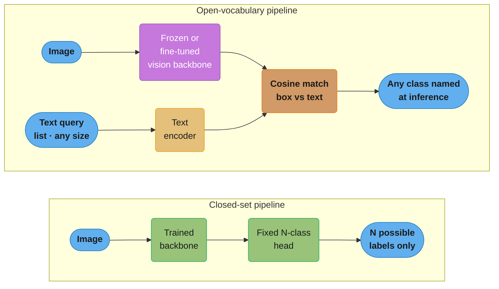
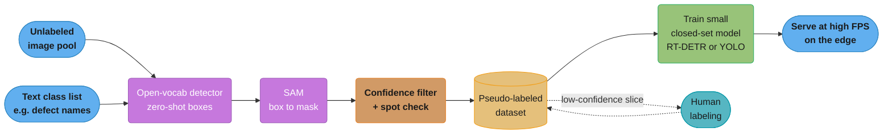

# Open-Vocabulary Detection and Vision Foundation Models — Deep Dive

---

## 1. Concept Overview

Every detector in [object_detection.md](object_detection.md) — YOLO, Faster R-CNN, DETR — shares one hard constraint: the set of classes it can name is fixed at training time. Add a new class and there is no inference-time lever to pull; you relabel data and retrain the head. That constraint is the **vocabulary axis**, and it is orthogonal to the anchor-free-vs-anchor-based, NMS-vs-set-prediction axis the base module already covers.

**Open-vocabulary detection** removes the constraint by taking the class list as *text*, at inference time, instead of baking it into a trained `N`-way classification head. The model that makes this possible is a vision-language model — this file uses CLIP's image-text embedding space (see [vision_transformers.md](vision_transformers.md) §"CLIP") as the substrate, then covers three families built on it:

- **OWL-ViT / OWLv2** (Google DeepMind) — attach a lightweight detection head directly to a CLIP-style ViT, and score each candidate box against text-query embeddings.
- **Grounding DINO** (IDEA Research) — fuse text into every stage of a DETR/DINO-style decoder, rather than bolting a text match on at the end.
- **SAM / SAM 2** (Meta) — a complementary, *class-agnostic* foundation model: given a point, box, or mask prompt it returns a pixel-accurate mask with no notion of "what" the object is. Paired with an open-vocabulary detector's boxes, it turns zero-shot detection into zero-shot instance segmentation.

A fourth thread — **DINOv2 as a frozen backbone** (self-supervised pretraining is covered in depth in [self_supervised_vision.md](self_supervised_vision.md)) — is included here only for the production pattern it enables: a frozen trunk plus a tiny trained head for dense prediction, the same "reuse, don't retrain" philosophy that makes open-vocabulary detection valuable.

The section this file spends the most judgment on is §5–§10's **production pattern**: nobody serves a 200M-parameter zero-shot grounding model at the edge. What ships is an open-vocabulary model used offline as an **auto-labeler**, distilling its knowledge into a small closed-set detector that runs at real-time speed. Zero-shot is how you start a project with zero labels; a distilled specialist is what you deploy.

---

## 2. Intuition

**One-line analogy**: a closed-set detector is a multiple-choice exam with the options printed on the paper; an open-vocabulary detector is a fill-in-the-blank exam where you can write in any answer, because the "grading key" (the text encoder) understands language, not just a fixed answer list.

**Mental model**: in a closed-set detector, "is this a forklift?" is answered by a trained linear weight vector baked into the model's last layer. In an open-vocabulary detector, that weight vector is *computed on demand* by running the string `"a forklift"` through a text encoder — the classifier is generated at query time, not frozen at train time.

**Why it matters**: real-world class lists are long-tailed and constantly changing — a new SKU, a newly named defect type, a species nobody labeled last quarter. Retraining a closed-set head for every addition does not scale; a text query does.

**Key insight**: zero-shot detection is not free accuracy — it inherits every gap in the text encoder's training corpus. The classes you most need open-vocabulary detection *for* (a proprietary part number, a rare medical finding) are exactly the classes CLIP's web-scraped text corpus is least likely to have seen described precisely. Zero-shot quality tracks how "photographable and describable on the open web" a concept is, not how visually distinctive it is.

A second mental model matters just as much for §5's production pattern: think of the open-vocabulary model not as a product feature but as a **compiler pass**. It runs once, offline, over raw pixels and a text spec, and emits a labeled dataset — the artifact a human would otherwise have produced by hand. Nobody ships a compiler to end users to run on every request; they ship the binary it produced. The served model is that binary.

---

## 3. Core Principles

**Text as classifier weights.** The open-vocabulary formulation replaces `score = box_features @ W_class` (a trained matrix) with `score = cosine(box_embedding, text_embedding(class_name))`, where `text_embedding` comes from a language encoder trained jointly with the vision side. The classifier is no longer a parameter of the model — it is a function of whatever string you pass in.

**Text embeddings are class-agnostic and precomputable.** Because the text encoder does not depend on the image, embedding a class name once and reusing it for every image in a run is correct and cheap — the per-image cost is dominated by the image encoder, not by how many classes you're searching for (worked out with real numbers in §6).

**Decoupling "what" from "where."** SAM and SAM 2 deliberately answer only "where is the boundary of the thing under this prompt," never "what is it." Class-agnostic segmentation composes with *any* upstream source of boxes or points — an open-vocabulary detector, a human click, a tracked point from a previous video frame — because the mask decoder never has to know the vocabulary.

**Set prediction is the natural host for text conditioning.** [object_detection.md](object_detection.md) explains why DETR's Hungarian-matched object queries replace anchors and NMS. That same query mechanism is *why* the DETR line, not the anchor-based line, is where grounding models attach: a learned query is already an abstract "slot" competing to represent one object, and it is a small step to let text features bias which region and which semantic category a slot should claim. An anchor grid has no equivalent slot to condition.

**Frozen pretraining as capital reuse.** DINOv2's linear-probe quality (see [self_supervised_vision.md](self_supervised_vision.md)) means a single frozen backbone forward pass, followed by a task-specific head with orders of magnitude fewer trainable parameters, reaches strong dense-prediction accuracy. This is the same "spend compute once, reuse everywhere" idea underlying open-vocabulary detection — it just reuses *visual* structure instead of *linguistic* structure.

**The auto-labeler's precision/recall tradeoff becomes the distilled model's training-data quality.** Nothing about §5's loop is free of the ordinary supervised-learning failure modes — it just moves them upstream. A generous (high-recall, low-precision) confidence threshold on the auto-labeling detector floods the pseudo-labeled dataset with false positives that the small model then dutifully learns to reproduce; too strict a threshold (high-precision, low-recall) starves it of true positives for the harder examples. The threshold chosen in §6/§10's calibration step is not a detail — it is the training-data quality knob for everything downstream of it.

---

## 4. Types / Architectures / Strategies

### A. Two-tower zero-shot detection — OWL-ViT / OWLv2

OWL-ViT ([Minderer et al., 2022, arXiv:2205.06230](https://arxiv.org/abs/2205.06230)) starts from a standard CLIP-style ViT, removes the final pooling and classification token projection, and instead treats every output patch token as a candidate object representation. A lightweight box-regression head and a per-token embedding head are added on top; each token's embedding is compared against precomputed text-query embeddings via cosine similarity, exactly like CLIP's zero-shot image classification, except per-patch instead of per-image. Training fine-tunes this whole detector end-to-end on detection data while keeping the contrastive image-text pretraining as the initialization.

OWL-ViT's query is not required to be text. The paper's **one-shot image-conditioned detection** mode replaces the text-query embedding with the embedding of a cropped example image of the target object, matched against the same per-token embedding space — useful exactly where Pitfall 1 in §10 bites hardest: a class whose name has no strong text-embedding match can still be specified by showing the model a picture of it instead of describing it.

OWLv2 ([Minderer et al., 2023, arXiv:2306.09683](https://arxiv.org/abs/2306.09683)) keeps the OWL-ViT architecture and changes how it is trained: **OWL-ST**, a self-training recipe that uses an existing OWL-ViT detector to generate pseudo-box annotations on web-scale image-text pairs (not curated detection datasets), then trains a fresh detector on those pseudo-labels at over 1 billion examples. This is the auto-label pattern from §5 applied to the *researchers'* own training pipeline, not just to downstream products: OWL-ST raised LVIS rare-class AP from 31.2% to 44.6% (a 43% relative improvement) with an L/14 backbone, on classes the model saw zero human box annotations for.

### B. Fused-decoder grounding — Grounding DINO

Grounding DINO ([Liu et al., 2023/2024 ECCV, arXiv:2303.05499](https://arxiv.org/abs/2303.05499)) starts from the DINO detector (§C below) and inserts text at three points rather than matching embeddings only at the end:

1. **Feature enhancer** — image and text features are fused with stacked cross-modality deformable self-attention layers *before* decoding, so visual features already carry linguistic context by the time queries are formed.
2. **Language-guided query selection** — instead of DETR's fixed learned query embeddings, the top-`k` encoder image features most similar to the text features initialize the decoder's queries. The model starts decoding from image regions the text already suggests are relevant.
3. **Cross-modality decoder** — each decoder layer cross-attends to *both* image features and text features (not image features alone), so box refinement stays text-conditioned all the way to the output.

Grounding DINO reaches 52.5 AP on COCO zero-shot (no COCO training data at all) and a mean 26.1 AP on the 35-dataset ODinW zero-shot benchmark, both reported in the paper.

### C. The DETR lineage the base module only touches

[object_detection.md](object_detection.md) introduces DETR's set prediction and Hungarian matching, and has one Q&A on Deformable DETR's epoch count. The full ladder — because Grounding DINO, and increasingly production real-time detectors, are built on it — is:

| Model | arXiv | What it fixed | Headline result |
|---|---|---|---|
| DETR | [2005.12872](https://arxiv.org/abs/2005.12872) | Removed NMS and anchors via bipartite-matched set prediction | On par with a tuned Faster R-CNN baseline on COCO |
| Deformable DETR | [2010.04159](https://arxiv.org/abs/2010.04159) | Dense global attention → sparse, learned key-point sampling around a reference point per query | 10x fewer training epochs than DETR, better small-object AP, multi-scale features without a separate FPN |
| DINO (detector) | [2203.03605](https://arxiv.org/abs/2203.03605) | Contrastive denoising training, mixed query selection for anchor initialization, "look forward twice" box refinement | 49.4 AP at 12 epochs / 51.3 AP at 24 epochs (ResNet-50); 63.3 AP test-dev with a Swin-L backbone pretrained on Objects365 |
| RT-DETR | [2304.08069](https://arxiv.org/abs/2304.08069) | Efficient hybrid encoder + IoU-aware query selection, engineered specifically to hit real-time latency | RT-DETR-R50: 53.1% AP at 108 FPS; RT-DETR-R101: 54.3% AP at 74 FPS (COCO, T4 GPU) |

RT-DETR's framing in its own title — "DETRs Beat YOLOs on Real-time Object Detection" — is the paper's explicit claim: YOLO's NMS post-processing step has latency that scales with the number of candidate boxes and is data-dependent (more crowded scenes → more NMS work), while RT-DETR's end-to-end set prediction has fixed, dependency-free inference cost. RT-DETR is closed-set, not open-vocabulary — it belongs in this file because it is the "target model" side of the auto-label-and-distill pattern in §5, and because the base module never reaches this generation of the DETR line.

### D. Promptable segmentation — SAM / SAM 2

SAM ([Kirillov et al., 2023, arXiv:2304.02643](https://arxiv.org/abs/2304.02643)) is introduced with its core architecture in [image_segmentation.md](image_segmentation.md); this file adds the part that matters for the composite pipeline in §5: SAM's mask decoder is **ambiguity-aware**. A single point prompt on, say, a person's shirt is genuinely ambiguous — does it mean the shirt, the torso, or the whole person? Rather than force one answer, SAM's decoder outputs **three mask candidates plus a predicted IoU score for each**, and the caller picks the one whose predicted quality is highest (or all three, for a human-in-the-loop tool). A **box** prompt is far less ambiguous than a point, so in the detector-to-SAM handoff described in §5, `multimask_output` is typically set to `False` — the box already disambiguates which object is meant.

SAM 2 ([Ravi et al., 2024, arXiv:2408.00714](https://arxiv.org/abs/2408.00714)) extends the same promptable interface to video with a **streaming memory**: a memory encoder stores features from previously prompted or predicted frames in a memory bank, and a memory attention module conditions each new frame's mask prediction on that bank — so a single prompt on frame 1 (a click, a box) can propagate a mask through an entire video without re-prompting every frame. The paper reports better accuracy than prior video segmentation approaches using 3x fewer human interactions, and reports SAM 2 as more accurate and 6x faster than the original SAM on the image task alone.

### E. Frozen vision-foundation backbone — DINOv2

DINOv2 ([Oquab et al., 2023, arXiv:2304.07193](https://arxiv.org/abs/2304.07193)) — trained as described in [self_supervised_vision.md](self_supervised_vision.md) — is used in production as a **frozen trunk**: run the image once through the pretrained ViT, keep every weight fixed, and train only a small head (a linear layer, a lightweight decoder) on top of the patch-token features for the downstream task — dense correspondence, monocular depth, or a segmentation mask via a linear probe. The value proposition is the same as CLIP's for text-conditioned tasks, but for tasks with no natural language interface: DINOv2 features are dense (one embedding per patch, not one per image), so they carry the spatial information a per-pixel task needs without any labeled dense-prediction data to fine-tune the backbone itself.

Freezing the backbone is a deliberate choice, not a shortcut taken for lack of compute. Fine-tuning the full ViT on a small task-specific dataset risks overwriting the general-purpose structure the self-supervised pretraining spent enormous compute to learn — a failure mode sometimes called catastrophic forgetting of the pretrained representation. Keeping the trunk frozen and training only a small head bounds how much the small, potentially noisy downstream dataset can distort the backbone: the worst case is an undertrained head, not a corrupted backbone.

### F. The composite pipeline — box in, mask out, with no labeled masks

None of the four architectures above needs the others to function, but chained together they form the pattern that actually ships product: an open-vocabulary detector (OWLv2 or Grounding DINO) emits boxes for a text-named class with zero labeled examples of that class; each box is handed to SAM as a prompt; SAM returns a pixel-accurate mask. The result is zero-shot **instance segmentation** — assembled from two foundation models, with no segmentation-labeled training data for the target class at any point. **Grounded-SAM**, the reference open-source implementation of exactly this composition, reports 46.0 mean AP on the Segmentation in the Wild zero-shot track using Grounding-DINO-L + SAM-ViT-H ([IDEA-Research/Grounded-Segment-Anything](https://github.com/IDEA-Research/Grounded-Segment-Anything)).

---

## 5. Architecture Diagrams



The load-bearing difference is not accuracy, it is *where the classifier lives*. In the closed-set pipeline it is a weight matrix baked into `head1` at train time. In the open-vocabulary pipeline it is generated fresh by `tenc2` from whatever text you feed it — `txt2` can grow from 3 classes to 3,000 with no retraining.



This loop is the production pattern from §1 and §9: the open-vocabulary stage never serves a real request. It runs once, offline, to manufacture a dataset; the model that actually answers requests is the small distilled one at the bottom right.

---

## 6. How It Works — Detailed Mechanics

### Zero-shot detection with OWLv2

```python
import torch
from PIL import Image
from transformers import Owlv2Processor, Owlv2ForObjectDetection

processor = Owlv2Processor.from_pretrained("google/owlv2-base-patch16-ensemble")
model = Owlv2ForObjectDetection.from_pretrained("google/owlv2-base-patch16-ensemble")
model.eval()

image = Image.open("factory_floor.jpg").convert("RGB")

# One entry per image in the batch; each entry is the class list for that image.
text_queries = [["a conveyor belt roller", "a safety guard rail", "a spilled pallet"]]

inputs = processor(text=text_queries, images=image, return_tensors="pt")
with torch.no_grad():
    outputs = model(**inputs)

target_sizes = torch.tensor([image.size[::-1]])  # (height, width)
results = processor.post_process_grounded_object_detection(
    outputs=outputs,
    target_sizes=target_sizes,
    threshold=0.1,
    text_labels=text_queries,
)[0]

for box, score, label in zip(results["boxes"], results["scores"], results["text_labels"]):
    x0, y0, x1, y1 = box.tolist()
    print(f"{label}: {score:.2f} at ({x0:.0f}, {y0:.0f}, {x1:.0f}, {y1:.0f})")
```

`Owlv2Processor` wraps an image processor and a CLIP-style tokenizer into one call — the same processor tokenizes `text_queries` and resizes/normalizes `image`. `post_process_grounded_object_detection` does the box decoding, the sigmoid/softmax over class logits, and the score threshold in one step, returning boxes in absolute pixel coordinates rather than the model's normalized output space.

### Zero-shot grounding with Grounding DINO

```python
import torch
from PIL import Image
from transformers import GroundingDinoProcessor, GroundingDinoForObjectDetection

processor = GroundingDinoProcessor.from_pretrained("IDEA-Research/grounding-dino-base")
model = GroundingDinoForObjectDetection.from_pretrained("IDEA-Research/grounding-dino-base")
model.eval()

image = Image.open("factory_floor.jpg").convert("RGB")

# Grounding DINO's query format differs from OWLv2's list-of-lists: classes are
# concatenated into one string, each terminated by a period. Getting this wrong
# (missing periods, no lowercase) silently degrades grounding quality.
text_query = "a conveyor belt roller. a safety guard rail. a spilled pallet."

inputs = processor(images=image, text=text_query, return_tensors="pt")
with torch.no_grad():
    outputs = model(**inputs)

results = processor.post_process_grounded_object_detection(
    outputs,
    inputs.input_ids,
    box_threshold=0.35,
    text_threshold=0.25,          # separate threshold for the text-token match itself
    target_sizes=[image.size[::-1]],
)[0]

for box, score, label in zip(results["boxes"], results["scores"], results["text_labels"]):
    print(f"{label}: {score:.2f} at {box.tolist()}")
```

Grounding DINO exposes **two** thresholds where OWLv2 exposes one: `box_threshold` gates the box-objectness score, and `text_threshold` separately gates how well the box's region matches the queried text tokens. This is a direct consequence of the fused-decoder architecture in §4B — box quality and text-match quality are scored by different parts of the cross-modality decoder, not by a single cosine similarity, so they need independent cutoffs rather than the one threshold OWLv2's simpler matching head requires.

### Handing a box to SAM for a mask

```python
import numpy as np
from segment_anything import sam_model_registry, SamPredictor

sam = sam_model_registry["vit_h"](checkpoint="sam_vit_h_4b8939.pth")
predictor = SamPredictor(sam)
predictor.set_image(np.array(image))  # image encoder forward pass, run once per image

masks = {}
for box, label in zip(results["boxes"], results["text_labels"]):
    mask, iou_pred, _ = predictor.predict(
        box=box.numpy(),
        multimask_output=False,  # a box prompt is unambiguous enough for one mask
    )
    masks[label] = mask[0]
```

`set_image` runs SAM's ViT-H image encoder once — [image_segmentation.md](image_segmentation.md) puts this at roughly 150ms — and every subsequent `predict()` call for a *different box on the same image* reuses that cached encoding, running only the lightweight mask decoder (sub-50ms). This is why a detect-then-segment pipeline processes an image with 20 detected objects almost as fast as one with 2: the expensive step runs once, not per box.

When the upstream prompt is a single point rather than a box — closer to §4D's genuinely ambiguous case — keep all three candidate masks instead of collapsing to one:

```python
masks, iou_preds, _ = predictor.predict(
    point_coords=np.array([[x, y]]),
    point_labels=np.array([1]),       # 1 = foreground click
    multimask_output=True,            # ambiguity-aware: 3 masks, one per granularity
)
best = masks[np.argmax(iou_preds)]    # highest predicted-IoU candidate
```

`iou_preds` is SAM's own predicted quality score for each of the three masks, not a ground-truth IoU — it is the signal the decoder was trained to output alongside the mask itself, and it is what a human-in-the-loop tool typically surfaces to let an annotator pick between the three candidates rather than trusting the argmax blindly.

### The arithmetic that matters — scaling with the number of text queries

The text encoder forward pass does not depend on the image, so it should never be inside the per-image loop. Embed all `Nq` class-name strings once, cache the resulting `Nq × D` matrix, and reuse it for every image processed in the run:

```python
# Correct: text embeddings computed once, outside the per-image loop.
text_bank = processor(text=[class_names], return_tensors="pt")
with torch.no_grad():
    text_embeds = model.owlv2.get_text_features(**text_bank)  # [Nq, D], cached

for image in image_stream:
    image_inputs = processor(images=image, return_tensors="pt")
    with torch.no_grad():
        vision_out = model.owlv2.get_image_features(**image_inputs)
    scores = vision_out @ text_embeds.T  # [num_boxes, Nq] — one matmul, not Nq forward passes
```

Per-image cost then splits into two very different-sized pieces: one image-encoder forward pass (the expensive part, and fixed regardless of `Nq`), plus a `cosine_similarity(boxes, text)` matmul that is `O(num_boxes × Nq × D)`. For a typical OWLv2 output of a few thousand candidate boxes, a 50-class query list, and `D = 768`, that matmul is on the order of `10^8` multiply-adds — trivial next to the backbone's own FLOPs. The mistake to avoid is re-running the text encoder inside the image loop: that turns an operation whose cost is independent of `Nq` into one that scales linearly with it, multiplying wall-clock time by the size of the class list for no accuracy benefit, since the text embeddings never change.

### Closing the loop — distilling into the served model

The last step of §5's diagram is an ordinary supervised training run — the only unusual part is that the labels came from §6's zero-shot stages instead of a human annotator:

```python
from ultralytics import RTDETR

# rtdetr-l.pt starts from COCO-pretrained weights; the training data here is the
# pseudo-labeled dataset assembled by the OWLv2/Grounding DINO + SAM pipeline above,
# in standard YOLO-format annotations pointed to by data.yaml.
model = RTDETR("rtdetr-l.pt")
model.train(data="pseudo_labeled_defects/data.yaml", epochs=100, imgsz=640, batch=16)

# The served artifact is this closed-set model — Grounding DINO and SAM never
# appear in the inference path.
results = model("line_camera_frame.jpg")
```

The model class that ships to production (`RTDETR`, or a `YOLO` target model in the same role) has no dependency on the vision-language models that generated its training data — it is a closed-set detector like any other, evaluated and deployed exactly as [object_detection.md](object_detection.md) describes.

---

## 7. Real-World Examples

**Autodistill (Roboflow)** is an open-source framework built directly around the auto-label-then-distill pattern in §5: a "base model" (Grounding DINO, Grounded SAM, or CLIP) labels a raw image folder from a plain-text ontology, and the resulting pseudo-labeled dataset trains a "target model" (YOLOv5, YOLOv8, or DETR) with no human annotation step ([autodistill/autodistill](https://github.com/autodistill/autodistill)).

**Grounded-SAM (IDEA-Research)** is the reference implementation of the box-to-mask composition in §4F: Grounding DINO produces text-conditioned boxes, SAM converts each box to a mask, with no segmentation-specific training in either component ([IDEA-Research/Grounded-Segment-Anything](https://github.com/IDEA-Research/Grounded-Segment-Anything)). **Grounded SAM 2** extends the same composition to video by swapping in SAM 2, adding the streaming memory from §4D so a text prompt on frame 1 tracks the mask through the rest of the clip ([IDEA-Research/Grounded-SAM-2](https://github.com/IDEA-Research/Grounded-SAM-2)).

**Retail and industrial inventory bootstrapping**: a new SKU or a newly introduced part has zero labeled training images on day one. Running an open-vocabulary detector with the SKU's product-description text as the query, over a week of warehouse camera footage, produces a usable pseudo-labeled dataset before a human labeler ever opens an annotation tool — the "auto-label" half of the §5 loop, independent of whether the team ever gets to the "distill" half.

**Interactive annotation tooling**: SAM's point/box prompt interface (§4D) is the mechanism behind "click once, get a mask" labeling tools — a human supplies one click instead of tracing a polygon, cutting per-instance annotation time from tens of seconds to a couple of clicks, which is why SAM-assisted labeling shows up as a step inside most modern annotation pipelines rather than as a replacement for them.

**Robotic manipulation and embodied grounding**: a robot arm's perception stack traditionally needed a fixed, retrained object vocabulary to answer "where is the mug." An open-vocabulary detector lets an instruction like "pick up the blue mug" resolve directly to a box without a class list baked in ahead of time, which is why open-vocabulary grounding shows up as a perception front-end in embodied-AI and robotic manipulation research pipelines — the detector's output feeds a downstream grasp-planning system rather than driving actuation directly.

---

## 8. Tradeoffs

| Dimension | Closed-set (YOLO / Faster R-CNN) | Open-vocabulary, served live (OWLv2 / Grounding DINO) | Open-vocabulary, distilled (auto-label → small closed-set model) |
|---|---|---|---|
| Labeling cost to start | High — needs boxes for every class before training | Zero — text query only | Zero for bootstrap; a spot-check/review pass replaces full labeling |
| Latency | Low, purpose-built for the target hardware | High — a full ViT-scale backbone plus text encoder per image | Low — same as closed-set, because the served model *is* closed-set |
| Accuracy on head (common) classes | Highest, if trained on enough examples | Good but generally below a specialist trained on real labels | Approaches the closed-set ceiling once distilled on enough auto-labels |
| Accuracy on tail (rare) classes | Poor to unusable without new labeled data | Strong relative to zero labels, weak on out-of-corpus vocabulary (§10) | Depends entirely on auto-label quality for that class — inherits the detector's blind spots |
| Cost to add one class | Full relabel + retrain cycle | One new text string, no retraining | One new text string for auto-labeling, then a retrain of the small model |
| Where it belongs | Stable, well-defined taxonomy, tight latency budget | Prototyping, long-tail coverage, rapid taxonomy changes, offline labeling | Production serving once the taxonomy has stabilized enough to bake into a small model |

**Cost to add one class, worked out.** For a closed-set detector: collect and box-label a few hundred examples of the new class (days, depending on annotator availability), then retrain or fine-tune the model (hours to a day of compute) before it can be served — the class does not exist for the model until that cycle completes. For a live open-vocabulary detector: edit one string in the query list (minutes, no compute). For the distilled pattern in §5: run the auto-label loop for the new class alone against existing footage (minutes to set up, an offline batch job to run), review the low-confidence slice (hours of human time, not days — §13's Best Practice 6), then fine-tune the small served model on the combined dataset (hours of compute). The distilled pattern's per-class cost sits between the other two: slower than editing a query string, but far faster than a from-scratch relabel-and-retrain cycle, because the labeling step itself is automated.

**Licensing** — checked directly against each project's license file, because assuming permissive terms without checking is a real production risk: OWL-ViT/OWLv2 ([google-research/scenic](https://github.com/google-research/scenic)), Grounding DINO ([IDEA-Research/GroundingDINO/LICENSE](https://github.com/IDEA-Research/GroundingDINO/blob/main/LICENSE)), SAM ([facebookresearch/segment-anything](https://github.com/facebookresearch/segment-anything/blob/main/LICENSE)), SAM 2 ([facebookresearch/sam2](https://github.com/facebookresearch/sam2/blob/main/LICENSE)), and DINOv2's base checkpoints ([facebookresearch/dinov2](https://github.com/facebookresearch/dinov2)) are **all released under Apache License 2.0** — permissive, commercial use allowed, no copyleft obligation. That is a genuinely useful finding against the common assumption that these differ sharply: as of this writing, none of the five core models in this file blocks commercial deployment. The real trap is narrower and easy to miss: **not every checkpoint in a family shares its flagship license.** `facebookresearch/dinov2`'s domain-specialized variants — Cell-DINO and XRay-DINO — ship their model weights under Meta's **FAIR Noncommercial Research License**, distinct from the Apache-2.0 base DINOv2 checkpoints in the same repository. Always read the license attached to the *specific checkpoint* you pull, not the license badge on the repository's front page.

---

## 9. When to Use / When NOT to Use

**Use an open-vocabulary detector (OWLv2 or Grounding DINO) when**: you have zero or very few labeled examples of a class and need something working today; your taxonomy changes often enough that retraining a closed-set head every time is a real operational cost; you are building the auto-labeling stage of a bootstrap pipeline rather than a latency-critical serving path.

**Use SAM / SAM 2 when**: you need pixel-accurate masks without training a segmentation model for your specific classes; you are building an interactive annotation tool where a human supplies one prompt per instance; you need to propagate a mask across video frames from a single initial prompt rather than re-segmenting every frame.

**Use a frozen DINOv2 backbone when**: the downstream task is dense (depth, correspondence, per-pixel segmentation) and you have too little labeled data to fine-tune a full backbone, but enough to train a small linear or shallow head.

**Do NOT serve an open-vocabulary model directly in a latency- or cost-sensitive production path.** A ViT-scale image encoder plus a text encoder, run per request, costs far more than a purpose-built closed-set detector at the same accuracy on your actual (usually head-heavy) traffic distribution — this is precisely why §5's loop routes the open-vocabulary model offline and serves the distilled model instead.

**Do NOT trust one global confidence threshold across a multi-class open-vocabulary query list** without calibration — see the second pitfall in §10; scores are not comparable across different text strings by construction.

**Do NOT treat zero-shot detection as a substitute for labeled data on a safety-critical or highly domain-specific class** — where a wrong or missed detection has real cost (a missed weld defect, a missed drug interaction term), the fix in §10's first pitfall (prompt engineering, then few-shot, then real labels as a last resort) should be read as an escalation ladder, not a menu of equally good options.

**Do NOT reach for SAM 2's video memory when a per-frame re-detection is cheap enough and independence between frames matters more than tracking continuity** — for a stationary security camera counting distinct events, re-running a cheap closed-set detector every frame can be both simpler and more correct than propagating one mask through a memory bank, since propagation is designed to keep tracking the *same* object, which is the wrong behavior when the goal is to notice a *new* one.

---

## 10. Common Pitfalls

**Pitfall 1 (broken → fix): domain vocabulary collapse.** A team building a defect-detection pipeline for PCB assembly queries an open-vocabulary detector with the internal part nomenclature straight out of their BOM:

```python
# BROKEN — near-zero recall, because CLIP's web-scraped text corpus
# was never trained on this exact internal part vocabulary.
text_queries = [["M8x1.25 hex flange bolt", "0603 SMD resistor R47"]]
```

CLIP's text encoder was contrastively trained on web-scale (image, caption) pairs — it learned a rich mapping for phrases that actually co-occur with photographs on the open web ("a small silver bolt", "a tiny resistor on a circuit board"), not for jargon strings from an internal parts catalog that never appeared near an image caption anywhere the model trained. The text embedding for `"M8x1.25 hex flange bolt"` lands nowhere near the visual cluster of images the model would need to match it against.

```python
# FIX, escalating in cost:
# 1. Prompt-engineer into descriptive, photographable language.
text_queries = [["a small silver hexagonal-head bolt", "a tiny black rectangular resistor"]]

# 2. If phrasing alone isn't enough, use OWL-ViT's one-shot image-conditioned
#    mode: supply a cropped example image of the part as the query instead of text.
#    (Grounding DINO and OWLv2 both also improve with a short exemplar-image set,
#    though the mechanism differs by model — check each model's card before assuming parity.)

# 3. If accuracy still isn't acceptable for this one class, accept that it needs
#    real labels: hand-label a small set for this class and either fine-tune the
#    detector or route it to a dedicated closed-set classifier downstream of a
#    generic "there is something here" region proposal.
```

Rephrasing into visually descriptive, web-common language is nearly free and often closes most of the gap. When it doesn't, the fix is not more prompt tuning — it is accepting that this class is exactly the kind zero-shot detection cannot help with, and budgeting for labels.

**Pitfall 2: comparing scores across different text queries with one threshold.** A single global `threshold=0.3` applied across a class list like `["a person", "a rare industrial fastener"]` silently biases toward whichever class names are more common, and more consistently phrased, in the pretraining text distribution — a frequent, canonical phrase like `"a person"` tends to produce systematically higher and more confident scores than an unusual multi-word phrase, independent of how visually present either object actually is in the image. Treating that global score as a calibrated probability and applying one cutoff produces silent under-detection on the rarer-phrased classes and over-detection on the common ones. Fix: calibrate a per-class threshold on a small labeled validation slice for each class in the query list, or switch to a rank-based decision (top-`k` boxes per class) instead of an absolute score cutoff when no validation data exists yet.

**Pitfall 3: an imprecise detector box propagates straight into a wrong mask.** SAM segments literally what a box prompt asks it to — it has no notion of "the object I meant." A loose box drawn around two touching objects (two adjacent boxes on a conveyor belt, two overlapping cells in a microscopy image) hands SAM an ambiguous region, and with `multimask_output=False` it returns exactly one mask for whatever it judges the dominant contiguous region inside that box to be — sometimes both objects fused, sometimes only one. Fix: when the upstream detector's boxes are known to be loose (small objects, touching instances, a detector run at a lower confidence threshold to maximize recall), keep `multimask_output=True` and select or manually review among SAM's three candidates rather than assuming the box alone disambiguates.

**Pitfall 4: running the zero-shot model itself as the production server.** The most common architectural mistake in teams new to this space is standing up OWLv2 or Grounding DINO directly behind an inference API because it "already works" from the prototype. It does work — at a fraction of the throughput and a multiple of the cost of a purpose-built detector for the same traffic. This is not a subtle failure; it shows up immediately in the latency and GPU-cost dashboards. The fix is architectural, not a tuning knob: route the zero-shot model offline into the auto-label loop in §5, and serve the distilled model.

**Pitfall 5: a detector false positive becomes a confident, plausible-looking hallucinated mask.** SAM does not know when a box is wrong — it only knows how to find the boundary of *something* inside a box, and on a natural image there is almost always some contiguous region to find, even one that has nothing to do with the object the detector claimed. If the open-vocabulary detector fires a false positive (a shadow mistaken for a defect, a reflection mistaken for a part), SAM will still return a clean, high-confidence-looking mask for it — the pipeline produces a pixel-accurate mask of the *wrong thing* with no signal in the mask itself that anything went wrong. This is especially dangerous in the auto-labeling loop of §5, because a confident-looking mask is exactly what a reviewer skimming the low-confidence slice is trained to wave through. Fix: gate on the *detector's* score before ever calling SAM (do not let a box below a calibrated per-class threshold reach the segmentation stage at all), and keep the human review slice keyed to the detector's confidence, not to any post-hoc property of the mask SAM produced — the mask's visual cleanliness is not evidence the underlying detection was correct.

---

## 11. Technologies & Tools

| Tool | Role | License / Notes |
|---|---|---|
| `transformers` (`Owlv2ForObjectDetection`, `GroundingDinoForObjectDetection`) | HF inference wrapper for OWLv2 and Grounding DINO | Apache 2.0 (`transformers` itself); underlying checkpoints per model card |
| [google-research/scenic](https://github.com/google-research/scenic) (`owl_vit` project) | Official OWL-ViT / OWLv2 training and inference code | Apache 2.0 |
| [IDEA-Research/GroundingDINO](https://github.com/IDEA-Research/GroundingDINO) | Official Grounding DINO implementation | Apache 2.0 |
| [facebookresearch/segment-anything](https://github.com/facebookresearch/segment-anything) | Official SAM implementation, `SamPredictor` | Apache 2.0 |
| [facebookresearch/sam2](https://github.com/facebookresearch/sam2) | Official SAM 2 implementation, video predictor | Apache 2.0 |
| [facebookresearch/dinov2](https://github.com/facebookresearch/dinov2) | Official DINOv2 code and base checkpoints | Apache 2.0 (base checkpoints; domain variants differ, see §8) |
| [lyuwenyu/RT-DETR](https://github.com/lyuwenyu/RT-DETR) | Official RT-DETR (PaddlePaddle and PyTorch) | Apache 2.0 |
| [IDEA-Research/DINO](https://github.com/IDEA-Research/DINO) | Official DINO detector implementation | ICLR 2023 reference implementation |
| [autodistill/autodistill](https://github.com/autodistill/autodistill) | Auto-label-then-distill framework (§5, §7) | Apache 2.0 |
| [IDEA-Research/Grounded-Segment-Anything](https://github.com/IDEA-Research/Grounded-Segment-Anything) | Reference Grounding DINO + SAM composition (§4F, §7) | Apache 2.0 |
| Roboflow Supervision | Post-processing / visualization for detection and segmentation outputs | Apache 2.0 |

---

## 12. Interview Questions with Answers

**Q: Why can't a closed-set detector like YOLO or Faster R-CNN handle a request for a brand-new object class without retraining?**
**Short:** Its classifier is a fixed trained weight matrix baked in at training time, so a new class has no slot until you relabel and retrain.
A closed-set detector's final layer computes `logits = features @ W_class`, where `W_class` is a trained parameter matrix with one column per class fixed at training time. There is no inference-time input that can add a column — the only way to add a class is to collect labeled examples of it and run a new training (or fine-tuning) job. Open-vocabulary detectors solve exactly this by replacing `W_class` with a function of a text string, computed fresh at inference time (see §3, "Text as classifier weights").

**Q: What is "domain vocabulary collapse" in open-vocabulary detection, and how do you fix it?**
**Short:** Zero-shot detection quality collapses on jargon the text encoder's web-scraped training corpus never saw described near a matching image.
CLIP-style text encoders learn strong embeddings for phrases that co-occur with photographs on the open web, and weak or meaningless embeddings for internal jargon (a part number, a rare diagnostic term) that never appeared in that training distribution. The fix escalates: first rephrase the class name into visually descriptive, web-common language; if that's insufficient, use an image-conditioned or few-shot exemplar query instead of text; if that's still insufficient, accept the class needs real labeled data. See §10, Pitfall 1, for the broken and fixed query examples.

**Q: Why is it wrong to apply one global confidence threshold across a list of different text queries in an open-vocabulary detector?**
**Short:** Score scale differs by query phrasing and frequency, so one cutoff systematically favors common class names over rare ones.
The cosine-similarity score between a box embedding and a text embedding is not a calibrated probability, and its scale depends on how frequently and consistently that particular phrase appeared in the model's pretraining distribution — a common phrase tends to score higher on average than an unusual one, independent of true visual confidence. One global threshold therefore biases detection toward frequently-phrased classes. Fix: calibrate a per-class threshold on a validation slice, or use a rank-based cutoff (top-`k` per class) instead of an absolute score.

**Q: What goes wrong when you hand SAM an imprecise box from an upstream detector?**
**Short:** SAM segments literally what the box contains, so a loose box around touching objects can return one fused mask instead of two.
SAM has no notion of object identity — it segments whatever region a prompt indicates. A box drawn loosely around two adjacent or touching objects is ambiguous, and with `multimask_output=False` SAM commits to a single interpretation, which can merge both objects into one mask or capture only the dominant one. Fix: when upstream boxes are known to be loose, keep `multimask_output=True` and select among SAM's three ambiguity-aware candidates rather than trusting the box to fully disambiguate.

**Q: Why do production teams run open-vocabulary detectors offline as auto-labelers instead of serving them directly?**
**Short:** A ViT-scale vision-language model costs far more latency and GPU spend per request than a purpose-built closed-set detector at equal accuracy.
Open-vocabulary detectors carry the cost of a full vision-language backbone (image encoder plus text encoder) on every request, which is dramatically more expensive than a detector purpose-trained and sized for the target hardware and traffic distribution. The production pattern is to run the open-vocabulary model once, offline, over a pool of unlabeled images to generate pseudo-labels, then train a small closed-set model (RT-DETR, YOLO) on that pseudo-labeled data and serve the small model. See §5's diagram and §9.

**Q: How does OWL-ViT turn a CLIP-style image-text model into an object detector?**
**Short:** It drops CLIP's pooled output, treats every patch token as a candidate object, and adds box and embedding heads on top.
OWL-ViT removes the final token pooling and classification projection from a CLIP-pretrained ViT, keeping every patch token as a per-location candidate representation. A box-regression head predicts a bounding box per token, and an embedding head projects each token to the same space as the text encoder's output; detection scores come from cosine similarity between per-token embeddings and text-query embeddings, matching CLIP's zero-shot classification mechanism but applied per patch instead of per image. The whole network is then fine-tuned end-to-end on detection data. (arXiv:2205.06230)

**Q: What are the three places Grounding DINO fuses text into its detector, and why does that beat matching embeddings only at the output?**
**Short:** A feature enhancer, language-guided query selection, and a cross-modality decoder fuse text at every stage, not only the final score.
Grounding DINO's feature enhancer cross-attends image and text features before decoding even starts, so visual features already carry linguistic context. Language-guided query selection initializes decoder queries from the encoder features most similar to the text, rather than from DETR's fixed learned constants, so decoding starts from text-relevant regions. The cross-modality decoder then cross-attends to both image and text features in every decoder layer, keeping box refinement text-conditioned through the whole decoding process — rather than running a class-agnostic decoder and only checking text similarity on the final box embedding. (arXiv:2303.05499)

**Q: What problem does OWLv2's self-training recipe (OWL-ST) solve, and what does it change relative to OWL-ViT?**
**Short:** OWL-ST scales training data past curated detection datasets by having an existing detector pseudo-label billions of web image-text pairs.
OWL-ViT's accuracy is bounded by the size of curated detection datasets available for fine-tuning. OWLv2 keeps the same architecture but trains it with OWL-ST: an existing OWL-ViT detector generates pseudo-box annotations directly on uncurated web-scale image-text pairs, and a new detector trains on over a billion such pseudo-labeled examples. This raised LVIS rare-class AP from 31.2% to 44.6% with an L/14 backbone — a 43% relative gain on classes with zero human box annotations. (arXiv:2306.09683)

**Q: What does Deformable DETR's attention mechanism change relative to plain DETR's dense global attention?**
**Short:** Each query samples a small, learned set of key points near a reference location instead of attending densely to every feature pixel.
Plain DETR's transformer attends globally and densely over the full feature map at every layer, which is expensive at high resolution and slow to learn which regions matter. Deformable attention instead learns, per query, a small fixed number of sampling offsets around a reference point, and attends only to those sampled locations — acting as a learned pre-filter over the most relevant feature-map pixels. This also lets the module naturally aggregate multi-scale features without a separate FPN. (arXiv:2010.04159)

**Q: What is DINO detector's contrastive denoising training, and what problem does it solve beyond Deformable DETR?**
**Short:** It trains the model to recover ground-truth boxes from noised copies while explicitly distinguishing noised positives from negatives.
Bipartite matching in a DETR-style model is unstable early in training, because which query matches which ground-truth object can flip between steps. DINO's contrastive denoising adds noised copies of ground-truth boxes as auxiliary decoder inputs — the model learns to reconstruct the clean box from a noised one, and a contrastive component explicitly teaches it to tell a noised positive (same object) apart from a noised negative (different object) at similar noise levels, stabilizing the assignment. Combined with mixed query selection (using encoder-predicted boxes to initialize anchors, rather than static learned embeddings) and "look forward twice" (each box refinement step also receives gradient signal from the next layer's loss), DINO reaches 49.4 AP at just 12 epochs on COCO with a ResNet-50 backbone. (arXiv:2203.03605)

**Q: What makes RT-DETR different from a real-time YOLO model, given both target the same latency budget?**
**Short:** RT-DETR is end-to-end with no NMS post-processing step, while YOLO's latency and accuracy both depend on that step.
YOLO-family models still require NMS to remove duplicate predictions, and NMS's cost and quality depend on the number of overlapping candidate boxes, which varies with scene content (a crowded scene does more NMS work than a sparse one, see the NMS pitfalls in [object_detection.md](object_detection.md)). RT-DETR uses set prediction like DETR, so it needs no NMS, but adds an efficient hybrid encoder and IoU-aware query selection specifically engineered to close the speed gap with YOLO, reaching 53.1% AP at 108 FPS (RT-DETR-R50) and 54.3% AP at 74 FPS (RT-DETR-R101) on COCO, measured on a T4 GPU. Quote those two numbers together with the hardware — an FPS figure without the GPU it was measured on is not a claim. (arXiv:2304.08069)

**Q: How does SAM resolve the ambiguity of a single point prompt that could mean several different objects?**
**Short:** Instead of forcing one answer, its mask decoder outputs three candidate masks at different granularities plus a predicted quality score each.
A point on a person's shirt is genuinely ambiguous between "the shirt," "the torso," and "the whole person." SAM's mask decoder does not try to guess the one intended object; it produces three mask outputs simultaneously, covering different plausible granularities, along with a predicted IoU score for each, and the caller (or a downstream heuristic) picks the highest-scoring one or surfaces all three to a human. A box prompt is much less ambiguous than a point, so `multimask_output` is typically disabled for box-prompted calls. (arXiv:2304.02643)

**Q: What does SAM 2 add on top of SAM to support video, and what does it change about how you prompt it?**
**Short:** A streaming memory bank lets a prompt on one frame propagate a mask through subsequent frames without re-prompting each one.
SAM 2 adds a memory encoder that stores features from previously prompted or predicted frames into a memory bank, and a memory attention module that conditions each new frame's segmentation on that bank. This means a single click or box on frame 1 can track an object through an entire clip, rather than requiring a fresh prompt on every frame as a naive per-frame SAM application would. The paper reports better tracking accuracy than prior approaches while using 3x fewer human interactions, and reports SAM 2 as 6x faster than SAM on the plain image task. (arXiv:2408.00714)

**Q: How is a frozen DINOv2 backbone used differently from a CLIP backbone in a downstream vision system?**
**Short:** DINOv2 provides dense, text-free visual features for per-pixel tasks; CLIP provides text-aligned features for language-conditioned tasks.
CLIP's value is that its embedding space is aligned with a text encoder, which is exactly what open-vocabulary detection and zero-shot classification need — a way to score "how well does this image region match this text string." DINOv2 was never trained against language at all; its value is the quality and density of its purely visual patch-token features, which is why it is the stronger choice as a frozen backbone for dense, non-linguistic tasks like depth estimation and dense correspondence, probed with a small trained head rather than matched against text. Use CLIP-family models when the downstream task has a natural-language interface; use DINOv2 when it doesn't.

**Q: Why can text embeddings in an open-vocabulary detector be computed once and reused across every image in a run?**
**Short:** The text encoder's output depends only on the query string, not the image, so caching it turns a per-image cost into a one-time cost.
The text encoder is a pure function of the input string — it has no dependence on which image is being processed. Embedding all `Nq` class names once into an `Nq × D` matrix and reusing that matrix for every image in the batch or stream is therefore both correct and necessary for throughput: it converts what would otherwise be an `O(Nq)`-per-image cost into a fixed one-time cost, leaving the per-image cost dominated by the image encoder's forward pass and a cheap `O(num_boxes × Nq)` similarity matmul. See §6's worked example.

**Q: Is "open-set detection" the same thing as "open-vocabulary detection"?**
**Short:** In practice yes for the papers in this file — both terms describe detecting classes named only at inference time via text.
Grounding DINO's own paper title uses "open-set object detection," while OWL-ViT and OWLv2's papers use "open-vocabulary object detection." Both describe the same capability discussed throughout this file: the class list is not fixed at training time, and new classes are specified by natural-language text at inference time. The terminology split reflects different research lineages (grounding/referring-expression work versus vision-language zero-shot classification work) converging on the same task, not a technical distinction worth building a decision around.

**Q: When would you choose Grounding DINO over OWLv2 for a zero-shot detection task, or the reverse?**
**Short:** Grounding DINO tends to handle longer, compositional phrases better; OWLv2 is architecturally simpler and benefits from OWL-ST's scale.
Grounding DINO's fused decoder (feature enhancer, language-guided query selection, cross-modality decoder — §4B) was built specifically to handle referring-expression-style queries, so it tends to be the stronger choice when queries are compositional phrases ("the red truck on the left") rather than bare class names. OWLv2's simpler two-tower architecture is easier to reason about and to embed text once for a fixed class list (§6), and its OWL-ST self-training recipe gives it strong rare-class recall at the scale reported in the paper. In practice, evaluate both against a small labeled slice of your actual target vocabulary before committing — published zero-shot benchmarks do not guarantee ranking on a specific domain's phrasing.

**Q: What is the licensing status of these open-vocabulary and foundation models for commercial deployment, and what is the one trap to check for?**
**Short:** OWL-ViT, OWLv2, Grounding DINO, SAM, SAM 2, and base DINOv2 are all Apache 2.0, but domain-specific DINOv2 checkpoints are not.
As of this writing, all five core models covered in this file — OWL-ViT/OWLv2, Grounding DINO, SAM, and SAM 2 — plus DINOv2's base checkpoints are released under the permissive Apache License 2.0, which allows commercial use with no copyleft obligation. The trap is checkpoint-specific, not family-wide: `facebookresearch/dinov2`'s domain-specialized variants (Cell-DINO, XRay-DINO) ship model weights under Meta's FAIR Noncommercial Research License, a materially different and restrictive license from the base DINOv2 checkpoints hosted in the same repository. Always verify the license attached to the specific checkpoint you pull, not the license on the repository's landing page.

---

## 13. Best Practices

1. Cache text embeddings once per class list and reuse them across every image in a run — never re-embed text inside the per-image loop (§6).
2. Rephrase jargon class names into visually descriptive, web-common language before concluding an open-vocabulary model "doesn't work" on a class (§10, Pitfall 1).
3. Calibrate confidence thresholds per class, not globally, when a query list mixes common and rare phrasings (§10, Pitfall 2).
4. Prefer `multimask_output=True` on SAM whenever the upstream box source is known to be loose or the objects are small/touching; only disable it once you've confirmed box precision is high (§10, Pitfall 3).
5. Never serve an open-vocabulary detector directly on a latency-sensitive path — route it offline into an auto-label loop and serve a distilled closed-set model instead (§5, §9).
6. Reserve human review for the low-confidence slice of an auto-labeled dataset rather than the whole set — spot-checking, not full re-labeling, is what keeps the pattern in §5 cheaper than manual annotation.
7. When composing an open-vocabulary detector with SAM, keep the two models' outputs traceable to each other (box → mask) so a downstream quality issue can be attributed to the detection stage or the segmentation stage, not diagnosed as one opaque failure.
8. Check the license on the specific checkpoint you pull, every time — a family's flagship license does not necessarily cover every variant in the same repository (§8).
9. Re-benchmark before assuming a published zero-shot number transfers to your domain; OWLv2 vs. Grounding DINO ranking on a benchmark dataset does not predict ranking on your specific vocabulary's phrasing (§12).
10. For a video pipeline, prompt once and let SAM 2's memory propagate the mask rather than re-running a per-frame image segmenter — it is both cheaper and more temporally consistent (§4D).

---

## 14. Case Study

**Problem**: A contract electronics manufacturer needs an automated visual inspection system to flag five defect types on a PCB assembly line (solder bridge, missing component, tombstoned component, cold joint, wrong-part placement). Day one: zero labeled defect images exist, because defects are rare (under 0.5% of boards) and the five-way taxonomy was only finalized this week. The line runs at 40 boards/minute and inspection must add under 200ms per board.

**Why not just hand-label from scratch?** The team estimated a from-scratch effort at roughly 15,000 boxed-and-typed examples to get reasonable per-class coverage given the 0.5% defect rate — at a conservative annotation rate, that is weeks of dedicated annotator time before a single model can train, on a taxonomy that had only existed for a week and was expected to gain at least one more class before quarter's end. That combination — near-zero starting labels, and a taxonomy still in flux — is exactly the condition §9 names as the case for starting with an open-vocabulary bootstrap instead of a manual labeling pass.

**Stage 1 — bootstrap with zero labels.** Text queries phrased descriptively rather than from the internal defect taxonomy (`"a blob of solder bridging two adjacent pins"` rather than `"solder bridge defect code SB-4"`, applying the Pitfall 1 fix directly) are run through Grounding DINO over eight weeks of archived line-camera footage. Detected boxes are passed to SAM for pixel masks, producing a pseudo-labeled dataset. Per-class thresholds are calibrated on a 200-image hand-checked slice, per Pitfall 2 — a single global threshold had initially over-flagged the common "missing component" class and under-flagged the rarer, harder-to-phrase "tombstoned component" class.

**Stage 2 — review, not full relabel.** Only the bottom 15% of pseudo-labels by confidence are routed to a human reviewer (the dashed loop in §5's diagram); the rest are accepted as-is. This keeps total human labeling effort to roughly 1,500 reviewed images instead of the ~15,000-image dataset a from-scratch supervised effort would have required.

**Stage 3 — distill.** The resulting dataset trains an RT-DETR-L model from scratch. RT-DETR was chosen over a YOLO variant specifically because the "wrong-part placement" class produces heavily overlapping candidate boxes (a correct part and several visually similar wrong parts stacked in nearly the same location), the exact crowded-scene scenario where NMS-based detectors lose recall (see [object_detection.md](object_detection.md)'s NMS pitfalls) and RT-DETR's NMS-free set prediction does not.

**Stage 4 — validate before trusting the pseudo-labels.** Before training RT-DETR on the full pseudo-labeled set, the team ran Pitfall 5's gate explicitly: any box below the per-class threshold from Stage 1 was dropped before it ever reached SAM, rather than filtering on anything about the resulting mask. A held-out set of 300 boards was independently hand-labeled purely to score the pseudo-labeling pipeline itself (not to train on) — this is the step that would have caught a systematically miscalibrated threshold before it silently degraded every downstream training run.

**Result**: the served model is RT-DETR-L, not Grounding DINO — inference cost and latency match a purpose-built detector, comfortably inside the 200ms budget, while the training data behind it cost roughly 1,500 human-reviewed images instead of a full manual annotation pass. Grounding DINO and SAM never run in the production loop; their entire contribution is upstream, in the dataset that trained RT-DETR.

**Follow-up problem**: three months later, a sixth defect type is identified. Rather than re-running the full RT-DETR training pipeline from a cold start, the team re-enters Stage 1 with the new class's text query alone, generates pseudo-labels for just that class from the existing footage archive, reviews the same 15% low-confidence slice, and fine-tunes RT-DETR on the combined five-plus-one dataset — the open-vocabulary stage's real advantage shows up here, in how cheaply the taxonomy can grow, not in the first bootstrap alone.
