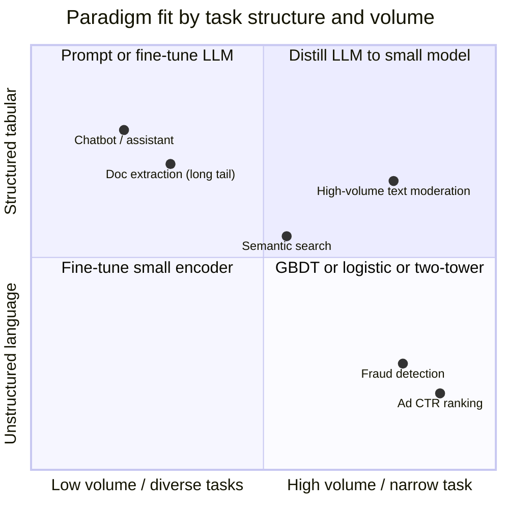
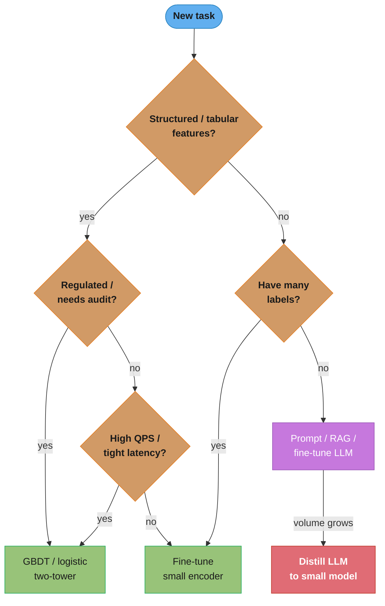
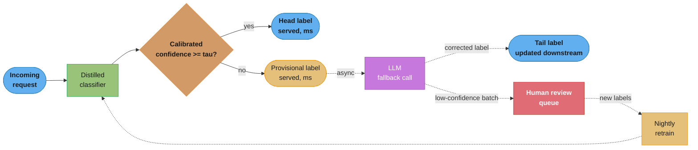
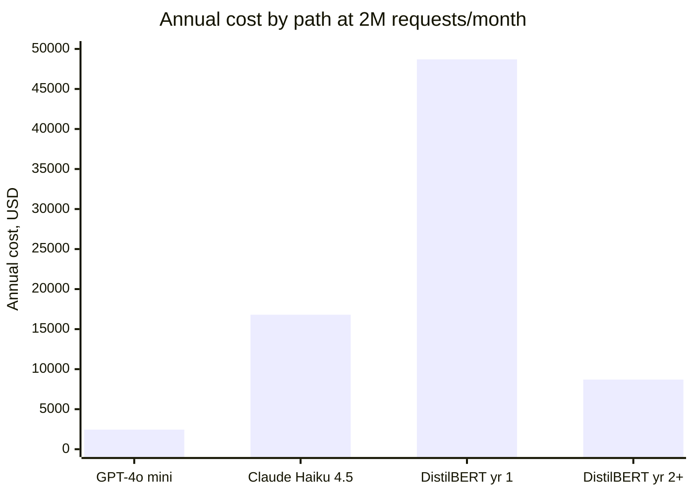

# Classical ML vs LLM — The Build-Decision Framework
> Deep-dive sub-file of [ml_system_design](ml_system_design.md). Cross-reads:
> [model_selection_and_algorithm_choice](../model_selection_and_algorithm_choice/model_selection_and_algorithm_choice.md),
> [../../llm/context_engineering](../../llm/context_engineering/context_engineering.md) (RAG-vs-fine-tuning),
> [../../llm/token_economics_and_cost_optimization](../../llm/token_economics_and_cost_optimization/token_economics_and_cost_optimization.md).

## 1. Concept Overview

The most common opening move in a 2026 AI system design interview is no longer "which model architecture" — it is **"should this even be an LLM?"** For a decade the reflex was to frame every problem as a supervised-learning task and reach for logistic regression, gradient-boosted trees, or a fine-tuned BERT. Generative LLMs added a second reflex — "just prompt a model" — that is often right for unstructured, low-volume, long-tail language tasks and often catastrophically wrong for high-volume, low-latency, structured prediction. This module is the decision framework that sits *between* the `ml/` and `llm/` sections: given a task, cost budget, latency SLO, data situation, and regulatory context, which paradigm do you build on?

The framework is deliberately paradigm-agnostic. "Classical ML" here means any trained, task-specific model — linear/logistic regression, GBDT (XGBoost/LightGBM), a fine-tuned encoder (BERT), a two-tower recommender. "LLM" means a large pretrained generative model used via prompting, RAG, tool-use, or fine-tuning. The point is not that one wins; it is that the *axes of the decision* are learnable and defensible.

**Where this sits in a design interview.** The question rarely arrives as "which paradigm" in so many words — it arrives disguised as "design a support-ticket router," "design a fraud model," or "design a content-moderation pipeline." A candidate who defaults straight to "we'll fine-tune a BERT" and a candidate who defaults straight to "we'll call an LLM" have made the same mistake in opposite directions: both skipped the step that actually earns points, which is stating the volume, the latency budget, and the label situation *before* naming a model. Interviewers calibrate heavily on whether that ordering happens on its own, because in production the wrong-first-guess is exactly what turns into a rewrite six months later.

**Why 2026 makes this sharper than it was a few years ago.** Three things changed the shape of the decision without changing its axes. Hosted-LLM per-token prices fell sharply between 2023 and 2026 — see the cited pricing in Section 8 — which pushed the classical-ML break-even volume upward; a task that clearly justified a trained model a few years ago may now sit comfortably on the LLM side for a while longer. Distillation and structured-output tooling matured, so "prompt now, distill later" changed from an aspirational plan into a one-sprint migration most teams can actually execute (Section 10 has a war story about the team that didn't). And regulatory scrutiny of automated decisions — the EU AI Act's high-risk categories, expanding adverse-action rules in consumer finance — hardened the interpretability veto from a best practice into a compliance requirement in more domains than before. The framework has not changed; where the lines sit on it has, and a senior candidate is expected to know it moved rather than reciting a memorized break-even number.

**How to structure the answer, in order.** A design interview rewards showing the reasoning in this sequence, not just landing on the right paradigm:

1. State the volume and the latency SLO for the decision itself, before naming any model — Section 3's checklist starts here because it is the fastest disqualifier.
2. State what labeled data exists today, and whether more can be obtained within the project's timeline — this decides whether classical ML is even on the table yet.
3. Name the regulatory or interpretability constraint, if any, and say explicitly whether it is a veto or a preference.
4. Only now name a paradigm, and say why it follows from 1-3 rather than asserting it first and defending it after.
5. Say whether the honest answer is a hybrid, and if so, sketch the split (Section 5's router diagram is the default shape) rather than leaving "we'd use both" as an unstructured aside.

Skipping straight to step 4 is the single most common gap this module exists to close.

For deciding which AI use cases to fund, whether to buy or build them, and how much autonomy to grant, see [Applied AI Product Decisions](../../llm/applied_ai_product_decisions/applied_ai_product_decisions.md).

## 2. Intuition

**One-line analogy:** classical ML is a machine you build to stamp one part a million times a second; an LLM is a versatile contractor you hire by the hour who can do almost any job once, expensively, without a blueprint.

**Mental model:** think of two cost curves crossing. Classical ML has a high *fixed* cost (collect labels, train, deploy a pipeline) and a near-zero *marginal* cost (microseconds, fractions of a cent per prediction). An LLM has a near-zero *fixed* cost (write a prompt this afternoon) and a high *marginal* cost (100 ms–seconds, cents per call). At low volume and high task diversity the LLM wins; as volume rises and the task narrows, the marginal cost dominates and classical ML wins. The whole framework is reasoning about *where you are on those curves*.

**Why it matters:** picking the wrong paradigm is the most expensive mistake in the system — an LLM on a billion-row-per-day tabular CTR task burns money and latency for worse accuracy than a GBDT; a hand-labeled classifier on a fuzzy, ever-changing long-tail language task burns quarters of engineering time for a job a prompt does today.

**Key insight:** the decision is driven by *marginal economics and task structure*, not by which technology is newer or more capable in the abstract. Capability is necessary but not sufficient — an LLM that *can* do the task may still be the wrong build.

## 3. Core Principles

1. **Volume × latency sets the marginal-cost ceiling.** High-QPS, low-latency paths (ad ranking at 1 ms, fraud at 10 ms) cannot afford per-call LLM inference; batch, low-volume paths can.
2. **Label availability sets the classical-ML floor.** Classical supervised ML needs labeled data; if you have millions of labels, train a model. If you have zero labels and can't get them, an LLM's zero/few-shot ability is the unlock.
3. **Task structure decides fit.** Structured prediction over tabular/numeric features (regression, ranking, CTR) is classical ML's home; open-ended generation, summarization, extraction from messy text, and reasoning over instructions are the LLM's home.
4. **Interpretability and regulation can veto the LLM.** Credit, healthcare, and hiring decisions demand auditable, monotonic, explainable models; a black-box LLM's rationale is not a defensible adverse-action reason.
5. **A hybrid is usually the real answer.** Use the LLM where its generality pays (bootstrapping labels, handling the long tail, the natural-language surface) and a distilled/classical model where volume and latency bite.
6. **Cost curve shape decides where the paradigms cross, and that crossing point is the whole decision.** Nothing above is really a separate question — each is the crossover asked from a different angle. Below it, the LLM's near-zero fixed cost wins; above it, classical ML's near-zero marginal cost wins; the other five principles exist to tell you which side of the crossover a specific task actually sits on.

**Applying the principles as a five-minute checklist.** Each axis resolves to a threshold question you can ask before naming a model:

1. *Labels* — do you have tens of thousands of labeled examples for this exact task, or can you get them within budget? No → the LLM is not a preference, it is the only path available until you use it to bootstrap labels for something cheaper.
2. *Throughput x latency* — what is the p99 latency budget, and what is peak QPS? A 50ms budget at 500 QPS leaves no room for a 300-1500ms network round trip to a hosted model, regardless of what the accuracy comparison says.
3. *Task structure* — is the strongest signal in named numeric columns, or in free text and instructions? Tabular signal favors classical ML even when an LLM is technically capable of reading the same columns as text, because the LLM discards the numeric structure a GBDT's splits exploit directly.
4. *Regulation* — if a user appeals this decision, can you name the specific input feature that drove the score? If the answer must be yes by law, the model itself must be interpretable or wrapped in a faithful explainer — asking the LLM to narrate a rationale for its own output is not the same thing, because nothing guarantees the narration reflects what actually produced the number.
5. *Cost curve shape* — are you comparing a per-call price against a per-call price, or a per-call price against a monthly fixed cost? This is where naive break-even math goes wrong: classical ML's serving cost behaves like a subscription (a GPU instance billed whether it serves one call or ten million), not a per-unit price, so the real comparison is total spend at your volume, not marginal cost in isolation. Section 8 works this arithmetic through with current prices.

**Walking the checklist against a task the module hasn't used yet.** Take "triage inbound insurance claims into a queue," a plausible interview prompt on its own. Labels: a large insurer has years of claim-outcome history, so the answer to question 1 is yes for the common claim types and no for a handful of newly-introduced coverage categories — already a head/tail split before any other axis is considered. Throughput x latency: claims arrive in the thousands per day, not per second, and a few hundred milliseconds of routing latency is invisible against a claims process that takes days end to end, so question 2 does not veto anything here, unlike the 200ms ticket-routing SLO Section 14 works through. Structure: claim text is unstructured, but the outcome the business cares about (approve, deny, escalate) is influenced heavily by structured policy and claim-amount fields, so question 3 argues for a model that can see both — a classical model with the free text reduced to embeddings as one more feature, or an LLM given the structured fields inline in the prompt. Regulation: insurance claim denials are exactly the adverse-action territory Section 10's fourth pitfall describes, so question 4 vetoes a black-box rationale for the *denial* decision specifically, even if an LLM assists elsewhere in the flow. Cost curve: given the volume, either paradigm clears the crossover comfortably, so question 5 does not decide it. Put together: label-rich common claim types get a classical, auditable model; label-poor new categories get an LLM to unblock and bootstrap; the denial reason itself is generated by the auditable model, never the LLM. That is the checklist producing a hybrid without the word "hybrid" being reached for first — which is the point of running it in order.

**And the honest fifth answer is usually "both."** Few production systems sit purely on one side of the crossover. A single feature commonly splits into a high-volume head a trained model serves and a long tail an LLM serves, with the split point set by exactly this cost-curve logic applied per-segment rather than to the feature as a whole. Section 14 works one such system end to end.

## 4. Types / Architectures / Strategies

The realistic option space is not binary — it is a ladder from cheapest-to-build to cheapest-to-run:

| Strategy | Fixed cost | Marginal cost | Best when |
|----------|-----------|---------------|-----------|
| Prompt an LLM (zero/few-shot) | Hours | High ($/call, 100ms-s) | Prototype, low volume, long-tail, no labels |
| RAG (LLM + retrieval) | Days | High + retrieval | Knowledge-grounded QA over changing corpus |
| Fine-tune an LLM | Days-weeks + GPUs | High | Domain style/format, still generative |
| Fine-tune a small encoder (BERT/DistilBERT) | Days + labels | Low (ms) | Text classification/NER at scale |
| GBDT / logistic / two-tower | Days + labels | Very low (µs) | Tabular, ranking, CTR, high QPS |
| **Distill LLM → small model** | LLM labels + train | Very low | Have LLM quality, need classical economics |

The distillation row is the bridge: use the LLM as a *teacher* to label data or transfer capability into a small task-specific model that meets the latency/cost budget. See [../../llm/knowledge_distillation_and_model_merging](../../llm/knowledge_distillation_and_model_merging/knowledge_distillation_and_model_merging.md).

## 5. Architecture Diagrams



Two axes decide the quadrant: how structured the input is (vertical) and how high-volume/narrow the task is (horizontal). Unstructured + low-volume → prompt an LLM; structured + high-volume → classical ML; high-volume + unstructured → distill the LLM into a small model to get LLM quality at classical economics.



The decision walk: structure and regulation push toward classical ML; missing labels push toward the LLM; rising volume on an LLM path pushes toward distillation.

### Hybrid Serving: Confidence-Routed Head/Tail



The router is the concrete shape "hybrid" takes in production. Every request is served synchronously by the distilled student, so the p99 SLO is always the student's latency, never the LLM's — a low-confidence verdict ships as a provisional label immediately and is corrected asynchronously once the LLM fallback returns. Low-confidence traffic also feeds a human-review queue that retrains the student, so the tail the LLM has to cover shrinks over time as the student absorbs what the teacher has already labeled. Section 14 sizes this exact router for a 2M-ticket/month workload.

## 6. How It Works — Detailed Mechanics

The decision is quantitative. Make the cost and latency comparison explicit rather than hand-waving "LLMs are expensive."

```python
def paradigm_cost_comparison(daily_predictions: int,
                             llm_cost_per_call_usd: float = 0.002,
                             llm_latency_ms: float = 800.0,
                             gbdt_cost_per_call_usd: float = 0.0000002,
                             gbdt_latency_ms: float = 0.5,
                             classical_build_usd: float = 40_000.0):
    """
    Compare a prompted LLM (no build cost, high marginal cost) against a trained
    classical model (high build cost, negligible marginal cost) over one year.
    Returns the break-even volume where classical ML becomes cheaper.

    Illustrative defaults: an LLM API call ~ $0.002 and ~800ms; a GBDT prediction
    ~ 2e-7 dollars and ~0.5ms; a one-off classical build ~ $40k (labeling + eng).
    """
    annual = daily_predictions * 365
    llm_annual = annual * llm_cost_per_call_usd
    gbdt_annual = annual * gbdt_cost_per_call_usd + classical_build_usd

    # break-even daily volume: classical_build == annual LLM marginal savings
    per_call_savings = llm_cost_per_call_usd - gbdt_cost_per_call_usd
    breakeven_daily = classical_build_usd / (per_call_savings * 365)

    return {
        "llm_annual_usd": round(llm_annual, 2),
        "gbdt_annual_usd": round(gbdt_annual, 2),
        "breakeven_daily_volume": int(breakeven_daily),
        "llm_p50_latency_ms": llm_latency_ms,
        "gbdt_p50_latency_ms": gbdt_latency_ms,
        "recommendation": "classical" if daily_predictions > breakeven_daily else "llm",
    }


# At 1M predictions/day the LLM costs ~$730k/yr vs ~$40k for GBDT — and misses a
# 1ms latency SLO by 800x. Break-even is only a few tens of thousands of calls/day.
print(paradigm_cost_comparison(1_000_000))
```

**The idea behind it.** `breakeven_daily = build_cost / (per_call_savings x 365)` says: "how many calls a day do I need before a year of saved pennies pays off the build?" It is a payback-period calculation wearing ML clothing — the LLM rents capability by the call, the trained model buys it outright.

| Symbol | What it is |
|--------|------------|
| `llm_cost_per_call_usd` | Marginal price of one LLM prediction, `$0.002` here. Paid forever, per call |
| `gbdt_cost_per_call_usd` | Marginal price of one GBDT prediction, `$0.0000002` — 10,000x smaller |
| `per_call_savings` | The difference. Effectively just the LLM's price, since the GBDT's is a rounding error |
| `classical_build_usd` | One-time `$40,000` for labeling plus engineering. The bet you are amortizing |
| `x 365` | Turns a per-call saving into an annual one, fixing the payback window at a year |
| `breakeven_daily` | Daily volume at which the two totals cross. Above it, build; below it, prompt |

**Walk one example.** Run the stated 1M predictions/day through both arms:

```
  annual calls    :  1,000,000/day x 365          =   365,000,000 calls

  LLM arm         :  365e6 x $0.002               =      $730,000 / yr
  GBDT arm        :  365e6 x $0.0000002           =           $73 marginal
                     + $40,000 build              =       $40,073 / yr
  ----------------------------------------------------------------------
  ratio           :  730,000 / 40,073             =         18.2x cheaper

  break-even      :  per_call_savings = 0.002 - 0.0000002 = $0.0019998
                     $40,000 / ($0.0019998 x 365) =    54,800 calls/day

  payback at 1M/day :  $40,000 build / $2,000 per day of LLM spend = 20 days
```

Two numbers do the persuading. The break-even sits at **54,800 calls/day** — a volume most production features clear in their first week, which is why "the LLM is cheaper to start with" stops being true so quickly. And at 1M/day the build pays for itself in **20 days**, after which the GBDT arm is essentially free: its entire annual marginal cost is `$73`, less than one hour of the LLM arm's spend.

**Read the latency the same way.** The comparison is not close enough to need a formula:

```
  LLM     :  800.0 ms
  GBDT    :    0.5 ms
  ratio   :  800 / 0.5  =  1600x
```

That is the "~1000x" the Section 8 tradeoff table and the Section 12 answers refer to. A 1ms ad-ranking SLO is not missed by a little — it is missed by three orders of magnitude, which is why latency acts as a **hard veto** rather than something to trade against accuracy. Cost is negotiable at low volume; a 1600x latency gap never is.

**Why the build cost sits in the denominator's shadow.** Doubling the build to `$80,000` only doubles the break-even to about 110,000 calls/day — still small. Halving the LLM's per-call price, however, doubles it too, because `per_call_savings` is the term doing all the work. The practical reading: **falling token prices move the break-even far more than better engineering estimates do**, so a design that is marginally on the LLM side of the line today should be re-checked against current pricing rather than treated as settled.

The mechanics also include a *capability* gate that cost cannot override: if you have no labels and cannot obtain them cheaply, classical supervised ML is simply not available, and the LLM's zero-shot ability is the only path — until you have used it to *generate* labels and can then train a cheap model (the distillation/flywheel move).

## 7. Real-World Examples

**Microsoft — a prompted LLM beat a fine-tuned specialist model outright.** Microsoft Research's Medprompt showed that GPT-4 steered with dynamic few-shot selection, self-generated chain-of-thought, and choice-shuffle ensembling — no weight updates at all — beat Med-PaLM 2, Google's model fine-tuned specifically on medical text, on all nine MultiMedQA benchmarks, cutting the MedQA (USMLE) error rate by 27% and crossing 90% accuracy for the first time. This is the direction the golden-hammer pitfall (Section 10) says should be rare: here the generalist model, not the specialist fine-tune, was the better production choice, purely from prompt engineering. Source: [arXiv:2311.16452](https://arxiv.org/abs/2311.16452), "Can Generalist Foundation Models Outcompete Special-Purpose Tuning? Case Study in Medicine" (Microsoft Research, Nov 2023).

**Klarna — a full LLM-first replacement, then a partial reversal toward the hybrid this module argues for.** Klarna's OpenAI-built assistant, launched February 2024, handled 2.3 million conversations in its first month — work the company described as equivalent to about 700 full-time agents — with a two-minute median resolution time versus eleven minutes for a human agent. By May 2025 Klarna's CEO told Bloomberg the company had cut too far into human support and was rehiring for premium support roles, and by 2026 it had settled into a freelance, per-shift human-support layer working alongside the AI assistant rather than replacing it outright. Read together, this is a real-world instance of Principle 5: the team that skips the hybrid and goes all-in on one paradigm often ends up building the hybrid anyway, at a higher cost than designing it in from the start. Sources: [OpenAI, "Klarna's AI assistant does the work of 700 full-time agents"](https://openai.com/index/klarna/); [Klarna press release, Feb 2024](https://www.klarna.com/international/press/klarna-ai-assistant-handles-two-thirds-of-customer-service-chats-in-its-first-month/).

**Google — an LLM distilled down to a small model for on-device latency and cost.** Gemini Nano (1.8B and 3.25B parameter variants) is distilled from Google's larger Gemini models and shipped 4-bit quantized specifically so it can run on-device — summarization and reading-comprehension quality inherited from the teacher, at a size and latency a phone can serve locally with no per-call API cost at all. This is the distillation row of Section 4's table at production scale: keep the teacher's quality, pay a small model's marginal cost. Source: [arXiv:2312.11805](https://arxiv.org/abs/2312.11805), "Gemini: A Family of Highly Capable Multimodal Models" (Google, Dec 2023).

**Sourcegraph — a small, latency-tuned model kept on the serving path instead of the flagship LLM.** Cody's code-completion feature is latency-critical (autocomplete has to return before the developer finishes typing), so Sourcegraph runs a small, specifically-tuned completion model there rather than routing every keystroke through a large general-purpose LLM; the chat feature, which is not latency-critical, uses the larger model. Their 2024 migration of the autocomplete model cut P75 latency from 900ms to 690ms while increasing the accepted-completion rate — a concrete instance of picking the small model for the latency-bound path and reserving the LLM for the path that can afford it. Source: [Sourcegraph, "Improving Cody Autocomplete: Faster and smarter"](https://sourcegraph.com/blog/improving-cody-autocomplete-faster-smarter).

**Stripe — structured, high-volume prediction stays classical.** Radar scores every transaction inside the payment-authorization path under a roughly 100ms end-to-end budget, of which model inference itself consumes only 1-2ms; Stripe migrated from a Wide-and-Deep architecture (XGBoost plus a DNN) to a pure DNN in mid-2022 for training-pipeline reasons, but the replacement was still a trained, task-specific model, never a prompted LLM. This is the anchor case for why Section 3's Principle 1 exists: an LLM's 100ms-plus round trip alone would consume the entire latency budget before a single feature is even scored. Source: [Stripe, "How we built it: Stripe Radar"](https://stripe.dev/blog/how-we-built-it-stripe-radar).

Two more hybrids worth naming without a dedicated citation each: semantic search everywhere pairs a classical-ML primitive (embeddings) for retrieval with an LLM for reranking or synthesis, and content moderation pairs cheap classical filters for volume with LLM guardrail models for nuanced or adversarial content (see [design_harmful_content_detection](../case_studies/design_harmful_content_detection.md)) — both are the same head/tail split Section 5's router diagram formalizes.

| Organization | What moved | Direction | Primary source |
|---|---|:---:|---|
| Microsoft / OpenAI (Medprompt) | Prompted GPT-4 outperformed a fine-tuned medical specialist model | LLM replaces fine-tuned | arXiv:2311.16452 |
| Klarna | Support workflow went LLM-first, then partially back to a human/AI hybrid | LLM-first, corrected toward hybrid | OpenAI + Klarna press release |
| Google (Gemini Nano) | Large Gemini models distilled to a 1.8B/3.25B on-device model | LLM distilled to small model | arXiv:2312.11805 |
| Sourcegraph (Cody) | Latency-critical autocomplete kept on a small tuned model, not the flagship LLM | Small model over LLM on the critical path | Sourcegraph engineering blog |
| Stripe (Radar) | Structured fraud scoring stayed a trained DNN, never a prompted LLM | Classical stays classical | Stripe engineering blog |

Read across the table, the direction is not "LLMs are winning" or "classical ML is winning" — it is that each organization moved *toward whichever paradigm fit that specific task's volume, latency, and label situation*, sometimes toward the LLM and sometimes away from it, which is the entire argument of this module rather than an exception to it.

## 8. Tradeoffs

| Dimension | Classical ML | LLM |
|-----------|-------------|-----|
| Marginal cost / latency | µs–ms, micro-cents | 100ms–s, cents |
| Fixed / build cost | High (labels, training) | Low (a prompt) |
| Labeled-data need | Required | Zero/few-shot works |
| Structured/tabular tasks | Excellent | Poor |
| Long-tail / novel language | Poor | Excellent |
| Interpretability / audit | Strong (SHAP, monotonic) | Weak (black box) |
| Iteration speed to v0 | Slow | Fast |
| Cost at high volume | Excellent | Poor |
| Hallucination risk | N/A | Real; needs guardrails |

### A worked cost model for a text-classification task

Section 6 illustrated the crossover with round numbers ($0.002/call, $0.0000002/call). Here is the same arithmetic with published prices, so the comparison can be re-run against the day's actual rate card rather than trusted from memory. Task: a single-label text classifier at 2,000,000 requests/month, ~600 input tokens and ~20 output tokens per call (ticket text plus instructions in, a label out).

| Path | Marginal cost/call | Fixed/build cost | Year-1 cost at 2M/mo | Year-2+ cost at 2M/mo | p99 latency (illustrative) |
|------|--------------------|--------------------|----------------------|------------------------|------|
| Hosted LLM — cheap tier (GPT-4o mini, $0.15/$0.60 per MTok) | ~$0.000102 | $0 | ~$2,450/yr | ~$2,450/yr | 300–900ms |
| Hosted LLM — capable tier (Claude Haiku 4.5, $1/$5 per MTok) | ~$0.0007 | $0 | ~$16,800/yr | ~$16,800/yr | 300–1200ms |
| Fine-tuned DistilBERT, self-hosted (1x AWS g5.xlarge, $1.006/hr) | ~$0.0004 at this volume | $40,000 (labels + eng) | ~$48,700/yr | ~$8,700/yr | 5–15ms |
| Small open-weights model, prompted, self-hosted (same GPU, no fine-tune) | ~$0.0004 at this volume | ~$8,000 (prompt eng + eval set, no labeling) | ~$16,700/yr | ~$8,700/yr | 30–150ms |

Prices read 2026-08-25: OpenAI GPT-4o mini and GPT-4o from [developers.openai.com/api/docs/pricing](https://developers.openai.com/api/docs/pricing); Claude Haiku 4.5 and Claude Sonnet 5 from [platform.claude.com/docs/en/about-claude/pricing](https://platform.claude.com/docs/en/about-claude/pricing); AWS `g5.xlarge` on-demand rate from AWS EC2 pricing, $1.0060/hr in `us-east-1`. Token counts and GPU throughput are engineering estimates for this scenario, not measured — re-derive them for your own prompt length and hardware before trusting the total.

**Read the table for what it actually says, not just for a winner.** At this specific volume, the cheap-tier hosted LLM is cheaper than self-hosting a fine-tuned classifier in *every* year, not just year one — a result that would have been reversed at 2023 token prices, and is exactly the "falling token prices move the break-even" effect Section 6 flags. The fine-tuned model only wins on pure dollar cost above roughly 7M requests/month against the cheap tier, or roughly 1M requests/month against the capable tier — both far above this scenario's 2M/month:

```
  cheap-tier crossover    :  $8,700 / (365 x $0.000102)   =  233,700 calls/day  ~=   7.0M/month
  capable-tier crossover  :  $8,700 / (365 x $0.0007)     =   34,050 calls/day  ~=   1.0M/month
  ratio                   :  7.0M / 1.0M                                        =        7.0x
```

| Symbol | What it is |
|--------|------------|
| `$8,700` | The fine-tuned model's steady-state annual cost (year 2+, build already amortized — see the cost table above) |
| `365 x price` | Converts a per-call price into an annual per-call rate, so it can be divided into an annual budget |
| `crossover` | The daily volume at which the LLM path's annual spend equals the classical path's steady-state annual spend |

**Which hosted LLM you would otherwise use changes the crossover by 7x**, which is why "compare to an LLM" is not a single number; it depends on which LLM the classical path is actually competing against.

So at 2M/month, cost alone argues for the cheap-tier LLM. Three other rows in the fuller comparison below are why Section 14's case study still builds the classifier:



The DistilBERT bar is tallest in year one and shortest by year two — the one-time build cost is what makes a classical path look expensive on a single-year view and cheap on a multi-year one, so the horizon you amortize over is itself a modeling choice, not a fact.

| Dimension | Fine-tuned DistilBERT | Hosted LLM | Small self-hosted open-weights model |
|-----------|------------------------|------------|----------------------------------------|
| Calibrated probability | Yes — Platt/temperature scaling against held-out labels | No — a self-reported "confidence" is not calibrated to true accuracy | Partial — logit-based scores exist but are not validated without labels |
| Data residency | Stays in your VPC | Leaves your network to the vendor's API | Stays in your VPC |
| Vendor deprecation risk | None (you own the weights and the training pipeline) | Real — providers retire model snapshots on their own schedule | Low — you control the upgrade cadence |
| Interpretability | SHAP/feature attribution against real features | Free-text rationale, not a faithful account of the computation | Same as hosted LLM |
| Time to first working version | Days–weeks (needs labels) | Hours | Days (needs prompt + eval iteration, not labels) |

**Batch and caching discounts move the crossover further, and are easy to miss.** Both providers cited above discount off-path work: Anthropic's Batch API is 50% off both input and output tokens for requests that do not need a synchronous response, and prompt caching charges as little as 10% of the base input price for a repeated prefix (a fixed system prompt, a repeated set of few-shot examples). A bootstrapping job like Section 14's tail-label pass — non-interactive, and reusing the same instructions across every call — is exactly the shape these discounts target: applying both to the capable-tier price in this table roughly halves its effective per-call cost, which shifts that row's crossover volume from ~1M to ~2M requests/month. Neither discount helps the *synchronous* head-serving path a hybrid keeps on a classical model, which is precisely why they change the economics of the LLM side without changing the case for keeping the SLO-bearing path classical.

**The calibrated-probability row is the one people skip and then regret.** Any product that thresholds a score — "auto-approve above 0.9," "escalate below 0.3" — needs the number to mean the same thing at every point on the scale. A GBDT or a fine-tuned encoder can be calibrated and validated against held-out labels (see `case_studies/cross_cutting/model_calibration_and_thresholding.md`); a prompted LLM asked to output "confidence: 0.87" is reporting a number with no guaranteed relationship to its actual error rate, because nothing in next-token prediction optimizes that number to be calibrated. Section 14's confidence router depends on this distinction directly — it can only route on the student's score, not the LLM's, because only the student's score has been validated to mean what it claims to mean.

## 9. When to Use / When NOT to Use

**Reach for classical ML when:** the task is structured/tabular; volume is high and latency tight; you have (or can get) labels; the decision is regulated and must be auditable; the objective is a well-defined score (CTR, watch time, default probability); the product thresholds a score and needs that score calibrated.

**Reach for an LLM when:** the input is unstructured natural language; the task is open-ended (generation, summarization, extraction, reasoning); labels are scarce or the task changes often; volume is low or batchable; time-to-first-version matters more than steady-state cost; the long tail is too heterogeneous to ever be worth hand-labeling.

**Do NOT use an LLM when:** you are ranking billions of tabular rows/day at millisecond SLOs; the decision needs a defensible, monotonic, auditable rationale; a cheap trained model already meets quality; the product needs a calibrated probability and not just a label. **Do NOT force classical ML when:** you have no labels for a fuzzy long-tail language task and an LLM prompt solves it today; the task's definition changes faster than a retraining cycle; the volume is too low to ever amortize a build.

**Use BOTH when the traffic itself is heterogeneous — which is the common case, not the exception.** Any feature with a head/tail shape (most support, search, moderation, and categorization problems have one) has a high-volume common case that behaves like the classical column of this table and a long tail that behaves like the LLM column, inside the *same* feature. Splitting them, rather than picking one paradigm for the whole feature, is usually not a compromise — it is the design that scores best on every row of Section 8's table simultaneously: the head gets classical ML's latency and cost, the tail gets the LLM's generality, and neither has to compromise for the other's traffic. Section 14 sizes exactly this split.

**A quick-reference table for common interview prompts.** None of these are universal answers — they are what the axes in Section 3 resolve to *given the usual assumptions* for each task; state your own assumptions and the recommendation can move.

| "Design a system for..." | Volume / latency | Labels | Regulated? | Usual answer |
|---------------------------|-------------------|--------|:---:|---------------|
| Ad click-through rate ranking | Billions/day, ~1ms | Abundant (implicit clicks) | No | Classical (GBDT/DLRM) — Section 7's Stripe-style latency veto applies directly |
| Real-time fraud/authorization scoring | Millions/day, ~10-100ms | Abundant, delayed | Often yes | Classical, monotonic where required |
| Customer-support ticket routing | Low-millions/mo, ~100-500ms | Partial (head only) | Rarely | Hybrid — Section 14's exact shape |
| Document/contract extraction | Low volume, batch-tolerant | Scarce, heterogeneous | Sometimes (legal/medical) | LLM, with human review on regulated fields |
| Content moderation at platform scale | Billions/day, sub-second | Abundant for known abuse | Yes (many jurisdictions) | Hybrid — classical filters plus LLM guardrails |
| Semantic / conversational search | Millions/day, ~200ms-1s | Partial (click logs) | No | Hybrid — embeddings retrieve, LLM reranks or synthesizes |
| Credit / lending decision | Low-millions/mo, seconds acceptable | Abundant | Yes, strictly | Classical, monotonic, SHAP-explainable — Section 10's pitfall 4 is the failure mode to avoid |
| Code autocomplete | Every keystroke, <100ms | N/A (self-supervised) | No | Small latency-tuned model on the critical path, larger LLM off it — Section 7's Sourcegraph example |
| On-device summarization/assistant | Local, no network round trip | N/A | No | Distilled small model — Section 7's Gemini Nano example |
| Novel medical/legal Q&A | Low volume, seconds acceptable | Scarce, expert-costly | Often yes | LLM with strong prompting (Section 7's Medprompt result), human sign-off before action |

## 10. Common Pitfalls

1. **Per-call cost modeled at list price, blown by retries and long context.** A team budgeted GPT-4o mini at 2M calls/month against the $0.000102/call sticker price — about $204/month — and the first invoice came in at **$1,850/month, 9x over budget**. Root cause: a 22% retry rate on malformed JSON output (each retry is a second full call), plus context that had crept from 600 to 4,200 tokens once conversation history got appended for "better context." Fix: switched to structured-output/function-calling mode (retries fell under 2%) and capped history to the last three turns; the bill dropped to $310/month. The list price on a pricing page is never the per-call cost in production — retries and prompt bloat are.

    ```python
    # BROKEN: no structured-output constraint; a malformed response retries unbounded,
    # and every retry is a second full call billed at the same rate as the first.
    def classify_ticket(text: str) -> str:
        resp = llm.complete(f"Classify this ticket: {text}\nReturn JSON with a 'label' field.")
        try:
            return json.loads(resp)["label"]
        except (json.JSONDecodeError, KeyError):
            return classify_ticket(text)          # unbounded recursion, unbounded billing

    # FIXED: force machine-parseable output so a malformed response is rejected by the
    # provider before it is returned, not retried after the fact.
    def classify_ticket(text: str) -> str:
        resp = llm.complete(
            f"Classify this ticket: {text}",
            response_format={"type": "json_schema", "schema": TICKET_LABEL_SCHEMA},
        )
        return resp.parsed["label"]               # schema-validated; nothing to retry on
    ```
2. **The LLM prototype became the production path because nobody budgeted the distillation.** A ticket-routing prototype shipped on GPT-4o mini at 50k calls/day; the feature worked, volume grew 40x over six months, and the run rate grew from roughly $150/month to **$6,000/month ($72,000/year)** with the distillation step still sitting in the backlog because "it was working." A $45,000 one-time distillation project, budgeted at launch, would have capped steady-state spend near $9,000/year — the team paid for the LLM's convenience twice: once as the prototype cost, once as the deferred-migration tax.
3. **Prompt drift after a provider bumps the model version, with no eval harness to catch it.** A team pinned to a floating model alias rather than a dated snapshot; the vendor rolled a new default weights version behind that alias, and ticket-routing accuracy dropped **roughly 6 points over three weeks** before anyone noticed — because nothing gated deploys against a golden set, and the first signal was a rise in support-escalation volume, not a metric. Fix: pinned to a dated snapshot and added a 500-example golden eval that runs nightly, alerting if accuracy drops more than 2 points. An LLM you do not own can change under you without a code change on your side.
4. **An LLM in a regulated adverse-action path.** A fintech used an LLM to help draft denial explanations for a credit decision; the regulator required a specific, reproducible reason tied to actual feature values under adverse-action rules, and the LLM's free-text rationale was not provably derived from the scorecard's real inputs — a compliance finding that cost **roughly $280,000 in legal and engineering remediation** to bolt a SHAP-based reason-code generator onto the underlying model. The LLM was moved to drafting assistance only; it never again generates the compliance-facing reason itself. Fluent is not the same as auditable.
5. **p99 latency owned by a single LLM vendor with no classical fallback.** A team routed 100% of ticket classification through one LLM provider with no fallback path; a **47-minute vendor outage** left every new ticket unclassified, breaching the 200ms routing SLO for the entire window and backing up roughly **14,000 tickets**. Fix: added the previous classical checkpoint as a cached fallback that serves during provider outages, exercised monthly by a chaos test that kills the LLM path on purpose. A single external dependency on the synchronous path is a latency SLO you do not actually control.
6. **Evaluation by vibes, because there were never any labels.** A team shipped an LLM classifier for a task chosen specifically *because* no labels existed, then judged "is it working" by a couple of engineers skimming transcripts. A stakeholder audit three months later measured actual accuracy at **61%**, far below the assumed "looks fine" ~90%, because the eyeballed examples had been unrepresentatively easy. Fix: spent one week building a 1,000-example stratified eval set with the LLM's own output as a starting point and a 10% human-verified sample, and made it the mandatory gate for any future prompt change. The absence of labels is the reason to reach for the LLM, not a reason to skip measuring it.

**All six, at a glance:**

| # | Pitfall | Quantified impact | Fix |
|---|---------|--------------------|-----|
| 1 | List-price cost model, no retry/context accounting | 9x over budget ($204 -> $1,850/mo) | Structured output, capped history |
| 2 | Prototype outgrew its LLM budget, distillation never scheduled | $72,000/yr run rate vs. a $45,000 one-time fix | Budget the migration at launch, not after |
| 3 | No eval harness catches a silent model-version bump | 6-point accuracy drop over 3 weeks, undetected | Pinned snapshot + nightly golden-set eval |
| 4 | LLM rationale used as a regulated adverse-action reason | ~$280,000 remediation cost | SHAP-explainable scorecard generates the reason |
| 5 | Single-vendor LLM dependency on the synchronous path | 47-minute outage, ~14,000 tickets backed up | Cached classical fallback, chaos-tested monthly |
| 6 | No labels, no eval, "looks fine" by eyeball | Measured accuracy 61% vs. assumed ~90% | Stratified eval set, LLM-assisted + human-verified |

All six share the same root cause wearing different clothes: something was assumed to hold — a price, a migration timeline, a model version, a rationale's faithfulness, a vendor's uptime, an accuracy level — that was never actually measured until an incident or an audit forced the measurement. Distinct from all six is the golden-hammer mistake Section 7's Stripe example and Section 12's tabular-CTR question cover directly: choosing the wrong paradigm outright, which no amount of measuring the LLM path would have fixed, because the LLM was never the right tool for that task to begin with.

## 11. Technologies & Tools

| Tool | Role in the decision |
|------|---------------------|
| XGBoost / LightGBM | Default for tabular/ranking; the classical baseline to beat |
| DistilBERT / fine-tuned encoders | Text classification/NER at scale (ms, cheap) |
| OpenAI/Anthropic APIs, open-weight LLMs | Zero/few-shot prototyping, long-tail, generation |
| RAG stacks (vector DB + LLM) | Knowledge-grounded QA over changing corpora |
| Distillation / labeling pipelines (Snorkel, LLM-as-labeler) | Turn LLM quality into classical economics |
| Cost/latency observability (per-call token + $ tracking) | Make the marginal-cost curve visible before scale bites |
| Eval harnesses (Promptfoo, DeepEval, OpenAI Evals) | Golden-set regression gates that catch prompt/model-version drift before it reaches users |
| LLM gateways / routers (LiteLLM, Portkey) | Multi-provider failover so a single vendor outage does not own your p99 |
| Structured-output tooling (function calling, Instructor + Pydantic) | Force machine-parseable output, cutting the retry rate that quietly inflates per-call cost |
| Self-hosted serving for open-weights models (vLLM, TGI, Ollama) | Run a small open-weights model on your own GPU when data residency or vendor risk rules out a hosted API |
| Calibration tooling (Platt scaling, temperature scaling) | Turn a trained model's raw score into a probability a threshold-based product can trust — see `case_studies/cross_cutting/model_calibration_and_thresholding.md` |
| Feature stores (Feast, Tecton) | Serve the same numeric features to a classical model at training and serving time with point-in-time correctness — the plumbing an LLM path doesn't need but a classical or hybrid one does |
| Model serving frameworks (Triton, ONNX Runtime, BentoML) | Low-latency, batched serving for the classical or distilled side of a hybrid — see [model_serving_and_inference.md](../model_serving_and_inference/model_serving_and_inference.md) |
| Weak supervision (Snorkel labeling functions, LLM-as-labeler pipelines) | Turn heuristics and LLM output into a noisy-but-usable training set for the classical side, faster than pure hand-labeling — see `../active_learning_and_weak_supervision/active_learning_and_weak_supervision.md` |
| LLM observability (Langfuse, Arize Phoenix) | Trace prompts, track per-version accuracy, and catch the drift Section 10's third pitfall describes |

Most of this list is not new to this module — it is the standard classical-ML and LLM-ops toolchain from elsewhere in this section and `llm/`, assembled here for what each tool's *job* is inside this specific decision, not as a fresh inventory. The two rows worth calling out because they are easy to skip: an eval harness is what turns "the LLM seemed fine" into a number (Section 10's sixth pitfall), and calibration tooling is what makes a classical score usable as a threshold input at all (Section 8) — neither is optional once a design depends on either claim.

**Mapped to the three phases a hybrid actually goes through**, since a tool's relevance depends on which phase of Section 14's rollout you're in:

| Phase | What's needed | Tools from the table above |
|-------|-----------------|------------------------------|
| Bootstrap (no labels yet) | Turn LLM output into a usable training set | LLM-as-labeler, weak supervision, structured-output tooling |
| Serve (in production) | Low-latency classical path, cost-controlled LLM fallback | Serving frameworks, feature stores, calibration tooling, LLM gateways |
| Monitor (ongoing) | Catch drift, prompt/model-version regressions, and cost creep | Eval harnesses, LLM observability, cost/latency observability |

A team that has only invested in the "serve" column is the team Section 10's pitfalls describe — the system works until a model version changes, a cost creeps up unnoticed, or a stakeholder asks for a real accuracy number and there isn't one.

## 12. Interview Questions with Answers

**Q: When would you choose a gradient-boosted tree over an LLM?**
**Short:** Choose a GBDT for high-volume, tight-latency tabular prediction like CTR, fraud, or default risk.
For structured/tabular prediction at high volume and tight latency — CTR, fraud, default risk. GBDTs give microsecond inference, micro-cent cost, strong accuracy on numeric features, and SHAP interpretability, all of which an LLM loses on. The LLM is worse on accuracy, ~1000× the latency, and orders of magnitude more expensive here. Reach for classical ML whenever the input is tabular and the QPS is high.

**Q: What is the single biggest factor that makes an LLM the wrong choice?**
**Short:** High prediction volume under a tight latency budget is the biggest factor ruling out an LLM.
High prediction volume under a tight latency budget, because the LLM's per-call marginal cost and 100ms–second latency dominate at scale. A task at 1M+ predictions/day and a millisecond SLO cannot afford per-call LLM inference. This is why ad ranking and fraud stay classical even in an LLM era. Compute the break-even volume before committing.

**Q: You have zero labeled data for a fuzzy text task. What do you do?**
**Short:** Start with an LLM zero/few-shot to unblock the task, then use its outputs as labels to distill a cheap model.
Start with an LLM zero/few-shot, because classical supervised ML is simply unavailable without labels. The LLM handles the task immediately and, just as importantly, can *generate* labels you then use to train a cheap task-specific model. That bootstrapping — LLM to unblock, then distill for economics — is the standard modern pattern. Labels, or the lack of them, set the classical-ML floor.

**Q: Explain the fixed-vs-marginal cost tradeoff between the two paradigms.**
**Short:** Classical ML has high fixed cost and near-zero marginal cost, while an LLM has the reverse, crossing over at some volume.
Classical ML has high fixed cost (labeling, training, pipeline) but near-zero marginal cost per prediction; an LLM has near-zero fixed cost (a prompt) but high marginal cost per call. At low volume the LLM's cheap start wins; as volume rises the marginal cost dominates and classical ML wins. The decision is largely about where you sit on those crossing cost curves. Always estimate the break-even volume.

**Q: What is model distillation and why is it the bridge between the paradigms?**
**Short:** Distillation trains a small cheap student model from a large LLM teacher, keeping its quality at classical serving cost.
Distillation uses a large model (the LLM teacher) to train a small task-specific model (the student), transferring quality into a cheap, low-latency package. It lets you keep the LLM's accuracy on a task while paying classical ML's economics at serving time. It is the answer when an LLM feature outgrows its cost envelope as volume rises. See knowledge_distillation.

**Q: Why might regulation force you away from an LLM even if it is more accurate?**
**Short:** Regulated decisions require an auditable, explainable rationale that a black-box LLM cannot reliably provide.
Because regulated decisions (credit, hiring, healthcare) require an auditable, monotonic, explainable rationale that a black-box LLM cannot provide. Laws like ECOA/FCRA demand specific adverse-action reasons, which a scorecard or monotonic GBDT gives and an LLM's free-text rationale does not. Interpretability and compliance can veto the higher-accuracy model. Accuracy is not the only acceptance criterion.

**Q: When is a hybrid of classical ML and an LLM the right answer?**
**Short:** A hybrid works when cheap classical filters handle the high-volume common case and an LLM handles the nuanced long tail.
When different parts of the pipeline have different cost and quality profiles. Cheap classical filters then handle the high-volume common case, and an LLM handles the nuanced long tail or the natural-language surface. Semantic search (embeddings retrieve, LLM reranks/synthesizes) and moderation (classical filters plus LLM guardrails) are canonical hybrids. Use each paradigm where it is cheap and strong. Hybrids are usually the real production design.

**Q: How do you actually compute the break-even point between an LLM and a trained model?**
**Short:** Break-even daily volume equals the build cost divided by the annual per-call savings times 365.
Set the classical build cost equal to the annual marginal savings: break-even daily volume = build_cost / (per_call_savings × 365). With an LLM at ~$0.002/call, a GBDT at micro-cents, and a ~$40k build, break-even is only a few tens of thousands of calls/day. Above that, the trained model is cheaper within a year — and also meets latency SLOs the LLM misses. Make this calculation explicit in a design.

**Q: Why is prompting an LLM for tabular CTR prediction a bad idea?**
**Short:** Structured numeric features are GBDT's home turf, so prompting an LLM there adds huge latency and cost for worse accuracy.
Because structured numeric features are classical ML's home turf, where GBDTs are more accurate, and the LLM adds 1000× latency and cost for worse results. LLMs excel at unstructured language, not at learning feature interactions over numeric columns. This is the golden-hammer pitfall — choosing the newer tool regardless of fit. Ranking billions of tabular rows/day belongs to GBDT/DLRM.

**Q: What makes fine-tuning a small encoder (BERT) different from fine-tuning an LLM?**
**Short:** A fine-tuned small encoder is a cheap low-latency classifier, while a fine-tuned LLM remains a costly generative model.
A fine-tuned small encoder (DistilBERT) is a low-latency, low-cost task-specific classifier — milliseconds and cheap at scale — whereas a fine-tuned LLM is still a generative model with high per-call cost. For high-volume text classification/NER you want the small encoder; for domain-styled generation you want the fine-tuned LLM. Pick by whether the output is a label (encoder) or free text (LLM). Volume usually favors the encoder.

**Q: How does time-to-first-version influence the paradigm choice?**
**Short:** An LLM prompt delivers a working v0 in hours with no labels, so teams often prototype on an LLM before building classical ML.
An LLM prompt gives a working v0 in hours with no labels or training, which is invaluable for prototyping, validating product-market fit, or covering a long tail cheaply. Classical ML's build cost (labeling, training, pipeline) delays v0 by days or weeks. So even when classical ML is the right steady-state answer, teams often start on an LLM and migrate once volume justifies the build. Speed-to-learn can outweigh steady-state cost early.

**Q: What are the hidden risks of an LLM that classical ML does not have?**
**Short:** Hallucination, prompt injection, non-determinism, and provider dependency are LLM risks a trained classifier does not carry.
Hallucination, prompt-injection, non-determinism, and provider dependency/cost drift, none of which a trained classifier exhibits. An LLM can confidently produce wrong output that needs guardrails, evaluation harnesses, and monitoring the classical model would not require. These operational costs belong in the comparison, not just the per-call price. Factor guardrail and eval overhead into the LLM's true cost.

**Q: How do you decide between RAG and fine-tuning when you have already chosen the LLM paradigm?**
**Short:** Use RAG to ground answers in changing knowledge and fine-tuning to change the model's behavior, format, or style.
Use RAG when the knowledge is large, changing, or must be cited (ground answers in retrieved documents); use fine-tuning when you need to change the model's *behavior, format, or style* rather than inject facts. They are complementary — many systems fine-tune for format and use RAG for knowledge. This is the intra-LLM version of the same fit question. See llm/context_engineering.

**Q: A prototype LLM feature is cheap today; why might it not scale?**
**Short:** Marginal LLM cost scales linearly with volume, so a penny-cheap prototype can become a six-figure bill at production scale.
Because marginal cost scales linearly with volume — a feature that costs pennies at 1k calls/day becomes a six-or-seven-figure annual bill and breaches latency SLOs at 10M calls/day. The cheap prototype hides the marginal-cost curve that only bites at scale. Always project cost at target volume and set a distillation trigger. Prototype economics are not production economics.

**Q: If an LLM can technically do a task, why might you still not use it?**
**Short:** Capability is necessary but not sufficient, since fit to cost, latency, data, and audit constraints decides the build.
Because capability is necessary but not sufficient — fit to cost, latency, data, and audit constraints decides the build. An LLM that *can* classify tabular rows may still be the wrong choice versus a GBDT that is cheaper, faster, more accurate, and auditable. Choosing on benchmark capability rather than production fit is a classic mistake. The right question is not "can it" but "should it, given the constraints."

**Q: How does interpretability differ between the two paradigms and when does it decide the design?**
**Short:** Classical models give faithful SHAP-level explanations while an LLM offers only a non-faithful rationale, deciding regulated designs.
Classical models offer SHAP values, monotonic constraints, and coefficient-level explanations; an LLM offers at best a post-hoc free-text rationale that is not a faithful account of its computation. When a decision must be defended to a regulator, contested in an appeal, or debugged for bias, that auditability decides the design in classical ML's favor. Interpretability is a hard requirement in credit, hiring, and healthcare, not a nice-to-have.

**Q: Why can't a prompted LLM give you a calibrated probability, and what do you do about it?**
**Short:** A prompted LLM's self-reported confidence is not calibrated because nothing in next-token prediction optimizes it to match true accuracy.
Because nothing in a prompted LLM's training objective ties a self-reported "confidence: 0.87" to its actual error rate — next-token prediction optimizes for plausible text, not for a number that matches empirical accuracy on held-out examples. A trained classifier's score can be calibrated against real labels with Platt scaling or temperature scaling and then validated; an LLM's stated confidence has no such validation step behind it. The practical fix is to route on a calibrated classical model's score and treat the LLM as a fallback for what that score flags as uncertain, never as the thing being thresholded directly. Any product that auto-approves or auto-escalates above a cutoff needs this distinction to hold.

**Q: How do you compute the cost crossover volume using today's published LLM prices instead of a memorized number?**
**Short:** Divide the classical build cost by the annual per-call savings at current published LLM prices, not a remembered figure.
Pull the current per-million-token input/output price from the provider's pricing page, multiply by your actual token counts per call to get a real marginal cost, then divide the classical path's build-plus-serving cost by the annual savings at that marginal cost — the same `breakeven_daily = build_cost / (per_call_savings x 365)` formula from Section 6, run with today's numbers instead of an assumption. This matters because the crossover moved by roughly 7x between a cheap-tier and a capable-tier hosted model in Section 8's worked example, using prices read the same day — a number computed six months ago is not safe to reuse. Re-derive it, cite the pricing page and the date you read it, and treat the result as good for that day, not permanently.

**Q: How do you build an eval harness that catches prompt drift after a provider changes a model version?**
**Short:** Pin a dated model snapshot, keep a labeled golden set, and run it nightly with an alert on any accuracy drop.
Pin to a dated model snapshot rather than a floating alias, maintain a few hundred labeled golden examples that represent the task's real distribution, and run that golden set against the live pipeline on a schedule — nightly at minimum, and on every prompt or model change. Alert when accuracy drops more than a small tolerance (2 points is a reasonable default), because a silent regression is discovered by users complaining, not by a metric, if there is no gate in place. This is the direct fix for the pitfall where a vendor's default-alias rollout dropped routing accuracy for three weeks before anyone noticed.

**Q: When is distillation worth the investment, and what do you give up by doing it?**
**Short:** Distillation pays off once LLM volume is high and the task is stable enough that a student model won't be stale by the time it ships.
It pays off once a task's volume has grown large enough that the LLM's marginal cost dominates the annual bill and the task itself is stable enough that a distilled student won't be obsolete by the time it ships — a task whose definition changes weekly is a bad distillation target regardless of volume. What you give up is the teacher's full generality: the student is only as good as the labeled or teacher-generated examples it saw, so it will not gracefully handle inputs unlike anything in that training set the way the original LLM might. That is exactly why the hybrid router keeps an LLM fallback path rather than retiring the teacher entirely after distillation.

**Q: What does "the hybrid" concretely mean in serving terms, not just as a principle?**
**Short:** A hybrid is a confidence-routed system where a cheap model serves every request and a fallback path only fires below a threshold.
Concretely, it is a router: a cheap, low-latency model (classical or a distilled student) serves every request synchronously so the system's p99 latency is always that model's latency, and a request only pays the LLM's cost and latency when the cheap model's calibrated confidence falls below a tuned threshold. The low-confidence path can be asynchronous — serve a provisional answer immediately, correct it once the LLM responds — which is how a hybrid meets a tight latency SLO even though the LLM itself would never meet it alone. Section 5's router diagram and Section 14's case study both build this same shape at different scales.

**Q: How do you bootstrap training labels from an LLM without inheriting its errors?**
**Short:** Treat LLM-generated labels as a draft, sample a slice for human verification, and measure agreement before trusting the rest.
Treat the LLM's output as a labeling *draft*, not ground truth: have it label the unlabeled set, then pull a random or stratified sample — a few hundred to a couple thousand examples, depending on class count — for human verification, and measure agreement between the LLM's labels and the verified subset. If agreement is high on the sample, trust the rest at a known error rate you can factor into downstream accuracy claims; if it is low, the class is a bad bootstrapping candidate and needs direct human labeling instead. Skipping the verification step is how a team ends up training a confident classifier on confidently wrong labels — the failure is silent because nothing measures it.

**Q: A regulator requires a specific, reproducible reason for an automated adverse decision — what does that rule out?**
**Short:** It rules out an LLM's free-text rationale as the compliance-facing reason, because it is not provably derived from the actual inputs.
It rules out using an LLM's free-text rationale as the reason itself, because nothing guarantees that narration is a faithful account of what the underlying model actually computed from the applicant's real feature values — a regulator wants a reason that is reproducible and traceable to specific inputs, not a plausible-sounding explanation generated after the fact. The fix is a monotonic or SHAP-explainable scorecard that produces the compliance-facing reason code directly from its own features, with the LLM, if used at all, restricted to drafting the applicant-facing wording around a reason the scorecard already generated. This is a stricter requirement than "is the model accurate" — a highly accurate black box still fails it.

**Q: "Throughput" and "latency" are two different numbers — why does the framework multiply them instead of checking each alone?**
**Short:** Checking QPS and latency separately can each look fine while the combination makes per-call LLM inference impossible.
Because a QPS figure and a latency budget can each look individually survivable while their combination rules out per-call LLM inference entirely — 500 QPS at a 50ms budget means 25 requests are in flight at once even before a single one completes, which a hosted API's connection and rate limits were never sized for, on top of the raw round-trip time itself. Checking only "is 50ms tight" or only "is 500 QPS high" misses this; the product of the two is what actually determines whether concurrent hosted calls are physically viable. State both numbers together in a design interview, not as two separate bullet points.

**Q: The cost table in Section 8 shows the cheap-tier LLM beating the fine-tuned model in every year at 2M requests/month — so why does Section 14's case study still build the classifier?**
**Short:** Cost alone favors the LLM at that volume, but a 200ms p99 SLO is a hard veto the LLM's 300-1200ms latency cannot clear regardless of price.
Because cost is only one row of the comparison, and it is not the row that disqualifies the LLM here — latency is. A hosted LLM's 300-1200ms p99 blows a 200ms routing SLO by several times over on every call, which Section 3's Principle 2 treats as a hard veto rather than something a lower price can trade against. The two sections are not in tension: Section 8 shows cost alone would favor the cheap-tier LLM at this volume, and Section 14 shows that cost is not the constraint actually binding in that specific design. Always check which axis is the disqualifying one before assuming the cheapest option on paper is buildable.

**Q: A candidate in an interview jumps straight to naming a model architecture. What's the tell that they skipped this framework?**
**Short:** Naming a model before stating volume, latency, and label availability signals the paradigm choice was assumed, not derived.
The tell is architecture-first ordering: "I'd fine-tune a BERT" or "I'd call GPT-4o" offered before the volume, the latency SLO, or the label situation has been stated means the paradigm was assumed rather than derived from the problem. A candidate who has internalized this framework states those three numbers, or asks for them, before naming anything — the model choice then falls out of the answer instead of preceding it. This ordering is one of the more reliable senior/junior signals in an ML system design interview, independent of whether the final answer is even correct.

**Q: How does a small self-hosted open-weights model change this analysis compared to a hosted LLM API or a fine-tuned classical model?**
**Short:** A self-hosted open-weights model trades a hosted LLM's per-call price for a GPU's fixed cost while skipping a fine-tune's labeling cost.
It sits between the other two options on every axis: like a hosted LLM, it needs no labeled data and reaches a working v0 in days via prompting rather than weeks of labeling; like a fine-tuned classical model, its marginal cost is a GPU instance's fixed monthly price rather than a per-call charge, and the data never leaves your infrastructure. What it does not give you is either side's best case — it is typically slower per call than a small fine-tuned encoder (autoregressive generation vs. a single forward pass) and less capable than a frontier hosted model, so it is the right choice specifically when data residency or vendor risk rules out the hosted API but the volume or task doesn't yet justify a full fine-tune. Section 8's cost table puts a number on this middle position.

**Q: Does batch processing or prompt caching change which paradigm wins the cost comparison?**
**Short:** Batch and caching discounts roughly halve effective LLM cost for non-interactive work, pushing the crossover volume higher.
Yes, for work that can tolerate them: a provider's batch API commonly discounts both input and output tokens by half for requests that don't need a synchronous response, and prompt caching can cut repeated-prefix input cost to a small fraction of the base rate — together these can roughly halve a capable-tier LLM's effective per-call cost for a bootstrapping or offline-labeling job. That shifts the crossover volume higher in the LLM's favor, but only for the traffic those discounts actually apply to; a synchronous, latency-bound request generally can't use batch mode, and a prompt without a large repeated prefix gets little from caching. Apply the discount to the *type* of call it actually covers before using it in a break-even calculation, not to the whole workload.

**Q: How does this decision change when you genuinely don't know the volume yet, such as at a pre-launch startup?**
**Short:** Start on the LLM to ship fast, but instrument cost and volume from day one so the crossover can be checked as soon as real traffic exists.
Start on the LLM specifically because Section 3's Principle 1 can't be evaluated without a volume, and the LLM's low fixed cost lets you ship and learn the real number instead of guessing it. Instrument per-call cost and daily volume from the first request, and set an explicit revisit trigger — a specific volume, not "someday" — at which you re-run the break-even math from Section 8 with real traffic instead of a projection. The mistake is not starting on the LLM; it is never coming back to check whether the assumption that justified it still holds, which is Section 10's second pitfall.

**Q: What does the Klarna story actually teach, beyond "AI replaced some jobs"?**
**Short:** Klarna's full LLM-first rollout worked on the metrics it tracked but missed a constraint that only surfaced at scale, forcing a walk-back toward a hybrid.
It teaches that a full LLM-first rollout can succeed on the metrics being measured — resolution time, conversation volume handled — while missing a constraint that only becomes visible at scale, which in Klarna's case was serious enough that the company reopened hiring for premium human support roles about a year later. The company did not conclude LLMs don't work; it landed on a freelance human-support layer working alongside the AI assistant, which is the hybrid this module argues for from the start, reached the expensive way. The interview lesson is to name the hybrid as a considered option up front, not as a fallback discovered after a full-scale rollout underperforms on a dimension nobody measured initially.

**Q: Why is naively A/B testing an LLM against a classical model a weak way to make this decision?**
**Short:** A naive A/B test compares accuracy alone and misses cost, latency, and calibration differences a single win-rate metric hides.
Because a single win-rate or accuracy metric collapses exactly the dimensions Section 8's table keeps separate — an LLM arm can win on accuracy while losing badly on p99 latency, per-call cost at projected volume, and calibration, none of which show up in an accuracy-only comparison. A fair test reports the full table for both arms rather than just which one scored higher on the held-out set. Optimizing for the one metric that's easy to A/B test is how a team ships the wrong paradigm with a real experiment on record to justify it.

**Q: Does open-weights model licensing matter to this decision, separately from cost?**
**Short:** Licensing matters because a restrictive license on a distilled or open-weights model can block the exact commercial deployment being planned.
Yes — a model's license can independently veto a design that clears every cost, latency, and accuracy bar, if the license restricts commercial use, output ownership, or redistribution in a way that conflicts with the deployment plan. This applies most directly to a self-hosted open-weights model and to any distillation where the teacher model's terms constrain what you're allowed to do with a student trained on its outputs. Check the license against the actual deployment before treating a downloadable open-weights model as automatically license-free.

**Q: How does the senior-vs-principal framing of this module's decision differ?**
**Short:** Senior engineers execute the crossover math correctly; principal engineers decide the amortization horizon and own the tradeoff when contested.
At the senior level, this decision is mostly execution: compute the break-even correctly, build the calibration and eval harness, get the router's latency right. At the principal level, it is judgment under ambiguity — choosing the amortization horizon a break-even calculation is run against (Section 8's year-1-vs-year-2+ swing), deciding when a task is stable enough to justify distillation before the data fully proves it, and owning the call when legal, an SRE, and a product lead each want a different answer to the same tradeoff. The math in this module is the same at both levels; what changes is who is accountable for the assumptions it is run against.

## 13. Best Practices

- **Always compute break-even volume and cost-at-target-scale before choosing an LLM path** — pull current published prices (Section 8), not a remembered figure, and make the marginal-cost curve explicit rather than gesturing at "LLMs are expensive."
- **Default to the cheapest paradigm that meets quality**; treat the LLM as the option you justify with a number, not the default you reach for because it is easiest to start.
- **Prototype on an LLM, then distill** once a task proves high-volume and stable — and put the distillation project on the roadmap *when you ship the prototype*, not after the bill becomes a fire drill. Section 10's second pitfall is what happens when this step is left implicit.
- **Let regulation and latency act as hard vetoes**, not soft preferences — a 1000x latency gap or a missing reason-code capability is not something a better prompt fixes.
- **Design hybrids on purpose, as a router with a tuned threshold** — not as "call the LLM when the classifier seems unsure," which is not a design until the threshold is chosen against a held-out set and the fallback path's latency budget is decided.
- **Instrument per-call token and dollar cost from day one**, split by model version and prompt variant, so a cost regression is visible in a dashboard before it is visible in a monthly invoice.
- **Calibrate before you threshold anything.** A raw model score is not a probability until it has been validated against held-out labels; skipping this step is invisible until the threshold-based product starts making decisions that don't match its stated confidence.
- **Pin model versions and run a golden-set eval on every change.** Treat a vendor's floating alias the same way you would treat an unpinned dependency in a build — it can change under you without your consent.
- **Build the classical fallback before you need it, not during the outage.** A single hosted-LLM dependency on a synchronous path is an SLO you do not control; a cached last-good classical checkpoint is cheap insurance against exactly the outage Section 10's fifth pitfall describes.
- **Track each vendor's model-deprecation calendar as an operational input**, the same way you would track a database's end-of-life date — a retired model snapshot is a forced migration on someone else's timeline.

**Revisit the decision on a cadence, not only when something breaks.** The crossover in Section 8 moves whenever any input to it moves, and a design that was correct at launch can quietly become wrong without a single line of code changing.

| Trigger | Why it moves the decision | Where to check |
|---------|----------------------------|------------------|
| Hosted LLM pricing changes | Shifts the crossover volume directly — Section 8 measured a 7x swing between two providers on the same day | Provider pricing page, dated |
| Traffic volume grows past the last-computed crossover | The paradigm that was cheaper at launch may no longer be | Section 6/8's break-even formula, re-run with current volume |
| The task's label availability changes (a backlog gets labeled, or a new regulation removes label access) | Moves which paradigm is even available, not just which is cheaper | Section 3, Principle 1 |
| A new regulation adds an adverse-action or audit requirement | Can veto an LLM-based design outright, independent of accuracy or cost | Section 9's regulated-decision rules |
| The LLM-fallback rate in a hybrid drifts outside its sized range | The hybrid's cost model was sized around a specific split; a large drift invalidates the savings claim | Section 14's monitoring discussion |

None of these require a redesign by default — most resolve to "re-run the arithmetic with today's numbers and confirm the conclusion still holds." The failure mode this guards against is not making the wrong call once; it is making the right call once and then never checking it again.

## 14. Case Study

### Support-Ticket Triage at 2M Tickets/Month

**The problem.** Route every incoming support ticket to one of the queues an agent works from, with a 200ms p99 SLO on the routing decision, at 2,000,000 tickets/month. Forty **head** categories (billing, login, refund, outage) cover about 85% of volume -- 1.7M tickets/month -- and have years of hand-labeled history. Roughly 300 **tail** categories (specific integration bugs, rare plan combinations, one-off partner issues) cover the remaining 15% -- 300k tickets/month -- and have essentially no labels, because each is too rare and too fast-changing to have ever justified a labeling pass. This is the shape Section 3's Principle 6 describes exactly: a head that behaves like a classical-ML problem sitting next to a tail that behaves like an LLM problem, inside the same feature.

**Why not pure classical.** A DistilBERT classifier trained on the 40 labeled head categories meets the latency budget easily (5-15ms) and is cheap to run, but it has no tail classes in its output space at all -- every tail ticket is forced into the nearest head bucket, wrong 100% of the time. Blended routing accuracy: `0.85 x 0.94 (head accuracy) + 0.15 x 0 (tail, entirely misrouted) ~= 80%`. One ticket in five lands in the wrong queue, and the failing fifteen percent are disproportionately the tickets that most need a specialist, because that is what "tail" means here.

**Why not pure LLM.** Routing every ticket through Claude Haiku 4.5 handles the tail's diversity well and costs about $16,800/year at this volume (Section 8's worked table), but a hosted LLM's 300-1200ms p99 latency blows the 200ms SLO by 2-6x on *every single ticket*. Cost is not even the disqualifying factor here -- latency is a hard veto (Section 3, Principle 2) regardless of what the accuracy or cost numbers say.

**The hybrid design.** Wire the router from Section 5's diagram to this shape: the distilled 40-class student serves every ticket synchronously, so the SLO the product experiences is always the student's ~15ms, never the LLM's. The student's softmax confidence is calibrated with temperature scaling against a held-out set, and a ticket whose top-1 calibrated confidence falls below `tau = 0.75` -- tuned to hit 95% precision on the "confident" bucket -- ships a provisional queue assignment immediately (meeting the SLO) while an async call to Claude Haiku, prompted with the full 300-tail-category taxonomy, returns the corrected category. Low-confidence, LLM-corrected tickets stream into a human-review sample that feeds a nightly retrain; as tail categories accumulate teacher-verified volume they graduate into the student's own label space, so the tail the LLM must cover shrinks release over release.

```python
def route_ticket(text: str, student, tau: float = 0.75):
    """Synchronous decision only -- this is what the 200ms SLO measures."""
    label, confidence = student.predict_calibrated(text)   # temperature-scaled softmax
    if confidence >= tau:
        return {"queue": label, "path": "student", "provisional": False}
    # Ship a provisional assignment now; correct it asynchronously.
    enqueue_llm_fallback(text)                              # -> Claude Haiku, off the request path
    return {"queue": "pending_review", "path": "student", "provisional": True}
```

**The cost table that justifies the split.** Fallback volume lands at roughly `0.90 x 300k + 0.02 x 1.7M ~= 304,000 calls/month` -- about 15% of traffic -- at Claude Haiku's $0.0007/call from Section 8, or **~$213/month, ~$2,554/year**.

| Path | Year-1 cost | Year-2+ cost | Meets 200ms p99? | Blended routing accuracy |
|------|------------|---------------|:---:|:---:|
| All-LLM (Claude Haiku 4.5, every ticket) | ~$16,800 | ~$16,800 | No -- 300-1200ms per call | High on both head and tail, but disqualified on latency |
| All-classical (DistilBERT, head only, no tail labels) | ~$48,700 | ~$8,700 | Yes -- 5-15ms | ~80% (every tail ticket misrouted) |
| **Hybrid (student + calibrated router + LLM fallback)** | **~$55,450** | **~$12,750** | **Yes -- the synchronous path is always the student's** | **~91%** |

The hybrid's steady state is `$8,700 (GPU) + $2,554 (LLM fallback) + ~$1,500 (review sampling)`. That is **24% cheaper than routing every ticket through the LLM** while being the *only* option that clears the latency SLO, and it buys roughly **eleven points of routing accuracy** over the all-classical path for about $4,050/year more than the cheapest option -- a trade any team would take once it is written down as a number instead of argued as an intuition.

**The decision that makes it work, and the one that breaks it.** An earlier pass had the ticket wait for the LLM response before being queued at all whenever confidence was low. That passed every test at low traffic and then breached the SLO the first time the vendor's p99 spiked, because roughly 15% of traffic was bottlenecked on a call the SLO was never designed to include -- and the p99 is measured over *all* traffic, so any branch carrying more than 1% of requests determines it. Serving a provisional label immediately and correcting it asynchronously is not an optimization layered on the design; it is the mechanism that makes the SLO achievable at all. The same decoupling is what makes an LLM outage a delay rather than an incident: a slow provider and a down provider are the same problem from the synchronous path's point of view.

**The full system** -- scale estimation for both cost curves, the label-distillation pipeline, the router's calibration and the conformal alternative, the eval harness that catches prompt drift, the on-call runbooks, eight war stories with quantified impact, capacity planning across both paths, and where the hybrid's economics flip -- is built out as a principal-tier case study in
**[design_llm_hybrid_support_triage](../case_studies/design_llm_hybrid_support_triage.md)**.

See [design_harmful_content_detection](../case_studies/design_harmful_content_detection.md) for a production system with the same shape at a different layer: cheap classical filters and small encoders carry the volume, while LLM guardrail models handle nuanced, novel, and generated content -- chosen along the same axes as this framework (volume, latency, task structure, adversarial change). For the intra-LLM branch of the decision (RAG vs fine-tuning vs long context), see [../../llm/context_engineering](../../llm/context_engineering/context_engineering.md); for turning LLM quality into classical economics, see [../../llm/knowledge_distillation_and_model_merging](../../llm/knowledge_distillation_and_model_merging/knowledge_distillation_and_model_merging.md).
