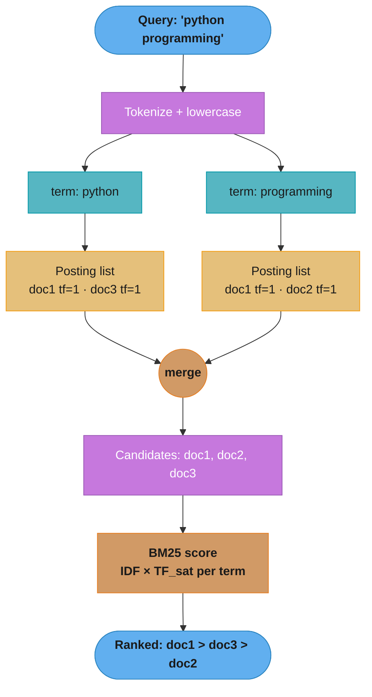
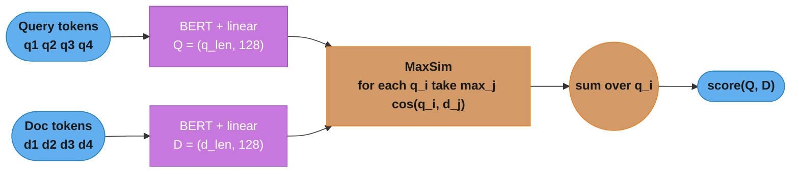
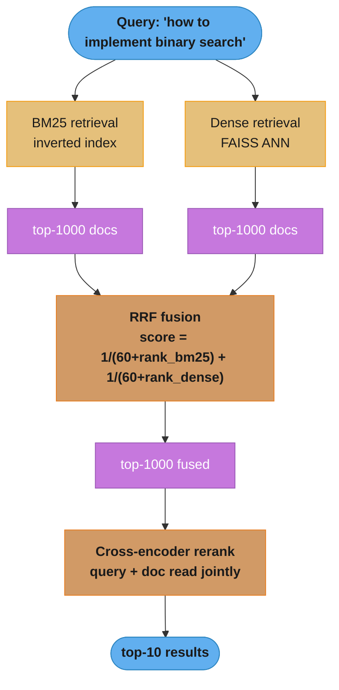
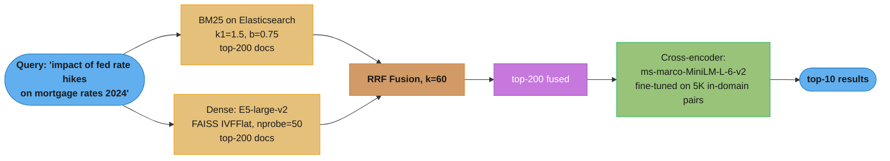

# Text Representation and Information Retrieval

> This file is a deep-dive sub-file of the [Natural Language Processing](natural_language_processing.md) module.
> It covers information retrieval fundamentals, sparse retrieval (BM25), dense retrieval (Sentence-BERT),
> late interaction (ColBERT), and hybrid search. RAG-focused retrieval with vector databases is covered
> in the LLM section (`llm/rag_fundamentals/`).

---

## 1. Concept Overview

Information retrieval (IR) is the problem of finding relevant documents from a large collection given a query. Before the transformer era, IR was dominated by sparse methods — representing documents and queries as sparse vectors over a vocabulary and computing similarity via lexical overlap. The key insight: if a document contains the same words as a query, it is probably relevant.

Modern IR has three paradigms:

1. **Sparse retrieval (BM25):** Lexical matching over inverted indexes. Fast, interpretable, no training needed. Still competitive for factual queries.
2. **Dense retrieval (bi-encoder):** Encode queries and documents into dense vector representations; find nearest neighbors. Handles semantic similarity and paraphrase.
3. **Late interaction (ColBERT):** Compute token-level similarity between query and document representations. Best quality but higher storage cost.

Understanding all three — and when to combine them — is a critical senior ML engineer skill for search, recommendation, and RAG system design interviews.

---

## 2. Intuition

One-line analogy: BM25 is an exact keyword matching expert; dense retrieval is a semantic understanding expert; ColBERT is an expert who reads both query and document carefully before scoring relevance.

Mental model: Imagine searching a library. BM25 is like searching the card catalog by exact title/keyword match — fast and precise for known-item search but fails for "books about dogs" when the title says "canine companions." Dense retrieval is like asking a librarian who understands synonyms and related concepts. ColBERT is like the librarian who reads the first page of candidate books and your query together before ranking.

Why it matters: on MS MARCO passage ranking (BEIR's standardized run) BM25 achieves nDCG@10 of 0.228; a dense bi-encoder such as TAS-B reaches 0.408; ColBERT lands at 0.401 and BM25 plus a cross-encoder reranker at 0.413. Each step roughly doubles the compute cost, and out of domain the ordering shifts again — BM25+cross-encoder is the strongest zero-shot system across BEIR's 18 datasets while BM25 alone beats every dense retriever on several of them. Understanding when each step's cost is justified is essential for production system design.

Key insight: Dense retrieval does not outperform BM25 on all queries. For queries with rare keywords (product IDs, specific names, unusual terms), BM25's exact lexical match is more reliable because the embedding model may not have seen those tokens in its training data.

---

## 3. Core Principles

**TF-IDF (foundational):** Term Frequency × Inverse Document Frequency weights terms by how discriminative they are. A term appearing frequently in a document and rarely in the corpus has high TF-IDF — a signal it characterizes this document. TF-IDF is the foundation that BM25 improves upon.

```
TF-IDF(t, d) = TF(t, d) x IDF(t)
```

**The idea behind it.** "Score a term high in one document when it appears a lot *here* and almost nowhere *else* in the corpus." TF measures local prominence, IDF measures global rarity, and the product keeps only terms that are both. Either half alone is worthless: TF alone ranks every document by how often it says "the"; IDF alone ignores the document being scored entirely.

The two halves are separate calculations, so decode them separately.

`TF(t, d)` — term frequency, a *within-document* quantity:

| Symbol | What it is |
|--------|------------|
| `count(t, d)` | How many times term `t` literally occurs in document `d` |
| `\|d\|` | Length of document `d` in tokens |
| `TF = count(t, d) / \|d\|` | Share of this document made up of term `t`. A rate, not a raw count, so a 4000-word page does not beat a 40-word page just by being longer |

`IDF(t)` — inverse document frequency, a *corpus-wide* quantity that never looks at the document being scored:

| Symbol | What it is |
|--------|------------|
| `N` | Total number of documents in the corpus |
| `df(t)` | Document frequency: how many of those `N` documents contain `t` at least once. Note: presence only, count ignored |
| `N / df(t)` | "One in how many documents has this word." `df` small → big number → rare, discriminative term |
| `log(...)` | Compresses that ratio so a single ultra-rare term cannot swamp everything else |
| `IDF = log(N / df(t))` | The rarity weight. A term in every document gets `log(1) = 0` and contributes nothing |

**Walk one example.** A five-document corpus pushed all the way through:

```
  corpus, N = 5 documents
    d1  "python tutorial for beginners"     len 4
    d2  "python data science"               len 3
    d3  "java tutorial"                     len 2
    d4  "learn python programming"          len 3
    d5  "cooking recipes"                   len 2

  IDF = ln(N / df)          (corpus-wide, computed once at index time)
    term        df    N/df     IDF
    python       3    1.67    0.5108    <- in most docs: weak signal
    tutorial     2    2.50    0.9163
    java         1    5.00    1.6094    <- rare: strong signal
    cooking      1    5.00    1.6094

  TF-IDF for d1 "python tutorial for beginners", |d| = 4
    python      TF = 1/4 = 0.2500   x 0.5108  =  0.1277
    tutorial    TF = 1/4 = 0.2500   x 0.9163  =  0.2291   <- same count, higher score
                                                             purely because it is rarer

  TF-IDF for d2 "python data science", |d| = 3
    python      TF = 1/3 = 0.3333   x 0.5108  =  0.1703
    tutorial    TF = 0/3 = 0.0000   x 0.9163  =  0.0000   <- absent, contributes nothing

  Both documents contain "python" exactly once, yet d2 scores higher
  (0.1703 vs 0.1277) because d2 is shorter -- the same word is a bigger
  share of what d2 is about.
```

**Why the log is there, and what breaks without it.** In a 10,000-document corpus, `df = 1` gives `N/df = 10000` while `df = 5000` gives `N/df = 2` — a raw ratio of `5000x`. Taking logs turns that into `9.2103` vs `0.6931`, a ratio of `13.29x`. Without the log, one freak term appearing in a single document would dominate the sum for every query it touches, and a document matching that one term would outrank a document matching all the others. The log converts "how many times rarer" into "how many orders of magnitude rarer," which is the scale at which term rarity is actually informative.

**Why the smoothing `+1` is there.** A query term that appears in *zero* corpus documents has `df(t) = 0`, and `N / 0` is a division by zero that crashes the scorer at query time — not index time, so it is easy to miss in testing. Writing `IDF = log(N / (1 + df))` keeps the value finite (`ln(10000/1) = 9.2103` for the unseen term) and the ranking well-defined. BM25 uses a different smoothing constant for the same reason; that variant is decoded in [Information Retrieval and Search](../information_retrieval_and_search/information_retrieval_and_search.md) §6.2.

**BM25 (Best Match 25):** Adds two critical improvements over TF-IDF — TF saturation (`TF_sat = TF × (k1 + 1) / (TF + k1)`, so repeated mentions earn rapidly shrinking credit) and length normalization (`L_norm = 1 - b + b × (|d| / avgdl)`, so long documents no longer win purely by containing more words). Both exist because raw TF-IDF believes a word repeated 50 times is 50 times the evidence, and that belief is what keyword-stuffed pages exploit. The full k1/b derivation — the saturation-alone and length-alone worked tables, the symbol-by-symbol breakdown, and why both smoothing terms in the IDF are load-bearing together — lives in [Information Retrieval and Search](../information_retrieval_and_search/information_retrieval_and_search.md) §6.2; the BM25 class implementation in Section 6 below cross-links there too rather than repeating it.

**Inverted index:** The core data structure for sparse retrieval. For each term in the vocabulary, store a posting list: sorted list of (document_id, term_frequency) pairs. To retrieve documents containing "python programming": look up both posting lists, merge (AND/OR logic), rank by BM25 score. With skip pointers, merging posting lists of length n is O(n), not O(n²).

**Sentence embeddings:** Map a sentence to a single dense vector in a semantic space where similar sentences are nearby. `sim(sentence_a, sentence_b) = cosine(embed(a), embed(b))`. Training requires sentence pairs with similarity labels (NLI, STS benchmarks, or self-supervised methods).

**Put simply.** "Ignore how long the two arrows are; ask only whether they point the same way." Cosine is the angle between two embedding vectors, rescaled to `1` for identical direction, `0` for perpendicular, `-1` for opposite. Length is discarded on purpose, because vector length in embedding space tracks things like text length and token count — not meaning.

| Symbol | What it is |
|--------|------------|
| `embed(a)` | The encoder's output vector for sentence `a` — 384 or 768 numbers |
| `a · b` | Dot product: multiply the two vectors element-by-element and add up. Big when they agree coordinate-by-coordinate |
| `\|\|a\|\|` | L2 norm, the vector's length: `sqrt(a·a)` |
| `cos(a,b) = (a·b) / (\|\|a\|\| \|\|b\|\|)` | Dot product with both lengths divided out — pure direction, bounded to `[-1, 1]` |
| L2 normalization | Replacing `a` with `a / \|\|a\|\|` so its length becomes exactly `1` |

**Walk one example.** Three-dimensional toy vectors, where the axes are the counts of "cheap", "car", and "bicycle". The query is `q = [1, 1, 0]` ("cheap car"):

```
  doc A = [5, 5, 0]   same content as the query, said five times over (a long page)
  doc B = [0, 1, 1]   "car bicycle"  -- genuinely a different topic

                       ||v||     q.v     cosine(q,v)    euclidean(q,v)
    doc A            7.0711      10        1.0000          5.6569
    doc B            1.4142       1        0.5000          1.4142

  Euclidean distance ranks B (1.4142) as CLOSER than A (5.6569) -- exactly
  backwards. A is the query repeated; B is a different topic. Cosine gets
  it right: A = 1.0000 (identical direction), B = 0.5000.
```

That is the whole answer to "why cosine, not Euclidean": Euclidean distance punishes a document for being long, because a longer document produces a longer vector, and the raw gap between two vector tips grows with their length regardless of topic.

**What L2 normalization buys you.** Once every vector has length `1`, the denominator of the cosine formula is `1 × 1 = 1`, so the division disappears and **the dot product simply *is* the cosine**:

```
  q_unit = [0.7071, 0.7071, 0.0000]     (q divided by ||q|| = 1.4142)
  A_unit = [0.7071, 0.7071, 0.0000]     (A divided by ||A|| = 7.0711)
  B_unit = [0.0000, 0.7071, 0.7071]

    dot(q_unit, A_unit) = 1.0000   == cosine(q, A)
    dot(q_unit, B_unit) = 0.5000   == cosine(q, B)

  And on unit vectors, euclidean distance becomes a restatement of cosine:
    d(q_unit, B_unit)^2 = 1.0000     2 - 2 x cosine = 2 - 2(0.5) = 1.0000
```

This identity is why the FAISS code below builds an `IndexFlatIP` (inner product) index rather than an L2 index and why `encode()` ends in `F.normalize(..., p=2)`. Inner-product search is cheaper than cosine search — no per-comparison division, no square roots — and on normalized vectors it returns identical rankings. Skip the normalize step and `IndexFlatIP` silently starts ranking by *magnitude*, so the longest documents float to the top of every query. The last line above shows the other consequence: once vectors are normalized, sorting by cosine descending and sorting by Euclidean distance ascending produce the same order, so an HNSW or IVF index built on either metric is valid.

**Siamese architecture (Sentence-BERT):** Two BERT encoders with shared weights. Input: (sentence_a, sentence_b). Each sentence encoded independently to mean-pooled representation. Trained with cosine embedding loss on NLI data (entailment→similar, contradiction→dissimilar). At inference, pre-compute and store all document embeddings; query is encoded on-the-fly; nearest neighbor search finds top-K.

**Reciprocal Rank Fusion (RRF):** Given two ranked lists (e.g., BM25 rank and dense rank), fuse them without knowing individual scores. Score for document d = Σ_{system} 1/(k + rank(d, system)) where k=60 is a constant preventing top-ranked documents from dominating too strongly — a document ranked #1 by BM25 but buried at rank 50 by a dense retriever can still lose the fusion to a document both systems ranked merely near the top, because RRF rewards cross-system agreement over any single system's conviction. Simple, calibration-free, often outperforms score-based fusion when score scales differ between systems. The full symbol table, the four-document worked example, and the k-sweep table showing why `k = 60` (not `0`) tames rank-1's dominance without erasing the ordering signal all live in [Information Retrieval and Search](../information_retrieval_and_search/information_retrieval_and_search.md) §6.4.

---

## 4. Types / Architectures / Strategies

### 4.1 Retrieval Paradigms

Quality column: MS MARCO passage nDCG@10 as reported in the BEIR benchmark (arXiv 2104.08663, Table 2), so the rows are directly comparable.

| Paradigm | Representation | Index | Similarity | Latency | Quality |
|----------|---------------|-------|------------|---------|---------|
| **BM25** | Sparse bag-of-words | Inverted index | TF-IDF-based score | <10ms | nDCG@10 0.228 |
| **Dense bi-encoder** | Dense vector (768d) | FAISS IVF or HNSW | Cosine/L2 | 20-50ms | nDCG@10 0.408 (TAS-B) |
| **ColBERT late interaction** | Token matrix (32×128d) | Dense + inverted | MaxSim per token | 50-100ms | nDCG@10 0.401 |
| **Cross-encoder reranker** | Pair (query+doc) | No index (pairwise) | Classification score | 200-500ms for 100 docs | nDCG@10 0.413 (over BM25) |
| **Learned sparse (SPARTA/SPLADE)** | Sparse BERT activations | Inverted index | Sparse dot product | <20ms | nDCG@10 0.351 (SPARTA) |
| **Hybrid (BM25 + dense)** | Both | Both | RRF fusion | 30-60ms | Typically 1-3 points over the better arm |

The learned-sparse row quotes SPARTA rather than SPLADE because SPARTA is what BEIR Table 2
actually measured — **no primary source reports a SPLADE MS MARCO nDCG@10 at all.** SPLADE's
own papers report MS MARCO in MRR@10 and BEIR as a 13-dataset nDCG@10 average, so the closest
honest numbers are SPLADE++ SelfDistil at `37.6` MRR@10 / `50.7` BEIR-13 average and SPLADE-v3
at `40.2` / `51.7` (Lassance et al., SPLADE-v3 tech report, Tables 1–2). Do not mix those into
the column above — different metric, different dataset set. The ranking the column is there to
teach still holds: learned sparse beats BM25 by a wide margin and lands near a good dense
bi-encoder while keeping an inverted index.

### 4.2 Dense Retrieval Models

**The table below is the MS MARCO passage-ranking leaderboard lineage, not a 2026 buying guide.** Every model in it was released to compete on one specific benchmark (MS MARCO dev MRR@10), and the numbers are still correct as reported — they just aren't the numbers a 2026 model-selection decision should be made from, because the field's current leaders don't report on this benchmark at all. Keep this table for what it teaches (how a bi-encoder, ColBERT, and a cross-encoder compare on one apples-to-apples benchmark) and use the table after it to actually pick a model.

| Model | Base | Dim | Training | MS MARCO dev MRR@10 |
|-------|------|-----|---------|-----------------|
| BM25 (reference point) | — | — | none | 18.7 |
| SBERT `msmarco-MiniLM-L6-cos-v5` | MiniLM-6L | 384 | MS MARCO | 32.27 |
| SBERT `msmarco-bert-base-dot-v5` | BERT-base | 768 | MS MARCO | 38.08 |
| E5-small | MiniLM-12L | 384 | Weakly supervised + fine-tune | 37.5 |
| E5-large | BERT-large-24L | 1024 | Weakly supervised + fine-tune | 39.4 |
| ColBERT-v2 | 12L | 128/token | Late interaction + distillation | 39.7 |
| Cross-encoder `ms-marco-MiniLM-L6-v2` (rerank) | MiniLM-6L | — | Pairwise labels | 39.01 |

The general-purpose SBERT `all-*` checkpoints (`all-MiniLM-L6-v2`, based on `MiniLM-L6-H384`, 384d; `all-mpnet-base-v2`, 768d) and the BGE family are trained for broad semantic similarity and report on MTEB/BEIR rather than MS MARCO MRR@10 — `bge-large-en-v1.5` scores 54.29 on MTEB's 15 retrieval tasks. Do not compare those numbers against this column.

### 4.2.1 Choosing an Embedding Model in 2026

The models above are all several generations old. The figures below are copied as-is from [Embedding Models](../../llm/rag_fundamentals/embedding_models.md) §6.2/§8 — read that file for the full derivation, dimensionality-cost math, and MTEB provenance notes; do not re-derive or round these numbers here.

| Model | Dim (MRL range) | Context | Hosting | MTEB v2 English mean |
|-------|-----------------|---------|---------|----------------------|
| OpenAI `text-embedding-3-small` | 1536 | 8192 tok | API | — (MTEB v1 Retrieval: 51.1) |
| OpenAI `text-embedding-3-large` | 3072 | 8192 tok | API | — (MTEB v1 Retrieval: 55.4) |
| Cohere `embed-v4.0` | 256/512/1024/1536 | 128000 tok | API (multimodal) | — |
| Qwen3-Embedding-8B | 32-4096 (MRL) | 32768 tok | Open weights | 75.22 |
| Qwen3-Embedding-4B | 32-2560 (MRL) | 32768 tok | Open weights | 74.60 |
| Qwen3-Embedding-0.6B | 32-1024 (MRL) | 32768 tok | Open weights | 70.70 |
| Google `gemini-embedding-2` | 128-3072 (MRL) | 8192 tok | API (text/image/audio/PDF) | — |
| `voyage-4-large` | 256/512/1024/2048 | 32000 tok | API (retrieval-tuned) | — |
| `google/embeddinggemma-300m` | 128-768 (MRL) | 2048 tok | Open weights (on-device/edge, 300M params) | — |
| `nomic-embed-text-v2-moe` | 256-768 (MRL) | 512 tok | Open weights (MoE, multilingual) | — |

Two facts this table hides if you skim it. First, **dimensionality is now a deployment knob, not a fixed model property** — every MRL-trained model above can be truncated to a smaller dimension at query time for a proportional storage cut and a small, tunable quality loss (see the FAISS `nlist`/`nprobe` tradeoff in [Information Retrieval and Search](../information_retrieval_and_search/information_retrieval_and_search.md) for why smaller vectors also mean cheaper ANN search). Second, **the newer open-weights models are instruction-conditioned and the prefix is not optional**: Qwen3-Embedding wants `"Instruct: {task}\nQuery:{query}"` on queries (nothing on documents), EmbeddingGemma wants `"task: search result | query: {q}"` / `"title: none | text: {doc}"`, and nomic wants `search_query:` / `search_document:`. Omitting the prefix — exactly the domain-gap failure mode in Pitfall 2 below — costs measurable recall, the same way getting BGE's prefix wrong does.

### 4.2.2 Reading the Retrieval Metrics

The two tables above are scored in `NDCG@10` and `MRR@10`, and Section 12 adds `Recall@K`. All three answer different questions — MRR asks how fast you found *the* answer, NDCG asks how well you ordered *all* the good answers, and Recall@K asks whether the good answers made it into the bucket at all — and all three are quoted constantly in interviews without being defined. The formulas, the full symbol tables, and worked examples for all four ranking metrics (Precision@k, MRR, MAP, NDCG) walked down one shared ranked list live in [Information Retrieval and Search](../information_retrieval_and_search/information_retrieval_and_search.md) §6.5; that treatment is the fuller one and this file does not repeat it.

Two reading notes for the tables above. First, the `MS MARCO dev MRR@10` column is reported on a 0-100 scale, so `39.7` means `MRR@10 = 0.397` — roughly "the first relevant passage sits between position 2 and 3 on average," and BM25's `18.7` means it sits past position 5. Second, `Recall@K` is the metric with a hard downstream consequence: the `0.7500` above means a cross-encoder reranking those 100 candidates can never see the 2 missing documents, so `0.7500` is a ceiling on every metric computed after it, no matter how good the reranker is.

### 4.3 Hybrid Retrieval Strategies

| Strategy | Description | When to Use |
|----------|-------------|------------|
| **Serial hybrid** | BM25 first, dense reranks top-N | Large corpus, BM25 as cheap pre-filter |
| **Parallel fusion (RRF)** | Run BM25 and dense independently, fuse | When both contribute: factual + semantic queries |
| **Ensemble reranking** | Fuse N retrievers, then cross-encoder reranks top-K | Maximum quality, latency-tolerant |
| **SPLADE + dense** | SPLADE for rare terms, dense for semantics | Domain with specialized vocabulary |

---

## 5. Architecture Diagrams

### BM25 Inverted Index and Retrieval Flow



Each query term looks up its posting list in the inverted index; the lists are merged into a candidate set, scored with BM25, and ranked — doc1 wins because it matches both query terms while doc2 and doc3 match only one.

### Bi-Encoder vs Cross-Encoder

```mermaid
flowchart TD
    classDef io      fill:#61afef,stroke:#2e86c1,color:#1a1a1a,font-weight:bold
    classDef frozen  fill:#c678dd,stroke:#9b59b6,color:#fff
    classDef train   fill:#98c379,stroke:#27ae60,color:#1a1a1a
    classDef mathOp  fill:#d19a66,stroke:#e67e22,color:#1a1a1a,font-weight:bold
    classDef lossN   fill:#e06c75,stroke:#c0392b,color:#fff,font-weight:bold
    classDef req     fill:#56b6c2,stroke:#0097a7,color:#1a1a1a
    classDef base    fill:#e5c07b,stroke:#f39c12,color:#1a1a1a

    subgraph BE["Bi-Encoder — precompute + ANN search"]
        BQ(["Query"]) --> BQE["BERT encoder"]
        BD(["Document"]) --> BDE["BERT encoder (shared weights)"]
        BQE --> BQP["mean pool: q_emb (768d)"]
        BDE --> BDP["mean pool: d_emb (768d)"]
        BQP --> BCOS(("cosine"))
        BDP --> BCOS
        BCOS --> BS(["similarity score"])
    end
    subgraph CE["Cross-Encoder — joint, rerank only"]
        CQD(["query + SEP + doc, concatenated"]) --> CENC["BERT encoder (full attention)"]
        CENC --> CCLS["classifier head"]
        CCLS --> CS(["relevance score"])
    end

    class BQ,BD,BS,CQD,CS io
    class BQE,BDE,CENC frozen
    class BQP,BDP,CCLS,BCOS mathOp
```



The bi-encoder embeds query and document independently, so document vectors are precomputed once and searched with ANN — O(1) inference per query. The cross-encoder concatenates the pair for one joint forward pass, capturing full query↔document token interaction (higher quality) but precomputing nothing, so it is only affordable as a reranker over a short candidate list.

### ColBERT Late Interaction (MaxSim)



ColBERT keeps one vector per token instead of pooling. MaxSim matches each query token to its single best-matching document token and sums those maxima — so "beginners" can match "learn" and "tutorial" can match "scratch" even without exact lexical overlap, which a single pooled vector could not express.

### Hybrid Retrieval Pipeline (RRF + rerank)



BM25 and dense retrieval run in parallel, each returning top-1000; RRF fuses them by rank alone (no score calibration needed since the two score scales are incompatible), and a cross-encoder reranks the fused pool down to the final 10.

---

## 6. How It Works — Detailed Mechanics

### BM25 Scoring

```python
from rank_bm25 import BM25Okapi

# score(Q, D) = sum_{t in Q} IDF(t) * (TF(t,D) * (k1+1)) / (TF(t,D) + k1*(1-b+b*|D|/avgdl))
# IDF(t) = log((N - df(t) + 0.5) / (df(t) + 0.5) + 1); k1=1.2 (TF saturation), b=0.75 (length norm)
corpus_tokens = [doc.split() for doc in corpus]
bm25 = BM25Okapi(corpus_tokens, k1=1.2, b=0.75)
scores = bm25.get_scores(query.split())
```

The full symbol-by-symbol derivation of that formula — why `k1` bounds a document's TF contribution near `k1+1` no matter how many times a term repeats, why both the `+0.5` and the `+1` inside the IDF log are load-bearing together, and a worked example scoring the same query term across documents of different lengths and repetition counts — lives in [Information Retrieval and Search](../information_retrieval_and_search/information_retrieval_and_search.md) §6.2, which this module builds on rather than re-derives.

### Sentence-BERT Training (Siamese Network)

```python
import torch
import torch.nn as nn
import torch.nn.functional as F
from transformers import AutoTokenizer, AutoModel
from typing import List, Tuple
import numpy as np


class SentenceBERT(nn.Module):
    """
    Sentence-BERT (Reimers & Gurevych, 2019).
    Siamese BERT with mean pooling for sentence embeddings.
    Fine-tuned on NLI data with softmax or cosine-similarity objective.
    """

    def __init__(self, model_name: str = "bert-base-uncased") -> None:
        super().__init__()
        self.encoder = AutoModel.from_pretrained(model_name)

    def mean_pool(
        self,
        token_embeddings: torch.Tensor,  # (batch, seq_len, hidden)
        attention_mask: torch.Tensor,    # (batch, seq_len)
    ) -> torch.Tensor:
        """
        Mean pooling over non-padding tokens.
        Critical: mask padding tokens before averaging.
        """
        mask = attention_mask.unsqueeze(-1).float()  # (batch, seq_len, 1)
        summed = (token_embeddings * mask).sum(dim=1)
        counts = mask.sum(dim=1).clamp(min=1e-9)
        return summed / counts  # (batch, hidden)

    def encode(
        self,
        input_ids: torch.Tensor,
        attention_mask: torch.Tensor,
    ) -> torch.Tensor:
        """Encode a batch of sentences to normalized embeddings."""
        outputs = self.encoder(input_ids=input_ids, attention_mask=attention_mask)
        embeddings = self.mean_pool(outputs.last_hidden_state, attention_mask)
        return F.normalize(embeddings, p=2, dim=-1)  # L2 normalize for cosine sim

    def forward(
        self,
        anchor_ids: torch.Tensor,
        anchor_mask: torch.Tensor,
        positive_ids: torch.Tensor,
        positive_mask: torch.Tensor,
        negative_ids: torch.Tensor,
        negative_mask: torch.Tensor,
    ) -> torch.Tensor:
        """
        Triplet loss forward pass.
        Margin-based: anchor should be closer to positive than negative by margin.
        """
        anchor_emb = self.encode(anchor_ids, anchor_mask)
        pos_emb = self.encode(positive_ids, positive_mask)
        neg_emb = self.encode(negative_ids, negative_mask)

        # Cosine similarity (negative = distance for triplet loss)
        pos_sim = F.cosine_similarity(anchor_emb, pos_emb)
        neg_sim = F.cosine_similarity(anchor_emb, neg_emb)

        # Triplet loss: max(0, margin + neg_sim - pos_sim)
        loss = F.relu(0.5 + neg_sim - pos_sim).mean()
        return loss


def build_faiss_index(embeddings: np.ndarray, nlist: int, nprobe: int = 10) -> "faiss.Index":
    """FAISS IVF index for approximate nearest neighbor search over document embeddings."""
    import faiss

    dim = embeddings.shape[1]
    quantizer = faiss.IndexFlatIP(dim)
    index = faiss.IndexIVFFlat(quantizer, dim, nlist, faiss.METRIC_INNER_PRODUCT)
    index.train(embeddings.astype(np.float32))
    index.nprobe = nprobe
    index.add(embeddings.astype(np.float32))
    return index
```

The full `nlist`/`nprobe` cost model — the per-query distance-computation formula, the `nlist` build-time sweep, the `nprobe` recall/speedup sweep, and why lost recall at low `nprobe` is unrecoverable by rescoring — lives in [Information Retrieval and Search](../information_retrieval_and_search/information_retrieval_and_search.md) §6.3. Section 14's case study below still uses `nprobe = 10-50` (its `nlist = 7071` for a 50M-product index) as the recall/latency operating point that math justifies.

### Reciprocal Rank Fusion

Wiring BM25 and dense retrieval together is a three-line fold over both ranked lists: `score(d) = Σ_r 1/(k + rank(d, r))`, computed by iterating each system's ranked document-id list and accumulating into one dict, then sorting descending — the code is identical whether the two inputs come from `BM25Okapi.get_scores()` above or the `SentenceBERT`/FAISS pair below it. The full function, its symbol table, the four-document worked walkthrough, and the `k`-sweep table explaining why `60` (not `0`) is the conventional damping constant all live in [Information Retrieval and Search](../information_retrieval_and_search/information_retrieval_and_search.md) §6.4 (`reciprocal_rank_fusion()`), which this module's Section 5 "Hybrid Retrieval Pipeline" diagram illustrates visually rather than re-deriving in code here.

### ColBERT MaxSim Scoring

```python
import torch
import torch.nn.functional as F
from transformers import AutoTokenizer, AutoModel


class ColBERT(torch.nn.Module):
    """
    ColBERT: Contextualized Late Interaction over BERT (Khattab & Zaharia, 2020).

    Key idea: Don't pool to a single vector — keep per-token representations.
    Score = sum over query tokens of max similarity over document tokens.

    Storage cost: 32 tokens × 128 dims × 4 bytes = 16KB per document
    vs bi-encoder: 768 dims × 4 bytes = 3KB per document (~5x more storage)
    """

    def __init__(
        self,
        model_name: str = "bert-base-uncased",
        dim: int = 128,  # Compressed dimension (from 768 → 128 via linear layer)
    ) -> None:
        super().__init__()
        self.encoder = AutoModel.from_pretrained(model_name)
        self.linear = torch.nn.Linear(self.encoder.config.hidden_size, dim, bias=False)
        self.dim = dim

    def encode(
        self,
        input_ids: torch.Tensor,
        attention_mask: torch.Tensor,
    ) -> torch.Tensor:
        """Encode to per-token compressed embeddings."""
        outputs = self.encoder(input_ids=input_ids, attention_mask=attention_mask)
        token_embeddings = outputs.last_hidden_state  # (batch, seq_len, hidden)
        compressed = self.linear(token_embeddings)    # (batch, seq_len, dim)
        return F.normalize(compressed, p=2, dim=-1)   # L2 normalize per token

    def maxsim_score(
        self,
        query_embeddings: torch.Tensor,     # (q_len, dim) — normalized
        doc_embeddings: torch.Tensor,       # (d_len, dim) — normalized
    ) -> float:
        """
        MaxSim: for each query token, find max similarity over all doc tokens.
        score = sum_i max_j cosine(q_i, d_j)

        Inner product of normalized vectors = cosine similarity.
        """
        # (q_len, d_len) — all pairwise cosine similarities
        sim_matrix = torch.matmul(query_embeddings, doc_embeddings.T)

        # Max over document dimension: (q_len,)
        max_sims = sim_matrix.max(dim=-1).values

        # Sum over query dimension: scalar
        return max_sims.sum().item()
```

**What it means.** `score(Q,D) = Σ_i max_j cos(q_i, d_j)` says: "for every word in the query, find the single word in the document that best answers it, then add up how good those best answers were." Nothing in the formula requires those answers to come from the same part of the document, which is exactly what lets one query match a document that covers its parts in scattered places.

| Symbol | What it is |
|--------|------------|
| `Q` | Query token matrix, shape `(q_len, 128)` — one L2-normalized vector per query token, not one per query |
| `D` | Document token matrix, shape `(d_len, 128)` |
| `Q @ D.T` | The full `(q_len, d_len)` grid of pairwise cosine similarities. Normalized inputs make matmul = cosine |
| `max_j` | Row-wise maximum: each query token's best match anywhere in the document |
| `Σ_i` | Sum those row maxima. More query tokens satisfied = higher score |
| "late" interaction | Q and D are encoded independently (so D is precomputable), and only the cheap similarity grid is computed at query time |

**Walk one example.** Query tokens `[capital, france, attractions]` against document tokens `[Paris, is, the, Eiffel]`:

```
  cosine grid (Q @ D.T), rows = query tokens, cols = document tokens

                Paris     is     the   Eiffel      row max
  capital        0.82    0.05   0.03    0.21         0.82   <- matched "Paris"
  france         0.74    0.02   0.01    0.35         0.74   <- matched "Paris" too
  attractions    0.30    0.04   0.02    0.68         0.68   <- matched "Eiffel"
                                                    ------
                                  score(Q, D)  =     2.24

  Note "Paris" is the best match for TWO query tokens -- MaxSim allows reuse.
  And "attractions" scored off a completely different token. A single pooled
  768d vector has to encode both of those relationships at once; the grid
  just represents them separately.
```

Compare that `2.24` against the average of all 12 cells, `0.2725`: most of the grid is noise (the `is`/`the` columns), and taking the row max is what discards it. Sum instead of average across rows means longer queries produce larger scores, so ColBERT scores are comparable *between documents for one query*, never across queries.

**What the extra expressiveness costs.** Storing per-token vectors instead of one pooled vector:

```
  bi-encoder :  768 dims x 4 bytes                =   3,072 bytes/doc
  ColBERT    :  32 tokens x 128 dims x 4 bytes    =  16,384 bytes/doc

  ratio = 16,384 / 3,072 = 5.33x

  at 1M documents :  3.07 GB  ->  16.38 GB
```

The dimension drop from 768 to 128 (the `self.linear` projection) is what keeps that ratio at `5.33x` instead of `32x` — without it, 32 full-width token vectors would be 32 times a pooled vector. This is also why Best Practice 9 recommends INT8 compression of the document token embeddings: it takes the 4 bytes per dimension down to 1, restoring the storage bill to roughly bi-encoder levels for under 0.5 MRR@10 of quality.

In production you rarely hand-write the class above. sentence-transformers 6.0 (August 2026) ships `MultiVectorEncoder`, which loads PyLate and Stanford ColBERT checkpoints (`MultiVectorEncoder("colbert-ir/colbertv2.0")`) and ColPali-family visual retrievers, scores with MaxSim, and offers `HierarchicalTokenPooling`, which clusters each document's token vectors (Ward linkage on cosine similarity) and keeps one mean vector per cluster to shrink the per-token storage computed above.

---

## 7. Real-World Examples

**Elasticsearch BM25 (ubiquitous):** Elasticsearch uses BM25 as its default similarity function since v5.0 (2016), with documented defaults `k1 = 1.2` and `b = 0.75`, configurable per field. `index_options: "positions"` stores term positions for phrase matching. Large deployments still keep BM25 as the core ranking function and layer ML rescoring on top of its candidate set.

**GitHub Code Search ("Blackbird", 2023):** not a dense-retrieval system at all — GitHub built a custom n-gram inverted index over code, using "sparse grams" (weight-selected character intervals) instead of plain trigrams to cut false positives on common patterns, and k-merges posting lists by score at compaction time so relevant documents get low IDs and stream out first. It serves roughly 640 queries/second per 64-core host. The lesson for retrieval design is the same one BM25 teaches: for code, exact substring and symbol matching is the signal, and an inverted index is the right structure for it.

**Multilingual dense retrieval:** a multilingual encoder (XLM-R based, trained SBERT-style) maps queries and passages in many languages into one shared embedding space, so an English query can retrieve relevant French documents with no translation step. Production deployments back this with a FAISS IVF or HNSW index; the practical constraint is that recall and latency are set by `nprobe` (or `efSearch`), not by the encoder.

**ColBERT in Stanford DSP (Stanford NLP):** Used as the retrieval component in multi-hop reasoning tasks (HotpotQA). ColBERT's per-token MaxSim is critical for multi-hop: the query "who was the director of the film where [PERSON] played the lead" requires matching "director" to "directed by" and the person name to a specific character name — token-level matching handles these compositional queries better than pooled bi-encoders.

**Learned sparse retrieval for e-commerce:** SPLADE-style models expand product queries and listings with related terms at index time. "wireless headphones" expands to ["headphones", "wireless", "bluetooth", "earbuds", "audio"] via the model's BERT-based term prediction. Because the output is still a sparse vocabulary vector, it serves from the same inverted index the site already runs — the speed of BM25 with much of the semantics of dense retrieval, and no second vector store to operate.

---

## 8. Tradeoffs

| Property | BM25 | Dense (SBERT) | ColBERT | Cross-Encoder |
|----------|------|--------------|---------|--------------|
| Index size (1M docs) | ~500MB | ~3GB (768d FP32) | ~16GB (32tok×128d) | No index |
| Query latency | <10ms | 20-50ms | 50-100ms | 500ms+ |
| MS MARCO nDCG@10 (BEIR) | 0.228 | 0.408 (TAS-B) | 0.401 | 0.413 (reranking BM25) |
| OOV term handling | Exact match | Semantic generalization | Semantic + token precision | Semantic + full context |
| Training required | None | Yes (NLI/STS data) | Yes (hard negatives) | Yes (pairwise labels) |
| Updates (new docs) | Fast (append) | Re-encode new docs | Re-encode new docs | No index |
| Interpretability | High (term weights) | Low (dense vectors) | Medium (token scores) | Low |

| BM25 Failure Modes | When Dense Helps |
|--------------------|-----------------|
| Vocabulary mismatch ("buy" vs "purchase") | Dense understands synonyms |
| Paraphrase ("how to sort" vs "sorting algorithms") | Dense captures semantics |
| Abbreviations ("ML" vs "machine learning") | Dense trained on similar contexts |
| Polysemy ("bank" = financial institution vs river bank) | Dense uses context |

| Dense Failure Modes | When BM25 Helps |
|--------------------|-----------------|
| Rare proper nouns ("XYZ-123 product code") | BM25 exact match is reliable |
| Numeric specifics ("section 7.3.2") | BM25 matches exactly |
| Code identifiers (`transformers.BertModel`) | BM25 handles special tokens |
| Domain jargon not in training data | BM25 lexical match works |

---

## 9. When to Use / When NOT to Use

### Use BM25 when:

- Corpus update latency must be minimal (new documents indexed in milliseconds)
- Queries are keyword-like with exact terminology (product codes, error codes, API names)
- Infrastructure constraints: no GPU, 100MB memory budget
- Queries and documents share vocabulary reliably (same language, same domain)
- System baseline before investing in dense retrieval

### Use dense retrieval when:

- Semantic similarity matters (paraphrase, synonym, cross-lingual)
- Zero-shot retrieval in a new domain (pre-trained dense models generalize better than BM25 on semantics)
- FAQ matching: "how do I reset my password" → matches "account recovery" even without keyword overlap
- > 10K queries/day justify the GPU infrastructure cost

### Use ColBERT when:

- Maximum retrieval quality without full cross-encoder cost
- Multi-hop reasoning (token-level matching captures compositional queries better)
- Storage budget allows ~5x of dense retrieval
- Latency budget allows 50-100ms

### Use cross-encoder reranking when:

- The top-K results from a fast retriever need maximum precision sorting
- Latency SLA allows 200-500ms (rerank only top 50-100 candidates)
- Training data exists for supervised pairwise scoring

### Do NOT use dense retrieval alone when:

- Corpus contains rare terms that the embedding model was not trained on
- Updates are frequent (re-encoding cost per new document, FAISS index rebuild)
- Exact match is critical (product IDs, legal citations)

---

## 10. Common Pitfalls

### Pitfall 1: BM25 tokenization mismatch between index and query time

```python
# BROKEN: Different tokenization at index time vs query time
# Index time: lower-case only
tokenizer_at_index = lambda text: text.lower().split()

# Query time: lowercase + stopword removal
tokenizer_at_query = lambda text: [
    w for w in text.lower().split() if w not in stopwords
]

# "the python tutorial" query removes "the" at query time,
# but "the" was indexed. Documents containing "the python tutorial"
# are not matched on "the" — inconsistent scoring.

# FIXED: Use the IDENTICAL tokenization pipeline at index and query time
def tokenize(text: str) -> list[str]:
    return re.findall(r'\b[a-z]+\b', text.lower())  # single function used everywhere
```

### Pitfall 2: Embedding domain gap

```python
# BROKEN: Using general-purpose SBERT for specialized domain
model = SentenceTransformer("all-MiniLM-L6-v2")  # trained on general English

# Legal documents contain "whereas", "hereinafter", "indemnification"
# Medical documents contain "myocardial infarction", "contraindicated"
# These terms may not be in the training distribution

# FIXED: Domain-specific fine-tuning with in-domain pairs
from sentence_transformers import SentenceTransformer, InputExample, losses
from torch.utils.data import DataLoader

# Create in-domain training pairs (anchor: query, positive: relevant doc)
train_examples = [
    InputExample(texts=["chest pain", "acute myocardial infarction"], label=1.0),
    InputExample(texts=["chest pain", "gastric reflux"], label=0.3),
    # ... 10K+ pairs from domain
]

train_dataloader = DataLoader(train_examples, shuffle=True, batch_size=16)
train_loss = losses.CosineSimilarityLoss(model)
model.fit(train_objectives=[(train_dataloader, train_loss)], epochs=3, warmup_steps=100)
```

### Pitfall 3: Not tuning hybrid fusion weight

```python
# Naive assumption: alpha=0.5 for BM25 + 0.5 for dense is optimal
# Reality: task-dependent
# - Factual keyword queries: BM25 contribution ~0.7, dense ~0.3
# - Semantic queries: BM25 ~0.3, dense ~0.7

# FIXED: Tune alpha on a validation set
# Score combination: final_score = alpha * bm25_score + (1-alpha) * dense_score
# (after normalizing each to [0,1] range)

def tune_hybrid_alpha(
    queries: list[str],
    relevant_docs: list[list[int]],
    bm25_scores: list[list[float]],
    dense_scores: list[list[float]],
    alphas: list[float] = [0.1, 0.2, 0.3, 0.4, 0.5, 0.6, 0.7, 0.8, 0.9],
) -> float:
    """
    Grid search over alpha on validation set.
    Evaluate with NDCG@10 or MRR@10 on held-out queries.
    """
    best_alpha, best_ndcg = 0.5, 0.0
    for alpha in alphas:
        combined = [
            alpha * b + (1 - alpha) * d
            for b, d in zip(bm25_scores, dense_scores)
        ]
        ndcg = compute_ndcg(combined, relevant_docs, k=10)  # implement separately
        if ndcg > best_ndcg:
            best_ndcg, best_alpha = ndcg, alpha
    return best_alpha

# Alternative: RRF (no alpha tuning needed, but still tune k)
```

### Pitfall 4: FAISS index staleness

The detector and the rebuild policy for this — per-list length skew, the frozen-centroid
failure mode, and the distributed `merge_ondisk` rebuild that makes a scheduled rebuild cheap
— are in [FAISS Deep Dive](../../llm/faiss_deep_dive/faiss_deep_dive.md) §6.3 and §6.9.

```python
# BROKEN: Add documents to FAISS without rebuilding when using IVF
# IVF clusters are computed at train() time; new documents fall into
# existing clusters even if they'd create better clusters

index = faiss.IndexIVFFlat(quantizer, dim, nlist)
index.train(existing_embeddings)
index.add(existing_embeddings)

# Later: 100K new documents added to corpus
index.add(new_embeddings)  # Added, but clusters are stale
# Result: poor recall for queries matching new document space

# FIXED: Rebuild index periodically (weekly or when >10% new documents)
def rebuild_index(all_embeddings: np.ndarray) -> faiss.Index:
    nlist = max(int(len(all_embeddings) ** 0.5), 100)
    quantizer = faiss.IndexFlatIP(dim)
    index = faiss.IndexIVFFlat(quantizer, dim, nlist, faiss.METRIC_INNER_PRODUCT)
    index.train(all_embeddings)
    index.add(all_embeddings)
    return index
```

### Pitfall 5: Cross-encoder used without first-stage retrieval

```python
# BROKEN: Cross-encoder applied to all 1M documents for a single query
# 1M documents × 200ms each = 55 hours per query

cross_encoder = CrossEncoder("cross-encoder/ms-marco-MiniLM-L-6-v2")
scores = cross_encoder.predict([(query, doc) for doc in all_million_docs])  # impossible

# FIXED: Always use cross-encoder as a reranker on top of fast first-stage retrieval
bm25_top100 = bm25_index.retrieve(query, top_k=100)
candidates = [(query, doc_id_to_text[doc_id]) for doc_id, _ in bm25_top100]
scores = cross_encoder.predict(candidates)  # 100 pairs × 2ms each = 0.2s total
```

### Pitfall 6: bf16 cross-encoder reranker returning near-random order

```python
# BROKEN: sentence-transformers < 6.0, reranker loaded in bfloat16.
# The sigmoid on the logits runs in bf16, saturates, and collapses the top
# candidates onto a few tied scores. Mean NDCG@10 of
# cross-encoder/ettin-reranker-32m-v1 on three NanoBEIR datasets: 0.18 (v5.7.0).
reranker = CrossEncoder(name, model_kwargs={"torch_dtype": torch.bfloat16})

# FIXED: sentence-transformers >= 6.0 upcasts scoring to float32 (same model:
# 0.68). On an older version, keep the model in float32 or apply the sigmoid
# to float32 logits yourself.
```

---

## 11. Technologies & Tools

| Tool | Purpose | Notes |
|------|---------|-------|
| `rank_bm25` (Python) | BM25 implementation | pip install rank-bm25; in-memory, pure Python |
| Elasticsearch / OpenSearch | Production BM25 + scoring | Distributed, supports custom scoring plugins |
| `sentence-transformers` | SBERT models + training | Built-in data loaders, losses, evaluation. 6.1.0 (2026-09-18); 6.x requires `transformers` 5.x |
| FAISS (Facebook) | Dense vector ANN search | CPU/GPU; flat, IVF, HNSW, PQ variants |
| Annoy (Spotify) | ANN search for read-heavy workloads | Memory-mapped, perfect for multiple readers |
| ScaNN (Google) | State-of-the-art ANN for Google scale | Best recall/latency at 10B+ vectors |
| ColBERT (Stanford) | Late interaction retrieval | `colbert-ir/colbertv2.0` on HuggingFace |
| `MultiVectorEncoder` (sentence-transformers 6.0+) | Late interaction in the standard library | Loads PyLate, Stanford ColBERT and ColPali-family checkpoints; MaxSim scoring; `HierarchicalTokenPooling` merges similar document token vectors to cut storage |
| BEIR benchmark | IR evaluation benchmark | 18 datasets, standardized evaluation |
| `pyserini` | BM25 + dense retrieval research library | Wraps Anserini (Lucene) + FAISS |

---

## 12. Interview Questions with Answers

**Q: Derive the BM25 score formula and explain each component.**
**Short:** BM25 combines an IDF term-rarity weight with a saturating, length-normalized term-frequency component.

BM25 score for term t in document d given query Q: `score(Q,D) = Σ_{t∈Q} IDF(t) × TF_sat(t,D)`. The IDF component `log((N - df(t) + 0.5) / (df(t) + 0.5) + 1)` weights terms by rarity — common terms ("the", "is") get near-zero IDF; rare discriminative terms get high IDF. The 0.5 additive smoothing prevents log(0) when df(t)=N (all documents contain the term). The TF saturation component `TF(t,D) × (k1+1) / (TF(t,D) + k1 × (1 - b + b × |D|/avgdl))` handles two problems with raw TF: (1) saturation via k1 — at k1=1.2, TF_sat plateaus near 2.2 even as TF→∞, preventing a document containing a term 100 times from scoring 100x more than one containing it once; (2) length normalization via b — documents longer than average get penalized (|D|/avgdl > 1), preventing long documents from dominating purely by having more term occurrences. k1=1.2, b=0.75 are empirically optimal across TREC benchmarks.

**Q: When does BM25 outperform dense retrieval?**
**Short:** BM25 outperforms dense retrieval on rare proper nouns, exact identifiers, and out-of-distribution vocabulary.

BM25 wins whenever the query hinges on an exact string the encoder never learned to represent. Three query types make this concrete: (1) Rare proper nouns and identifiers — "TSMC N3P process technology" contains jargon a general-purpose dense encoder maps to a poor representation since it wasn't in training data; BM25 exact-matches the term in documents. (2) Numeric and code search — "Python 3.11.2 release notes" or "`torch.nn.functional.scaled_dot_product_attention`" benefit from exact character-level matching. (3) Adversarial out-of-distribution queries — for queries with deliberately unusual vocabulary, the dense encoder's generalization is a liability. BEIR quantifies this: on Touché-2020 argument retrieval BM25 scores nDCG@10 0.367 against TAS-B's 0.162 and ColBERT's 0.202, and BM25 also beats both on Signal-1M (0.330) and TREC-NEWS (0.398). The reverse holds where paraphrase dominates — on FiQA and Quora the dense models are 6-8 points ahead — which is the whole argument for hybrid retrieval.

**Q: Why must the tokenizer be identical at BM25 index time and query time?**
**Short:** A tokenizer mismatch between BM25 index and query time silently reduces recall with no error raised.

A tokenizer mismatch between indexing and querying silently reduces recall with no error, because a query term tokenized differently never matches its indexed form. If the index keeps stopwords but the query pipeline strips them (or one lowercases and the other does not, or one stems), the two token streams diverge and BM25 scores documents inconsistently — a document that truly contains the query phrase may not match on some terms. The failure is invisible: no exception is raised, results are just quietly worse. The fix is to route index and query text through a single shared tokenization function, and to version it so a change forces a full reindex.

**Q: Why does directly summing BM25 and cosine similarity scores produce poor rankings?**
**Short:** Summing BM25 and cosine scores fails because their scales are unbounded and bounded respectively, and incomparable.

BM25 scores are unbounded (commonly 0 to 30+) while cosine similarity is bounded to [-1, 1], so a raw sum lets BM25 dominate and drowns out the dense signal. The two systems produce scores on completely different, uncalibrated scales that vary per query, so neither min-max nor z-score normalization is reliable across queries. This is exactly why Reciprocal Rank Fusion is preferred: RRF discards the raw scores and fuses on rank position alone (`1/(k+rank)`), which is scale-free and needs no per-query calibration. If you must combine scores directly, normalize each to [0,1] on a validation set and tune the blend weight alpha — but RRF usually matches or beats that with zero tuning.

**Q: What is the recall@K ceiling in a retrieve-then-rerank pipeline?**
**Short:** First-stage recall@K is a hard ceiling on a reranker, since it can only reorder already-retrieved candidates.

A reranker can only reorder candidates the first-stage retriever surfaced, so first-stage recall@K is a hard ceiling on final quality. If BM25 recall@100 is 0.80, then 20% of relevant documents never enter the reranker's input and no cross-encoder — however powerful — can recover them. This makes first-stage recall@100 the single most important metric to monitor: a drop there caps the whole system even when reranker quality is unchanged. Practical levers are widening K (retrieve top-500 instead of top-100), adding a parallel retriever (hybrid BM25 + dense) to cover each other's blind spots, and alerting on recall@100 in production separately from end-to-end NDCG.

**Q: What do the BM25 parameters k1 and b control, and how should you tune them?**
**Short:** k1 controls term-frequency saturation and b controls length normalization, defaulting to 1.2 and 0.75.

k1 controls term-frequency saturation (higher k1 means repeated terms keep adding weight for longer) and b controls length-normalization strength (b=0 disables it, b=1 applies full normalization). Defaults are k1=1.2 and b=0.75, empirically strong across TREC benchmarks. Raise k1 for corpora where genuine repetition signals relevance — regulatory or legal text repeats "compliance", "disclosure" heavily, so the enterprise case study bumped k1 to 1.5 to avoid over-saturating those terms. Lower b when document lengths are uniform (length penalty adds noise), raise it toward 1 when short and long documents are mixed and long ones are unfairly dominating. Tune both on a labeled validation set via grid search against NDCG@10.

**Q: Why does a general-purpose embedding model underperform on legal or medical retrieval, and how do you fix it?**
**Short:** General-purpose embeddings underperform on legal or medical text because domain jargon falls outside their training data.

General-purpose sentence encoders were trained on everyday English, so specialized jargon falls outside their training distribution and maps to poor, undifferentiated vectors. Terms like "indemnification", "hereinafter", or "myocardial infarction" were rarely or never seen with their domain meaning, so the encoder cannot place them in a useful region of embedding space — general-purpose SBERT models drop 5-15 NDCG points on legal, medical, and code corpora. The primary fix is domain fine-tuning: build in-domain (query, relevant-doc) pairs and continue training with a contrastive or cosine-similarity loss, which typically recovers most of the gap in a few epochs. As a complement, keep BM25 in a hybrid setup so rare in-domain terms are still matched by exact lexical overlap even before fine-tuning lands.

**Q: Explain Sentence-BERT training objective and why it differs from standard BERT.**
**Short:** Sentence-BERT trains a siamese network so embeddings can be precomputed, avoiding a forward pass per pair at query time.

Standard BERT fine-tuned on NLI uses a three-class classification head on `[CLS]` of the concatenated pair [A, SEP, B]. This requires running BERT on every pair at inference time — for finding the most similar sentence among 10K candidates, you need 10K forward passes. Sentence-BERT (Reimers & Gurevych, 2019) solves this by training a siamese network: two BERT encoders with shared weights, each processing one sentence independently, then a mean-pooled representation is compared via cosine similarity. Training uses NLI pairs: entailment → high similarity target (label 1), contradiction → low similarity target (label 0). The key advantage: pre-compute and store all document embeddings offline; for a new query, one BERT forward pass + cosine search over stored embeddings. The price: quality slightly below cross-encoder because the pair is not jointly processed. In practice a MS MARCO-tuned SBERT bi-encoder scores MRR@10 38.08 on the dev set versus 39.01 for the `ms-marco-MiniLM-L6-v2` cross-encoder reranking the same candidates — and the gap widens sharply out of domain.

**Q: What is ColBERT late interaction and why is it better than pooled bi-encoders?**
**Short:** ColBERT keeps per-token embeddings and scores with MaxSim, capturing finer query-document interaction than pooling.

ColBERT keeps per-token BERT representations instead of pooling to a single vector. Query encoding: BERT → linear projection → (q_len, 128) token embeddings. Document encoding: same structure → (d_len, 128). Scoring: `MaxSim(Q, D) = Σ_i max_j cosine(q_i, d_j)` — for each query token, find its best-matching document token and sum. This is strictly more expressive than bi-encoder pooling: pooling loses which specific aspects of the document match which aspects of the query. For "capital city of France Paris attractions," ColBERT's query token "capital" can match "Paris" (capital) specifically, while "attractions" matches "Eiffel Tower" — the pooled vector would need to encode all of this in one 768-dimensional vector. Storage cost: ~16KB per document (32 tokens × 128 dims × 4 bytes) vs ~3KB for a pooled 768d FP32 vector. ColBERTv2 achieves MRR@10 = 39.7 on the MS MARCO dev set — ahead of strong single-vector bi-encoders (E5-large 39.4, `msmarco-bert-base-dot-v5` 38.08) and on par with a cross-encoder reranker (39.01), but with far lower query-time cost than the cross-encoder.

**Q: How does Reciprocal Rank Fusion work and why is k=60 used?**
**Short:** Reciprocal Rank Fusion combines ranked lists using only rank position, with k=60 damping the top rank's dominance.

RRF combines ranked lists without requiring score normalization: `score(d) = Σ_r 1/(k + rank_r(d))` where the sum is over all ranked lists. The k constant prevents the formula from being dominated by the #1 ranked document — without k, rank=1 gives score 1.0 while rank=2 gives 0.5 (2x difference); with k=60, rank=1 gives 1/61 while rank=2 gives 1/62 (1.6% difference). k=60 was found empirically to work well across diverse IR tasks in Cormack et al. (2009). Practical advantage: BM25 scores and dense similarity scores have completely different scales and cannot be directly summed or averaged without careful calibration. RRF ignores scores entirely (uses only ranks), making it robust to scale differences. Typical hybrid gain is 1-3 nDCG@10 points over the better single retriever, essentially for free — the enterprise case study in §14 measures BM25 0.38, dense 0.51, RRF hybrid 0.54.

**Q: What FAISS index type should you use for different corpus sizes and latency requirements?**
**Short:** FAISS index choice scales from exact flat search to IVF clustering to product quantization as corpus size grows.

For <100K documents: `IndexFlatIP` (exact brute-force cosine search). Exact results, no approximation. At 100K documents with 768d FP32 vectors: 300MB index, ~5ms query. For 100K-10M documents: `IndexIVFFlat` with `nlist=sqrt(N)` clusters. Train clusters via k-means, then assign documents. Set `nprobe=10-50` (fraction of clusters to search at query time). Recall@10 ~95% with 10x speedup over flat. For >10M documents: `IndexIVFPQ` (IVF + product quantization) compresses vectors 4-32x via quantization. 1B documents in 4GB vs 3TB for flat FP32. Recall drops to ~85% but serves 1B-scale retrieval. For maximum quality with reasonable latency: HNSW (Hierarchical Navigable Small World graph). Query traverses a multi-layer graph structure. Recall@10 ~99% with ~2ms latency for 1M documents but high RAM usage and no GPU support. Production rule: start with IVFFlat, switch to IVFPQ if memory is a constraint, switch to HNSW if recall matters more than memory.

**Q: How do you handle the cold-start problem for new documents in a dense retrieval system?**
**Short:** Cold-start is handled by serving new documents from BM25 immediately while dense encoding happens asynchronously.

Three strategies: (1) Async re-encoding pipeline: new documents are added to an in-memory BM25 index immediately (milliseconds), then encoded by the dense model and added to the FAISS index asynchronously (minutes). Queries during this window use BM25-only for new documents. (2) Online quantized encoding: use a smaller, faster embedding model (all-MiniLM-L6-v2 at ~10ms vs E5-large at ~50ms) for new documents to reduce re-encoding latency. (3) Nearest neighbor approximation: compute a new document's approximate embedding by averaging the embeddings of its most similar BM25 results from the existing corpus (no GPU inference needed). Production choice depends on freshness requirements: news search needs option 1 with <5-minute indexing; product catalog allows hourly batch re-encoding.

**Q: What is SPLADE and why is it sometimes preferred over dense retrieval?**
**Short:** SPLADE expands queries and documents into sparse vectors via BERT, giving semantic matching at inverted-index speed.

SPLADE (Formal et al., 2021) uses a BERT model to expand both queries and documents into sparse vocabulary-sized vectors that a normal inverted index can serve. BERT's MLM head predicts a score for every vocabulary term and SPLADE applies a `log(1 + ReLU(x))` transformation to sparsify it. The key insight: "wireless headphones" activates "bluetooth", "earbuds", "audio", "wireless", "headphones" with positive weights (semantic expansion via BERT's language-modeling knowledge). Those sparse vectors go into a standard inverted index, giving BM25-like inference speed. The original SPLADE scores MRR@10 32.2 on MS MARCO dev, SPLADE-max 34.0 and DistilSPLADE-max 36.8 — far above BM25's 18.7 and within a point or two of strong dense bi-encoders. It is preferred over dense retrieval when: (1) inverted index infrastructure already exists and cannot be replaced; (2) rare term precision matters (SPLADE explicitly adds rare relevant terms to the sparse representation); (3) latency <20ms is required (FAISS ANN has 20-50ms; inverted index has <10ms).

**Q: Describe a production search system architecture for an e-commerce site with 50M products.**
**Short:** A production e-commerce search fuses parallel BM25 and dense retrieval with RRF, then reranks with a cross-encoder.

First-stage retrieval: Parallel BM25 and dense retrieval running simultaneously, each returning top-1000 candidates. BM25 handles exact product name/ID queries (critical for finding specific products); dense retrieval handles semantic queries ("birthday gift for dad" → "men's watches", "whiskey gifts"). Index: BM25 on Elasticsearch (distributed, real-time updates for new products); dense on FAISS IVFFlat with nprobe=50 (50M products, 384d all-MiniLM-L6-v2 embeddings = 75GB RAM). Fusion: RRF with k=60 over top-1000 from each. Second-stage reranking: Cross-encoder on top-100 fused results (MiniLM cross-encoder, ~5ms/pair, 100 pairs = 500ms — acceptable for web search). Third stage: Business rules (out-of-stock penalty, margin-based boost, brand exclusions) applied to top-20. Personalization: user embedding added as soft constraint to dense retrieval query. Latency budget: BM25 10ms + dense 30ms (parallel) + fusion 1ms + reranking 500ms = 541ms total. Optimize by reducing reranking to top-50 when p99 latency exceeds 400ms.

**Q: How does the inverted index enable sub-second search over billions of documents?**
**Short:** An inverted index enables sub-second search by merging sorted posting lists per query term across sharded indexes.

The inverted index is a map from each unique term to a posting list: a sorted array of (document_id, term_frequency) pairs. For a query "python programming tutorial", the retrieval engine fetches three posting lists (one per query term) and performs a sorted merge to find documents containing any or all terms. Merge using DAAT (Document-At-A-Time) traversal: maintain a pointer per posting list, advance the pointer of the list pointing to the smallest document ID. BM25 score for each document is computed on-the-fly using precomputed IDF values and stored TF values. Skip pointers enable O(sqrt(n)) merging of large posting lists by skipping blocks of documents. Sharding: for a 1B-document index, distribute posting lists across 100 shards, run queries in parallel, merge top-K results (scatter-gather pattern). Lucene (Elasticsearch's underlying engine) achieves <10ms P99 for simple keyword queries over 1B documents using compressed posting lists (VBYTE encoding) + SIMD-optimized merge operations.

**Q: Compare bi-encoder and cross-encoder for a reranking use case.**
**Short:** Bi-encoders precompute embeddings for fast retrieval, while cross-encoders jointly encode pairs for higher-quality reranking.

Bi-encoder: query and document are encoded independently → their embeddings compared via cosine similarity. Advantage: encodings can be precomputed and stored; O(1) per query after index construction. Disadvantage: full interaction between query and document is lost — the model cannot see how specific query tokens relate to specific document tokens. Cross-encoder: query and document are concatenated and jointly encoded: BERT([CLS] query [SEP] document [SEP]). The model can attend from any query token to any document token — full interaction is captured. Disadvantage: cannot precompute anything; every query-document pair requires a fresh BERT forward pass. Quality: on MS MARCO dev the `ms-marco-MiniLM-L6-v2` cross-encoder reaches MRR@10 39.01 against 38.08 for a MS MARCO-tuned bi-encoder — under a point in domain, but the same reranker scores nDCG@10 74.30 on TREC DL 2019, and BEIR finds BM25 + cross-encoder to be the strongest zero-shot system across 18 datasets. Reranking earns its keep out of domain, not on the training benchmark. Production pattern: bi-encoder for first-stage retrieval (precomputed, O(log N) ANN search); cross-encoder for reranking top-50-100 (fresh inference on small candidate set).

**Q: What is the "vocabulary mismatch problem" and which retrieval approaches solve it?**
**Short:** Vocabulary mismatch, when a query and document share no terms, is solved by dense retrieval or SPLADE's term expansion.

Vocabulary mismatch: a user queries "inexpensive car" but a relevant document says "affordable vehicle" — no shared term, zero BM25 score. Classical solutions: (1) query expansion — add synonyms from WordNet or a thesaurus before BM25 retrieval; (2) relevance feedback — retrieve initial results, extract key terms, re-query with expanded terms (Rocchio algorithm). Modern solutions: (3) dense retrieval — SBERT maps "inexpensive car" and "affordable vehicle" to nearby vectors; no vocabulary constraint; (4) SPLADE — BERT expands both query and document at encoding time, adding "cheap", "budget", "automobile", "car", "vehicle" to the sparse representation. Dense retrieval has the best semantic coverage but fails on rare proper nouns (vocabulary mismatch in the other direction). Hybrid BM25 + dense covers both failure modes.

**Q: How do you evaluate the quality of an IR system?**
**Short:** IR systems are evaluated with NDCG, MRR, and Recall@K, each suited to different relevance and ranking goals.

Standard metrics: (1) NDCG@K (Normalized Discounted Cumulative Gain): rewards relevant documents at higher ranks more than lower ranks, accounts for graded relevance (highly relevant, partially relevant, irrelevant). `DCG@K = Σ_{i=1}^{K} (2^rel_i - 1) / log2(i+1)`; divide by ideal DCG to normalize. Standard on TREC and BEIR benchmarks. (2) MRR@K (Mean Reciprocal Rank): `MRR = (1/|Q|) Σ_q 1/rank_q(first_relevant)`. Good for tasks where one relevant result is sufficient (FAQ retrieval, QA). (3) Recall@K: fraction of all relevant documents that appear in the top-K. Critical for reranking setups — first-stage retrieval recall@100 bounds reranker maximum performance. Production evaluation: click-through rate and dwell time correlate with NDCG in web search, but not in all domains (e.g., medical search requires clinical expert judgments). Always use offline evaluation on held-out queries first; shadow-mode online evaluation before full rollout.

---

## 13. Best Practices

1. Start with BM25 as your retrieval baseline before building dense retrieval infrastructure — it takes one hour to set up and often achieves 70-80% of what is possible with heavy investments.
2. Use RRF over score-based fusion whenever combining BM25 and dense scores — their score scales are incompatible and RRF requires no calibration.
3. Normalize FAISS embeddings to unit length before building an IndexFlatIP index — this makes inner product equivalent to cosine similarity.
4. Set FAISS nprobe dynamically based on latency budget — for p95 < 50ms target, start nprobe=10 and increase until latency budget is exhausted.
5. Use the same tokenization in BM25 index and query time — mismatches silently reduce recall with no error message.
6. Fine-tune the sentence embedding model on in-domain pairs before production deployment — general-purpose SBERT models drop 5-15 NDCG points on specialized domains (legal, medical, code).
7. Monitor retrieval recall@100 in production alongside quality metrics — recall@100 dropping means the first-stage is failing to surface candidates that the reranker could handle.
8. Build an evaluation dataset of 300+ query-relevant_doc pairs from production queries before deploying any retrieval change — ground truth labels from click logs are a reasonable proxy.
9. For ColBERT deployment, compress document token embeddings to INT8 (4x size reduction) — quality drop is <0.5 MRR@10.
10. When using cross-encoder reranking, cap reranking pool at 50-100 candidates — quality gains from increasing to 200+ are marginal while latency increases linearly.

---

## 14. Case Study

### Problem: Enterprise Knowledge Base Search for 10M Documents

**Context:** A financial services firm has 10M internal documents (research reports, regulatory filings, internal memos) and 5,000 employees submitting 50K queries/day. Previous keyword search (Elasticsearch BM25 v5) has NPS of -12; users report finding irrelevant or no results for conceptual queries.

**Measurement:** Offline evaluation on 500 labeled query-document pairs by domain experts. Baseline BM25: NDCG@10 = 0.38 (below industry standard of 0.50+ for enterprise search).

**System Design:**



**Implementation and results:**

| System | NDCG@10 | Latency p95 |
|--------|---------|-------------|
| BM25 baseline | 0.38 | 12ms |
| Dense only (E5-large) | 0.51 | 45ms |
| BM25 + Dense RRF | 0.54 | 50ms |
| + Cross-encoder rerank (top-50) | 0.61 | 480ms |
| + In-domain fine-tuning of cross-encoder | 0.67 | 480ms |

**Key findings:**

- Dense retrieval alone improved NDCG by 13 points on semantic queries ("monetary policy implications") but degraded by 4 points on specific-term queries ("10-K filing Apple Inc 2023").
- RRF hybrid recovered the BM25 strength on specific queries while keeping dense semantic gains.
- Cross-encoder fine-tuning on 5K in-domain pairs (from 200 sampled queries × 25 judged documents each) added 6 NDCG points — the single largest improvement step.
- Latency: 480ms p95 was acceptable for document search (not real-time autocomplete). Reducing rerank pool from 50 to 25 docs: latency 240ms, NDCG 0.65 (acceptable tradeoff for time-sensitive analysts).
- BM25 k1 was tuned from default 1.2 to 1.5 for financial text — regulatory documents repeat key terms heavily; higher k1 reduces over-saturation on "regulation", "compliance", "disclosure".
