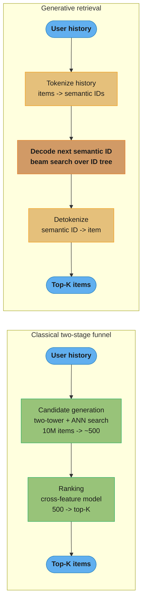
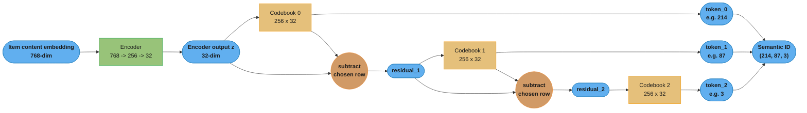
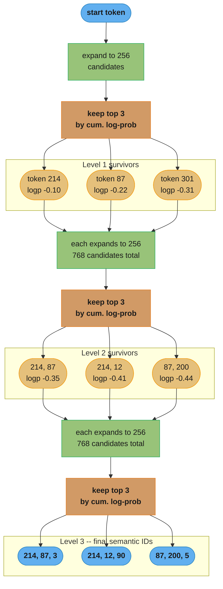
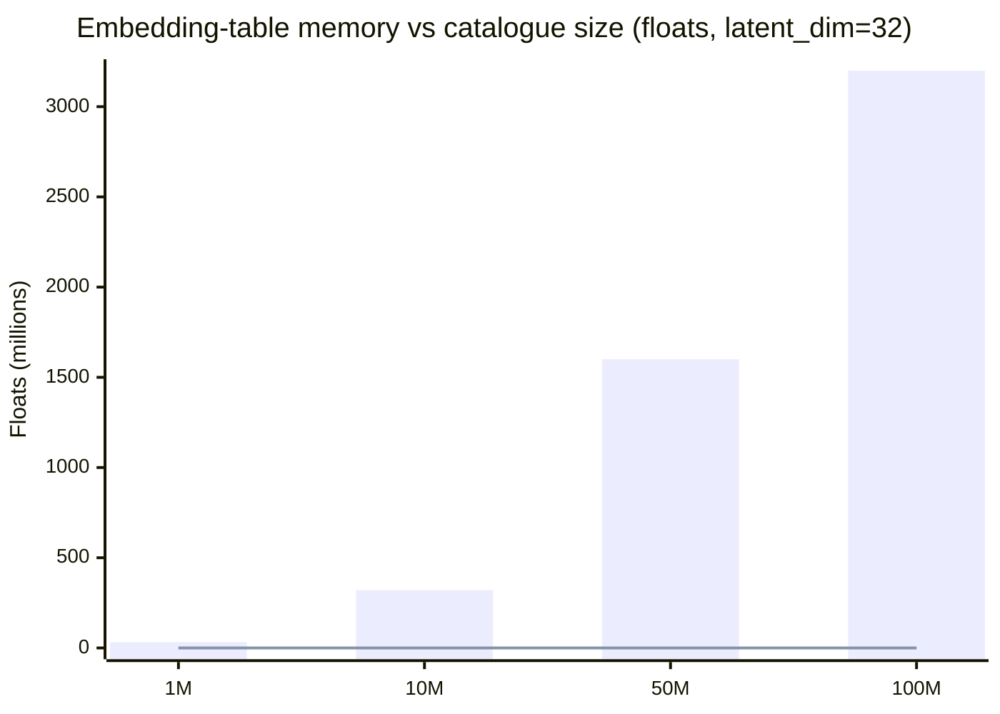
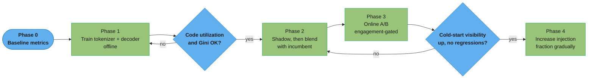

# Generative Recommenders

*Recommendation reframed as sequence generation — semantic IDs, RQ-VAE tokenization, HSTU, and retrieval-as-decoding.*

> Deep-dive sub-file of [Deep Learning Recommenders](./deep_learning_recommenders.md), expanding
> its Section 4.7 semantic-ID material into its own module. Cross-reads:
> [retrieval_and_ranking](retrieval_and_ranking.md) for the classical
> funnel this architecture replaces, and
> [../../llm/foundations_and_architecture/foundations_and_architecture.md](../../llm/foundations_and_architecture/foundations_and_architecture.md)
> for the Transformer attention HSTU modifies.

---

## 1. Concept Overview

Every recommender covered in [deep_learning_recommenders.md](./deep_learning_recommenders.md) — two-tower, DeepFM, DLRM, even SASRec's causal-attention sequence model — answers the same underlying question the same underlying way: given a fixed catalogue of N items, each with its own row in an embedding table, *score or rank a candidate set drawn from that table*. Retrieval is nearest-neighbor search over precomputed vectors; ranking is a classifier over a shortlist. The item vocabulary is external to the model — it is a lookup, not something the model has any structural understanding of.

Generative recommenders — TIGER (Google, 2023) and HSTU (Meta, 2024) are the two reference architectures — reframe the problem the way large language models reframed text prediction. Instead of a private row per item, every item is re-expressed as a short sequence of discrete tokens drawn from a small, shared vocabulary (a **semantic ID**), and instead of scoring a candidate set, the model **generates** the next item's token sequence conditioned on the user's history, one token per decoding step, exactly the way an LLM generates the next word. Recommendation becomes a decoding problem, and the catalogue becomes a vocabulary the model can reason about compositionally rather than memorize row by row.

This module is the generative half of the recommender-systems module: it assumes the two-tower, DLRM, and SASRec material from `deep_learning_recommenders.md` as background and goes deep on what changes when items stop being atomic IDs — the RQ-VAE tokenizer, HSTU's modified attention, beam search as retrieval, and why this is the one place in classical recsys where LLM-style scaling laws start to apply.

**Production adoption signal**: This is no longer a research-only idea. Meta reports HSTU running in production ranking and retrieval; Shopify has rebuilt its commerce recommendation engine on HSTU; Google's TIGER established the RQ-VAE-plus-decoder recipe on public benchmarks; and Snap has published its own production semantic-ID design (Section 7 gives the numbers for each). What every one of these deployments shares is caution about the migration path — none of them describes a clean-cut replacement of an existing retrieval stack, and Section 4.4 and Section 13 explain why that caution is structural, not just conservatism.

**Scope of this module** relative to the parent:

| Question | Answered in |
|----------|-------------|
| How does a two-tower or DLRM model work? | `deep_learning_recommenders.md` |
| How does SASRec's causal attention model a sequence? | `deep_learning_recommenders.md` |
| How does an item become a semantic ID, and how is one decoded back to an item? | This module, Section 6 |
| How does HSTU's attention differ from a standard Transformer's? | This module, Section 3 and Section 12 |
| How do you migrate a live retrieval stack to a generative one without breaking it? | This module, Section 4.4, Section 13, Section 14 |

---

## 2. Intuition

**One-line analogy**: A classical recommender treats the catalogue like a phone book — one entry per item, looked up by an arbitrary number that tells you nothing about the item next to it. A generative recommender treats the catalogue like a language: every item is a short "sentence" built from a small alphabet of reusable tokens, so two items that mean similar things are *spelled* similarly, and the model can generate an item's spelling for a user it has never seen alongside that exact item before.

**Mental model**: An RQ-VAE tokenizer is the "alphabet-builder" — trained once, offline, on item content embeddings, it turns any item (existing or brand-new) into a semantic ID, a tuple like `(214, 87, 3)`. A sequence model (HSTU or a TIGER-style seq2seq Transformer) is the "sentence-generator" — trained on interaction logs, it takes a user's history and decodes the next item's semantic ID token by token, using beam search to keep several plausible sentences alive at once. Retrieval and ranking, which classical architectures keep as two separately trained systems, become two views of the same generative model.

**Key insight**: The catalogue-as-vocabulary reframing is what makes cold start and scaling stop being separate problems solved by separate tricks. A new item's semantic ID exists the moment its content embedding does — no interaction history needed — because tokenization only depends on content, not behavior. And because every item's representation is built from the same shared, small set of codebook tokens rather than a private embedding row, adding model capacity improves the fit for the *entire* catalogue at once, the same mechanism that makes a bigger LLM a better model of language rather than a bigger lookup table.

**Why it matters in practice**: The two things every recsys team eventually hits — a growth-stage catalogue where cold start dominates the loss, and a scaling wall where more parameters stop buying more accuracy — are exactly the two failure modes this reframing addresses directly rather than papering over with a fallback tower or a bigger embedding table. That is the argument for learning this architecture even for a team not migrating today: it names the two problems classical recsys architecture cannot solve by construction.

---

## 3. Core Principles

**Glossary — the vocabulary this module introduces**, for quick reference against the parent module's two-tower/DLRM/SASRec terms:

| Term | What it means here |
|------|----------------------|
| Semantic ID | A short tuple of codebook indices (e.g. `(214, 87, 3)`) that stands in for an item, produced by RQ-VAE from its content embedding |
| RQ-VAE | Residual-Quantized VAE — the tokenizer that turns a content embedding into a semantic ID via a chain of small codebooks |
| Codebook | One level's lookup table of learned vectors (e.g. 256 rows x 32 dims); a semantic ID picks one row per codebook |
| Residual | What the encoder output has left to explain after each quantization level; input to the next level's codebook |
| Prefix sharing | Two items landing on the same early tokens because they are semantically similar — the mechanism behind cold-start transfer |
| Uniqueness token | A learned-free counter token appended to break ties when two items would otherwise collide on the same semantic ID |
| Retrieval-as-decoding | Generating an item's semantic ID autoregressively instead of scoring precomputed vectors against a query |
| Beam search (here) | Keeping the top-B partial semantic-ID prefixes by cumulative log-probability at each decode step, over the ID tree |
| HSTU | Meta's generative-recommender architecture — target-aware attention over interleaved item/action sequences |
| Target-aware attention | HSTU's modified attention (pointwise SiLU weighting, relative bias, elementwise gating) in place of softmax |
| Tokenizer drift | Semantic IDs silently becoming meaningless because the content-embedding model changed without the RQ-VAE being retrained to match |

**The catalogue is a vocabulary, not a lookup table.** Every architecture in the parent module — two-tower, NCF, Wide & Deep, DeepFM, SASRec — treats "which item" as a lookup: one row of an embedding table, one class in a softmax over N items. The principles below describe what changes once that assumption is dropped.

**Item tokenization — semantic IDs via RQ-VAE.** TIGER (Google, Rajput et al., "Recommender Systems with Generative Retrieval," NeurIPS 2023) trains a Residual-Quantized VAE (RQ-VAE) over each item's content embedding (text, metadata) to produce a **semantic ID**: a short tuple of codebook indices, e.g. `(214, 87, 3)`. Residual quantization is what makes the ID hierarchical rather than flat: quantize the embedding against codebook 0 to get the first token, subtract that codebook entry to get a residual, quantize the residual against codebook 1 to get the second token, and repeat. Each level refines what the previous level left unexplored — the first token captures the coarsest semantic cluster ("kitchen appliances"), the last token captures fine-grained distinctions within that cluster. Two items that are semantically similar land in the same coarse cluster and therefore **share an ID prefix** — that shared prefix is the entire cold-start mechanism: a brand-new item gets a semantic ID the moment its content embedding exists, no interaction history required, and it inherits collaborative signal from every other item that shares its prefix.

The tokenizer is trained entirely offline, on item content alone, and is a separate lifecycle from the sequence model that consumes its output — it is the "content encoder" for the whole system, and every downstream model (retrieval decoder, and potentially a shared ranker) depends on its codebooks staying fixed and versioned (Section 10, Pitfall 2).

This is a sharp departure from a **learned atomic ID** (a plain `nn.Embedding(n_items, dim)` row, as used by every model in the parent module): an atomic ID is an arbitrary integer with no relationship to any other item's ID, so a new item needs its own freshly-initialized, untrained row and starts with zero signal. A semantic ID is compositional — the vocabulary is `sum(codebook sizes)` rather than `n_items`, so the same handful of thousand-entry codebooks tokenizes a catalogue of any size.

The practical consequence is that a catalogue's *size* stops being the thing that determines vocabulary size — its *content diversity* does. A 500M-item catalogue with narrow content diversity (e.g. a single-category marketplace) may need fewer, smaller codebooks than a 5M-item catalogue spanning wildly different content types, because the codebooks only need enough capacity to separate however many genuinely distinct semantic clusters exist.

**Plain VQ-VAE versus RQ-VAE.** A single-codebook VQ-VAE quantizes the whole embedding against one codebook in one shot, so codebook size must scale with catalogue size to avoid collisions (differentiating 50M items needs a 50M-entry codebook, which defeats the purpose). RQ-VAE instead composes several small codebooks residually: 3 levels of 256 entries each already address `256^3 ≈ 16.7M` distinct combinations from `3 x 256 = 768` total codebook rows. The residual is what makes composition possible — quantizing the same embedding against three *independent* codebooks without the residual step would just produce three uncorrelated approximations of the same vector, not a coarse-to-fine hierarchy.

Choosing `n_levels` and `codebook_size` is therefore a real hyperparameter search, not a default — too few addressable combinations relative to catalogue size collapses distinct items onto the same prefix (Section 10, Pitfall 1); too many wastes vocabulary and slows decoding for no gain (Section 4 works through the sizing tradeoff directly).

**Target-aware attention and the generative objective.** HSTU (Meta, 2024) trains directly on next-action prediction over a user's interleaved sequence of items and actions (view, click, purchase), the recommendation analogue of next-token prediction. It modifies standard Transformer attention for this setting — pointwise SiLU-based weighting instead of softmax, relative attention bias, and elementwise gating before the output projection — changes aimed at preserving signal magnitude over very long user histories and at fusing the attention kernel efficiently at production scale. Classical two-tower + separate ranker keeps retrieval (cheap dot product over precomputed vectors) and ranking (expensive cross-feature scoring of ~500 candidates) as two different models trained on two different objectives; HSTU's generative framing lets one sequence model potentially serve both roles, because generating the next item and scoring a candidate item are two views of the same conditional distribution `P(item | history)`.

Softmax attention normalizes weights to sum to 1 across the whole sequence, which is exactly the property that squeezes signal out of very long histories — as sequence length grows, softmax spreads its probability mass thinner and thinner over more positions. Pointwise SiLU weighting drops that normalization constraint, letting each position's contribution scale independently of how many other positions compete for attention, which is why HSTU is described as preserving magnitude over long histories rather than merely attending over them (Section 4 works through this contrast explicitly).

**Retrieval-as-decoding.** Once items are semantic IDs, retrieval is no longer an ANN search — it is autoregressive decoding. A seq2seq Transformer (TIGER) or a decoder-only sequence model (HSTU-style) is conditioned on the user's history and generates the target item's token sequence one codebook level at a time, using **beam search over the semantic-ID tree**: at each level, keep the top-B partial prefixes by cumulative log-probability, expand each into its children, and prune back to B. The beam search is walking a tree whose depth equals the number of codebook levels and whose branching factor equals each level's codebook size — a much smaller search than scanning an ANN index over millions of item vectors, and it naturally returns a ranked top-K by beam score rather than needing a separate nearest-neighbor step.

The consequence for infrastructure is significant: there is no ANN index to build, shard, or refresh as the catalogue changes, but there is real sequential compute per request — `n_levels` forward passes through the decoder, each scoring `beam_width x codebook_size` candidates — that a static ANN lookup simply does not pay (Section 6 works the exact numbers; Section 8 quantifies the tradeoff).

**Scaling laws for recommendation.** Because HSTU shares parameters across items through a common token vocabulary rather than allocating a private embedding row per item, adding model depth or width improves the fit for the *whole* catalogue at once. Shopify reported this directly: HSTU showed "encouraging scaling behavior, where validation loss improves as model capacity grows" — the same power-law relationship between compute/parameters and loss that motivates scaling LLMs, and one a two-tower model's per-item embedding table cannot exhibit, because its capacity is spent on memorizing individual item rows rather than on shared structure.

This is the principle that makes generative recommenders more than an alternative retrieval index: it is the one place in classical recsys where "make the model bigger" is a legitimate lever for improving the *entire system*, not just the accuracy on items that already have abundant interaction data. Section 7 gives the production evidence — Meta's HSTU kernel-efficiency numbers and Shopify's own validation-loss curve.

**The tokenizer is a dependency, not a one-time preprocessing step.** Every principle above assumes the RQ-VAE keeps producing semantic IDs that mean the same thing over time, but the tokenizer itself depends on an upstream content-embedding model (whatever produces the 768-dim item embedding it quantizes) that most teams did not build for this purpose and do not think of as part of the recommendation stack. That upstream model has its own release cycle, and a retrain there — even one aimed at an unrelated NLP or vision improvement — shifts the embedding space the RQ-VAE was fit to, silently invalidating every stored semantic ID unless the tokenizer is retrained and the catalogue re-tokenized in lockstep (Section 10, Pitfall 2). Treating the tokenizer as a versioned artifact tied to its encoder, not a script that ran once at launch, is what keeps this dependency from becoming an invisible source of decay.

---

## 4. Types / Architectures / Strategies

### 4.1 Semantic IDs (RQ-VAE / TIGER) vs. Learned Atomic IDs

The default in every classical model is an atomic ID: `nn.Embedding(n_items, dim)`, one row per item, trained end-to-end with the recommendation objective and otherwise unrelated to any other row. It is simple, expressive, and structurally cold-start-blind — a new item's row is randomly initialized and carries zero signal until enough interactions accumulate to train it.

A semantic ID replaces that row with a short tuple of codebook indices produced by an RQ-VAE trained on item content (Section 3). The vocabulary shrinks from `n_items` to `sum(codebook sizes)` — typically a few hundred to a few thousand rows total, independent of catalogue size — and every item's representation is compositional: built from tokens shared with every other item that has a similar prefix. Choose semantic IDs when the catalogue is large and cold-start-heavy; choose atomic IDs when the catalogue is small, stable, and every item already has abundant interaction history (Section 9 makes this decision concrete).

### 4.2 HSTU (Generative Sequence Model) vs. Two-Tower + Separate Ranker

The classical funnel trains two models with two objectives: a two-tower retrieval model optimized for fast approximate scoring over millions of items, and a separate cross-feature ranker optimized for precise scoring over the few hundred candidates retrieval returns. They are trained on different data slices, tuned independently, and kept in sync by hand.

HSTU collapses this into one sequence model trained on next-action prediction over a user's interleaved item/action history. Because generating the next item and scoring a candidate item are two views of the same conditional distribution `P(item | history)` (Section 3), the same model can in principle serve both roles — retrieval by generating top candidates via beam search, ranking by scoring the log-probability HSTU already assigns to each candidate. In practice, most production deployments (Section 7) still keep a lightweight downstream ranking pass, but the retrieval and coarse-ranking boundary that was rigid in the classical funnel becomes a design choice rather than an architectural necessity.

### 4.3 Retrieval-as-Decoding vs. ANN Search

Two-tower retrieval precomputes every item's vector once, builds a static ANN index (FAISS or equivalent), and answers each request with a sub-5ms approximate-nearest-neighbor lookup against that index. The index must be rebuilt or incrementally updated whenever items are added, removed, or re-embedded.

Retrieval-as-decoding replaces the index with a generative model and beam search: no precomputed structure to maintain, because the model *generates* the answer directly as a semantic-ID sequence, and beam search over the ID tree returns a ranked top-K without a separate nearest-neighbor step. The cost moves from index-maintenance engineering to per-request sequential compute — `n_levels` decoder forward passes, each scoring `beam_width x codebook_size` candidates (Section 6). Choose retrieval-as-decoding when index staleness or cold-start coverage is the bigger operational pain; choose ANN when sub-5ms latency is non-negotiable and the catalogue changes slowly enough that index maintenance is cheap.

### 4.4 The Hybrid: Generative Retrieval as an Additional Candidate Source

Neither of the above is usually a day-one replacement. The strategy every production deployment in Section 7 actually follows is additive: ship generative retrieval as an *extra* candidate source merged alongside the incumbent two-tower's ANN output, not instead of it. The downstream ranker keeps seeing the familiar candidate mix it was trained on, plus a smaller injected fraction from the generative path; only after the ranker is retrained or fine-tuned on the blended distribution, and an online A/B test — not an offline recall number — confirms a real win, does a team consider narrowing or retiring the incumbent path (Sections 9, 10 Pitfall 3, and 13 all converge on this same migration shape).

### 4.5 Operational Shape of the Hybrid

Running the additive strategy in 4.4 in production means two retrieval paths coexist behind one merge step, and each has its own operational surface: the incumbent two-tower needs its ANN index rebuilt or incrementally updated as items change, while the generative path needs its tokenizer and decoder versioned together (Section 3) and its invalid-decode rate monitored (Section 10, Pitfall 5). The merge itself is typically a simple weighted union — take the incumbent's top candidates plus a smaller fixed count or percentage from the generative path — with the injection fraction itself treated as a tunable rollout knob, starting near zero in shadow mode and increasing only as each phase gate is cleared (Section 14 works through a concrete phased rollout). The one thing every one of these deployments avoids is a single switchover date: the hybrid is not a transitional state on the way to full replacement, it is frequently the durable end state, because the two paths cover different failure modes (stable catalogue depth vs. cold-start coverage) that neither one alone handles well.

**One request, end to end, through the hybrid architecture**:

1. A request arrives carrying the user's recent interaction history.
2. The incumbent two-tower computes the user vector and runs ANN search — its usual path, unchanged.
3. In parallel, the generative path tokenizes the user's history items into their semantic IDs and runs beam search (Section 5.3) to decode the next item's semantic ID.
4. Each decoded semantic ID is detokenized back to a real item, dropping any beam candidate that fails to resolve (Section 10, Pitfall 5).
5. The two candidate lists are merged — the incumbent's full list plus the generative path's smaller injected fraction (Section 4.5 above).
6. The merged list goes to the downstream ranker, which has been retrained or fine-tuned on exactly this blended distribution (Section 10, Pitfall 3).
7. The ranker's top-K is what the user sees; both paths' contributions are logged separately so the generative path's own click-through can be measured (Section 12's A/B-fairness question).

---

## 5. Architecture Diagrams

### 5.1 Classical Funnel vs Generative Retrieval



The classical funnel narrows a candidate set with an ANN index and then a separate ranking
model; the generative path replaces both stages with one sequence model that emits the
answer directly as a token sequence, and beam search over that token tree already returns a
ranked list — there is no separate ranking pass and no ANN index to maintain. What the
generative path buys back in index simplicity, it spends in decode latency per request
(Section 8).

### 5.2 RQ-VAE — Residual Quantization Chain



Each level quantizes what the previous level left unexplained: the residual after level 0 is
what level 1's codebook must explain, and so on. Three levels of 256 entries address
`256^3 ≈ 16.7M` distinct semantic IDs from just `768` total codebook rows — the arithmetic
Section 6 works through with real tensor shapes.

### 5.3 Beam Search Over the Semantic-ID Tree (beam_width = 3)



At `beam_width = 3` the tree never carries more than 3 live prefixes at once, even though each
level's true branching factor is the full 256-entry codebook — pruning after every level is
what keeps beam search a bounded search rather than an exhaustive walk of `256^n_levels`
possibilities.

### 5.4 Embedding-Table Memory vs Catalogue Size



The atomic-ID bar grows linearly with catalogue size — 1.6 billion floats at 50M items, the
exact number Section 6 derives — while the RQ-VAE codebook line is flat at 24,576 floats
regardless of catalogue size, because the codebooks are shared across every item. A per-item
integer ID table still grows with catalogue size in the generative design, but integers are far
cheaper than a 32-float embedding row per item.

---

## 6. How It Works — Detailed Mechanics

```python
from __future__ import annotations

import torch
import torch.nn as nn
import torch.nn.functional as F
from dataclasses import dataclass, field


# ─────────────────────────────────────────────────────────────────────────────
# RQ-VAE: turns an item's content embedding into a semantic ID
# ─────────────────────────────────────────────────────────────────────────────

@dataclass
class RQVAEConfig:
    input_dim: int = 768          # item content embedding (e.g. from a text/CLIP encoder)
    latent_dim: int = 32          # bottleneck width fed into the quantizer
    n_levels: int = 3             # semantic ID length -- one token per level
    codebook_size: int = 256      # entries per level -- 256^3 ~= 16.7M addressable IDs
    commitment_weight: float = 0.25


class ResidualQuantizer(nn.Module):
    """n_levels codebooks, each quantizing what the previous level left as residual."""

    def __init__(self, cfg: RQVAEConfig) -> None:
        super().__init__()
        self.cfg = cfg
        # One (codebook_size, latent_dim) embedding table per level
        self.codebooks = nn.ModuleList(
            [nn.Embedding(cfg.codebook_size, cfg.latent_dim) for _ in range(cfg.n_levels)]
        )

    def forward(self, z: torch.Tensor) -> tuple[torch.Tensor, torch.Tensor, torch.Tensor]:
        """z: (B, latent_dim) encoder output for a batch of items.

        Returns (quantized, semantic_ids, commitment_loss).
        quantized:   (B, latent_dim)      -- sum of the chosen codebook vectors
        semantic_ids:(B, n_levels)        -- the token sequence, e.g. [214, 87, 3]
        """
        residual = z
        quantized = torch.zeros_like(z)
        ids: list[torch.Tensor] = []
        commit_loss = z.new_zeros(())

        for level, codebook in enumerate(self.codebooks):
            # Distance from residual to every codebook row: (B, codebook_size)
            dist = (
                residual.pow(2).sum(-1, keepdim=True)
                - 2 * residual @ codebook.weight.T
                + codebook.weight.pow(2).sum(-1)
            )
            level_ids = dist.argmin(dim=-1)                      # (B,)
            level_vec = codebook(level_ids)                      # (B, latent_dim)

            # Commitment loss: pull the encoder output toward the chosen code,
            # and (separately) pull the code toward the encoder output.
            commit_loss = commit_loss + F.mse_loss(residual, level_vec.detach())
            commit_loss = commit_loss + F.mse_loss(residual.detach(), level_vec)

            # Straight-through estimator: forward pass uses the discrete code,
            # backward pass passes the gradient straight through unquantized.
            level_vec_st = residual + (level_vec - residual).detach()

            quantized = quantized + level_vec_st
            residual = residual - level_vec.detach()             # what the NEXT level must explain
            ids.append(level_ids)

        semantic_ids = torch.stack(ids, dim=-1)                  # (B, n_levels)
        return quantized, semantic_ids, self.cfg.commitment_weight * commit_loss


class RQVAE(nn.Module):
    """Encoder -> residual quantizer -> decoder. Trained on item content embeddings only,
    never on interaction data -- the tokenizer is item-side, not user-side."""

    def __init__(self, cfg: RQVAEConfig) -> None:
        super().__init__()
        self.encoder = nn.Sequential(
            nn.Linear(cfg.input_dim, 256), nn.ReLU(), nn.Linear(256, cfg.latent_dim)
        )
        self.quantizer = ResidualQuantizer(cfg)
        self.decoder = nn.Sequential(
            nn.Linear(cfg.latent_dim, 256), nn.ReLU(), nn.Linear(256, cfg.input_dim)
        )

    def forward(self, item_embedding: torch.Tensor) -> dict[str, torch.Tensor]:
        z = self.encoder(item_embedding)                         # (B, latent_dim)
        z_q, semantic_ids, commit_loss = self.quantizer(z)
        recon = self.decoder(z_q)                                 # (B, input_dim)
        recon_loss = F.mse_loss(recon, item_embedding)
        return {
            "semantic_ids": semantic_ids,                         # (B, 3) e.g. [[214, 87, 3], ...]
            "loss": recon_loss + commit_loss,
        }


def detokenize(
    semantic_ids: torch.Tensor,                # (n_levels,) one item's tokens
    id_to_item: dict[tuple[int, ...], int],
) -> int | None:
    """Map a generated semantic ID back to a real item ID. Returns None on collision
    (two items sharing all n_levels tokens) or on an ID the decoder invented that no
    item actually owns -- both are handled by the caller, see Section 10 Pitfall 1."""
    key = tuple(semantic_ids.tolist())
    return id_to_item.get(key)                  # None => fall back to the next beam candidate


# ─────────────────────────────────────────────────────────────────────────────
# Retrieval-as-decoding: beam search over the semantic-ID tree
# ─────────────────────────────────────────────────────────────────────────────

class SemanticIDDecoder(nn.Module):
    """A small seq2seq-style decoder: conditioned on an encoded user history, generate
    the target item's semantic ID one codebook level at a time (TIGER-style)."""

    def __init__(self, history_dim: int, codebook_size: int = 256, n_levels: int = 3) -> None:
        super().__init__()
        self.n_levels = n_levels
        self.codebook_size = codebook_size
        self.token_embed = nn.Embedding(codebook_size + 1, history_dim)  # +1 = start token
        decoder_layer = nn.TransformerDecoderLayer(d_model=history_dim, nhead=4, batch_first=True)
        self.decoder = nn.TransformerDecoder(decoder_layer, num_layers=2)
        self.output_proj = nn.Linear(history_dim, codebook_size)

    def step_logits(
        self, memory: torch.Tensor, partial_ids: torch.Tensor
    ) -> torch.Tensor:
        """memory: (1, T, D) encoded history. partial_ids: (beam, t) tokens generated so far.
        Returns (beam, codebook_size) logits for the next token."""
        beam = partial_ids.shape[0]
        tgt = self.token_embed(partial_ids)                       # (beam, t, D)
        mem = memory.expand(beam, -1, -1)                          # (beam, T, D)
        out = self.decoder(tgt, mem)                               # (beam, t, D)
        return self.output_proj(out[:, -1, :])                     # (beam, codebook_size)

    @torch.no_grad()
    def beam_search(
        self, memory: torch.Tensor, beam_width: int = 10, start_token: int = 256
    ) -> torch.Tensor:
        """Returns (beam_width, n_levels) semantic IDs ranked by cumulative log-prob."""
        device = memory.device
        seqs = torch.full((1, 1), start_token, dtype=torch.long, device=device)  # (1, 1)
        scores = torch.zeros(1, device=device)                     # (1,)

        for _level in range(self.n_levels):
            logits = self.step_logits(memory, seqs)                # (beam, codebook_size)
            log_probs = F.log_softmax(logits, dim=-1)               # (beam, codebook_size)
            candidate_scores = scores.unsqueeze(-1) + log_probs     # (beam, codebook_size)

            flat = candidate_scores.reshape(-1)                     # (beam * codebook_size,)
            top_scores, top_idx = flat.topk(min(beam_width, flat.numel()))
            beam_idx = top_idx // self.codebook_size                # which parent beam
            token_idx = top_idx % self.codebook_size                # which token chosen

            seqs = torch.cat([seqs[beam_idx], token_idx.unsqueeze(-1)], dim=-1)
            scores = top_scores

        return seqs[:, 1:]                                          # drop the start token
```

### Reading the tokenizer and the decoder

**In plain terms.** "Learn to reconstruct the item's embedding through a chain of small lookup
tables — each table's job is to explain whatever the previous table missed — then read off which
row was picked at each table as the item's ID."

| Symbol | What it is |
|--------|------------|
| `residual` | What the encoder output has left to explain, updated after every level |
| `level_ids` | The chosen row index at this level — one token of the semantic ID |
| `straight-through estimator` | Lets gradients flow through the non-differentiable `argmin` by copying the forward value's gradient onto the input |
| `commitment_loss` | Pulls encoder and codebook toward each other so quantization does not drift arbitrarily |
| `beam_width` | How many partial semantic-ID prefixes survive each decoding step |

**Walk one example.** A concrete vocabulary size, 3 levels x 256 codes: `256^3 = 16,777,216`
addressable semantic IDs from just `3 x 256 = 768` codebook rows and `768 x 32 = 24,576` floats of
parameters (`latent_dim = 32`), against a plain atomic-ID embedding table of `n_items x 32` floats
that grows linearly with catalogue size forever. A 50M-item catalogue needs an atomic-ID table of
`50,000,000 x 32 = 1,600,000,000` floats; the same 50M items tokenized through this RQ-VAE still
cost `768 x 32 = 24,576` floats for the codebooks themselves, because the codebooks are shared
across every item and only the (much cheaper) `50M x 3` integer ID table grows with catalogue size.
This is the headline number behind Section 8's memory tradeoff row.

**Decoding as a tree walk.** `beam_search` expands `beam_width` partial sequences by all
`codebook_size` children at each level, keeping only the top `beam_width` by cumulative
log-probability — a search tree of depth `n_levels = 3` and branching factor `codebook_size = 256`,
not a scan over every item. At `beam_width = 10` the decoder scores `10 x 256 = 2,560` candidates
per level, `7,680` total across 3 levels, to retrieve 10 ranked items — far fewer scored candidates
than a brute-force pass over 16.7M possible IDs, though still real sequential compute that an ANN
index does not pay (Section 8).

**What happens on a collision.** Two distinct items can legitimately land on the same semantic ID
if their content embeddings are close enough to be indistinguishable at the chosen `codebook_size`
and `n_levels`. TIGER's fix is to append a 4th "uniqueness" token that is not learned by the
quantizer at all — just a counter over items that already share the first 3 tokens, incremented
for each new collision. `detokenize` above returns `None` on an ID with no entry in `id_to_item`
(the decoder generated a syntactically valid but never-assigned ID); the caller drops that beam
candidate and falls through to the next-ranked one, exactly the failure mode Section 10 Pitfall 1
covers at scale.

---

## 7. Real-World Examples

**Meta HSTU (2024)**: Meta introduced Hierarchical Sequential Transduction Units as a generative-recommender architecture that reframes ranking and retrieval as sequence generation over a user's interleaved items and actions, modifying Transformer attention (SiLU-based weighting in place of softmax, relative attention bias, elementwise gating) to preserve signal over long histories and fuse efficiently at production scale. Reported production kernel work moved model FLOPs utilization from 7.65% to 31.40% on two DGX H100 nodes and cut PyTorch AOTInductor inference time by 1.14x-2.38x depending on caching, with an MLPerf submission reaching 99,997 queries/sec. Source: [NVIDIA — How Generative Recommenders Are Redefining RecSys at Scale](https://developer.nvidia.com/blog/how-generative-recommenders-are-redefining-recsys-at-scale).

**Shopify's commerce recommendation engine**: Shopify built its 2026 recommendation engine on HSTU, reporting that the architecture "aligned well with our problem and also showed encouraging scaling behavior, where validation loss improves as model capacity grows" — the scaling-law relationship Section 3 describes. Shopify's online A/B test (their August model) reported +0.94% Shop orders, +5% high-quality CTR, +0.71% conversion rate, and +4.8% served-product recall@2, with a 7.3x training-pipeline speedup over their baseline. Shopify describes moving next from product-ID space to a semantic-ID token space to shrink the retrieval vocabulary and enable direct integration with text queries and assistant interactions. Source: [Shopify Engineering — Generative Recommendations](https://shopify.engineering/generative-recommendations).

**Google TIGER**: TIGER (Rajput et al., "Recommender Systems with Generative Retrieval," NeurIPS 2023) trains an RQ-VAE over item content embeddings to derive hierarchical semantic IDs, then trains a seq2seq Transformer to generate the target item's semantic ID directly, replacing nearest-neighbor retrieval with decoding. On the Amazon Beauty benchmark TIGER reported up to a 29% NDCG@5 improvement over SASRec, and up to 21% NDCG@5 / 15% NDCG@10 on Amazon Toys and Games, with reported gains on cold-start items that a nearest-neighbor content baseline could not match. Source: [Recommender Systems with Generative Retrieval (arXiv:2305.05065)](https://arxiv.org/pdf/2305.05065).

**Snapchat semantic IDs**: Snap published its production semantic-ID design for content recommendation, building on TIGER and RQ-VAE: a 3-level residual codebook (widths 1024/512/256, giving a theoretical ~134M-ID space) over multimodal video-text embeddings, extended with a Personalized-PageRank co-engagement contrastive loss so frequently co-engaged videos cluster in ID space rather than relying on content similarity alone. Snap reported 49.1% code utilization and 32.1% of videos receiving unique semantic IDs after this supervision, materializing generated IDs to videos via a lookup table rather than real-time retrieval. Source: [arXiv:2607.28895](https://arxiv.org/html/2607.28895).

### Production Numbers At a Glance

| Company | Architecture | Headline reported number |
|---------|--------------|-----------------------------|
| Meta | HSTU | FLOPs utilization 7.65% -> 31.40% on H100 nodes; 1.14x-2.38x AOTInductor inference speedup; MLPerf 99,997 queries/sec |
| Shopify | HSTU | +0.94% Shop orders, +5% high-quality CTR, +0.71% conversion, +4.8% served-product recall@2, 7.3x training-pipeline speedup |
| Google | TIGER (RQ-VAE + seq2seq) | Up to 29% NDCG@5 improvement over SASRec on Amazon Beauty; 21% NDCG@5 / 15% NDCG@10 on Amazon Toys and Games |
| Snap | Semantic IDs (RQ-VAE + PPR co-engagement loss) | 49.1% code utilization; 32.1% of videos assigned unique semantic IDs |

Every number above is specific to its own benchmark or production surface — they are not directly comparable across rows — but the pattern across all four is the same one Section 3 predicts: validation loss or ranking quality keeps improving as capacity or supervision increases, rather than saturating the way a per-item embedding table does.

---

## 8. Tradeoffs

| Dimension | Classical (two-tower + ANN) | Generative (semantic ID + decode) |
|-----------|------------------------------|-------------------------------------|
| Item-vocabulary memory | Grows linearly with catalogue: `n_items x dim` (Section 6 example: 1.6B floats for 50M items) | Grows with codebook size, not catalogue: `n_levels x codebook_size x dim` (Section 6 example: ~24.6K floats), plus a cheap integer ID table |
| Cold start | Needs a content-based fallback tower; the ID embedding itself starts untrained | Native: a new item's content embedding tokenizes immediately, inheriting signal from every item sharing its ID prefix |
| Serving cost / latency | Sub-5ms ANN lookup over a precomputed index; index must be rebuilt/updated as items change | Sequential beam-search decode, `n_levels` forward passes deep; typically slower per query than ANN, no index rebuild needed since generation is stateless over the current tokenizer |
| Interpretability | A dot product in an opaque embedding space | An ID prefix is a legible semantic cluster — two items sharing a prefix are cluster-mates by construction |
| Scaling behavior | More parameters mostly means a wider per-item embedding row; benefit saturates | Shared vocabulary means more model capacity improves the fit for the whole catalogue at once (Section 3, Shopify's validation-loss result) |
| Migration cost | N/A (incumbent) | Incremental: ship as an added candidate source beside the existing tower before replacing it (Section 13) |

### Migration Risk — What Breaks When Each Piece Changes

| Component that changes | What breaks | Blast radius |
|------------------------|-------------|---------------|
| The tokenizer (RQ-VAE codebooks retrained or resized) | Every previously-assigned semantic ID becomes meaningless unless the whole catalogue is re-tokenized and the ID-to-item lookup rebuilt | Whole system: the decoder was trained against the old token distribution, so its outputs silently stop mapping to coherent items until retrained |
| The content encoder feeding the tokenizer (e.g. the text/CLIP embedding model upstream) | Item content embeddings shift, but if the RQ-VAE is not retrained to match, semantic IDs stop corresponding to consistent clusters in the new embedding space (Section 10 Pitfall 2) | Retrieval quality degrades silently over weeks — every item still has an ID, just not a meaningful one |
| The downstream ranker (unchanged, but candidate distribution shifts) | A ranker trained only on the classical tower's candidate mix has never learned to score generative retrieval's different (often less "safe") candidates well, so offline retrieval wins can be mis-ranked away online (Section 10 Pitfall 3) | Online metrics diverge from offline metrics — the classic hidden cost of shipping retrieval and ranking as independently-evaluated stages |
| The beam-width or codebook-sizing hyperparameters (changed without re-validating) | Recall and decode latency move together but in opposite intended directions from what was tuned for | Serving cost creeps up, or effective top-K silently shrinks (Section 10 Pitfall 5), without a single obvious trigger to point to |
| The blended injection fraction (raised faster than the ranker was retrained for) | The ranker sees a candidate mix further from its training distribution than it was validated against | The exact failure Pitfall 3 describes, reintroduced at a new injection level even after the initial rollout passed its gate |

### Decode Cost Sensitivity to Beam Width

Beam width is the one knob that trades recall for latency most directly (Section 6, Section 12). At `codebook_size=256` and `n_levels=3`, the number of candidates the decoder scores grows linearly with beam width:

| `beam_width` | Candidates scored per level | Candidates scored across 3 levels |
|--------------|------------------------------|-------------------------------------|
| 5 | 1,280 | 3,840 |
| 10 | 2,560 | 7,680 |
| 20 | 5,120 | 15,360 |
| 50 | 12,800 | 38,400 |

Recall gains from widening the beam taper off well before latency does — the marginal candidate a wider beam adds is increasingly unlikely to outrank what a narrower beam already found — which is why beam width is tuned against a measured recall curve and a hard latency ceiling, not raised by default whenever recall looks slightly low (Section 12).

---

## 9. When to Use / When NOT to Use

**Use generative retrieval (semantic IDs, HSTU/TIGER-style) when:**
- The catalogue is huge and cold-start-heavy — new items need to be retrievable the moment content features exist, with no interaction history
- You can afford sequential decode latency per request rather than a sub-5ms ANN lookup
- You have (or can generate) good content embeddings to tokenize, and enough interaction volume to train the sequence decoder well
- You want retrieval and ranking's roles to converge into a shared, scalable sequence model rather than maintaining two separately-trained systems

**Do NOT use generative retrieval to replace a well-tuned ranker when:**
- The catalogue is small and stable (tens of thousands of items, low churn) — a mature two-tower or DLRM ranker will already be well-calibrated and an ANN index is cheaper to operate than a tokenizer-plus-decoder pipeline
- Latency budget cannot absorb multi-step sequential decoding
- The team cannot yet operate the tokenizer as its own versioned artifact (Section 10 Pitfall 2) — a stale tokenizer silently invalidates the whole retrieval stage
- Offline gains have not been validated online (Section 10 Pitfall 3) — generative retrieval changes the candidate distribution the downstream ranker was trained on

### Decision Factors at a Glance

| Factor | Favors semantic IDs / generative retrieval | Favors atomic IDs / classical funnel |
|--------|----------------------------------------------|-----------------------------------------|
| Catalogue size | Tens of millions of items or more | Tens of thousands to low millions |
| Churn / new-item rate | High — cold start is a constant, ongoing problem | Low — most items are long-lived and well-trained |
| Content embeddings available | Good text/image/metadata embeddings already exist or are cheap to produce | Content is sparse, low-quality, or expensive to embed |
| Latency budget | Can absorb multi-step sequential decode on top of the base budget | Sub-5ms retrieval is a hard requirement |
| Team's operational maturity | Comfortable owning a versioned tokenizer artifact and its own monitoring | Not yet ready to add a new class of production dependency |
| Migration posture | Willing to run a hybrid/blended architecture indefinitely (Section 4.5) | Wants the smallest number of moving production systems |
| Retrieval/ranking boundary | Wants the option to converge retrieval and ranking into one sequence model over time (Section 4.2) | Retrieval and ranking are deliberately kept as separate, independently-tunable stages |
| Interaction data volume | Enough interaction history to train a sequence decoder well, beyond just the item content | Interaction data is thin even for existing items, favoring a simpler model with fewer parameters to fit |

---

## 10. Common Pitfalls

**Pitfall 1 — Tokenizer collapse**: A team trained an RQ-VAE with `n_levels=2, codebook_size=64` (4,096 addressable IDs) over a 3M-item catalogue. Within weeks, the top 3 semantic-ID prefixes accounted for over 40% of all items — the codebook was too small relative to catalogue size, so thousands of unrelated items were forced to share the same coarse prefix, and the decoder could no longer distinguish them: retrieval recall@100 for items behind a collapsed prefix dropped to near the recall of picking randomly among the colliding items. Diagnostic: track code utilization (fraction of codebook rows actually used) and the Gini coefficient of items-per-ID; both degrading is collapse in progress. **Fix**: size codebooks to the catalogue (3 levels of 256 gives ~16.7M addressable IDs against a 3M-item catalogue, leaving headroom), and monitor the collision rate directly rather than only tracking reconstruction loss, which can look fine while collisions climb.

**Pitfall 2 — Tokenizer drift after item-embedding retraining**: An RQ-VAE was trained once at launch and left in production; six months later the upstream content-embedding model (the encoder feeding the tokenizer) was retrained for an unrelated NLP upgrade. Every item's content embedding shifted, but the RQ-VAE codebooks were not retrained to match — the stored semantic IDs, computed against the old embedding space, no longer corresponded to consistent semantic clusters in the new one. Retrieval quality degraded silently over the following weeks with no single alerting signal, because each item still had *an* ID, just not a meaningful one. **Fix**: version the tokenizer together with the embedding model that feeds it as one artifact, re-tokenize the full catalogue and invalidate the old semantic-ID-to-item lookup whenever either changes, and alert on embedding-model retraining events as a trigger to re-run tokenization, not just on tokenizer-specific metrics.

**Pitfall 3 — Offline wins that do not survive the A/B test**: A generative retrieval candidate source showed a strong recall@100 lift over the incumbent two-tower offline, so a team replaced retrieval outright. Live engagement dropped. Root cause: generative retrieval surfaces a different mix of candidates (semantically coherent but sometimes less familiar or less "safe" items) than the ANN-based tower did, and the downstream ranker had been trained exclusively on the old candidate distribution — it had never learned to score the new kind of candidate well, so many strong offline retrieval hits were mis-ranked or suppressed downstream. **Fix**: ship generative retrieval as an *additional* candidate source merged with the incumbent (Section 13), retrain or fine-tune the ranker on the blended candidate distribution before trusting an A/B test, and gate any full replacement on the online metric, never the offline recall number alone.

**Pitfall 4 — No uniqueness token, so two live SKUs are permanently indistinguishable**: A marketplace shipped semantic IDs without TIGER's 4th uniqueness token, reasoning that `n_levels=3, codebook_size=256` gave "plenty" of headroom over their catalogue. Two visually near-identical variants of the same product (different colorway, near-identical title and image) landed on the exact same 3-token ID, and `detokenize` had no way to tell them apart — one of the two became permanently unretrievable, silently, because the ID-to-item lookup could only hold one mapping per key and the second write overwrote the first. Nobody noticed until a seller complained their listing had vanished from search. **Fix**: always append a dedicated uniqueness/collision token that is not learned by the quantizer — a plain counter over items that already share the first `n_levels` tokens — so a collision produces a longer, still-unique ID rather than a silent overwrite, and alert whenever the counter for any prefix exceeds a small threshold (a systemic collision pattern, not an isolated one).

**Pitfall 5 — Unmonitored invalid decodes shrink the effective top-K**: A team's beam search returned `beam_width=20` candidates per request, and dashboards showed a healthy top-20 recall number. Only when a deeper audit sampled raw beam output did anyone notice that on average 6 of the 20 beams decoded to semantic IDs with no entry in `id_to_item` — syntactically valid token sequences the decoder had learned to produce but that no real item had ever been assigned, a natural consequence of the vocabulary being combinatorially larger (`256^3` ≈ 16.7M) than the catalogue (a few million items) it needed to cover. The system silently fell through to the next-ranked beam candidate for each invalid one, so users effectively received a top-14 list dressed up as a top-20 one, and nobody had instrumented the invalid-decode rate to notice. **Fix**: log and alert on the fraction of beam candidates that fail `detokenize` per request, treat a rising rate as a signal the decoder is drifting from the tokenizer's actual assignment surface (often after a re-tokenization that the decoder was not retrained against), and size `beam_width` with that expected loss rate built in rather than assuming every beam candidate resolves to a real item.

**Pitfall 6 — Evaluating against ground truth logged by the incumbent retriever**: A team measured recall@100 for a new generative retriever against "ground truth" positives drawn from click logs — but those logs were generated by users who could only click on what the incumbent two-tower + ANN system had surfaced to them in the first place. Items the generative retriever newly surfaced, which the old ANN system structurally could never have shown, had no chance of appearing as a logged positive, so the metric was mechanically biased toward crediting only the overlap between the two systems and blind to the generative retriever's actual novel contribution. The offline number looked like a wash; the team nearly shelved the project on a metric that could not, by construction, see its main advantage. **Fix**: pair offline recall against historical logs with either an online interleaving experiment or a full A/B test where the generative retriever gets its own exposure, so its novel candidates get a real chance to be clicked and counted — never trust an offline metric whose ground truth was generated exclusively by the system being replaced.

### Pitfall Summary — Signal to Watch, Fix in One Line

| # | Pitfall | Signal that catches it | Fix in one line |
|---|---------|--------------------------|--------------------|
| 1 | Tokenizer collapse | Falling code utilization; rising Gini coefficient | Size codebooks with real headroom over catalogue size |
| 2 | Tokenizer drift after embedding retraining | Retrieval quality degrading with no single alert | Version tokenizer and content encoder as one artifact |
| 3 | Offline wins that do not survive A/B | Online engagement drop despite offline recall lift | Ship additive, retrain ranker on blended distribution first |
| 4 | No uniqueness token | A listing silently disappears from retrieval | Always append a learned-free collision counter token |
| 5 | Unmonitored invalid decodes | Invalid-decode rate never instrumented | Log and alert on the `detokenize`-failure fraction |
| 6 | Ground-truth-logged-by-incumbent bias | Offline recall flat despite a real online win | Give new candidates real exposure via interleaving or A/B |

---

## 11. Technologies & Tools

| Tool | Use Case |
|------|----------|
| RQ-VAE | Training the residual-quantized tokenizer that produces semantic IDs; TIGER reference implementations are the usual starting point |
| HSTU | Meta's open-source [generative-recommenders](https://github.com/meta-recsys/generative-recommenders) repo — training and inference kernels for the generative objective ("Actions Speak Louder than Words," ICML 2024) |
| PyTorch | Reference RQ-VAE and HSTU-style decoder implementations (Section 6); `nn.TransformerDecoder` and custom attention kernels for the generative objective |
| TorchRec | Meta's PyTorch domain library for sharded embedding tables and large-scale RecSys — the codebook/embedding tables in Section 6, sharded at production scale ([meta-pytorch/torchrec](https://github.com/meta-pytorch/torchrec)) |
| FAISS | ANN index for the incumbent two-tower path retained in the hybrid architecture (Section 4.4) — not needed once retrieval is fully decode-based |
| NVIDIA Merlin | GPU-accelerated recommendation training and serving infrastructure, applicable to both the tokenizer training and the sequence decoder |
| RecBole | Benchmark harness covering 100+ classical models — useful as the incumbent baseline a generative retriever must be A/B tested against |
| Triton Inference Server | Serving the beam-search decode loop at low latency; the sequential nature of decoding (Section 6) makes kernel fusion and batching here the main latency lever |
| Sentence-Transformers / CLIP-style encoders | Producing the item content embedding (the 768-dim input in Section 6) that RQ-VAE quantizes into semantic IDs — the upstream dependency Section 3 and Section 10 Pitfall 2 both describe |
| LLM inference engines (vLLM, TensorRT-LLM) | Not built for recsys, but their beam-search and autoregressive-decode kernels are structurally the same problem as semantic-ID decoding (Section 6) and are a reasonable starting point for a team building the decode-serving path from scratch |

---

## 12. Interview Questions with Answers

**Q: What does tokenizer collapse look like in production metrics?**
**Short:** Tokenizer collapse shows as a shrinking set of semantic-ID prefixes absorbing a growing share of the catalogue.

Tokenizer collapse is when the codebook is too small relative to catalogue size, so many unrelated items get forced onto the same coarse ID prefix and the model can no longer tell them apart. It shows up as falling code utilization (the fraction of codebook rows actually used), a worsening Gini coefficient of items-per-ID (a few IDs absorbing a disproportionate share of items), and a recall@K that quietly drops toward the recall of guessing randomly among the colliding items — while RQ-VAE reconstruction loss can look fine throughout, because reconstruction does not directly penalize collisions. The fix is sizing codebooks with headroom over catalogue size and monitoring collision rate as its own metric, not inferring it from reconstruction loss.

**Q: What is the collision/uniqueness token, and why does a semantic-ID space need one?**
**Short:** A learned-free counter token appended to the ID so two items sharing all quantized tokens stay distinguishable.

A semantic ID's addressable space (`codebook_size^n_levels`) can still be smaller than the number of genuinely distinct items whose content embeddings land close together, so two different items can legitimately quantize to the identical token tuple. TIGER's fix is a 4th token that the quantizer never learns — a plain counter incremented for each new item that already shares the first `n_levels` tokens with an existing one, so the collision produces a longer but still-unique ID instead of one item silently overwriting another in the ID-to-item lookup. Skipping this token is the single most common way teams turn an addressing-space problem into a silent data-loss bug, so treat it as mandatory, not an optional refinement.

**Q: What is the tokenizer's version boundary, and why must it be versioned with the content encoder?**
**Short:** The RQ-VAE codebooks and the content-embedding model that feeds them must be released and rolled back together.

The RQ-VAE is trained to quantize embeddings from one specific content-embedding model; if that upstream encoder is retrained or replaced and the RQ-VAE is not retrained alongside it, every existing semantic ID is computed against embeddings that no longer match the space the codebooks were fit to, and IDs silently stop corresponding to meaningful clusters. Treat the tokenizer and its upstream encoder as one versioned artifact — bump both together, re-tokenize the full catalogue, and invalidate the old ID-to-item lookup on either one's release — rather than versioning them independently. The practical trigger to build is an alert on the encoder's own retraining event, because the tokenizer's own metrics can look normal for weeks while drift accumulates underneath it.

**Q: How do you A/B a generative retriever against an incumbent two-tower fairly?**
**Short:** Give the new candidates real exposure online — an offline metric against old logs cannot credit them.

Offline recall computed against historical click logs is structurally biased toward the incumbent system, because those logs only contain clicks on what the incumbent chose to surface — a generative retriever's genuinely novel candidates never had a chance to be logged as positives, so the offline number looks like a wash even when the new system is a real improvement. Run either an interleaving experiment or a full online A/B test in which the generative retriever's candidates get real exposure and can accrue their own click data, and evaluate on the online engagement metric the business actually cares about, not the offline recall number. Never let an offline-only evaluation be the basis for shelving or shipping a generative retrieval candidate source.

**Q: Why can generative retrieval drop the ANN index entirely, and what does that cost at serving time?**
**Short:** Beam-search decoding over the semantic-ID tree replaces nearest-neighbor search but adds sequential decode latency.

Generative retrieval does not score a precomputed set of item vectors against a query vector at all — it autoregressively generates the target item's semantic-ID tokens, so beam search over the token tree returns a ranked candidate list directly, with no ANN index to build, shard, or refresh as items change. The cost is that decoding is sequential: each codebook level requires a forward pass through the decoder before the next level can be generated, which is typically slower per request than a sub-5ms ANN lookup over a static index, and there is real engineering work in kernel-fusing that decode loop to hit a production latency budget (Section 7's HSTU inference-speedup numbers exist precisely because of this cost).

**Q: How does beam width trade off against recall and latency in retrieval-as-decoding?**
**Short:** A wider beam raises recall by keeping more candidates alive but multiplies the per-level forward-pass cost.

Beam width sets how many partial semantic-ID prefixes survive pruning at every decoding level; a wider beam explores more of the tree before committing, which raises the odds the true next item's ID sequence is among the survivors, directly improving recall. But every level scores `beam_width x codebook_size` candidates through the decoder (Section 6: `beam_width=10` scores 2,560 candidates per level, 7,680 across 3 levels), so widening the beam scales that cost linearly and adds directly to per-request latency. Tune beam width against a measured latency budget and an offline recall curve, not a single default value, because the right tradeoff point is different for a 3M-item catalogue than a 500M-item one.

**Q: Where does diversity and popularity bias land in a generative recommender, compared to a classical one?**
**Short:** Bias shifts from popularity-weighted negative sampling to whatever the sequence decoder's training data and beam scoring favor.

A classical two-tower's popularity bias is well understood and lives in negative sampling (Pitfall 1 of the parent module — popular items dominate in-batch negatives, biasing the softmax). A generative retriever's bias sources are different: the sequence decoder is trained on interaction logs, so it inherits whatever popularity and recency skew is already in those logs, and beam search's cumulative log-probability scoring naturally favors token sequences the decoder has seen often, which correlates with popular content sharing common prefixes. Diversity therefore has to be engineered in deliberately — via training-data reweighting, diversity-aware beam search variants, or a post-decode reranking step — rather than assumed to transfer from the fixes that work for two-tower negative sampling.

**Q: What is a semantic ID and why does prefix-sharing solve the cold-start problem?**
**Short:** A semantic ID is a short token sequence from RQ-VAE where similar items share a coarse-to-fine prefix.

A semantic ID is the tuple of codebook indices an RQ-VAE assigns to an item's content embedding, produced coarse-to-fine so that semantically similar items land on the same early tokens and diverge only in later ones. A new item gets its semantic ID the instant its content embedding exists — no interaction history required — and because it shares a prefix with every existing item in its semantic cluster, the model already has collaborative signal for it via those cluster-mates. An atomic item-ID embedding has none of this: it is an arbitrary row that starts untrained and has no relationship to any other item's row, which is why cold start is structural for atomic IDs and largely solved by construction for semantic IDs.

**Q: How does RQ-VAE differ from a plain VQ-VAE, and why does the residual matter?**
**Short:** RQ-VAE chains several small codebooks over successive residuals instead of one large codebook in one shot.

A plain VQ-VAE quantizes an embedding against a single codebook in one step, so distinguishing a large catalogue requires a codebook as large as the catalogue itself, which defeats the point of compression. RQ-VAE instead applies several small codebooks in sequence: quantize against codebook 0, subtract that codebook entry to get a residual, quantize the residual against codebook 1, and repeat — each level explains only what the previous level missed. The residual step is what turns three small codebooks into a combinatorial address space (3 levels of 256 gives 256^3 ~= 16.7M IDs from just 768 codebook rows) instead of three redundant approximations of the same vector, and it is also what makes the ID hierarchical: early tokens are coarse clusters, later tokens are fine distinctions within them.

**Q: Why does generative retrieval use residual quantization instead of one large flat codebook sized to the catalogue?**
**Short:** A flat codebook must grow with catalogue size; residual quantization keeps the vocabulary small and shared.

A single flat codebook sized to guarantee no collisions across a 50M-item catalogue would need on the order of 50M entries — an embedding table exactly as large as the atomic-ID table it was meant to replace, defeating the entire point of tokenization. Residual quantization gets combinatorial coverage from a handful of small codebooks instead: three levels of 256 entries multiply out to `256^3 ≈ 16.7M` addressable combinations from only 768 total rows, because each level's codebook is reused across every possible prefix from the levels before it, the same way a small alphabet produces an enormous number of distinct words. This is also what keeps the vocabulary small enough for a sequence decoder to learn efficiently — decoding one token from a 256-entry codebook is a much easier per-step classification problem than decoding one token from a 50M-entry one.

**Q: How do you size codebook levels and width against a catalogue?**
**Short:** Pick n_levels and codebook_size so the addressable ID space comfortably exceeds catalogue size, then verify with utilization metrics.

Start from the addressable space `codebook_size^n_levels` and target it several times larger than the catalogue — Snap's published production design uses widths of 1024/512/256 across 3 levels for roughly a 134M-ID space, comfortable headroom for tens of millions of items (Section 7). More levels or wider codebooks buy more headroom against collisions but also lengthen the decode path (one more forward pass per level) and grow the token vocabulary the decoder has to learn to generate accurately, so the sizing choice trades collision risk against decode latency and training data requirements. Validate the choice empirically after training, not just by the arithmetic: track code utilization and the Gini coefficient of items-per-prefix (Section 10 Pitfall 1), and resize before shipping if either signals collapse.

**Q: What does target-aware attention in HSTU change versus vanilla softmax attention?**
**Short:** HSTU replaces softmax's normalized weighting with pointwise gating that does not dilute as the sequence grows longer.

Vanilla softmax attention normalizes its weights to sum to 1 across the sequence, so as a user's history grows longer, the same total probability mass gets spread across more positions and each individual position's contribution shrinks — a structural signal-dilution problem for very long interaction histories. HSTU's target-aware attention drops that normalization in favor of pointwise SiLU-based weighting plus relative attention bias and elementwise gating, letting each position's contribution scale on its own terms rather than competing for a fixed probability budget. The practical effect is that HSTU can condition on much longer user histories without the signal from early interactions vanishing the way it would under softmax, which is part of why it fuses efficiently at the production sequence lengths Meta reports (Section 7).

**Q: Why does HSTU replace softmax with pointwise SiLU-based weighting specifically?**
**Short:** SiLU weighting avoids softmax's normalization bottleneck and fuses more efficiently into a single production attention kernel.

Softmax requires computing a normalization constant across the whole attention row before any individual weight is final, which is both the signal-dilution issue over long sequences (previous question) and a computational bottleneck that resists simple kernel fusion. Pointwise SiLU-based weighting scores each position independently — no cross-position normalization step — which both avoids the long-sequence signal dilution and is friendlier to fuse into a single efficient kernel alongside the relative attention bias and elementwise gating HSTU also uses. Meta's reported production kernel work (moving FLOPs utilization from 7.65% to 31.40% on H100 nodes, Section 7) is the direct payoff of an attention formulation designed for fusion, not just for accuracy.

**Q: How do retrieval and ranking converge into one model in a generative recommender, and when should they not?**
**Short:** Beam-search log-probability can double as both the retrieval score and the ranking score of the same generative model.

Classical systems train retrieval (cheap dot product over ~10M items down to ~500) and ranking (expensive cross-feature scoring of those 500) as two separate models with two separate objectives; HSTU's single sequence model computes `P(item | history)` directly, so the log-probability beam search already assigns to each candidate can serve as both the retrieval signal (which items to surface) and a ranking signal (how to order them), collapsing two pipelines into one. This convergence should not be pushed all the way in every deployment: a dedicated ranker can still incorporate business rules, real-time signals (inventory, pricing), and explicit multi-objective weighting that a pure generative log-probability does not capture, which is why most production systems (Section 7) keep a lightweight ranking pass even after adopting a generative retriever.

**Q: How does a brand-new item become retrievable with zero interaction history?**
**Short:** Its content embedding tokenizes into a semantic ID immediately, inheriting signal from every item sharing its prefix.

The moment a new item's content embedding is computed — from its title, description, image, or metadata — it can be passed through the already-trained RQ-VAE tokenizer to produce a semantic ID, a step that depends only on content and never touches interaction data. Because that ID shares its coarse prefix with every existing item in the same semantic cluster, the sequence decoder — trained on interactions with those cluster-mates — already assigns reasonable probability mass to generating this new item's ID for a user with a matching history, even though the decoder has never seen this specific item before. This is why generative retrieval is described as solving cold start "natively": no separate content-based fallback tower is required, unlike a classical two-tower where the new item's ID embedding row starts untrained.

**Q: How would you migrate a 50M-item retrieval stage from two-tower to generative retrieval incrementally?**
**Short:** Add generative retrieval as an extra candidate source beside the two-tower before ever replacing it.

Train the RQ-VAE tokenizer on item content embeddings and the sequence decoder on existing interaction logs, then deploy it as an *additional* candidate source merged with the incumbent two-tower's ANN output, not a replacement — the ranker keeps seeing the same familiar candidate mix plus a smaller injected fraction from generative retrieval. Validate offline recall lift, then run an online A/B test measuring engagement, not just recall, because generative retrieval shifts the candidate distribution the ranker was trained on (Section 10 Pitfall 3) and that shift only shows up online. Only after the ranker has been retrained or fine-tuned on the blended distribution, and the online metric confirms a real win, consider narrowing or retiring the two-tower path.

**Q: When is a two-tower plus ANN simply the right answer in 2026, rather than a generative retriever?**
**Short:** When the catalogue is small, stable, and latency-sensitive — the classical stack is cheaper to build and operate.

A tokenizer-plus-decoder pipeline is real infrastructure to build, version, and monitor (Sections 10 and 11), and it buys the most when cold start and catalogue scale are the dominant pain points; a catalogue of tens of thousands of stable items with low churn does not have that pain, so a mature two-tower or DLRM ranker, already well-calibrated on abundant interaction data, will match or beat a generative retriever without the added tokenizer-versioning and sequential-decode-latency burden. It is also the right call when the latency budget genuinely cannot absorb multi-step decoding, or when the team lacks the operational maturity to treat the tokenizer as its own versioned, monitored artifact — shipping a fragile generative pipeline poorly is worse than shipping a well-run classical one. Default to the classical stack unless cold start, catalogue scale, or the desire to unify retrieval and ranking specifically justify the added complexity.

**Q: Why do scaling laws apply to HSTU-style generative recommenders but not to a two-tower model?**
**Short:** HSTU shares parameters across items via a common token vocabulary; a two-tower spends capacity on private item rows.

A two-tower model's capacity is mostly spent on a per-item embedding row in a table that grows linearly with catalogue size — adding parameters widens each row but does not let items share structure, so the benefit of more capacity saturates quickly. HSTU tokenizes items through a shared, much smaller vocabulary (the semantic-ID codebooks), so every item's representation is built from the same shared building blocks the model is learning; adding depth or width improves those shared building blocks for the whole catalogue simultaneously, the same mechanism that lets larger LLMs be better models of language rather than just bigger lookup tables. Shopify reported exactly this: validation loss on their HSTU-based recommender kept improving as model capacity grew, a power-law relationship a two-tower's item table does not exhibit.

---

## 13. Best Practices

1. Ship generative retrieval as an *additional* candidate source merged alongside the incumbent two-tower, never as a day-one replacement — this is the migration that actually works, because it lets the ranker and the online metrics adapt to the new candidate distribution (Section 10 Pitfall 3) before the incumbent is retired.
2. Version the item tokenizer as its own artifact tied to the content-embedding model that feeds it, and re-tokenize the catalogue whenever either changes — an untracked tokenizer drifts silently (Section 10 Pitfall 2).
3. Always append a dedicated uniqueness/collision token to the semantic ID — a plain counter over items sharing a prefix — never assume the addressable space is large enough to avoid collisions in practice (Section 10 Pitfall 4).
4. Size codebook levels and width with real headroom over catalogue size, and validate with code-utilization and Gini-coefficient metrics after training, not just the theoretical `codebook_size^n_levels` arithmetic (Section 10 Pitfall 1).
5. Instrument the invalid-decode rate — the fraction of beam candidates that fail to resolve to a real item — as its own monitored metric; a rising rate silently shrinks the effective top-K users receive (Section 10 Pitfall 5).
6. Never evaluate a generative retriever's recall against ground truth logged exclusively by the incumbent system it is replacing; give new candidates real exposure through an interleaving or A/B test before trusting the comparison (Section 10 Pitfall 6).
7. Tune beam width against a measured latency budget, not a default — every unit of beam width multiplies the per-level decoder forward-pass cost (Section 6, Section 12).
8. Retrain or fine-tune the downstream ranker on the blended candidate distribution before trusting an online A/B test of generative retrieval — the ranker was trained on the old distribution and will mis-score unfamiliar candidates otherwise.
9. Treat diversity and popularity-bias mitigation as a deliberate design choice in the generative path, not an inherited fix from classical negative-sampling corrections — the bias sources are different (Section 12).
10. Default to a classical two-tower for a small, stable, latency-sensitive catalogue; reach for generative retrieval specifically when cold start, catalogue scale, or unifying retrieval-and-ranking are the actual pain points (Section 9).
11. Reserve a decode-latency budget for the generative path separately from the incumbent tower's serving budget rather than assuming they simply add — a blended architecture only needs the generative decode to fit inside whatever headroom is available for its own injected fraction of each response (Section 14).
12. Alert on the upstream content-embedding model's own retraining or deployment events, not just on tokenizer-specific metrics — the tokenizer can look healthy by every metric it owns while silently drifting out of sync with an encoder that changed underneath it (Section 10 Pitfall 2).

---

## 14. Case Study

**Problem**: A marketplace with 50M active listings and heavy weekly churn (hundreds of thousands of new listings per week, many with zero interaction history at launch) runs an incumbent two-tower + FAISS retrieval stage. Cold-start listings are underrepresented in recommendations for their first several days, costing measurable early-life visibility for sellers, and the team wants to evaluate migrating retrieval to semantic IDs without risking the incumbent's stable recall.

**Scale**: 50M listings, ~400K new listings/week, ~2B interaction events/month, incumbent two-tower serving retrieval at a p99 budget of 8ms per request. The generative path's decode latency budget (Section 6, Section 12) has to fit inside whatever headroom the team is willing to add on top of that 8ms, not replace it.

**Sizing**: Following Snap's published production design (Section 7), the team sizes 3 residual codebook levels at widths 1024/512/256 (`latent_dim=32`), giving a theoretical `1024 x 512 x 256 ≈ 134M`-ID address space against the 50M-item catalogue — comfortable headroom before collisions become a systemic risk, plus a mandatory 4th uniqueness token (Section 10 Pitfall 4) for the residual collisions that still occur at the edges of that headroom.



**Phased rollout**:

1. **Phase 0 — Baseline**: Record the incumbent two-tower's recall@100, NDCG@10, and cold-start-listing early-life visibility as the numbers every later phase is measured against.
2. **Phase 1 — Offline tokenizer + decoder training**: Train the RQ-VAE on listing content embeddings (title, category, image) and the sequence decoder on historical interaction logs. Gate on code utilization and the items-per-prefix Gini coefficient (Section 10 Pitfall 1) before proceeding — a collapsed tokenizer at this stage is cheap to fix and catastrophic to ship.
3. **Phase 2 — Shadow and blend**: Deploy the trained decoder as a shadow candidate source, then as a small-percentage blended candidate source alongside the incumbent tower's ANN output (Section 4.4). Retrain the downstream ranker on the blended distribution before measuring anything online.
4. **Phase 3 — Online A/B, gated on engagement not offline recall**: Run a real A/B test measuring click-through, conversion, and specifically cold-start-listing early-life visibility — the metric this migration exists to fix — never gating the rollout decision on the offline recall lift alone (Section 10 Pitfall 3).
5. **Phase 4 — Gradual injection increase**: If Phase 3 confirms a real win, increase the generative path's blended injection fraction incrementally, re-validating ranker calibration and latency budgets at each step, before any discussion of retiring the incumbent tower.

**Phase-gate metrics** — what specifically blocks moving to the next phase:

| Phase | Gate metric | Threshold shape | What a failure looks like |
|-------|-------------|------------------|----------------------------|
| 1 -> 2 | Code utilization; Gini coefficient of items-per-prefix (Pitfall 1) | Utilization high and stable across training epochs; Gini not trending up | A shrinking set of prefixes absorbing a growing share of listings — resize codebooks before proceeding |
| 2 -> 3 | Invalid-decode rate (Pitfall 5); ranker calibration on blended distribution | Invalid-decode rate low and monitored, not just measured once | Beam candidates resolving to no real listing at a rate nobody is tracking, silently shrinking effective top-K |
| 3 -> 4 | Online engagement delta; cold-start-listing early-life visibility delta; p99 latency vs budget | Engagement flat-or-up, visibility clearly up, latency inside budget | Offline recall lift that does not show up online (Pitfall 3) — the exact failure this phasing exists to catch before it reaches every user |

**What the memory arithmetic actually saves**: The atomic-ID embedding table for 50M items at `latent_dim=32` costs `50,000,000 x 32 = 1,600,000,000` floats. The RQ-VAE codebooks for this design cost `(1024 + 512 + 256) x 32 = 57,344` floats total — a roughly 27,900x smaller floating-point table, because the codebooks are shared across the whole catalogue rather than allocated per item. A `50M x 3` integer semantic-ID lookup table is still needed and still grows with catalogue size, but integers are far cheaper to store and update than a 32-float row per item, and unlike a FAISS index this table needs no approximate-nearest-neighbor structure to rebuild — a straight key-value write suffices.

```python
# Sizing arithmetic for the migration above -- same numbers, worked as code.

CATALOGUE_SIZE = 50_000_000
LATENT_DIM = 32
CODEBOOK_WIDTHS = [1024, 512, 256]        # Snap-style 3-level design (Section 7)
FLOAT_BYTES = 4                            # float32

# Atomic-ID table: one embedding row per item, grows with catalogue size.
atomic_id_floats = CATALOGUE_SIZE * LATENT_DIM
atomic_id_bytes = atomic_id_floats * FLOAT_BYTES

# RQ-VAE codebooks: shared across every item, independent of catalogue size.
codebook_floats = sum(CODEBOOK_WIDTHS) * LATENT_DIM
codebook_bytes = codebook_floats * FLOAT_BYTES

# The semantic-ID lookup table still grows with catalogue size, but holds
# small integers (token indices), not floats.
n_levels = len(CODEBOOK_WIDTHS)
id_table_ints = CATALOGUE_SIZE * n_levels

memory_ratio = atomic_id_floats / codebook_floats

print(f"Atomic-ID table:  {atomic_id_floats:,} floats ({atomic_id_bytes / 1e9:.2f} GB)")
print(f"RQ-VAE codebooks: {codebook_floats:,} floats ({codebook_bytes / 1e6:.3f} MB)")
print(f"Semantic-ID table: {id_table_ints:,} integers (not floats)")
print(f"Float-table shrink: {memory_ratio:,.0f}x")
# Atomic-ID table:  1,600,000,000 floats (6.40 GB)
# RQ-VAE codebooks: 57,344 floats (0.229 MB)
# Semantic-ID table: 150,000,000 integers (not floats)
# Float-table shrink: 27,900x
```

**What decode latency actually costs**: At `beam_width=10` and `n_levels=3`, retrieval scores `10 x 256 = 2,560` candidates per decoding level, `7,680` total across the full decode (Section 6) — real sequential compute the incumbent's sub-5ms ANN lookup never pays. This is the number the team weighs against the cold-start visibility win: a fixed-index lookup is faster per request, but it has zero coverage for the listings this migration exists to help. In this design the team keeps the incumbent tower as the latency-critical path for the bulk of traffic and reserves the generative path's added decode cost for the blended fraction of each response, so the aggregate p99 stays inside the original 8ms budget even though any single generative-path candidate costs more to produce.

**What a hypothetical rollout could show**: If Phase 3's A/B test confirms the migration is working, the shape of the win is specific rather than diffuse — overall recall@100 stays roughly flat (the incumbent tower still serves the bulk of traffic unchanged), while cold-start-listing early-life visibility rises measurably in the first several days after listing creation, and the blended candidate source's own click-through on its injected fraction validates that its novel candidates are landing with users, not just diversifying the results for its own sake. A flat overall recall number paired with a real cold-start lift is the expected result shape for this kind of migration — a large uniform recall jump would actually be a signal to double-check the online evaluation for the ground-truth-bias failure mode in Pitfall 6, not a reason for extra confidence.

**Result shape**: If Phase 3's A/B test shows cold-start-listing early-life visibility improving without a regression in overall recall@100 or added p99 latency beyond budget, the blended architecture (Section 4.4) becomes the durable production shape — not a full replacement of the incumbent tower, but a permanent second candidate source specifically earning its keep on the items the classical stack was structurally blind to.

See [design_recommendation_engine.md](../case_studies/design_recommendation_engine.md) for the full two-tower serving architecture this migration builds on top of, and [deep_learning_recommenders.md](./deep_learning_recommenders.md) for the classical models and pitfalls (in-batch negative bias, embedding table explosion) that remain relevant to the incumbent side of the blended system.
