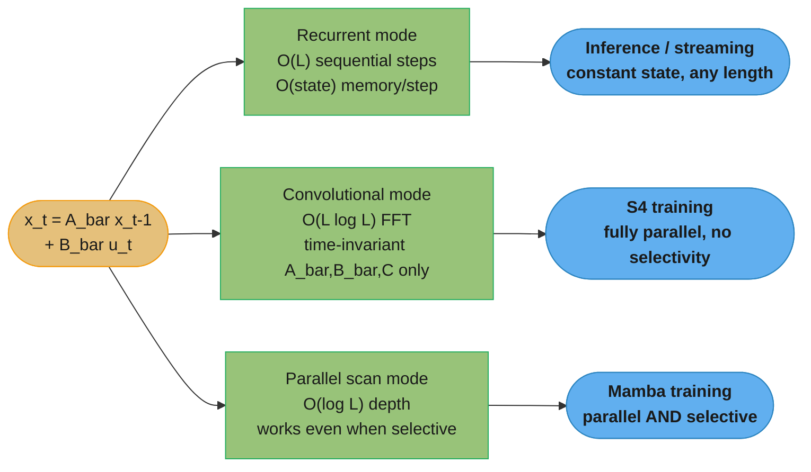
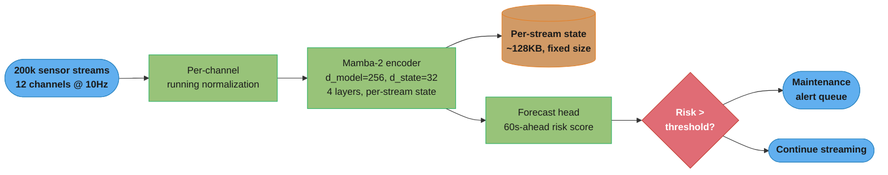

# State Space Models (S4, Mamba, xLSTM) — Deep Dive

## 1. Concept Overview

State space models (SSMs) are a third path for sequence modeling, sitting between the two architectures the [parent module](recurrent_neural_networks.md) covers: they keep the constant-size recurrent state that makes an RNN cheap to run, but replace the RNN's hand-tuned gates with a linear dynamical system whose recurrence can *also* be computed as a convolution — which is what makes it trainable at Transformer speed. S4 (Structured State Space, Gu, Goel & Ré, 2021) showed a stable, well-initialized linear SSM could solve long-range sequence benchmarks no RNN could touch. Mamba (Gu & Dao, 2023) made the SSM's parameters depend on the input — "selective" — which gives it the content-based routing that made attention so effective, at the cost of losing the convolutional shortcut. Mamba-2 (Dao & Gu, 2024) then proved SSMs and linear attention are mathematically the same family of operation, letting Mamba-2 reuse the matrix-multiply hardware Transformers already exploit.

This deep-dive stays in ML/applications territory, not LLM pretraining: long audio, long multivariate time series, genomics, and streaming inference where a fixed-size state per step — not a KV cache that grows with every token — is the entire point. Nearly every production SSM deployed today is a **hybrid**: a handful of attention layers dropped into an otherwise-SSM stack, because pure SSMs have a specific, well-documented weakness at exact copying and retrieval that attention does not share.

**Relationship to the parent module:** LSTM and GRU also carry a fixed-size state forward and also solve a version of the vanishing-gradient problem with gates — an SSM is not a different goal, it is a different mechanism for the same goal, one built from linear algebra (eigenvalues, discretization) instead of learned sigmoid gates. Read [recurrent_neural_networks.md](recurrent_neural_networks.md) first if the vanishing-gradient story and the gating mechanism are not already familiar; this file assumes both.

---

## 2. Intuition

One-line analogy: an LSTM's cell state is a notebook with gates deciding what to erase and write; an S4/Mamba state is a bank of damped oscillators — each one decaying or ringing at its own frequency — and the input pushes them, the output reads a linear combination of where they currently are.

Mental model: the state h_t is still a fixed-size vector, exactly like an RNN's hidden state, but it is produced by a **linear** recurrence (`h_t = A_bar h_{t-1} + B_bar x_t`) instead of a nonlinear gated one. Linearity is what lets the same recurrence be unrolled into a convolution and computed in parallel across the whole sequence during training — something a nonlinear LSTM recurrence cannot do because each step's nonlinearity depends on the previous step's output.

Why it matters: attention gives every token a direct O(1) path to every other token, at the cost of a KV cache that grows linearly with sequence length. An SSM's state never grows — one fixed-size vector represents the entire history, however long. That is a genuine engineering win for long streams (hour-long audio, genomic sequences, week-long sensor traces) and a genuine capability loss for tasks that need to retrieve one exact fact verbatim from far back in the context.

Key insight: **the fixed-size state is a lossy compression of history, and that single fact explains both why SSMs win and why they fail.** A compressed summary is enough to continue a smooth trend, recognize a genre of audio, or forecast the next value in a time series. It is not enough to reproduce an arbitrary string a Transformer's attention could just look up verbatim — compression by definition throws information away, and there is no way to know in advance which token will need to be retrieved exactly.

---

## 3. Core Principles

**Continuous linear SSM.** The starting point of S4 is the same equation used in control theory: `x'(t) = A x(t) + B u(t)`, `y(t) = C x(t) + D u(t)`, where `x(t)` is the (continuous-time) state, `u(t)` the input, and `A, B, C, D` are learned matrices. Deep learning runs on discrete tokens, so this continuous system is **discretized** — most commonly with a zero-order hold — into `A_bar = exp(ΔA)`, `B_bar = (ΔA)^-1 (exp(ΔA) - I) · ΔB`, producing a discrete-time recurrence `x_t = A_bar x_{t-1} + B_bar u_t`, `y_t = C x_t`, with `Δ` the (learned) step size. This is a linear RNN — same recurrence shape as Section 5 of the parent module's `h_t = f(W_hh h_{t-1} + ...)`, but with `f` removed and `W_hh` replaced by the structured matrix `A_bar`.

**HiPPO initialization.** A randomly initialized `A` behaves no better than a randomly initialized RNN's `W_hh` — it still vanishes or explodes. HiPPO (Gu, Dao, Ermon, Rudra & Ré, 2020, "Recurrent Memory with Optimal Polynomial Projections," [arXiv:2008.07669](https://arxiv.org/abs/2008.07669)) derives a specific, non-random `A` matrix that is provably optimal for compressing a continuous history into a fixed-size state via projection onto an orthogonal polynomial basis (HiPPO-LegS uses Legendre polynomials and requires no timescale prior). S4 initializes `A` from HiPPO rather than learning it from scratch, which is the difference between a state that memorizes structured history well from step one and one that has to rediscover the idea by gradient descent.

**Diagonal plus low-rank (DPLR).** Computing the discrete recurrence naively for every timestep is `O(L · N^2)` for state size `N` and sequence length `L` — too slow. S4's contribution is showing the HiPPO matrix `A` can be written as **diagonal plus low-rank**, `A = Λ - P Q^T`, which can be conjugated into a genuinely diagonal matrix and the whole recurrence reduced to evaluating a Cauchy kernel — bringing the cost down to roughly `O(L log L + N log N)` via FFT. This is a numerical-stability trick as much as a speed trick: a naive diagonalization of the raw HiPPO matrix is numerically unstable (its eigenvalues are ill-conditioned), and DPLR is what makes diagonalizing it safe.

**Recurrence-or-convolution duality.** Because the discrete SSM is linear and time-invariant (A_bar, B_bar, C do not change across timesteps in S4), unrolling the recurrence produces a single global convolution kernel: `y = u * K` where `K = (CB_bar, CA_bar B_bar, CA_bar^2 B_bar, ...)`. This is the core S4 trick — the exact same computation can run as an `O(L)` sequential recurrence at inference (constant memory per step, ideal for streaming) or as an `O(L log L)` FFT convolution at training time (fully parallel across the sequence, ideal for GPU throughput). An LSTM has no equivalent: its nonlinear gates make each step depend on the actual value of the previous step's output, not just a fixed linear combination, so there is no way to precompute a convolution kernel for it.

**Selectivity (Mamba).** S4's `A_bar`, `B_bar`, `C` are the same for every token — the model cannot decide "pay more attention to this particular token." Mamba (Gu & Dao, 2023, [arXiv:2312.00752](https://arxiv.org/abs/2312.00752)) makes `B`, `C`, and `Δ` functions of the current input token, so the model can, per-token, choose to let information in (`B`), choose what to read out (`C`), and choose how fast the state forgets (`Δ` — a small `Δ` means "barely update the state, this token doesn't matter"; a large `Δ` means "reset toward this token, it matters a lot"). This is Mamba's version of an LSTM's forget gate, generalized from a learned scalar-per-dimension gate to a full input-dependent linear projection.

**Selectivity breaks the convolution.** The moment `B_bar` and `C` vary per-timestep, the convolution kernel `K` from the paragraph above is no longer a fixed sequence of matrices — it is different at every position, so the neat `y = u * K` FFT trick no longer applies. Mamba pays for content-based routing with the loss of the training-time parallelism that made S4 fast, and the fix is not "go back to O(L) sequential training" but a **hardware-aware parallel scan**: the recurrence `x_t = A_bar_t x_{t-1} + B_bar_t u_t` is still an associative operation (the composition of two affine maps is another affine map), so a parallel prefix-scan algorithm can compute all `L` states in `O(log L)` parallel depth instead of `L` sequential steps — while the *result* is identical to running the recurrence one step at a time.

**State space duality (Mamba-2 / SSD).** Mamba-2 (Dao & Gu, 2024, ICML 2024, [arXiv:2405.21060](https://arxiv.org/abs/2405.21060), "Transformers are SSMs") proves a selective SSM's output can equivalently be written as `Y = (L ∘ CB^T) X` for a specific structured (semiseparable) matrix — the same algebraic shape as **linear attention** (attention with the softmax removed, i.e. `Y = (QK^T) V`). This is the SSD (structured state space duality) framework: it does not make Mamba faster on its own, it reveals that the SSM recurrence and linear attention were always computing the same class of matrix multiplication, which means Mamba-2 can reuse the block-matrix-multiply algorithms and tensor-core kernels that make attention fast on GPUs, instead of relying on the bespoke selective-scan CUDA kernel Mamba needed. The paper reports Mamba-2 is **2-8x faster** than the original Mamba's selective scan while remaining competitive with Transformers on language modeling.

---

## 4. Types / Architectures / Strategies

| Architecture | Recurrence type | Content-dependent params | Training path | Long-range mechanism | Where it fits |
|---|---|---|---|---|---|
| S4 / S4D | Linear, time-invariant, DPLR (or purely diagonal in S4D) | None — same `A_bar, B_bar, C` for every token | FFT convolution, `O(L log L)` | HiPPO-initialized `A`, provably long memory | Long Range Arena, audio, genomics — where content-routing is not the bottleneck |
| Mamba (selective SSM) | Linear per-step, but `B_bar, C, Δ` are input-dependent | Full selectivity | Hardware-aware parallel scan, fused CUDA kernel | Selective forget/write per token | General sequence modeling, drop-in for attention where a constant-size state matters |
| Mamba-2 (SSD) | Same selective recurrence, restricted `A` to scalar-times-identity per head | Full selectivity, structured for matmul reuse | Chunked matmul-based scan (block decomposition of the semiseparable matrix), tensor-core friendly | Same as Mamba, larger recommended state size since matmul is cheap | Same as Mamba, preferred when training/inference throughput on GPU matters more than the last point of quality from a fully general `A` |
| Mamba-3 | Selective recurrence with a more expressive discretization and a complex-valued state update; optional MIMO (multi-input, multi-output) form | Full selectivity | Chunked matmul-based scan, as Mamba-2 | Complex state supports state tracking (parity, modular counting) that real decaying states cannot do | Successor to Mamba-2 (Lahoti et al., ICLR 2026): matches Mamba-2 perplexity at half the state size; use the MIMO form when decode quality matters and latency is fixed |
| xLSTM (sLSTM) | Gated, RNN-family — not an SSM | Yes (gates, as in LSTM) | Sequential (recurrent), memory-mixing across heads | Exponential gating with a stabilizer state (replaces LSTM's sigmoid gates) | A parallel *revival* of the gated-RNN line, not a member of the SSM family — included here because it targets the same "post-Transformer alternative" niche |
| xLSTM (mLSTM) | Gated, matrix-valued memory | Yes | Fully parallelizable (no hidden-to-hidden recurrence across the matrix memory) | Covariance-update rule, exponential gating | The xLSTM block used when parallel training throughput matters more than sLSTM's stronger sequential mixing |
| Hybrid (Jamba, Nemotron-H, Falcon-H1) | Interleaved or parallel SSM + attention layers | Both (SSM layers selective, attention layers standard) | Attention layers parallel by construction; SSM layers via parallel scan | Attention layers supply exact recall; SSM layers supply cheap long-range compression | Production LLMs and long-context systems — see Section 7 |

**Why xLSTM belongs in this file despite not being an SSM.** It answers the same interview question — "what came after RNNs besides Transformers" — with a different bet: instead of replacing gates with linear algebra, xLSTM (Beck et al., 2024, [arXiv:2405.04517](https://arxiv.org/abs/2405.04517)) keeps the LSTM's gated-RNN structure but replaces sigmoid gates with **exponential gating** plus a stabilization term (to prevent overflow), and introduces a matrix-valued memory cell (mLSTM) so the update can be computed with parallelizable covariance-style matrix operations rather than a strictly sequential loop. The paper reports xLSTM blocks, stacked residually, perform favorably against state-of-the-art Transformers and SSMs in both performance and scaling behavior.

---

## 5. Architecture Diagrams

**Three ways to compute the same linear recurrence:**



The same equation supports three execution strategies. S4 exploits time-invariance to fall
back to a convolution for training; Mamba gives up that convolution for selectivity, and
recovers parallel training through a scan instead. All three modes compute the *identical*
sequence of states — they are three algorithms for one recurrence, not three models.

**Constant-size state vs a KV cache that keeps growing:**

```
 Transformer KV cache: grows one slot per generated token, never shrinks
 -----------------------------------------------------------------------
   token 1     [K1 V1]
   token 2     [K1 V1][K2 V2]
   token 3     [K1 V1][K2 V2][K3 V3]
   ...
   token 32768 [K1 V1][K2 V2][K3 V3] .......................... [K32768 V32768]
                <------------------ 6 GB at fp16 (worked example, Section 6) ------------------>

 SSM recurrent state: one fixed-size vector, same size at token 1 and token 32768
 -----------------------------------------------------------------------
   token 1     [ state: d_inner x d_state ]        <- 128 KB / layer (worked example, Section 6)
   token 2     [ state: d_inner x d_state ]           (overwritten, not appended)
   token 3     [ state: d_inner x d_state ]
   ...
   token 32768 [ state: d_inner x d_state ]        <- identical size to token 1
```

Caption: the KV cache is a *lossless* growing ledger — every past token's key/value is kept
verbatim, which is exactly why a Transformer can retrieve any of them exactly. The SSM state
is a *lossy, fixed-size* summary that gets overwritten every step — which is exactly why it
never runs out of memory, and exactly why it cannot promise to reproduce something from
32,000 steps ago on demand. This one tradeoff is the throughline of Sections 8 and 10.

---

## 6. How It Works — Detailed Mechanics

### Discretization: continuous (A, B) to discrete (A_bar, B_bar)

```python
import torch
from torch import Tensor


def discretize_zoh(A: Tensor, B: Tensor, delta: Tensor) -> tuple[Tensor, Tensor]:
    """Zero-order-hold discretization used by S4 and Mamba.

    A: (d_inner, d_state) continuous-time state matrix (diagonal here, so
       stored as its diagonal entries — this is the S4D / Mamba convention,
       not the full DPLR matrix S4 uses).
    B: (..., d_state) continuous-time input matrix. In Mamba this is
       input-dependent (selective), so its leading dims carry (batch, seq_len).
    delta: (..., d_inner) the learned/selective step size, one per channel
       per timestep.
    Returns discrete (A_bar, B_bar) with an extra d_inner axis broadcast in.
    """
    deltaA = torch.exp(delta.unsqueeze(-1) * A)  # (..., d_inner, d_state)
    # Zero-order hold for B: (A)^-1 (exp(A) - I) B, done elementwise since A
    # is diagonal here — this is the numerically-stable diagonal-only version.
    deltaB = delta.unsqueeze(-1) * B.unsqueeze(-2)  # (..., d_inner, d_state)
    return deltaA, deltaB
```

### Selective scan — sequential reference implementation

This is a **reference implementation for readability, not the production kernel.**
The real `mamba-ssm` package fuses discretization, the scan, and the output
projection into one CUDA kernel, keeps the `(batch, d_inner, d_state)` state
resident in fast SRAM instead of round-tripping it through HBM, and recomputes
intermediate activations in the backward pass instead of storing them — the
same trick FlashAttention uses to make an O(L) memory-bound operation fast.
A plain Python loop over timesteps is O(L) sequential and un-parallelized —
correct, and useful for understanding the recurrence, but roughly 20-40x
slower than the fused kernel on GPU.

```python
import torch
from torch import Tensor


def selective_scan_reference(
    u: Tensor,       # (batch, seq_len, d_inner) input
    delta: Tensor,   # (batch, seq_len, d_inner) input-dependent step size
    A: Tensor,       # (d_inner, d_state) NOT input-dependent (learned per-channel)
    B: Tensor,       # (batch, seq_len, d_state) input-dependent -- the "selective" part
    C: Tensor,       # (batch, seq_len, d_state) input-dependent -- the "selective" part
    D: Tensor,       # (d_inner,) skip connection
) -> Tensor:
    """Sequential reference for the selective SSM scan (Mamba, Section 3.2).

    One Python-level loop over timesteps -- O(L) sequential, no parallelism.
    Exists to make the recurrence legible; NOT what mamba-ssm runs at scale.
    """
    b, l, d_in = u.shape
    n = A.shape[1]
    device = u.device

    deltaA = torch.exp(delta.unsqueeze(-1) * A)                            # (b, l, d_in, n)
    deltaB_u = delta.unsqueeze(-1) * B.unsqueeze(2) * u.unsqueeze(-1)      # (b, l, d_in, n)

    x = torch.zeros(b, d_in, n, device=device)
    ys = []
    for t in range(l):
        x = deltaA[:, t] * x + deltaB_u[:, t]        # state update -- the "scan"
        y = torch.einsum("bdn,bn->bd", x, C[:, t])   # read out via C_t (selective readout)
        ys.append(y)
    y = torch.stack(ys, dim=1) + u * D                # skip connection
    return y


def _demo() -> None:
    """Hand-verifiable self-check: d_in=1, n=1 collapses the recurrence to
    scalar arithmetic, so every intermediate value can be checked by hand.
    Numbers match a manual trace: t=0 y=1.0000, t=1 y=0.6788, t=2 y=4.2497."""
    u = torch.tensor([[[1.0], [-0.2], [2.0]]])
    delta = torch.tensor([[[1.0], [0.5], [2.0]]])
    A = torch.tensor([[-0.5]])
    B = torch.ones(1, 3, 1)
    C = torch.ones(1, 3, 1)
    D = torch.zeros(1)

    y = selective_scan_reference(u, delta, A, B, C, D)
    expected = torch.tensor([[[1.0], [0.6788007830714049], [4.249716852743046]]])
    assert torch.allclose(y, expected, atol=1e-6), f"mismatch: {y} vs {expected}"
    print("selective_scan_reference: OK", y.squeeze().tolist())


if __name__ == "__main__":
    _demo()
```

`_demo()` was traced by hand (and independently with plain Python floats) before being
written down: `deltaA_t = exp(delta_t * A)` gives `0.6065, 0.7788, 0.3679` at t=0,1,2; the
state accumulates `x_0=1.0`, `x_1=0.7788*1.0-0.1=0.6788`, `x_2=0.3679*0.6788+4.0=4.2497` —
each step is exactly `A_bar_t * (previous state) + (this step's gated input)`, the same
"mix a re-weighted copy of the old summary with the current input" reading the parent
module gives the vanilla RNN, minus the `tanh` squash.

### Mamba-3: complex state and MIMO decoding

Mamba-3 (Lahoti, Li, Chen, Wang, Bick, Kolter, Dao & Gu, ICLR 2026,
[arXiv:2603.15569](https://arxiv.org/abs/2603.15569)) keeps the selective recurrence and changes
three things. **A more expressive recurrence** comes from a different discretization of the
continuous system. **A complex-valued state update** targets state tracking: Mamba-2's `A_bar` is a
real decay in `(0, 1)`, so each state coordinate can only shrink toward zero, while a complex
eigenvalue rotates the state each step, which is what tracking parity or a count modulo k needs.
**The MIMO form** replaces the per-step rank-1 outer-product update with a rank-`r` update.
Decode is memory-bandwidth-bound (the state is loaded from HBM every token for very little math),
so the extra FLOPs of a rank-`r` update fit inside time the step already spends waiting on memory:
quality goes up without raising decode latency.

The paper's numbers at 1.5B parameters: Mamba-3 beats the next-best model, Gated DeltaNet, by
0.6 points of average downstream accuracy, and the MIMO variant adds 1.2 more (1.8 total).
Across state sizes, Mamba-3 matches Mamba-2's perplexity with half the state, which halves the
per-sequence inference memory computed in the next subsection. In `mamba-ssm` it is
`from mamba_ssm import Mamba3`, with `is_mimo=True` and `mimo_rank` selecting the MIMO form.

### Memory arithmetic: constant SSM state vs a growing KV cache

Concrete comparison at `d_model = 2048`, `expand = 2` (so `d_inner = 4096`, matching the
`mamba-ssm` package defaults of `d_state=16, d_conv=4, expand=2`), `n_layers = 24`, fp16:

```
  SSM recurrent state (per layer):  d_inner x d_state = 4096 x 16 = 65,536 elements
                                     x 2 bytes (fp16)  = 131,072 bytes = 128 KB / layer
                                     x 24 layers        = 3,072 KB     ~ 3 MB TOTAL
                                     -- identical at token 1 and token 1,000,000 --

  Transformer KV cache (per token):  2 (K,V) x n_layers x n_heads x head_dim x 2 bytes
                                      n_heads=32, head_dim=64 (2048 / 32)
                                    = 2 x 24 x 32 x 64 x 2 bytes = 196,608 bytes = 192 KB / token

  At 32,768 tokens (32K context):    192 KB x 32,768 = 6,291,456 KB = 6,144 MB = 6 GB
```

At this one context length the SSM state is already **~2,000x smaller**, and the gap widens
linearly with every additional token — the SSM number never changes. This is the concrete
form of the diagram in Section 5: a KV cache is a ledger that keeps every entry; an SSM
state is a single fixed-size register that gets overwritten.

---

## 7. Real-World Examples

**Mamba on audio and genomics (original paper).** The Mamba paper reports state-of-the-art
results not just on language but on audio waveform modeling and DNA/genomics sequence
modeling — domains where sequences run to hundreds of thousands or millions of steps and a
Transformer's quadratic attention cost (or even a KV cache's linear memory cost) is
prohibitive; a constant-memory recurrent state is a direct fit.

**Jamba (AI21, production hybrid).** Jamba (Lieber et al., 2024, [arXiv:2403.19887](https://arxiv.org/abs/2403.19887)) interleaves Transformer, Mamba, and mixture-of-experts (MoE)
layers at roughly one attention layer for every seven Mamba layers within each repeating
block. Jamba-1.5-Mini ships 52B total parameters with 12B active per token (MoE routing);
Jamba-1.5-Large ships 398B total with 94B active — designed respectively to fit on a single
80GB GPU and a single 8x80GB-GPU node. The design goal stated by AI21 is combining Mamba's
memory/throughput efficiency with attention's retrieval strength in one model rather than
picking one architecture exclusively.

**Nemotron-H (NVIDIA, production hybrid).** Nemotron-H ([arXiv:2504.03624](https://arxiv.org/abs/2504.03624)) replaces the majority of self-attention layers in a
standard Transformer with Mamba layers across an 8B/56B model family (plus a 47B variant
compressed from the 56B model via NVIDIA's "MiniPuzzle" technique). The paper reports
accuracy on par with or better than similarly-sized Qwen-2.5 and Llama-3.1 models, with up
to 3x faster inference than a comparable pure-Transformer model, and used an FP8 training
recipe for the 56B model that matched BF16 accuracy.

**Falcon-H1 (TII, parallel hybrid).** Falcon-H1 ([arXiv:2507.22448](https://arxiv.org/abs/2507.22448)) takes a structurally different hybrid approach
from Jamba/Nemotron-H's *interleaved* layers: attention and Mamba-2 heads run **in parallel
within the same block** and their outputs are concatenated before the block's output
projection, rather than alternating attention-layer / SSM-layer sequentially. Released at
0.5B-34B scale, the 34B flagship is reported to match or outperform models up to 70B
(Qwen3-32B, Qwen2.5-72B, Llama-3.3-70B class) with fewer parameters and less training data.

**Streaming keyword spotting and on-device audio (constant-state inference).** The same
property that makes SSMs attractive for streaming RNN inference in the parent module —
`O(state)` memory per step, independent of stream length — applies directly to always-on
audio and long multivariate sensor traces; see [speech_and_audio_ml.md](../speech_and_audio_ml/speech_and_audio_ml.md) for the ASR/streaming
pipeline this plugs into, and [time_series_forecasting.md](../time_series_forecasting/time_series_forecasting.md) for the forecasting side.

---

## 8. Tradeoffs

| Property | LSTM/GRU | Pure SSM (S4 / Mamba / Mamba-2) | Transformer |
|---|---|---|---|
| Training parallelism | Sequential across time — cannot parallelize the time axis | S4: full FFT-convolution parallelism (non-selective). Mamba/Mamba-2: parallel scan, `O(log L)` depth | Fully parallel across all positions |
| Inference memory | `O(hidden_size)` — constant per step | `O(d_inner x d_state)` — constant per step, same order as LSTM | `O(seq_len x hidden)` — KV cache grows with every generated token |
| Inference latency/token | `O(hidden_size^2)` per step, hardware-limited by sequential dependency | Same shape as LSTM — sequential recurrent generation, but a much cheaper per-step matmul at large `d_inner` since state is diagonal | Grows with context length as the KV cache is re-read every step |
| Exact recall / copying | Weak beyond a few hundred steps (Section 3, vanishing gradient) | Provably bounded by fixed state size — Jelassi et al. show state space models are fundamentally limited on copying tasks that a two-layer Transformer solves exactly (Section 10) | Strong — any token is one attention lookup away, independent of distance |
| Ecosystem maturity | Mature: `torch.nn.LSTM`/`GRU` are cuDNN-accelerated, stable for a decade | Young: `mamba-ssm` requires Linux + a custom CUDA kernel build; HF `transformers` support exists but is newer and narrower than its Transformer coverage | Most mature: every major training/serving framework is Transformer-first |
| Best long-sequence domain | Short-medium streaming (audio frames, sensor ticks) | Very long streams where content is smooth/compressible: long audio, genomics, long multivariate time series | Any length where GPU budget allows a KV cache and exact retrieval matters |

---

## 9. When to Use / When NOT to Use

**Use an SSM (S4/Mamba/Mamba-2) when:**
- The sequence is very long (tens of thousands to millions of steps) and a KV cache of that
  length would not fit in memory or would dominate serving cost
- The task is compressible — forecasting, classification, generation of smooth signals —
  rather than exact retrieval of a specific earlier token
- Streaming inference needs constant memory per step regardless of how long the stream has
  already run (long audio, continuous sensor telemetry, genomics)
- Training throughput on very long sequences matters more than matching a Transformer's
  peak quality at moderate lengths

**Use a hybrid (Mamba/SSM layers + a few attention layers) when:**
- The workload needs both — long-context compression most of the time, but occasional exact
  lookups (e.g. "what was the exact API key mentioned 20,000 tokens ago"). This is why every
  production SSM system in Section 7 is a hybrid, not a pure SSM
- You want SSM-level memory/throughput at serving time but cannot accept the copying/recall
  failure mode of a pure SSM (see Section 10)

**Do NOT use a pure SSM when:**
- The task is fundamentally retrieval-shaped: needle-in-a-haystack QA, exact string copying,
  in-context learning that depends on verbatim recall of a specific earlier example
- Sequence lengths are short enough that a Transformer's KV cache is cheap anyway — there is
  no memory pressure to relieve, so the SSM buys nothing and costs ecosystem maturity
- The team cannot support the current SSM tooling constraints (Linux-only optimized CUDA
  kernels, narrower `transformers` library coverage than standard Transformer checkpoints)

**Use xLSTM instead of an SSM when:**
- The team wants the gated-RNN inductive bias (explicit forget/input/output-style gating)
  rather than a linear-dynamical-system formulation, while still getting matrix-memory
  parallel training via mLSTM blocks

---

## 10. Common Pitfalls

**BROKEN -> FIX: a pure-SSM model chosen for long-context retrieval fails needle-in-a-haystack.**
A team building a document-QA system over 50-page contracts picked a pure Mamba-based model
specifically *because* of its long-context efficiency claims, assuming "handles long
sequences" meant "answers questions about anything in a long sequence." In evaluation, the
model reliably summarized document themes but failed to retrieve an exact clause number or
dollar figure quoted 30 pages earlier, hallucinating a plausible-sounding but wrong value
instead. This is not a training bug — it is the documented, provable limitation of a
fixed-size state: Jelassi et al., "Repeat After Me: Transformers are Better than State
Space Models at Copying" ([arXiv:2402.01032](https://arxiv.org/abs/2402.01032)), prove a two-layer Transformer can copy strings of
exponential length while a generalized SSM's copying ability is fundamentally bounded by
its fixed-size latent state, and confirm the gap empirically on both synthetic copying tasks
and pretrained LLMs — pure SSMs dramatically underperform Transformers at exact
retrieval/copying from context.

```
# BROKEN: pure SSM for a task that requires exact-value retrieval
model = MambaForCausalLM.from_pretrained("state-spaces/mamba-2.8b-hf")
answer = model.generate(f"{fifty_page_contract}\n\nWhat is the penalty clause amount?")
# -> plausible-sounding but wrong dollar figure; the state compressed it away

# FIX 1: hybrid architecture -- a few attention layers restore exact recall
# (this is exactly why Jamba/Nemotron-H/Falcon-H1 are hybrids, not pure SSMs)
model = JambaForCausalLM.from_pretrained("ai21labs/AI21-Jamba-Mini-1.6")
answer = model.generate(f"{fifty_page_contract}\n\nWhat is the penalty clause amount?")

# FIX 2 (architecture-agnostic): don't rely on the model's compressed state at
# all for exact facts -- retrieve the exact span and put it back in context
span = retrieve_exact_clause(fifty_page_contract, query="penalty clause amount")
answer = model.generate(f"{span}\n\nWhat is the penalty clause amount?")
```

Either fix works, and they compose: a hybrid model is a strictly better default for mixed
workloads, while explicit retrieval is the right fix even for a Transformer once the context
is too long to fit at all.

**Pitfall — treating `mamba-ssm`'s optimized kernel as portable, then failing to deploy.**
A team validated a Mamba model in a notebook (CPU fallback, or a dev box with the compiled
CUDA extension already built) and only discovered at deployment time that the production
inference servers were not Linux, or lacked the toolchain to build `causal_conv1d` and
`mamba-ssm`'s CUDA extensions — the model would technically run via the library's plain
"eager" PyTorch fallback path, at a fraction of the throughput the design was budgeted on.
Fix: pin the exact `mamba-ssm`/`causal_conv1d` build requirements (Linux, matching CUDA
toolkit and PyTorch version) into the serving image at design time, not deployment time, and
benchmark the eager fallback path explicitly if there is any chance a target environment
cannot build the optimized kernel — do not assume "it imports without error" means "it runs
at the throughput the paper reports."

**Pitfall — resetting selectivity's `Δ` the same way an LSTM resets hidden state, and getting it backwards.**
A team porting streaming-inference code from an LSTM pipeline reset the SSM's recurrent
state to zero between independent sequences (correct — this mirrors the parent module's
"hidden state leaking across sequences" pitfall) but also zeroed out the *learned* `Δ`
projection weights during a fine-tune warm-start, treating them as "sequence-specific state"
rather than the model's globally-learned parameters. `Δ` is a parameter, not a runtime state
variable — resetting per-sequence state means resetting `x_t` (the recurrent state tensor)
to zero at a sequence boundary; it never means resetting the weights that compute `Δ`, `B`,
or `C` from the input.

---

## 11. Technologies & Tools

| Tool | Purpose |
|---|---|
| `mamba-ssm` (PyPI) | Official Mamba/Mamba-2/Mamba-3 package from the `state-spaces/mamba` repo (`Mamba`, `Mamba2`, `Mamba3` modules; `Mamba3(is_mimo=True, mimo_rank=4)` for MIMO); ships the fused CUDA selective-scan kernel. Linux-only, requires a matching CUDA toolkit + PyTorch build |
| `causal_conv1d` | Companion package providing the fused causal 1D convolution Mamba uses before the scan; required alongside `mamba-ssm` for the optimized path |
| `transformers` (Hugging Face) | `MambaConfig`/`MambaForCausalLM`, `Mamba2Config`, and `JambaForCausalLM` ship in the library, giving Mamba/Mamba-2/Jamba the same `from_pretrained`/`generate` API as any Transformer checkpoint |
| `state-spaces/mamba` (GitHub) | Upstream reference implementation and pretrained checkpoint releases (`mamba-130m` through `mamba-2.8b`, plus `-hf` variants for `transformers`) |
| `xlstm` (PyPI, `NX-AI/xlstm`) | Official xLSTM implementation (sLSTM + mLSTM blocks); `mlstm_kernels` provides fast kernels for the large xLSTM checkpoints |
| `flash-linear-attention` (`fla`) | Community library of fused Triton kernels for linear-attention-family models, including SSM/SSD-style recurrences, useful when the official CUDA kernel is unavailable |
| Long Range Arena (LRA) | The standard long-sequence benchmark suite S4 was designed against (Path-X, ListOps, byte-level text, etc.) — still the reference benchmark for comparing sequence-mixing architectures on raw long-range capability |

---

## 12. Interview Questions with Answers

**Q: Why does making an SSM "selective" (Mamba) break the convolutional training mode that made S4 fast?**
**Short:** Selectivity makes A_bar, B, C vary per token, so no fixed convolution kernel exists anymore.
S4's convolutional trick works because `A_bar`, `B_bar`, and `C` are the same matrices at every timestep, so the unrolled recurrence collapses into one fixed kernel `K` convolved against the input. Mamba computes `B`, `C`, and the step size `Δ` from the current input token, so a different effective `A_bar_t`/`B_bar_t` applies at every position — there is no single kernel left to precompute, because the "kernel" is now data-dependent. Mamba recovers parallelism a different way: the recurrence is still an associative operation, so a parallel prefix scan computes all states in `O(log L)` depth instead of falling back to a fully sequential `O(L)` loop.

**Q: What specifically fails when a pure SSM is used for long-context retrieval, and what fixes it?**
**Short:** A pure SSM's fixed-size state cannot losslessly hold an arbitrary fact for exact retrieval; hybrids or explicit retrieval fix it.
Jelassi et al. ("Repeat After Me," arXiv:2402.01032) prove a generalized SSM's ability to copy or retrieve a token verbatim is bounded by its fixed-size latent state, while a two-layer Transformer can copy strings of exponential length because attention gives every position a direct, lossless lookup into every prior position. In practice this shows up as a model that summarizes long documents well but hallucinates when asked for one exact figure buried deep in the context. The fix is architectural (a hybrid with a few attention layers, exactly why Jamba/Nemotron-H/Falcon-H1 exist) or a retrieval step that puts the exact span back into context rather than relying on the compressed state to have preserved it.

**Q: Why is `mamba-ssm` Linux-only, and what happens if you deploy without the compiled CUDA kernel?**
**Short:** The optimized selective-scan kernel is a custom CUDA extension; without it the library silently falls back to a much slower eager path.
The official package's speed comes from a fused CUDA kernel (`selective_scan_cuda`) that keeps intermediate state in GPU SRAM and recomputes activations in the backward pass instead of storing them; that kernel has to be compiled against a specific CUDA toolkit and PyTorch build, which the maintained wheels currently support only on Linux. If the compiled extension is missing at import time, `mamba-ssm`/`transformers` fall back to a plain PyTorch ("eager") implementation that is still numerically correct but runs at a fraction of the throughput — the failure mode is silent (the model still produces correct output), which is what makes it dangerous: a benchmark run on a dev box with the kernel built can look nothing like production if the kernel silently isn't there.

**Q: What is HiPPO initialization and why does S4 need it instead of random initialization?**
**Short:** HiPPO gives S4's state matrix A a provably optimal structure for compressing history, instead of an untrained random one.
HiPPO (Gu, Dao, Ermon, Rudra & Ré, 2020, arXiv:2008.07669) derives a specific state matrix `A` that is the closed-form optimal solution to projecting a continuous input history onto a fixed-size polynomial basis online, as new inputs arrive. A randomly initialized `A` in a linear recurrence has exactly the vanishing/exploding eigenvalue problem the parent module's Section 3 describes for `W_hh` — HiPPO sidesteps that by starting from a matrix already known to preserve long-range information, rather than hoping gradient descent discovers a comparable structure from scratch.

**Q: What is the diagonal-plus-low-rank (DPLR) trick and what problem does it solve?**
**Short:** DPLR rewrites the HiPPO matrix so it can be diagonalized stably and the recurrence computed via a fast Cauchy kernel.
The raw HiPPO matrix is not safely diagonalizable — its eigenvalues are ill-conditioned, so naive diagonalization is numerically unstable. S4 shows the matrix can be written as `Λ - PQ^T` (diagonal plus a low-rank correction), which can be conjugated into a genuinely diagonal form and the whole recurrence reduced to evaluating a Cauchy kernel, bringing the cost from the naive `O(L·N^2)` down to roughly `O(L log L + N log N)` via FFT. It is simultaneously the numerical-stability fix and the speed fix — the two are the same trick.

**Q: In Mamba, why does the paper call B, C, and Δ "selective" and not A?**
**Short:** Mamba makes only B, C, and Δ input-dependent, keeping A a fixed learned per-channel parameter for efficiency and stability.
`B` controls how much of the current input is written into the state, `C` controls what is read back out, and `Δ` controls how fast the state forgets — making these input-dependent gives the model per-token control over "let this in," "expose this," and "how much does this matter." `A` stays a plain learned parameter (not computed from the input) because keeping it fixed is what lets the diagonalized, discretized recurrence stay numerically well-behaved and cheap to discretize per-channel; making `A` itself selective was considered and left out of the base Mamba design in favor of this more constrained, more stable parameterization.

**Q: What does "state space duality" (SSD) in Mamba-2 actually establish, and why does it matter practically?**
**Short:** SSD proves selective SSMs and linear attention compute the same structured-matrix operation, letting Mamba-2 reuse tensor-core matmul kernels.
Dao & Gu (arXiv:2405.21060) show a selective SSM's output can be written as `Y = (L ∘ CB^T)X` for a specific semiseparable matrix, which is the same algebraic shape as linear attention (`Y = (QK^T)V` without the softmax). Practically, this means Mamba-2 can be implemented as a sequence of chunked block-matrix multiplications instead of a bespoke selective-scan kernel, reusing the tensor-core-optimized matmul primitives Transformers already exploit — the paper reports Mamba-2 running 2-8x faster than the original Mamba's scan while remaining competitive with Transformers on language modeling.

**Q: Why does the SSM's fixed-size state solve the same problem as an LSTM's gates, using a completely different mechanism?**
**Short:** Both keep a bounded-size summary of history; LSTM controls it with learned sigmoid gates, an SSM with a structured linear recurrence.
An LSTM's cell state and an SSM's state vector are both fixed-size compressions of everything seen so far — the shared constraint is "memory doesn't grow with sequence length." LSTM enforces useful long-range behavior by learning sigmoid-valued forget/input/output gates end to end; an SSM enforces it by construction, via a linear recurrence whose matrix is either fixed and HiPPO-structured (S4, provably long-memory by derivation) or input-dependent through B/C/Δ (Mamba, learned selectivity). Neither approach is "the gate idea" borrowed from the other — they are two independent solutions converging on the same fixed-size-state design point.

**Q: What is the parallel scan, and why is it necessary once B_bar and C become input-dependent?**
**Short:** A parallel scan computes an associative recurrence in O(log L) depth in parallel, unlike a fixed convolution kernel which needs time-invariance.
Once `B_bar`, `C`, and `Δ` vary per token, no single convolution kernel represents the whole sequence, so S4's FFT-convolution training shortcut is gone. But the recurrence `x_t = A_bar_t x_{t-1} + B_bar_t u_t` composes two affine maps at each step, and composition of affine maps is associative — which is exactly the algebraic property a parallel prefix-scan algorithm exploits to compute all `L` states with `O(log L)` parallel depth instead of an `O(L)` sequential loop, while producing bit-for-bit the same states a sequential loop would.

**Q: How does the fused CUDA kernel keep the selective scan fast despite being memory-bandwidth-bound?**
**Short:** The kernel keeps the state in fast on-chip SRAM instead of HBM, and recomputes activations in the backward pass instead of storing them.
Rather than materializing the discretized `(batch, seq_len, d_inner, d_state)` tensors in slow GPU HBM, the fused kernel loads the SSM parameters into fast on-chip SRAM, performs discretization and the recurrence there, and only writes the final outputs back to HBM — cutting the number of HBM reads/writes by roughly the state dimension `N`. It also avoids storing every intermediate state for the backward pass (which would be as memory-hungry as storing every attention score); instead it recomputes them from the saved inputs during backprop, the same trade FlashAttention makes for the attention matrix.

**Q: Why is nearly every production SSM system (Jamba, Nemotron-H, Falcon-H1) a hybrid rather than a pure SSM?**
**Short:** Hybrids combine SSM efficiency for most tokens with attention's exact recall for the tokens that need it.
A pure SSM's fixed-size state is provably weak at exact copying/retrieval (Section 10), which is a real capability gap for any production system that has to answer "what exact value appeared earlier in this context." Every named hybrid solves it the same way at a different granularity: Jamba interleaves roughly one attention layer per seven Mamba layers; Nemotron-H replaces most (not all) attention layers with Mamba; Falcon-H1 runs attention and Mamba-2 heads in parallel within the same block rather than alternating layers. All three keep enough attention to preserve exact recall while getting most of a pure SSM's memory and throughput benefit on the bulk of the sequence.

**Q: What is the difference between S4's DPLR approach and S4D / Mamba's purely diagonal A?**
**Short:** S4 keeps a low-rank correction for exactness from HiPPO; S4D and Mamba drop it, using a plain diagonal A that trains fine in practice.
S4's original DPLR formulation keeps a low-rank correction term because that is what the exact HiPPO matrix requires for its provable long-memory guarantees. Follow-up work (S4D, and the diagonal `A` used inside Mamba) found that a plain diagonal `A`, initialized from a diagonal approximation of HiPPO (or even simpler init schemes), trains just as well in practice and is considerably simpler to implement and reason about — the low-rank correction turned out to matter far more for the theoretical guarantee than for empirical performance.

**Q: What memory advantage does an SSM's recurrent state have over a Transformer's KV cache, concretely?**
**Short:** The SSM state is a fixed size regardless of sequence length; the KV cache grows linearly with every generated token.
For a `d_model=2048`, 24-layer model at fp16, the SSM recurrent state is `d_inner (4096) x d_state (16) x 24 layers x 2 bytes ≈ 3 MB`, and that number is identical whether the sequence is 10 tokens or 10 million. A comparably sized Transformer's KV cache costs `2 x 24 layers x 32 heads x 64 head_dim x 2 bytes ≈ 192 KB per token`, which at a 32K-token context alone reaches roughly 6 GB and keeps growing with every additional token generated.

**Q: Is xLSTM a state space model?**
**Short:** No — xLSTM keeps the LSTM's gated-RNN structure with exponential gating, not a linear state space recurrence.
xLSTM (Beck et al., arXiv:2405.04517) is a parallel revival of the gated-RNN line, not a member of the SSM family: it keeps LSTM-style gates (sLSTM: scalar memory, novel memory mixing; mLSTM: matrix-valued memory with a covariance update rule) and replaces the sigmoid gating with exponential gating plus a stabilization mechanism, rather than reformulating the recurrence as a linear dynamical system with a convolution/recurrence duality. It targets the same "efficient long-sequence alternative to plain attention" niche as SSMs, by a structurally different route.

**Q: Why can't an LSTM be run in "convolutional mode" the way S4 can?**
**Short:** LSTM's nonlinear gates make each step depend on the previous step's actual output, so no fixed convolution kernel can represent it.
S4's convolution trick works because the linear, time-invariant recurrence can be unrolled algebraically into one fixed kernel independent of the actual input values. An LSTM's gates (`sigmoid(W[x_t, h_{t-1}])`) are nonlinear functions of the *previous step's actual hidden state*, not just a fixed linear combination — so the effect of `x_1` on `h_5` depends on the specific values `h_2, h_3, h_4` took, which in turn depend on the specific inputs. There is no way to precompute a fixed kernel for that, because the kernel itself would have to already know every intermediate output.

**Q: How should you reset an SSM's state between independent sequences in a batch, and what should you never reset?**
**Short:** Reset the recurrent state tensor to zero between sequences; never reset the learned Δ/B/C projection weights.
The recurrent state `x_t` (shape `batch x d_inner x d_state`) is per-sequence runtime data and should be reset to zero at a sequence boundary, exactly like resetting an LSTM's `h_0, c_0` between independent documents (parent module, Section 10). The projections that compute `Δ`, `B`, and `C` from the input are globally learned model parameters, not runtime state — they are shared across every sequence the model ever processes and must never be zeroed or reinitialized as part of a "reset," which is a mistake that is easy to make when porting streaming-inference code from an LSTM pipeline that only has one kind of per-sequence state to reset.

**Q: When would you choose Mamba-2 over the original Mamba, and what do you give up?**
**Short:** Choose Mamba-2 for GPU throughput via tensor-core matmuls; the tradeoff is a more restricted, scalar-times-identity A matrix.
Mamba-2's SSD formulation restricts `A` to a scalar-times-identity matrix per attention-style head (rather than Mamba's fully general per-channel diagonal `A`), which is what allows the recurrence to be expressed as chunked block-matrix multiplications and executed on tensor cores instead of a bespoke selective-scan kernel — the paper reports 2-8x faster than Mamba's scan. The tradeoff is a less expressive `A` per channel; in practice this is compensated by being able to afford a larger state size `d_state` for the same compute budget, since the matmul-based computation is so much cheaper per FLOP than the scan kernel.

**Q: What does Mamba-3's complex-valued state let it do that Mamba-2 cannot, and what does MIMO buy at decode?**
**Short:** A complex state rotates instead of only decaying, so it can track parity-style state; MIMO's rank-r update adds quality inside the memory-bound decode step at no latency cost.

Mamba-2's per-step transition is a real decay between 0 and 1, so every state coordinate can only fade, and a fading state cannot flip back and forth the way tracking parity or a count modulo k requires. Mamba-3 (arXiv:2603.15569, ICLR 2026) makes the state update complex-valued, so a step can rotate the state, which is the missing primitive for these state-tracking tasks. MIMO addresses a different limit: single-token decode loads the whole state from memory for one rank-1 outer-product update, so the GPU is idle on arithmetic; a rank-`r` MIMO update does more math per byte loaded and raises quality without raising decode latency. The paper reports +0.6 average accuracy over Gated DeltaNet at 1.5B (+1.8 with MIMO) and Mamba-2 perplexity at half the state size.

**Q: Why is a "constant memory per step" claim about SSMs true for inference but not for training?**
**Short:** Inference walks the recurrence one step at a time with fixed state; training with the parallel scan trades memory for parallelism.
At inference/generation time, an SSM genuinely runs the sequential recurrence one token at a time, so memory really is `O(state size)` regardless of how many tokens have already been generated — this is the property that makes streaming inference attractive. At training time, however, the parallel scan (or S4's FFT convolution) processes the whole sequence's states simultaneously to get GPU parallelism, which means training-time memory scales with sequence length just like a Transformer's activation memory does — the constant-memory property is specifically an inference-time, sequential-generation property, not a blanket property of the architecture.

---

## 13. Best Practices

- Default to a **hybrid** (SSM layers plus a small fraction of attention layers) for any
  production system that might need exact retrieval from long context — do not assume "long
  context" and "exact recall over long context" are the same requirement.
- Pin the exact `mamba-ssm` / `causal_conv1d` build environment (Linux, matching CUDA
  toolkit, matching PyTorch version) into the deployment artifact; never assume the eager
  PyTorch fallback path delivers the throughput a benchmark measured with the compiled kernel.
- Benchmark needle-in-a-haystack / exact-copying tasks explicitly before shipping a pure SSM
  for any retrieval-adjacent workload — general perplexity or summarization quality does not
  surface this failure mode.
- Reset the recurrent state tensor (not the model's learned projection weights) between
  independent sequences in a batch, mirroring the parent module's hidden-state-leak pitfall.
- Reach for `transformers`' `MambaForCausalLM`/`Mamba2Config`/`JambaForCausalLM` for standard
  checkpoints before hand-rolling a custom loading path — the library already carries the
  correct discretization and kernel-dispatch logic.
- Prefer the largest `d_state` your throughput budget allows on Mamba-2 (matmul-based SSD is
  far cheaper per state-dimension than Mamba's scan kernel), rather than defaulting to the
  same `d_state=16` that suits the original Mamba's scan cost.
- Treat S4's non-selective, purely time-invariant form as the right choice specifically when
  the task does not need content-based routing (e.g. a fixed audio-featurization front end) —
  it is simpler, and its FFT-convolution training is genuinely faster than a scan when
  selectivity would add nothing.
- When porting a streaming pipeline from LSTM to an SSM, audit every place the old code reset
  "hidden state" — the SSM equivalent is the state tensor, never the Δ/B/C projection weights.

---

## 14. Case Study

**Scenario: constant-memory streaming forecasting over 200k industrial sensor streams.**
A manufacturing platform ingests 200,000 independent multivariate sensor streams (vibration,
temperature, pressure — 12 channels per stream) at 10 Hz, and must produce a rolling 60-second-ahead
anomaly-risk forecast per stream with under 50ms P99 latency per inference call, running on
a fixed fleet of GPUs with no headroom to let per-stream memory grow. Each stream is
effectively infinite — sensors run continuously for months between maintenance windows — so
any model whose inference memory scales with elapsed time is a non-starter at this fleet
size: 200,000 growing KV caches would exhaust GPU memory within hours even at a modest
per-token footprint, while 200,000 constant-size SSM states are a fixed, plannable memory
budget from the first second of a stream to the millionth.

**Architecture decision.**



**Why not a hybrid here.** Section 9 recommends a hybrid whenever a workload needs exact
retrieval; this workload does not — the forecast is a smoothed statistical continuation of
recent sensor behavior, never a request to reproduce an exact past reading verbatim. A pure
Mamba-2 encoder was chosen deliberately, and the choice was validated the way Section 10
insists it must be: the team explicitly checked whether any part of the product surface
(e.g. "show me the exact temperature reading from the incident 3 days ago") required exact
recall, found that use case was served by a separate raw-log-lookup system rather than the
forecasting model, and only then confirmed a pure SSM was appropriate for this component.

**Per-stream memory.** With `d_model=256`, `expand=2` (`d_inner=512`), `d_state=32`, 4 layers,
fp16: `512 x 32 x 4 layers x 2 bytes = 131,072 bytes = 128 KB` per stream — at 200,000
concurrent streams, `128 KB x 200,000 ≈ 24.4 GB` total, a fixed number regardless of how
long any individual stream has been running. The equivalent fixed-window Transformer
approach the team prototyped first required re-processing a sliding window of raw
observations per forecast call, and its cost scaled with window length rather than being a
one-time fixed footprint — at the 6-hour lookback window product wanted, that prototype could
not fit the same fleet's memory budget at 200,000 concurrent streams.

**Operational result.** The Mamba-2 encoder path held per-stream state to a fixed budget
that let the team plan GPU fleet size directly from stream count rather than from a
worst-case lookback window, and inference per stream stayed within the 50ms P99 budget
because each step only reads the current 12-channel observation and the existing 128 KB
state — no re-scan of history is ever required, which is the direct payoff of the fixed-size
state this whole file has been building toward.

**Interview discussion points:**

**Why was a pure SSM the right call here when Section 9 generally recommends hybrids?** Because the specific failure mode hybrids fix — exact retrieval of a verbatim past value — was explicitly not a requirement of the forecasting model; it was served by a separate system. The lesson generalizes: "prefer hybrids" is a default for retrieval-shaped workloads, not a blanket rule, and the right process is to check the requirement explicitly (as Section 10's pitfall describes failing to do) rather than assume.

**What would break first if this were built on a fixed-window Transformer instead?** Memory, not accuracy — reprocessing a sliding window per forecast call means memory and compute scale with the window length chosen for accuracy, and at 200,000 concurrent streams even a modest per-stream window multiplies into a fleet-breaking total, whereas the SSM state is a one-time fixed cost independent of how far back the model's forecast implicitly depends on.

**How would you validate the pure-SSM choice before committing to production?** Run the exact `Repeat After Me`-style check from Section 10 against this workload's actual query patterns — confirm no downstream consumer ever needs an exact historical value reproduced by the forecasting model itself, and if any does, either route that need to the raw-log-lookup system (as done here) or add a hybrid attention layer rather than discovering the gap after ship.
