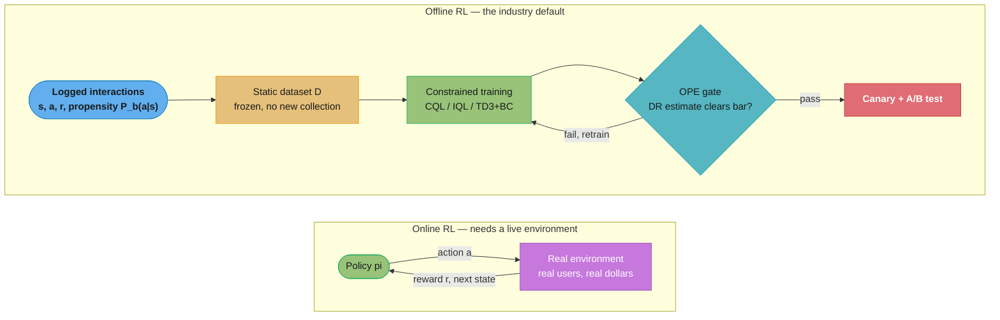
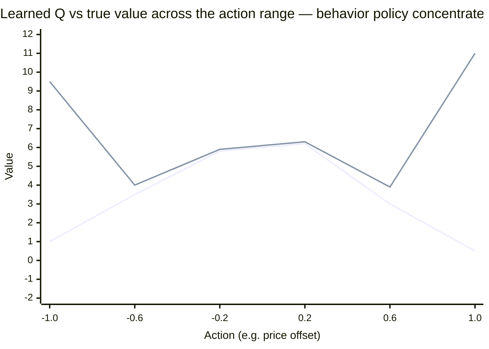

# Offline Reinforcement Learning

---

## 1. Concept Overview

Offline RL (also called batch RL) learns a policy entirely from a fixed, previously-collected dataset of logged interactions — no environment, no simulator, no further data collection during training. The agent never gets to try an action and see what happens; it only gets to reason about what *would* have happened, using transitions someone else's policy already generated.

This is the form RL actually takes in most industry deployments. [`reinforcement_learning.md`](reinforcement_learning.md) covers the online agent-environment loop — an agent that explores, observes a reward, and updates — which is the right model for a game, a simulator, or a robot in a lab. It is the wrong model for pricing, recommendation, or marketplace allocation, because "explore" there means showing a real customer a bad price or a real driver a bad dispatch. Offline RL exists because the online loop's core assumption — cheap, safe exploration against the true environment — is false in exactly the settings where RL is most tempting to apply: money, users, and irreversible actions are all on the line. The trade a team makes is: give up live exploration, keep everything else — sequential decisions, delayed reward, long-horizon credit assignment — and solve it from history instead.

---

## 2. Intuition

One-line analogy: it is the difference between learning to drive by sitting behind the wheel versus learning to drive by watching ten thousand hours of other people's dashcam footage. You never get to try the turn you're unsure about — you only get to reason, from footage of turns other drivers actually took, about how good your own turn would probably have been.

Mental model: every value function you train offline is being asked a question the data cannot answer — "what if I'd done something other than what's in the log?" — and it will answer that question whether or not it has any right to. A neural network queried at an input far from its training distribution does not raise an error; it returns a number, confidently, and that number is frequently wrong in the optimistic direction. Nothing in supervised learning punishes this, because supervised learning is never asked to *act* on its own extrapolation. RL is, every single training step, via `max_a' Q(s', a')`.

Why it matters: this single failure mode — extrapolation error — is the entire subject of offline RL. Every algorithm below (BCQ, TD3+BC, CQL, IQL, Decision Transformer) is a different answer to the same one question: how do you get the benefits of value-based reasoning (stitching together good pieces of many mediocre trajectories, per §12) without ever trusting the value function where the data can't check its work?

Key insight: in the online loop, a bad estimate corrects itself — the agent tries the overvalued action, the environment reports the true reward, and the error is gone in one step. Offline, there is no environment to correct it. A confidently wrong Q-value can survive the entire training run unchallenged, and the policy that chases it ships to production still wrong.

---

## 3. Core Principles

1. **Distributional shift is the root cause.** The learned policy `pi(a|s)` diverges from the behavior policy `pi_b(a|s)` that generated the data as training progresses — greedy policy improvement pulls the policy toward whatever action currently has the highest estimated Q-value, and nothing forces that action to be one the data actually demonstrated.
2. **Extrapolation error is what distributional shift produces in the Q-function.** `Q(s, a)` for an out-of-distribution `(s, a)` pair is a function-approximator guess with no data to ground it. Bootstrapping (`r + gamma * max_a' Q(s', a')`) then compounds that guess into every earlier state's target, and the `max` operator systematically prefers whichever action's guess happens to be an overestimate — an unconstrained TD update has no mechanism to distinguish "genuinely great action" from "action the network hallucinated a high value for."
3. **There is no environment to correct the error.** Online, a bad estimate is falsified the next time the agent tries that action. Offline, the dataset is frozen — an inflated Q-value for an unseen action is never contradicted, because it is never tested.
4. **The whole field is a spectrum of "how hard do you constrain the policy to the data."** Pure behavior cloning constrains completely (and cannot improve on the data). Unconstrained off-policy Q-learning constrains not at all (and diverges, per above). Every practical algorithm sits between these: stay close enough to the data that extrapolation error can't run away, while still improving on the average behavior in the logs.
5. **Offline RL is not the same problem as off-policy evaluation, but they share the same disease.** Training a policy from logs and *scoring* a policy from logs (§6) both fail for the same underlying reason: neither can check its answer against a real environment, so both need a way to know when the data does and does not support a conclusion.
6. **The logging requirement decides whether any of this is even possible.** You must record the *propensity* — the probability the behavior policy actually assigned to the action it took, `P_b(a|s)` — at decision time. Without it, you cannot compute an importance-sampling correction, you cannot build an unbiased off-policy estimate, and a deterministic production policy with zero randomization produces logs from which nothing can be learned or safely evaluated at all. This is the most common way real offline RL projects fail, and it fails at the logging layer, months before anyone runs CQL.

---

## 4. Types / Architectures / Strategies

### 4.1 The progression, from "trust the data completely" to "trust the data selectively"

```
Behavior      Policy-          Value-              In-Sample    Sequence
Cloning  ──>  Constraint  ──>  Regularization ──>  Methods  ──> Modeling
(BC)          (BCQ, TD3+BC)    (CQL)               (IQL)        (Decision Transformer)

no reward     stay near the    push Q down on      never query  predict actions from
used; copy    data's own       unseen actions,     an unseen    return + history;
the data;     actions, via a   so the learned Q    action at    a supervised
cannot beat   generative       is a provable       all — the    objective with no
the logging   model or a       LOWER bound on      value fn is  TD target at all
policy        BC penalty       the true value      built only
                                                   from actions
                                                   in the data
```

### 4.2 Method families

| Family | Representative methods | Core mechanism | What it costs |
|--------|------------------------|-----------------|----------------|
| Behavior cloning | BC | Supervised regression of `pi(a\|s)` onto the logged actions | No reward signal — cannot exceed the behavior policy's quality, even when the data contains better sub-trajectories to stitch together |
| Policy-constraint | BCQ (Fujimoto, Meger & Precup, [arXiv:1812.02900](https://arxiv.org/abs/1812.02900), ICML 2019), TD3+BC (Fujimoto & Gu, [arXiv:2106.06860](https://arxiv.org/abs/2106.06860), NeurIPS 2021) | Restrict the action set the policy can select (BCQ: only actions a generative model judges plausible) or add a behavior-cloning term to the policy loss (TD3+BC) | Constraint strength is a hyperparameter; too loose reopens extrapolation error, too tight collapses to BC |
| Value-regularization | CQL (Kumar, Zhou, Tucker & Levine, [arXiv:2006.04779](https://arxiv.org/abs/2006.04779), NeurIPS 2020) | Add a regularizer that pushes `Q(s,a)` down for actions not in the data and up for the logged action, so the learned Q is a provable **lower bound** on the true value | Conservatism trades away some achievable value in exchange for the lower-bound safety guarantee — visible directly in §6's run |
| In-sample learning | IQL (Kostrikov, Nair & Levine, [arXiv:2110.06169](https://arxiv.org/abs/2110.06169), ICLR 2022) | Fit `V(s)` as an **expectile regression** of `Q(s, a_logged)` — never evaluates `Q` at any action outside the dataset, so there is no `max_a'` to hallucinate over | Expectile `tau` trades bias (low tau, closer to the mean/behavior policy) against how aggressively it estimates the best in-sample action (high tau) |
| Sequence modeling | Decision Transformer (Chen et al., [arXiv:2106.01345](https://arxiv.org/abs/2106.01345), NeurIPS 2021) | Train a causal transformer to autoregressively predict the next action conditioned on past states, actions, and a **target return-to-go** — no value function, no Bellman backup, ordinary supervised sequence loss | Cannot reliably *stitch*: it reproduces trajectories shaped like the ones it saw, and struggles to compose the best segments of several mediocre trajectories into one better than any of them (§12) |

### 4.3 Off-policy evaluation sits alongside training, not after it

OPE (§6) is not a training method — it is how you score *any* candidate policy (one you trained offline, one a human proposed, a modified version of the current production policy) against the same logs, before it ever sees a real decision. Every serious offline RL pipeline runs training and OPE together: train a candidate, score it offline, and only pass the ones that clear an OPE bar to a real A/B test.

---

## 5. Architecture Diagrams

### Offline Pipeline vs. the Online Loop



The online loop touches the real environment on every single step — that is exactly the exposure offline RL is built to avoid. The offline pipeline never touches production until the OPE gate passes: everything left of the gate runs against a frozen dataset, and the gate is the one place a bad candidate is stopped before it can cost a real customer anything.

### Extrapolation Error — the Q-Spike Outside the Data Support



The flat line is the true value of each action; it peaks near 0.2 and tapers off, exactly what a sane reward surface looks like. The spiking line is an *unconstrained* Q-network trained on logs from a behavior policy that rarely visited the extremes (std ~0.3 around 0) — at the two actions the data barely covers, `-1.0` and `1.0`, the network's own generalization error becomes a confident, wrong peak. Nothing in ordinary TD learning tells the network these two numbers are less trustworthy than the well-supported middle three; greedy policy improvement reads the spike as "this is clearly the best action" and ships a policy that has never once been validated there. CQL's regularizer and IQL's in-sample constraint (§4.2, §6) exist specifically to flatten spikes like these back toward the data-supported line.

---

## 6. How It Works — Detailed Mechanics

### CQL and IQL on a small logged dataset

The setup below is a 5-state chain (state 4 is the goal) logged by a **weak, already-deployed policy** that mostly plays "stay" (75%), sometimes "forward" (20%), and almost never "back" (5%) — realistic production logging, where one action per state is chronically under-sampled. Two Q-functions are trained on the identical logs: plain off-policy Q-learning (`alpha_cql = 0`, i.e. no conservatism) and CQL (`alpha_cql = 1.0`). A separate IQL run fits an expectile value function that never queries an unlogged action at all.

```python
import numpy as np
import torch
import torch.nn as nn
import torch.optim as optim

N_STATES, N_ACTIONS, GAMMA = 5, 3, 0.95  # actions: 0=forward, 1=stay, 2=back

def env_step(s: int, a: int) -> tuple[int, float, bool]:
    s2 = min(s + 1, N_STATES - 1) if a == 0 else s if a == 1 else max(s - 1, 0)
    reached_goal = s2 == N_STATES - 1 and s != N_STATES - 1
    return s2, (10.0 if reached_goal else -0.1), s2 == N_STATES - 1

# Logged dataset from a weak, deployed behavior policy -- "back" has 5% coverage,
# which is exactly the condition that produces extrapolation error below.
BEHAVIOR_PROBS = np.array([0.20, 0.75, 0.05])
N_LOGGED = 6000
logged_s, logged_a, logged_r, logged_s2, logged_done, logged_prop = [], [], [], [], [], []
for _ in range(N_LOGGED):
    s = np.random.randint(0, N_STATES - 1)
    a = np.random.choice(N_ACTIONS, p=BEHAVIOR_PROBS)
    s2, r, done = env_step(s, a)
    logged_s.append(s); logged_a.append(a); logged_r.append(r)
    logged_s2.append(s2); logged_done.append(done); logged_prop.append(BEHAVIOR_PROBS[a])
logged_s, logged_a = torch.tensor(logged_s), torch.tensor(logged_a)
logged_r, logged_s2 = torch.tensor(logged_r, dtype=torch.float32), torch.tensor(logged_s2)
logged_done = torch.tensor(logged_done, dtype=torch.float32)
logged_prop = torch.tensor(logged_prop, dtype=torch.float32)

class QNet(nn.Module):
    def __init__(self, n_states: int, n_actions: int, hidden: int = 32) -> None:
        super().__init__()
        self.embed = nn.Embedding(n_states, hidden)
        self.net = nn.Sequential(nn.Linear(hidden, hidden), nn.ReLU(), nn.Linear(hidden, n_actions))
    def forward(self, s: torch.Tensor) -> torch.Tensor:
        return self.net(self.embed(s))

def train_cql(alpha_cql: float, n_epochs: int = 400) -> QNet:
    q = QNet(N_STATES, N_ACTIONS)
    q_target = QNet(N_STATES, N_ACTIONS); q_target.load_state_dict(q.state_dict())
    opt = optim.Adam(q.parameters(), lr=1e-2)
    for epoch in range(n_epochs):
        with torch.no_grad():
            td_target = logged_r + GAMMA * q_target(logged_s2).max(dim=1).values * (1 - logged_done)
        q_all = q(logged_s)
        q_taken = q_all.gather(1, logged_a.unsqueeze(1)).squeeze(1)
        td_loss = nn.functional.mse_loss(q_taken, td_target)
        # CQL(H) penalty: minimize logsumexp_a Q(s,a) [push ALL actions down],
        # maximize Q(s, a_logged) [pull the observed action back up]. Net effect:
        # Q is suppressed everywhere except where the data actually supports it.
        cql_penalty = (torch.logsumexp(q_all, dim=1) - q_taken).mean()
        loss = td_loss + alpha_cql * cql_penalty
        opt.zero_grad(); loss.backward(); opt.step()
        if epoch % 100 == 0:
            q_target.load_state_dict(q.state_dict())
    return q

q_unconstrained = train_cql(alpha_cql=0.0)
q_cql = train_cql(alpha_cql=1.0)
```

**Actual output** (seed fixed, `torch==2.13.0`, `numpy==2.4.4`, CPU):

```
Logged transitions: 6000
Action counts in logs -- forward: 1223, stay: 4498, back: 279

Q(s=0, .) after training [forward, stay, back] -- 'back' has 5% log coverage:
  plain Q-learning (alpha=0): [ 8.26 -0.10 -0.08]
  CQL (alpha=1.0):            [ 2.01  0.76  0.03]
```

The alpha=0 run is ordinary off-policy Q-learning on the logs and recovers a large, roughly correct value for "forward" — but this is exactly the setting where extrapolation error is a live risk (compare §5's spike: nothing here would have flagged a spurious estimate as spurious). CQL compresses every value, including the well-supported one, toward a smaller number — visible proof of the paper's central claim: the CQL Q-function is a deliberately **conservative lower bound**, not a best-effort point estimate, and that conservatism is the price paid for the safety guarantee.

Now IQL, trained on the identical logs, which never evaluates `Q` at any action the behavior policy didn't take:

```python
class VNet(nn.Module):
    def __init__(self, n_states: int, hidden: int = 32) -> None:
        super().__init__()
        self.embed = nn.Embedding(n_states, hidden)
        self.net = nn.Sequential(nn.Linear(hidden, hidden), nn.ReLU(), nn.Linear(hidden, 1))
    def forward(self, s: torch.Tensor) -> torch.Tensor:
        return self.net(self.embed(s)).squeeze(-1)

def expectile_loss(diff: torch.Tensor, tau: float) -> torch.Tensor:
    weight = torch.where(diff > 0, tau, 1 - tau)
    return (weight * diff.pow(2)).mean()

def train_iql(tau: float = 0.8, n_epochs: int = 400) -> tuple[QNet, VNet]:
    q = QNet(N_STATES, N_ACTIONS)
    q_target = QNet(N_STATES, N_ACTIONS); q_target.load_state_dict(q.state_dict())
    v = VNet(N_STATES)
    opt_q, opt_v = optim.Adam(q.parameters(), lr=1e-2), optim.Adam(v.parameters(), lr=1e-2)
    for epoch in range(n_epochs):
        # V-step: expectile regression toward Q(s, a_logged) ONLY -- no max,
        # no argmax, no query of any action outside the batch.
        with torch.no_grad():
            q_sa = q_target(logged_s).gather(1, logged_a.unsqueeze(1)).squeeze(1)
        loss_v = expectile_loss(q_sa - v(logged_s), tau)
        opt_v.zero_grad(); loss_v.backward(); opt_v.step()
        # Q-step: bootstrap off V(s') instead of max_a' Q(s',a') -- V(s') IS
        # the in-sample estimate of the best reachable value, so this touches
        # no out-of-distribution action either.
        with torch.no_grad():
            td_target = logged_r + GAMMA * v(logged_s2) * (1 - logged_done)
        q_taken = q(logged_s).gather(1, logged_a.unsqueeze(1)).squeeze(1)
        loss_q = nn.functional.mse_loss(q_taken, td_target)
        opt_q.zero_grad(); loss_q.backward(); opt_q.step()
        if epoch % 100 == 0:
            q_target.load_state_dict(q.state_dict())
    return q, v

q_iql, v_iql = train_iql(tau=0.8)
```

**Actual output:**

```
IQL V(s) estimates, s=0..4: [-0.01  1.16  4.56  8.61  1.87]
IQL Q(s=0, .) [forward, stay, back]: [ 0.98 -0.08 -0.08]
```

`V(s)` rises monotonically toward the goal (state 3, one step from the terminal state 4, correctly the highest) and drops at state 4 itself (post-terminal bookkeeping, not a real decision point) — a sane value function built without a single query outside the logged actions.

### Off-policy evaluation: IPS vs. Doubly Robust, and the horizon collapse

```python
def evaluate_candidate_policy() -> None:
    # candidate policy pi_e: deterministic "always forward" (a=0)
    pi_e_prob = (logged_a == 0).float()
    weights = pi_e_prob / logged_prop  # importance ratio pi_e(a|s) / pi_b(a|s)

    ips_estimate = (weights * logged_r).mean().item()

    with torch.no_grad():
        q_all = q_cql(logged_s)
        v_hat_candidate = q_all[:, 0]                               # direct-method term
        q_hat_taken = q_all.gather(1, logged_a.unsqueeze(1)).squeeze(1)
    # Doubly robust = direct-method baseline + IPS-weighted residual correction.
    # Unbiased if EITHER q_cql or the propensities are correct -- "doubly" robust.
    dr_terms = v_hat_candidate + weights * (logged_r - q_hat_taken)
    dr_estimate = dr_terms.mean().item()
    print(f"IPS estimate: {ips_estimate:.3f}  (var {(weights * logged_r).var().item():.3f})")
    print(f"DR estimate:  {dr_estimate:.3f}  (var {dr_terms.var().item():.3f})")

evaluate_candidate_policy()
```

**Actual output:**

```
Candidate policy = 'always forward' (a=0); logged support for a=0: 20.4% of rows
IPS estimate:  2.734  (variance: 132.998)
DR estimate:   2.486  (variance: 105.408)
```

Both estimators only use the 20.4% of logged rows where the behavior policy happened to also play "forward" — every other row contributes zero to IPS and only its direct-method term to DR. That's already a 21% variance reduction from the same logs, from a single Q-function used purely as a control variate; the two estimators agree to within 10% of each other, which is the everyday sanity check for "does the direct-method component look consistent with the data."

Now the horizon effect referenced in §3 and §5 — per-step importance ratios (mean 1, moderate spread) multiplied across a trajectory of length `H`:

```python
def ess_vs_horizon(horizons: list[int], n_traj: int = 20_000, ratio_std: float = 0.5) -> None:
    rng = np.random.default_rng(1)
    for h in horizons:
        sigma = np.log(1 + ratio_std ** 2) ** 0.5
        mu = -0.5 * sigma ** 2
        W = rng.lognormal(mean=mu, sigma=sigma, size=(n_traj, h)).prod(axis=1)
        ess = (W.sum() ** 2) / (W ** 2).sum()
        print(f"H={h:>3}  mean(W)={W.mean():.3f}  var(W)={W.var():.3f}  ESS={ess:.1f}  ESS/N={ess/n_traj:.4f}")

ess_vs_horizon([1, 5, 10, 20, 50, 100])
```

**Actual output** (of 20,000 simulated logged trajectories):

```
H=  1  mean(W)=0.994  var(W)=0.247   ESS=16003.2  ESS/N=0.8002
H=  5  mean(W)=0.997  var(W)=2.044   ESS= 6542.4  ESS/N=0.3271
H= 10  mean(W)=0.967  var(W)=6.587   ESS= 2486.7  ESS/N=0.1243
H= 20  mean(W)=0.985  var(W)=30.280  ESS=  621.1  ESS/N=0.0311
H= 50  mean(W)=0.842  var(W)=389.234 ESS=   36.4  ESS/N=0.0018
H=100  mean(W)=0.282  var(W)=148.697 ESS=   10.7  ESS/N=0.0005
```

At `H=1`, 20,000 logged trajectories are worth 16,003 real samples — a mild, tolerable loss. By `H=100`, the same 20,000 trajectories are worth **10.7** — the entire batch's estimate is effectively decided by a handful of trajectories whose cumulative importance weight happened not to collapse toward zero. This is the concrete reason plain importance sampling is treated as unusable past a horizon of roughly 10-20 steps in practice, and why doubly robust and model-based (fitted-Q evaluation) estimators dominate long-horizon OPE — they don't eliminate the horizon problem, but the direct-method term keeps contributing even where the IS weight has collapsed to noise.

---

## 7. Real-World Examples

**Meta's Pearl (production RL library).** Pearl ([arXiv:2312.03814](https://arxiv.org/abs/2312.03814), Meta's Applied Reinforcement Learning team) is deployed in production and ships CQL, IQL, and TD3+BC as first-class offline RL algorithms alongside its online actor-critic and bandit modules (already listed in [`reinforcement_learning.md` §11](reinforcement_learning.md)). The existence of a production library that treats offline RL as a peer of online RL and bandits — not an academic afterthought — is itself the strongest signal of how the industry actually consumes RL: mostly from logs, rarely from a live loop.

**Industrial process control.** Offline RL (CQL specifically) has been applied to real manufacturing lines where online exploration is either unsafe or prohibitively expensive to simulate accurately — a steel-industry process-control case study and a press-hardening (automotive stamping) case study both selected CQL for its conservative, overestimation-resistant value function over methods requiring live interaction. These are outside this file's recsys/pricing/marketplace focus but make the general point concretely: offline RL is chosen specifically *because* the environment cannot be safely explored, the same reasoning that applies to pricing a real customer or dispatching a real driver.

**Slate recommendation — logging, not just training.** [`reinforcement_learning.md` §7](reinforcement_learning.md) already covers YouTube's production REINFORCE recommender (Chen et al., WSDM 2019) and its off-policy correction; that system is continually retraining against fresh logs rather than training once from a frozen dataset, so it sits adjacent to — not squarely inside — the offline RL setting described here. The distinction matters in an interview: "off-policy" (learns from data collected by a different policy) and "offline" (learns from a dataset with zero further collection) are not synonyms, and a system can be the former without being the latter.

### Applied mapping — what state, action, and reward actually are

| Domain | State | Action | Reward | Delayed-reward problem |
|--------|-------|--------|--------|--------------------------|
| Slate recommendation | User history, session context, candidate slate features | Which item(s) to place in the slate | Click / watch time / conversion | Today's click is easy to attribute; the effect of today's slate on *next week's* retention is not — see [`online_learning_and_bandits.md`](../recommender_systems/online_learning_and_bandits.md) for the single-step contextual-bandit simplification |
| Dynamic pricing | SKU, competitor prices, inventory level, demand signal | Price (continuous or a discrete grid) | Revenue or margin from the resulting sale (or non-sale) | A price today shapes tomorrow's demand curve (reference-price effects); see [`design_dynamic_pricing.md`](../case_studies/design_dynamic_pricing.md) §4, which already logs propensities for exactly this reason |
| Marketplace / dispatch allocation | Driver location, idle time, nearby demand, surge state | Which rider to match, or where to pre-position an idle driver | Trip revenue, or platform-level utilization over the shift | A dispatch decision now trades off an immediate match against ending the trip in a low-demand zone later — the pre-positioning problem in [`design_marketplace_matching.md`](../case_studies/design_marketplace_matching.md) §11 |

All three share the same credit-assignment shape: the reward that matters (retention, lifetime value, driver utilization) resolves on a much longer horizon than the reward that's easy to log (click, this sale, this trip), and §10's second pitfall is exactly what happens when the offline RL horizon is set to the easy one.

---

## 8. Tradeoffs

| Method | Data requirement | Hyperparameter sensitivity | Can stitch sub-optimal trajectories? | Ease of pre-deployment evaluation |
|--------|-------------------|------------------------------|----------------------------------------|--------------------------------------|
| Behavior cloning | Works even on small, narrow datasets; quality ceiling = behavior policy | Low — effectively none | No — by construction, it only reproduces what it saw | Trivial: compare predicted action distribution to held-out logs |
| TD3+BC | Moderate; needs enough coverage for the critic to be meaningful | Low-moderate — one BC-weight coefficient (`alpha` in the paper) | Partial — the critic term can favor a better action than BC alone, within the constraint | Standard OPE (§6); critic doubles as a DM component |
| CQL | Moderate-to-large; the conservatism helps most exactly where data is thin | Moderate — `alpha_cql` trades safety against achievable value (see §6's compression) | Yes — value-based methods can in principle recombine good segments of different trajectories | Standard OPE; the learned Q is itself usable as the DR direct-method term |
| IQL | Moderate; benefits from reasonably diverse logged actions per state | Moderate — expectile `tau` controls how aggressively it estimates the best in-sample action | Yes, and typically the most robust of the value-based family — never touches an OOD action to begin with | Standard OPE |
| Decision Transformer | Large; sequence models want more data than tabular-scale value methods | High — target return-to-go must be chosen at inference time, and generalizes poorly outside the logged return range | **No** — known to struggle at combining pieces of different sub-optimal trajectories into a better one (§12) | Awkward — no explicit value function to plug into DR; typically evaluated by rollout in a simulator or by DM models built on top |
| Contextual bandit (for comparison) | Smallest — one-step, no bootstrapping | Low | N/A — no multi-step credit assignment exists | Easiest of all: single-step IPS/DR, no horizon-collapse problem (§6) |

---

## 9. When to Use / When NOT to Use

**Use offline RL when:**
- Real environment interaction is expensive, dangerous, or ethically off-limits (pricing a live customer, dispatching a live driver, treating a live patient)
- A moderate-to-large log of past interactions already exists **with logged propensities** — without them, skip straight to §10's first pitfall
- The decision genuinely has multi-step consequences your team can point to (today's price affects tomorrow's demand; today's match affects tonight's utilization) — otherwise a contextual bandit is simpler, lower-variance, and easier to evaluate (§8)
- You can build an OPE gate and a staged rollout, because no offline estimate alone is grounds to ship (§10)

**Do NOT use offline RL when:**
- The production logging policy is deterministic with no randomization — there is no propensity to log even if you wanted to, and neither training nor evaluation has a foundation (§10, Pitfall 1)
- The reward is genuinely single-step — reformulating a one-shot decision as a multi-step MDP adds variance and complexity for no credit-assignment benefit a bandit doesn't already capture
- Exploration in the real environment is actually cheap and safe (a game, a simulator with a good sim-to-real match) — use the online loop in [`reinforcement_learning.md`](reinforcement_learning.md) instead; offline RL's conservatism costs real achievable value that online exploration would recover for free
- Your logged data covers only a narrow slice of the action space with no diversity at all — there is nothing to learn beyond what the current policy already does, and even conservative methods cannot manufacture information the logs never captured

---

## 10. Common Pitfalls

### Pitfall 1: training and evaluating on logs from a deterministic policy with no propensities

```
# BROKEN: production policy always prices at the model's point estimate, zero
# randomization, and the team assumed a uniform propensity when computing OPE.
logged_prop_assumed = np.full(N, 1.0 / N_ACTIONS)          # WRONG: not the real P_b(a|s)
weights = pi_e_prob / logged_prop_assumed                   # importance ratio is fabricated

# What actually happens: for any candidate action the deterministic policy
# never took, the TRUE P_b(a|s) is 0 -- the honest importance ratio is
# pi_e(a|s) / 0, undefined. Using an assumed uniform propensity instead just
# hides the undefined-ness behind a number that looks plausible and is not:
# the OPE estimate is now a measurement of the assumed distribution, not of
# the logging policy, and neither training nor evaluation has any real basis.
```

This is the single most common way real offline RL projects fail, and it fails upstream of any algorithm choice: recall from §6 that even a *moderate* coverage gap (20.4% support for "always forward") already produced an IPS variance of 133 against a DR variance of 105 — both usably finite because the true propensity was nonzero and known. Push that coverage to zero and both estimators stop being finite-variance estimators of anything.

**Fix:** inject deliberate randomization into the production policy before logging — epsilon-exploration, or Thompson-sampling-style logging as in [`online_learning_and_bandits.md`](../recommender_systems/online_learning_and_bandits.md) — and log the *actual* probability assigned to the action taken, not a value assumed after the fact. Where per-request randomization is politically or operationally impossible, use a switch-back or staggered geographic/cohort rollout design instead of trying to retrofit propensities onto a deterministic log. If neither is available, do not run offline RL or OPE on that data; reformulate the problem as an online bandit with mandatory exploration budget going forward.

### Pitfall 2: a reward tied to a delayed business metric the logged horizon cannot cover

```
# BROKEN: dynamic-pricing trajectories are logged per-session (a few minutes),
# but the metric the business actually cares about is 90-day customer LTV.
# gamma=0.99 "should" look about 100 steps ahead (see reinforcement_learning.md
# section 5's discount-horizon table) -- but each logged episode terminates
# at checkout, so there ARE no more steps for gamma to discount over.
reward = immediate_margin_on_this_sale                       # the only signal actually logged
# The value function bootstraps correctly within the session and then simply
# stops -- it has no way to represent "this price change quietly increased
# 90-day churn," because that signal was never in the data to begin with.
```

The agent looks like it is optimizing long-horizon value (gamma is close to 1, the Bellman backups are correct, the code is right) while actually optimizing a myopic proxy, because the *logging boundary*, not gamma, is what determines how far credit assignment can reach. This is silent: nothing in training breaks, the loss curves look normal, and the policy that ships is confidently optimizing the wrong horizon.

**Fix:** either extend the logged trajectory to actually span the metric you care about (session-level episodes for an LTV objective is a category error, not a tuning problem), or explicitly train against a shorter-horizon proxy metric that has been validated to correlate with the true delayed outcome — and validate that correlation with a held-out delayed-outcome model, not by assumption. [`design_dynamic_pricing.md`](../case_studies/design_dynamic_pricing.md) §9 documents a version of this failure mode for the same domain used above.

---

## 11. Technologies & Tools

| Tool | Use Case | Notes |
|------|----------|-------|
| Pearl (Meta) | Production RL agent library | CQL, IQL, TD3+BC as offline methods alongside online actor-critic and bandits ([arXiv:2312.03814](https://arxiv.org/abs/2312.03814)); `github.com/facebookresearch/Pearl` |
| d3rlpy | Offline deep RL library, scikit-learn-style API | Actively maintained, PyPI (`pip install d3rlpy`); implements BC, BCQ, CQL, IQL, TD3+BC and more; `github.com/takuseno/d3rlpy` |
| CORL (corl-team) | Single-file, research-oriented offline RL implementations | AWAC, BC, CQL, DT, IQL, TD3+BC, SAC-N, ReBRAC and others, each in one readable file; `github.com/corl-team/CORL` (formerly under `tinkoff-ai`) |
| D4RL | Standard offline RL benchmark datasets | Maintained by Farama Foundation ([arXiv:2004.07219](https://arxiv.org/abs/2004.07219)); datasets are being migrated to **Minari** (`Farama-Foundation/Minari`), the successor offline-dataset library, so new work should target Minari where available |
| Tianshou | PyTorch RL library | Strong offline RL support alongside online algorithms (already listed in [`reinforcement_learning.md` §11](reinforcement_learning.md)) |
| CleanRL | Single-file reference implementations | Primarily online algorithms; useful as a style reference for the CORL single-file philosophy above |

---

## 12. Interview Questions with Answers

**Q: Why can't you just run standard off-policy Q-learning (DQN, DDPG) directly on a fixed logged dataset?**
**Short:** Unconstrained bootstrapping hallucinates high values for unseen actions with no environment to correct them.

The `max_a' Q(s', a')` term in the Bellman target is an unconstrained optimization over the *learned* Q-function, and a neural network queried on an out-of-distribution action returns a confident number with no basis in data — extrapolation error. Online, this self-corrects: the agent tries the overvalued action, the environment reports the true (lower) reward, and the estimate is repaired within one step. Offline, the dataset is frozen, so an inflated estimate for an action the data never demonstrated is never contradicted, and bootstrapping compounds it into every earlier state's target. This is why every offline RL method modifies either the policy (constrain it near the data) or the value function (regularize it toward conservatism) — plain Q-learning has neither.

**Q: What is the one logging requirement that determines whether offline RL or OPE is possible at all?**
**Short:** The behavior policy's action probability (propensity) must be logged at decision time.

Without a logged propensity `P_b(a|s)`, you cannot compute an importance-sampling ratio, and neither training-time corrections nor any off-policy evaluation estimator has a valid foundation. A deterministic production policy with zero exploration is the worst case: it assigns probability 1 to one action and 0 to every other, so the honest importance ratio for any other action is undefined, not merely large. This is the most common way real offline RL projects fail in practice, and it fails at the logging layer — months before anyone chooses an algorithm.

**Q: A team trains CQL on logs from a fully deterministic production policy with no exploration. What actually breaks?**
**Short:** Training may run without error, but OPE cannot validate the result, so nothing prevents shipping a policy nobody can verify.

CQL's TD loss and conservative penalty are computable on any dataset, including one with a single logged action per state, so the training loop will not visibly fail. What breaks is verification: any OPE estimator (§6) computed against those logs has either an undefined importance weight (true propensity is 0) or a fabricated one (assuming uniform propensity, per §10's Pitfall 1), so there is no honest signal for whether the trained policy is better or worse than what's running today. The failure is silent — loss curves look fine, and the team ships blind.

**Q: Why does plain behavior cloning sometimes outperform CQL or IQL on real logged data?**
**Short:** When the data is near-expert and function-approximation error outweighs distributional-shift error, BC's simplicity wins.

Value-based offline RL methods have to fit a Q-function, and every additional moving part (bootstrapping, a regularizer, a target network) is another source of approximation error on top of whatever distributional-shift error it's trying to fix. When the logged data already comes from a strong policy and is fairly narrow, there is little room to improve on it, so the extra machinery of CQL or IQL buys little upside while still carrying its own estimation noise — BC, with no value function to get wrong, can win outright. This exact motivation is why TD3+BC ([arXiv:2106.06860](https://arxiv.org/abs/2106.06860)) exists: adding a plain BC term to an otherwise standard actor-critic loss matches more complex methods on much of the D4RL benchmark suite.

**Q: Why do OPE confidence intervals rarely settle a ship/no-ship decision on their own?**
**Short:** OPE intervals are usually too wide to distinguish two reasonable candidate policies, so a live A/B test is still required.

Even with a doubly robust estimator's variance reduction (§6 measured roughly a 21% cut, 133 to 105, on a dataset with 20% action support), the resulting confidence interval is often wide enough to contain both "this policy is a clear win" and "this policy is a clear loss." The direct-method component's accuracy is also fundamentally unverifiable offline — it was fit on the same logs it's now being used to correct, so its own bias is invisible from inside the estimate. OPE's real job is triage: reject policies whose interval is unambiguously bad, and pass the rest to a real, cheaper-than-it-looks canary or A/B test rather than treating any offline number as final.

**Q: What is the CQL alpha coefficient actually trading off, and what happens at the two extremes?**
**Short:** Alpha controls conservatism strength; alpha=0 reopens extrapolation error, alpha too large collapses value learning to near-BC.

`alpha_cql` scales the penalty term (`logsumexp_a Q(s,a) - Q(s,a_logged)`) against the ordinary TD loss. At `alpha=0`, CQL degenerates exactly to unconstrained off-policy Q-learning — §6's run at `alpha=0` produced a Q(forward)=8.26 with no mechanism to say whether that number is trustworthy or an extrapolation artifact. As `alpha` grows large, the penalty dominates the loss, every action's Q-value is compressed toward the logged action's, and the resulting policy converges toward simply imitating the data — the same ceiling behavior cloning has, defeating the purpose of using a value function at all. In practice `alpha` is tuned (or, in Lagrangian CQL variants, automatically adjusted) to sit between these extremes.

**Q: Why is importance-sampled OPE variance so much worse over a long horizon than a single step?**
**Short:** Per-decision importance ratios multiply across a trajectory, and the variance of that product grows explosively with horizon length.

A trajectory-level importance weight is the product of `H` per-step ratios, each with mean 1 and its own spread; even mild per-step variance compounds multiplicatively. §6's simulation showed effective sample size collapsing from 80% of the batch at `H=1` to 0.05% of the batch at `H=100` — 20,000 logged trajectories carrying the statistical weight of roughly 11 real ones. This is exactly why per-decision (step-wise) IS, doubly robust estimators, and model-based methods like fitted Q evaluation dominate long-horizon OPE in practice; plain trajectory-level IS is considered unusable past roughly a 10-20 step horizon.

**Q: What is extrapolation error, mechanistically, and why does it self-reinforce during training?**
**Short:** It's the Q-function's ungrounded guess at out-of-distribution actions, which greedy improvement systematically prefers.

`Q(s,a)` for a state-action pair the data never demonstrated is a function-approximator extrapolation with no ground truth to check it — like any regression queried outside its training distribution, it can land arbitrarily high or low with no penalty for being wrong, because nothing in the loss function has ever seen that input. The self-reinforcement comes from the `max` operator in policy improvement: among several noisy, ungrounded guesses across the action space, `max` systematically selects whichever one happens to be an overestimate, and bootstrapping then propagates that overestimate backward into every state that can reach it. §5's spike diagram shows the resulting shape directly — the two actions furthest from the behavior policy's support are exactly where the unconstrained network's guess is worst.

**Q: How does CQL's conservative penalty force the learned Q-function to be a provable lower bound?**
**Short:** By minimizing a softmax over all actions while maximizing the logged action's value, so untested actions are pushed below it.

The penalty term is `logsumexp_a Q(s,a) - Q(s, a_logged)`: the first term is a soft maximum over every action's current Q-value (including actions never seen at that state), and minimizing it pushes the whole distribution down, while the second term pulls the logged action's value back up. Kumar, Zhou, Tucker & Levine ([arXiv:2006.04779](https://arxiv.org/abs/2006.04779)) prove that, under a mild condition, the resulting Q-function lower-bounds the true value of the policy it's being used to evaluate — the training objective isn't just heuristically "make Q conservative," it is specifically calibrated to produce a bound you can trust in the pessimistic direction. §6's measured compression (8.26 to 2.01 for the same well-supported action) is that guarantee visible in a real run: some achievable value is deliberately sacrificed for the safety property.

**Q: How does IQL avoid ever evaluating the Q-function on an out-of-distribution action?**
**Short:** It fits V(s) by expectile regression on only the logged Q(s, a_logged), never on a max or an unseen action.

Standard TD control bootstraps off `max_a' Q(s', a')`, which requires evaluating Q at whatever action currently looks best — potentially one never logged at that state. IQL instead trains a separate value network `V(s)` as an **expectile regression** of `Q(s, a_logged)`: at expectile `tau > 0.5`, this asymmetrically weights positive residuals more heavily than negative ones, which pulls `V(s)` toward the *upper* end of the logged actions' values without ever computing `Q` at any action outside the batch. The Q-function then bootstraps off `V(s')` rather than `max_a' Q(s', a')`, so an out-of-distribution query never enters the picture at any stage. §6's run shows this concretely: `V(s)` rises monotonically toward the goal state using only the three logged actions per state, no `max` anywhere in the graph.

**Q: What does a doubly robust estimator combine, and why is it usually lower-variance than plain IPS?**
**Short:** It sums a direct-method value estimate with an importance-weighted correction, staying unbiased if either half is right.

DR estimates a candidate policy's value as `V_hat(s) + w * (r - Q_hat(s,a))` — a direct-method term (`V_hat`, computed from a trained Q-function, using no importance weight at all) plus an importance-weighted *residual* correction rather than the importance-weighted reward itself. The "doubly robust" property is that the estimate stays unbiased if either the direct-method Q-function or the propensity weights are correct, even if the other is wrong. Variance drops because the residual `(r - Q_hat)` is typically small and centered near zero wherever `Q_hat` is a reasonable model, so the importance weight — the main source of IPS's variance — is multiplying a much smaller quantity. §6 measured this directly: 133 (IPS) down to 105 (DR) on the same logs, roughly a 21% cut, using the same `q_cql` trained earlier in the same file as the direct-method term.

**Q: What is the philosophical difference between policy-constraint methods (BCQ, TD3+BC) and value-regularization methods (CQL)?**
**Short:** One constrains which actions the policy can propose; the other regularizes the value function used to judge them.

Policy-constraint methods restrict the *action space the policy is allowed to search*: BCQ ([arXiv:1812.02900](https://arxiv.org/abs/1812.02900)) trains a generative model of the data and only lets the policy pick among actions the generative model judges plausible; TD3+BC ([arXiv:2106.06860](https://arxiv.org/abs/2106.06860)) achieves something similar more simply, by adding a behavior-cloning term directly to the policy's loss. CQL instead leaves the policy's search unconstrained and regularizes the *Q-function itself*, so that even if the policy considers an unusual action, the value assigned to it is deliberately suppressed unless the data supports it. In practice the two families often converge on similar behavior — both are ways of keeping the effective policy near the data — but they intervene at different points in the pipeline, and that distinction is a common interview probe for whether a candidate actually understands the mechanism rather than just the algorithm names.

**Q: What does Decision Transformer do differently from value-based offline RL, and what is its known failure mode?**
**Short:** It replaces value functions with return-conditioned supervised sequence modeling, but struggles to stitch sub-optimal trajectories.

Decision Transformer ([arXiv:2106.01345](https://arxiv.org/abs/2106.01345)) trains a causal transformer to autoregressively predict the next action given past states, actions, and a target return-to-go — there is no Bellman backup, no Q-function, and no `max` anywhere, just an ordinary sequence-modeling loss. This sidesteps extrapolation error entirely, since it never bootstraps off its own value estimates. Its documented weakness is **stitching**: value-based methods can in principle recombine the best segments of several individually mediocre trajectories into one better than any of them, because the Bellman equation reasons about states independent of which trajectory they came from; a sequence model conditioned on return-to-go tends to reproduce trajectory shapes it actually saw, and measurably underperforms on benchmark tasks (e.g. Maze2D) specifically designed to require stitching pieces of different logged paths together.

**Q: What role does propensity play in the importance-sampling ratio, and why must it be the actual logging probability rather than an assumed one?**
**Short:** Propensity is the importance ratio's denominator; using an assumed value instead of the real one silently corrupts every downstream estimate.

The importance-sampling ratio is `pi_e(a|s) / P_b(a|s)`, where `P_b(a|s)` must be the probability the behavior policy actually assigned to the action it took at that decision — not a guess, not a uniform-over-actions assumption, and not a value inferred after the fact from aggregate action frequencies (which conflates the marginal action distribution with the state-conditional one). Substituting an assumed propensity produces a ratio, and the ratio produces a number, and the number looks exactly like a valid OPE estimate — there is no error message, only a wrong answer computed with full confidence (§10, Pitfall 1). This is why the propensity must be logged as a first-class field at decision time, alongside the state, action, and reward, rather than reconstructed later.

**Q: When would you choose a contextual bandit formulation over full offline RL for a recommendation or pricing problem?**
**Short:** When the reward genuinely resolves in one step, a bandit is simpler, lower-variance, and far easier to evaluate offline.

If the decision's consequence is adequately captured by the immediate reward — a single recommendation's click, a single price's conversion, with no meaningful multi-step credit assignment — reformulating it as a multi-step MDP adds the entire machinery of Bellman backups, discounting, and horizon-dependent OPE variance (§6) for no benefit a one-step contextual bandit ([`online_learning_and_bandits.md`](../recommender_systems/online_learning_and_bandits.md)) doesn't already provide. The tell in an interview is credit assignment: if you can't articulate what specific future consequence today's action is trading off against, you don't have an RL problem, you have a bandit problem wearing an RL costume.

**Q: What happens to an offline-RL policy trained with a reward tied to a delayed business metric if the logged trajectory horizon is too short?**
**Short:** Training looks correct while silently optimizing a myopic proxy, because the logging boundary — not gamma — caps credit assignment.

If episodes are logged only up to, say, checkout, but the actual objective is a 90-day outcome like churn or lifetime value, no amount of increasing `gamma` toward 1 recovers the missing signal — there simply are no further logged steps for a high `gamma` to discount over, and the value function bootstraps correctly within the session and then stops. Nothing about training breaks visibly: loss curves converge, the Bellman updates are mathematically correct, and the shipped policy is confidently optimizing the wrong horizon (§10, Pitfall 2). The fix is either extending the logged episode to actually span the metric that matters, or explicitly training against a validated short-horizon proxy rather than assuming a long discount factor substitutes for missing data.

**Q: What did D4RL change about how offline RL algorithms are benchmarked?**
**Short:** It replaced data from partially-trained online agents with realistic sources like human demonstrations and mixed-quality policies.

Prior RL benchmarks typically generated "offline" datasets by taking snapshots of an online agent mid-training — data that is qualitatively unlike what a real production system logs. D4RL (Fu, Kumar, Nachum, Tucker & Levine, [arXiv:2004.07219](https://arxiv.org/abs/2004.07219)) instead assembled datasets from hand-designed controllers, human demonstrators, and mixtures of policies of varying quality, explicitly designed to surface properties relevant to real-world use — narrow coverage, mixed-quality logs, multitask settings. The paper's authors report this exposed real deficiencies in algorithms that looked fine on the older, easier benchmark style. D4RL is now maintained by the Farama Foundation, with its datasets migrating to the successor library Minari.

**Q: How would you validate an offline-RL-trained pricing or dispatch policy before it ever touches a real customer?**
**Short:** Layer OPE screening, a Q-function sanity check against domain knowledge, shadow mode, and a staged canary before a real A/B test.

First, run OPE (§6) as a triage filter, not a final answer — reject anything with a clearly bad point estimate or an interval that doesn't clear the current production baseline. Second, sanity-check the learned Q-function against domain knowledge at states with poor logged coverage (§5's spike diagram is exactly what to look for) — an implausible value at a rarely-visited state is a red flag regardless of what OPE says. Third, run the candidate policy in shadow mode: log what it *would* have done against live traffic without acting on it, and compare its implied action distribution to what a domain expert would expect. Only then move to a staged canary — a small traffic percentage with guardrail metrics and a fast kill switch — before a full A/B test. No single offline number, however sophisticated the estimator, replaces this sequence; it only determines how much of the sequence you can skip with confidence.

---

## 13. Best Practices

1. **Log propensities from day one, even before you have an offline RL project.** Retrofitting exploration and propensity logging onto a deterministic production system is far more expensive than building it in from the start, and it is the single most common blocker discovered late (§10, Pitfall 1).
2. **Match the logged episode horizon to the metric you actually care about**, not to whatever boundary is operationally convenient (a session, a day). If the true objective is a 90-day outcome, either the trajectory needs to span it or the reward needs to be an explicitly validated shorter-horizon proxy (§10, Pitfall 2).
3. **Treat every offline number as a screening filter, never a ship decision.** Run OPE to reject clearly bad candidates and pass the rest to shadow mode and a staged canary; §12 covers why the confidence interval alone is rarely decisive.
4. **Start with the simplest method that could work — BC or a contextual bandit — before reaching for CQL, IQL, or a sequence model.** §8's comparison and §12's BC-beats-CQL question exist because the simplest baseline sometimes wins outright, and it is always the cheapest to validate.
5. **Use the trained Q-function as a doubly robust control variate whenever you already have one**, rather than defaulting to plain IPS — §6 measured a real variance reduction from doing exactly this with zero extra training cost.
6. **Sanity-check the learned value function at low-coverage states before trusting the policy it implies.** A spike or an implausible value where the behavior policy rarely visited (§5) is a warning sign an aggregate metric can hide.
7. **Prefer in-sample methods (IQL) or well-tuned value-regularization (CQL) over sequence modeling (Decision Transformer) whenever trajectory stitching plausibly matters** — most industrial logs are a mixture of policies of varying quality, exactly the setting where stitching separates a good offline RL result from a mediocre one (§12).
8. **Never assume a propensity you did not actually log.** A fabricated or aggregate-derived propensity produces an OPE estimate that looks valid and is not (§10, Pitfall 1) — there is no runtime signal that distinguishes it from a correct one.

---

## 14. Case Study

**Scenario:** A ride-hailing marketplace wants to replace its hand-tuned dispatch heuristic with a learned policy for one decision: when a driver goes idle, should the system dispatch them to the nearest waiting rider, or hold them for a slightly-further rider whose trip ends in a higher-demand zone? The team has 18 months of dispatch logs from a heuristic that already has 8% built-in randomization for exactly this kind of future offline analysis — a deliberate design choice made when the heuristic first launched (see [`design_marketplace_matching.md`](../case_studies/design_marketplace_matching.md) §11 for the online contextual-bandit layer this offline system feeds into).

**Why offline, not online:** a bad live dispatch decision strands a real rider and idles a real driver — exploring randomly at scale is a real-money, real-experience cost, not an abstraction. The team's logging discipline (propensities recorded per decision from day one) is what makes any of the rest of this possible; without it, §10's Pitfall 1 would apply and the project would stop here.

**Pipeline, using the flow from §5:**

1. **Logged interactions.** Each dispatch decision logs `(state, action, reward, propensity)`: state = driver location, idle time, nearby demand, time-of-day; action = which waiting rider to match (one of the candidates within radius); reward = trip revenue plus a driver-utilization bonus for ending the trip in a higher-demand zone; propensity = the heuristic's actual probability of choosing that rider, including its 8% randomization.
2. **Constrained training.** IQL is chosen over CQL after the §8 comparison: the team's logs are a mixture of the heuristic's near-deterministic core policy and its randomized exploration slice, and IQL's in-sample guarantee (never querying an unlogged match) was judged the safer default for a first deployment, with CQL kept as a documented fallback if IQL's achievable value proves too conservative.
3. **OPE gate.** The trained policy is scored with the doubly robust estimator from §6, using the IQL Q-function as the direct-method term. The team requires the DR point estimate to clear the current heuristic's logged average by a margin larger than the estimator's own confidence interval — not merely a positive delta — before promoting a candidate.
4. **Canary and A/B test.** Candidates that clear the OPE gate run first in shadow mode (logged, not acted on) for one week, then in a single-city canary with a kill switch on driver utilization and rider wait-time guardrails, before a full geographic A/B test.

**Outcome and honest caveats:** the offline-trained policy's DR-estimated utilization gain was consistent with, though smaller than, the gain the online contextual-bandit pre-positioning layer already achieves in [`design_marketplace_matching.md`](../case_studies/design_marketplace_matching.md) §11 — expected, since the offline policy is solving a narrower single-decision problem, not the full shift-length pre-positioning problem. The team explicitly did not claim the OPE estimate as ground truth: the A/B test was run in full regardless of how strong the offline number looked, consistent with §12's answer on why OPE intervals rarely settle a ship decision alone.

**Interview framing:** this case study is a compact illustration of nearly every mechanism in this file at once — propensity logging as a prerequisite, an in-sample method chosen for its safety guarantee over raw achievable value, DR as the OPE gate, and a staged rollout that treats the offline estimate as a filter rather than a verdict. A candidate who can walk through why each of those four choices was made, not just name the algorithms, has demonstrated the actual judgment this file is trying to teach.
