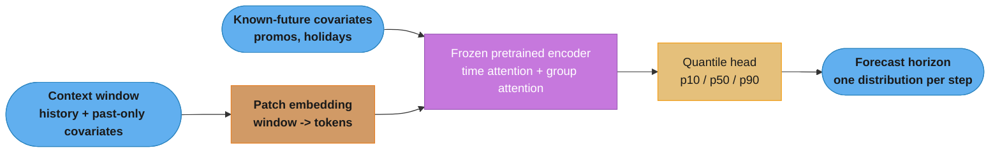
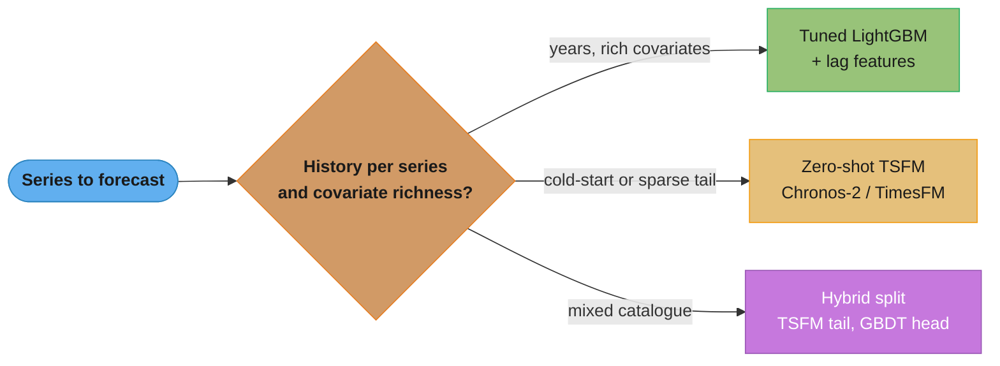

# Time-Series Foundation Models

*Zero-shot forecasting with models pretrained on millions of series — Chronos-2, TimesFM, Moirai-2, Lag-Llama, TimeGPT.*

---

## 1. Concept Overview

Between 2024 and 2026 the forecasting field acquired **pretrained foundation models** the same way NLP acquired BERT: a model trained once on a very large, heterogeneous corpus that then forecasts a series it has never seen, with no fitting step at all. Before this, every series got its own model — an ARIMA per SKU, a Prophet per metric — because there was nothing to transfer between an electricity-load curve and a retail SKU. A time-series foundation model (TSFM) is trained on millions of series drawn from synthetic generators and public real-world corpora, and it treats the shapes that recur across all of them — trend, multiple seasonalities, level shifts, intermittent bursts — as a transferable prior.

The practical consequence is architectural, not academic. The opening question in a 2026 forecasting design round is no longer "ARIMA, Prophet or an LSTM" — it is **whether you fit a model per series at all**, and the honest answer depends almost entirely on how much history each series carries and how many of them there are. This sub-file is the deep dive on that new option: how these models are built (§3-§4), how to call one and back it up with an honest baseline (§6), when it wins and when a tuned gradient-boosted tree still wins (§8-§9), and the failure modes specific to a model you did not train (§10). It assumes the classical and deep-learning material in the parent module — [Time Series Forecasting](time_series_forecasting.md) — as the baseline every TSFM claim must be measured against.

What an interviewer now expects, and what a strong answer contains, changed with the field. It is no
longer enough to name Chronos-2 or TimesFM and describe the architecture; the discriminating answer
states explicitly which of your series have enough history to fit something yourself, proposes the
zero-shot model as the free first baseline rather than the final answer, and names the specific backtest
that would tell you whether it actually earned its place over seasonal-naive. That is the shape §6 and
§14 walk through end to end.

---

## 2. Intuition

**One-line analogy:** a forecaster pretrained on a million series is to ARIMA what BERT was to a bag of words — both eras produced a model that arrives already knowing the shape of the problem, so the work shifts from *fitting* to *deciding whether fitting is even necessary*.

**Mental model:** think of a TSFM as a very well-read generalist forecaster who has seen a million businesses' data and can give you a plausible first answer about yours in seconds, versus a specialist who has spent a career on exactly your business but needs years of your own numbers before they can say anything. The generalist is priceless when you have a brand-new series and no history; the specialist wins once there is enough history for expertise to compound.

**Why it matters:** a 40,000-SKU demand catalogue typically has 30,000 SKUs with under a year of history and 200 SKUs that carry most of the revenue. Historically that meant one architecture stretched thin across both regimes, or 30,000 near-useless per-series fits. A TSFM turns the thin-history regime from "impossible to fit well" into "call an API," which is a qualitatively different capability, not an incremental accuracy gain.

**Key insight:** the value of a TSFM is concentrated entirely in the *absence of a fitting step*, and every design decision in this file follows from that one fact — it is why they win on cold-start and lose on rich single-series history, why the interview question is a hybrid, and why the honest baseline is never optional.

A second, quieter insight follows from the first: because nothing was fit to your data, nothing about
the model's confidence tells you whether it understands *your* domain. A per-series ARIMA that converges
cleanly has, at minimum, found a linear structure that actually exists in that series. A TSFM produces a
plausible-looking forecast whether or not your domain resembles anything in its pretraining corpus,
because "plausible time-series shape" is exactly what it was trained to produce. That is precisely why
§6's backtest-before-trust discipline and §10's pitfalls are not optional ceremony — they are the only
mechanism that stands in for the fitting step this class of model skips.

---

## 3. Core Principles

A TSFM is pretrained on a large corpus of time series — typically a mixture of synthetic series from
random generative processes and real public series — and then forecasts an unseen series with no
fitting step. The transfer works because the *shapes* of time series (trend, multiple seasonalities,
level shifts, bursty counts) recur across wildly different domains, so a model that has seen millions
of them has priors that a per-series ARIMA fitted on 60 points cannot possibly acquire.

**How they are built.** Four design choices define the family:

- **Patching.** Rather than one token per timestep, contiguous windows of the series are embedded as
  patches. This is what makes long contexts affordable: attention cost falls quadratically in the
  patch size, and a patch also carries local shape that a single scalar cannot.
- **Scaling and tokenization.** The series is normalized per-window before it enters the model, since
  the pretraining corpus spans magnitudes from web-request counts to megawatt-hours. The original
  Chronos line went further and *quantized* scaled values into a fixed vocabulary, which let a T5
  language-model architecture be reused essentially unchanged — forecasting as next-token prediction.
- **Probabilistic heads.** These models emit quantiles, not a point. That is not a bonus feature; it
  is the reason they are usable for inventory and capacity decisions at all (Principle 5).
- **Covariate conditioning.** The 2025-26 generation separates **past-only covariates** (observed
  historically, unknown in the future — traffic volume, competitor price) from **known-future
  covariates** (scheduled promotions, holidays, published weather forecasts) and accepts
  **categorical** covariates alongside numeric ones. The distinction matters: a known-future covariate
  can inform the forecast horizon directly, a past-only one can only inform the encoding of history.

**Cross-series modelling is the 2026 change.** Earlier TSFMs forecast one series at a time and were
univariate by construction. Chronos-2 alternates **time attention** (within a series) with **group
attention** (across an arbitrary-sized group of series), so coevolving series — the SKUs in one
category, the sensors on one machine — are forecast jointly and the model can exploit their
correlation. That is what moved the family from "a better per-series forecaster" to something that can
replace a multivariate model.

**Beyond the four build choices, five more principles decide whether pretraining is worth reaching for:**

5. **The pretraining corpus, not the parameter count, is what transfers.** TimesFM 2.5 is pretrained on over 400 billion real-world time-points spanning sources from web-traffic counts to macroeconomic series (verified against Google's own announcement, §7); Chronos's corpus mixes a large synthetic generator (Gaussian processes, ARMA, trend/seasonality composites) with public real series. The synthetic half exists specifically because there is not enough diverse *real* time-series data on earth to pretrain a model the way there is text — a constraint NLP pretraining never had.
6. **A patch is a compression ratio, not just an engineering trick.** Chronos-2 supports context lengths up to 8,192 timesteps and TimesFM 2.5 up to 16,384 — figures reachable only because the sequence the transformer actually attends over is `context_length / patch_length` tokens, not `context_length` tokens. Pick patch length too coarse and short-lived spikes wash out inside a window; too fine and you lose the long-context advantage patching exists to buy.
7. **The quantile head is trained, not calibrated after the fact.** Point-forecast models can be wrapped with bootstrap intervals as an afterthought; a TSFM's quantile levels are outputs the pretraining objective directly optimizes (a pinball/quantile loss per level), which is why the model can emit a calibrated `p10`/`p50`/`p90` for a series it has never seen — there is no per-series calibration step to skip.
8. **Zero-shot, fine-tuned, and self-trained are three different cost/accuracy points, not a ladder you always climb.** Zero-shot costs one forward pass and no data pipeline; fine-tuning costs a training pipeline plus a checkpoint you now own; training your own TSFM-shaped model from scratch costs a pretraining run and is almost never the right call outside a handful of companies with the corpus and compute to justify it. Most teams should never reach step three.
9. **A global model already buys back much of what pretraining buys.** DeepAR or one LightGBM fitted across every SKU in your catalogue is *global* — it shares structure across your own series, which already solves a large fraction of cold-start. A TSFM is *pretrained on someone else's data*. Confusing the two sends teams reaching for a foundation model when a global model on their own data would have been cheaper, more accurate, and fully auditable in a backtest (see the Q&A on this distinction in §12).
10. **Group attention cost scales with the square of the group size, so grouping is a design choice, not a default.** Attention over `n` series in a group costs `O(n^2)` the same way attention over `n` timesteps does, which is why a production deployment groups series along a real correlation boundary — the SKUs in one product category, the sensors on one machine — rather than passing an entire 40,000-SKU catalogue into a single group call. Unrelated series thrown into one group do not just fail to help (Principle 6's group-attention Q&A in §12); they also spend compute the model gets no signal back for.

---

## 4. Types / Architectures / Strategies

### 4.1 The Model Roster

| Model | Origin | Covariates | Multivariate / joint | Licence | Notes |
|-------|--------|-----------|----------------------|---------|-------|
| **Chronos-2** (`amazon/chronos-2`, 120M) | Amazon, Oct 2025 | past-only, known-future, categorical | Yes — group attention over arbitrary groups | Apache-2.0 | State of the art on fev-bench; first among pretrained models on GIFT-Eval, >90% head-to-head win rate over Chronos-Bolt |
| **Chronos-Bolt** (`amazon/chronos-bolt-*`, 9M-205M) | Amazon | limited | No | Apache-2.0 | The fast, small predecessor; still the right pick when latency or footprint dominates |
| **Chronos-T5** (`amazon/chronos-t5-*`, 8M-710M) | Amazon | no | No | Apache-2.0 | The original quantize-and-reuse-T5 line |
| **TimesFM 3.0** (`google/timesfm-3.0-pytorch`, 330M) | Google, Aug 2026 | past-only and past-and-future | Yes, native multivariate | timesfm-non-commercial-license-v1.0 (commercial use only through Google Cloud) | Runs in BigQuery ML; ranks first on fev-bench per Google's README |
| **TimesFM 2.5** (`google/timesfm-2.5-200m-*`, 200M) | Google, Sep 2025 | via XReg | No | Apache-2.0 | The last Apache-2.0 TimesFM checkpoint; 16,384-step context |
| **Toto 2.0** (`Datadog/Toto-2.0-*`, 4M / 22M / 313M / 1B / 2.5B) | Datadog, Apr 2026 | No (2.0 takes no exogenous variables) | Yes, alternating time/variate attention | Apache-2.0 (code and weights) | Built for observability metrics; reports top scores on GIFT-Eval and Datadog's BOOM observability benchmark |
| **Moirai-2** | Salesforce, Aug 2025 | yes | Yes | CC-BY-NC-4.0 (research only) | Positioned for complex multivariate data |
| **Lag-Llama** | community | limited | No | open weights | Probabilistic-first, decoder-only |
| **TimeGPT** | Nixtla | yes | limited | commercial API | No weights; you rent the endpoint |

Model sizes and licence for the Chronos family are from the
[project repository](https://github.com/amazon-science/chronos-forecasting); the Chronos-2 architecture
and benchmark claims are from
[Amazon Science](https://www.amazon.science/blog/introducing-chronos-2-from-univariate-to-universal-forecasting).
Cells left as broad descriptions rather than exact numbers are ones where a primary source does not
publish a single figure — do not quote a context length for these from a blog post.

Note the parameter counts. `amazon/chronos-2` is **120M** parameters — smaller than a BERT-large. These
are not LLM-scale models, and the instinct to budget GPU capacity as if they were is wrong; the
smallest useful checkpoints run on CPU.

**Benchmarks to know.** **GIFT-Eval** and **fev-bench** are the two the field currently quotes. Both
exist because the older M-competition datasets are now almost certainly inside every pretraining
corpus, which makes them useless for evaluating a pretrained model — a leakage problem the benchmarks
were explicitly designed around, and the same problem you have with your own public series (Pitfall 8).

Two specific checkpoint figures are worth pinning down because they get quoted loosely: **TimesFM 2.5**
(`google/timesfm-2.5-200m-*` on Hugging Face) is 200M parameters with a 16,384-timestep context window,
a reduction from the 500M-parameter TimesFM 2.0 that Google reports as its top zero-shot entry on
GIFT-Eval for both MASE and CRPS — smaller and longer-context, not bigger, is what moved it up the
leaderboard. **Chronos-2** (`amazon/chronos-2` on Hugging Face) is 120M parameters with an
8,192-timestep context window, confirmed on its own model card. **TimesFM 3.0**
(`google/timesfm-3.0-pytorch`, August 2026) is 330,710,976 parameters per its Hugging Face safetensors
metadata, adds native multivariate forecasting with past-only and past-and-future covariates, and ships
its weights under a non-commercial licence, so TimesFM 2.5 stays the TimesFM checkpoint you can
self-host commercially. Check the model card before quoting any of these numbers in an interview,
since this family updates on a roughly six-month cadence.

### 4.2 Three Deployment Strategies

A TSFM is not one decision, it is a choice between three cost/accuracy points on the same model family:

| Strategy | What you do | Cost | When it's right |
|----------|-------------|------|------------------|
| **Zero-shot** | Call `predict()` with no gradient step | One forward pass, no data pipeline | Always try first — it is the free option and tells you whether the pretrained priors fit your domain at all |
| **Fine-tuned** | Continue training the checkpoint on your own series | A training pipeline, a checkpoint you now own, version, monitor and retrain | Zero-shot is close but systematically biased on your data — never the first move |
| **Hybrid (TSFM + GBDT)** | Route cold-start/long-tail series to the TSFM, head series with rich history to a tuned GBDT | Two systems to operate instead of one, but each does only what it is best at | The default answer for any catalogue with a genuine head/tail split — see §8 and §14 |

The ordering matters as much as the options: skipping straight to fine-tuning without first measuring
the zero-shot gap is the single most common way teams over-invest in a TSFM deployment.

**A minimal routing rule, in the shape §14 uses at production scale:**

```python
def route_series(history_weeks: int, nonzero_weeks: int, min_history: int = 104) -> str:
    """Decide which model serves this series. Re-evaluated on a fixed cadence (§14),
    never hard-coded once and forgotten -- a series' history only grows.
    """
    if history_weeks < min_history or nonzero_weeks < min_history // 2:
        return "zero_shot_tsfm"      # cold-start or sparse tail
    return "tuned_gbdt"              # enough history to earn a per-series/global fit
```

This is deliberately the simplest rule that could work — a history-length and sparsity threshold, not a
learned meta-model choosing between forecasters. Reach for something more sophisticated (a stacked
meta-learner over both models' outputs) only after measuring that the simple threshold rule is actually
the bottleneck on your backtest, not before.

---

## 5. Architecture Diagrams

### 5.1 Pretraining-to-Inference Path



Nothing in this path is fit to your data — every box except the two input ovals is frozen weights from
pretraining. The known-future covariates enter at the encoder, not the quantile head, which is what
lets a scheduled promotion shift the entire predictive distribution for the horizon rather than only
the point estimate.

### 5.2 Which Model Class for This Series?



Most real catalogues land on the third branch: a distribution of series where some have five years of
history and some launched last week, which is exactly the shape §8 and §14 work through in detail.

### 5.3 Illustrative Error Shape — Head vs. Tail

```mermaid
xychart-beta
    title "Illustrative error shape only - not a published benchmark"
    x-axis [Seasonal-naive, Tuned-LightGBM, Zero-shot-TSFM, Fine-tuned-TSFM]
    y-axis "Volume-weighted error (illustrative, lower is better)" 0 --> 100
    bar [58, 22, 55, 38]
    bar [62, 68, 24, 26]
```



The two bars are the shape described in the Pitfall 1 war story (§10) — the first series is the 200
head SKUs that carry most of revenue, the second is the 30,000-SKU sparse tail. **These numbers are
illustrative, invented to draw the shape of the tradeoff, not a result from GIFT-Eval, fev-bench, or any
published paper** — read them as "the GBDT wins on the head and the TSFM wins on the tail," not as a
number to cite. The crossover is exactly why §14's production system ships both models rather than
picking a single winner.

---

## 6. How It Works — Detailed Mechanics

### 6.1 Zero-Shot Forecasting with Chronos-2

The whole point is that there is no `fit()` call. You hand the model history and ask for a horizon.

```python
# pip install chronos-forecasting
import pandas as pd
from chronos import Chronos2Pipeline

# 120M params, Apache-2.0. device_map="cpu" also works -- this is not an LLM.
pipeline = Chronos2Pipeline.from_pretrained("amazon/chronos-2", device_map="cuda")

# Long format: one row per (series id, timestamp). 40k SKUs live in one frame.
context_df = pd.DataFrame({
    "id":        ["SKU_1"] * 104 + ["SKU_2"] * 104,   # 2 years of weekly history
    "timestamp": list(weeks) * 2,
    "target":    list(sku1_units) + list(sku2_units),
    "on_promo":  list(sku1_promo) + list(sku2_promo),  # past-only covariate
})

# Known-future covariates: values we ALREADY know for the horizon (planned promos,
# holidays, published weather). This is the column a GBDT would need hand-built lags for.
future_df = pd.DataFrame({
    "id":        ["SKU_1"] * 13 + ["SKU_2"] * 13,
    "timestamp": list(next_13_weeks) * 2,
    "on_promo":  list(sku1_planned_promo) + list(sku2_planned_promo),
})

pred_df = pipeline.predict_df(
    context_df,
    future_df=future_df,
    prediction_length=13,               # 13-week horizon
    quantile_levels=[0.1, 0.5, 0.9],    # probabilistic output, not a point estimate
    id_column="id",
    timestamp_column="timestamp",
    target="target",
)
# -> DataFrame indexed by (id, timestamp) with a column per requested quantile.

# Order inventory against the 0.9 quantile, never the median: the cost of a stockout
# and the cost of overstock are asymmetric, which is the entire reason you asked for
# quantiles instead of a point forecast.
reorder = pred_df["0.9"]
```

Three things to notice, because they are what the interview probes:

1. **No training loop, no per-series state.** Adding a new SKU means adding rows, not fitting a model.
   That is the cold-start property, and it is the only reason this beats a per-series ARIMA on a long tail.
2. **`future_df` is where known-future covariates enter.** With a GBDT you would build these as
   engineered features and be responsible for not leaking anything unknowable at prediction time. Here
   the split is enforced by the API — past-only covariates go in `context_df`, known-future ones in
   `future_df`. That is a real reduction in leakage surface.
3. **Quantiles are native.** No bootstrap, no quantile-loss retraining per level.

**Always keep the classical fallback in the same code path.** A TSFM that cannot beat seasonal-naive on
your backtest is not a result, and you want the comparison to be one function call:

```python
from statsforecast import StatsForecast
from statsforecast.models import SeasonalNaive, AutoETS

sf = StatsForecast(models=[SeasonalNaive(season_length=52), AutoETS(season_length=52)], freq="W")
baseline = sf.forecast(df=context_df.rename(columns={"id": "unique_id", "timestamp": "ds", "target": "y"}), h=13)
# Compare on YOUR rolling-origin backtest (Section 5), not on a published leaderboard.
```

**Fine-tuning is the middle option, and it is usually the wrong first move.** Zero-shot first,
because it costs nothing and tells you whether the pretrained priors fit your domain at all. Fine-tune
only when zero-shot is close but systematically biased on your data — and budget for the fact that a
fine-tuned checkpoint is now a model you own, version, monitor and retrain, which is precisely the
operational burden the zero-shot path was avoiding.

### 6.2 The Honest Comparison — a Volume-Weighted Rolling-Origin Backtest

Pitfall 1 (§10) is that a scale-free metric (MASE, SMAPE) averaged over a skewed catalogue reports a win
driven entirely by low-revenue tail series. The only honest comparison weights each series' error by
what it actually costs you, and re-fits both models at multiple rolling origins rather than one
train/test split. This is a minimal, runnable version — not a framework, just the shape of the check:

```python
import numpy as np
import pandas as pd

def rolling_origin_backtest(
    long_df: pd.DataFrame,      # columns: id, timestamp, target, volume_weight
    tsfm_predict_fn,            # (context_df, horizon) -> point forecast per id
    baseline_predict_fn,        # same signature, e.g. seasonal-naive
    horizon: int = 13,
    n_origins: int = 4,
    step: int = 13,
) -> pd.DataFrame:
    """Score a TSFM against a baseline at several cutoff points, weighted by volume.

    ponytail: single-process loop, fine at a few thousand series; parallelize
    per-origin with joblib if the catalogue is large enough to make this slow.
    """
    ids = long_df["id"].unique()
    max_ts = long_df.groupby("id")["timestamp"].transform("max")
    rows = []

    for origin_idx in range(n_origins):
        cutoff = long_df["timestamp"].max() - pd.Timedelta(weeks=step * (origin_idx + 1))
        context = long_df[long_df["timestamp"] <= cutoff]
        actual = long_df[
            (long_df["timestamp"] > cutoff)
            & (long_df["timestamp"] <= cutoff + pd.Timedelta(weeks=horizon))
        ]
        if actual.empty or context.empty:
            continue

        tsfm_fc = tsfm_predict_fn(context, horizon)          # id -> array[horizon]
        base_fc = baseline_predict_fn(context, horizon)      # id -> array[horizon]

        for sid in ids:
            y_true = actual.loc[actual["id"] == sid, "target"].to_numpy()
            if len(y_true) == 0 or sid not in tsfm_fc or sid not in base_fc:
                continue
            weight = long_df.loc[long_df["id"] == sid, "volume_weight"].iloc[0]
            tsfm_err = np.abs(y_true - tsfm_fc[sid]).mean()
            base_err = np.abs(y_true - base_fc[sid]).mean()
            rows.append({"id": sid, "origin": origin_idx, "weight": weight,
                         "tsfm_err": tsfm_err, "base_err": base_err})

    result = pd.DataFrame(rows)
    # The number that actually matters for the migration decision:
    weighted = result.groupby("origin").apply(
        lambda g: pd.Series({
            "tsfm_weighted_mae": np.average(g["tsfm_err"], weights=g["weight"]),
            "base_weighted_mae": np.average(g["base_err"], weights=g["weight"]),
        })
    )
    return weighted
```

Run this segmented by head/tail (Pitfall 1) as well as aggregated — the aggregate number is the one that
misled the team in the war story, and the segmented one is the one that would have caught it before
rollout.

**Reading the output.** The function returns one row per rolling origin with two weighted-MAE columns,
not a single scalar — that is deliberate. A single origin can be an easy or hard quarter by chance;
looking across `n_origins` tells you whether the TSFM's edge (or the GBDT's) is stable or a fluke of one
cutoff date. In practice you want three views before trusting a migration decision: the aggregate
weighted MAE per origin (does either model consistently win), the same numbers split by head/tail
segment (does the win survive the volume-weighting the way Pitfall 1 requires), and the quantile
coverage check from §12's probabilistic-output answer (is the "probabilistic" model's uncertainty
actually calibrated, not just its median accurate). A model that wins on aggregate weighted MAE but has
badly miscalibrated quantiles is not ready to drive an inventory decision, even though the point-accuracy
number alone would look like a clean win.

**A worked example of the output shape** (illustrative sample numbers from one hypothetical run of the
harness, not a benchmark result — the point is how to read the table, not what to expect):

```
origin   tsfm_weighted_mae   base_weighted_mae   winner
0             41.2                52.8            TSFM
1             39.7                50.1            TSFM
2             44.5                43.9            base (roughly tied)
3             40.1                51.6            TSFM
```

Three origins favour the TSFM by a wide margin and one is roughly a tie — that pattern, not a single
average across all four, is what you report. A single averaged number would say "TSFM wins by ~22%,"
which is true in aggregate but hides that one quarter showed no real edge; if that tied quarter
correlates with a specific event (a promotional spike, a stockout the actuals reflect but the covariates
did not capture) it is worth understanding before trusting the aggregate. This is the same discipline as
the head/tail segmentation in Pitfall 1, applied along the time axis instead of the catalogue axis.

---

## 7. Real-World Examples

**Google — TimesFM in BigQuery, AlloyDB, and Agent Platform.** Google shipped `AI.FORECAST`/`AI.EVALUATE`
(BigQuery ML, generally available since November 2025) and `AI.FORECAST` (AlloyDB, public preview) on
top of TimesFM, and lists it in Model Garden on Agent Platform — a zero-shot forecast is callable as SQL
inside the warehouse with no separate training pipeline. TimesFM 3.0 (August 2026, 330M parameters)
adds native multivariate forecasting and covariates; its downloadable weights are non-commercial, so
commercial use runs through BigQuery ML, where the multivariate TimesFM models are in Preview.
TimesFM 2.5, the last Apache-2.0 checkpoint, is 200M parameters with a 16,384-timestep context window
and is pretrained on more than 400 billion real-world time-points; Google reports it first among
zero-shot models on GIFT-Eval for both point (MASE) and probabilistic (CRPS) accuracy. (Google Cloud
Blog; BigQuery TimesFM documentation; `google-research/timesfm` README; Hugging Face model cards.)

**Amazon — Chronos on SageMaker and AutoGluon-TimeSeries.** Chronos-2 (120M parameters, Apache-2.0,
8,192-timestep context) ships through both SageMaker JumpStart and AutoGluon-TimeSeries/AutoGluon-Cloud,
the latter offering a plain "pass a DataFrame in, get forecasts back" API with real-time, serverless and
batch inference options. Amazon reports the Chronos family has been downloaded more than 120 million
times from Hugging Face — evidence of adoption breadth, not of accuracy on any one workload; verify on
your own backtest regardless (Pitfall 8). (Hugging Face model card; AWS Machine Learning Blog;
AutoGluon-Cloud documentation.)

**Nixtla — TimeGPT as a rented API.** TimeGPT is not distributed as open weights; it is a hosted
endpoint (`dashboard.nixtla.io`) pretrained on more than 100 billion data points, called with a Python
or R client rather than loaded locally. That is the clean example of the licence/vendor axis in §8 and
§12 — you get a zero-shot forecast with no infrastructure to run, at the cost of every forecast leaving
your network and depending on a vendor's uptime and pricing. The same endpoint also exposes zero-shot
anomaly detection over a series, not just forecasting — a second product built on the identical
pretrained backbone, and a reminder that a TSFM's transferable prior over "what a normal time series
looks like" is useful beyond the forecasting task this file focuses on. (Nixtla documentation.)

**Deployment breadth as its own signal.** What is notable across all three vendors is not any single
accuracy claim but how many *ways* each now offers to call a zero-shot forecast: SQL inside a warehouse
(BigQuery `AI.FORECAST`), a managed notebook environment (SageMaker JumpStart, Model Garden on Agent Platform), a
DataFrame-in-DataFrame-out library call (AutoGluon-TimeSeries), and a plain REST API (TimeGPT). That
breadth is itself evidence the "no fitting step" property from §1 is being taken seriously as a product
surface, not just a research result — each integration point exists specifically because zero-shot
forecasting removes the training-pipeline requirement that used to gate where a forecast could be
called from.

**The energy and grid-imbalance backtest genre.** Net-load and grid-imbalance forecasting — a series
with strong daily/weekly/yearly seasonality plus weather covariates — is one of the domains GIFT-Eval and
fev-bench-style benchmarks routinely include, because it stresses exactly the covariate-conditioning and
long-context properties this file covers. Treat any specific named-utility production claim in this
space with the same skepticism as any other unverified deployment story; the genre is real and
well-published, a specific company's rollout numbers usually are not independently checkable.

---

## 8. Tradeoffs

### TSFM vs GBDT-with-lags vs Classical — the decision table

The comparison the 2026 interview actually asks for. Read it as a distribution over your series, not as
one winner: a large catalogue usually needs two of these columns at once.

| Concern | Zero-shot TSFM | LightGBM + lag features | ARIMA / ETS / Prophet |
|---------|----------------|-------------------------|-----------------------|
| Cold-start / new series | **Best** — forecasts with no history at all | Poor alone; usable if trained globally across series | Cannot fit |
| Long-tail, sparse, intermittent series | **Best** — pretrained priors carry it | Mediocre; lags are mostly zeros | Poor |
| One series, years of history, rich covariates | Weakest — a tuned GBDT generally wins | **Best** | Competitive if the structure is genuinely linear |
| Known-future covariates | Native (`future_df`), leakage split enforced by the API | Hand-engineered; leakage is your responsibility | Prophet regressors; ARIMA needs SARIMAX |
| Probabilistic output | Native quantiles | Requires quantile-loss models per level | Prophet CI is not a calibrated predictive interval |
| Inference cost / latency | Highest — a neural forward pass, GPU helps but is not required at 120M params | Microseconds | Microseconds |
| Interpretability | None; you cannot explain a forecast to a planner | Feature importances, SHAP | **Best** — coefficients and decomposition |
| Operational burden | Lowest — no per-series retraining, no model registry churn | Retraining cadence, feature pipeline, backfills | One fitted model per series to babysit |
| Backtest trustworthiness | **Weakest** — pretraining leakage risk on public series | Fully under your control | Fully under your control |

Two rows deserve emphasis because they are the ones candidates skip. **Interpretability** is often the
binding constraint rather than accuracy: a demand planner who must justify a purchase order cannot act
on a number with no decomposition, which is why Prophet survives in businesses where it is not the most
accurate option. And **operational burden** is where the TSFM's real economics live — the saving is
usually not accuracy, it is deleting a per-series retraining pipeline and the on-call that comes with it.

**Team size and maturity change which row dominates.** A two-person data-science team supporting a large,
heterogeneous catalogue is usually operational-burden-constrained first — they cannot staff a per-series
retraining pipeline regardless of the accuracy it might buy, which pushes the decision toward zero-shot
even where a GBDT would win on accuracy alone. A larger team with an existing feature-engineering and
retraining pipeline already amortized across other models is much more likely to be accuracy-constrained
instead, and will correctly extend that pipeline to cover more of the catalogue before reaching for a
foundation model. Neither posture is wrong; the table above is the input to the decision, not the
decision itself, and the correct read of it depends on which constraint is actually binding for the team
making the call.

---

## 9. When to Use / When NOT to Use

Read both lists against your own catalogue's history-per-series distribution (Principle 6), not against
the model in isolation — the same TSFM is a clear yes for one segment of a catalogue and a clear no for
another, which is precisely §14's worked example.

### When to Use a Zero-Shot Foundation Model

- **Cold start** — a new SKU, sensor, tenant or region with no history. This is the case nothing else covers: ARIMA cannot fit, a GBDT has only zeros in its lag features.
- **A long tail of sparse series** — a catalogue where most items have a handful of non-zero weeks. The pretrained priors carry these where per-series fitting produces noise.
- **Many heterogeneous series and no appetite for a per-series pipeline.** The operational saving (no retraining cadence, no per-series model registry, no backfills) is frequently worth more than the accuracy difference.
- **You need calibrated quantiles and do not want to train a model per quantile level.**
- **As a strong first baseline in a design round.** "Zero-shot Chronos-2 before anything else, then decide whether to earn the training pipeline" is a defensible opening in 2026 and demonstrates you know the cost of what you are proposing to build.

### When NOT to Use a Zero-Shot Foundation Model

- **You have millions of rows of one series and rich exogenous features.** A tuned LightGBM with lag and calendar features generally wins, and it wins cheaply. This is the single most common wrong application.
- **The forecast must be explainable to a planner or a regulator.** A TSFM offers no decomposition — no trend/seasonality split, no coefficient, no feature importance. If someone must justify a purchase order, Prophet's interpretability may outrank accuracy.
- **Microsecond inference on commodity CPU at high fan-out.** A 120M-parameter forward pass is orders of magnitude more expensive per forecast than an ARIMA evaluation; at millions of series refreshed per minute the arithmetic stops working.
- **Your evaluation series are public.** If your backtest data plausibly sits in the pretraining corpus, you cannot measure the model honestly on it (Pitfall 8).
- **It does not beat seasonal-naive on your own rolling-origin backtest.** No leaderboard position overrides this.

---

## 10. Common Pitfalls

### Pitfall 1: Declaring a foundation-model win on a scale-free metric

A team benchmarked zero-shot Chronos against their incumbent LightGBM across 40,000 SKUs and reported a
12% MASE improvement, and the migration was approved on that number. Revenue impact after rollout was
negative. MASE and SMAPE weight every series equally, so the win came almost entirely from the 30,000
low-volume tail SKUs where forecast error costs almost nothing, while the 200 head SKUs — which carried
78% of revenue — got slightly worse. **Fix:** score on a **volume-weighted** or cost-weighted error, and
always report the head and tail segments separately. A single aggregate number over a heavily skewed
catalogue is not a decision input. The resolution here was the hybrid: TSFM for the tail, the incumbent
GBDT retained for the head.

### Pitfall 2: Silent context-window truncation dropping a seasonality

A team fed three years of daily data to a TSFM to capture yearly seasonality and got forecasts with no
annual pattern at all. The model's context window held roughly the most recent year; everything earlier
was silently truncated, so the yearly cycle was never visible to it — there was no warning, no error,
and the forecasts looked plausible. **Fix:** check the checkpoint's context length against the number of
observations one full seasonal cycle requires *before* choosing a frequency. Aggregating daily to weekly
often fixes it outright: 3 years of weekly data is 156 points and fits comfortably where 1,095 daily
points do not. Verify by forecasting a series with a known strong annual cycle and confirming the model
reproduces it.

### Pitfall 3: Backtesting a pretrained model on data inside its pretraining corpus

A team evaluated a TSFM on a public electricity-load dataset, measured excellent accuracy, and deployed
it against their own private series where it performed far worse. The benchmark series was in the
model's pretraining corpus — the "out-of-sample" backtest was partly in-sample, and it measured
memorization rather than generalization. This is a failure mode that simply does not exist for a model
you fit yourself, and it is why GIFT-Eval and fev-bench were constructed. **Fix:** backtest exclusively
on **your own private series** with a rolling-origin split, and treat any published leaderboard number
as evidence that the model class is worth trying, never as an estimate of what you will get. If you must
use public data, prefer series that postdate the checkpoint's training cutoff.

### Pitfall 4: Over-provisioning GPU capacity for a 120M-parameter model

A platform team sized a GPU cluster for a Chronos-2 rollout using the same per-request headroom they
budget for a 70B-parameter LLM endpoint, and shipped a deployment running at under 5% utilization.
`amazon/chronos-2` is 120M parameters — smaller than BERT-large — and the smallest useful TSFM
checkpoints run acceptably on CPU at moderate batch sizes; the mental model "it's a transformer, so
capacity-plan it like an LLM" is simply wrong for this model family. **Fix:** benchmark actual
p99 latency and throughput on the target hardware, including CPU, before provisioning anything, and size
against that measurement rather than an LLM-serving rule of thumb. The excess capacity here cost more
per month than the entire zero-shot migration was projected to save in inventory.

### Pitfall 5: Putting a known-future covariate in the past-only frame

An integration passed scheduled promotion flags for the forecast horizon into `context_df` instead of
`future_df`, because the engineer copied a pattern from a past-only weather-observation feature. The
API accepted it silently — nothing about the shape of the data signals which frame a covariate belongs
in — and the model forecast the promotion weeks with zero visibility into the fact that a promotion was
scheduled, producing a forecast no better than not passing the covariate at all. **Fix:** treat the
past-only/known-future split as a data-contract review item, not an implementation detail: for every
covariate, write down explicitly whether its value for the horizon is known *before* the forecast is
requested, and unit-test that `future_df` actually contains the planned-promotion column with non-null
values for every horizon timestamp.

### Pitfall 6: Discarding quantiles at the last mile

A demand-planning team wired Chronos-2's `p10`/`p50`/`p90` output into a downstream inventory system
built for a single point forecast, and the integration collapsed the three columns to their median
before writing to the database. The entire reason a probabilistic model was chosen — ordering against
the 0.9 quantile to cover asymmetric stockout cost (§12) — was thrown away one hop after the forecast
left the model, and nobody noticed until a stockout post-mortem asked why the "probabilistic" migration
had not moved the metric it was funded to move. **Fix:** treat the downstream consumer's schema as part
of the design, not an afterthought — if the consuming system cannot take a distribution, either extend
it to accept a quantile or compute the reorder point (a quantile lookup) upstream of the interface, but
never silently reduce to a point and call the migration probabilistic.

---

## 11. Technologies & Tools

Everything below sits on top of the classical and deep-learning toolchain already listed in the parent
module's §11 — `statsmodels`, `pmdarima`, `Prophet`, `Ruptures`, `tsfresh` and plain `LightGBM` remain the
right tools for the head-of-catalogue side of every decision in §8, and are not repeated here. This table
is scoped to the zero-shot/foundation-model side of the stack plus the baselines and benchmarks you run
directly against it.

| Tool | Use Case | Notes |
|------|---------|-------|
| chronos-forecasting (Amazon) | Zero-shot and fine-tuned TSFM inference | `Chronos2Pipeline.from_pretrained("amazon/chronos-2")`; Apache-2.0; 120M params runs on CPU |
| transformers (Hugging Face) | Loading TSFM checkpoints generally | The distribution channel for TimesFM, Moirai and the Chronos family |
| statsforecast (Nixtla) | SeasonalNaive, AutoETS, AutoARIMA baselines | The fast baseline you are obliged to beat; keep it in the same code path as the TSFM |
| GIFT-Eval | Benchmarking pretrained forecasters | Designed post-leakage; the M-competition sets are inside most pretraining corpora and no longer discriminate |
| fev-bench | Benchmarking pretrained forecasters | The other current leaderboard; Chronos-2 reports state-of-the-art results here |
| NeuralForecast (Nixtla) | Deep learning models (NBEATS, TFT, DeepAR) | GPU-optimized, sklearn API; the right place for a fine-tuned or from-scratch neural baseline |
| GluonTS (Amazon) | DeepAR, Temporal Fusion Transformer | Global-model baseline to compare against a pretrained TSFM (Principle 9) |
| Darts | Unified API for all model types | Wraps classical, deep-learning and several TSFM checkpoints behind one interface |
| AutoGluon-TimeSeries | Ensembling TSFMs with statistical models | The production path used on SageMaker; ships Chronos-2 with a DataFrame-in/forecast-out API |
| timesfm (Google) | TimesFM checkpoint loading and inference | Checkpoints `google/timesfm-2.5-200m-pytorch` (Apache-2.0) and `google/timesfm-3.0-pytorch` (non-commercial); also reachable through BigQuery `AI.FORECAST` and Model Garden on Agent Platform with no local install |
| toto-models (Datadog) | Toto 2.0 inference | `pip install toto-models` (Python 3.12+); `Toto2Model.from_pretrained("Datadog/Toto-2.0-22m")` returns 9 quantiles per variate; no fine-tuning API in 2.0 |
| nixtla (Python/R client) | Calling the TimeGPT hosted API | No local weights; requires an API key from `dashboard.nixtla.io` |

---

## 12. Interview Questions with Answers

**Q: When does a zero-shot time-series foundation model beat a tuned LightGBM with lag features, and when does it lose?**
**Short:** It wins on cold-start and sparse long-tail series with little history, and loses on series with years of data and rich exogenous features.

It wins where there is not enough history to fit anything, and loses where there is plenty. The deciding variable is history **per series**, not the number of series: a pretrained model arrives with priors learned from millions of series, so it can forecast a SKU launched last week that ARIMA cannot fit and whose GBDT lag features are all zeros. Once a series has years of observations plus rich exogenous signal — promotions, prices, weather, competitor actions — a tuned LightGBM generally wins, because it is learning your specific business's response function rather than a generic prior. On a large catalogue both are usually true at once, which is why the honest answer to the interview question is a hybrid: the foundation model serves the cold-start tail, the GBDT serves the head. Two traps to name: a *global* model (DeepAR, or one GBDT across all series) already captures much of the cross-series transfer people credit to pretraining, so it is often the cheaper right answer; and any comparison must be scored per segment, since a scale-free aggregate metric over a skewed catalogue will show a win driven entirely by tail series that carry no revenue.

**Q: What is pretraining leakage in forecasting and how do you design a backtest around it?**
**Short:** A public series may sit inside the model's pretraining corpus, so a backtest on it measures memorization rather than generalization.

It is the risk that your evaluation series was part of the foundation model's training data, making your "out-of-sample" backtest partly in-sample. This failure mode does not exist for a model you fit yourself — you control exactly what it saw — and it is why the classical M-competition datasets no longer discriminate between pretrained forecasters and why GIFT-Eval and fev-bench were built. The symptom is brutal in practice: excellent benchmark accuracy followed by a large drop on your own data, with nothing in the evaluation that could have predicted it. Design around it by backtesting exclusively on **your own private series** with a rolling-origin split, and by treating any published leaderboard result as evidence that the model class is worth trying rather than as an estimate of the accuracy you will get. Where you must use public data, prefer series whose observations postdate the checkpoint's training cutoff.

**Q: How do covariates enter a time-series foundation model compared with a GBDT?**
**Short:** A TSFM takes past-only and known-future covariates as separate typed inputs, while a GBDT needs them hand-engineered as lag features you must keep leak-free yourself.

The modern TSFM API distinguishes them by type; the GBDT makes them your problem. A model like Chronos-2 accepts **past-only** covariates (observed historically, unknown over the horizon — realized traffic, competitor price), **known-future** covariates (already known for the forecast window — scheduled promotions, holidays, published weather forecasts) and categorical covariates, in separate context and future frames. That separation is enforced by the interface, which meaningfully shrinks the leakage surface: you cannot accidentally feed the model a future value of a past-only variable. With a GBDT every covariate becomes an engineered feature, and preventing leakage — never letting a feature encode information unavailable at prediction time — is entirely on you and is the most common source of a backtest that cannot be reproduced in production. The tradeoff runs the other way on control: hand-built features let you encode domain knowledge (a promotion's decay profile, a cannibalization term between SKUs) that you cannot express through a generic covariate slot.

**Q: Why does probabilistic output matter more than point accuracy for inventory decisions?**
**Short:** Stockout and overstock costs are asymmetric, so the reorder decision needs a quantile of the demand distribution, not the mean.

Because the cost of being wrong is asymmetric, so the optimal decision is a quantile of the demand distribution rather than its centre. If a stockout costs a lost sale plus customer defection and overstock costs only carrying charges, you should order against roughly the 0.9 quantile of forecast demand, not the median — and a point forecast simply cannot tell you where that quantile sits. This is why native quantile output is a headline feature of DeepAR and of every current foundation model, and why a forecast evaluated purely on MAE can be operationally worse than a less "accurate" one with well-calibrated intervals. The practical check is calibration, not sharpness: if you order to the 0.9 quantile you should stock out about 10% of the time, so measure the empirical coverage of your predictive intervals over a rolling backtest. A model whose 90% interval covers 60% of realized values is misleading the planner more dangerously than a point forecast, because it carries false confidence.

**Q: What does a foundation model's context window cost you, and how do you detect the problem?**
**Short:** History beyond the context window is silently truncated, so a seasonality longer than the window vanishes from the forecast with no warning.

It silently caps how much history the model can see, and anything beyond it is dropped without an error. The expensive case is a seasonal cycle longer than the window: feed three years of daily data to a model whose context holds roughly one year and the annual pattern is simply invisible, producing forecasts that look plausible and contain no yearly seasonality at all. Nothing warns you — no exception, no truncation notice — which puts it in the same family as every other silent-loss failure in forecasting. Detect it by checking the checkpoint's context length against the number of observations one full seasonal cycle needs *before* you pick a frequency, and confirm empirically by forecasting a series with a known strong annual cycle and verifying the model reproduces it. The usual fix is aggregation rather than a bigger model: three years of weekly data is 156 points and fits where 1,095 daily points do not, and weekly is often the decision granularity anyway.

**Q: What is the difference between a global model and a pretrained foundation model for forecasting?**
**Short:** A global model is trained on all of your own series at once; a pretrained model arrives already trained on millions of unrelated series.

A global model learns from your data across series; a foundation model arrives having learned from everyone else's. DeepAR and a single LightGBM fitted across every SKU are *global* — one model, many series, sharing structure learned from **your** business, which already solves much of the cold-start problem because a new SKU inherits patterns from its siblings. A TSFM is *pretrained*: it knows nothing about your catalogue and a great deal about time series in general, and it needs no fitting step at all. Conflating the two is a common and expensive error, because it sends teams reaching for a foundation model when a global model on their own data would be more accurate, far cheaper to serve, and fully under their control for backtesting. The useful decision rule: if you have enough related series to train a global model, try that first; reach for pretraining when you cannot even assemble that, or when deleting the retraining pipeline is worth more than the accuracy difference.

**Q: Why do time-series foundation models patch the input instead of using one token per timestep?**
**Short:** Patching turns thousands of timesteps into hundreds of tokens, which is what makes long contexts computationally affordable and gives the model local shape, not just a value.

Patching trades one scalar-per-token for one window-per-token, and both halves of that trade matter. Attention cost grows quadratically in sequence length, so tokenizing every timestep individually would make an 8,000-step context prohibitively expensive; grouping contiguous timesteps into patches divides the effective sequence length by the patch size before attention ever runs, which is the mechanism that lets Chronos-2 and TimesFM 2.5 reach context windows in the thousands of steps at all. The second benefit is representational: a single scalar carries no shape information, but a patch of, say, 32 points already encodes a local slope, a spike, or a plateau before the encoder even attends across patches — the model is reasoning over shapes, closer to how a human eyeballs a chart, rather than over disconnected points. The cost is resolution: too coarse a patch and a short-lived spike gets smoothed into its neighbours; matching patch length to the shortest signal you care about is a real hyperparameter, not a default to leave alone.

**Q: What does cross-series (group) attention buy over per-series forecasting, and when does it do nothing?**
**Short:** Group attention lets coevolving series inform each other's forecast; it adds nothing when your series are genuinely independent.

It lets the model condition one series' forecast on what is happening in correlated series at the same time, which is the difference between a univariate and a genuinely multivariate forecaster. Chronos-2 alternates time attention (within a series, across its own history) with group attention (across an arbitrary-sized group of series at the same timestep), so the SKUs in one category, or the sensors on one machine, are forecast jointly and a shock visible in one series can inform the forecast of another before it shows up in that series' own history. This is the change that moved the Chronos family from "a better per-series model" to something that can substitute for a hand-built multivariate model like VAR. It buys nothing, and can even add noise, when the series in your group are not actually correlated — grouping unrelated SKUs together for group attention is not a free performance boost, it is a modelling assumption you are asserting, and it should be validated the same way you would validate a VAR specification: does knowing series B improve the backtest error on series A.

**Q: How does a TSFM's quantile head differ mechanically from DeepAR's parametric distributional output?**
**Short:** A quantile head directly outputs each requested quantile via quantile loss; DeepAR fits a parametric distribution's parameters and derives quantiles from it.

They reach a predictive distribution by two different mechanisms, and the difference matters for what each can represent. DeepAR outputs the parameters of an assumed distribution — typically Gaussian or negative binomial — at each step, then any quantile you want is computed analytically from that distribution's closed form; this is compact and cheap, but it is only as correct as the assumption that your data actually follows that distribution. A TSFM quantile head instead trains directly against a pinball (quantile) loss for each requested quantile level, so `p10`, `p50` and `p90` are learned outputs with no assumption about the underlying distribution's shape, which lets it represent skewed, multimodal, or heavy-tailed demand that a Gaussian assumption would misrepresent. The practical tradeoff: DeepAR can extrapolate to a quantile level it was never explicitly asked for by re-evaluating its fitted distribution, while a TSFM must be asked for a quantile level at inference time and only outputs the levels you request — request the levels the downstream decision actually needs (Pitfall 6), not just `p50`.

**Q: How do you decide between zero-shot, fine-tuning, and training your own model from scratch?**
**Short:** Try zero-shot first because it is free; fine-tune only if it is close but biased; train from scratch almost never.

Try them in that order because the cost triples at each step while the marginal benefit usually shrinks. Zero-shot costs one forward pass and tells you immediately whether the pretrained priors fit your domain — no data pipeline, nothing to own. Fine-tuning is justified only when zero-shot is directionally right but systematically off on your data, and it converts the TSFM from a free API call into a model you now version, monitor for drift, and retrain on a cadence, which is exactly the operational burden zero-shot was chosen to avoid. Training a TSFM-shaped model from scratch — your own pretraining run over a large multi-series corpus — is justified for only a handful of organizations with both the breadth of series and the compute budget to make that investment pay off; for nearly everyone else it is strictly dominated by fine-tuning an existing checkpoint. The decision rule a candidate should state out loud: never skip a step, and never take a step without first measuring that the previous one fell short on your own backtest.

**Q: Why is a 120M-parameter TSFM not comparable to an LLM for capacity planning?**
**Short:** At 120M-330M parameters these models are no bigger than BERT-large and often run acceptably on CPU, unlike a multi-billion-parameter LLM.

Because the parameter count is two to three orders of magnitude smaller than the LLMs that capacity-planning intuition usually comes from. `amazon/chronos-2` is 120M parameters, `google/timesfm-2.5` is 200M and `google/timesfm-3.0-pytorch` is 330M, all at or below BERT-large's 340M, and all able to run a useful forward pass on CPU rather than requiring a GPU fleet. A platform team that budgets GPU capacity for a TSFM the way it would for a 70B-parameter chat model will over-provision by a wide margin, because the two workloads share an architecture family (transformers) but not a scale. The right sizing exercise is a direct latency/throughput benchmark on the actual target hardware, including CPU, at the batch sizes and request rates the workload will see — not an analogy to a different model class. This is a genuine gotcha because "it's a transformer" primes people to reach for LLM-serving playbooks that simply do not apply at this parameter count.

**Q: How do you pick a context length against a series' seasonal period?**
**Short:** The context window must hold at least one, ideally several, full seasonal cycles at the frequency you choose, or the model never sees the pattern.

You need the context window, measured in observations, to comfortably contain the seasonal cycle you want the model to learn, and you choose the series' frequency with that arithmetic in mind rather than defaulting to the finest grain available. A yearly cycle needs roughly 365 points at daily frequency but only about 52 at weekly, so a checkpoint with an eight-thousand-step context window handles a decade of weekly data easily but truncates only a few years of daily data — the exact failure in Pitfall 2. The practical procedure: identify the longest seasonal period that matters for the decision, compute how many observations one full cycle needs at each candidate frequency, and pick the coarsest frequency that still gives the decision-relevant resolution while leaving comfortable headroom inside the checkpoint's published context length. Then verify empirically rather than trusting the arithmetic alone — forecast a series with a known strong seasonal signal and confirm the output actually reproduces it.

**Q: What problem were GIFT-Eval and fev-bench specifically built to fix?**
**Short:** They exclude or account for pretraining-corpus contamination that makes the older M-competition benchmarks unable to discriminate between pretrained forecasters.

They exist to restore a fair comparison after the classical benchmark datasets stopped being usable for pretrained models. The M-competition series (M3, M4, M5) are now almost certainly inside the pretraining corpus of every major TSFM, so a model's score on them measures partial memorization rather than genuine generalization, and every model ends up looking similarly excellent — the benchmark stops discriminating. GIFT-Eval and fev-bench were built with this specific failure in mind: curated, more diverse collections of series, with attention paid to what is and is not likely to be inside common pretraining corpora, so that a leaderboard position is closer to evidence of real transfer. The practical lesson for a practitioner is not "trust these benchmarks blindly" but "understand why they exist" — the same contamination problem exists for your own public series relative to whatever corpus a vendor's checkpoint was trained on, and no public leaderboard, however well-constructed, substitutes for your own private backtest.

**Q: How does the Apache-2.0-weights-vs-rented-API choice affect a forecasting system's design?**
**Short:** Apache-2.0 weights such as Chronos-2 or TimesFM 2.5 let you self-host, fine-tune, and audit for leakage; a rented API trades that control for zero infrastructure.

It is a real architecture decision, not a licensing footnote. Chronos-2, Chronos-Bolt and TimesFM 2.5 ship Apache-2.0 weights, so you can self-host on your own hardware, fine-tune the checkpoint, run it fully offline, and audit exactly what data went into pretraining as far as the model card discloses — all of which matter when data residency, latency, or leakage auditing (Pitfall 3) are hard requirements. Read the licence per checkpoint, not per family: TimesFM 3.0 weights use timesfm-non-commercial-license-v1.0, with commercial use permitted only through Google Cloud services such as BigQuery ML, and Moirai 2.0 weights are CC-BY-NC-4.0 for research only, so neither can be self-hosted inside a commercial product. TimeGPT ships only as a hosted endpoint: no weights to download, so every forecast call leaves your network, you inherit the vendor's uptime and pricing, and you cannot fine-tune the base model yourself beyond whatever the API exposes. The tradeoff is genuinely symmetric rather than one option being strictly better — a rented API removes GPU provisioning and model-serving work entirely, which is a real operational win for a small team, at the cost of vendor lock-in and less control over exactly what the model saw during pretraining.

**Q: How do time-series foundation models interact with hierarchical forecast reconciliation?**
**Short:** A TSFM forecasts each level independently like any other model, so its outputs still need standard reconciliation (e.g. MinT) to make totals add up.

They do not solve reconciliation on their own; they are simply another source of base forecasts that the reconciliation step must still coerce into consistency. When a catalogue has a hierarchy — SKU rolls into category rolls into region — forecasting at every level independently produces numbers that do not sum correctly (the region forecast does not equal its category forecasts added together), and that is exactly as true whether the base forecaster is ARIMA, DeepAR, or a zero-shot TSFM. Where the TSFM does change the picture is at the leaves: it lets you generate a base forecast for every bottom-level series, including brand-new ones with no history, which a hierarchy previously had to either omit or approximate from parent-level splits. After generation you still apply a standard reconciliation method (bottom-up, top-down, or the trace-minimization approach, MinT) to make the levels consistent; Chronos-2's group attention across correlated series can make the base forecasts more mutually consistent going in, which reduces the size of the reconciliation adjustment, but it does not remove the reconciliation step.

**Q: How do you monitor a foundation model you never trained, when there is no training distribution to drift from?**
**Short:** Monitor forecast-vs-actual error directly and continuously, since there is no training-data distribution to compare live inputs against.

Standard drift monitoring compares live input distributions to a stored training distribution, and that comparison has no anchor for a model whose training data you never saw and do not control — you cannot compute a PSI or KS statistic against a reference you don't have. What replaces it is monitoring the thing that actually matters: rolling forecast error against realized actuals, computed continuously and segmented the same way the backtest was (head vs tail, by category), with an alert threshold tied to the seasonal-naive baseline rather than to an absolute number. Track quantile calibration too — the empirical coverage of the 90% interval should stay near 90% over time; a drift in coverage without a drift in point error is itself a signal, since it means the model's uncertainty estimate has stopped being trustworthy even if its median forecast still looks fine. The operational upside is real: there is no training-data staleness to chase and no retraining cadence to maintain purely to keep pace with a training distribution, since the model was never fit to yours in the first place.

**Q: Why do pretrained priors help specifically on intermittent or count time series?**
**Short:** Pretraining on many sparse/count series gives the model priors about zero-inflated, bursty demand that a per-series model with mostly zeros cannot learn.

Because an intermittent series — mostly zeros with occasional non-zero demand spikes, common in spare parts, low-volume SKUs, or rare-event counts — gives a per-series model almost nothing to fit: a GBDT's lag features are zero most of the time and an ARIMA's stationarity assumptions barely apply. A TSFM's pretraining corpus includes large numbers of exactly this shape of series, drawn from both synthetic generators (explicitly designed to produce bursty, zero-inflated patterns) and real sparse series across domains, so the model arrives with priors about how often a burst tends to recur and roughly how large it tends to be, rather than learning purely from the handful of non-zero points in your specific series. This is a direct extension of the cold-start argument: intermittency is really "not enough informative history per unit time," the same underlying condition that makes zero-shot forecasting valuable, just caused by sparsity within a long series rather than by the series being new. The check that matters is the same one as everywhere else in this file — verify on your own backtest that the pretrained model actually beats a naive zero-forecast or a Croston-style classical intermittent-demand method, since a pretrained prior is a starting point, not a guarantee.

**Q: What do you do when a zero-shot TSFM loses to seasonal-naive on your backtest?**
**Short:** Trust the backtest over the leaderboard, then check context length, frequency choice, and covariate wiring before concluding the model class is wrong for the domain.

You believe the backtest, not the model's reputation — a published leaderboard position is not a promise about your data (Pitfall 3). Losing to seasonal-naive is diagnostic, not just disappointing, so work through the checklist before concluding the whole model class is wrong: confirm the context window actually covers a full seasonal cycle at the frequency you chose (Pitfall 2), confirm known-future covariates are wired into `future_df` rather than the past-only frame (Pitfall 5), confirm the comparison is volume-weighted and segmented rather than a single scale-free aggregate that could be hiding a real win on part of the catalogue (Pitfall 1), and try a different checkpoint size or the fine-tuned path before abandoning the family entirely. If all of that checks out and the model still loses, that is a legitimate result, not a bug — it is exactly the population §8's decision table predicts a TSFM should lose on (one series, long history, rich covariates), and the correct response is to route those series to the GBDT rather than to force the TSFM to win a fight it was never going to win.

---

## 13. Best Practices

- **Always run the seasonal-naive and TSFM in the same backtest code path.** A model compared against a leaderboard number instead of your own baseline is not a comparison (Pitfall 3, Pitfall 6).
- **Score every comparison volume- or cost-weighted, and segmented by head/tail.** A single scale-free aggregate over a skewed catalogue hides exactly the series that matter most (Pitfall 1).
- **Check context length against your longest relevant seasonal cycle before picking a frequency**, not after forecasts look flat where a seasonal peak should be (Pitfall 2).
- **Treat past-only vs known-future covariate assignment as a reviewed data contract**, since the API accepts a misplaced covariate silently (Pitfall 5).
- **Order against a quantile, never the median, for any decision with asymmetric cost** — and verify the consuming system actually accepts a distribution before calling the migration probabilistic (Pitfall 6).
- **Benchmark real latency/throughput on your target hardware before provisioning GPUs.** A 120M-200M-parameter model is not an LLM-scale capacity-planning problem (Pitfall 4).
- **Prefer a global model (DeepAR, one LightGBM across all series) as the first thing you try after seasonal-naive**, before reaching for a pretrained checkpoint — it is often cheaper and more accurate for the history you actually have.
- **Zero-shot before fine-tuning, always.** Fine-tuning converts a free forward pass into a model you own, version, monitor and retrain.
- **Monitor rolling forecast error and quantile coverage in production, not input-distribution drift** — there is no training distribution of yours to drift from.
- **Never quote a benchmark number from a blog post as your expected production accuracy.** Verify parameter counts, context lengths and licences on the model's own card before repeating them (§4).
- **Log which model served every prediction, on both the TSFM and GBDT paths.** A hybrid deployment without per-prediction model attribution cannot be post-mortemed when a specific forecast turns out wrong (§14).
- **Re-run the head/tail routing rule on a fixed cadence, not once at launch.** A SKU accumulates history every week, so the boundary between "route to the TSFM" and "route to the GBDT" moves; treat it as a scheduled backtest, not a one-time cutover decision (§14).
- **Request every quantile level the downstream decision actually needs at inference time**, since an unrequested level is simply not returned — unlike a fitted parametric model, there is no closed form to fall back on afterward (§12).

---

## 14. Case Study

**Demand forecasting for a 40,000-SKU catalogue: the hybrid split.**

A retailer's demand-planning system forecasts weekly units for every SKU 13 weeks ahead, feeding
purchase-order quantities. The catalogue has the shape this whole file has been describing: roughly
30,000 SKUs launched or restocked within the last year (cold-start or near-cold-start, thin history),
and about 200 mature SKUs with five-plus years of weekly history, active promotional calendars, and
known competitor-price covariates. Those 200 head SKUs carry 78% of revenue; the 30,000-SKU tail carries
the rest.

**First attempt — one model for everything.** The team first tried a single tuned LightGBM with lag and
calendar features across the whole catalogue. It performed well on the head (rich lag history to learn
from) and badly on the tail (lag features mostly zero, no signal to fit). They then tried zero-shot
Chronos-2 across the whole catalogue and measured a 12% MASE improvement in aggregate — this is the
Pitfall 1 scenario verbatim. The aggregate number was driven almost entirely by the 30,000 tail SKUs,
where any improvement costs the business almost nothing, while the 200 head SKUs got measurably worse.
Revenue impact after a full-catalogue TSFM rollout was negative.

**The fix — score by segment, then route by segment.** Re-running the backtest volume-weighted and
segmented (§6.2) showed the real picture:

```
Segment      Series count   Revenue share   Winner (volume-weighted MAE)
Head          200             78%           LightGBM + lags   (TSFM ~19% worse)
Tail        30,000+            22%           Chronos-2 zero-shot (TSFM ~41% better)
```

That table is the production decision, not a compromise: route the 200 head SKUs to the existing tuned
LightGBM pipeline unchanged, and route the ~30,000-SKU tail to zero-shot Chronos-2 with no per-series
fitting at all. The routing rule is simple and auditable — a SKU with fewer than roughly two years of
weekly history, or fewer than a fixed count of non-zero weeks, goes to the TSFM; everything else stays
on the GBDT. New SKUs start on the TSFM by construction and graduate to the GBDT once they accumulate
enough history, which the backtest can re-verify on a fixed cadence.

**Why this is the right shape of answer, not a hedge.** The interview instinct to pick a single winning
model is the wrong instinct here: §8's decision table shows the two approaches winning on almost
perfectly complementary populations, so forcing one model across the whole catalogue guarantees losing
on whichever segment that model is weak on. The operational cost of running two systems is real — two
things to monitor, two on-call surfaces — but it is smaller than the revenue cost of a single wrong-shaped
model, and the TSFM side of the split specifically deletes the per-series retraining pipeline that
30,000 individually-fit models would have required, which is where most of the net operational saving
actually comes from.

**Rollout and monitoring cadence.** The routing boundary is not a one-time decision, because every SKU
accumulates a week of history each week and eventually crosses from "thin" to "rich." The production
system re-runs the volume-weighted rolling-origin backtest (§6.2), segmented the same way, on a monthly
cadence — not because the model architectures change, but because the *population* on each side of the
boundary does. A SKU graduates from the Chronos-2 tail path to the LightGBM head path once it has
accumulated roughly two years of weekly history with a non-trivial promotional calendar, verified by the
backtest rather than assumed from a hard-coded age threshold alone. Two monitoring signals run
continuously rather than monthly: rolling forecast error against realized demand on both paths, alerted
against the seasonal-naive baseline rather than an absolute threshold (Pitfall 3's lesson generalized —
there is no training distribution for the TSFM path to drift from, so error-vs-actual is the signal that
exists); and empirical coverage of the Chronos-2 `p90` quantile used for reordering, which should track
near 90% — a coverage drift here is a silent failure of exactly the property (§12's probabilistic-output
answer) the tail path was built to provide, and it can move independently of point-forecast accuracy.
New SKUs enter on the TSFM path by construction (there is no other option with zero history), and the
system logs which path served every purchase-order recommendation so a post-mortem can always attribute
a bad order to the model that produced it.

**Where this connects.** The full case study, including feature-store wiring, evaluation cadence and
rollout mechanics for a production demand-forecasting system, is
[Design: Demand Forecasting](../case_studies/design_demand_forecasting.md). For the classical and
deep-learning baselines this file assumes throughout, see the parent module,
[Time Series Forecasting](time_series_forecasting.md).
