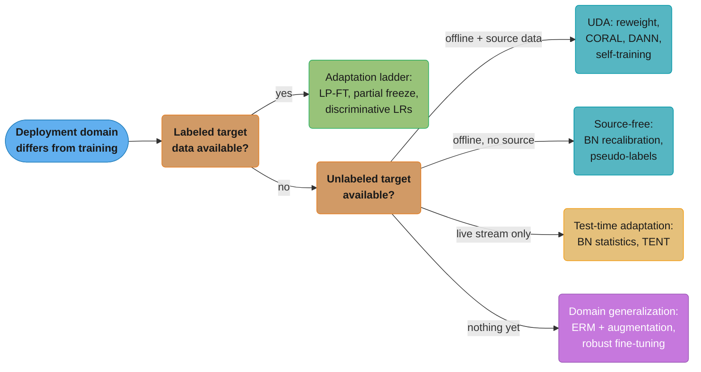
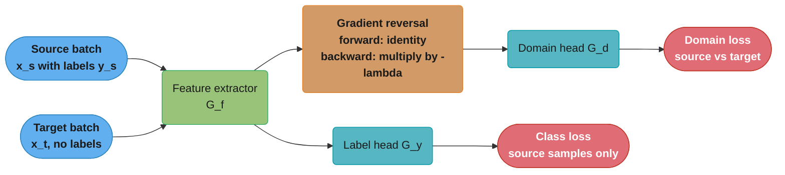
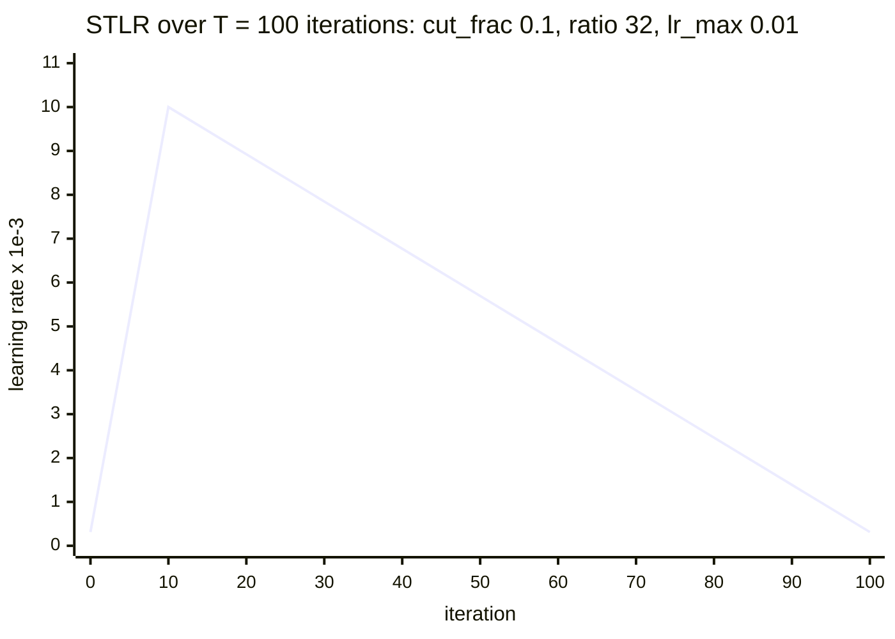
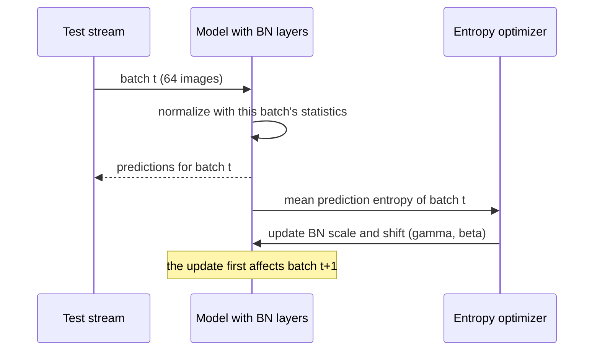

# Transfer Learning and Domain Adaptation

## 1. Concept Overview

Transfer learning reuses what a model learned on a large source task or dataset to solve a different, usually smaller, target task. The everyday form is fine-tuning: start from pretrained weights (an ImageNet ResNet, a BERT-style encoder) instead of random initialization, and adapt them with the target labels you have. Domain adaptation is the sibling problem where the task stays the same but the data distribution moves: the model was trained on distribution `p_s(x, y)` and will be scored on `p_t(x, y)`, and you may have no target labels at all.

Four settings sit under this one page, and the right tool depends on which data you hold at adaptation time:

| Setting | You have | Typical technique | Section |
|---|---|---|---|
| Supervised transfer | Pretrained weights + some target labels | Linear probe, partial freeze, LP-FT, discriminative LRs, adapters | 4.1, 6.1-6.4 |
| Unsupervised domain adaptation (UDA) | Labeled source + unlabeled target | Importance weighting, BBSE, CORAL, DANN, self-training | 4.3, 6.6-6.10 |
| Test-time / source-free adaptation | Trained model + unlabeled target stream, no source data | BN statistic recalibration, TENT | 4.4, 6.11 |
| Domain generalization (DG) | Several source domains, no target data at all | ERM with strong pretraining, augmentation, robust fine-tuning | 4.5 |

Boundaries with neighbouring pages. Parameter-efficient methods for large language models (LoRA, QLoRA, adapters, prefix tuning) are taught in [LoRA](../../llm/fine_tuning/lora.md), [PEFT Methods](../../llm/fine_tuning/peft_methods.md) and [LLM Domain Adaptation](../../llm/fine_tuning/domain_adaptation.md); this page only places them on the adaptation ladder. Detecting that production data moved (PSI, KS, dashboards, alerting) is owned by [Monitoring and Drift Detection](../monitoring_and_drift_detection/monitoring_and_drift_detection.md) and [Drift Monitoring and Retraining](../case_studies/cross_cutting/drift_monitoring_and_retraining.md); this page owns what to DO about a shift once you suspect which kind it is. Adapting a model over a long sequence of tasks without forgetting earlier ones is covered in [Continual Learning and Test-Time Memory](../../llm/data_flywheels_and_continuous_learning/continual_learning_and_test_time_memory.md). Learning to adapt from K examples by training across many tasks is [Meta-Learning and Few-Shot](../meta_learning_and_few_shot/meta_learning_and_few_shot.md).

---

## 2. Intuition

One-line analogy: transfer learning is hiring an experienced engineer for a new team (keep their general skill, teach the local codebase gently), and domain adaptation is that same engineer relocating to a country with different conventions (same job, different "input distribution").

Mental model: two independent questions decide everything. First, what do I move: weights (fine-tune a pretrained model) or the data distribution (reweight, align, or renormalize so the target looks like the source)? Second, what supervision do I hold on the target: many labels, a few, unlabeled data, a live stream, or nothing? Almost every technique on this page is one cell in that grid.

Why it matters: almost no production model sees its training distribution. A model trained on one hospital's scanners meets another hospital's; a classifier trained on studio photos meets phone photos; a fraud model trained on last year's mix meets this quarter's. The WILDS benchmark (10 datasets covering shifts across hospitals, camera traps, and time and location in satellite imaging) reports that standard training gives substantially lower out-of-distribution than in-distribution accuracy, and that the gap persists even with methods built to close it.

Key insight: adaptation can hurt in two silent ways. Fine-tuning every weight can distort good pretrained features and lose accuracy under shift (Kumar et al. measured fine-tuning at about 2% higher in-distribution but 7% lower out-of-distribution than a linear probe, on average over 10 shift datasets). And unsupervised adaptation methods quietly assume a TYPE of shift: importance weighting assumes covariate shift, BBSE assumes label shift, DANN assumes the label marginals did not move. Pick the wrong assumption and the "adaptation" lowers target accuracy while source metrics still look perfect.

---

## 3. Core Principles

**Features go from general to specific with depth.** Yosinski et al. quantified this layer by layer on ImageNet networks: first-layer features (Gabor-like filters, colour blobs) transfer across tasks, higher layers specialize to the source task. They found two distinct failure causes: specialization of upper layers to the source task, and optimization trouble from splitting co-adapted neurons between a frozen and a trainable part. They also found that transferring from distant tasks still beats random features, and that transferred initialization can leave a generalization boost that lingers even after fine-tuning. Practical consequence: the lower layers are cheap to freeze, the upper layers are where adaptation is needed.

**Fine-tuning is controlled forgetting.** Howard and Ruder's ULMFiT states the tension directly: overly aggressive fine-tuning causes catastrophic forgetting of what pretraining captured, while too cautious fine-tuning converges slowly and overfits. Their three controls, now standard vocabulary, are discriminative learning rates (lower layers get smaller LRs), a slanted triangular schedule (short warmup, long decay) and gradual unfreezing (last layer first).

**The best adaptation depends on how similar the tasks and distributions are.** Peters et al. found that fine-tuning versus freezing the pretrained model as a feature extractor depends on the similarity between pretraining and target tasks; Kumar et al. found that fine-tuning loses to linear probing when the pretrained features are good AND the shift is large. There is no universally best rung of the adaptation ladder.

**Shift types are different assumptions, and some cannot be verified without labels.** Covariate shift (`p(x)` moves, `p(y|x)` fixed), label shift (`p(y)` moves, `p(x|y)` fixed) and concept shift (`p(y|x)` moves) each license a different correction. Unlabeled target data can reveal that `p(x)` moved, but it can never prove `p(y|x)` stayed fixed.

**Invariance has a price when label marginals differ.** Learning domain-invariant features (DANN, CORAL) is only a sufficient strategy under conditions that often fail. Zhao et al. built a counterexample with conditional shift where invariant features and low source error still give failed adaptation, and proved an information-theoretic lower bound: when the label marginals differ across domains, no method that learns exactly invariant representations can achieve small error on both domains.

**Model selection is part of the algorithm.** Gulrajani and Lopez-Paz argue that a domain generalization algorithm without a model selection strategy is incomplete. Their DomainBed testbed (seven multi-domain datasets, nine baseline algorithms, three model selection criteria) found that carefully implemented ERM (plain empirical risk minimization) matches state-of-the-art across all of them. Treat "plain pretrained ERM" as the baseline every adaptation method has to beat on a fairly selected checkpoint.

**Transfer can be negative.** Wang et al. give negative transfer a formal definition (using source knowledge hurts target performance compared with not using it) and show it arises when the source is less related to the target. Detect it empirically (Section 6.4) instead of assuming pretraining always helps.

**Validate on the target distribution, by group.** A random split of target data leaks near-duplicates (consecutive frames, the same user, the same session) and says nothing about the next domain. Hold out whole domains, sites, cameras or time ranges.

---

## 4. Types / Architectures / Strategies

### 4.1 The supervised-transfer ladder

From the cheapest, least-forgetful rung to the most expressive. Numbers use torchvision ResNet-50 (25,557,032 parameters with the 1000-class head, 4.09 GFLOPS) with a new 12-class head: the backbone without a head has 23,508,032 parameters and the new head has `2048 x 12 + 12 = 24,588`, so the model totals 23,532,620.

| Rung | What trains | Trainable params (ResNet-50, 12 classes) | Strength | Main risk |
|---|---|---|---|---|
| Frozen features + kNN or logistic regression | Nothing in the net | 0 (classifier on cached features) | Instant, no forgetting, cacheable | Features not tuned to target |
| Linear probe | New head only | 24,588 (0.10% of the model) | Best OOD when features are good and shift is large | Lower ID ceiling |
| Partial freeze (top stage) | `layer4` + head | about 15.0M (about 64%) | Good ID/cost balance | Which stage depends on the shift type |
| Full fine-tune | Everything | 23.5M (100%) | Highest ID accuracy with enough labels | Distorts features, worst OOD, needs 16 bytes/param of fp32 AdamW state |
| LP-FT | Head, then everything | 24.6K then 23.5M | Kumar et al.: best of both | Two-phase training to manage |
| Adapters / LoRA | Small inserted modules, base frozen | often under 1% | Many task variants share one base | Taught in the LLM pages |
| Surgical fine-tuning | One chosen block | block size | Matches or beats last-layers tuning (Lee et al.) | Needs a shift-type hypothesis |
| WiSE-FT (weight-space ensembling) | Full FT, then interpolate with zero-shot weights | 100% | Recovers robustness lost to fine-tuning | Needs a zero-shot model (CLIP-like) |

The `layer4` figure is hand-derived from the torchvision architecture (14,964,736 parameters, so `layer4` plus the 12-class head is 14,989,324 = 63.7% of 23,532,620). Verify it with `count()` from Section 6.1 on your own model rather than trusting this page's arithmetic.

Adapters and LoRA freeze the base model and train small low-rank or bottleneck modules. The LoRA paper reports up to 10,000 times fewer trainable parameters and 3 times less GPU memory than fine-tuning GPT-3 175B with Adam, with no extra inference latency (unlike adapters). For the mechanics, ranks, QLoRA and merging, read [LoRA](../../llm/fine_tuning/lora.md), [QLoRA](../../llm/fine_tuning/qlora.md) and [PEFT Methods](../../llm/fine_tuning/peft_methods.md) rather than re-deriving them here.

**Linear probing then full fine-tuning (LP-FT).** Kumar et al. show fine-tuning with a fixed or random head distorts the pretrained lower layers while the head is still being learned, which hurts OOD accuracy. Fitting the head first and then fine-tuning everything fixes the order of events. Averaged over 10 shift datasets (Breeds-Living17, Breeds-Entity30, DomainNet, CIFAR to STL, CIFAR10.1, FMoW, ImageNetV2, ImageNet-R, ImageNet-A, ImageNet-Sketch) the paper reports:

| Method (relative to a linear probe) | In-distribution | Out-of-distribution |
|---|---|---|
| Full fine-tune | +2 points | -7 points |
| LP-FT | +3 points | +3 points |

The LP-FT row is derived from the abstract's statement that LP-FT is 1% better in-distribution and 10% better out-of-distribution than full fine-tuning.

**Discriminative learning rates, slanted triangular schedule, gradual unfreezing (ULMFiT).** Pick the last layer's LR by fine-tuning only that layer, then divide by 2.6 per layer going down (`lr[l-1] = lr[l] / 2.6`). Slanted triangular LR rises for 10% of iterations then decays linearly; the paper uses `cut_frac = 0.1`, `ratio = 32` and `lr_max = 0.01`. Gradual unfreezing unfreezes the last layer, trains one epoch, unfreezes the next lower layer, and repeats until all layers train. The method cut error by 18-24% on the majority of six text classification datasets and, with 100 labeled examples, matched training from scratch on 100 times more data.

### 4.2 Shift taxonomy

| Shift | Formal change | What stays fixed | Revealed by unlabeled target data? | Standard response |
|---|---|---|---|---|
| Covariate shift | `p_s(x) != p_t(x)` | `p(y|x)` | The `x` change yes, "`p(y|x)` is unchanged" no | Importance weighting, BN-statistic recalibration, target-like data in training |
| Label (prior) shift | `p_s(y) != p_t(y)` | `p(x|y)` | Indirectly, through predicted-class counts if the confusion matrix is invertible | BBSE or MLLS reweighting, prior-corrected posteriors, threshold moves |
| Concept shift | `p_s(y|x) != p_t(y|x)` | Possibly `p(x)` | No, needs fresh labels | Relabel, retrain or fine-tune on new labels |
| Mixed / corruption shift | Several at once | Little | Partly | Robust fine-tuning, TTA with a reliable-sample filter |

Label shift typically arises when diseases cause symptoms (the label causes the features), covariate shift when the input population or sensor changes while the mapping stays physical. Which assumption holds is a domain judgment, not a measurement.

### 4.3 Unsupervised domain adaptation methods

| Family | Idea | Needs source data at adaptation | Core assumption |
|---|---|---|---|
| Importance weighting | Reweight source losses by `p_t(x)/p_s(x)` | Yes | Covariate shift, overlapping support |
| BBSE / MLLS | Estimate `w(y) = q(y)/p(y)` from predicted-class counts, reweight | Holdout confusion matrix only | Label shift, invertible confusion matrix |
| Moment alignment (CORAL, MMD) | Match feature mean or covariance across domains | Yes | Alignment helps the classifier |
| Adversarial alignment (DANN) | Features must fool a domain classifier | Yes | Label marginals roughly equal |
| Self-training / pseudo-labeling | Train on confident target predictions | Optional | Predictions mostly right, errors not self-reinforcing |
| Normalization-statistic adaptation (AdaBN) | Replace BN statistics with target statistics | No | Shift lives in activation statistics |

### 4.4 Test-time adaptation

| Method | Updates | Adapts per | Source data needed | Known failure |
|---|---|---|---|---|
| BN statistics (AdaBN, Schneider et al.) | Running mean and variance only | Pass over target (forward only) | No | Tiny or label-skewed batches |
| TENT | BN scale and shift, by entropy minimization | Online batch, one gradient per batch | No | Hard shifts (MNIST to SVHN), unstable under imbalance or small batches |
| CoTTA | All parameters, with weight-averaged teacher plus stochastic restore | Online, non-stationary | No | Higher compute, more knobs |
| SAR | Entropy minimization on reliable samples with sharpness-aware updates | Online | No | Added hyperparameters, best with group or layer norm |

### 4.5 Domain generalization

No target data exists when training, so the only levers are the pretrained model, the augmentation, the diversity of source domains, and the checkpoint selection rule. DomainBed's headline finding is that ERM with proper tuning matches the specialized algorithms across its datasets. For large pretrained models the practical lever is robust fine-tuning: WiSE-FT ensembles the weights of the zero-shot and fine-tuned models and reports 4 to 6 points more accuracy under distribution shift than prior work on ImageNet plus five derived shifts, while also raising ImageNet accuracy by 1.6 points, at no extra fine-tuning or inference cost.

---

## 5. Architecture Diagrams

### Which adaptation applies: a decision flow by available supervision



The first question is whether ANY target labels exist: even a few hundred labeled target examples usually beat every unsupervised method, so check that before reaching for adversarial training.

### DANN: one feature extractor, two heads, one gradient reversal



The domain head learns to tell domains apart, while the reversed gradient pushes the feature extractor the opposite way, so features become useful for the label head yet uninformative about the domain.

### Slanted triangular learning rate (ULMFiT defaults)



The rate climbs from `lr_max / 32` to `lr_max` in the first 10 iterations, then decays linearly back to `lr_max / 32`, giving the short increase and long decay the paper found key.

### Layer-wise freezing and learning-rate ladder

```
GRADUAL UNFREEZING + DISCRIMINATIVE LRs  (ResNet-50, head LR 1e-3, divide by 2.6 per stage)

stage    LR        ep1   ep2   ep3   ep4   ep5   ep6
fc       1.0e-3    [T]   [T]   [T]   [T]   [T]   [T]     T = trainable, BN in train mode
layer4   3.8e-4    [ ]   [T]   [T]   [T]   [T]   [T]     blank = frozen, BN in eval mode
layer3   1.5e-4    [ ]   [ ]   [T]   [T]   [T]   [T]
layer2   5.7e-5    [ ]   [ ]   [ ]   [T]   [T]   [T]
layer1   2.2e-5    [ ]   [ ]   [ ]   [ ]   [T]   [T]
stem     8.4e-6    [ ]   [ ]   [ ]   [ ]   [ ]   [T]

general features (stem, layer1) move last and slowest; task-specific ones (layer4, fc) move first
```

One stage joins per epoch, and each stage's LR is the head LR divided by `2.6` once per step down the ladder, so the most general features move last and slowest.

### Test-time entropy minimization loop (TENT)



TENT serves predictions before applying the update for the same batch, so each prediction already benefits from target batch statistics but never from its own gradient step.

---

## 6. How It Works - Detailed Mechanics

All code is Python 3.10+ with type hints, targeting PyTorch 2.x (the PyTorch 2.15 documentation was checked for `BatchNorm2d`, per-parameter optimizer options and `OneCycleLR`), torchvision, NumPy, SciPy and scikit-learn.

### 6.1 Build, freeze and count

```python
from __future__ import annotations

import torch
from torch import Tensor, nn
from torchvision.models import ResNet50_Weights, resnet50

BN_TYPES = (nn.BatchNorm1d, nn.BatchNorm2d, nn.BatchNorm3d)
STAGES = ["fc", "layer4", "layer3", "layer2", "layer1", "stem"]


def build_resnet50(num_classes: int) -> nn.Module:
    # IMAGENET1K_V2 is 80.858 top-1 on ImageNet-1K; inputs must use the
    # weights' own transforms (resize 232, crop 224, ImageNet mean/std)
    model = resnet50(weights=ResNet50_Weights.IMAGENET1K_V2)
    model.fc = nn.Linear(model.fc.in_features, num_classes)  # random init
    return model


def count(model: nn.Module, trainable_only: bool = False) -> int:
    return sum(p.numel() for p in model.parameters() if p.requires_grad or not trainable_only)


def stage_modules(model: nn.Module) -> dict[str, list[nn.Module]]:
    return {
        "fc": [model.fc],
        "layer4": [model.layer4],
        "layer3": [model.layer3],
        "layer2": [model.layer2],
        "layer1": [model.layer1],
        "stem": [model.conv1, model.bn1],
    }


def set_stage_state(model: nn.Module, active: list[str]) -> None:
    """Trainable + train-mode BN for active stages, frozen + eval-mode BN for the rest."""
    for stage, mods in stage_modules(model).items():
        on = stage in active
        for m in mods:
            m.requires_grad_(on)
            m.train(on)
```

`requires_grad_(False)` stops gradients but does not stop BatchNorm from updating its running statistics. The PyTorch docs state that during training a BatchNorm layer keeps running mean and variance estimates (default `momentum=0.1`) which are then used in evaluation. `set_stage_state` therefore switches the module to eval mode as well, which is the only thing that freezes those statistics.

### 6.2 Discriminative learning rates, STLR-style schedule, gradual unfreezing

```python
import torch.nn.functional as F


def discriminative_groups(model: nn.Module, head_lr: float, decay: float = 2.6) -> list[dict]:
    mods = stage_modules(model)
    return [
        {
            "params": [p for m in mods[stage] for p in m.parameters()],
            "lr": head_lr / decay**i,
            "name": stage,
        }
        for i, stage in enumerate(STAGES)
    ]


def finetune_gradual(
    model: nn.Module,
    loader: torch.utils.data.DataLoader,
    epochs_per_stage: int = 1,
    head_lr: float = 1e-3,
    decay: float = 2.6,
    device: str = "cuda",
) -> None:
    model.to(device)
    groups = discriminative_groups(model, head_lr, decay)
    opt = torch.optim.AdamW(groups, weight_decay=1e-2)
    total_epochs = epochs_per_stage * len(STAGES)
    # OneCycleLR accepts one max_lr per param group. These settings reproduce the
    # slanted-triangular shape: 10% warmup from max_lr/32, then linear decay to max_lr/32
    sched = torch.optim.lr_scheduler.OneCycleLR(
        opt,
        max_lr=[g["lr"] for g in groups],
        total_steps=total_epochs * len(loader),
        pct_start=0.1,
        anneal_strategy="linear",
        cycle_momentum=False,
        div_factor=32,
        final_div_factor=1,
    )
    for epoch in range(total_epochs):
        n_active = min(epoch // epochs_per_stage + 1, len(STAGES))
        set_stage_state(model, STAGES[:n_active])
        for x, y in loader:
            x, y = x.to(device), y.to(device)
            loss = F.cross_entropy(model(x), y)
            opt.zero_grad(set_to_none=True)
            loss.backward()
            opt.step()
            sched.step()
```

Every stage is in the optimizer from the start; frozen stages simply have `grad = None`, which the optimizers skip, so unfreezing needs no optimizer rebuild and a stage's weight decay never touches it while frozen. In the PyTorch docs, `OneCycleLR` defaults are `pct_start=0.3`, `div_factor=25`, `final_div_factor=1e4`, which is why they are overridden above.

### 6.3 LP-FT in two phases

```python
def run_epochs(
    model: nn.Module,
    loader: torch.utils.data.DataLoader,
    params: list[nn.Parameter],
    lr: float,
    epochs: int,
    device: str,
) -> None:
    opt = torch.optim.AdamW(params, lr=lr, weight_decay=1e-2)
    for _ in range(epochs):
        for x, y in loader:
            x, y = x.to(device), y.to(device)
            loss = F.cross_entropy(model(x), y)
            opt.zero_grad(set_to_none=True)
            loss.backward()
            opt.step()


def lp_ft(
    model: nn.Module,
    loader: torch.utils.data.DataLoader,
    lp_epochs: int = 10,
    ft_epochs: int = 5,
    device: str = "cuda",
) -> None:
    model.to(device)
    # Phase 1: linear probe, backbone frozen AND in eval mode, so its features never move
    set_stage_state(model, ["fc"])
    run_epochs(model, loader, list(model.fc.parameters()), lr=1e-2, epochs=lp_epochs, device=device)
    # Phase 2: full fine-tune from the probed head, much smaller LR (heuristic: 10-100x lower)
    set_stage_state(model, STAGES)
    run_epochs(model, loader, list(model.parameters()), lr=1e-4, epochs=ft_epochs, device=device)
```

Phase 2 starts from a head that already fits the frozen features, so early gradients into the backbone are small and informative instead of large and random. The LRs shown are starting points to tune on a target-domain validation set, not values from the paper.

### 6.4 Detecting negative transfer

Negative transfer is a comparison, so build the comparison. Train the same architecture from random initialization and from the pretrained weights at the SAME target budget, over several target-set sizes and seeds, and watch the sign of the gap.

```python
import statistics
from collections.abc import Callable


def transfer_gap(
    train_eval: Callable[[bool, int, int], float],
    sizes: list[int],
    seeds: list[int],
) -> dict[int, tuple[float, float]]:
    """train_eval(pretrained, n_target, seed) -> accuracy on a held-out TARGET-domain set.
    Returns {n_target: (mean gap, std of gap)}; gap = pretrained - scratch."""
    out: dict[int, tuple[float, float]] = {}
    for n in sizes:
        gaps = [train_eval(True, n, s) - train_eval(False, n, s) for s in seeds]
        out[n] = (statistics.mean(gaps), statistics.pstdev(gaps))
    return out


def negative_transfer_at(gaps: dict[int, tuple[float, float]], n_prod: int) -> bool:
    mean, std = gaps[n_prod]
    return mean < -std  # worse than scratch by more than seed noise at the production budget
```

Four more signals, cheapest first. (1) A linear probe on frozen pretrained features must beat a linear probe on random-initialized features; Yosinski et al. found even distant-task features beat random ones, so if it does not, the pipeline is broken before transfer is. (2) Sweep how many layers you transfer (copy the first `k`, re-initialize the rest); a curve that peaks at small `k` says the upper layers are source-specific. (3) Compare per-slice, not only overall: a pretrained model can raise average accuracy while regressing on a rare class or device. (4) Watch early target loss: if the pretrained run starts above the scratch run and never crosses, the source features are working against the target. Wang et al. also propose an adversarial filter that removes unrelated source data when you control the source set.

### 6.5 Detecting the shift: domain classifier, KS with Bonferroni, BBSD

Rabanser et al. compared shift detectors across datasets and perturbations and found that a two-sample test on the outputs of a pretrained classifier (black box shift detection, BBSD) performed best, and that a trained domain classifier helps characterize the shift and judge whether it is harmful. The helpers below implement those pieces; see [Monitoring and Drift Detection](../monitoring_and_drift_detection/monitoring_and_drift_detection.md) for PSI bands and alerting.

```python
import numpy as np
from scipy import stats
from sklearn.linear_model import LogisticRegression
from sklearn.metrics import roc_auc_score
from sklearn.model_selection import StratifiedKFold, cross_val_predict


def domain_classifier(x_src: np.ndarray, x_tgt: np.ndarray, seed: int = 0) -> tuple[float, np.ndarray]:
    """Out-of-fold P(target | x) for every row, plus its AUC. Rows: source first, then target."""
    x = np.vstack([x_src, x_tgt])
    d = np.r_[np.zeros(len(x_src)), np.ones(len(x_tgt))]
    clf = LogisticRegression(max_iter=2000)
    cv = StratifiedKFold(5, shuffle=True, random_state=seed)
    p = cross_val_predict(clf, x, d, cv=cv, method="predict_proba")[:, 1]
    return float(roc_auc_score(d, p)), p


def ks_bonferroni(z_src: np.ndarray, z_tgt: np.ndarray, alpha: float = 0.05) -> tuple[bool, int, float]:
    """Per-column two-sample KS; reject if min p < alpha / K (Bonferroni, as in Rabanser et al.)."""
    pvals = np.array([stats.ks_2samp(z_src[:, j], z_tgt[:, j]).pvalue for j in range(z_src.shape[1])])
    return bool(pvals.min() < alpha / len(pvals)), int(pvals.argmin()), float(pvals.min())


def bbsd_hard_chi2(pred_src: np.ndarray, pred_tgt: np.ndarray, k: int) -> float:
    """Chi-squared homogeneity test on predicted-class counts (BBSDh). Returns the p-value."""
    table = np.vstack([np.bincount(pred_src, minlength=k), np.bincount(pred_tgt, minlength=k)])
    table = table[:, table.sum(axis=0) > 0]  # drop classes never predicted in either set
    return float(stats.chi2_contingency(table)[1])
```

Run `ks_bonferroni` on the softmax outputs (BBSDs) of a classifier scored on HELD-OUT source data, never on its own training set. `scipy.stats.ks_2samp` uses the exact p-value when both samples have fewer than 10,000 points under `method="auto"` and the asymptotic one otherwise. Detection tells you that something moved; the domain classifier's AUC and its most predictive features tell you what. It cannot tell you whether `p(y|x)` changed.

### 6.6 Importance weighting for covariate shift

If only `p(x)` moves, the target risk equals the source risk with each source example weighted by `w(x) = p_t(x) / p_s(x)`. A domain classifier gives the ratio without density estimation: `w(x) = [P(target|x) / P(source|x)] * (n_s / n_t)`.

```python
def covariate_weights(
    p_target_given_x: np.ndarray,  # out-of-fold P(target | x) for the SOURCE rows
    n_src: int,
    n_tgt: int,
    clip: float = 20.0,
) -> tuple[np.ndarray, float]:
    odds = p_target_given_x / np.clip(1.0 - p_target_given_x, 1e-6, None)
    w = np.clip(odds * n_src / n_tgt, 0.0, clip)
    ess_fraction = float(w.sum() ** 2 / (w**2).sum() / len(w))  # effective sample size / n
    return w / w.mean(), ess_fraction
```

Always print `ess_fraction`. An effective sample size of a few percent of `n` means a handful of source points carry the whole loss: the estimator is unbiased in theory and useless in practice. Pass the weights to the loss with `reduction="none"`:

```python
def weighted_ce(logits: Tensor, y: Tensor, w: Tensor) -> Tensor:
    return (F.cross_entropy(logits, y, reduction="none") * w).mean()
```

Two caveats from the literature. Byrd and Lipton found that on over-parameterized deep networks that fit the training data, importance weighting affects the model early in training but its effect diminishes over successive epochs; L2 regularization and batch normalization (not dropout) restore some of it. So for deep nets, weights alone often do nothing once the net interpolates. And the same weights make model selection honest: Sugiyama et al.'s importance-weighted cross-validation is unbiased under covariate shift where ordinary cross-validation is not, so use weighted validation accuracy `sum(w_i * correct_i) / sum(w_i)` to compare checkpoints.

### 6.7 Label shift: BBSE and prior correction

Under label shift `p(x|y) = q(x|y)`, a classifier's predicted label depends on `y` only through `x`, so `q(y_hat) = sum_y p(y_hat, y) * w(y)` with `w(y) = q(y) / p(y)`. In matrix form `mu = C w`, where `C[i, j] = p(y_hat = i, y = j)` is the joint confusion matrix measured on held-out source data and `mu` is the distribution of predictions on the target. Lipton et al.'s black box shift estimation (BBSE) solves `w = C^-1 mu`, is consistent, and works even when the predictor is biased, inaccurate or uncalibrated, as long as `C` is invertible.

```python
def bbse_weights(
    pred_src_holdout: np.ndarray,
    y_src_holdout: np.ndarray,
    pred_tgt: np.ndarray,
    k: int,
    max_cond: float = 1e4,
) -> np.ndarray:
    c = np.zeros((k, k))
    np.add.at(c, (pred_src_holdout, y_src_holdout), 1.0)
    c /= len(y_src_holdout)                       # joint p(y_hat, y)
    if np.linalg.cond(c) > max_cond:
        raise ValueError("confusion matrix is near-singular, BBSE is unstable")
    mu = np.bincount(pred_tgt, minlength=k) / len(pred_tgt)
    w = np.clip(np.linalg.solve(c, mu), 0.0, None)
    return w / (w * c.sum(axis=0)).sum()          # keep sum_y w(y) p(y) = 1


def prior_correct(probs: Tensor, w: Tensor) -> Tensor:
    """p_t(y|x) is proportional to p_s(y|x) * w(y). Needs calibrated probabilities."""
    adj = probs * w
    return adj / adj.sum(dim=1, keepdim=True)
```

Worked check with two classes. A source classifier has 90% accuracy and `p(y) = [0.5, 0.5]`, so `C = [[0.45, 0.05], [0.05, 0.45]]` and `C^-1 = [[2.25, -0.25], [-0.25, 2.25]]`. If the true target prior is `[0.7, 0.3]`, the true weights are `[1.4, 0.6]` and the target prediction mix is `mu = C w = [0.66, 0.34]`. Naive counting says 66% / 34%, understating the shift; `C^-1 mu = [2.25 * 0.66 - 0.25 * 0.34, -0.25 * 0.66 + 2.25 * 0.34] = [1.4, 0.6]` recovers it exactly. Garg et al. unify BBSE with the maximum-likelihood alternative MLLS and report that MLLS dominates empirically: its consistency needs calibration of the classifier plus the same invertibility condition, and BBSE's inefficiency comes from coarse (hard-label) calibration.

### 6.8 CORAL: align second-order statistics

Deep CORAL adds a differentiable loss `l_CORAL = ||C_S - C_T||_F^2 / (4 d^2)`, the squared Frobenius distance between source and target feature covariances (batch estimates, `d` is the feature width), and trains `l = l_class + sum_i lambda_i * l_CORAL`.

```python
def coral_loss(fs: Tensor, ft: Tensor) -> Tensor:
    d = fs.size(1)

    def cov(x: Tensor) -> Tensor:
        xc = x - x.mean(dim=0, keepdim=True)
        return xc.t() @ xc / (x.size(0) - 1)

    return ((cov(fs) - cov(ft)) ** 2).sum() / (4 * d * d)


# training step: source batch has labels, target batch does not
# logits_s, feats_s = model(xs); _, feats_t = model(xt)
# loss = F.cross_entropy(logits_s, ys) + lam * coral_loss(feats_s, feats_t)
```

The authors warn that minimizing the CORAL loss alone can collapse: the network could project all data to a single point, making the loss zero with no usable classifier. The classification loss is the counterweight, and the two reach an equilibrium during training. CORAL needs one covariance per batch (`O(d^2)` memory), so apply it to a low-dimensional layer rather than a 2048-wide one unless the batch is large enough for a stable estimate.

### 6.9 DANN: adversarial alignment with a gradient reversal layer

```python
import math


class GradReverse(torch.autograd.Function):
    @staticmethod
    def forward(ctx, x: Tensor, lambd: float) -> Tensor:
        ctx.lambd = lambd
        return x.view_as(x)

    @staticmethod
    def backward(ctx, grad_out: Tensor) -> tuple[Tensor, None]:
        return -ctx.lambd * grad_out, None


def dann_lambda(p: float, gamma: float = 10.0) -> float:
    """p = training progress in [0, 1]. Ganin et al.: lambda ramps 0 -> 1 as 2/(1+exp(-gamma p)) - 1."""
    return 2.0 / (1.0 + math.exp(-gamma * p)) - 1.0


class DANN(nn.Module):
    def __init__(self, features: nn.Module, feat_dim: int, num_classes: int) -> None:
        super().__init__()
        self.features = features
        self.classifier = nn.Linear(feat_dim, num_classes)
        self.domain = nn.Sequential(nn.Linear(feat_dim, 256), nn.ReLU(), nn.Linear(256, 1))

    def forward(self, x: Tensor, lambd: float = 1.0) -> tuple[Tensor, Tensor]:
        f = self.features(x)
        return self.classifier(f), self.domain(GradReverse.apply(f, lambd)).squeeze(1)


def dann_step(
    model: DANN,
    opt: torch.optim.Optimizer,
    xs: Tensor,
    ys: Tensor,
    xt: Tensor,
    progress: float,
) -> float:
    lambd = dann_lambda(progress)
    logits_s, dom_s = model(xs, lambd)
    _, dom_t = model(xt, lambd)
    cls = F.cross_entropy(logits_s, ys)
    dom = F.binary_cross_entropy_with_logits(
        torch.cat([dom_s, dom_t]),
        torch.cat([torch.zeros_like(dom_s), torch.ones_like(dom_t)]),
    )
    loss = cls + dom
    opt.zero_grad(set_to_none=True)
    loss.backward()
    opt.step()
    return float(loss)
```

The paper's deep-network recipe: batches of 128 with half source and half target, SGD with momentum 0.9, learning rate annealed as `mu_p = 0.01 / (1 + 10 p)^0.75`, `lambda_p` ramped by the schedule in `dann_lambda` (`gamma = 10`, not tuned), and a fixed `lambda = 1` for the domain classifier itself so it trains as fast as the label predictor. The code above achieves the same effect: the domain head receives the full gradient while the feature extractor receives the reversed, `lambda`-scaled one. DANN directly optimizes the H-divergence of Ben-David et al.'s domain adaptation theory, so it inherits their assumption that a single classifier can do well on both domains, and Zhao et al.'s lower bound when label marginals differ.

Proxy A-distance (PAD) is the diagnostic that comes with the paper: train a linear SVM to separate source from target in the learned representation and use its held-out error. A good adaptation DRIVES THE PAD DOWN, which is the same measurement as the domain-classifier AUC in Section 6.5, now applied to features instead of inputs.

### 6.10 Pseudo-labeling and self-training

```python
@torch.no_grad()
def select_pseudo_labels(
    probs: Tensor,
    threshold: float = 0.9,
    max_per_class: int | None = None,
) -> tuple[Tensor, Tensor]:
    """Return (indices, labels) of confident target predictions, optionally capped per class."""
    conf, pred = probs.max(dim=1)
    keep = conf >= threshold
    idx, labels = torch.nonzero(keep).squeeze(1), pred[keep]
    if max_per_class is not None:
        sel: list[Tensor] = []
        for c in range(probs.size(1)):
            members = idx[labels == c]
            top = conf[members].topk(min(max_per_class, len(members))).indices
            sel.append(members[top])
        idx = torch.cat(sel)
        labels = pred[idx]
    return idx, labels
```

The loop is: train on labeled data, predict the unlabeled target, keep confident predictions, retrain on labeled plus pseudo-labeled, repeat. Self-training amplifies whatever the model already believes, so its failure mode is confirmation bias: a systematically wrong but confident class only gets more entrenched, and a majority class can swallow the rest. Two guards are in the code (a confidence threshold and a per-class cap); two more are noise and a larger-or-equal student, which is what Noisy Student training adds. Xie et al. train an EfficientNet teacher on labeled ImageNet, pseudo-label 300M unlabeled images, then train an equal-or-larger student on the union with dropout, stochastic depth and RandAugment noise, and reach 88.4% top-1 on ImageNet; on robustness sets ImageNet-A top-1 rises from 61.0% to 83.7%, ImageNet-C mean corruption error falls from 45.7 to 28.3. For semi-supervised variants, see [Semi-Supervised Learning](../active_learning_and_weak_supervision/semi_supervised_learning.md).

### 6.11 Test-time adaptation: recalibrate BN, then TENT

Forward-only recalibration needs no labels and no gradients. Schneider et al. replace the training-set activation statistics of each BN layer with statistics from the target images; on ImageNet-C a ResNet-50 goes from 76.7% to 62.2% mean corruption error with that alone, and the authors report that even adapting to a single sample helps and 32 samples are enough to improve the previous state of the art for a ResNet-50. The same idea appears as AdaBN.

```python
@torch.no_grad()
def recalibrate_bn(model: nn.Module, target_loader: torch.utils.data.DataLoader, device: str = "cuda") -> None:
    model.to(device).eval()
    bns = [m for m in model.modules() if isinstance(m, BN_TYPES)]
    saved = [m.momentum for m in bns]
    for m in bns:
        m.reset_running_stats()
        m.momentum = None   # None = cumulative average, i.e. a plain mean over all target batches
        m.train()           # train mode only so running stats accumulate during the forward passes
    for x in target_loader:
        model(x.to(device))
    for m, mom in zip(bns, saved):
        m.momentum = mom    # restore, so later fine-tuning uses the normal moving average
    model.eval()
```

TENT goes one step further: it keeps normalizing with the CURRENT batch's statistics and additionally trains the BN scale `gamma` and shift `beta` (under 1% of the parameters) to minimize prediction entropy.

```python
import copy


def softmax_entropy(logits: Tensor) -> Tensor:
    return -(logits.softmax(dim=1) * logits.log_softmax(dim=1)).sum(dim=1)


def configure_tent(model: nn.Module) -> tuple[nn.Module, list[nn.Parameter]]:
    model.train()                      # BN normalizes with batch statistics
    model.requires_grad_(False)
    params: list[nn.Parameter] = []
    for m in model.modules():
        if isinstance(m, nn.BatchNorm2d):
            m.requires_grad_(True)
            m.track_running_stats = False
            m.running_mean = None      # per the BatchNorm docs, None buffers mean batch statistics always
            m.running_var = None
            params += [m.weight, m.bias]
    return model, params


class Tent:
    def __init__(self, model: nn.Module, lr: float = 2.5e-4, momentum: float = 0.9) -> None:
        self.model, params = configure_tent(model)
        self.opt = torch.optim.SGD(params, lr=lr, momentum=momentum)
        self.init_state = copy.deepcopy(model.state_dict())

    @torch.enable_grad()
    def __call__(self, x: Tensor) -> Tensor:
        logits = self.model(x)                       # prediction uses this batch's statistics
        loss = softmax_entropy(logits).mean()
        self.opt.zero_grad(set_to_none=True)
        loss.backward()
        self.opt.step()                              # affects the NEXT batch only
        return logits.detach()

    def reset(self) -> None:
        self.model.load_state_dict(self.init_state)
```

The paper's ImageNet setting is batch size 64 and learning rate 0.00025 with SGD and momentum (other datasets: batch 128, learning rate 0.001, Adam); it scales the learning rate down with the batch size. Its results: on ImageNet-C TENT reaches 44.0% error online and 42.3% offline versus 50.2% for adversarial noise training and 51.7% for AugMix; on VisDA-C error falls from 56.1% to 45.6%, and to 39.6% when all layers except the classifier are updated; on GTA to Cityscapes segmentation IoU goes 28.8% (source) to 31.4% (BN statistics) to 35.8% (TENT). TENT also fails: on the hard MNIST to SVHN shift the source-only error of 71.3% rose to 79.8%. `reset()` matters because entropy minimization on a stream can drift (Section 10); keep the initial weights and restore them when the domain changes or monitored entropy collapses. TENT costs one extra backward pass per batch: activation gradients must flow through the whole network even though only BN parameters are updated, which in practice is roughly 2x to 3x a plain forward pass (an engineering estimate, measure on your hardware).

### 6.12 Group-aware target evaluation

```python
def worst_group_accuracy(pred: np.ndarray, y: np.ndarray, groups: np.ndarray) -> tuple[float, dict[int, float]]:
    per_group = {int(g): float((pred[groups == g] == y[groups == g]).mean()) for g in np.unique(groups)}
    return min(per_group.values()), per_group
```

Report accuracy per site, device, camera or time slice and the worst of them, not a pooled number: a pooled average can rise while the worst domain falls.

---

## 7. Real-World Examples

**ULMFiT (Howard and Ruder, ACL 2018):** pretrains an AWD-LSTM language model on Wikitext-103 (28,595 Wikipedia articles, 103M words), fine-tunes the language model on target text, then fine-tunes the classifier with discriminative learning rates, slanted triangular LRs and gradual unfreezing. It cut error by 18-24% on the majority of six text classification datasets (IMDb test error 4.6% against 5.9% for the best previous entries in its table) and matched training from scratch on 100 times more data using only 100 labeled examples.

**ImageNet transfer, measured (Kornblith et al., CVPR 2019):** across 16 classification networks and 12 datasets, ImageNet accuracy correlates with transfer accuracy at r = 0.99 when networks are fixed feature extractors and r = 0.96 when fine-tuned. Many common forms of regularization slightly improve ImageNet accuracy but yield penultimate features that transfer worse, and on two small fine-grained datasets pretraining gave minimal benefit. Better ImageNet architectures transfer better, but ImageNet features are less general than assumed.

**Fine-tuning vs probing under shift (Kumar et al., ICLR 2022 oral):** on 10 shift datasets, fine-tuning averaged 2% higher in-distribution and 7% lower out-of-distribution than a linear probe, and LP-FT was 1% better ID and 10% better OOD than full fine-tuning. Surgical fine-tuning (Lee et al., ICLR 2023) extends this: across seven real-world tasks and three shift types, tuning one chosen block matched or beat the usual last-layers tuning, and for image corruptions tuning only the first few layers worked best.

**Robust fine-tuning of CLIP-like models (Wortsman et al., CVPR 2022):** WiSE-FT interpolates zero-shot and fine-tuned weights, gaining 4 to 6 points under distribution shift on ImageNet plus five shifts over prior work, 1.6 points on ImageNet itself, and 0.8 to 3.3 points over standard fine-tuning on seven transfer datasets, at no extra cost.

**Self-training at scale (Noisy Student, CVPR 2020):** 88.4% ImageNet top-1, 2.0 points above the previous state of the art that needed 3.5B weakly labeled Instagram images, with large robustness gains (Section 6.10).

**Test-time adaptation (TENT, ICLR 2021 spotlight):** a new state-of-the-art on ImageNet-C at the time with one gradient per batch and no source data; and the same paper's honest failure on MNIST to SVHN. The follow-ups document when TTA breaks: Niu et al. (ICLR 2023, notable top 5%) find online adaptation fails or harms under mixed shifts, small batches, and online imbalanced label shift, trace the instability to batch norm, and propose SAR to filter noisy large-gradient samples and seek flat minima; Wang et al. (CoTTA, CVPR 2022) show pseudo-labels become unreliable under changing target distributions, causing error accumulation and forgetting, and counter with weight-averaged and augmentation-averaged predictions plus stochastic restoration of source weights.

**WILDS (Koh et al.):** 10 datasets of natural shifts (across hospitals for tumor identification, camera traps for wildlife monitoring, time and location in satellite imaging and poverty mapping). Standard training yields substantially lower OOD than ID performance, and existing shift-handling methods do not close the gap.

---

## 8. Tradeoffs

**Supervised-transfer ladder:**

| Dimension | Linear probe | Partial freeze | Full fine-tune | LP-FT | LoRA / adapters |
|---|---|---|---|---|---|
| Trainable params (ResNet-50, 12 classes) | 24,588 | about 15.0M | 23.5M | 24.6K then 23.5M | typically under 1% of base |
| Optimizer state (fp32 AdamW, 16 bytes/param) | negligible | about 240 MB | about 376 MB | about 376 MB in phase 2 | small |
| In-distribution ceiling | Lowest | Middle | Highest with enough labels | Highest or close | Close to full FT (LLM reports) |
| OOD under large shift | Best of the plain three | Middle | Worst (-7 vs probe) | Best (+3 vs probe) | Often robust, shift-dependent |
| Forgetting risk | None | Low | High | Low | Low (base frozen) |
| Labels needed (rule of thumb) | Tens to hundreds | Hundreds to thousands | Thousands and up | Hundreds and up | Hundreds and up |

The label-count row is a rule of thumb, and the optimizer-state row is plain arithmetic (4 bytes weight + 4 gradient + 8 for two Adam moments per parameter), not measurements from the papers.

**Unsupervised adaptation methods:**

| Method | Source data at adaptation | Compute | Fails when | Cheap sanity check |
|---|---|---|---|---|
| BN recalibration | No | One forward pass over target | Skewed or tiny target set | Accuracy on a small labeled target slice |
| Importance weighting | Yes | Domain classifier fit | Low overlap, ESS under about 10% | Print ESS fraction |
| BBSE / MLLS | Holdout confusion matrix | One linear solve | Concept shift, singular `C` | Condition number of `C` |
| CORAL | Yes | Covariance per batch | Class-conditional shift | Target accuracy of a labeled slice |
| DANN | Yes | Adversarial training, unstable | Label marginals differ | PAD, class-wise confusion |
| Self-training | Optional | Several retrain rounds | Confident systematic errors | Class histogram of pseudo-labels |
| TENT | No | About 2-3x forward cost | Hard shift, small or skewed batches | Entropy and prediction histogram |

**Adaptation regimes:**

| Regime | Needs at deploy time | Adapts | Risk |
|---|---|---|---|
| Fine-tune on target labels | Labels | Offline, once | Overfitting small label sets |
| UDA | Source plus unlabeled target | Offline, repeated per domain | Wrong shift assumption |
| Source-free adaptation | Unlabeled target | Offline | No source anchor |
| TTA | Live stream | Online, forever | Drift, error accumulation |
| DG | Nothing | Never | Unknown deploy domain still hurts |

---

## 9. When to Use / When NOT to Use

**Use transfer learning when:**
- The target has fewer than roughly 100K labeled examples; for most vision, text and tabular-embedding problems a pretrained backbone is the default start.
- Source and target share low-level structure (natural images to medical images share edges and textures; web text to legal text shares syntax).
- You can measure the gain against a from-scratch baseline (Section 6.4) at your real label budget.

**Use unsupervised domain adaptation or TTA when:**
- Labels cannot be collected in the new domain quickly, but unlabeled inputs arrive in volume.
- A small labeled target slice exists to MEASURE the result, even if it is too small to train on.
- You have identified the shift type (Section 4.2) and the method's assumption matches it.

**Do NOT use these when:**
- You can afford even a few hundred target labels: supervised fine-tuning almost always beats UDA, and the labels double as a validation set.
- The shift is concept shift (`p(y|x)` changed, for example a policy or fraud tactic changed): reweighting and alignment move the model toward the wrong rule faster. Relabel and retrain.
- The source and target tasks are unrelated; pretrained weights can hurt (negative transfer).
- You have no way to evaluate on the target domain: unmeasured adaptation is an unaudited change to the model.
- The deployed system is safety-critical and an online-updating model would be unreviewable (TTA changes weights per batch).

### Production decision guide

The thresholds below are rules of thumb to tune on your own data; the papers do not give universal cutoffs.

| Situation | First action | Escalate to | Stop and relabel if |
|---|---|---|---|
| Unlabeled target, domain-classifier AUC under 0.60 | Do nothing, keep monitoring | none | AUC rises over two weeks |
| AUC 0.60 to 0.80, labels unchanged | Recalibrate BN statistics (a few hundred to a few thousand target images) | Importance weighting if ESS fraction above 0.2 | Target accuracy on 200 labeled images falls under the SLO |
| AUC 0.80 to 0.95 | BN recalibration plus 200-500 labeled target images and LP-FT | Self-training with a confidence threshold of about 0.9 | Per-class recall collapses on a rare class |
| AUC above 0.95 (domains nearly separable) | Treat as a new domain: collect 500-2,000 target labels | Partial fine-tune with discriminative LRs | Fine-tuned model still under scratch baseline (negative transfer) |
| Predicted-class mix moved, `p(x|y)` plausibly stable | BBSE weights, then prior-corrected posteriors | Threshold retuning per new prior | Conditional shift suspected |
| Live stream, batch size 64 or more, mild corruption | TTA with BN statistics, then TENT with a reset trigger | SAR or CoTTA for non-stationary streams | Batch under 16 or heavy class skew: skip TTA |
| Same task, new labels or rules | Retrain from fresh labels | Fine-tune from the old model with a small LR | Never adapt unsupervised |

Label budget heuristic for supervised transfer on images: under 100 target labels, probe or kNN on frozen features (plus LoRA for transformers); 100 to 1,000, LP-FT or fine-tune the top stage; 1,000 to 10,000, discriminative LRs with gradual unfreezing; above 10,000 full fine-tuning is fine, but still train a from-scratch baseline once to check for negative transfer.

---

## 10. Common Pitfalls

The war stories in this section are illustrative composites with constructed numbers, written to exercise the failure; the underlying mechanisms are the ones documented in the papers named in each item.

**Pitfall 1 - The "frozen" backbone whose BatchNorm keeps moving.** A team froze a ResNet-50 backbone with `requires_grad_(False)` and trained a new head with batch size 8, but left the model in `train()` mode. BatchNorm kept normalizing with 8-image batch statistics during training and kept writing them into running statistics (momentum 0.1, so the running values track roughly the last ten batches, about 80 images). Training accuracy reached 94% while evaluation, which uses the running statistics, sat at 81%.

```python
# BROKEN: parameters frozen, but BatchNorm layers still run in train mode
model = build_resnet50(num_classes=12)
model.requires_grad_(False)
model.fc.requires_grad_(True)
opt = torch.optim.AdamW(model.fc.parameters(), lr=1e-2)
for epoch in range(10):
    model.train()                        # backbone BN: batch stats in training, noisy running stats saved
    for x, y in loader:                  # batch size 8
        loss = F.cross_entropy(model(x), y)
        opt.zero_grad(); loss.backward(); opt.step()
```

```python
# FIX: freeze the backbone's statistics explicitly, train only the head
model = build_resnet50(num_classes=12)
opt = torch.optim.AdamW(model.fc.parameters(), lr=1e-2)
for epoch in range(10):
    set_stage_state(model, ["fc"])       # fc trainable, everything else frozen and in eval mode
    for x, y in loader:
        loss = F.cross_entropy(model(x), y)
        opt.zero_grad(); loss.backward(); opt.step()
# if the target domain differs a lot, run recalibrate_bn() ONCE over the full target set instead
```

`requires_grad_` and `train()` are independent switches, and the BatchNorm statistics are buffers, not parameters, so freezing parameters never freezes them. The failure is silent because the loss still decreases. Decide the BN policy on purpose: eval mode (keep source statistics) for small batches or similar domains, or one explicit forward-only recalibration over the whole target set for a different domain.

**Pitfall 2 - A domain classifier scored on the data it was fit on.** Reading shift off an in-sample classifier reports near-perfect separation even with no shift, because a flexible model memorizes individual rows.

```python
# BROKEN: in-sample AUC and in-sample propensities
from sklearn.ensemble import GradientBoostingClassifier

clf = GradientBoostingClassifier().fit(x, d)
p = clf.predict_proba(x)[:, 1]
auc = roc_auc_score(d, p)              # about 1.0 even when source and target are the same distribution
w = p / (1 - p)                         # weights are extreme, ESS collapses
```

```python
# FIX: out-of-fold predictions, weights from rows the model did not train on
auc, p = domain_classifier(x_src, x_tgt)                         # cross_val_predict inside
w, ess_fraction = covariate_weights(p[: len(x_src)], len(x_src), len(x_tgt))
assert ess_fraction > 0.1, "importance weights are degenerate, do not use them"
```

A shuffled-labels control is the cheap cross-check: fit the same classifier on randomly permuted domain labels and confirm its out-of-fold AUC is about 0.5.

**Pitfall 3 - Importance weights with a collapsed effective sample size.** A reweighting job passed raw `p/(1-p)` weights to the loss; 2% of source rows carried more than 80% of the total weight. The "adapted" model was trained on a few hundred effective examples and lost 6 points on classes those rows did not cover. Clip weights, print ESS, and abandon the method when ESS is a few percent of `n` (the shift is too large for reweighting; collect target labels).

**Pitfall 4 - Pseudo-labeling a systematic error.** A self-training loop with a 0.5 confidence threshold pseudo-labeled a dominant class with high confidence on blurry target images. After three rounds that class was 71% of the pseudo-labels versus 38% of the true target distribution. Raise the threshold, cap pseudo-labels per class (`select_pseudo_labels`), add input noise, and track the pseudo-label class histogram per round.

**Pitfall 5 - TENT on the wrong stream.** Entropy minimization on a stream with batch size 4 and bursts of a single class drove predictions toward that class; once a model assigns the same label to everything, entropy is minimal and the loss rewards the collapse. This is the documented SAR failure mode (small batches, online imbalanced label shift, mixed shifts, with noisy large-gradient samples causing collapsed trivial solutions). Use batches of 64 where possible, shuffle across the stream, keep `Tent.reset()` wired to an entropy or prediction-histogram monitor, and prefer forward-only BN recalibration when you cannot guarantee batch quality.

**Pitfall 6 - DANN under label shift.** A DANN run aligned features between a balanced training set and a target domain where one class was 11% of traffic versus 4% in training. Forcing the two feature marginals to match required moving some target examples of the frequent class onto the rare class's region. Zhao et al.'s bound explains it: with different label marginals, exactly invariant representations cannot have small error on both domains. Estimate and correct the label shift first (BBSE), then align.

**Pitfall 7 - Choosing the checkpoint on target labels.** Reporting the best epoch measured on the same target test set "selects" noise and calls it adaptation. Gulrajani and Lopez-Paz make model selection part of the algorithm for this reason. Use a held-out labeled target slice that is never trained on, importance-weighted source validation, or a fixed budget schedule; report which one you used.

**Pitfall 8 - Learning rate and preprocessing mismatch.** Using one learning rate of 1e-3 for the whole of a pretrained network destroys the lower layers (the ULMFiT catastrophic-forgetting regime), and feeding images normalized with different mean/std from the pretrained weights' own transforms (`ResNet50_Weights.IMAGENET1K_V2.transforms` resizes to 232, crops to 224 and uses mean `[0.485, 0.456, 0.406]`, std `[0.229, 0.224, 0.225]`) shifts every activation. Use the weights' transform object, discriminative LRs, and a warmup.

**Pitfall 9 - Reporting only in-distribution accuracy.** Fine-tuning won 2 points ID and lost 7 OOD on average in the LP-FT study. A model card that only quotes the ID metric will bless the wrong rung of the ladder. Gate promotion on the worst target slice (`worst_group_accuracy`).

---

## 11. Technologies & Tools

| Tool | Purpose | Notes |
|---|---|---|
| PyTorch `torch.optim` parameter groups | Per-stage learning rates and weight decay | A param-group dict may carry its own `lr`; PyTorch 2.15 docs checked |
| `torch.optim.lr_scheduler.OneCycleLR` | Warmup then decay, one `max_lr` per group | Set `div_factor=32`, `final_div_factor=1`, `pct_start=0.1`, `anneal_strategy="linear"` for an STLR shape |
| torchvision model weights | Pretrained backbones with matching transforms | `ResNet50_Weights.IMAGENET1K_V2`: 80.858 top-1, 25,557,032 params, 4.09 GFLOPS |
| `torch.nn.BatchNorm2d` | Source of both the adaptation problem and the TTA lever | Default `momentum=0.1`; `momentum=None` gives a cumulative average; buffers set to `None` force batch statistics |
| `torch.autograd.Function` | Custom backward for gradient reversal | Custom autograd functions are documented in the autograd notes |
| `scipy.stats.ks_2samp`, `chi2_contingency` | Univariate and categorical two-sample tests | `ks_2samp` is exact when both samples have fewer than 10,000 points under `method="auto"` |
| scikit-learn `cross_val_predict`, `LogisticRegression` | Out-of-fold domain classifier | The classifier-two-sample-test detector of Rabanser et al. |
| DomainBed | Domain generalization testbed (seven datasets, nine baselines, three selection criteria) | Released with Gulrajani and Lopez-Paz; use it to see ERM as a baseline |
| WILDS | In-the-wild distribution-shift benchmark, 10 datasets | Open-source package with data loading and standard evaluation (wilds.stanford.edu) |
| LoRA, QLoRA, PEFT adapters | Parameter-efficient transfer for large models | See [LoRA](../../llm/fine_tuning/lora.md), [QLoRA](../../llm/fine_tuning/qlora.md), [PEFT Methods](../../llm/fine_tuning/peft_methods.md) |
| Drift detectors (MMD, classifier drift, PSI) | Production detection | See [Monitoring and Drift Detection](../monitoring_and_drift_detection/monitoring_and_drift_detection.md) and [Production Quality Monitoring and Drift](../../mlops/production_quality_monitoring_and_drift/production_quality_monitoring_and_drift.md) |

---

## 12. Interview Questions with Answers

**Q: Linear probe, partial freeze or full fine-tune: which one do you start with, and why?**
**Short:** Start with a linear probe as the baseline, then try LP-FT or partial freezing, because full fine-tuning can win in-distribution yet lose badly out-of-distribution.
The decision depends on label count, similarity to pretraining and how large the shift to deployment will be. Kumar et al. measured, over 10 shift datasets, fine-tuning at about 2% higher ID and 7% lower OOD than a linear probe when the pretrained features were good and the shift large. A probe costs minutes and trains 24,588 parameters on a ResNet-50 with 12 classes, so it also gives a floor that any fancier method has to beat. Move up the ladder (LP-FT, then top-stage fine-tuning, then full) only while target-domain validation keeps improving, and report OOD, not just ID.

**Q: Why does LP-FT beat plain fine-tuning out-of-distribution?**
**Short:** A randomly initialized head sends large, uninformative gradients into the backbone early on, distorting pretrained features; fitting the head first removes that distortion.
In plain fine-tuning the head and the backbone learn at the same time, so while the head is still wrong the lower layers change to compensate and drift away from the pretrained features that generalize under shift. Kumar et al. prove this effect for fine-tuning overparameterized two-layer linear networks with a fixed or random head. Linear probing first gives a head that already fits the frozen features, so the gradients that reach the backbone are small and aligned. Empirically LP-FT beat full fine-tuning by 1% ID and 10% OOD on average, so use a small LR in phase two.

**Q: What are discriminative learning rates and gradual unfreezing, and what numbers does ULMFiT use?**
**Short:** Lower layers get smaller learning rates (the paper divides by 2.6 per layer going down) and layers are unfrozen last-to-first one per epoch, to avoid catastrophic forgetting.
Different layers hold different kinds of information, so they should adapt to different extents: choose the last layer's LR by tuning only that layer, then set each lower layer to the one above divided by 2.6. Gradual unfreezing trains the last layer for an epoch, adds the next lower layer, and repeats until all layers train. Combined with the slanted triangular schedule (10% warmup, long linear decay, ratio 32) these cut error by 18-24% on most of six text datasets. The PyTorch version is optimizer parameter groups plus `OneCycleLR(max_lr=[...])`.

**Q: Does `requires_grad_(False)` freeze a BatchNorm layer?**
**Short:** No, it only stops weight gradients; BatchNorm running statistics are buffers that keep updating in train mode, so you must also call eval() on the frozen modules.
`requires_grad_(False)` turns off gradients for `weight` and `bias`, but BatchNorm updates `running_mean` and `running_var` in every training-mode forward pass, with a default momentum of 0.1. With a tiny batch those running statistics become noisy and training and evaluation behaviour diverge without any error. The fix is to set the frozen stages to eval mode (`m.train(False)`), or to recalibrate once over the whole target set deliberately. Decide the policy explicitly instead of inheriting `model.train()`.

**Q: What is negative transfer and how do you detect it?**
**Short:** Negative transfer is when using source knowledge makes target performance worse than not using it; detect it by comparing against a from-scratch baseline at the same target budget.
Wang et al. formalize it and show it arises when the source is less related to the target. In practice train the same architecture from random and pretrained initialization at several target-set sizes and several seeds on a target-domain validation set, and flag a negative gap larger than the seed noise at your production label budget. Cheaper signals: a frozen-feature probe that does not beat a random-feature probe, a layer-truncation sweep that peaks at few transferred layers, and per-slice regressions hidden by a good average. If it is negative, transfer fewer layers, lower the LR, or filter the source data.

**Q: What is the difference between covariate, label and concept shift?**
**Short:** Covariate shift changes p(x), label shift changes p(y), and concept shift changes p(y|x); each licenses a different correction.
Covariate shift keeps `p(y|x)` fixed while inputs move (new demographic, new sensor); the fix is importance weighting or normalization adaptation. Label shift keeps `p(x|y)` fixed while class frequencies move (a disease's prevalence changes); the fix is BBSE or MLLS reweighting and prior-corrected posteriors. Concept shift changes the labeling rule itself (a fraud tactic evolves), and nothing unlabeled can fix it because the mapping is wrong, so it needs fresh labels. Naming the type first matters: applying the covariate-shift fix to a concept shift moves the model confidently toward the wrong rule.

**Q: Can you prove covariate shift from unlabeled target data?**
**Short:** No: unlabeled data can show p(x) moved, but whether p(y|x) stayed fixed needs labels, so covariate shift is an assumption you validate with a small labeled slice.
Two-sample tests, a domain classifier or MMD detect that the input distribution changed. The covariate-shift claim is the stronger statement that the labeling rule did not change, and no amount of unlabeled data can confirm it. This is why a small labeled target sample (even 200 images) is worth more than another week of unlabeled data: it measures whether the model's accuracy actually changed, which is the quantity you care about. The [monitoring page](../monitoring_and_drift_detection/monitoring_and_drift_detection.md) covers the same split between data drift and concept drift.

**Q: How do you detect covariate shift in practice, and which test is best?**
**Short:** Run a two-sample test on a low-dimensional representation, such as softmax outputs, or train a domain classifier and test its held-out AUC; Rabanser et al. found classifier-output tests best.
Rabanser et al. compared dimensionality reductions (none, PCA, random projection, autoencoders, label-classifier outputs, domain classifier) with MMD, KS plus Bonferroni, and chi-squared tests. Univariate KS tests on each of K dimensions combine with a Bonferroni threshold of alpha/K, which is conservative; MMD with an RBF kernel and a permutation p-value tests the joint distribution but needs enough samples. Black box shift detection, a KS or chi-squared test on the outputs of a source-trained classifier scored on held-out source data, was best across their shifts, and a domain classifier helps characterize and judge harmfulness. Reducing dimension can miss shifts, so keep a raw-feature monitor too.

**Q: How does importance weighting work, and why is it fragile?**
**Short:** It reweights source losses by w(x)=p_t(x)/p_s(x), estimated with a domain classifier; it is fragile because weights can be extreme and deep nets that interpolate largely ignore them.
With only covariate shift the weighted source risk is an unbiased estimate of the target risk, and `w(x)` equals the domain classifier's odds times `n_s/n_t`. Fragility comes from variance: when overlap is low a few rows dominate and the effective sample size collapses (print it; under about 10% means do not use it). Byrd and Lipton showed that for over-parameterized networks that fit the training data the weighting effect fades over epochs, partly restored by L2 regularization and batch norm. Keep it for model selection and for smaller models; use IWCV (Sugiyama et al.) so validation is also unbiased under shift.

**Q: How does BBSE correct for label shift without target labels?**
**Short:** BBSE solves C w = mu for the class weights w, where C is the joint confusion matrix from held-out source data and mu is the distribution of predictions on the target.
Under label shift, a classifier's predictions on the target are a mixture of its per-class behaviour (unchanged) weighted by the new class frequencies, so `q(y_hat) = sum_y p(y_hat, y) w(y)`. Estimate the confusion matrix on source holdout data, count predictions on unlabeled target data, and solve the linear system; it is consistent even for a biased or uncalibrated classifier provided the confusion matrix is invertible. Then reweight the training loss or multiply posteriors by `w` and renormalize. Garg et al. show MLLS (a maximum-likelihood estimator) is empirically better, with a calibration condition. Check the condition number of `C` first.

**Q: How does a gradient reversal layer implement domain-adversarial training?**
**Short:** It acts as identity in the forward pass and multiplies the gradient by -lambda in the backward pass, so the feature extractor learns to confuse the domain classifier while the classifier learns to separate.
In DANN a shared feature extractor feeds a label head (source labels) and, through the reversal layer, a domain head (source vs target). The domain head minimizes domain loss normally; gradients flowing back into the features are negated, so the features maximize domain loss, making them uninformative about the domain yet useful for classification. One SGD pass therefore finds the saddle point of the adversarial objective. The paper ramps lambda from 0 to 1 with `2/(1+exp(-10p)) - 1` so the domain signal does not dominate noisy early features, and uses half-source, half-target batches of 128.

**Q: When does DANN or other feature alignment fail?**
**Short:** When label marginals differ or class-conditionals shift, because matching feature distributions exactly can then force a wrong alignment and an irreducible error on one domain.
Zhao et al. constructed a counterexample where domain-invariant features with small source error still adapt badly under conditional shift, and proved a lower bound: when the label marginals differ between domains, any method that learns exactly invariant representations has large joint error on at least one domain. Practically, estimate and correct label shift first, align class-conditionally or via pseudo-labels, watch per-class recall on the target, and monitor Proxy A-distance together with target accuracy; low PAD with falling accuracy means over-alignment. Adversarial training also needs careful tuning: it is a minimax problem.

**Q: What does CORAL align, and why is the classification loss required?**
**Short:** CORAL aligns the second-order statistics (covariances) of source and target features, and it needs the classification loss because CORAL alone can collapse features to a single point.
Deep CORAL minimizes `||C_S - C_T||_F^2 / (4 d^2)` on batch covariances at one or more layers, added to the classification loss with a weight lambda. It is simpler to optimize than adversarial training and similar in spirit to minimizing MMD with a polynomial kernel. With the CORAL term alone, projecting everything to a point makes it zero while destroying class information, which is why the paper trains both losses jointly until they reach equilibrium. It captures only second-order mismatch, and needs a large enough batch for a stable covariance estimate.

**Q: What are the failure modes of pseudo-labeling, and how does Noisy Student reduce them?**
**Short:** Pseudo-labeling reinforces its own mistakes (confirmation bias); Noisy Student adds noise to an equal-or-larger student so it must generalize beyond its teacher's labels.
A confident wrong prediction becomes training data and strengthens itself, and one class can dominate the pseudo-labels. Guard with a confidence threshold, a per-class cap and a per-round class histogram. Noisy Student (Xie et al.) trains a teacher on labeled data, pseudo-labels 300M unlabeled images, trains an equal-or-larger student with dropout, stochastic depth and RandAugment on labeled plus pseudo-labeled data, then iterates; it reached 88.4% ImageNet top-1 and cut ImageNet-C mean corruption error from 45.7 to 28.3. Without noise and capacity the student merely copies the teacher.

**Q: Does a specialized domain generalization algorithm beat ERM?**
**Short:** Under a fair setup, often not: Gulrajani and Lopez-Paz found carefully implemented ERM state-of-the-art across all seven DomainBed datasets, so ERM with good pretraining is the baseline.
Their DomainBed testbed (seven multi-domain datasets, nine baselines, three model selection criteria) shows that conclusions depend on the model selection rule, and that an algorithm without a selection rule is incomplete. For pretrained models the practical levers are better pretraining, augmentation, and robust fine-tuning such as WiSE-FT, which reported 4-6 points under shift. Before adopting a DG method, reproduce ERM with the same selection criterion on your data and require the method to win by more than seed noise.

**Q: What does TENT update and when does it fail?**
**Short:** TENT updates only BatchNorm scale and shift (under 1% of parameters) to minimize prediction entropy using batch statistics, and fails on hard shifts, small batches or label-skewed streams.
It switches BN to batch statistics and optimizes `gamma` and `beta` with one gradient per batch; the update affects the next batch, not the current one. On ImageNet-C it reached 44.0% error online (42.3% offline), and it failed on MNIST to SVHN where source error 71.3% rose to 79.8%. Niu et al. document the failure conditions (mixed shifts, small batches, online imbalanced label shift) and the collapse to a single label, proposing SAR; Wang et al. show long non-stationary streams accumulate error (CoTTA). Wire a reset to a monitored entropy or prediction histogram, and use batches of 64 or more.

**Q: Why not just recalibrate BatchNorm statistics instead of running TENT?**
**Short:** Often you should: BN recalibration is forward-only, parameter-free and has far fewer failure modes, and TENT adds a gradient step that helps only on shifts BN statistics cannot absorb.
Schneider et al. replaced training statistics with target statistics and moved ResNet-50 from 76.7% to 62.2% mean corruption error on ImageNet-C, with even a single sample helping and 32 samples sufficient to beat a previous state of the art. TENT's reported gain over test-time normalization is about 14-18% relative error on ImageNet-C, but it costs a backward pass, adds a learning rate to tune and can drift. Start with recalibration, measure on a labeled slice, and add entropy minimization only if the residual gap justifies the risk.

**Q: How do you do model selection in unsupervised domain adaptation without target labels?**
**Short:** Use importance-weighted validation on source data, a small held-out labeled target slice that is never trained on, or a reverse-validation scheme, and state which one you used.
Naive validation on source data is biased under covariate shift; Sugiyama et al.'s importance-weighted cross-validation is unbiased there, with the caveat that weights must be well estimated (check ESS). The DANN paper selects hyperparameters without target labels using reverse cross-validation. Even 100-200 labeled target examples give a far more reliable signal than either, and Gulrajani and Lopez-Paz show conclusions depend on the selection rule. Never pick the best epoch on the final target test set.

**Q: Do ImageNet-pretrained features always help?**
**Short:** Not always: Kornblith et al. found minimal benefit on two small fine-grained datasets, and feature quality depends on how the network was regularized during ImageNet training.
Across 16 networks and 12 datasets ImageNet accuracy predicts transfer accuracy strongly (r = 0.99 as fixed feature extractors, 0.96 fine-tuned), so better backbones do help. But many common regularizers that slightly raise ImageNet accuracy yield penultimate features that transfer worse, and pretraining gave little on two fine-grained tasks, so ImageNet features are less general than assumed. Always run the from-scratch comparison at your real label budget, and pick the backbone by transfer accuracy on your domain rather than ImageNet leaderboard rank.

**Q: Where do LoRA and adapters sit on the adaptation ladder, and why are they not covered in detail here?**
**Short:** They freeze the base weights and train small low-rank or bottleneck modules, sitting between a linear probe and full fine-tuning; the mechanics live in the LLM fine-tuning pages.
LoRA reports up to 10,000 times fewer trainable parameters and 3 times less GPU memory than fine-tuning GPT-3 175B with Adam, with no extra inference latency, and the base weights never move, so forgetting is limited. For the choice between full fine-tuning and PEFT, ranks and target modules, QLoRA quantization and merging, read [LoRA](../../llm/fine_tuning/lora.md), [PEFT Methods](../../llm/fine_tuning/peft_methods.md) and [LLM Domain Adaptation](../../llm/fine_tuning/domain_adaptation.md). The same shift-awareness applies: a LoRA adapter trained on one domain still needs target-domain validation.

**Q: Your fine-tuned model scores 96% on a random validation split but 78% after deployment to a new site. What happened and how do you prevent it?**
**Short:** A random split leaks near-duplicates from the same site, session or time, so validation measured memorization; split by domain, site, camera or time and report the worst group.
Consecutive frames, the same user's sessions or the same device's images land on both sides of a random split, which makes the validation set an in-distribution test of a different question from the deployment one. Hold out entire sites, cameras or time ranges (`GroupShuffleSplit`, or a forward-chaining split), compute per-group and worst-group accuracy, and include a labeled slice from the true deployment domain before launch. Then compare against a linear-probe baseline: if fine-tuning wins ID but loses on the held-out site, you are in the regime Kumar et al. describe and LP-FT or a lower LR is the first fix.

**Q: A TTA or self-training method improved your offline target accuracy; what else do you check before shipping it?**
**Short:** Check source-domain regression, per-class recall, stability over a long stream, and a rollback path, because adaptation helps the average while hurting tails and forgetting the source.
Measure the adapted model on the original source test set and on rare classes; entropy-based methods can sharpen toward majority classes. Replay a long recorded stream and watch accuracy and prediction histograms over time, since CoTTA's analysis shows pseudo-label error accumulates when targets keep changing. Keep the unadapted model as a shadow baseline and an automatic reset when drift or entropy alarms fire. For adapting repeatedly over a task sequence without forgetting, see [Continual Learning and Test-Time Memory](../../llm/data_flywheels_and_continuous_learning/continual_learning_and_test_time_memory.md).

---

## 13. Best Practices

- Establish the floor first: a linear probe on frozen features and a from-scratch run at the same label budget. Every other method must beat both on a TARGET-domain holdout.
- Use pretrained weights with their own preprocessing transform; never re-derive mean/std from a different dataset.
- Set the BatchNorm policy deliberately for every fine-tune: eval mode for frozen stages, recalibrate once over the target for a large domain gap, train mode only for stages you are actually adapting.
- Prefer LP-FT, or a small-LR full fine-tune warmed up from a trained head, over fine-tuning from a random head; use discriminative learning rates (head LR divided by about 2.6 per stage as a start) and a warmup-then-decay schedule.
- Name the shift type before choosing a corrector; keep a small labeled target slice (hundreds of examples) just for measuring.
- Score domain classifiers out-of-fold, run a permuted-label control, and print ESS before using importance weights.
- Estimate label shift with BBSE or MLLS only after checking the confusion matrix condition number and calibration; apply prior correction at inference.
- Treat TTA as production code: batch of 64 or more, reset trigger, shadow baseline, monitored entropy and prediction histogram.
- Select checkpoints with a rule decided before looking at target test accuracy; state it in the model card.
- Gate releases on worst-group accuracy, not pooled accuracy, and keep the source-domain regression test.
- Keep detection and adaptation in separate pipelines: monitoring decides when to act (see [Drift Monitoring and Retraining](../case_studies/cross_cutting/drift_monitoring_and_retraining.md)), adaptation code decides how.
- Link adaptation runs to experiment tracking so the BN policy, LRs and selection rule are reproducible.

---

## 14. Case Study

**Scenario (illustrative composite: the company, volumes and every metric below are constructed to exercise the design, not drawn from a published deployment).** A logistics company trains a 12-class parcel-condition classifier (intact, crushed, wet, torn, and so on) at Site A: 40,000 labeled images from fixed studio-style cameras. Site B opens with conveyor cameras: 300,000 unlabeled images per day, different lighting and angle, and a different class mix (damaged parcels are 11% of traffic against 4% at Site A). A first day of annotation yields 400 labeled Site B images for training and a separate 1,200-image labeled evaluation set collected on different belts and days.

**The pipeline.**


Detection first: a cross-validated domain classifier on frozen backbone features gave AUC 0.96, and importance weights computed from it had an ESS fraction of 4%, so importance weighting was rejected (Section 6.6) and DANN was skipped because the label marginals clearly differed (Section 6.9, Pitfall 6). The recipe therefore stacks the methods that do not rely on overlap or equal priors.

**Orchestration code, gating each stage on a group-aware metric.**

```python
from dataclasses import dataclass


@dataclass
class StageResult:
    name: str
    acc: float
    worst_belt_acc: float


def evaluate(model: nn.Module, x_eval: Tensor, y_eval: np.ndarray, belts: np.ndarray) -> tuple[float, float]:
    model.eval()
    with torch.inference_mode():
        pred = model(x_eval).argmax(dim=1).cpu().numpy()
    worst, _ = worst_group_accuracy(pred, y_eval, belts)
    return float((pred == y_eval).mean()), worst


def adapt_site_b(
    model: nn.Module,
    unlabeled_loader: torch.utils.data.DataLoader,
    labeled_loader: torch.utils.data.DataLoader,
    x_eval: Tensor,
    y_eval: np.ndarray,
    belts: np.ndarray,
) -> list[StageResult]:
    results: list[StageResult] = []
    results.append(StageResult("source-only", *evaluate(model, x_eval, y_eval, belts)))

    recalibrate_bn(model, unlabeled_loader)                       # forward-only, no labels
    results.append(StageResult("bn-recalibrated", *evaluate(model, x_eval, y_eval, belts)))

    lp_ft(model, labeled_loader, lp_epochs=10, ft_epochs=5)       # 400 labeled Site B images
    results.append(StageResult("lp-ft", *evaluate(model, x_eval, y_eval, belts)))

    # BBSE prior correction is applied at inference via prior_correct(probs, w)
    # pseudo-label round: select_pseudo_labels(probs, threshold=0.9, max_per_class=2000), then retrain
    return results
```

**Results (illustrative).**

| Stage | Accuracy on 1,200-image Site B eval set | Worst-belt accuracy | Damaged-class recall |
|---|---|---|---|
| Site A model, source-only | 71.4% | 62.0% | 54% |
| + BN recalibration | 78.9% | 70.5% | 61% |
| + LP-FT (400 labels) | 83.6% | 77.8% | 70% |
| + BBSE prior correction | 84.0% | 78.1% | 78% |
| + pseudo-label round (0.9, capped) | 85.1% | 79.4% | 79% |
| Reference: DANN from the Site A model | 76.0% | 66.3% | 49% |

The reference row is what the label-shift misstep looks like: DANN lifted the average a little but lowered damaged-class recall, because aligning marginals when 4% versus 11% of rows are damaged sacrifices the rare class. BN recalibration contributed 7.5 points for one forward pass over unlabeled data; 400 labels added 4.7 more; prior correction mostly bought recall on the class that matters.

**BROKEN to FIX: an evaluation that rewards leakage.** The team's first evaluation shuffled all labeled Site B images into one pool and split 80/20 randomly. Consecutive conveyor frames of the same parcel landed on both sides, and the reported 94% accuracy collapsed to 83.6% on the belt-held-out set.

```python
# BROKEN: random split of frames that come from the same parcel and belt
from sklearn.model_selection import train_test_split

x_tr, x_va, y_tr, y_va = train_test_split(x_b, y_b, test_size=0.2, random_state=0)
# near-duplicate frames of one parcel are in both halves: validation measures memorization
```

```python
# FIX: split by belt and day so no parcel or session crosses the boundary
from sklearn.model_selection import GroupShuffleSplit

groups = belt_id.astype(str) + "_" + day_id.astype(str)
gss = GroupShuffleSplit(n_splits=1, test_size=0.2, random_state=0)
tr_idx, va_idx = next(gss.split(x_b, y_b, groups=groups))
assert set(groups[tr_idx]).isdisjoint(groups[va_idx])
worst, per_belt = worst_group_accuracy(pred_va, y_b[va_idx], belt_id[va_idx])
```

Random splits treat every frame as independent, but a belt, a day and a parcel are the units that deployment changes. The leak is silent: the metric is high, the loss curve is clean, and every other number built on it (stage ordering, thresholds, the decision to ship) inherits the error. Grouped splits plus worst-group accuracy cost three lines and turn the evaluation into the question the business is asking.

**Operational plan.** Keep the unadapted Site A model as a shadow baseline; run the domain classifier weekly on a rolling window (AUC drift above 0.05 triggers a labeling batch of 300 images); reset any online adaptation on a prediction-histogram alarm; and hand sustained drift off to the retraining flow in [Drift Monitoring and Retraining](../case_studies/cross_cutting/drift_monitoring_and_retraining.md).

---

## See Also

- [Monitoring and Drift Detection](../monitoring_and_drift_detection/monitoring_and_drift_detection.md) - PSI, KS and MMD detection, alerting, and the data-drift versus concept-drift split this page acts on
- [Drift Monitoring and Retraining](../case_studies/cross_cutting/drift_monitoring_and_retraining.md) - retraining triggers and the production loop that calls the adaptation recipes here
- [Production Quality Monitoring and Drift](../../mlops/production_quality_monitoring_and_drift/production_quality_monitoring_and_drift.md) - the MLOps-side quality gates and drift operations
- [Continual Learning and Test-Time Memory](../../llm/data_flywheels_and_continuous_learning/continual_learning_and_test_time_memory.md) - adapting over a sequence of tasks or domains without catastrophic forgetting
- [Meta-Learning and Few-Shot](../meta_learning_and_few_shot/meta_learning_and_few_shot.md) - learning to adapt from K examples, and why transfer is the baseline to beat
- [Convolutional Neural Networks](../convolutional_neural_networks/convolutional_neural_networks.md) - the ImageNet-backbone transfer recipe and the BatchNorm-on-new-domain war story
- [Self-Supervised and Contrastive Learning](../self_supervised_and_contrastive_learning/self_supervised_and_contrastive_learning.md) - label-free pretraining that supplies the backbones transferred here
- [Semi-Supervised Learning](../active_learning_and_weak_supervision/semi_supervised_learning.md) - pseudo-labeling and consistency regularization in depth
- [Imbalanced Data and Leakage Traps](../imbalanced_data_and_leakage_traps/imbalanced_data_and_leakage_traps.md) - class priors, group leakage and fit-inside-fold discipline
- [Uncertainty Quantification and Conformal Prediction](../uncertainty_quantification_and_conformal_prediction/uncertainty_quantification_and_conformal_prediction.md) - calibration, needed for prior correction and entropy-based TTA
- [LLM Fine-Tuning](../../llm/fine_tuning/fine_tuning.md), [LoRA](../../llm/fine_tuning/lora.md), [PEFT Methods](../../llm/fine_tuning/peft_methods.md), [LLM Domain Adaptation](../../llm/fine_tuning/domain_adaptation.md) - parameter-efficient and continued-pretraining adaptation for language models
