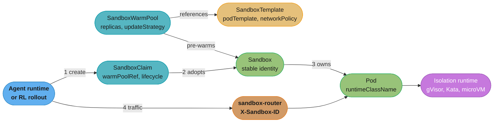
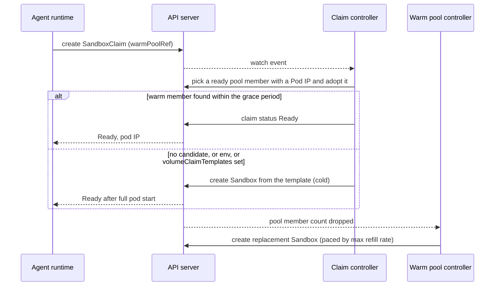
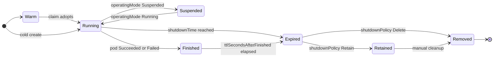
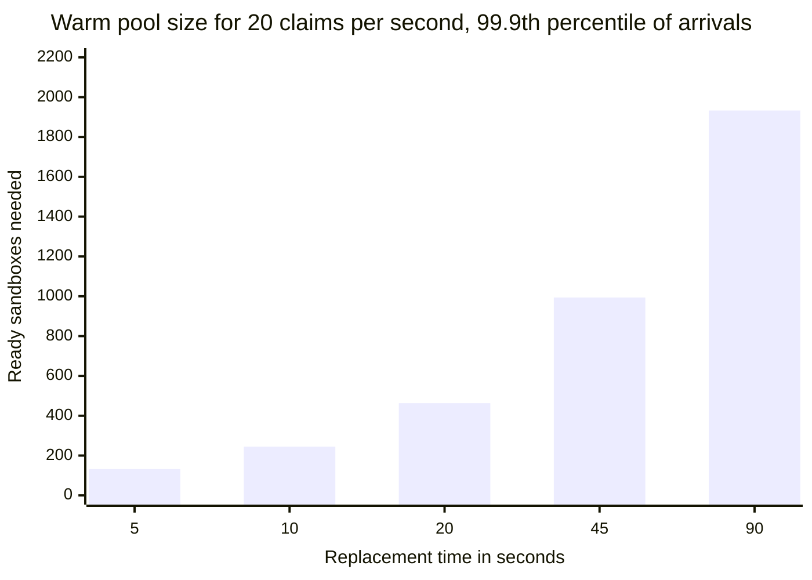
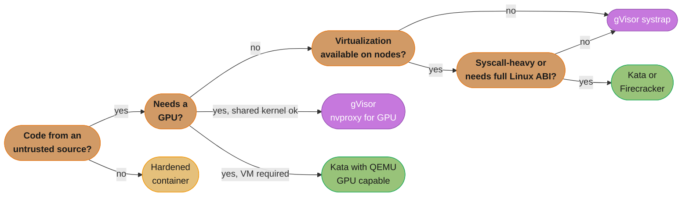

# Agent Runtime and Sandbox Fleet Operations

> **Version anchor (2026-11-25).** `kubernetes-sigs/agent-sandbox` v1.0.12 (released 2026-11-20) is current. Its CRDs are served only as `v1beta1`: `Sandbox` in `agents.x-k8s.io` and `SandboxTemplate`, `SandboxClaim` and `SandboxWarmPool` in `extensions.agents.x-k8s.io`. The project needs Kubernetes 1.25 or later with CRD CEL validation and recommends 1.29 or later. Kubernetes 1.37 is current (1.37.2 on 2026-10-13); its scalability criteria are at most 110 pods per node, 5,000 nodes and 150,000 pods per cluster. gVisor release 20261123.0 (2026-11-24), Firecracker v1.18.0 (2026-11-09) and Kata Containers 4.4.0 (2026-11-17) are the current isolation runtimes. GKE Pod snapshots are read from the vendor documentation as checked on 2026-11-25. Every limit and flag on this page was read from the project's own documentation or source on that date. Numbers marked "modeled" are arithmetic on stated assumptions, not measurements.

---

## 1. Concept Overview

An AI agent that executes code, edits files, drives a browser or runs a build needs a computer. At small scale that computer is a container someone started by hand. At fleet scale it is a service with its own capacity plan, its own security boundary, its own cost line and its own on-call rotation. This module treats the **sandbox** as the unit of that service: one isolated, stateful, single-tenant execution environment that lives for one agent session, one RL rollout or one CI job.

Four workloads share the same substrate and have very different shapes:

| Workload | Arrival pattern | Session length | What hurts first |
|---|---|---|---|
| Interactive agent sessions (coding agent, data analyst, computer-use agent) | smooth with daily peaks | minutes to hours | cost of idle sandboxes, start latency the user feels |
| Short code execution (tool call, code interpreter) | very high rate | seconds | warm-pool overhead exceeds the work itself |
| RL environment fleets (rollouts, evaluation, SWE-bench style tasks) | one synchronized wave per training step | minutes | burst claim rate, image pulls, straggler sandboxes |
| CI runners and builds | bursty, queue-driven | minutes | cleanup, cache state, credential scope |

The artifacts an operator owns are not the model weights. They are the things that decide what a session can touch and how fast it starts:

| Artifact | What it holds | Typical owner | Changes how often |
|---|---|---|---|
| Sandbox template | pod spec, base image digest, resource requests and limits, `runtimeClassName`, network policy | platform team | weekly |
| Warm pool config | replicas per template, update strategy, readiness grace period | platform team, often autoscaled | daily |
| Isolation tier | which runtime class a tenant class gets (runc hardened, gVisor, Kata) | security | per quarter |
| Egress and credential policy | allowed destinations, which broker holds which secret | security and platform | per new tool |
| Lifecycle policy | session TTL, idle suspend, retention after expiry | platform | per quarter |
| Snapshot images | memory and file state for fast restore | platform | per template change |

The sandbox template belongs in the agent release bundle next to the agent config and tool manifests, because a template change (a new base image, a loosened egress rule) changes what an agent can do exactly as a prompt change does. The release mechanics for that bundle live in [Agent, Tool and MCP Server Lifecycle](../agent_tool_and_mcp_server_lifecycle/agent_tool_and_mcp_server_lifecycle.md).

The reference implementation taught here is `kubernetes-sigs/agent-sandbox`, a SIG Apps project whose README describes it as managing "isolated, stateful, singleton workloads, ideal for use cases like AI agent runtimes and reinforcement learning". It is a **sandbox orchestrator**: it delegates low-level isolation to a runtime such as gVisor or Kata Containers through `RuntimeClass`, and owns identity, lifecycle, warm pools and claims.

**Not here.** How an agent uses a sandbox as a tool (code-execution patterns, E2B, Modal, Riza, output limits) lives in [Sandboxed Code Execution](../../llm/agents_and_tool_use/sandboxed_code_execution.md). The runtime stack itself (containerd, runc, shims, OCI, RuntimeClass mechanics) lives in [Container Runtimes and OCI](../../devops/container_runtimes_and_oci/container_runtimes_and_oci.md). Agent identity, MCP surface and platform-level egress policy live in [AI Workloads and Agent Operations](../../devops/platform_engineering_and_idp/ai_workloads_and_agent_operations.md). The release lifecycle of agent configs and tools lives in [Agent, Tool and MCP Server Lifecycle](../agent_tool_and_mcp_server_lifecycle/agent_tool_and_mcp_server_lifecycle.md). The RL trainer, rollout and weight-sync topology lives in [Training Infrastructure Operations](../training_infrastructure_operations/training_infrastructure_operations.md), and the algorithm side in [RL Environments and Agentic RL](../../llm/alignment_and_rlhf/rl_environments_and_agentic_rl.md). GPU scheduler policy lives in [GPU Cluster Scheduling and Quotas](../gpu_cluster_scheduling_and_quotas/gpu_cluster_scheduling_and_quotas.md). The agent side of a coding sandbox (loop design, repository tools, evaluation) lives in [Coding Agents](../../llm/coding_agents/coding_agents.md) and the agent logic of a full design in [Design an Autonomous SWE Agent](../../llm/case_studies/design_autonomous_swe_agent.md). The Kubernetes mechanisms under the fleet live in [Kubernetes Operators and CRDs](../../devops/kubernetes_operators_and_crds/kubernetes_operators_and_crds.md), [Kubernetes Networking](../../devops/kubernetes_networking/kubernetes_networking.md) and [Kubernetes Security](../../devops/kubernetes_security/kubernetes_security.md). This page owns the fleet operations of the sandbox itself: pool sizing, claim latency, snapshot and TTL policy, egress and credential isolation at fleet scale, density, cost per session and observability.

---

## 2. Intuition

**One-line analogy.** A sandbox fleet is a connection pool for kernels: you pre-open expensive things, hand one to each caller, and the engineering is in sizing the pool, bounding how long a caller keeps one, and making sure no caller sees the previous caller's state.

**Mental model.** Every sandbox is in one of two economic states. While a session runs, the sandbox earns its cost. While it waits, either in a warm pool for a claim or idle between agent steps, it is overhead. An agent session spends most of its wall-clock time waiting on a model, not executing code, so the dominant cost lever is not CPU efficiency. It is how many sandboxes sit idle and for how long.

**Why it matters.** The first time a team puts a coding agent in front of real users, three things break in a fixed order. Start latency breaks first (a cold pod takes tens of seconds, and the user is watching). Cost breaks second (a warm pool or a long TTL multiplies idle sandboxes). Security breaks last and worst (a shared token, an open egress path or an unreset sandbox leaks one tenant's data into another's session).

**Key insight.** Warm pool overhead per session is roughly the replacement time divided by 3,600, in sandbox-hours, regardless of fleet size (the derivation is in §6.2). A 45 second replacement adds 0.0125 sandbox-hours to every session. That is under 4% of a 20 minute session and 450% of a 10 second one. The same pool that makes a coding agent feel instant makes a code-interpreter tool call cost several times the code it runs.

---

## 3. Core Principles

- **Claim, do not create.** The latency-critical path is binding a pre-created sandbox to a session. Anything that forces a cold start on that path (a per-claim env var, a per-claim volume) must be designed out or accepted knowingly.
- **The template is the contract.** Everything a sandbox may do is decided by its `SandboxTemplate`: image, resources, runtime class, network policy, service account. Review and version it like code, pin the image by digest, and put the digest in the agent bundle.
- **Isolation tier follows tenant risk, not team preference.** Trusted internal code gets a hardened container. Code written by a model on behalf of an external user gets a userspace kernel or a VM. Code that must not share a kernel with anything gets a VM per sandbox.
- **Every sandbox has a deadline.** A `shutdownTime` or `ttlSecondsAfterFinished` on every claim, enforced by the controller, with a platform default for callers that forget. The fleet cost of "no TTL" is unbounded.
- **Egress is denied until allowed.** The default is public internet only with private ranges and the metadata server blocked. Production policy narrows that to named destinations.
- **Credentials do not live in the sandbox.** A sandbox holds at most a short-lived, narrowly scoped token. Long-lived secrets stay in a broker or proxy outside the isolation boundary.
- **Never resume two sandboxes from one snapshot unless uniqueness is re-established.** Identifiers, random seeds and tokens inside a snapshot are duplicated by every restore.
- **Measure to first instruction, not to Ready.** A pod can be Ready before the thing the agent needs (a restored GPU context, a started language server) is usable.
- **The control plane is part of the fleet.** At hundreds of claims per second the API server, etcd and the controller's own refill traffic are the bottleneck, not the nodes.

---

## 4. Types / Architectures / Strategies

### 4.1 Object model

| Object | API group | Role | Fields that matter operationally |
|---|---|---|---|
| `Sandbox` | `agents.x-k8s.io/v1beta1` | one stateful singleton pod with stable identity | `podTemplate`, `volumeClaimTemplates`, `operatingMode` (`Running` or `Suspended`), `shutdownTime`, `shutdownPolicy` (`Retain` or `Delete`), `failedPodPolicy` (`Retain` or `Recreate`), `service` |
| `SandboxTemplate` | `extensions.agents.x-k8s.io/v1beta1` | reusable blueprint | `podTemplate`, `networkPolicy`, `networkPolicyManagement` (`Managed` or `Unmanaged`), `envVarsInjectionPolicy`, `volumeClaimTemplatesPolicy` |
| `SandboxWarmPool` | `extensions.agents.x-k8s.io/v1beta1` | N pre-created sandboxes from one template | `replicas` (HPA-controllable), `sandboxTemplateRef`, `updateStrategy` (`OnReplenish` or `Recreate`), `readinessGracePeriodSeconds` (minimum 30) |
| `SandboxClaim` | `extensions.agents.x-k8s.io/v1beta1` | request for one sandbox from a pool | `warmPoolRef`, `lifecycle` (`shutdownTime`, `ttlSecondsAfterFinished`, `shutdownPolicy` of `Retain`, `Delete` or `DeleteForeground`), `additionalPodMetadata`, `env`, `volumeClaimTemplates` |
| `sandbox-router` | not a CRD | HTTP reverse proxy, routes by `X-Sandbox-ID` header | needed for runtimes (gVisor, Kata) where direct pod port-forwarding does not work |
| `sandboxd` | not a CRD | in-sandbox daemon the SDKs use for files, commands and processes | REST `/v1/files/...` and gRPC process and file-watch services |

The extensions are opt-in: the controller serves them only when started with `--extensions` (the standard `sandbox-with-extensions.yaml` install does this). The v1beta1 API is the only served version; `v1alpha1` types and conversion webhooks were removed.

### 4.2 Isolation tiers

| Tier | Boundary | Kubernetes hook | Strengths | Costs and limits |
|---|---|---|---|---|
| Hardened container (runc, seccomp, dropped capabilities, non-root, read-only rootfs) | shared host kernel | default runtime | native speed and density, full compatibility | one kernel bug is a node compromise, so only for trusted code |
| gVisor (`runsc`) | per-sandbox userspace kernel (the Sentry) in Go, with a Gofer process for file access | `RuntimeClass` such as `gvisor` | strong isolation without hardware virtualization, flexible footprint, high density, GPU through `nvproxy` | reduced application compatibility, higher per-syscall cost, "poor performance for system call heavy workloads" in gVisor's own words |
| Kata Containers | one lightweight VM per pod with a dedicated guest kernel | `RuntimeClass` such as `kata-qemu` | no shared kernel, hypervisor choice (QEMU, Cloud Hypervisor, Firecracker, Dragonball) | needs hardware or nested virtualization, per-pod memory and CPU overhead, GPU and confidential computing best supported on QEMU only |
| Firecracker microVM | KVM guest per microVM, minimal device model, jailer | not a Kubernetes runtime by itself, used directly or under Kata | fast boot, snapshots, tiny VMM overhead | you build the orchestration, snapshot files are trusted input, Kata's hypervisor table lists no GPU support for its Firecracker mode |

gVisor's platform choice matters operationally: the KVM platform "runs best on bare-metal setups", while `systrap`, the default since mid-2023, is the better choice inside a VM or without virtualization support. A fleet on cloud VMs without nested virtualization is therefore a `systrap` fleet.

### 4.3 State strategies

| Strategy | What survives | What does not | Typical use |
|---|---|---|---|
| Ephemeral | nothing | everything | code execution, RL rollouts, CI jobs |
| Suspend and resume (`operatingMode: Suspended`) | the Sandbox object, its PVCs, its identity | running processes, memory, `emptyDir` contents | agent sessions with idle gaps |
| Process or pod snapshot (gVisor checkpoint, GKE Pod snapshots) | memory, threads, file descriptors, rootfs, `emptyDir`, optionally GPU state | PVC contents, active external connections, new IP and hostname on restore | restoring a warmed-up runtime or a long session |
| microVM snapshot (Firecracker) | guest memory file plus device state file, disks managed by you | network connections, vsock connections, uniqueness of IDs and secrets | clone-from-template fast starts |

### 4.4 Pool strategies

| Strategy | When | Failure mode |
|---|---|---|
| One warm pool per template | few templates, moderate rate | single-pool refill ceiling and per-pool serialization |
| Sharded pools of one template | above about 30 claims per second or 500 to 1,000 replicas | more objects to size and balance |
| Pool per task image (RL, SWE-bench style) | hundreds of images, each used by a few rollouts | template and policy churn, image pull storms |
| No pool, cold start | rare, long sessions where 40 to 60 seconds is acceptable | the user waits |
| Pool plus snapshot restore | long runtime warm-up (GPU, large dependency load) | snapshot compatibility rules, uniqueness |

---

## 5. Architecture Diagrams

### Object model and claim path



The caller only ever writes a `SandboxClaim`. The warm pool creates sandboxes ahead of time from the template, the claim controller adopts one, and traffic reaches the pod through the router. The runtime class on the pod is the only place the isolation tier appears, which is why swapping gVisor for Kata is a template change and not a fleet rewrite.

### Claim, warm hit and cold fallback



A claim that sets `spec.env` or `spec.volumeClaimTemplates` skips the warm path entirely, even when the pool is full, because those fields cannot be applied to a running pod. The default wait for a warm candidate to report a Pod IP is 2 seconds (`--sandbox-claim-warm-candidate-grace-period`), after which the claim cold-starts.

### Sandbox lifecycle



`Expired` always deletes the Pod and Service. Only the Sandbox or claim object itself is governed by `shutdownPolicy`, and the CRD default is `Retain`, so an expired object stays in etcd until something deletes it (§6.5).

### Warm pool size for 20 claims per second, by replacement time (modeled)



The pool must cover arrivals during one replacement time. The mean is 20 x T, and the 99.9th percentile of a Poisson arrival count adds a few percent at this scale. Halving the replacement time roughly halves the pool, which is why snapshot restore and pre-pulled images are pool-size levers, not only latency levers.

### Choosing an isolation tier



This is a default, not a rule. A regulated tenant may require a VM per sandbox regardless of cost, and a low-risk internal fleet may accept gVisor on the grounds of density. The decision belongs in the template and is reviewed with security, not left to each agent team.

### Burst drain and recovery of one pool (modeled)

```
Assumptions: pool of 3,939 ready, replacement time T = 45 s, refill capped at 100 per s,
             burst of 300 claims per s for 12 s (3,600 claims), no arrivals afterwards.

time     ready    creating    note
-------  -------  ----------  ------------------------------------------------------
t=0 s     3,939           0   steady state
t=12 s      339       1,200   burst over, pool at 8.6%, next burst would go cold
t=45 s      339       3,600   first replacements become ready (created at t=0)
t=60 s    1,839       2,100   replacements arrive at 100 per s
t=81 s    3,939           0   recovered: T + deficit / refill rate = 45 + 3,600 / 100

A second burst inside the 81 s window meets an almost empty pool and cold-starts.
```

The recovery time is the replacement time plus the deficit divided by the refill rate. Raising the refill cap shortens the second term only. Only a shorter replacement time (snapshot restore, pre-pulled images, a smaller image) shortens the first.

---

## 6. How It Works - Detailed Mechanics

### 6.1 The three manifests that define a fleet

A template, a pool and a claim are the whole write path. The template pins the image by digest, drops the service account token (the controller also defaults `automountServiceAccountToken` to `false` when the template omits it) and picks the runtime class.

```yaml
apiVersion: extensions.agents.x-k8s.io/v1beta1
kind: SandboxTemplate
metadata:
  name: py-agent
  namespace: agent-fleet
spec:
  podTemplate:
    spec:
      runtimeClassName: gvisor          # the isolation tier lives here and only here
      automountServiceAccountToken: false
      securityContext:
        runAsNonRoot: true
        runAsUser: 1000
      containers:
        - name: runtime
          image: registry.example.com/agent/py-runtime@sha256:1111111111111111111111111111111111111111111111111111111111111111
          ports:
            - containerPort: 8080
          resources:
            requests: { cpu: 250m, memory: 512Mi }
            limits:   { cpu: "2",  memory: 2Gi }
          securityContext:
            allowPrivilegeEscalation: false
            readOnlyRootFilesystem: true
            capabilities: { drop: ["ALL"] }
  networkPolicyManagement: Managed        # default: public egress only, ingress from the router only
  envVarsInjectionPolicy: Disallowed      # default: a claim that sets env is rejected
---
apiVersion: extensions.agents.x-k8s.io/v1beta1
kind: SandboxWarmPool
metadata:
  name: py-agent-a
  namespace: agent-fleet
spec:
  replicas: 450
  sandboxTemplateRef:
    name: py-agent
  updateStrategy:
    type: Recreate                        # default is OnReplenish
  readinessGracePeriodSeconds: 120        # minimum 30, controller default 300
---
apiVersion: extensions.agents.x-k8s.io/v1beta1
kind: SandboxClaim
metadata:
  name: sess-8f3a
  namespace: agent-fleet
spec:
  warmPoolRef:
    name: py-agent-a
  lifecycle:
    shutdownTime: "2026-11-25T23:30:00Z"   # hard cap on the session
    ttlSecondsAfterFinished: 300           # clean up 5 minutes after the pod finishes
    shutdownPolicy: Delete                 # CRD default is Retain
  additionalPodMetadata:
    labels:
      sandbox.users.io/session: 8f3a       # label keys need an allowed domain prefix
```

Custom network rules replace the managed default, and an empty `ingress` list means deny all, including the router. A template that supplies its own `networkPolicy` must therefore allow the router explicitly:

```yaml
spec:
  networkPolicy:
    ingress:
      - from:
          - namespaceSelector:
              matchLabels:
                kubernetes.io/metadata.name: agent-sandbox-system   # where the router runs
    egress:
      - to:
          - ipBlock:
              cidr: 0.0.0.0/0
              except: ["10.0.0.0/8", "172.16.0.0/12", "192.168.0.0/16", "169.254.0.0/16"]
        ports:
          - { protocol: TCP, port: 443 }
```

### 6.2 Warm pool sizing math

Four numbers drive the whole design: the claim arrival rate `lambda` (per second), the mean session length `D` (seconds), the replacement time `T` (seconds from the pool noticing a deficit to a new member being ready), and the refill rate cap `R`.

**Concurrency (Little's law).** Sandboxes in use `N = lambda x D`. At 83.3 claims per second and 20 minute sessions that is 100,000 concurrent sandboxes. The pool is separate from `N`: it is the buffer in front of it.

**Pool size.** While one replacement is in flight, the pool must absorb every claim that arrives. Arrivals during `T` seconds are Poisson with mean `mu = lambda x T` if sessions start independently, so:

```
W  >=  q_p(mu)  ~  mu + z x sqrt(mu)            z = 2.33 for p99, 3.09 for p99.9
```

| lambda (per s) | T (s) | mu = lambda x T | p99 | p99.9 | Pool shards (see below) |
|---|---|---|---|---|---|
| 2 | 45 | 90 | 113 | 121 | 1 |
| 5 | 45 | 225 | 261 | 273 | 1 |
| 20 | 10 | 200 | 234 | 245 | 1 |
| 20 | 45 | 900 | 971 | 994 | 2 |
| 83.3 | 3 | 250 | 287 | 300 | 2 |
| 83.3 | 10 | 833 | 901 | 924 | 2 |
| 83.3 | 45 | 3,749 | 3,892 | 3,939 | 4 |

All values are modeled (exact Poisson quantiles). Real session starts are correlated (a workday starting, an RL step launching a whole batch), so the independent-arrival figure is a floor. The honest sizing input is empirical: take the largest number of claims in any window of length `T` from a month of logs, and size to that with 10 to 20% headroom.

**Refill feasibility.** Steady state needs `R >= lambda`, and the project measured a ceiling of about 70 to 85 sandboxes per second per `SandboxWarmPool` because reconciles are serialized per pool and each batch waits for its watch events. Above roughly 30 claims per second sustained, or a pool above 500 to 1,000 replicas, the project's guidance is to split capacity across pools (for example 4 pools of 450 instead of 1 of 1,800), set `--sandbox-warm-pool-concurrent-workers` to the pool count, and set a per-pool refill rate at or above the per-pool arrival rate. Under watch lag of `L` seconds the rule becomes `rate >= claims_per_s x L / pools`, so keep the control plane fast before raising rates.

**Recovery.** After a burst of `B` claims the pool needs `T + B / R` seconds to recover (the §5 table: 45 + 3,600 / 100 = 81 s). If bursts can repeat inside that window, `W` must cover the burst, not the mean.

**Warm overhead per session.** The pool holds `W` ready sandboxes all hour, and `3,600 x lambda` sessions start in that hour, so

```
warm overhead per session  =  W / (3,600 x lambda)  =  (T + z x sqrt(T / lambda)) / 3,600   sandbox-hours
```

For `T = 45` and `lambda = 83.3` that is 0.0131 sandbox-hours, which is 3.9% of a 20 minute session. The overhead depends on `T` and barely on fleet size, which is why shrinking `T` is the cost lever (§6.10).

**Autoscaling the pool.** `SandboxWarmPool.spec.replicas` is documented as controllable by an HPA, and the project's Anthropic Managed Agents guide shows a stats adapter that patches the pool's `/scale` subresource from the work queue's stats. Scale up on queue depth or claim rate, hold a scheduled floor ahead of known ramps, and never let the pool scale down inside the recovery window of §5. The signal and scaler mechanics are in [Inference Autoscaling and Capacity Planning](../inference_autoscaling_and_capacity_planning/inference_autoscaling_and_capacity_planning.md); the generic HPA, KEDA and Cluster Autoscaler layer is in [Kubernetes Scheduling and Autoscaling](../../devops/kubernetes_scheduling_and_autoscaling/kubernetes_scheduling_and_autoscaling.md).

**Template rollouts.** When a template's blueprint changes (image, resources, runtime class), `updateStrategy: Recreate` deletes stale unclaimed sandboxes immediately and creates fresh ones, which drains capacity while replacements start. `OnReplenish` (the default) leaves stale unclaimed sandboxes in place and replaces them only when they are claimed or deleted, so old images keep being served for a while. Claimed sandboxes are never replaced by either. Metadata-only edits do not make a sandbox stale. Roll a template change by creating a second pool on the new template, shifting claims to it, then shrinking the old pool, the same blue and green move as in [Progressive Delivery for Model Servers](../progressive_delivery_for_model_servers/progressive_delivery_for_model_servers.md).

### 6.3 Controller throughput and control-plane protection

The controller binds claims with optimistic-lock updates on the `Sandbox` and the `SandboxClaim` status. Two regimes matter, and the project reports both:

| Regime | On the critical path | Measured |
|---|---|---|
| Burst warm adoption (drain an already ready pool) | optimistic-lock binding plus claim status update, no pod creation | about 300 claims per second per cluster at p90 of 200 ms or less (3,600 claims in 12 s from a 3,700-replica pool) |
| Sustained adoption plus refill | adoption plus `Sandbox` and `Pod` creation, watch round trips, `kube-scheduler` binding, node container start | about 70 to 85 sandboxes per second per pool, bounded by per-pool serialization, the expectations gate and the scheduler's default `--kube-api-qps=50` |

Under a 45 per second Poisson arrival rate across 4 pools, the sustained-tuned profile (`replenish-delay=0`, `max-refill-rate=100`) measured p50 92 ms, p90 182 ms and p99 376 ms for warm adoption. The same project's live GKE test measured cold pod start at about 42 to 50 s p50, which is the practical `T` for a pool without images pre-pulled or snapshots.

The levers, in the order to try them:

| Lever | Flag or object | Default | Why |
|---|---|---|---|
| Pace refill | `--sandbox-warm-pool-max-refill-rate` | 0 (unpaced) | smooths the 300-create bursts that saturate etcd and the watch buffer; about 15% lower p50 and p90 in the live test |
| Bound batches | `--sandbox-warm-pool-max-batch-size` | 300 | each `Sandbox` object is about 10 KB in etcd, so a 300-create batch is a write spike |
| Isolate watches | `--separate-watch-connection`, `--api-connections=4` | false, 1 | a single HTTP/2 connection carries about 100 concurrent streams, and starved watch events wedge the pool until a 5 minute timeout |
| Cut write volume | `--disable-sandbox-events`, `--disable-claim-events`, `--disable-claim-observability-annotations`, `--cache-label-selectors` | false | fewer etcd writes per claim, smaller informer cache on clusters above about 5,000 pods |
| Insulate the claim path | the APF overlay `examples/apf-insulation/apf-insulation.yaml` | not installed | gives claim-adoption writes dedicated API Priority and Fairness seats |
| Workers | `--sandbox-concurrent-workers`, `--sandbox-claim-concurrent-workers`, `--sandbox-warm-pool-concurrent-workers`, `--sandbox-template-concurrent-workers` | 100, 50, 1, 1 | 200, 150, 2, 1 beat both 1000, 1000, 500, 100 and 50, 50, 1, 1 at 75 concurrent claims |

The APF sizing rule is `seats(agent-sandbox-critical) >= 2 x demand-seats high watermark` at peak claim rate, fixed by raising the apiserver inflight limits, not by editing shares. The project measured high watermarks of 86 critical and 52 bulk seats at 45 claims per second with the optimized controller, so the stock 600-seat defaults are enough there; the overlay is protection for shared and higher-rate clusters, not a latency optimization.

### 6.4 What forces a cold start, and late binding

A warm sandbox is already running. Anything the claim needs to inject at the pod level cannot be applied to it, so a claim that sets `spec.env` or `spec.volumeClaimTemplates` always cold-starts a fresh sandbox from the template, even when the pool has ready capacity. Template policy adds a second gate: `envVarsInjectionPolicy` defaults to `Disallowed`, so such a claim is rejected unless the template allows it, and allowing it does not make it fast. Two things are safe: `additionalPodMetadata` (labels and annotations are applied to the adopted sandbox in place, with label keys limited to an allowed domain prefix, default `sandbox.users.io`) and a network call into the running pod.

The pattern that keeps the fast path is **late binding**: the pod starts generic and learns its session after the claim. The project's Anthropic Managed Agents guide does exactly this, with a tiny HTTP listener in the worker image that blocks until a dispatcher posts the session id, because "the session ID can't be passed as a container environment variable". A minimal version of that listener, with a guard so a second bind is refused:

```python
# Runs inside the warm pod. Blocks until the dispatcher binds one session.
import json, os, subprocess, threading
from http.server import BaseHTTPRequestHandler, HTTPServer

bound = threading.Event()

class Bind(BaseHTTPRequestHandler):
    def do_POST(self):
        if bound.is_set():                      # one session per pod, ever
            self.send_response(409); self.end_headers(); return
        bound.set()
        body = json.loads(self.rfile.read(int(self.headers["Content-Length"])))
        env = {**os.environ, "SESSION_ID": body["session_id"]}
        self.send_response(202); self.end_headers()
        subprocess.Popen(["/opt/agent/worker"], env=env)

HTTPServer(("0.0.0.0", 8080), Bind).serve_forever()
```

Per-session secrets follow the same rule: they arrive over the bind call as a short-lived token (§6.7), never through the pod spec.

### 6.5 Lifecycle, TTL and garbage collection

There are four independent clocks. Set all of them.

| Clock | Where | Effect |
|---|---|---|
| `lifecycle.shutdownTime` on the claim | absolute time | the controller deletes the Sandbox resources at that time; not propagated to the Sandbox itself |
| `lifecycle.ttlSecondsAfterFinished` on the claim | seconds after the Sandbox's `Finished` condition | expires the claim after the pod reaches `Succeeded` or `Failed`; whichever of the two timers fires first wins |
| `shutdownPolicy` | claim: `Retain`, `Delete`, `DeleteForeground`; Sandbox: `Retain`, `Delete` | what happens to the object after its resources are torn down |
| `spec.operatingMode: Suspended` | on the Sandbox | deletes the pod, keeps the Sandbox object and PVCs; resume creates a new pod from the current `podTemplate` that reattaches them |

The trap is `shutdownPolicy`. On expiry the Pod and Service are always deleted, but the CRD default for both the claim and the Sandbox is `Retain`: the object stays, with `Ready=False` and reason `ClaimExpired` or `SandboxExpired`. At 100,000 sessions a day that is 100,000 dead objects in etcd, at about 10 KB per `Sandbox`. The SDKs default `shutdownPolicy` to `Delete` when a timer is set and the caller omits it, but raw manifests get `Retain`. Set `Delete` explicitly, or run a janitor.

**Idle handling.** Auto suspend and resume on inactivity is on the project's roadmap as planned, not shipped. Today the caller suspends. The Go, Python and TypeScript SDKs (v1.0.12) expose `suspend()`, `resume()` and `is_suspended()`, which patch `spec.operatingMode` with a UID guard. The agent runtime or a sidecar must detect idleness (no tool call and no user message for N minutes) and call it. Suspending releases the pod and its CPU and memory, keeps the PVC, and loses running processes, memory and `emptyDir` contents unless paired with pod snapshots.

**Orphans.** A caller that crashes after creating a claim leaks a sandbox until `shutdownTime`. Label every claim with the owning session id through `additionalPodMetadata`, and run a janitor that lists claims whose session is gone from the session store. `shutdownTime` is the backstop, not the mechanism.

**Quota.** Bound the blast radius per tenant with an object-count quota on the custom resource, for example `count/sandboxclaims.extensions.agents.x-k8s.io` in a `ResourceQuota`, which Kubernetes supports for any CRD-backed resource, plus normal CPU and memory quota for the namespace.

**Node disruption.** Claimed sandboxes are stateful singletons, so a drain or an autoscaler scale-down kills a session. The project's examples use one `PodDisruptionBudget` per namespace to protect claimed pods and an optional second one to keep a minimum of idle warm pods. By default warm-pool pods are marked ready-to-evict (`--enable-warm-pool-eviction`, default true) so the Cluster Autoscaler can remove nodes holding only idle capacity, and the annotation is stripped when a sandbox is claimed. On spot or preemptible nodes a sandbox can stick in `PodTerminating` after its node disappears without kubelet confirmation; the project documents diagnosis and recovery for it.

### 6.6 Snapshot and restore

Three mechanisms give three different meanings of "restore". Choose by what the agent must not lose.

| | Suspend and resume | Process or pod snapshot | microVM snapshot |
|---|---|---|---|
| Unit | pod deleted, PVC kept | process memory and rootfs of one sandbox | guest memory plus device state |
| Runs again from | a fresh pod boot | the instruction after the snapshot | the instruction after the snapshot |
| Typical restore | a normal pod start plus volume attach | seconds for the kernel, memory streamed in the background | memory mapped on demand |
| New identity on restore | same Sandbox identity, new pod | new pod IP and hostname | new Firecracker process, your network overrides |
| Hazard | state outside the PVC is lost | CPU feature mismatch, duplicated secrets | the same state resumed twice is insecure |

**gVisor checkpoint and restore** is driven by `runsc` today. Checkpoint with `runsc checkpoint --image-path=<dir> <id>`, add `--leave-running` to keep the source alive, restore into a new container with `runsc restore --image-path=<dir> <id>`. Two image paths cannot share a directory. `--compression=none` (the default) lets kernel and memory restore run in parallel and is required by two optimizations: `--direct-io` on restore, and background restore, where the application starts as soon as kernel state loads while pages stream in and needed pages are faulted first, which cuts time to first instruction for large processes. Committed zero pages are skipped by default, which matters for LLM-sized zero-filled regions. Restore checks that the target has all CPU features of the source, which an allowed-features annotation (`dev.gvisor.internal.cpufeatures`) can stabilize across a mixed fleet. GPU checkpoint uses `cuda-checkpoint` through `--cuda-checkpoint-path` (not on arm64). Clocks: `CLOCK_MONOTONIC` excludes the checkpointed interval, `CLOCK_REALTIME` jumps to host time.

**GKE Pod snapshots** wrap this for a managed fleet. A node agent manages the lifecycle; `PodSnapshotStorageConfig` points at a Cloud Storage bucket, `PodSnapshotPolicy` selects pods by label and sets trigger, scope and retention, and `PodSnapshotManualTrigger` snapshots one pod on demand. The default `whole-pod` scope matches a restore target on a hash of the distilled pod spec, the same machine series, CPU vendor and feature set, and the same GKE Sandbox kernel and GPU driver versions. `rootfs-only` scope (GKE 1.35.3-gke.1031000 and later) skips the hash and the process memory, so it restores across machine families, including E2. Snapshots include process memory, threads, registers, file descriptors, rootfs, `emptyDir` and `tmpfs`, and exclude PVC contents and external connections. Pods must run in GKE Sandbox. For GPU pods, `cuda-checkpoint` writes GPU state into process memory, so memory limits must leave room, and the vendor warns that a restored LLM pod can be `Running` while its GPU memory is still filling, so measure restore at the first token or a readiness probe, not at `Running`.

**Firecracker snapshots** save a guest memory file and a microVM state file, with disks managed by you. The sequence is `PATCH /vm` to `Paused`, `PUT /snapshot/create` (`Full`, or `Diff`, which is developer preview), then `PUT /snapshot/load` in a fresh process with `resume_vm` set or a following `PATCH /vm` to `Resumed`:

```bash
curl --unix-socket /tmp/fc.sock -X PATCH 'http://localhost/vm' \
  -H 'Content-Type: application/json' -d '{"state": "Paused"}'
curl --unix-socket /tmp/fc.sock -X PUT 'http://localhost/snapshot/create' \
  -H 'Content-Type: application/json' \
  -d '{"snapshot_type": "Full", "snapshot_path": "./vm.state", "mem_file_path": "./vm.mem"}'
# in a new Firecracker process
curl --unix-socket /tmp/fc2.sock -X PUT 'http://localhost/snapshot/load' \
  -H 'Content-Type: application/json' \
  -d '{"snapshot_path": "./vm.state", "mem_backend": {"backend_path": "./vm.mem", "backend_type": "File"}, "resume_vm": true}'
```

Loading creates a `MAP_PRIVATE` mapping of the memory file, so pages load on demand and writes copy-on-write, which makes loading fast but means the memory file must stay on disk and immutable for the life of the restored microVM. Take the snapshot after the guest kernel has finished booting. Network and vsock packet loss is expected after resume, vsock connections are closed, and the guest wall clock continues from the snapshot instant and must be corrected. Use cgroups v2 hosts: restore latency is high on v1.

**The uniqueness rule is a security rule.** Firecracker states that resuming from the same snapshot more than once is insecure unless uniqueness is re-established: random numbers, seeds, IDs and cryptographic tokens would be reused. Its three examples reduce to one: a snapshot may be resumed exactly once, and the original must not run again. Cloning one template snapshot into many sandboxes breaks that, so the snapshot must hold no secrets and no per-session identity, and the clone must re-seed. VMGenID makes a Linux 5.18 or later guest re-seed its kernel PRNG on resume, but "unique identifiers, cached random numbers, cryptographic tokens, etc **will** still be replicated". The VMClock `vm_generation_counter` lets userspace detect a restore, with kernel support merged in Linux 7.0. GKE gives the same advice: encryption keys and certificates created before the snapshot must be re-created, and per-instance application state must be reinitialized.

Snapshot files are also an attack surface. Firecracker trusts them and checks only a CRC on the state file, so authenticate and encrypt them when they cross a trust boundary, and pin the Firecracker binary version, since each binary supports a fixed snapshot data format.

### 6.7 Egress and credential isolation at fleet scale

Isolation of the code is half the problem. The other half is what a compromised or merely misbehaving sandbox can reach and what it can carry out. Apply the layers in this order, cheapest first.

| Layer | Control | Detail |
|---|---|---|
| Pod hardening | non-root, read-only rootfs, dropped capabilities, no service account token | via a template the controller defaults `automountServiceAccountToken` to `false`; for a bare `Sandbox` enforce it with a `ValidatingAdmissionPolicy`, since the threat model says the default does not apply there |
| Namespace network policy | default-deny, then allow | the managed policy allows ingress only from the sandbox router and egress only to public IPs, blocking RFC1918, link-local (the cloud metadata server at `169.254.169.254`) and cluster ranges. In secure-default mode the controller also sets `dnsPolicy: None` with public resolvers |
| Hostname allowlist | outside `NetworkPolicy` | the NetworkPolicy API works at L3 and L4 and cannot target a hostname or a service by name. Use a `ClusterNetworkPolicy` (the network-policy-api project), a platform FQDN policy (the GKE reference uses `FQDNNetworkPolicy`), or an egress proxy, layered on top of the default-deny base |
| Credential broker | secrets stay outside the boundary | see below |
| Inbound authorization | who may reach a sandbox | the router's default authorizer is `AllowAll`, so its IP-class check is the only SSRF defense until you configure an authorizer. v1.0.12 adds Ed25519 sandbox-scoped v2 tokens bound to (namespace, name, uid); upgrade every router replica before minting them or older replicas answer 403 |
| Control-plane hygiene | RBAC on `Sandbox`, `SandboxClaim`, `SandboxTemplate`; reserved labels | the controller strips `agents.x-k8s.io/` and `extensions.agents.x-k8s.io/` keys from user pod metadata, which closes a traffic-hijack path through the per-sandbox Service selector |

One caveat belongs on the template review checklist: the default-deny ingress posture also blocks sidecar ports (a mesh proxy, a metrics agent), so health checks fail until you allow them.

**Credential brokering pattern (a design, not a product feature).** Warm pods are created before any user is known, so Kubernetes identity at pod creation cannot be per user. The project lists per-claim identity association as planned work, not shipped. Treat the sandbox as holding no durable identity and hand it capabilities per session:

1. The sandbox calls an internal egress proxy for every authenticated destination, presenting only a per-session token.
2. The proxy, outside the sandbox boundary, maps that token to the user and the allowed destination, attaches the real credential (or exchanges for a short-lived one), logs the call, and enforces the hostname allowlist.
3. The per-session token is minted at claim time, delivered over the late-binding call of §6.4, lives no longer than the claim's `shutdownTime`, and is revocable by the proxy when the session ends.

The result is that a prompt-injected agent can misuse its session's capabilities for the session's lifetime and nothing more, and a stolen sandbox filesystem contains nothing reusable. The token-to-user mapping, scope design and audit trail for the agent side belong with [AI Workloads and Agent Operations](../../devops/platform_engineering_and_idp/ai_workloads_and_agent_operations.md); this page owns the fleet mechanics of delivering and expiring the token.

### 6.8 Density, runtime overhead and ceilings

Pods per node is the minimum of four limits:

```
pods_per_node = min( cpu_allocatable / (cpu_request + cpu_overhead),
                     mem_allocatable / (mem_request + mem_overhead),
                     kubelet maxPods,
                     pod IPs per node from the CNI )
```

`maxPods` defaults to 110 and Kubernetes' own scalability criteria also assume at most 110 pods per node. Isolation runtimes add fixed cost per pod. A `RuntimeClass` `overhead.podFixed` is added to the pod's requests for scheduling, quota and cgroup sizing; the Kubernetes documentation's example for Kata with Firecracker shows 120 MiB and 250m CPU per pod, and says to change it to match the real runtime. Measure yours; do not copy that number.

A modeled node of 96 vCPU and 384 GiB with 92 vCPU and 368 GiB allocatable, and a fleet of 25,000 pods (24,000 sessions plus a 1,000-replica pool):

| Sandbox shape | CPU bound | Memory bound | Binding limit | Pods per node | Nodes for 25,000 |
|---|---|---|---|---|---|
| 0.25 vCPU and 512 MiB, no extra overhead | 368 | 736 | `maxPods` | 110 | 228 |
| same plus the doc-example Kata overhead (0.25 vCPU, 120 MiB) | 184 | 596 | `maxPods` | 110 | 228 |
| 1 vCPU and 2 GiB | 92 | 184 | CPU | 92 | 272 |

Two lessons follow. Agent sandboxes spend most of their time waiting on a model, so a low CPU request with a higher limit packs the node until `maxPods` binds, and raising `maxPods` (with a CNI whose per-node address range allows it) is then the density lever, not CPU. And the cost of that packing is correlated bursts: when many sessions run tests at once, burstable CPU contends. Do not overcommit memory, because an OOM kill ends a session.

Confine the fleet to its own node pools. A `RuntimeClass` can carry `scheduling.nodeSelector` and `tolerations`, which are merged into each pod at admission, so every pod using `gvisor` or `kata-qemu` lands only on nodes that have that runtime installed and tainted for it. This also keeps the blast radius of a sandbox escape away from system pods.

Single-cluster ceilings follow the Kubernetes criteria: 150,000 total pods and 5,000 nodes. A 100,000-session fleet plus a 4,000-replica pool uses 104,000 pods, which fits but leaves little room for system pods, RL waves or a second tenant. Past about 100,000 concurrent sandboxes plan for multiple clusters; the RL SDK in §6.9 already supports multi-cluster placement. Pre-pull images on sandbox nodes (see [OCI Image Formats and Lazy Pulling](../../devops/container_runtimes_and_oci/oci_image_formats_and_lazy_pulling.md) and [Model Storage, Loading and Cold Start](../model_storage_loading_and_cold_start/model_storage_loading_and_cold_start.md)), because image pull is most of `T` for large base images.

### 6.9 RL environment fleets as a second tenant

The project's motivation list names RL and evaluation directly: "high-throughput, isolated execution sandboxes for training and evaluation loops (e.g., SWE-bench, R2E-Gym, Ray/RLlib) with low-latency warm-pool claims". The repository ships `examples/agent-sandbox-rl`, a multi-cluster batch orchestrator for SWE-bench-style runs, and its design shows what differs from an interactive fleet.

| Concern | Interactive agent fleet | RL environment fleet |
|---|---|---|
| Arrival | smooth, daily cycle | one wave per training step: batch size x group size rollouts start together |
| Pool sizing | `lambda x T` | at least the wave size, because the whole batch claims inside one window |
| Images | a few templates | one image per task, hundreds per namespace |
| Template count | tens | hundreds, created and retired as the task set changes |
| Failure meaning | a user sees an error | an infrastructure failure scored as zero reward poisons the gradient signal |
| Tail | p99 session | the slowest rollout gates the step |

The SDK is organized around the claim path. Its flow is load images, configure clusters, compute replicas, preflight, warm pools, claim a sandbox per task, run, tear down. Its pool **strategies** (`none`, `naive`, `sliding`, `pipelined`) decide when pools exist relative to the task stream, its **placement** policies (`round-robin`, `least-loaded`, `capacity-weighted`, `image-affinity`) decide which cluster serves an image, and **recycling** reuses one sandbox across same-image tasks with a reset between (a git restore), which divides the claim count by tasks per image at the price of a reset-correctness obligation. It has adapters for SWE-bench and R2E-Gym, and for OpenHands (which needs Python 3.12 or later), and it names R2E-Gym, tunix, TorchRL and SkyRL as stacks it plugs into.

Three operational consequences are specific to RL:

1. **Per-template network policy does not scale.** With `networkPolicyManagement: Managed` the controller creates one `NetworkPolicy` per template. With a template per task image, a namespace holds hundreds, churned continuously. The project's example sets templates to `Unmanaged` and applies one namespace-wide policy that selects the label the SDK puts on every sandbox pod (`app=agent-sandbox-rl`), with ingress from the router and the fleet's clients, egress to kube-dns and public IPs, and sandbox-to-sandbox traffic denied. Apply that policy before the first warm, because until a policy selects a pod it is open.
2. **Dataplane identity churn.** On GKE Dataplane V2 (Cilium) every distinct pod label set gets its own security identity, and each sandbox pod carries unique labels (`sandbox-name-hash`, `claim-uid`, `run-id`), so a fleet that creates pods quickly creates identities as quickly. The fix is a cluster-wide Cilium `labels` exclusion of those keys, with two cautions the example states: every pattern must be an exclusion (`k8s:!^key$`), because one pattern without `!` switches Cilium to allowlist mode and can leave a policy selecting nothing, and the setting is cluster-wide, so a policy that selects an excluded key stops matching in every namespace.
3. **Env vars and volumes cold-start.** Task-specific env and per-task volumes disable warm adoption (§6.4), so bake task parameters into the image or pass them over the bind call.

**Sharing with interactive traffic.** Run RL as a separate tenant: its own namespaces, its own node pools, a lower `PriorityClass` so interactive sessions can preempt rollout sandboxes, and its own object-count quota. The trainer, rollout engine and weight-sync loop belong to [Training Infrastructure Operations](../training_infrastructure_operations/training_infrastructure_operations.md). Keep four rules on the fleet side. Record the template and image digest with every rollout so a reward is reproducible. Distinguish infrastructure failures (node loss, claim timeout, OOM from a bad request) from task failures, retry the first and never score them as zero. Deny egress for evaluation sandboxes so an agent cannot fetch the answer. Treat the policy being trained as adversarial code, because optimization will find the exploit in a leaky reset or a reachable network.

### 6.10 Cost per session

Let `p` be the cost of one sandbox-hour (node-hour price divided by pods per node, or by resource share), `D` the session length in hours, `T` the replacement time in seconds, and `slack` the hours a sandbox stays held after the work ends (TTL slack, idle suspend delay). Then

```
cost per session = p x ( D + (T + z x sqrt(T / lambda)) / 3,600 + slack )  +  storage  +  egress  +  control plane
```

Prices are variables on purpose: node, storage and egress prices change and are taken from your provider's current list. GPU and instrument pricing is covered in [GPU and AI FinOps](../../devops/cloud_cost_optimization_finops/gpu_and_ai_finops.md) and the unit-economics method in [AI Cost Engineering and Unit Economics](../ai_cost_engineering_and_unit_economics/ai_cost_engineering_and_unit_economics.md). The structure of the formula is the useful part, with `D = 20 minutes` (0.333 h), `T = 45 s` and `lambda = 83.3` (modeled):

| Scenario | Session | Warm overhead | Slack | Sandbox-hours per session | Share that is not the session |
|---|---|---|---|---|---|
| 30 minute TTL after finish | 0.333 | 0.013 | 0.500 | 0.846 | 61% |
| 5 minute TTL after finish | 0.333 | 0.013 | 0.083 | 0.430 | 22% |
| 5 minute TTL and `T` cut to 3 s by snapshot restore | 0.333 | 0.001 | 0.083 | 0.418 | 20% |
| Same, 10 second code-execution session at `T = 45 s` | 0.003 | 0.013 | 0.083 | 0.099 | 97% |

The table says where to work. Slack beats pool overhead for long sessions, so TTL discipline comes before pool tuning. For short sessions the pool dominates, which is the case for a snapshot, a smaller image, or no pool at all. The honest unit for agent fleets is **sandbox-hours per agent-hour of useful work**, which exposes idle holding that cost per session hides.

Suspend is a cost lever only above its break-even: a gap must be long enough that the saved sandbox-hours outweigh the resume latency the user feels. For gaps of seconds, keep the sandbox and run it at a low CPU request; for gaps of minutes, suspend it.

### 6.11 Observability

The controller exports Prometheus metrics on `:8080` by default (`--metrics-bind-address`; `:8443` with secure serving), and OpenTelemetry tracing over OTLP with `--enable-tracing`, which reads the standard `OTEL_EXPORTER_OTLP_ENDPOINT`. The families that carry a fleet SLO:

| Metric | Type | Use |
|---|---|---|
| `agent_sandbox_claim_controller_startup_latency_ms` | histogram by `launch_type`, `sandbox_template` | controller first sees the claim to Ready |
| `agent_sandbox_claim_startup_latency_ms` | histogram | end to end from the admission webhook's first-observed annotation, only for claims that carry it |
| `agent_sandbox_client_claim_startup_latency_ms` | histogram | from the client's request annotation, exposed to client clock skew |
| `agent_sandbox_claim_creation_total` | counter by `launch_type`, `warmpool_name`, `created_by` | warm hit ratio |
| `agent_sandbox_warmpool_size` | gauge by `warmpool_name`, `sandbox_status` | pool depth, split by status |
| `agent_sandbox_creation_latency_ms` | histogram | pod creation to Ready, for pool members measured at pool-member Ready, not at adoption |
| `agent_sandbox_expired_total`, `agent_sandbox_finished_total` | counters | TTL and completion flow; claim expiry is not counted in expired |
| `agent_sandbox_suspend_total`, `agent_sandbox_resume_total`, `agent_sandbox_resume_latency_ms` | counters, histogram | suspend and resume health by `result` |
| `agent_sandboxes` | gauge | point-in-time count by `operating_mode`, `launch_type`, `ready_condition`, `expired` |

```promql
# Warm hit ratio, the headline SLI for an interactive fleet
sum(rate(agent_sandbox_claim_creation_total{launch_type="warm"}[5m]))
  / sum(rate(agent_sandbox_claim_creation_total[5m]))

# p99 claim startup, split warm and cold
histogram_quantile(0.99,
  sum by (le, launch_type) (rate(agent_sandbox_claim_startup_latency_ms_bucket[5m])))

# Is the claim path queueing in the API server? Healthy is single-digit milliseconds
histogram_quantile(0.99, sum by (le) (
  rate(apiserver_flowcontrol_request_wait_duration_seconds_bucket{
    priority_level="agent-sandbox-critical", execute="true"}[5m])))
```

Read the exact `sandbox_status` label values from `/metrics` before writing a pool-depth alert. The suspend and resume latency and result counters are not recorded across controller restarts or leader changes, so they undercount during upgrades.

| SLO | Target to start from | Alert on |
|---|---|---|
| Warm hit ratio, interactive pools | 99% over 5 minutes | below 95% for 5 minutes (a pool is draining or a claim field forces cold starts) |
| p99 claim startup, warm | 500 ms | above 1 s for 10 minutes |
| Time to first instruction | session-specific, measured by the agent, p95 | 2x baseline |
| Pool recovery time after a burst | `T + B / R` from §6.2 | observed above 1.5x the model |
| Infra-caused session failure rate | under 0.5% | any step increase after a template or controller change |
| Retained expired objects | zero past the retention period | growth in `agent_sandboxes{expired="true"}` |

Time to Ready is not the SLI that matters. The agent-measured time from claim to the first successful command inside the sandbox is, because it includes the router hop, the sandbox daemon start and, for restores, the background load. Instrument it in the client and export it with the template digest and runtime class as labels so a template change shows up as a latency step. The general collection and tracing mechanics are in [Observability: Metrics and Prometheus](../../devops/observability_metrics_prometheus/observability_metrics_prometheus.md) and the quality-monitoring side for agents in [Production Quality Monitoring and Drift](../production_quality_monitoring_and_drift/production_quality_monitoring_and_drift.md).

---

## 7. Real-World Examples

**agent-sandbox project benchmarks (2026).** The project publishes its own numbers: about 300 claims per second at p90 of 200 ms or less when draining a pre-warmed 3,700-replica pool (3,600 claims over 12 seconds), a sustained per-pool refill ceiling of about 70 to 85 sandboxes per second, and warm-adoption latency of p50 92 ms, p90 182 ms, p99 376 ms at 45 claims per second across 4 pools. Its roadmap targets 1,000 or more claims per second and claim latency of 100 ms then 50 ms, both listed as planned, and it also lists first-class router, scale to zero and auto suspend as planned. That is the honest state: shipped numbers are the first set, the rest is direction.

**Self-hosted sandboxes for Anthropic Managed Agents, as documented by the project.** In the self-hosted configuration the hosted agent queues each tool call and a worker in your cluster pulls and runs it. The project's guide maps it to this module's primitives: one small dispatcher polls the work queue and holds no untrusted code, each work item gets a `SandboxClaim` that binds a pre-warmed pod "in well under a second", the pod runs one session and is torn down when the session ends, and the pool refills behind it. It uses late binding (§6.4), a default-deny `NetworkPolicy` with egress to cluster DNS and the API host only, `automountServiceAccountToken: false`, and recommends a gVisor runtime class. A GKE reference implementation lives in `GoogleCloudPlatform/kubernetes-engine-samples` under `ai-ml/anthropic-agent-sandbox`.

**GKE Sandbox and Pod snapshots.** GKE runs gVisor as GKE Sandbox and builds Pod snapshots on it: a node agent checkpoints and restores pods, a control-plane controller cleans up obsolete snapshots, and Cloud Storage holds the data. The documentation targets AI inference with large weights and applications with heavy dependency loads, and says workloads that already start fast gain little. It names supported GPU machine types for GPU snapshots, which today include L4, A100 and H100 shapes, and limits multi-GPU pods to L4.

**Firecracker in AWS Lambda and Fargate.** Firecracker was built at AWS to speed up and densify Lambda and Fargate, is Apache 2.0, and is integrated into Kata Containers and Flintlock. Its specification, enforced in CI on M5D.metal and M6G.metal, promises a VMM memory overhead of 5 MiB or less for a 1 vCPU, 128 MiB microVM and a boot from `InstanceStart` to guest `/sbin/init` of 125 ms or less with a minimal kernel and rootfs. Release v1.18.0 added Nitro Sandboxes, an alternative isolation backend driven through `/dev/nitro_enclaves` instead of KVM, for which snapshotting is not available.

**SWE-bench-style RL on Kubernetes.** The `agent-sandbox-rl` example is the project's answer to teams running R2E-Gym or SWE-bench workloads on a cluster, including a GKE per-namespace network policy variant for fleets with hundreds of templates and a note that the cost of Cilium identity churn is a cluster-level setting, not a per-fleet one.

---

## 8. Tradeoffs

| Isolation tier | Start cost | Density | Compatibility | Isolation strength | Best fit |
|---|---|---|---|---|---|
| Hardened container | lowest | highest | full | weakest, shared kernel | trusted internal code |
| gVisor (`systrap`) | low, no VM boot | high, flexible footprint | most syscalls, not all | strong, userspace kernel | untrusted code on cloud VMs without nested virtualization, GPU through `nvproxy` |
| gVisor (KVM platform) | low | high | same as above | strong, with KVM address-space isolation | bare metal nodes |
| Kata with QEMU | highest of the set | lowest, per-pod VM overhead | full Linux guest | strongest, dedicated kernel | regulated tenants, GPU and confidential computing |
| Kata with Firecracker or Cloud Hypervisor | VM boot | medium | full Linux guest | strong, dedicated kernel | CPU-only VM isolation |

| State strategy | Cost while idle | Resume latency | Complexity | Loses |
|---|---|---|---|---|
| Keep running | full sandbox cost | none | none | nothing |
| Suspend (pod released, PVC kept) | PVC only | pod start plus attach | low | processes, memory |
| Snapshot to object storage | storage only | seconds, memory streamed | high: compatibility matching, uniqueness | external connections, new IP |
| Recreate from scratch | none | cold start | none | all state |

| Pool design | Latency | Idle cost | Operational load |
|---|---|---|---|
| No pool | 40 to 60 s | none | lowest |
| Single pool sized to mean | warm until a burst, then cold | low | low |
| Single pool sized to a p99.9 window | warm | `T / 3,600` sandbox-hours per session | medium |
| Sharded pools plus paced refill | warm at high rate | same, plus more objects | high |
| Pool plus snapshot restore | warm, with a shorter `T` | lower, since `T` is smaller | highest |

---

## 9. When to Use / When NOT to Use

**Run a dedicated sandbox fleet when:**

- Agents execute model-written code or commands on behalf of external users or untrusted inputs.
- Sessions are stateful and long enough (minutes or more) that a stable identity and a persistent workspace matter.
- Start latency is user-visible and a 40 to 60 second cold start is not acceptable.
- You run RL or evaluation loops that need thousands of identical, isolated, disposable environments.
- Compliance requires per-session isolation and an audit trail of what each session could reach.

**Do not, or not yet, when:**

- The code is trusted and first-party. A hardened container and a normal Job are enough, and the fleet is overhead.
- Each execution is a stateless, sub-second function. A hosted code-execution API or a serverless function costs less than a warm pool whose overhead exceeds the work (§6.10).
- Volume is under a few claims per minute. Cold start every session and skip the pool.
- You cannot afford to operate Kubernetes controllers and CRDs at beta maturity. Use a managed sandbox service and revisit when volume justifies it; the technique side is in [Sandboxed Code Execution](../../llm/agents_and_tool_use/sandboxed_code_execution.md).
- You need hardware isolation but your nodes have no virtualization. Choose gVisor `systrap`, and say plainly that it is a different boundary.

---

## 10. Common Pitfalls

Each entry below is either a behavior documented by the project or vendor, or an illustrative scenario built from those documented behaviors with the arithmetic shown. None is a claim about a named company's incident.

**The env var that cold-started every claim.** A platform team wanted the user's API key inside the sandbox and added `spec.env` to each claim. The pool sat full of ready sandboxes, yet `launch_type="cold"` climbed to 100% and p50 claim latency moved from about 100 ms to the 42 to 50 s of a cold pod start, because a claim that sets `env` or `volumeClaimTemplates` "always cold-starts a fresh sandbox" and cannot adopt a running warm pod. Pool depth never dropped, so every pool alert stayed green. Fix: remove per-claim env, bind the session over the network after adoption (§6.4), and alert on the warm hit ratio, not pool depth.

```yaml
# BROKEN: per-session secret in env, so every claim bypasses the warm pool and the
# long-lived key sits in the pod spec and in etcd.
spec:
  warmPoolRef: { name: py-agent-a }
  env:
    - { name: USER_API_KEY, value: "sk-live-REDACTED" }
```

```yaml
# FIX: the claim carries only labels. The session token arrives over the bind call,
# lives until shutdownTime, and the real key stays in the egress proxy.
spec:
  warmPoolRef: { name: py-agent-a }
  lifecycle: { shutdownTime: "2026-11-25T23:30:00Z", shutdownPolicy: Delete }
  additionalPodMetadata:
    labels: { sandbox.users.io/session: 8f3a }
```

**The delay flag that drained a pool.** `--sandbox-warm-pool-replenish-delay` defers refill so a claim burst gets API server priority. On its own it was neutral in the project's live test, but combined with other flags a single transient API timeout on one of 75 claim creates let the pool drain, because the delay prevented the immediate refill, and p90 went from 74.6 s to 204.7 s with one claim failing. The project's own advice is to enable it only if warm adoption is confirmed and the pool exceeds the maximum burst with headroom, and that `--sandbox-warm-pool-max-refill-rate` alone gives the same gain without the fragility. Fix: pace the refill, leave the delay at 0.

```
# BROKEN: defers refill by 20 s after any member leaves the pool, one failed claim create
# and the pool is empty for the next 20 s of arrivals.
--sandbox-warm-pool-replenish-delay=20s
--sandbox-warm-pool-max-refill-rate=100
```

```
# FIX: no deferral, refill paced per pool, watches isolated from writes.
--sandbox-warm-pool-max-refill-rate=50
--sandbox-warm-pool-max-batch-size=200
--separate-watch-connection=true
--api-connections=4
```

**One giant pool that stopped refilling.** A 1,800-replica pool serializes its reconciles, and after each create batch it waits for the informer to see the `ADD` events. If watch frames queue behind writes on a shared HTTP/2 connection, the gate stays closed until the 5 minute fallback timeout, and the pool freezes its entire replenishment. Fix: shard into pools of about 450, one worker per pool, separate watch connection, and the APF overlay.

**Retained corpses.** Raw claims default to `shutdownPolicy: Retain`, so after the Pod and Service are deleted the claim and the `Sandbox` remain with `Ready=False`. At 100,000 sessions a day and about 10 KB per `Sandbox` that is about 1 GB of etcd growth a day plus informer cache growth, and list calls get slower until claim latency rises. Fix: `Delete` in every claim template, a janitor for stragglers, and an alert on `agent_sandboxes{expired="true"}`.

**One snapshot, many secrets.** A team snapshotted a warmed sandbox after it logged in to an internal service, then restored 500 clones from it. Each clone held the same session token and the same random seed, the service saw one identity from 500 places, and a revocation killed all of them at once. Firecracker's guidance is that resuming from the same snapshot more than once is insecure unless uniqueness is re-established, and VMGenID only re-seeds the kernel PRNG. Fix: snapshot after boot and before any secret or per-session state exists, keep the template snapshot secret-free, and bind identity after restore.

**Default-deny that can starve a sidecar.** The managed policy allows ingress only from the router, and the template documentation warns that a pod with sidecars (a mesh proxy, a monitoring agent) listening on their own ports will have that traffic blocked and "the sidecars may fail health checks". A pool whose members never reach Ready is replaced by the controller after the readiness grace period, so a bad template turns into a replacement loop that burns the refill budget. Fix: allow the sidecar ports explicitly in `networkPolicy.ingress`, and give slow runtimes a longer `readinessGracePeriodSeconds`.

**An open router.** The sandbox router's default authorizer is `AllowAll`, so any caller that can reach the router and knows or guesses an `X-Sandbox-ID` can talk to that sandbox, and the IP-class check is the only SSRF defense. Fix: a custom authorizer or sandbox-scoped v2 tokens, rate limits at the gateway, and no router exposure outside the platform network.

**Identity churn from unique labels.** On a Cilium-based dataplane every sandbox pod with a unique label set gets its own identity, so a fleet creating 80 pods per second creates identities at the same rate and the identity allocator becomes a control-plane hotspot. Fix: the cluster-wide label exclusion in §6.9, with the all-exclusions rule, and one namespace policy in place of per-template policies.

**Recycling a sandbox between tenants.** To skip the claim cost, a service kept one sandbox per user and reset it with `git checkout .` between tasks. Files in `/tmp`, background processes, shell history and cached credentials survived the reset. Recycling is defensible for one trust domain with a verified reset (the RL SDK scopes it to same-image tasks of one run). Across tenants the unit of reuse is the node image, never the sandbox.

**A rollout that emptied the pool at peak.** Changing the template image on a pool with `updateStrategy: Recreate` deletes every stale unclaimed sandbox immediately. With `T = 45 s` and 994 replicas, the pool drops to zero ready members and the arrivals of the next 45 seconds, 900 claims at 20 per second, all cold-start. Fix: a second pool on the new template, shift claims gradually, then shrink the old pool (§6.2).

---

## 11. Technologies & Tools

| Tool | Role | Notes |
|---|---|---|
| agent-sandbox | Kubernetes sandbox orchestrator | v1.0.12; `Sandbox`, `SandboxTemplate`, `SandboxClaim`, `SandboxWarmPool`; Go, Python and TypeScript SDKs; Apache-2.0; SIG Apps |
| gVisor | userspace-kernel isolation runtime | release 20261123.0; `runsc`, Sentry, Gofer; `systrap` and KVM platforms; `nvproxy` for GPUs; checkpoint and restore |
| Kata Containers | VM-per-pod isolation runtime | 4.4.0; QEMU, Cloud Hypervisor, Firecracker, Dragonball; `kata-deploy` Helm chart; QEMU is the GPU and confidential computing path |
| Firecracker | microVM monitor | v1.18.0; snapshots, jailer, Nitro Sandboxes; boot to init in 125 ms or less in its specification |
| Kubernetes | substrate | 1.37; `RuntimeClass` with `overhead` and `scheduling`, `ResourceQuota` object counts, API Priority and Fairness, PodDisruptionBudget |
| GKE Sandbox | managed gVisor node pools | `runtimeClassName: gvisor` on GKE |
| GKE Pod snapshots | managed pod snapshot and restore | `PodSnapshotPolicy`, `PodSnapshotStorageConfig`, `PodSnapshotManualTrigger`; `whole-pod` and `rootfs-only` scopes |
| cuda-checkpoint | GPU process state checkpoint | used by gVisor and GKE Pod snapshots for GPU state |
| Cilium | CNI and identity-based policy | per-label-set identity; `labels` exclusion option; backs GKE Dataplane V2 |
| ClusterNetworkPolicy | cluster-wide and FQDN-aware policy | network-policy-api project; layered over namespace NetworkPolicy |
| KEDA | event-driven scaler | v2.21.1; schedule or queue-driven floor for pool replicas |
| Prometheus | metrics store | controller metrics and apiserver flow-control metrics |
| OpenTelemetry | tracing | controller `--enable-tracing` over OTLP |
| Kubernetes Cluster Autoscaler | node scale-down | respects the `safe-to-evict` annotation on warm pods |

---

## 12. Interview Questions with Answers

**Q: A sandbox pool is full, but claims take 45 seconds. What happened?**
**Short:** A claim that sets spec.env or spec.volumeClaimTemplates cannot adopt a running warm pod, so it cold-starts from the template even with ready capacity; pass session data over a bind call instead.

Warm adoption binds an existing pod, and an env var or a volume claim cannot be applied to a pod that is already running. The controller therefore skips the pool and creates a fresh sandbox from the template, which costs a full pod start (42 to 50 s p50 in the project's live test). Pool depth stays high, so depth alerts miss it. The other causes are an exhausted pool, a candidate that did not report a Pod IP inside the 2 s grace period, and a template mismatch. Alert on the warm hit ratio from `agent_sandbox_claim_creation_total{launch_type}`, keep per-session data out of the claim, and use late binding (§6.4).

**Q: How do you size a warm pool for 20 claims per second?**
**Short:** Pool size is the arrivals during one replacement time: 20 x T plus a Poisson tail, so with T of 45 s you need about 900 plus 3 standard deviations, near 1,000, split into at least 2 pools.

The pool has to cover every claim that arrives while one replacement is being created, so the mean is `lambda x T`, and the 99.9th percentile of a Poisson count adds `3.09 x sqrt(mean)`: 994 at T = 45 s, 245 at T = 10 s. Replace the Poisson assumption with your measured maximum claims in any T-second window if sessions start in correlated waves. Check that refill can keep up (`R >= lambda`, about 70 to 85 sandboxes per second per pool at most), and shard above about 30 claims per second or 500 to 1,000 replicas. Then re-derive with a smaller T, because snapshots and pre-pulled images shrink the pool.

**Q: Why shard a warm pool instead of making one bigger?**
**Short:** Reconciles are serialized per pool and each create batch waits for its watch events, so one pool refills at about 70 to 85 sandboxes per second; several smaller pools refill in parallel.

`--sandbox-warm-pool-concurrent-workers` parallelizes only across distinct `SandboxWarmPool` objects, never within one. A single large pool also freezes completely if watch delivery lags, because the expectations gate blocks further creates until the events arrive or a 5 minute fallback fires. The project's rule is to split capacity (4 pools of 450 rather than 1 of 1,800) above about 30 sustained claims per second or 500 to 1,000 replicas, set the worker count to the pool count, pace each pool with `--sandbox-warm-pool-max-refill-rate`, and isolate watch traffic with `--separate-watch-connection` and `--api-connections=4`.

**Q: Why is `--sandbox-warm-pool-replenish-delay` risky?**
**Short:** It defers refill after members are claimed, so one failed claim create during a burst leaves the pool drained; the project measured p90 rising from 74.6 s to 204.7 s, and a refill rate cap gives the same gain safely.

The delay lets claim-adoption writes get API priority, and by itself it was neutral in the live A/B. In combination with other flags, a single transient timeout (1 of 75 claims) meant the immediate refill that would have covered the straggler never happened. The failure mode does not exist at delay 0. Use `--sandbox-warm-pool-max-refill-rate` (a per-pool token bucket, 50 to 100 per second when watch delivery is healthy) and only consider the delay if the pool always exceeds the largest burst by a margin and you alert on claim p90.

**Q: Suspend, snapshot or recreate: which keeps what?**
**Short:** Suspend deletes the pod and keeps the Sandbox object and PVCs, a snapshot also keeps memory and process state, and recreate keeps nothing; running processes and memory survive only with snapshots.

`operatingMode: Suspended` releases the pod and its CPU and memory and retains the object and its volumes. A resume starts a new pod from the current `podTemplate` that reattaches them, so processes, memory and `emptyDir` contents are gone. Process or pod snapshots (gVisor checkpoint, GKE Pod snapshots) keep memory, threads, rootfs and `emptyDir`, but not PVC contents, and they drop external connections and assign a new IP and hostname. A Firecracker snapshot keeps guest memory and device state while disks are your job. Pick the cheapest one that preserves what the agent cannot recompute.

**Q: Is it safe to start many sandboxes from one snapshot?**
**Short:** Not unless uniqueness is re-established: every restore replicates identifiers, random seeds and tokens held in the snapshot, so a template snapshot must be secret-free and each clone must reseed and rebind.

Firecracker states that resuming from the same snapshot more than once is insecure without a mechanism to keep unique things unique. VMGenID re-seeds the guest kernel PRNG on Linux 5.18 or later, but cached random numbers, unique IDs and cryptographic tokens remain duplicated, and the VMClock generation counter lets userspace detect the restore. GKE gives the same instruction for keys, certificates and per-instance state. Take the snapshot after boot and before login, secrets or per-session state, and inject identity after restore over the late-binding call.

**Q: gVisor, Kata or Firecracker for untrusted model-written code?**
**Short:** Pick by shared-kernel tolerance and platform: gVisor gives strong userspace isolation on any node, Kata gives a VM and dedicated kernel through RuntimeClass, and Firecracker is a microVM you orchestrate yourself.

Use gVisor with `systrap` when nodes are cloud VMs without nested virtualization and compatibility is acceptable (it intercepts syscalls in a userspace kernel and has higher per-syscall cost). Use Kata, which needs hardware or nested virtualization, when policy forbids sharing a kernel; QEMU is its GPU and confidential computing path. Use Firecracker directly only if you will build orchestration, since it is not a Kubernetes runtime on its own, though Kata can drive it. All three plug in through `runtimeClassName`, so the template, not the agent code, changes.

**Q: Can a Kubernetes NetworkPolicy enforce a domain allowlist?**
**Short:** No: NetworkPolicy works on IPs and ports at L3 and L4 and cannot match hostnames, so a domain allowlist needs an FQDN-aware policy or an egress proxy layered over a default-deny base.

The Kubernetes documentation lists targeting services by name and anything TLS related among things the API cannot do. The agent-sandbox project says the same when it needs an allowlist for an external API: keep default-deny `NetworkPolicy` as the base and add the platform's mechanism on top, such as a `ClusterNetworkPolicy` or the GKE `FQDNNetworkPolicy`. A proxy also gives you logging and a place to attach credentials. Remember that IP-based allowlists on CDN-fronted hosts drift.

**Q: How do you keep long-lived credentials out of a sandbox?**
**Short:** Route authenticated calls through an egress proxy that holds the real credential and maps a per-session token to the user, and deliver that token over the bind call with a lifetime no longer than the claim.

Warm pods are created before any user is known, so pod-level identity cannot be per user, and per-claim identity association is on the project's roadmap but not shipped. Set `automountServiceAccountToken: false` (the template default), keep secrets out of `spec.env` (which also forces a cold start), and let the proxy exchange the session token for a scoped credential and log it. A prompt-injected agent can then misuse only its own session's capability, and a copied filesystem holds nothing reusable. Revoke at the proxy when the session ends.

**Q: Why do expired sandboxes pile up, and how do you stop it?**
**Short:** On expiry the pod and service are deleted but the CRD default shutdownPolicy is Retain, so claim and Sandbox objects stay in etcd; set Delete explicitly and run a janitor for orphans.

A raw `SandboxClaim` or `Sandbox` gets `Retain`, which leaves the object with `Ready=False` and reason `ClaimExpired` or `SandboxExpired`. The SDKs default to `Delete` when you set a timer and omit the policy, which hides the problem in test and exposes it with raw manifests in production. At about 10 KB per `Sandbox` object, 100,000 sessions a day is about 1 GB of etcd growth a day. Also set `ttlSecondsAfterFinished`, label claims with the session id, and alert on retained expired objects. `agent_sandbox_expired_total` counts Sandbox expiry only, not claim expiry.

**Q: What happens to a claimed sandbox during a node drain or a spot preemption?**
**Short:** A claimed sandbox is a stateful singleton, so a drain or preemption ends the session unless a PodDisruptionBudget blocks voluntary eviction; involuntary loss can strand a sandbox in PodTerminating.

Put claimed pods behind one `PodDisruptionBudget` per namespace and keep a second one that holds a minimum of idle warm pods; the project's examples show both. Warm pool pods are marked ready-to-evict by default so the Cluster Autoscaler can remove nodes holding only idle capacity. A PDB does not help against spot reclaim, so keep sandboxes on on-demand nodes or accept the loss and make the agent resumable from the PVC. The project documents diagnosis and recovery for sandboxes stuck in `PodTerminating` when a node disappears without kubelet confirmation.

**Q: How do you measure sandbox start latency honestly?**
**Short:** Measure from claim to the first successful command inside the sandbox, split by warm and cold, because Ready can precede usability, especially after a GPU snapshot restore that streams memory in the background.

The controller histograms (`agent_sandbox_claim_controller_startup_latency_ms`, the webhook-based and client-based variants) stop at Ready, and each has caveats: the end-to-end one needs the webhook annotation, the client one is skewed by clock differences, and pool members are timed at pool-member Ready, not at adoption. GKE warns that a restored LLM pod can be `Running` and pass network checks while GPU memory is still filling. Time the agent-side first instruction, label it with template digest and runtime class, and chart p50, p99 and the warm hit ratio together.

**Q: What dominates the cost per session?**
**Short:** For long sessions the TTL slack and idle holding dominate; for short ones warm-pool overhead of about T over 3,600 sandbox-hours per session dominates, so the work moves from pool tuning to TTL discipline or no pool.

The model is `p x (D + (T + z x sqrt(T/lambda)) / 3,600 + slack)`. With a 20 minute session, a 30 minute TTL after finish makes 61% of the sandbox-hours slack, and cutting it to 5 minutes halves the total. Cutting `T` from 45 s to 3 s with snapshot restore saves only about 0.012 sandbox-hours per session. For a 10 second tool call, the same 45 s pool costs 4.5 times the work. Track sandbox-hours per agent-hour of useful work, and suspend only for gaps longer than the resume penalty.

**Q: Why does node density stop at 110 pods?**
**Short:** The kubelet maxPods default is 110 and Kubernetes' scalability criteria assume it, and low-request agent sandboxes hit that limit before CPU or memory, so raise maxPods and size the CNI range together.

Pods per node is the minimum of CPU, memory, `maxPods` and available pod IPs. A 96 vCPU node running 0.25 vCPU sandboxes could fit 368 by CPU, but `maxPods` allows 110. Runtime overhead (a RuntimeClass `overhead.podFixed`, for example the Kubernetes docs' Kata with Firecracker example of 120 MiB and 250m) is added to requests, so VM-isolated sandboxes cost more per pod. Do not overcommit memory: an OOM kill ends a session. Check the CNI's per-node address range before raising `maxPods`.

**Q: What breaks first when claims reach several hundred per second?**
**Short:** The API server path, not the nodes: claim adoption competes with refill creates and informer traffic for write capacity and watch delivery, so pace refill, shard pools and give the claim path dedicated APF seats.

The project measured about 300 claims per second at p90 under 200 ms for burst adoption, but only about 70 to 85 sandboxes per second per pool for sustained refill. Levers in order: a refill rate cap, `--separate-watch-connection` and `--api-connections`, event and annotation write reductions, `--cache-label-selectors`, and the APF overlay sized to `critical seats >= 2 x demand high watermark`. Watch `apiserver_flowcontrol_request_wait_duration_seconds` and rejected requests for the critical level, which must stay at zero.

**Q: How does an RL environment fleet differ from an interactive agent fleet?**
**Short:** RL arrives in synchronized waves with hundreds of per-task images and a gating tail, so size the pool to the wave, treat per-template policy as a scaling cost, and never score infrastructure failures as zero reward.

A training step launches batch size times group size rollouts at once, so the pool must cover the wave, not `lambda x T`. Each SWE-bench-style task has its own image, so the SDK creates a template per image and sometimes a pool per image, which multiplies network policies and Cilium identities. The slowest rollout gates the step. Run RL as a separate tenant with its own namespaces, node pools, quota and a lower priority than interactive sessions. Record the template digest per rollout, retry infrastructure failures, and block egress so the policy cannot fetch the answer.

**Q: Why is one NetworkPolicy per template a problem at RL scale?**
**Short:** The controller creates one policy per SandboxTemplate, and a fleet with a template per task image churns hundreds of policies, so use Unmanaged templates and one namespace-wide policy on a shared label.

Each template brings a policy create, a policy delete and a per-template label that the CNI tracks. On a Cilium dataplane every unique label set also becomes a security identity, and each sandbox pod carries unique labels. The project's example sets `networkPolicyManagement: Unmanaged`, applies one policy selecting `app=agent-sandbox-rl` (ingress from the router and fleet clients, egress to kube-dns and public IPs, sandbox to sandbox denied), and excludes the unique label keys from identity computation cluster-wide using only `!` exclusion patterns. Apply the policy before the first warm, since unselected pods are open.

**Q: How do you roll a new template image through a warm pool without a cold-start spike?**
**Short:** Stand up a second pool on the new template, shift claims to it, then shrink the old pool; updateStrategy Recreate deletes all stale unclaimed members at once and empties the pool.

`Recreate` removes stale unclaimed sandboxes immediately and creates fresh ones, so the pool is empty for one replacement time and every arrival in that window cold-starts (about 900 claims at 20 per second and T = 45 s). `OnReplenish`, the default, leaves stale members in place until they are claimed or deleted, so old images keep serving. Claimed sandboxes are never replaced by either. Metadata-only edits do not make members stale. The blue and green approach also gives you a rollback by moving claims back, and the new pool can be gated on smoke tests before it receives traffic.

**Q: Can you reuse one sandbox for the next session to save a claim?**
**Short:** Only inside one trust domain with a verified reset; across tenants a leftover file, process or cached credential defeats isolation, so reuse the node image and warm pool, never the sandbox.

The RL SDK offers recycling for same-image tasks of one run, with a reset between tasks (a git restore), which divides the claim count by tasks per image. That is acceptable because one run is one trust domain, and it still carries a correctness risk if the reset is incomplete (reward hacking through leftover state). For user-facing sessions a reset cannot cover memory, `/tmp`, background processes and credentials, so the cost of a claim, about 100 ms warm, is the price of isolation.

**Q: Why can a snapshot fail to restore on a different node?**
**Short:** Memory snapshots capture CPU feature state and kernel and driver versions, so restore requires a matching machine series, CPU vendor and feature set, or an allowed-features annotation, or a rootfs-only snapshot scope.

gVisor verifies that the target has all CPU features of the source host, and lets you pin the exposed set with the `dev.gvisor.internal.cpufeatures` annotation so a mixed fleet can restore. GKE's default `whole-pod` scope also matches on a hash of the distilled pod spec and requires the same GKE Sandbox kernel and GPU driver versions, and does not support E2 or other series that mix CPU generations; `rootfs-only` skips process memory and restores across families. Firecracker snapshots have a versioned data format per binary, and arm64 cannot restore across GIC versions. Group snapshots by hardware class and keep one per class.

---

## 13. Best Practices

1. Pin the template image by digest, put the digest in the agent release bundle, and review template changes like code.
2. Set `lifecycle.shutdownTime`, `ttlSecondsAfterFinished` and `shutdownPolicy: Delete` on every claim, with a platform default for callers that omit them, and quota claim counts per namespace.
3. Size each pool from the maximum claims in any replacement-time window, shard above about 30 claims per second, and pace refill with `--sandbox-warm-pool-max-refill-rate`.
4. Alert on the warm hit ratio and p99 claim startup, not on pool depth alone.
5. Keep per-session data out of `spec.env` and volume claims; bind sessions over the network after adoption.
6. Run untrusted code under gVisor or Kata through `RuntimeClass`, on dedicated tainted node pools, and record the tier in the template.
7. Deny egress by default, allowlist by hostname through a policy or proxy, and keep long-lived credentials in the proxy.
8. Never resume more than one sandbox from a snapshot that contains secrets or per-session identity; take template snapshots after boot and before first use.
9. Measure to the first successful command, label by template digest and runtime class, and keep a pool-recovery-time SLO.
10. Apply the APF overlay on shared clusters and size critical seats at twice the measured demand high watermark.
11. Run RL as its own tenant, retry infrastructure failures, and record image digests per rollout.
12. Authenticate the sandbox router, upgrade all replicas before enabling new token types, and put rate limits at the gateway.

---

## 14. Case Study

For the full design at 100,000 concurrent sessions (cells, park by artifact, egress and credential broker, cost per session), see [Design an Agent Sandbox Fleet](../case_studies/design_an_agent_sandbox_fleet.md). The worked scenario below is the smaller, single-cluster version.

### Coding assistant fleet: 24,000 concurrent sessions, from cold pods to sharded warm pools

**Context (worked scenario with modeled numbers).** A product team runs a coding assistant. Sessions average 20 minutes and arrive at 20 per second at the weekday peak, so Little's law gives `20 x 1,200 = 24,000` concurrent sandboxes. Each sandbox runs model-written shell commands on behalf of external users. The first version created a pod per session on gVisor nodes: p50 start was the cold pod start of about 45 s, users saw a spinner, and a retry on timeout doubled load during peaks. Finished sandboxes were held for 30 minutes before cleanup. The target is p99 claim under 1 s, no shared credentials and a cost that finance can predict.

**Step 1: choose the tier.** The code is untrusted and users are external, so a hardened container is out. Nodes are cloud VMs without nested virtualization, so Kata would need bare metal or a change of fleet. gVisor with the `systrap` platform keeps the existing nodes. Sandboxes need no GPU. The tier is a `runtimeClassName` in the template, recorded in the agent bundle.

**Step 2: size the pool.** `T` is 45 s and `lambda` is 20 per second, so `mu = 900` and the p99.9 pool is 994. The measured maximum claims in any 45 s window from a month of logs is 1,060 (sessions start in waves at the top of the hour), so the team sets 1,200 replicas, about 13% above the empirical maximum, in 3 pools of 400 with refill rate 50 per pool. Warm overhead per session is `(45 + 3.09 x sqrt(45/20)) / 3,600 = 0.0138` sandbox-hours, 4.1% of a session.

**Step 3: fix the claim path.** The first draft passed the user's token in `spec.env`, which forced every claim to cold-start and put a long-lived secret in the spec.

```yaml
# BROKEN: env on the claim bypasses the pool and persists the secret in etcd
spec:
  warmPoolRef: { name: assistant-pool-a }
  env:
    - { name: GIT_TOKEN, value: "ghp_REDACTED" }
```

```yaml
# FIX: labels only, bounded lifetime, objects deleted on expiry
spec:
  warmPoolRef: { name: assistant-pool-a }
  lifecycle:
    shutdownTime: "2026-11-25T22:20:00Z"   # session start plus 90 minutes hard cap
    ttlSecondsAfterFinished: 300
    shutdownPolicy: Delete
  additionalPodMetadata:
    labels: { sandbox.users.io/session: "c41e" }
```

The session token is minted at claim time, posted to the pod's bind listener, and valid for the claim's lifetime. Git operations go through an egress proxy that holds the real credential and enforces a hostname allowlist on top of the managed default-deny policy.

**Step 4: density and nodes.** Sandboxes request 0.25 vCPU and 512 MiB with limits of 2 vCPU and 2 GiB. On 96 vCPU nodes `maxPods` of 110 binds before CPU (368) or memory (736), so 25,200 pods need 230 nodes. The team accepts `maxPods` 110 for the first release and notes that raising it is the next density lever.

**Step 5: operate it.** The controller runs with the refill cap, `--separate-watch-connection`, `--api-connections=4`, event writes disabled and the APF overlay applied. Alerts cover the warm hit ratio (below 95% for 5 minutes), p99 claim startup (over 1 s for 10 minutes), retained expired objects, and pool recovery time (above 1.5 x the modeled 45 + deficit / 150 seconds). Idle sessions suspend after 10 minutes without a tool call, since a 10 minute gap is above the break-even.

**Results (modeled).**

| Metric | Cold pod per session | Sharded warm pools |
|---|---|---|
| p50 time to first command | about 45 s | about 0.1 s (warm adoption) |
| Claims served warm | 0% | 99%+ target, alert at 95% |
| Warm overhead per session | 0 | 0.0138 sandbox-hours (4.1%) |
| TTL slack, 30 min to 5 min | 0.5 sandbox-hours | 0.083 sandbox-hours |
| Total sandbox-hours per session | about 0.83 | about 0.43 |
| Nodes for peak at 110 pods per node | 218 | 230 (the warm pods add 12) |
| Long-lived secrets in sandboxes | one per session | none |

Halving the sandbox-hours per session came from TTL discipline, not from the pool. The pool paid for itself in latency, and its cost was 4% of a session. The first load test also showed the remaining risk: a template image change with `Recreate` emptied a pool and 900 claims cold-started inside 45 s, so template rollouts now use a second pool and a gradual shift.

**What went wrong on the way.** The first controller run used the defaults: one worker per pool, unpaced refill and a shared watch connection. At the top-of-hour wave a pool of 1,200 refilled in bursts of 300 creates, watch events lagged behind writes and the expectations gate held creates for minutes, so the second wave went cold. Sharding into 3 pools, pacing at 50 per second and separating the watch connection restored refill. The second miss was retained objects: claims had defaulted to `Retain`, and after a week the expired claims were most of the objects in the namespace until `shutdownPolicy: Delete` was set everywhere.

**Lessons.**

- The pool size comes from the arrivals in one replacement time, and the cost of the pool is that replacement time over 3,600 sandbox-hours per session.
- Anything per session that touches the pod spec turns a 100 ms claim into a 45 s one.
- TTL slack and retained objects cost more than the warm pool did.
- The isolation tier is a template field, so it can change without touching the agents.
