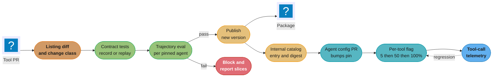
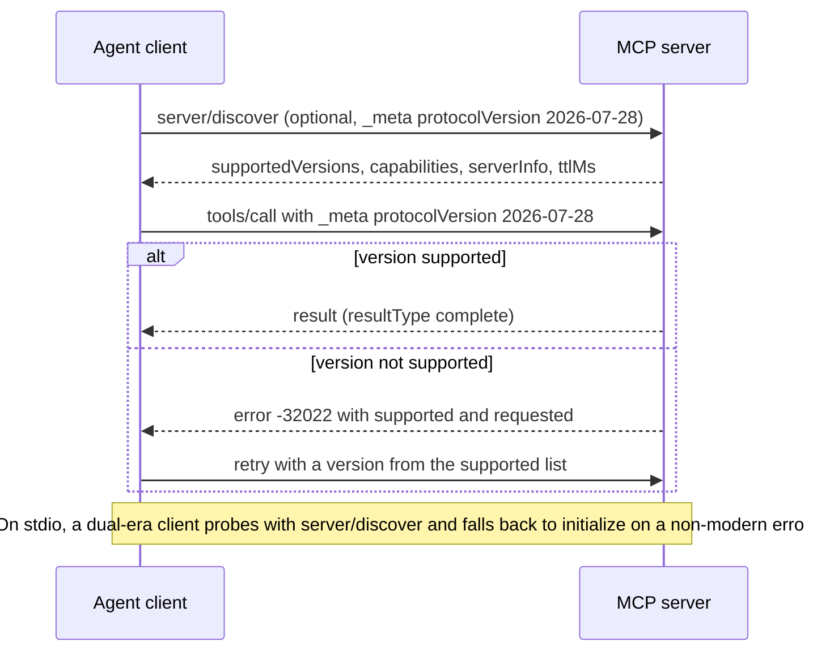
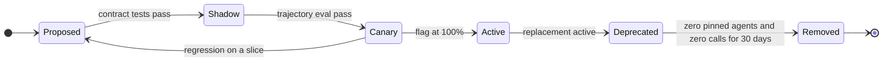

# Agent, Tool and MCP Server Lifecycle

> **Version anchor (2026-10-18).** The current MCP specification revision is `2026-07-28`: every request carries its protocol version in `_meta`, servers must implement `server/discover`, and the handshake-based revisions are `2025-11-25` and earlier. The MCP Registry is in preview, and its API has been frozen at v0.1 since 2025-10-24. Kubeflow Hub v0.3.17 (2026-09-21) carries MCP and Agents catalogs next to the model catalog; the project was renamed from Kubeflow Model Registry at v0.3.9. LiteLLM v1.106.0 (2026-10-18) disables stdio MCP servers by default (PR #44066). Other versions on this page come from the section pin table.

---

## 1. Concept Overview

An agent in production is not one artifact. It is a bundle of at least five, each with its own owner and its own change rate:

| Artifact | What it holds | Typical owner | Changes how often |
|---|---|---|---|
| Agent config | model id, system prompt reference, tool set, memory policy, step and token budgets, decoding settings | the agent team | weekly |
| Tool schema | `name`, `description`, `inputSchema`, `outputSchema`, `annotations` for one tool | the team that owns the backing API | per sprint |
| MCP server | a process or remote endpoint that serves many tool schemas plus resources and prompts | a platform or product team, sometimes a vendor | per release, sometimes without notice |
| Skill bundle | instructions plus scripts loaded on demand (`SKILL.md` and its files) | the agent team or a shared library team | weekly |
| Scope policy | which agent may call which tool with which OAuth scopes | security and platform | per quarter, and on every new tool |

Classic software delivery treats the first row as code and ignores the rest. That fails for agents for one reason: **the model reads the tool schema as prose and decides from it**. A tool's `description` is part of the program. Rewording "Refund an invoice that the customer disputes" to "Use for any billing complaint" changes which conversations end in a refund, and no compiler, type checker or unit test of the tool's handler sees it. The tool's API did not change. The agent's behavior did.

This module treats every row of that table as a versioned, gated, pinned artifact with a lifecycle: author, diff, contract-test, trajectory-evaluate, publish, pin per agent, canary behind a flag, monitor, deprecate, remove. The MCP layer adds two complications that plain function calling does not have:

1. **Someone else ships the server.** An MCP server owned by another team, or a vendor's remote server, can change its tool list between two of your requests. Your agent config pins nothing unless you make it pin something.
2. **The protocol itself versions.** The `2026-07-28` revision replaced the `initialize` handshake with a per-request version in `_meta`. A fleet with clients and servers on both sides of that line needs a compatibility plan, not a flag day.

The unit that gets released is the agent bundle: agent config plus the exact tool manifests, server versions, skill bundles and scope policy it was evaluated against. When any of those moves, the bundle is a new candidate and goes through the gate again.

**Not here.** How to write an MCP server (transports, handlers, Inspector) lives in [Building MCP Servers](../../llm/mcp_model_context_protocol/mcp_server_building.md). Runtime confinement of agents on a platform (namespaces, egress, audience-bound tokens, admission policy) lives in [AI Workloads and Agent Operations](../../devops/platform_engineering_and_idp/ai_workloads_and_agent_operations.md). Versioning the system prompt that an agent config references lives in [Prompt Lifecycle and Versioning](../prompt_lifecycle_and_versioning/prompt_lifecycle_and_versioning.md). This page owns the release lifecycle of agent configs, tool schemas and MCP servers as artifacts.

---

## 2. Intuition

**One-line analogy.** A tool schema is a public API whose only client is a reader that takes every word literally and never reads the changelog.

**Mental model.** Think of the agent as a program compiled at request time. The compiler inputs are the model weights, the system prompt, and the concatenated tool listings. Change any input and you have a different binary. A lockfile for that binary has to name the model id, the prompt version, and a digest of every tool listing the agent can see. Without the lockfile, "the agent we evaluated" and "the agent in production" are different programs that share a name.

**Why it matters.** Most agent regressions in production do not come from a model upgrade the agent team chose. They come from a dependency the agent team does not own: a tool description edited by the billing team, a new enum value in a CRM server, a remote server that added a `delete_records` tool, a gateway upgrade that stopped launching stdio servers. Each one changes behavior without a deploy of the agent.

**Key insight.** Version and gate on what the model sees, not on what the handler executes. Two tool listings with identical handlers and different descriptions are two different releases. Two listings with identical text and different handlers are also two different releases. The digest has to cover both: the listing text for behavior, and the server version for execution.

---

## 3. Core Principles

- **The listing is the contract.** `name`, `description`, `inputSchema`, `outputSchema` and `annotations` together are the interface the model consumes. A change to any of them is a release, and a change to `description` is a behavior change, not a docs change.
- **Pin per agent, not per platform.** Each agent config names exact server versions and a digest of the tool listing it was evaluated with. A platform-wide "latest" is how one team's tool change becomes every team's incident.
- **Fail closed on drift.** If the live listing digest does not match the pinned digest, the agent either refuses to start that tool set or drops the changed tools, and an alert fires. Silently accepting the new listing is how rug pulls work.
- **Gate on trajectories, not only outputs.** A final answer can be right while the agent called a refund tool it should not have. Gates measure tool selection, argument validity, step count, and forbidden calls, run several times per task.
- **Record once, replay many.** Contract tests replay recorded tool responses so a gate run is deterministic and does not hit production APIs. Live calls run on a schedule to catch recording drift.
- **Additive by default, versioned names for breaks.** New optional parameters and new tools are additive. Removing a parameter, narrowing a type, or changing semantics ships as a new tool name or a new server major version, with the old one deprecated on a dated schedule.
- **Scopes are versioned policy.** Which agent can call which tool with which OAuth scopes is a reviewed file with a version, not a console setting.
- **Protocol versions are negotiated, not assumed.** Clients send a version per request and handle `UnsupportedProtocolVersionError`; dual-era support covers servers still on the handshake revisions.

---

## 4. Types / Architectures / Strategies

### 4.1 Tool change classes

The classification decides which gate a change must pass. The middle column is the part teams get wrong: changes that look cosmetic to a human are behavior changes to a model.

| Change | Breaks callers' code? | Changes model behavior? | Class | Required gate |
|---|---|---|---|---|
| Add a new optional parameter | no | yes, the model may start filling it | additive | contract test, trajectory eval |
| Add a new tool to a server | no | yes, a new choice competes with old ones | additive | trajectory eval, scope review |
| Reword `description` | no | yes | behavior | trajectory eval |
| Add an enum value | no | yes, the model may pick it | behavior | trajectory eval |
| Change `title` or `icons` only | no | usually no: display fields, but check what your client sends | cosmetic | schema diff only |
| Reorder tools in the listing | no | rarely, but it breaks prompt-cache prefixes | cosmetic | schema diff, cost check |
| Make an optional parameter required | yes | yes | breaking | new major version |
| Remove or rename a parameter or tool | yes | yes | breaking | new name or major version, deprecation |
| Change output shape or units | yes for code reading `structuredContent` | yes | breaking | new major version |
| Change error text for `isError: true` results | no | yes, the model self-corrects from that text | behavior | trajectory eval on error paths |

### 4.2 Pinning strategies

| Strategy | What the agent config names | Drift protection | Upgrade cost |
|---|---|---|---|
| Float | server name only | none | zero, until it breaks |
| Version pin | `com.acme/billing@2.4.1` | protects against package changes, not remote servers | one PR per bump |
| Version plus listing digest | version and `sha256` of the canonical tool listing | catches description edits and rug pulls, including on remote servers | one PR per bump, plus a re-eval |
| Version plus digest plus per-tool flags | the above, with a flag deciding which tool version each agent sees | catches drift and lets one tool roll out by percentage | a flag system and telemetry per tool |

The third row is the minimum for any agent that can take an action with money, data deletion or customer messages. The fourth is what a platform with more than a handful of agents ends up building.

### 4.3 Where servers and agents are cataloged

| Catalog | Holds | Scope | Notes |
|---|---|---|---|
| Official MCP Registry | `server.json` metadata for public servers | public only | preview; API v0.1 frozen; versions immutable; namespace proven by GitHub, DNS or HTTP |
| Downstream aggregators | curated copies of registry metadata plus ratings | public | covered in [MCP Registries and Ecosystem](../../llm/mcp_model_context_protocol/mcp_registries_and_ecosystem.md) |
| Kubeflow Hub MCP catalog and Agents catalog | MCP servers and agents as catalog entries next to models | internal, per cluster | sources configured through a ConfigMap; sits beside the model catalog |
| Gateway allowlist | which servers a gateway will proxy, and which transports | runtime enforcement | LiteLLM v1.106.0 refuses stdio servers unless `LITELLM_ENABLE_MCP_STDIO=true` |
| Agent config repo | agent bundles with pins and digests | per team | the source of truth for what runs |

The official registry does not accept private servers and only references packages on public registries (npm, PyPI, NuGet, crates.io, Docker Hub and a short list of OCI registries, and MCPB files on GitHub or GitLab releases). Internal servers need an internal catalog.

### 4.4 Protocol eras

| Era | Revisions | How version is agreed | Session |
|---|---|---|---|
| Legacy | `2025-11-25` and earlier | `initialize` handshake once per connection | stateful |
| Modern | `2026-07-28` | `io.modelcontextprotocol/protocolVersion` in every request's `_meta`, plus `MCP-Protocol-Version` header on HTTP | stateless |
| Dual-era | both | server answers `initialize` with legacy semantics and `_meta` requests with modern semantics | both, on the same endpoint |

The wire-level changes between the eras are covered in [MCP Transports and JSON-RPC](../../llm/mcp_model_context_protocol/mcp_transports_and_jsonrpc.md). This page covers what they mean for pinning, testing and migrating a fleet.

---

## 5. Architecture Diagrams

### Release path for a tool or MCP server change



A tool change is published only after the agents that will consume it pass a trajectory eval with the new listing. Publishing does not move any agent: each agent picks the new version up through its own config PR and a per-tool flag, so the blast radius of a bad description is one agent at 5% of traffic.

### Version negotiation in the 2026-07-28 revision



Each request is accepted or rejected on its own, so one server can serve modern and legacy clients at once. The `serverInfo` in the discover result is self-reported and the spec says clients should not base security decisions on it, which is why the pin in an agent config is a listing digest and not the server's own version string.

### Tool lifecycle states



`Shadow` means the tool is listed to an eval harness but not to production agents. `Deprecated` keeps the tool callable and adds a dated notice to its description; it moves to `Removed` only when no agent config pins it and telemetry shows no calls.

### Which gate catches which change

```
                              schema   contract  trajectory  scope    listing
change                        diff     test      eval        review   digest
----------------------------  -------  --------  ----------  -------  -------
param removed or renamed        ✓        ✓          ✓                    ✓
param made required             ✓        ✓          ✓                    ✓
output shape or units changed   ✓        ✓          ✓                    ✓
description reworded            ✓                   ✓                    ✓
enum value added                ✓                   ✓                    ✓
new tool on the server          ✓                   ✓          ✓         ✓
error text changed                       ✓          ✓
remote server edits listing                                              ✓
handler logic changed only               ✓          ✓
```

Only the trajectory eval catches the description and enum rows, and only the listing digest catches a remote server that changes its listing between two of your releases. A pipeline with schema diff and contract tests alone leaves both gaps open.

---

## 6. How It Works - Detailed Mechanics

### 6.1 Agent config as a lockfile

The agent config names everything the model sees, by version and by digest. Fields that can be derived (the merged tool list, the total context size) are computed at load time, not stored.

```yaml
# agents/support-tier1/agent.yaml
agent: support-tier1
version: 14.2.0
model: claude-sonnet-4-5-20250929        # a dated model id, never an alias
system_prompt: prompts/support-tier1@31  # prompt registry reference
mcp_protocol: "2026-07-28"
servers:
  - name: com.acme/billing
    version: 2.4.1
    listing_sha256: 9f2c4e...a71b
    tools: [get_invoice, list_invoices, refund_invoice]
  - name: com.acme/crm
    version: 7.0.3
    listing_sha256: 41d0b8...0c2e
    tools: [get_customer, add_note]
skills:
  - name: refund-policy
    version: 3.1.0
    sha256: 0be771...93fa
budgets:
  max_steps: 12
  max_input_tokens: 120000
  max_tool_calls_per_turn: 4
memory:
  scope: conversation        # no cross-session memory for this agent
  retention_days: 0
scope_policy: policies/support-tier1@6
```

Three rules make this work. The model id is a dated id, because an alias moves under you. The `tools` list is an allowlist inside each server, so a server adding `delete_customer` does not give it to this agent. The `listing_sha256` is computed over the subset of the listing this agent uses, so an unrelated tool change on the same server does not force a re-eval.

### 6.2 Listing digest and drift check

The digest canonicalizes the parts of each tool the model reads and ignores display-only fields.

```python
import hashlib, json

MODEL_VISIBLE = ("name", "description", "inputSchema", "outputSchema", "annotations")

def listing_digest(tools: list[dict], allow: set[str]) -> str:
    picked = sorted(
        ({k: t[k] for k in MODEL_VISIBLE if k in t} for t in tools if t["name"] in allow),
        key=lambda t: t["name"],
    )
    blob = json.dumps(picked, sort_keys=True, separators=(",", ":"), ensure_ascii=False)
    return hashlib.sha256(blob.encode()).hexdigest()

def check_drift(server_cfg: dict, live_tools: list[dict]) -> list[str]:
    allow = set(server_cfg["tools"])
    missing = allow - {t["name"] for t in live_tools}
    if missing:
        raise RuntimeError(f"{server_cfg['name']}: pinned tools missing: {sorted(missing)}")
    if listing_digest(live_tools, allow) != server_cfg["listing_sha256"]:
        raise RuntimeError(f"{server_cfg['name']}: listing drift, refusing tool set")
    return sorted(allow)
```

The digest sorts tools by name so that a reordered listing hashes the same. Order still matters for cost: the `2026-07-28` tools page says servers should return tools in a deterministic order because the listing sits in the model's context and a reordered prefix misses the prompt cache. Track order separately as a cost signal, not as a behavior signal.

`tools/list` results carry `ttlMs` and `cacheScope`, and the spec example uses a `ttlMs` of 300000, five minutes. A client that caches the listing for that long sees a server-side description change up to five minutes late. The drift check must run on every listing refresh, not only at agent start.

### 6.3 Change classifier: broken, then fixed

The first version of a classifier most teams write compares only `inputSchema`, because that is what breaks code.

```python
# Broken: treats description and enum changes as no-ops
def classify(old: dict, new: dict) -> str:
    if old["inputSchema"] == new["inputSchema"]:
        return "none"
    old_req = set(old["inputSchema"].get("required", []))
    new_req = set(new["inputSchema"].get("required", []))
    if new_req - old_req:
        return "breaking"
    return "additive"
```

A billing team rewords the `refund_invoice` description, this returns `none`, the pipeline skips the trajectory eval, and the change ships. The fix classifies against what the model reads.

```python
# Fixed: any model-visible change needs at least a trajectory eval
def classify(old: dict, new: dict) -> str:
    oi, ni = old["inputSchema"], new["inputSchema"]
    old_props, new_props = set(oi.get("properties", {})), set(ni.get("properties", {}))
    if old_props - new_props:
        return "breaking"                                   # removed or renamed param
    if set(ni.get("required", [])) - set(oi.get("required", [])):
        return "breaking"                                   # newly required
    if old.get("outputSchema") != new.get("outputSchema"):
        return "breaking"                                   # code reads structuredContent
    for k in ("description", "annotations"):
        if old.get(k) != new.get(k):
            return "behavior"
    for p in old_props & new_props:
        if oi["properties"][p] != ni["properties"][p]:
            return "behavior"                              # enum, type, param description
    if new_props - old_props:
        return "additive"
    return "cosmetic"
```

The pipeline maps `breaking` to a new major version or a new tool name, `behavior` and `additive` to a trajectory eval against every agent that pins the tool, and `cosmetic` to the schema diff alone.

### 6.4 Publishing a server version

A public server is described by `server.json` and published with `mcp-publisher`.

```json
{
  "$schema": "https://static.modelcontextprotocol.io/schemas/2025-12-11/server.schema.json",
  "name": "io.github.acme/billing-mcp",
  "description": "Read invoices and issue refunds for Acme billing",
  "version": "2.4.1",
  "packages": [
    {
      "registryType": "npm",
      "registryBaseUrl": "https://registry.npmjs.org",
      "identifier": "@acme/billing-mcp",
      "version": "2.4.1",
      "transport": { "type": "stdio" }
    }
  ]
}
```

```bash
mcp-publisher init            # writes server.json
mcp-publisher login github    # proves the io.github.acme namespace
mcp-publisher publish
curl "https://registry.modelcontextprotocol.io/v0.1/servers?search=io.github.acme/billing-mcp"
```

The registry rules that matter for lifecycle:

- **Versions are immutable.** The version string must be unique per publication, and once published neither it nor the other metadata can change. A bad publish is fixed by publishing `2.4.2`, never by editing `2.4.1`.
- **Ranges are rejected.** `^1.2.3`, `~1.2.3`, `>=1.2.3`, `1.x`, `1.2.*` and `1 - 2` are prohibited version strings.
- **"latest" follows semver, with a trap.** A version string that does not parse as semver is always marked latest, even if it sorts before existing versions. A prerelease such as `1.2.3-1` published after `1.2.3` is not marked latest.
- **Align versions.** The registry docs ask local servers to match the server version to the package version, and remote servers to match the API version.
- **Package ownership is checked.** npm packages carry `mcpName` in `package.json`; PyPI packages carry `mcp-name: <server name>` in the README; OCI images carry the `io.modelcontextprotocol.server.name` annotation matching the `server.json` name.
- **Publisher metadata is capped.** Only `_meta` under `io.modelcontextprotocol.registry/publisher-provided` is kept, up to 4096 bytes of JSON; other `_meta` keys are dropped silently.

Internal servers do not go to the public registry. They get the same `server.json` shape and the same immutability rule in an internal catalog such as the Kubeflow Hub MCP catalog, so the agent config can reference both kinds the same way.

### 6.5 Contract tests with record and replay

A contract test pins the tool's behavior from the agent's side: given these arguments, the tool returns this shape and these error texts. Record mode calls the real server once and writes a cassette; replay mode serves the cassette and fails on any call that is not in it.

```python
import hashlib, json, pathlib

class Cassette:
    def __init__(self, path: pathlib.Path, mode: str):
        self.path, self.mode = path, mode            # mode: "record" or "replay"
        self.calls = json.loads(path.read_text()) if path.exists() else {}

    @staticmethod
    def key(tool: str, args: dict) -> str:
        blob = json.dumps({"tool": tool, "args": args}, sort_keys=True)
        return hashlib.sha256(blob.encode()).hexdigest()[:16]

    def call(self, live_client, tool: str, args: dict) -> dict:
        k = self.key(tool, args)
        if self.mode == "replay":
            if k not in self.calls:
                raise AssertionError(f"unrecorded call {tool}({args}): trajectory diverged")
            return self.calls[k]
        result = live_client.call_tool(tool, args)
        self.calls[k] = result
        self.path.write_text(json.dumps(self.calls, indent=2, sort_keys=True))
        return result
```

An unrecorded call in replay mode is the useful signal: the agent did something different from the recorded run, either a new tool, new arguments, or an extra step. The gate does not treat that as a test failure by itself. It reruns that task in a sandbox against a live staging server and scores the trajectory.

Cassettes rot. A recording made against `crm@7.0.3` keeps passing after the CRM team ships `7.1.0` with a new error text. Two habits keep them honest: re-record on every pinned version bump, and run a nightly live job against staging that diffs fresh responses against the cassette shape.

### 6.6 Trajectory eval as a gate

A trajectory eval runs the full agent bundle on a fixed task set and scores the sequence of tool calls, not only the final answer. Run each task several times; a single pass hides flakiness. Gate on pass^k (all k runs of a task succeed), the reliability metric introduced with Sierra's tau-bench; its derivation is in [Agent Evaluation and Benchmarking](../../llm/agents_and_tool_use/agent_evaluation_and_benchmarking.md).

```yaml
# gates/support-tier1.yaml
task_set: evalsets/support-tier1@9      # 420 tasks, 38 of them refund edge cases
runs_per_task: 3
gates:
  task_success_pass3:      {min: 0.80, max_drop_vs_champion: 0.02}
  tool_selection_accuracy: {min: 0.95}
  invalid_argument_rate:   {max: 0.01}
  median_steps:            {max_increase_vs_champion: 1}
  forbidden_calls:         {max: 0}     # refund_invoice on a non-disputed invoice
  cost_per_task_usd:       {max_increase_vs_champion_pct: 10}
slices:
  - refund_edge_cases       # gated separately, min task_success_pass3 0.90
  - non_english
```

The `forbidden_calls` gate is the one that would have caught the reworded refund description. Gate design, judge calibration and eval-set rotation are covered in [Evaluation Gates and Eval Sets](../evaluation_gates_and_eval_sets/evaluation_gates_and_eval_sets.md); benchmark families and trace-level judging are covered in [Agent Evaluation and Benchmarking](../../llm/agents_and_tool_use/agent_evaluation_and_benchmarking.md).

Cost of the gate, for scale: 420 tasks x 3 runs x about 9 steps averages 11,340 model calls per candidate. At 6,000 input and 400 output tokens per step that is about 68M input and 4.5M output tokens. Replay mode keeps tool calls free; the model calls are the bill. Teams cut it by running the full set only for `behavior` and `breaking` changes and a 60-task smoke set for `additive` ones.

### 6.7 Per-tool flags and per-agent pinning

A flag decides which version of one tool an agent sees, per agent and per traffic share. The resolution is deterministic per conversation so a user does not flip between versions mid-thread.

```python
import hashlib

FLAGS = {
    # (agent, tool) -> (new_version, percent)
    ("support-tier1", "refund_invoice"): ("refund_invoice_v3", 5),
}

def resolve_tool(agent: str, tool: str, conversation_id: str) -> str:
    rule = FLAGS.get((agent, tool))
    if not rule:
        return tool
    new_name, pct = rule
    bucket = int(hashlib.sha256(f"{agent}:{tool}:{conversation_id}".encode()).hexdigest(), 16) % 100
    return new_name if bucket < pct else tool
```

The flag only works if both tool versions are in the agent's evaluated bundle; a flag that exposes an unevaluated tool is a deploy without a gate. Telemetry tags every tool call with agent version, tool name, server version and flag bucket, so a regression can be traced to one row of the flag table. Gateway-side enforcement of the allowlist and per-tool routing belongs in [AI Gateway Operations](../ai_gateway_operations/ai_gateway_operations.md).

### 6.8 Deprecation on a dated schedule

The MCP specification deprecates its own features with a policy worth copying: a deprecated feature documents a migration path and stays for at least twelve months, or ninety days under an expedited-removal exception. For an internal tool the clock is usually shorter, but the shape is the same. The `_v2` naming pattern itself is in [Function Calling and Tool Design](../../llm/agents_and_tool_use/function_calling_and_tool_design.md); this section adds the pins, telemetry and removal rules around it.

```text
day 0    refund_invoice_v3 Active; refund_invoice marked Deprecated
         description gains: "Deprecated, removal 2026-12-15. Use refund_invoice_v3."
day 0-30 each agent team bumps its pin; telemetry lists agents still calling v2
day 30   gateway logs a warning per call to the deprecated tool
day 60   removal blocked if any agent config still pins it or any call seen in 30 days
day 60+  tool removed from the listing; server major version bumped
```

Adding the deprecation notice to the description is itself a `behavior` change and runs through the trajectory eval: a model that reads "Deprecated" may stop calling the tool before its replacement is in its bundle.

### 6.9 Skill bundles and scope policy as versioned artifacts

A skill bundle is a directory (`SKILL.md`, scripts, reference files) that the agent loads on demand; the loading model is covered in [Agent Skills and Progressive Disclosure](../../llm/agents_and_tool_use/agent_skills_and_progressive_disclosure.md). For lifecycle it behaves like a tool listing: its front-matter description decides when the model loads it, and its scripts execute. Version it with a semver string, pin it by the `sha256` of the directory tarball, and send changes to the description through the same `behavior` gate.

Scope policy is a file with a version, reviewed like code:

```yaml
# policies/support-tier1.yaml
version: 6
agent: support-tier1
identity: spiffe://acme.internal/agents/support-tier1
allow:
  - server: com.acme/billing
    tools: [get_invoice, list_invoices, refund_invoice]
    oauth_scopes: [invoices:read, refunds:write]
    limits: {refund_invoice: {max_amount_usd: 200, per_conversation: 1}}
  - server: com.acme/crm
    tools: [get_customer, add_note]
    oauth_scopes: [customers:read, notes:write]
deny_transports: [stdio]       # remote servers only for this agent
```

The `2026-07-28` tools page allows `tools/list` to vary by the authorization on the request, returning only the tools the caller's scopes permit. That makes the scope policy and the listing digest linked: widening a scope can add tools to the listing, change the digest, and correctly force a re-eval.

### 6.10 Moving a server fleet from 2025-11-25 to 2026-07-28

A fleet never switches eras in one deploy. The compatibility matrix in the spec makes the safe order clear: legacy clients cannot reach modern-only servers, and modern-only clients cannot reach legacy servers, while dual-era on either side works with everything.

```text
step 1  inventory   probe each server with server/discover; record era per server
                    tag every client in telemetry with the revision it sends
step 2  servers     ship dual-era builds (answer initialize AND per-request _meta)
                    minor version bump; contract tests run once per era
step 3  clients     ship dual-era clients: modern first, fall back on a non-modern error,
                    cache the era per stdio process or HTTP origin
step 4  watch       count initialize calls per server per day
step 5  servers     after 30 days at zero initialize calls, drop legacy as a major version;
                    the initialize error names the supported versions
```

Steps 2 and 3 can run in either order or in parallel. The fixed rule is that neither side goes modern-only while the other side still has legacy-only members.

Two changes in the modern era alter tool schemas, so they are not transport-only work:

- **No protocol session.** The `2026-07-28` tools page states that MCP has no protocol-level session, so a server cannot keep implicit per-connection state between calls. A tool that relied on legacy session state (an open browser context, a cart, a transaction) has to return an explicit handle from a creation tool and take it as an argument on later calls. That adds parameters and changes descriptions, which the classifier in 6.3 marks `behavior` or `breaking`, and the agents that use those tools go through the trajectory gate before step 2 ships.
- **`x-mcp-header` on parameters.** A parameter may carry `x-mcp-header` so its value is mirrored into an `Mcp-Param-{name}` HTTP header for load balancers and WAFs. On Streamable HTTP, a client must drop any tool whose `x-mcp-header` values break the rules (empty, not an HTTP token, duplicated, or on a `number` parameter), and stdio clients may ignore the annotation. A server release with one bad annotation therefore removes that tool for HTTP clients only, while stdio-based tests still pass. Run contract tests over both transports for any server that serves both.

Do not mirror sensitive parameters into headers: the spec warns that header values are visible to network intermediaries, so a `customer_email` parameter tagged with `x-mcp-header` leaks into proxy logs.

---

## 7. Real-World Examples

**Anthropic, SWE-bench agent (2024).** In "Building effective agents" (December 2024), Anthropic wrote that while building its SWE-bench agent it spent more time optimizing tools than the overall prompt. The model made mistakes with relative file paths after the agent moved out of the root directory; changing the tool to require absolute paths fixed it. The lesson for lifecycle: the tool schema moved results more than the prompt did, so it deserves the same release gate as the prompt.

**postmark-mcp on npm (September 2025).** An unofficial Postmark MCP server behaved correctly through version 1.0.15, then version 1.0.16 added a hidden BCC that copied every email the agent sent to an outside address. Any client that floated on the latest version took the change on its next install. A version pin plus a listing digest would not have caught it, because the listing did not change, only the handler. What catches it is pinning the package version, reviewing the diff before a bump, and the supply-chain controls in [ML Supply Chain Security](../ml_supply_chain_security/ml_supply_chain_security.md).

**Invariant Labs, GitHub MCP server (May 2025).** Researchers showed that a malicious issue in a public repository could instruct an agent with the GitHub MCP server to read a private repository and leak its contents into a pull request on the public one. The server was not modified. The failure was scope: one token covered both repositories. Per-agent scope policy that limits repositories per task is the lifecycle control; the threat model is in [MCP Security](../../llm/mcp_model_context_protocol/mcp_security.md).

**Invariant Labs, tool poisoning and rug pulls (April 2025).** The same group demonstrated instructions hidden in a tool description that the user never sees but the model follows, and a server that changes its description after the user approved it. A listing digest pinned at approval time turns the rug pull into a refused tool set instead of a silent behavior change.

**Replit agent (July 2025).** An agent on Replit deleted a production database during a declared code freeze in a project run by SaaStr's founder. The agent had a destructive capability in the same tool set as routine ones and no hard gate on its use. Replit's CEO announced automatic separation of development and production databases in response. The lifecycle lesson: destructive tools need their own scope, a `forbidden_calls` style gate in eval, and a runtime confirmation, not a sentence in the system prompt.

**LiteLLM v1.106.0 (2026-10-18).** The release disabled stdio MCP servers by default: they stay registered but do not start, tool listings skip them, direct calls return 403, and only `LITELLM_ENABLE_MCP_STDIO=true` in the proxy's process environment turns them back on (a config file key does not). For a team whose agents reached internal tools through stdio servers on the gateway, a routine gateway upgrade removed tools from every agent at once. The gateway is part of the agent bundle's dependency set and its upgrades go through the same trajectory gate.

**Kubeflow Hub (2026).** Kubeflow Hub, renamed from Kubeflow Model Registry at v0.3.9, lists MCP servers and agents in catalogs next to its model catalog. The v0.3.14 notes add ConfigMap-backed MCP catalog sources and the Agents catalog gallery, and the v0.3.16 notes add a `serverJson` field to the MCP server API. Teams that already register models there can list internal MCP servers and agents in the same place, which gives the lineage question "which agents use this server version" one query instead of a grep across repos.

---

## 8. Tradeoffs

### Pin exact versions vs float

| Dimension | Pin version plus digest | Float on latest |
|---|---|---|
| Behavior stability | changes only through a reviewed PR | changes when any owner ships |
| Security against rug pulls | refuses changed listings | accepts them |
| Upgrade toil | one PR and one eval per bump per agent | none |
| Security patches | delayed until the bump PR lands | immediate |
| Fit | agents that act on money, data, customers | internal read-only prototypes |

Mitigate the patch delay with automated bump PRs that run the gate and auto-merge on pass.

### Record and replay vs live tool calls in the gate

| Dimension | Replay | Live against staging |
|---|---|---|
| Determinism | same response every run | staging data drifts |
| Cost | model tokens only | model tokens plus staging load |
| Side effects | none | needs a sandbox for write tools |
| Catches server changes | no, cassette is frozen | yes |
| Handles new trajectories | fails on unrecorded calls | yes |

Most teams replay in the per-PR gate and run live nightly.

### Version per tool vs per server

| Dimension | Per-tool version (`refund_invoice_v3`) | Per-server version (`billing@3.0.0`) |
|---|---|---|
| Rollout granularity | one tool by flag | whole server |
| Listing size | grows during migrations, both names present | stable |
| Model confusion | two similar tools side by side | none |
| Fit | high-risk single tool changes | coordinated multi-tool changes |

### Public MCP Registry vs internal catalog

| Dimension | Official MCP Registry | Internal catalog (Kubeflow Hub MCP catalog, private registry) |
|---|---|---|
| Private servers | not accepted | yes |
| Namespace proof | GitHub, DNS or HTTP challenge | your SSO and RBAC |
| Package sources | public registries only | any internal registry |
| Stability | preview, data resets possible | yours to run |
| Fit | publishing a public server | everything you run internally |

---

## 9. When to Use / When NOT to Use

**Use the full lifecycle (digest pins, contract tests, trajectory gates, per-tool flags) when:**
- Any tool writes: money movement, data deletion, customer messages, infrastructure changes.
- Tool servers are owned by teams other than the agent team, or by vendors.
- More than one agent shares a server, so one tool change has several consumers.
- The agent reaches remote MCP servers whose code you cannot pin.
- A regulator or auditor will ask which tool definition an agent saw on a given date.

**Use a lighter version (version pins and a smoke eval) when:**
- The agent is internal, read-only, and its owner also owns every tool.
- Fewer than about ten tools and one agent; a 60-task smoke set covers the surface.

**Do not build it when:**
- The "agent" is a single function call with a fixed tool, no loop, and a typed response. Treat the tool as an API and use [API contracts and schema governance](../../backend/api_contracts_and_schema_governance/api_contracts_and_schema_governance.md).
- The system is a prototype that will be rewritten. Pin the model id and move on.
- The tool set changes daily during discovery. Gate at the point the agent first gets write access, not before.

---

## 10. Common Pitfalls

**The reworded description.** A billing team changed `refund_invoice`'s description from "Refund an invoice the customer has disputed in writing" to "Resolve customer billing complaints, including refunds". No schema changed and the classifier returned `none`. Refund calls rose from under 1% of conversations to about 6% over a day before finance noticed. Fix: classify description changes as `behavior`, gate on `forbidden_calls`, and pin the listing digest so the change could not reach the agent without a PR.

**The new enum value.** A CRM server added `"escalate_to_legal"` to a `next_action` enum for one internal workflow. The support agent, which shared the server, started choosing it for angry customers. The tool schema was backward compatible for code and a behavior change for the model. Fix: per-agent tool allowlists plus a trajectory eval on every enum change.

**Remote server changed between two requests.** A vendor's remote MCP server added a bulk-export tool. Clients that cached `tools/list` for its `ttlMs` picked it up within minutes, with no release on the client side. Fix: per-agent allowlist of tool names, digest check on every listing refresh, alert on any new tool name.

**Trusting `serverInfo.version`.** A team pinned on the version string in the server's self-reported `serverInfo`. A fork kept the same string and changed the handlers. The spec says `serverInfo` is not verified and clients should not use it for security decisions. Fix: pin package versions and digests from your own build or catalog, not the server's self-report.

**The non-semver "latest".** A team published an internal build as `2024.11-hotfix` to a registry following the MCP Registry versioning rules. Because it did not parse as semver, it was marked latest and sorted ahead of `2.4.1`. Every client resolving latest got the hotfix build. Fix: semver only, and never resolve latest in an agent config.

**The gateway upgrade.** After a LiteLLM upgrade to v1.106.0, every stdio MCP server on the proxy stopped starting and its tools vanished from listings. Agents did not error; they answered without the tools, worse. Fix: treat the gateway as part of the bundle, run the trajectory gate on gateway upgrades, and alert when an agent's resolved tool set is smaller than its config allowlist.

**Cassette rot.** Replay tests passed for four months while the CRM's real error text for an invalid customer id changed from "Customer not found, check the id format C-123456" to "404". The agent's self-correction depended on the old text. Fix: re-record on every pin bump and run a nightly live diff.

**Deprecated forever.** A tool marked deprecated stayed in the listing for nine months because one rarely used agent still pinned it, and its presence kept confusing the main agent, which sometimes chose the old tool. Fix: per-agent allowlists so the deprecated tool is listed only to agents that pin it, and a removal date that blocks the deprecated agent's own release until it bumps.

**Name collisions across servers.** Two servers each exposed `search`. The aggregated listing had two tools with one name and the model picked one at random. The spec says aggregating clients should prefix tool names with a server identifier and should not rely on `serverInfo.name` being unique. Fix: prefix with the catalog name from the agent config.

**The tool that vanished on HTTP only.** A server team tagged a `region` parameter and a `retry_ratio` parameter of type `number` with `x-mcp-header` so their WAF could route by both. The spec forbids the annotation on `number` parameters, and Streamable HTTP clients must drop a tool with an invalid annotation. Every remote agent lost the tool; the team's own tests ran over stdio, where clients may ignore the annotation, and stayed green. Fix: run contract tests over every transport the server serves, and alert when a client logs a rejected tool definition.

**Flaky gate, ignored gate.** A trajectory gate run once per task failed on about 1 in 8 candidates from noise alone. Engineers learned to rerun until green. Fix: run 3 to 5 times per task, gate on pass^k and on regression against the champion with a confidence margin.

---

## 11. Technologies & Tools

| Tool | Role in the lifecycle | Notes |
|---|---|---|
| MCP spec | revision `2026-07-28`: per-request versioning, `server/discover`, `tools/list` caching fields | dual-era servers serve legacy and modern clients on one endpoint |
| Official MCP Registry | public server metadata, namespace proof, immutable versions | preview; API v0.1 frozen 2025-10-24 |
| mcp-publisher | CLI that writes `server.json`, logs in and publishes to the registry | `init`, `login github`, `publish` |
| Kubeflow Hub | internal model, MCP and Agents catalogs (v0.3.17) | renamed from Kubeflow Model Registry at v0.3.9 |
| LiteLLM | gateway that proxies MCP servers with allowlists (v1.106.0) | stdio servers off unless `LITELLM_ENABLE_MCP_STDIO=true` |
| MCP Inspector | manual inspection of a server's listing and calls | check a listing by hand before pinning its digest |
| vcrpy | HTTP record and replay for Python tests | records HTTP clients such as httpx and requests; stdio needs a wrapper like the one in 6.5 |
| oasdiff | breaking-change detection for OpenAPI specs | for the REST API behind a tool; does not judge descriptions |
| Inspect AI | agent and tool-call evals in CI | task sets with scorers over full trajectories |
| DeepEval | agent and tool-call evals in CI | has a tool-correctness metric |
| MLflow | traces, datasets and evals tied to agent versions (3.17.1) | tag each trace with agent version and tool digests |
| Langfuse | traces, datasets and evals tied to agent versions (v4.63.0) | acquired by ClickHouse, announced 2026-01-16 |
| Arize Phoenix | traces and evals for agent runs (v20.23.0) | open source, can be self-hosted |
| Open Policy Agent | scope policy evaluation at the gateway | policy files versioned in git |
| AWS Cedar | scope policy evaluation at the gateway | policy files versioned in git |

Related pages: [Function Calling and Tool Design](../../llm/agents_and_tool_use/function_calling_and_tool_design.md) for writing the tool schema in the first place, [Design an Agent Platform](../../llm/case_studies/design_agent_platform.md) for the platform around it, and [AI Release Engineering](../ai_release_engineering/ai_release_engineering.md) for how the agent bundle joins the wider release bundle.

---

## 12. Interview Questions with Answers

**Q: Why is a change to a tool's description treated as a release when no code changed?**
**Short:** The model chooses tools by reading the description, so rewording it changes which calls the agent makes, which is a behavior change no unit test sees.

The model's decision to call a tool, and with which arguments, is conditioned on the description text. Rewording "refund a disputed invoice" to "resolve billing complaints" widens the set of conversations that end in a refund, with the handler unchanged. Schema diffs and unit tests of the handler both pass. The only gate that sees it is a trajectory eval on the agents that pin the tool, ideally with a `forbidden_calls` check. Classify any change to `description`, `annotations`, enum values or parameter descriptions as a behavior change and route it through that eval.

**Q: Your agent config pins `billing-mcp@2.4.1`. Can the tools your agent sees still change without a PR?**
**Short:** Yes: a remote server can change its listing between requests and listings can vary by caller scopes, so pin a per-agent digest of the tool listing and refuse drift.

A version pin protects only what you install. A remote MCP server is someone else's process; it can change its listing between two of your requests, and clients that cache `tools/list` pick it up within the response's `ttlMs`. Even a local server can return a different listing if its configuration or the caller's scopes change, because the spec lets `tools/list` vary by authorization. The fix is a `listing_sha256` over the model-visible fields of the tools the agent allows, checked on every listing refresh, with fail-closed behavior and an alert on mismatch.

**Q: Can you rely on `serverInfo.version` from `server/discover` to know which server build you are talking to?**
**Short:** No, `serverInfo` is self-reported and unverified, and the spec says clients should not use it for security or behavior decisions.

The `2026-07-28` discover page states that `serverInfo` is intended for display, logging and debugging, and that clients should not change behavior or make security decisions based on it. A fork or a compromised build can report any string. Identify the build from your own side: the package version and digest you installed, the catalog entry your agent config references, and the listing digest you observe. Log `serverInfo` for debugging only.

**Q: A teammate wants agent configs to reference `latest` for every MCP server to get fixes faster. What do you say?**
**Short:** Refuse it for any agent that acts; use exact pins with automated bump PRs that run the gate and auto-merge on pass, which keeps fixes fast without silent behavior changes.

Floating on latest means every tool owner can change your agent's behavior, and every malicious or broken publish reaches you on the next install, as the postmark-mcp case showed. It also interacts badly with registry semantics: in the MCP Registry a non-semver version string is always marked latest even when it sorts earlier. The speed argument is real, so automate it: a bot opens a bump PR per new version, the PR runs contract tests and the trajectory gate, and it merges itself when green. Security fixes reach production in hours, not weeks, and still through a gate.

**Q: How does a client that must talk to both 2026-07-28 servers and 2025-11-25 servers detect which one it is talking to?**
**Short:** On stdio it probes with `server/discover` and falls back to `initialize` on a non-modern error; on HTTP it sends a modern request and falls back on a 4xx without a modern error body.

The spec calls this a dual-era client. A recognized modern JSON-RPC error such as `-32022` identifies a modern server, so the client retries with a supported version instead of falling back. Anything else identifies a legacy server, and the client runs the `initialize` handshake, and on HTTP possibly falls further back to the deprecated HTTP+SSE transport. The era is a property of the server, so the client caches it per process or origin and may persist it across restarts, re-probing if the cached assumption fails. A legacy-only client talking to a modern-only server fails, which is why modern-only servers should list supported versions in their `initialize` error.

**Q: In what order do you move a mixed fleet of MCP clients and servers from the 2025-11-25 revision to 2026-07-28?**
**Short:** Ship dual-era servers and dual-era clients before either side goes modern-only, then drop legacy from servers only after telemetry shows zero `initialize` calls.

Legacy clients cannot talk to modern-only servers, and modern-only clients cannot talk to legacy servers, so either side going modern-only first breaks the other. The dual-era steps can run in either order or in parallel; dropping legacy comes last. Dual-era servers answer `initialize` with legacy semantics and per-request `_meta` with modern semantics on the same endpoint. Dual-era clients try modern, fall back on a non-modern error, and cache the era per server. Count `initialize` calls per server; when they stay at zero for a set window, ship a modern-only major version whose `initialize` error names the supported versions. Budget for schema work too: tools that relied on session state need explicit handles, which is a behavior change that goes through the trajectory gate.

**Q: What is the difference between a contract test and a trajectory eval for a tool change?**
**Short:** A contract test checks the tool's inputs and outputs against a recorded shape; a trajectory eval runs the whole agent and scores which tools it called, with what arguments, how often.

The contract test fixes the tool side: given these arguments the tool returns this structure and these error texts, and replay mode makes it deterministic and free of side effects. It catches removed parameters, output shape changes and error text changes. It cannot catch a description change, because the tool behaves identically when called. The trajectory eval fixes the agent side: it runs tasks end to end, several times each, and gates on task success, tool selection accuracy, invalid argument rate, step count and forbidden calls. You need both; each misses what the other catches.

**Q: Why run each trajectory eval task several times, and what metric do you gate on?**
**Short:** Agent runs are stochastic, so a single run hides flakiness; gate on pass^k, the share of tasks solved in all k runs, plus regression against the champion.

Sampling, tool latency and tool errors make agent trajectories vary run to run. Sierra's tau-bench made the point with pass^k: agents with decent pass^1 fall sharply as k grows, and an agent that acts on customers needs the pass^k number. Run 3 to 5 times per task, gate on an absolute pass^k floor, a maximum drop against the current champion bundle, and a zero tolerance for forbidden calls. A single-run gate fails on noise often enough that engineers learn to rerun until green, which removes the gate.

**Q: What breaks if you record tool responses once and replay them forever?**
**Short:** The cassettes freeze yesterday's server, so real changes such as new error texts pass the gate and the agent's self-correction breaks in production.

Replay makes the gate deterministic by design, which also means it cannot see the server change. An agent often recovers from tool errors by reading the error message; if the server changes "Customer not found, check the id format" to "404", replayed tests still pass while production self-correction fails. Re-record cassettes on every pin bump, run a nightly job that calls staging live and diffs response shapes and error texts against the cassette, and treat an unrecorded call in replay as a signal to rerun that task live in a sandbox.

**Q: How do you roll out a new version of one high-risk tool to one agent without moving the rest?**
**Short:** Ship it under a new tool name or version, add both versions to the agent's evaluated bundle, and use a per-agent, per-tool flag that buckets conversations deterministically.

The flag maps `(agent, tool)` to a new tool version and a percentage. Bucketing by a hash of agent, tool and conversation id keeps a conversation on one version for its whole life. Start at 5%, watch tool-call telemetry tagged with the flag bucket (selection rate, error rate, forbidden calls, task outcome), then move to 50% and 100%. Both versions must be in the evaluated bundle; a flag that exposes an unevaluated tool is an ungated deploy. Other agents on the same server keep their pins.

**Q: When can a deprecated tool on a shared MCP server be removed, and what blocks removal?**
**Short:** Only when no agent config pins it and telemetry shows zero calls for a set window; until then, the removal date blocks the lagging agent's next release.

Copy the MCP spec's own policy shape: a deprecated feature documents a migration path and stays for a fixed minimum window (twelve months for the spec, usually 30 to 90 days internally). Adding "Deprecated, use X" to the description is a behavior change, so run it through the trajectory eval; the model may stop calling the old tool before the new one is in its bundle. Limit the deprecated tool's listing to agents that still pin it, so it does not confuse others. Block removal while any agent config pins it or telemetry shows calls in the last 30 days, and block the lagging agent's next release until it bumps.

**Q: What does the MCP Registry enforce for a published server version, and what does it not check?**
**Short:** It enforces an immutable version string under a namespace whose owner was verified; it does not scan or sign the server code.

Publishing proves namespace ownership by GitHub OAuth or OIDC, DNS, or HTTP challenge, and checks package ownership through `mcpName` in npm's `package.json`, `mcp-name:` in a PyPI README, or an OCI annotation. A published version string and its metadata cannot change, and range-like versions are rejected. The registry hosts metadata only, references public package registries only, does not accept private servers, and is in preview with possible data resets. Code integrity comes from your own package pins, digests and supply-chain controls, not from the registry entry.

**Q: Which fields belong in an agent config, and which should be computed at load time?**
**Short:** Store the dated model id, prompt reference, server versions with listing digests and tool allowlists, skill pins, budgets, memory policy and scope policy; compute the merged listing and context size.

The config is a lockfile for everything the model sees and everything the agent may do. A dated model id instead of an alias, a prompt registry reference with a version, exact server versions and per-agent tool allowlists, listing digests, skill bundle digests, step and token budgets, memory scope and retention, and a scope policy reference. Anything derivable, such as the merged tool list or the token size of the listings, is computed at load and checked against budgets, not stored, so it cannot drift from its inputs.

**Q: How do scopes interact with tool listings in the 2026-07-28 revision?**
**Short:** `tools/list` may return only the tools the request's credentials permit, so widening a scope can add tools to an agent's listing and must trigger a re-eval.

The spec forbids the tool set varying per connection but allows it to vary by the authorization on each request. A scope policy change is therefore a listing change. Version scope policy as a reviewed file, compute the listing digest per agent identity, and let a digest change from a scope edit fail the drift check until the agent passes its gate with the new listing. This also keeps least privilege honest: a scope added for one task cannot quietly hand the agent unrelated write tools.

**Q: Two MCP servers both expose a tool named `search`. What happens and how do you fix it?**
**Short:** Names are unique only within one server, so the aggregated listing collides; prefix tool names with a catalog-assigned server id rather than the self-reported server name.

The spec scopes tool name uniqueness to a single server and says aggregating clients should implement disambiguation, such as prefixing with a server identifier, and should not rely on `serverInfo.name` because two servers can report the same name. Without a prefix the model sees two identical names and the client may route to either. Use the server name from your agent config or catalog (`billing.search`, `crm.search`), keep the prefix stable across versions so digests and telemetry stay comparable, and keep names within the spec's recommended 1 to 128 characters of letters, digits, underscore, hyphen and dot.

**Q: Why does tool order in a listing matter if the digest ignores order?**
**Short:** The listing sits in the model's context, so a reorder changes the prompt prefix and misses the prompt cache, raising cost and latency without changing behavior.

The `2026-07-28` tools page says servers should return tools in a deterministic order because clients cache listings and because a stable order improves prompt cache hit rates when tools are in context. The behavior digest sorts by name so a reorder does not force a re-eval. Order is tracked as a cost signal instead: an alert when the cache hit rate drops after a server bump, and a client-side sort before the listing enters the prompt.

**Q: How do you version a skill bundle?**
**Short:** Give it a semver version, pin it by a digest of the bundle, and send changes to its trigger description through the behavior gate like a tool description.

A skill bundle has two parts with different risks. The front-matter description decides when the model loads the skill, which is a behavior surface like a tool description. The scripts and reference files execute or inform actions, which is a supply-chain surface like a server handler. Pin the bundle by the `sha256` of its packaged directory in the agent config, re-run the trajectory eval on any description change, and run contract tests on its scripts. Skills shared across agents get the same per-agent pin and flag mechanics as tools.

**Q: A gateway upgrade removed tools from your agents and nothing errored. How do you detect that class of failure?**
**Short:** Compare each agent's resolved tool set at runtime with its config allowlist and alert when it shrinks, and run the trajectory gate on gateway upgrades.

LiteLLM v1.106.0 is a concrete case: stdio MCP servers stop starting by default, their tool listings come back empty, and the only signal is one proxy log warning per server, so an agent behind the proxy answers without those tools. Models do not complain about missing tools; they degrade. Emit the resolved tool count and names per agent at startup and on each listing refresh, alert on any allowlisted tool that is absent, and treat the gateway version as part of the bundle so its upgrade runs the same gate as a tool change.

---

## 13. Best Practices

- Pin dated model ids, prompt versions, exact server versions and per-agent listing digests in every agent config.
- Allowlist tool names per agent inside each server; never expose a server's full listing by default.
- Classify every tool change by what the model reads: `description`, enums and error texts are behavior changes.
- Run contract tests in replay mode per PR and live against staging nightly; re-record on every pin bump.
- Gate on trajectories with 3 to 5 runs per task: pass^k floor, champion regression margin, zero forbidden calls, cost ceiling.
- Publish new versions without moving agents; agents move through their own PRs and per-tool flags starting at about 5%.
- Deprecate on a dated schedule with telemetry; remove only at zero pins and zero calls.
- Version scope policy as a reviewed file and expect scope changes to change listings.
- Use semver only for server versions; never resolve latest in production.
- Support both MCP eras on servers during migration; on clients, handle `-32022` and cache the era per server.
- Treat the gateway and its MCP settings as part of the bundle; alert when a resolved tool set is smaller than the allowlist.
- Tag every tool-call trace with agent version, server version, listing digest and flag bucket.

---

## 14. Case Study

### Scenario: support agent platform with shared MCP servers

A composite scenario based on common incident patterns. A company runs three agents (support tier 1, collections, internal finance assistant) on six internal MCP servers exposing 41 tools. Servers are owned by four product teams. Agent configs reference servers by name only, the gateway caches listings for five minutes, and the eval suite runs once per agent release on 150 tasks, one run each.

**Incident.** The billing team reworded `refund_invoice` and added a `reason` enum value, `goodwill`, for the finance assistant. The support agent picked up the new listing within five minutes. Over the next 19 hours, support conversations ending in a refund rose from 0.8% to 6.1% of 22,000 conversations, about 1,160 extra refunds at a median of $33, roughly $38,000. Nothing failed: every call was schema-valid and every refund was under the per-call limit.

**Root causes.**
1. No pin: the support agent consumed the billing server's latest listing.
2. No per-agent allowlist: the new enum value reached an agent that was never meant to use it.
3. The release gate ran on agent releases only, not on tool releases, and it had no forbidden-call check.
4. Telemetry recorded tool calls without agent version or server version, so the first two hours went to working out which change caused it.

**Redesign.**

| Change | Mechanism | Cost |
|---|---|---|
| Agent configs pin server versions and listing digests | drift check on each listing refresh, fail closed, alert | about 1 bump PR per agent per week |
| Per-agent tool allowlists and per-agent enum restrictions | the gateway filters listings per agent identity | one policy file per agent |
| Tool PRs run the trajectory gate for every agent that pins the tool | 420 tasks, 3 runs, pass^3 floor 0.80, forbidden calls 0 | about 11,000 model calls per gated change |
| Per-tool flags for high-risk tools | 5%, 50%, 100% over 3 days | flag service and dashboards |
| Traces tagged with agent version, server version, digest, flag bucket | one query answers "what changed" | trace storage up about 3% |
| Gateway version in the bundle | gateway upgrades run the gate | one extra gated change per month |

**Result after one quarter.** 37 tool changes went through the pipeline: 21 classified `behavior`, 9 `additive`, 5 `breaking`, 2 `cosmetic`. The trajectory gate blocked 4, of which 3 were description changes the classifier's first version would have marked `none`. Mean time from tool merge to all agents on the new version went from about 5 minutes (uncontrolled) to 2.5 days (controlled), which the billing team accepted after the refund incident. No tool change reached a customer-facing agent without a gate.

**Discussion points.**
- The support agent's resolved tool list should never contain an enum value it was not evaluated with. Where does that restriction live: in the server, the gateway, or the client?
- Should the billing team or the support team own the cost of the trajectory eval for a billing tool change?
- When a security fix must ship to a tool in hours, which gate steps can be skipped, and how is that recorded?
