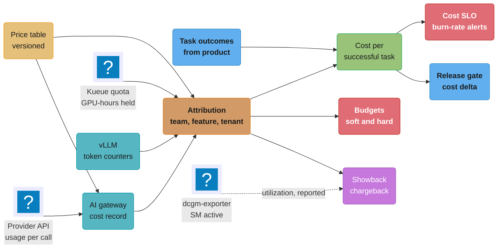
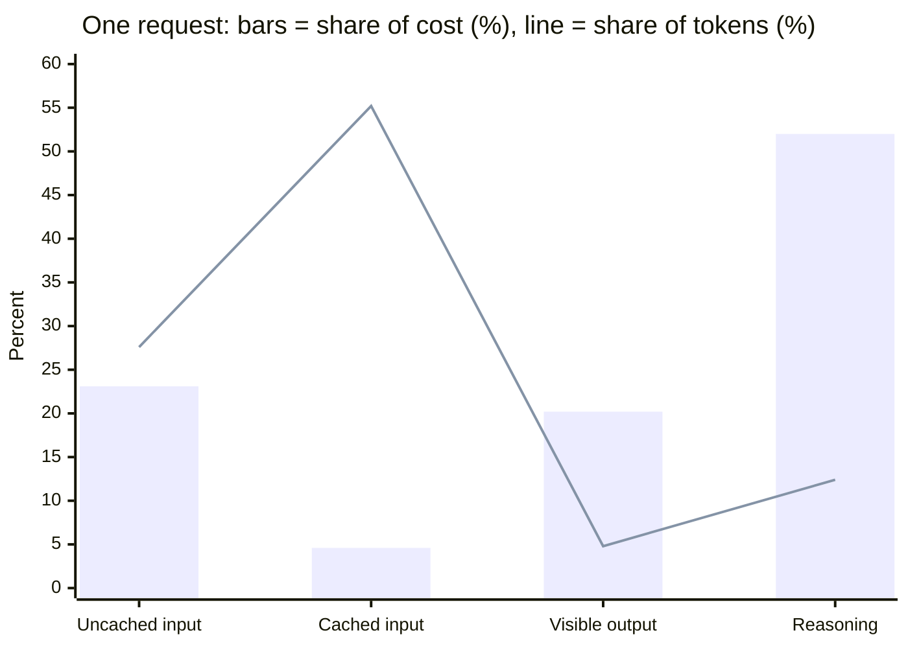
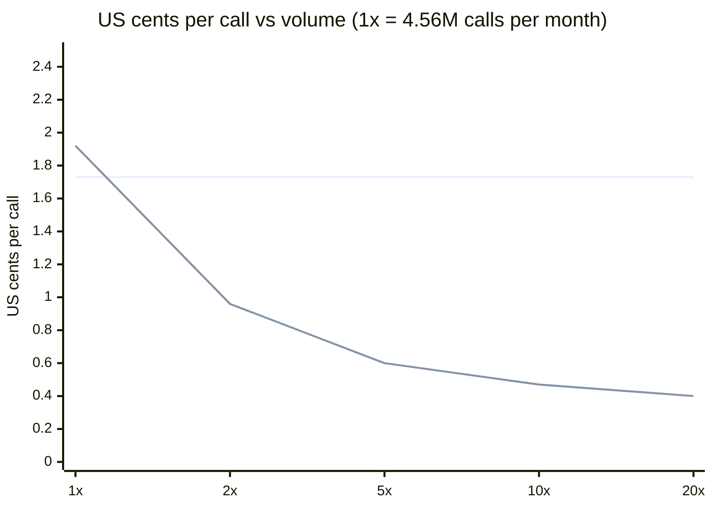

# AI Cost Engineering and Unit Economics

> **Version anchor (2026-10-18).** **OpenAI Decisions API** (checked 2026-10-18): public beta,
> `POST /v1/decisions`, model `gpt-6-luna`, input $0.10 per 1M tokens, no output charge. This is
> the only provider price on this page taken as a fact. LiteLLM v1.106.0 (2026-10-18). Agent
> Router v1.2.0 (2026-10-07; renamed from Envoy AI Gateway, CRDs unchanged). vLLM v0.32.0
> (2026-10-18). Kueue v0.20.2 (2026-10-15). dcgm-exporter 4.8.4 with DCGM 4.6.1 (2026-09-18).
> Langfuse v4.63.0 (2026-10-16). Every other price is a variable with an example value: API
> rates `P_in`, `P_cached`, `P_out` and the GPU-hour rate `G`. The example `G = $14.24` is the
> AWS on-demand B200 per-GPU rate that [GPU and AI FinOps](../../devops/cloud_cost_optimization_finops/gpu_and_ai_finops.md)
> anchors on 2026-08-26; the example API rates ($2.00 input, $0.20 cached input, $10.00 output
> per 1M tokens) are placeholders, not a quote. Re-price both against your contract.

Cost is an engineering metric for an AI system in the same way latency and error rate are. It
has a unit, an owner, a budget, an SLO, an alert and a release gate. This page covers the unit
(cost per successful task), the levers that move it and the quality gate each lever needs, the
self-host break-even as a decision, budgets and caps down to a single agent run, allocation of
shared GPU pools and API spend, and cost anomaly detection.

---

## 1. Concept Overview

An AI feature's bill has three properties that a web service's bill does not.

| Property | Web service | AI feature |
|---|---|---|
| Marginal cost per request | Close to zero at fixed capacity | Tokens on an API bill, or GPU-seconds on a fleet sized for peak |
| Variance per request | Low; payload sizes are bounded | High; a reasoning call or an agent run can cost 100x the median |
| Link between cost and quality | Weak | Direct; the cheaper model, shorter output or lower reasoning effort can lower success rate |

"What does it cost to resolve one support ticket with the assistant?" has an answer in dollars that
moves with every model, prompt, routing and caching change. Cost engineering measures that number,
sets a target for it and changes the system with a quality gate attached.

The work covers unit metrics with their numerators and denominators, the self-host or API
decision with utilization and the quality gap priced in, the levers and the gate each needs,
budgets and caps down to one agent run, allocation of shared spend, and cost SLOs with anomaly
detection, including the cost of evals and shadow traffic.

**Not here.** API pricing models, the provider prompt-caching mechanics, the Batch API and the
self-hosting TCO model live in
[Token Economics and Cost Optimization](../../llm/token_economics_and_cost_optimization/token_economics_and_cost_optimization.md)
§4-6; this page applies that TCO model to a decision. GPU purchase instruments (on-demand,
Savings Plans, Capacity Blocks), FOCUS versions, the billing reconciliation query and the
derivation of cost per 1M tokens from throughput live in
[GPU and AI FinOps](../../devops/cloud_cost_optimization_finops/gpu_and_ai_finops.md). General
cloud FinOps (tagging, rightsizing, the commitment ladder) lives in
[Cloud Cost Optimization and FinOps](../../devops/cloud_cost_optimization_finops/cloud_cost_optimization_finops.md).
Cache types and their correctness rules are in [LLM Caching](../../llm/llm_caching/llm_caching.md).
Enforcement of RPM, TPM and dollar budgets at the proxy, and the per-request cost record, are in
[AI Gateway Operations](../ai_gateway_operations/ai_gateway_operations.md). Replica sizing and
autoscaling are in
[Inference Autoscaling and Capacity Planning](../inference_autoscaling_and_capacity_planning/inference_autoscaling_and_capacity_planning.md).

---

## 2. Intuition

**One-line analogy.** A restaurant does not price a dish by the cost of the gas burner per minute.
It prices it by food cost per plate served, including the plates sent back. Cost per successful
task is food cost per plate that the customer kept.

**Mental model.** Every cost metric is a fraction. The numerator is all money spent for a purpose:
calls, retries, failed attempts, retrieval, guardrails, judges, idle GPU hours. The denominator is
the unit the business values: a resolved ticket, an accepted change, a correct decision. Most cost
mistakes leave something out of the numerator or count calls instead of successes below the line.

**Key insight.** Cost and quality are one decision. Every lever in §6.6 trades some quality risk
for money, so every lever ships behind an eval gate, and every quality gate reports cost per
successful task next to the quality score.

---

## 3. Core Principles

1. **Measure per successful task.** All spend for a feature, including retries, failures and
   supporting calls, divided by successful outcomes. Per-call cost is a component, not a target.
2. **Split tokens by class and version the price table.** Uncached input, cached input, output and
   reasoning bill at different rates; each record stores the price table version it used.
3. **Price self-hosted capacity at its utilization.** Cost per useful token is the list rate
   divided by goodput utilization, and the quality gap belongs in every break-even.
4. **Every lever has a gate.** A saving ships behind the same per-slice eval gates as a model
   change, with the expected saving written down first.
5. **Cap the run, not just the call.** `max_tokens` bounds one call; an agent run needs step,
   token, dollar and wall-clock caps of its own.
6. **Soft limits in production, hard limits elsewhere.** Production keys degrade at 100%; dev,
   batch, CI and eval keys stop.
7. **Charge for allocation, report utilization.** Billing only used GPU-seconds rewards hoarding.
8. **Alert on burn rate, not on totals.** An 80% monthly alert fires after the money is gone.

---

## 4. Types / Architectures / Strategies

### 4.1 Unit metrics

| Metric | Numerator | Denominator | Use for | Trap |
|---|---|---|---|---|
| Cost per call | Price x tokens for one model call | Calls | Engine and prompt tuning | Hides retries, extra turns and failed tasks |
| Cost per 1M tokens, by class | Spend per token class | Tokens of that class | Comparing providers, self-host vs API | A blended rate hides reasoning-token growth |
| Cost per request or conversation | All calls for one user request | Requests | Capacity and budget forecasts | Counts failed conversations as served |
| Cost per successful task | All spend for the feature, including retries, failures, retrieval, guardrails, judges, fixed costs | Successful outcomes | Product target, cost SLO, release gate | Needs an outcome signal joined to cost records |
| Cost per decision | Spend on a classification or decision call | Decisions | Screening, triage, routing, judges | Ignores the cost of a wrong decision |
| Cost per active user | Feature spend for a period | Users active in it | Pricing and plan limits | A mean hides the heavy tail |

### 4.2 Cost sources by deployment shape

| Shape | Cost driver | Marginal cost of one more request | Idle cost |
|---|---|---|---|
| Provider API, pay per token | Tokens by class x price | Full token price | None |
| Provider provisioned throughput | Committed capacity units | Zero up to the commitment, then overflow price | Unused commitment |
| Self-hosted, autoscaled | GPU-hours of running replicas | Small until a new replica is needed | Floor replicas, headroom, warm pool |
| Self-hosted, reserved fleet | Reserved GPU-hours | Zero up to capacity | Every unused reserved hour |
| Batch API or flex tier | Discounted tokens | Discounted token price | None |

---

## 5. Architecture Diagrams

### 5.1 Cost records to unit metrics, budgets and gates



API spend arrives as per-call cost records from the gateway; self-hosted spend arrives as GPU-hours
held (Kueue) and tokens served (vLLM). Attribution joins both to a team, feature and tenant. Task
outcomes from the product turn spend into cost per successful task, which feeds the cost SLO and the
release gate. Utilization from DCGM is reported next to the bill, not used to compute it.

### 5.2 Share of tokens vs share of cost, one request



The request from §6.1: 6,000 input tokens (4,000 cached), 350 visible output tokens and 900 reasoning
tokens. Cached input is 55% of the tokens and under 5% of the cost. Reasoning tokens are 12% of the
tokens and 52% of the cost, and they never appear in the response text.

### 5.3 Cost per call vs monthly volume, API vs self-hosted



The flat line is the API at $0.0173 per call. The falling line is the self-hosted fleet from §6.4:
a two-replica availability floor and 1.5 engineers make it more expensive at 1x, and it falls to
under a quarter of the API price at 20x. This chart leaves out quality; §5.4 adds it.

### 5.4 Self-host net monthly saving with the quality gap priced in

```
  net monthly saving of self-hosting, in $k (positive = self-host wins)
  quality gap = points of task success the self-hosted model loses
  each lost point = 1% of conversations escalated to a human at H = $4

                         volume  ->    1x          5x          20x
                 token saving   ->    -8.5      +257.1     +1,215.9
  cost of one point of quality  ->   -48.0      -240.0       -960.0
                                    --------    --------    ---------
  gap 0.0 points                      -8.5      +257.1     +1,215.9   <- self-host wins at 5x, 20x
  gap 0.5 points                     -32.5      +137.1       +735.9
  gap 1.0 points                     -56.5       +17.1       +255.9   <- 5x is near break-even
  gap 2.0 points                    -104.5      -222.9       -704.1   <- API wins everywhere
  gap 4.0 points                    -200.5      -702.9     -2,624.1

  break-even gap:  5x = 257.1 / 240.0 = 1.07 points    20x = 1,215.9 / 960.0 = 1.27 points
```

The token saving grows with volume, but so does the cost of each lost point, because both scale
with conversations. A self-hosted model that loses more than about 1.3 points of task success loses
money at any volume in this table. Close the gap first (fine-tuning, better retrieval), then move.

---

## 6. How It Works - Detailed Mechanics

### 6.1 Unit metrics, worked

The running example is a customer-support assistant. Example rates: `P_in = $2.00`,
`P_cached = $0.20`, `P_out = $10.00` per 1M tokens, reasoning tokens billed at `P_out`.

**Cost per call.** One answer call: 6,000 input tokens of which 4,000 hit the prompt cache, 350
visible output tokens and 900 reasoning tokens.

```
  uncached input   2,000 x $2.00  / 1M  =  $0.0040
  cached input     4,000 x $0.20  / 1M  =  $0.0008
  visible output     350 x $10.00 / 1M  =  $0.0035
  reasoning          900 x $10.00 / 1M  =  $0.0090
                                           -------
  cost per call                            $0.0173

  blended per 1M tokens = $0.0173 / 7,250 tokens x 1M = $2.39
```

The blended $2.39 per 1M tokens is a poor number to forecast with. If the reasoning budget doubles,
tokens rise 12% and cost rises 52%. Forecast per token class.

**Cost per conversation and per successful task.** One month of the feature:

| Line | Amount |
|---|---|
| Conversations started | 1,200,000 |
| Model calls (3.8 per conversation, 6% are retries) | 4,560,000 |
| Model spend: 4,560,000 x $0.0173 | $78,900 |
| Retrieval, embeddings, reranker | $6,100 |
| Guardrail classifier calls | $2,400 |
| Online-eval judge sampling (§6.10) | $3,600 |
| Gateway, vector database, observability share | $9,000 |
| Total | $100,000 |
| Resolved without a human (62%) | 744,000 |

```
  cost per conversation          = $100,000  / 1,200,000  =  $0.0833
  cost per successful task       = $100,000  /   744,000  =  $0.1344
```

Cost per successful task is 7.8x cost per call. The gap is calls per conversation (3.8), the
non-model lines (21% of spend) and the 38% of conversations that cost money and resolved nothing.

**Cost per decision.** A ticket-routing classifier runs on every conversation. With a decision
model at $0.10 per 1M input and no output charge, a 1,500-token prompt costs
`1,500 x $0.10 / 1M = $0.00015`. The same question to a generative model at the example rates,
with a 150-token answer, costs `1,500 x $2.00 / 1M + 150 x $10.00 / 1M = $0.0045`, 30x more. At 10M
decisions a month that is $1,500 against $45,000. The price is only half the metric; a decision has a
cost of error, and [Decision Models](../decision_models/decision_models.md) sets thresholds from it.

**Cost per active user.** 300,000 customers used the assistant in the month: $100,000 / 300,000 =
$0.33 per active user. For a seat-priced product the distribution matters more than the mean. A
coding assistant at $20 per seat per month with a median user at $3 of inference and a p99 user at
$180 loses money on every seat whose inference passes $20, the p99 seat among them, whatever the mean says. That is why plan limits are
set on the p99, not the mean (§7).

**The query.** Cost records from the gateway carry `feature` and `task_id`; the product writes
outcomes to `task_outcomes`. Fixed monthly costs per feature sit in their own table.

```sql
WITH spend AS (
  SELECT feature, task_id, SUM(cost_usd) AS usd
  FROM ai_cost_records
  WHERE ts >= TIMESTAMP '2026-09-01' AND ts < TIMESTAMP '2026-10-01'
  GROUP BY feature, task_id
),
fixed AS (
  SELECT feature, SUM(usd) AS usd
  FROM ai_fixed_costs
  WHERE month = DATE '2026-09-01'
  GROUP BY feature
)
SELECT s.feature,
       COUNT(*)                                             AS tasks,
       COUNT(*) FILTER (WHERE o.outcome = 'resolved')       AS successes,
       (SUM(s.usd) + COALESCE(MAX(f.usd), 0))
         / NULLIF(COUNT(*) FILTER (WHERE o.outcome = 'resolved'), 0) AS usd_per_success
FROM spend s
LEFT JOIN task_outcomes o ON o.task_id = s.task_id
LEFT JOIN fixed f ON f.feature = s.feature
GROUP BY s.feature;
```

The `LEFT JOIN` to outcomes keeps abandoned tasks in the spend and out of the successes. Records
with a null `task_id` (eval traffic, warmup, orphaned retries) collapse into one pseudo-task per
feature and inflate its spend; give them their own `feature` value.

### 6.2 Broken-then-fixed: a model swap gated on cost per call

**Broken.** A team swaps the answer model for one at 30% lower price per call and reports a 30%
saving. The dashboard tracks cost per call.

**What happened.** The cheaper model asks more clarifying questions and fails more tool calls, so
calls per conversation rise from 3.8 to 4.9 and resolution falls from 62% to 55%.

```
                                   champion        candidate
  cost per call                     $0.0173          $0.0121     (-30%)
  calls per conversation              3.8              4.9
  model cost per conversation       $0.0657          $0.0593
  non-model cost per conversation   $0.0176          $0.0176
  AI cost per conversation          $0.0833          $0.0769     (-7.7%)
  resolution rate                     62%              55%
  AI cost per successful task       $0.1344          $0.1398     (+4.0%)
  human cost per conversation       0.38 x $4        0.45 x $4
                                     = $1.52          = $1.80
  total cost per conversation       $1.6033          $1.8769     (+17.1%)
```

**Fixed.** The gate compares AI cost per successful task and total cost per conversation including
human handling, on a replay set and then in an A/B test. The candidate fails both. The release gate
code is in [AI Release Engineering](../ai_release_engineering/ai_release_engineering.md) §6.7; this
page supplies its inputs (§6.11).

### 6.3 GPU vs API: cost per 1M tokens from measured goodput

[GPU and AI FinOps](../../devops/cloud_cost_optimization_finops/gpu_and_ai_finops.md) derives
cost per 1M output tokens as `(G / 3600) / T x 1e6`, with `T` the measured output tokens per second
per GPU, and the utilization multiplier as list rate divided by the active fraction. Applied to the
support workload:

```
  benchmark (SLO sweep, real prompt mix, p95 TTFT 800 ms, p95 TPOT 50 ms):
    one 2-GPU replica serves 9 req/s at the SLO  ->  4.5 req/s per GPU
    output per GPU = 4.5 x 1,250 tokens = 5,625 tokens/s

  at 100% goodput utilization:
    cost per call    = (G / 3600) / 4.5  = (14.24 / 3600) / 4.5  = $0.00088
    cost per 1M out  = (14.24 / 3600) / 5,625 x 1e6              = $0.70

  fleet utilization = mean load / provisioned goodput
    peak-to-mean 2.5, headroom 30%  ->  1 / (2.5 x 1.3) = 31%

  at 31% goodput utilization:
    cost per call    = $0.00088 / 0.31  = $0.0028
    cost per 1M out  = $0.70 / 0.31     = $2.26
```

The utilization multiplier (3.2x here) moves the answer more than the choice of GPU discount. The
API price per call ($0.0173) and the self-hosted price per call ($0.0028) are still not comparable:
the self-hosted number has no people, no availability floor and no quality gap in it. §6.4 adds
them.

`T` and req/s come from an SLO sweep with the production prompt mix, not a peak-throughput run
([Inference Engine Operations and Benchmarking](../inference_engine_operations_and_benchmarking/inference_engine_operations_and_benchmarking.md)).
Goodput utilization is tokens served inside the SLO over tokens the fleet could serve inside it;
`DCGM_FI_DEV_GPU_UTIL` can read near 100% at small batch sizes and is not this number.

### 6.4 Self-host break-even as a decision

The TCO model in
[Token Economics and Cost Optimization](../../llm/token_economics_and_cost_optimization/token_economics_and_cost_optimization.md)
§4 sums GPU lease, 20-30% infrastructure overhead, people, tooling and opportunity cost. Applied to
the support feature at three volumes, with a two-replica availability floor, 1.5 engineers at an
example $25,000 per month fully loaded each, and 20% overhead:

| Volume | Calls per month | Peak req/s with 30% headroom | Replicas (2 GPUs each) | GPU cost at `G` | Overhead 20% | People | Self-host total | API at $0.0173 |
|---|---|---|---|---|---|---|---|---|
| 1x | 4.56M | 5.6 | 2 (floor) | $41,581 | $8,316 | $37,500 | $87,397 | $78,888 |
| 5x | 22.8M | 28.2 | 4 | $83,162 | $16,632 | $37,500 | $137,294 | $394,440 |
| 20x | 91.2M | 112.8 | 13 | $270,275 | $54,055 | $37,500 | $361,830 | $1,577,760 |

GPU cost is replicas x 2 GPUs x 730 hours x $14.24. Peak req/s is mean (calls / 2,628,000 seconds)
x 2.5 x 1.3. On tokens alone, self-hosting loses at 1x and wins 2.9x at 5x.

Then the rows a spreadsheet leaves out:

| Factor | Effect on the decision | How to price it |
|---|---|---|
| Quality gap | Each lost point of resolution is 1% of conversations sent to a human | Points lost x conversations x human cost; §5.4 |
| Availability floor | Two replicas in two zones whatever the traffic | Dominates below about 2x here |
| Reserved commitment | A 1-year reservation lowers `G` but strands capacity if the model's GPU shape changes | Discount vs probability of a model change inside the term |
| Model churn | A frontier model upgrade on the API is a config change; self-hosted it is a re-benchmark, re-quantize and re-gate | Engineer-weeks per migration x migrations per year |
| Engineer time | 0.5-2 FTE per serving stack, before on-call | Fully loaded rate x FTE |
| Burst handling | Self-hosted cold start is minutes; the API absorbs spikes | Overflow to the API at its price; see the autoscaling page |

With `H = $4` per human-handled conversation, the break-even quality gap is 1.07 points at 5x and
1.27 points at 20x (§5.4). The decision is "can we close the quality gap to under one point on every
slice that matters", and the answer comes from the eval gate, not from the cost model. The platform
view of this decision (build, buy or assemble) is in
[ML Platform Architecture and Build vs Buy](../ml_platform_architecture_and_build_vs_buy/ml_platform_architecture_and_build_vs_buy.md);
GPU pool shapes and spot blending are in
[GPU Pool Economics](../../llm/case_studies/cross_cutting/gpu_pool_economics.md).

### 6.5 Utilization: goodput, idle reserved capacity, warm pools

Three kinds of paid-for, unused capacity, each with its own fix:

| Idle kind | Measured by | Example | Fix |
|---|---|---|---|
| Headroom and diurnal trough | Goodput utilization of running replicas | 31% in §6.3 | Autoscaling on engine signals, scheduled floors, a burst route to the API |
| Reserved but unscheduled | `kueue_cluster_queue_nominal_quota` vs `kueue_cluster_queue_resource_usage` | A team holds 16 reserved GPUs and uses 6 | Borrowing inside a cohort; chargeback by allocation (§6.8) |
| Warm pools and dev endpoints | Replica-hours with zero requests | 40 preview endpoints, 1 GPU each, always on | Scale to zero after idle; shared multi-model dev endpoint |

**Warm pool vs scale-to-zero, worked.** 40 always-on preview endpoints on a smaller GPU at an
example `G_small = $2.62` per GPU-hour (the devops page's L40S-class rate) cost 40 x 730 x $2.62 =
$76,504 a month. Scaled to zero with 3% of hours active they cost $2,295, at the price of a 2-6
minute first request after idle, which preview endpoints can take. For a production endpoint the comparison is the warm replica's cost against the requests that fail or
wait during a cold start; one warm 2-GPU replica at `G = $14.24` costs $20,790 a month. Replica
mechanics, scheduled floors and KEDA `idleReplicaCount` are in
[Inference Autoscaling and Capacity Planning](../inference_autoscaling_and_capacity_planning/inference_autoscaling_and_capacity_planning.md).

### 6.6 Levers with their expected saving and gate

Write the expected saving and the gate before the change. A lever that misses its expected saving
by more than half is investigated like a regression.

| Lever | Expected saving, support example | Gate before ramp | Check after ramp |
|---|---|---|---|
| Prefix caching: stable system prompt and tool list first, variable content last | Input spend on cached share at 0.1x; hit rate 85% gives input cost x 0.235 of uncached | Byte-identical prefix across requests; no tenant data in the shared prefix | `vllm:prefix_cache_hits_total / vllm:prefix_cache_queries_total`, or provider `cached_tokens`, per prompt version |
| Batch API for nightly summarization | 50% of that job's spend | Job finishes inside its window at the provider's stated turnaround | Job lateness, error rate per batch |
| Route easy band to a smaller model | 40-70% on the routed share | Per-slice success within 1 point on the routed band; router precision on "easy" | Escalation rate for routed traffic |
| Decision model for routing labels and binary judges | $0.0045 to $0.00015 per decision | Calibration curve on 2,000+ own labels | Abstain rate, label distribution drift |
| FP8 quantization (self-host) | 1.3-2x throughput, so fewer replicas | Eval delta per slice under 0.5 points, including long-context and tool-call slices | Goodput per replica |
| Reasoning effort from high to medium on the easy band | Reasoning tokens down 50-70% on that band | Success on the hard slice unchanged; easy slice within 1 point | Reasoning tokens p90 per route |
| Output cap: 600 tokens with a "be brief" instruction | Visible output down 20-40% | Truncation rate under 0.5%; rubric score unchanged | `finish_reason=length` rate |
| Adapter consolidation: 12 fine-tuned 8B models onto one base with 12 LoRA adapters | 24 GPUs to 4; $38,252 per month at `G_small` | Per-adapter eval parity; p95 TPOT with mixed adapters in a batch | Adapter load latency, per-adapter error rate |

Adapter row: 24 GPUs (12 models x 2 replicas) become 4 (2 replicas x 2 GPUs); 20 x 730 x $2.62 =
$38,252. Adapter slots are in
[LoRA Adapter Serving and Lifecycle](../lora_adapter_serving_and_lifecycle/lora_adapter_serving_and_lifecycle.md);
routing policy in [LLM Routing and Model Selection](../../llm/llm_routing_and_model_selection/llm_routing_and_model_selection.md).

### 6.7 Budgets, quotas and agent run caps

Budgets nest: organization, team, tenant, virtual key, agent run. The gateway enforces the first
four with dollar budgets, TPM and RPM (`max_budget` and `budget_duration` in LiteLLM; token costs
into rate-limit buckets via `llmRequestCosts` in Agent Router). The proxy checks spend at admission
and settles after the response, so parallel in-flight calls can overshoot a budget by their own
cost; the mechanics are in [AI Gateway Operations](../ai_gateway_operations/ai_gateway_operations.md).
The agent run is the scope the gateway cannot see, because it does not know which calls belong to
one run.

**Hard vs soft.**

| Key type | At 80% | At 100% |
|---|---|---|
| Production feature key | Alert owner; route the easy band to the smaller model | Degrade: lower reasoning effort, cap output, keep serving; page owner |
| Tenant on a plan | Notify tenant | Hard stop with an upgrade path, or overage billing by contract |
| Dev, staging, eval, batch keys | Alert | Hard stop |
| Agent run | Lower effort, no new sub-tasks | Stop, return partial result with reason |

**Broken: per-call caps only.** An agent appends each tool result to its context and loops until
the model says it is done. Each call has `max_tokens=2000`, so every call looks bounded.

```python
def run_agent(task, llm, tools):
    messages = [system_prompt(), task.prompt]
    while True:
        resp = llm(messages=messages, max_tokens=2_000)
        if resp.done:
            return resp.text
        messages.append(resp.message)
        messages.append(tools.call(resp.tool_call))
```

Input tokens at step `k` are about `3,000 + 1,500 x k`. Summed over `n` steps that is
`3,000 n + 1,500 n(n+1)/2`, quadratic in `n`:

```
  normal run, 12 steps:   36,000 + 1,500 x 78     =    153,000 tokens  ->  $0.31
  stuck run, 120 steps:  360,000 + 1,500 x 7,260  = 11,250,000 tokens  -> $22.50
```

A tool that returns the same error keeps the model retrying until the context is nearly full; a
nightly job that relaunched 600 such runs spent $13,500 before anyone looked.

**Fixed: a run budget with reservation.**

```python
from dataclasses import dataclass

P_IN, P_CACHED, P_OUT = 2.00e-6, 0.20e-6, 10.00e-6  # example rates per token

class BudgetExceeded(Exception):
    pass

@dataclass
class RunBudget:
    max_steps: int = 25
    max_tokens: int = 600_000
    max_usd: float = 1.50
    steps: int = 0
    tokens: int = 0
    usd: float = 0.0

    def reserve(self, prompt_tokens: int, max_out: int) -> None:
        worst = prompt_tokens * P_IN + max_out * P_OUT
        if (self.steps + 1 > self.max_steps
                or self.tokens + prompt_tokens + max_out > self.max_tokens
                or self.usd + worst > self.max_usd):
            raise BudgetExceeded(f"steps={self.steps} tokens={self.tokens} usd={self.usd:.2f}")
        self.steps += 1

    def settle(self, u) -> None:
        self.tokens += u.input_tokens + u.output_tokens
        self.usd += ((u.input_tokens - u.cached_tokens) * P_IN
                     + u.cached_tokens * P_CACHED + u.output_tokens * P_OUT)

    @property
    def degraded(self) -> bool:
        return max(self.steps / self.max_steps, self.tokens / self.max_tokens,
                   self.usd / self.max_usd) >= 0.8

def run_agent(task, llm, tools, count_tokens, budget: RunBudget):
    messages = [system_prompt(), task.prompt]
    while True:
        try:
            budget.reserve(count_tokens(messages), 2_000)
        except BudgetExceeded as e:
            return partial_result(messages, reason=str(e))
        effort = "low" if budget.degraded else task.effort
        resp = llm(messages=messages, max_tokens=2_000, effort=effort)
        budget.settle(resp.usage)
        if resp.done:
            return resp.text
        messages += [resp.message, tools.call(resp.tool_call)]
```

With 25 steps the input worst case is `75,000 + 1,500 x 325 = 562,500` tokens, about $1.13 uncached.
At the support example's 1,250 output tokens per step, a full 25-step run settles at 593,750 tokens
and about $1.44, so the three caps bind at about the same step; when steps use the full 2,000
output tokens, the dollar cap binds first. A run never passes $1.50. The reservation uses the worst case, so a run cannot start a call it
cannot afford. Usage is settled from the response's usage field, because reasoning tokens are billed
and not shown. Loop detection (same tool, same arguments, same result three times) belongs in the
same runtime; the reliability side is in [Agent Reliability](../../llm/agents_and_tool_use/agent_reliability.md).

### 6.8 Showback, chargeback and allocation keys

**API spend** allocates directly: every cost record carries `team`, `feature`, `tenant` and
`cost_center` from the virtual key. The open questions are only shared calls (a router or guardrail
serving every feature) and eval traffic; allocate them by each feature's share of requests, or
keep them on the platform line and say so.

**A shared self-hosted endpoint** needs a key that tracks GPU time. Prefill and decode cost
different GPU-seconds per token, and cached prefix tokens cost almost nothing. Weights come from the
SLO sweep in §6.3, which also measures prefill throughput:

```
  decode:            5,625 tokens/s/GPU  ->  1M decode tokens   = 178 GPU-seconds
  uncached prefill: 30,000 tokens/s/GPU  ->  1M prefill tokens  =  33 GPU-seconds
  cached prefix:    no prefill compute   ->  weight about 0

  weighted usage = 178 x decode_M + 33 x prefill_M
```

Prefill and decode share batched steps, so these weights approximate GPU time; version them like
the price table and re-measure when the engine, model or GPU changes.

**Who pays for idle.** A 16-GPU shared pool at `G = $14.24` costs 16 x 730 x $14.24 = $166,323 a
month and runs at 55% goodput utilization. Three teams have weighted usage shares of 52%, 30% and
18%.

| Team | Usage share | A: fully loaded by usage | B: usage at cost, idle to platform | C: by nominal quota held (8, 5, 3 GPUs) |
|---|---|---|---|---|
| support | 52% | $86,488 | $47,568 | $83,162 |
| search | 30% | $49,897 | $27,443 | $51,976 |
| internal tools | 18% | $29,938 | $16,466 | $31,186 |
| platform (idle) | n/a | $0 | $74,845 | $0 |

Under A a team's rate moves with other teams' usage, so nobody can plan. B shows idle as one
platform line and puts pressure on the pool's size. C, with quotas, makes holding unused reserved
GPUs cost money, which stops hoarding; it is the model in
[GPU Cluster Scheduling and Quotas](../gpu_cluster_scheduling_and_quotas/gpu_cluster_scheduling_and_quotas.md)
§6.13. Run showback for a quarter or two first, while disputes over the key cost nothing. API records
and GPU allocations go into one FOCUS-shaped billing export with the same tags; the export and the
reconciliation query are in [GPU and AI FinOps](../../devops/cloud_cost_optimization_finops/gpu_and_ai_finops.md).

### 6.9 Cost SLOs and anomaly detection

**Cost per successful task as an SLO.** For the support feature: AI cost per successful task at or
under $0.15 over a 28-day window, with the measured value at $0.1344. A release or traffic shift
that pushes it over is reviewed like a latency SLO miss.

**Burn rate on budgets.** The burn-rate idea from
[SRE Principles and SLOs](../../devops/sre_principles_and_slos/sre_principles_and_slos.md) applies
to money: burn rate is spend rate divided by the budgeted rate. A key with a $45,000 30-day budget
has a budgeted rate of $62.50 an hour.

| Window | Burn rate | Means | Action |
|---|---|---|---|
| 1 h and 5 min | over 10x ($625 an hour) | Budget gone in 3 days | Page; throttle the key to its soft limit |
| 6 h | over 3x | Budget gone in 10 days | Page in business hours |
| 24 h | over 1.5x | Budget gone on day 20 | Ticket to the owning team |

The gateway's cost pipeline exports a counter `ai_cost_usd_total` per key and a gauge
`ai_budget_usd_per_hour` per key (both are this platform's own metric names):

```promql
(sum by (virtual_key) (rate(ai_cost_usd_total[1h])) * 3600
   / on (virtual_key) ai_budget_usd_per_hour > 10)
and
(sum by (virtual_key) (rate(ai_cost_usd_total[5m])) * 3600
   / on (virtual_key) ai_budget_usd_per_hour > 10)
```

The 5-minute window stops the alert from firing for an hour after a spike has already ended.

**Runaway agents.** Signals, in order of speed: a run at its step cap; the same tool with the same
arguments three times in a row; tokens per run above 10x the route's median; runs per user or per
CI pipeline above the p99 for that hour. The first two act inside the run (§6.7); the last two feed
the burn-rate alert with a `run_id` label so the page names the culprit.

**Per-key spikes and price changes.** A key at 3x its spend in the same hour last week opens a
ticket. So do two config diffs on deploy: a price table version change, and a model alias that
resolves to a different snapshot, which can raise reasoning tokens with no price change.

### 6.10 Cost of evals and shadow traffic

**Judge calls per release.** The release gate's eval cost is items x criteria x judge calls x
tokens. [Evaluation Gates and Eval Sets](../evaluation_gates_and_eval_sets/evaluation_gates_and_eval_sets.md)
§6.10 works it for a 2,400-item set: $1.08 per full run with a decision-model judge, $48.60 with a
generative judge at an assumed $3 / $15, $145.80 with three votes. Give each gate an eval budget per
month and charge it to the team that owns the eval set, so the eval key is a hard-limit key.

**Online-eval sampling.** Sample by the size needed to detect a drop, not by a percentage of
traffic. To detect a 2-point drop from an 80% pass rate at 95% confidence and 80% power:

```
  n = (1.96 + 0.84)^2 x 0.8 x 0.2 / 0.02^2 = 7.84 x 0.16 / 0.0004 = 3,136 per slice per week

  judge cost per conversation: 8,000-token transcript, 5 criteria, 200 output tokens each
    5 x (8,000 x $2.00 + 200 x $10.00) / 1M = $0.09

  3 slices x ~3,100 per week = ~9,400 per week = ~40,000 per month  ->  $3,600
  judging 100% of 1.2M conversations                                 ->  $108,000
```

Judging everything would cost more than the feature itself; a 3.3% sample covers three slices.

**Shadow traffic.** A shadow sends a copy of live requests to the candidate and discards its output.
On an API it adds the mirrored share of spend: 25% mirrored for 3 days on a feature spending $3,333
a day is $2,500. On a self-hosted fleet it adds replicas for the mirrored share at peak, and a 100%
mirror doubles GPU spend for its duration. Give every shadow an end date in its config and an alert
when it runs past it; mirroring mechanics are in
[Progressive Delivery for Model Servers](../progressive_delivery_for_model_servers/progressive_delivery_for_model_servers.md).

### 6.11 Cost delta as a release gate

The release gate in [AI Release Engineering](../ai_release_engineering/ai_release_engineering.md)
consumes these inputs from this page, measured on the same replay set for champion and candidate:

| Input | Why it is in the gate |
|---|---|
| AI cost per successful task | The primary cost comparison; per-call cost is reported, not gated |
| p90 cost per task | Catches a candidate that is cheap on average and expensive on hard tasks |
| Tokens by class per task | Shows which class moved, so the owner knows which lever to pull |
| Calls per task and retry rate | Explains a cost rise that the price table does not |
| Total cost per conversation including human handling | Used when the product has a human fallback |

The threshold is a product decision written before the release. With `H = $4` and 1.2M
conversations a month, one point of resolution is worth $48,000 a month in human handling, which
bounds how much extra model spend a quality gain can justify.

---

## 7. Real-World Examples

**Cursor, June and July 2025.** Cursor moved its Pro plan from a fixed count of fast requests to
usage-based credits priced at model API rates. Heavy users hit limits and charges they did not
expect; on July 4, 2025 Cursor apologized and offered refunds for unexpected charges. A flat price
over a heavy-tailed per-token cost needs limits set on high percentiles and stated in tokens or
dollars, not requests.

**Anthropic, Claude Code plan limits.** Claude Pro and Max plans carry a five-hour session limit
and a weekly limit on Claude Code use (Anthropic support article, checked 2026-10-18). A weekly cap
bounds agent sessions that run for hours, which move the top percentile of cost per active user
much further than chat does.

**GitHub Copilot premium requests, 2025.** GitHub gave each plan a monthly allowance of premium
requests with per-model multipliers, so a request to a more expensive model uses more of the
allowance, and began enforcing billing in June 2025: a per-user budget in a unit that tracks cost.

**OpenAI Decisions API, 2026.** `gpt-6-luna` at $0.10 per 1M input tokens with no output charge
(checked 2026-10-18) cuts cost per decision by more than an order of magnitude against a generative
call at frontier rates, which is why decision-model judges are a lever in §6.6.

---

## 8. Tradeoffs

| Dimension | Provider API | Self-hosted |
|---|---|---|
| Cost at low volume | Lower; no availability floor | Higher; two replicas and people regardless of traffic |
| Cost at high volume | Linear in tokens | 2.9-4.4x lower in §6.4 at 5-20x volume, before quality |
| Quality | Frontier models | Open models; gap must be measured per slice |
| Model upgrades | Config change and a gate | Re-benchmark, re-quantize, re-gate, maybe new GPU shape |
| Burst | Absorbed by provider, within rate limits | Cold start in minutes; needs headroom or overflow |
| Cost predictability | Varies with tokens and price changes | Fixed fleet cost; variance moves into utilization |
| Data residency and control | Provider's regions and terms | Yours |

---

## 9. When to Use / When NOT to Use

**Track cost per successful task when** the feature has an outcome signal (resolved, accepted,
merged), more than one call serves a request, or a human fallback gives a failed task a second cost.
**Stay with cost per call or per decision when** there is no outcome signal, and say so on the
dashboard.

**Self-host when** the measured quality gap is under the break-even (about one point in §5.4) on
every slice, volume is well past the availability floor (5x or more here), and a team can run the
stack with on-call. **Do not self-host when** volume sits near the floor, the quality gap is
unmeasured, or the product depends on frontier capabilities that change every few months.

**Use chargeback when** allocation keys survived a quarter of showback and teams own the prompts,
models and quotas they are billed for. **Do not** when teams cannot change what they are billed for;
it only moves the argument to finance.

---

## 10. Common Pitfalls

1. **Retries hidden in cost per call.** During a provider incident the client retried every 5xx with
   no cap; calls per conversation went from 3.8 to 6.1 and model spend rose 61%, while cost per call
   stayed flat and nothing alerted. Fix: a retry budget per request, retries as their own metric,
   cost per successful task on the main dashboard.
2. **A timestamp at the top of the system prompt.** Prefix cache hit rate fell from 85% to 3%; input
   cost per request went from 0.235 to 0.973 of the uncached rate, 4.1x. Fix: stable content first,
   a CI check that renders the prompt twice and diffs the prefix, hit rate per prompt version.
3. **Shadow left running.** A 100% shadow planned for 3 days ran 3 weeks at double replicas. Fix: an
   end date in the shadow config and an alert after it.
4. **Online eval at 100% in production.** A staging config that judged every request was promoted
   with a release; judge spend passed the feature's own spend in 9 days. Fix: sampling rate per
   environment and a hard budget on the eval key.
5. **Hard budget on a production key.** A support bot's key hit `max_budget` at 16:00 on the 28th
   and every customer got an error until the next morning. Fix: production keys degrade at 100%.
6. **Price table recomputed in place.** A price cut was applied to history, and last quarter's cost
   per task fell 18% in reports already sent to finance. Fix: store the price table version on each
   record and never recompute closed periods.
7. **Alias moved to a model that thinks longer.** A `-latest` alias moved to a snapshot with longer
   default reasoning; output tokens per call rose 2.6x at the same price. Fix: pin versioned ids and
   run the cost gate on any alias resolution change.
8. **MIG slices billed as whole GPUs.** Chargeback priced each `nvidia.com/gpu` at the full-GPU rate on a
   GPU split into seven MIG slices and billed one team seven times the hardware; see
   [GPU Cluster Scheduling and Quotas](../gpu_cluster_scheduling_and_quotas/gpu_cluster_scheduling_and_quotas.md).

---

## 11. Technologies & Tools

| Tool | Role | Notes |
|---|---|---|
| LiteLLM | AI gateway | v1.106.0; virtual keys, `max_budget`, `budget_duration`, TPM and RPM per key, team and user; spend logs per key |
| Agent Router | Envoy-based AI gateway | v1.2.0; `llmRequestCosts` feed token costs into rate-limit buckets |
| vLLM | Inference engine | v0.32.0; `vllm:prompt_tokens_total`, `vllm:generation_tokens_total`, prefix cache hit and query counters |
| Kueue | GPU quota and admission | v0.20.2; nominal quota and usage per ClusterQueue for chargeback by allocation |
| dcgm-exporter | GPU metrics | 4.8.4 with DCGM 4.6.1; `DCGM_FI_PROF_SM_ACTIVE` for reported utilization |
| Langfuse | LLM tracing and cost per trace | v4.63.0; model price definitions, cost per trace and per user |
| OpenCost | Kubernetes cost allocation | Per-namespace and per-pod cost for GPU nodes |
| Kubecost | Kubernetes cost allocation | Commercial allocation and showback, built on the OpenCost allocation model |
| Prometheus | Metrics store | Burn-rate rules over the cost counter |
| OpenAI Decisions API | Typed decision endpoint | Public beta; $0.10 per 1M input tokens, no output charge (2026-10-18) |

---

## 12. Interview Questions with Answers

**Q: A support assistant costs $0.0173 per model call. Why can its cost per successful task be 7.8x that?**
**Short:** Each conversation makes 3.8 calls, 21% of spend sits outside model calls, and 38% of conversations cost money but resolve nothing, so all of it lands on the successes.

In the support example cost per call is $0.0173 and cost per successful task is $0.1344, 7.8x higher.
The gap is 3.8 calls per conversation, 21% non-model spend and 38% of conversations that resolve
nothing. Report cost per call as a component for engine and prompt tuning, and put cost per
successful task on the main dashboard and in the release gate.

**Q: A cheaper model cut cost per call by 30%. How can total cost go up?**
**Short:** The cheaper model can need more calls per task and resolve fewer tasks, so cost per success and human escalation cost both rise even as the per-call price falls.

In §6.2 calls per conversation rise from 3.8 to 4.9 and resolution falls from 62% to 55%. AI cost per
conversation falls 7.7%, AI cost per success rises 4.0%, and with $4 per human-handled conversation
the total cost per conversation rises 17.1%. Gate model swaps on cost per successful task and on
total cost including the human fallback.

**Q: Why do reasoning tokens often dominate the bill when they are a small share of tokens?**
**Short:** They bill at the output rate, several times the input rate, and never appear in the response, so a small token share becomes a large cost share.

In the §6.1 request reasoning tokens are 12% of tokens and 52% of cost, while cached input is 55% of
tokens and under 5% of cost. Their count also varies with problem difficulty, so the mean moves when
the traffic mix moves. Log reasoning tokens as their own class from the usage field, budget on the
p90, and cap effort by route.

**Q: What goes into the numerator of cost per successful task?**
**Short:** All spend for the feature in the period: model calls including retries and failed attempts, retrieval, guardrails, judges, and the feature's share of fixed platform costs.

The denominator is successful outcomes from the product, joined by `task_id` to cost records. A
common mistake is joining only the tasks that succeeded, which drops the spend on failures from the
numerator. Use a left join from spend to outcomes, and give untagged spend (eval traffic, warmup)
its own bucket so it is visible rather than missing.

**Q: How do you decide whether to self-host a model instead of using an API?**
**Short:** Compare full monthly cost at your volume, including availability floor, people and overhead, and price the quality gap as the cost of tasks the cheaper model fails.

In §6.4 self-hosting loses at 1x volume because of a two-replica floor and 1.5 engineers, and wins
2.9x at 5x on tokens. With $4 per human-handled conversation, a quality gap above about 1.1 points
at 5x or 1.3 points at 20x wipes out the saving. Also price reserved-capacity risk and model churn.
The decision usually turns on whether the quality gap can be closed, which the eval gate answers.

**Q: Why is cost per 1M tokens from a benchmark misleading for a self-hosted fleet?**
**Short:** The benchmark assumes the GPU is busy all the time; a real fleet sized for peak with headroom runs at perhaps 30% goodput utilization, so real cost per token is about 3x higher.

Cost per useful token is the list rate divided by goodput utilization. With a peak-to-mean ratio of
2.5 and 30% headroom, utilization is 31%, and $0.70 per 1M output tokens becomes $2.26. Measure
throughput from an SLO sweep with the production prompt mix, not a peak-throughput run, and track
goodput utilization, not `DCGM_FI_DEV_GPU_UTIL`.

**Q: Why should a production key have a soft budget instead of a hard one?**
**Short:** A hard budget on a production key turns a cost overrun into a customer-facing outage, usually at the end of the billing period when nobody is watching.

At 100% a production key should degrade (lower reasoning effort, cap output, route the easy band to
a smaller model) and page the owner. Hard stops belong on dev, staging, eval and batch keys, where
stopping is cheaper than spending. Pair the soft limit with burn-rate alerts so the overrun is seen
in the first hour, not at month end.

**Q: Why does a per-call `max_tokens` not bound the cost of an agent run?**
**Short:** Each step re-sends the growing context, so input tokens grow linearly per step and total tokens grow quadratically with the number of steps; only a run-level cap bounds it.

With 3,000 base tokens plus 1,500 per step, a 12-step run uses 153,000 tokens ($0.31) and a 120-step
stuck run uses 11.25M ($22.50), 73x more, with every call under its `max_tokens`. Give the run its
own step, token, dollar and wall-clock caps, reserve the worst case before each call, and detect
repeated identical tool calls.

**Q: Who should pay for idle capacity in a shared GPU inference pool?**
**Short:** Charge teams for what they reserve if quotas exist; otherwise charge usage at cost and show idle as one platform line, so idle is visible and someone owns shrinking it.

Spreading idle across teams by usage share (fully loaded) makes each team's rate depend on others'
usage and hides idle. Charging usage at cost and leaving idle on the platform line in §6.8 shows
$74,845 a month of idle on a $166,323 pool. With quotas, billing nominal quota held makes hoarding
cost money, which changes behavior.

**Q: What allocation key would you use for a shared self-hosted LLM endpoint?**
**Short:** Weighted tokens: decode and prefill tokens weighted by the GPU-seconds each costs from your benchmark, with cached prefix tokens near zero; requests alone ignore length.

From the §6.3 benchmark, 1M decode tokens cost 178 GPU-seconds and 1M uncached prefill tokens 33.
Requests as a key charge a 200-token classification the same as a 20,000-token summary. The weights
are an approximation because prefill and decode share batched steps, so version them and re-measure
when the engine, model or GPU changes.

**Q: How do you alert on AI spend without waiting for the monthly budget alert?**
**Short:** Alert on burn rate, spend rate divided by budgeted rate, with a fast window pair for runaways and a slow window for drift, as SRE does for error budgets.

For a $45,000 30-day budget the budgeted rate is $62.50 an hour. Page when both the 1-hour and
5-minute burn rates exceed 10x, page in business hours above 3x over 6 hours, and ticket above 1.5x
over 24 hours. An 80% monthly threshold fires after the money is spent.

**Q: A provider changed its prices mid-month. What can go wrong in cost reporting?**
**Short:** If records store only a computed cost or are recomputed with the current table, history changes and periods stop being comparable; store the price table version on each record.

Recomputing closed periods with new prices changes numbers finance has already reported. Not
recomputing at all, while the forecast uses the old price, makes the forecast wrong. Version the
price table, compute cost at write time with that version, flag the version change as a step on
dashboards, and re-forecast from the change date.

**Q: Should 40 always-on, single-GPU preview endpoints be scaled to zero?**
**Short:** Yes; at 3% active hours they fall from about $76,500 to $2,300 a month, and preview users can accept a 2-6 minute first request after idle.

At the example `G_small = $2.62` per GPU-hour, 40 x 730 x $2.62 = $76,504 a month always on, and
$2,295 with 3% of hours active. A production endpoint is a different comparison: one warm 2-GPU
replica at `G = $14.24` costs $20,790 a month, weighed against the requests that fail or wait
during a cold start. Measure this idle kind as replica-hours with zero requests, separately from
headroom and from reserved-but-unscheduled quota.

**Q: How do you choose an online-eval sampling rate?**
**Short:** Size the sample to detect the drop you care about per slice per week, then convert to a rate; judging all traffic can cost more than the feature itself.

Detecting a 2-point drop from 80% at 95% confidence and 80% power needs about 3,100 judged
conversations per slice per week. At $0.09 per judged conversation, three slices cost about $3,600 a
month, a 3.3% sample. Judging all 1.2M conversations would cost $108,000, more than the feature's
$100,000. Use decision-model judges for binary criteria to cut the per-judgment cost further.

**Q: When should a decision model replace a generative judge or classifier for cost reasons?**
**Short:** When the question has a fixed label set and you can calibrate on your own labels; the per-call cost drops about 30x at this page's example rates with no output tokens.

A 1,500-token prompt costs $0.00015 at $0.10 per 1M input with no output charge, against $0.0045
for a generative call with a 150-token answer at $2 / $10. At 10M decisions a month that is $1,500
against $45,000. The saving is wasted if the threshold is wrong, so set it from the cost of each
error on calibrated probabilities.

**Q: What does a cost delta release gate compare, and who sets the threshold?**
**Short:** It compares cost per successful task, plus p90 cost per task, between champion and candidate on the same replay set; product sets what one point of success is worth.

Per-call cost is reported but not gated, because fewer turns can raise cost per call and lower cost
per success. Tokens by class and calls per task go in the report so the owner knows what moved. The
threshold is written before the release; with $4 human handling on 1.2M conversations, one point of
resolution is worth $48,000 a month.

---

## 13. Best Practices

- Put cost per successful task, tokens by class and calls per task on the feature's main dashboard.
- Store the price table version and token counts by class on every cost record, at write time.
- Price self-hosted capacity at measured goodput utilization; put the quality gap, availability
  floor, people and model churn in every self-host decision.
- Write the expected saving and the quality gate before shipping a cost lever.
- Give every agent run step, token, dollar and wall-clock caps with worst-case reservation.
- Use soft limits on production keys; hard limits on dev, eval, batch and CI keys.
- Alert on burn rate with a fast window pair and a slow window.
- Size online-eval samples by detection power per slice; end-date every shadow.
- Pin versioned model ids; treat an alias change as a release that runs the cost gate.

---

## 14. Case Study

### Internal coding agent on provider APIs: attribution, levers and budgets

**Context.** A software company with 1,900 engineers runs an internal coding agent on provider APIs
through a LiteLLM gateway: IDE chat, PR review comments, CI fix-up agents and a PR triage labeller.
The bill is $410,000 a month. Success is a task the engineer accepted (suggestion applied, review
comment resolved, CI fix merged): 2.6M runs, 41% accepted, 1.066M successes, $0.385 each. Finance
asks for a 40% cut without losing acceptance.

**Attribution (weeks 1-2).** Keys were per environment, not per feature. The platform team issued
one virtual key per feature and per CI pipeline, added `feature`, `run_id` and `task_id` to the cost
record, joined outcomes from IDE and Git events, and sent weekly showback by team. Findings:

| Finding | Share of spend |
|---|---|
| Three CI pipelines ran the fix-up agent on every push to every branch, no step cap | 18% ($73,800) |
| Prefix cache hit rate 22%: a run timestamp opened the system prompt and the tool list order was random | Input was 46% of what remained |
| Reasoning effort `high` on every route | Reasoning was 55% of output spend |
| PR triage labels from a generative model | $9,500 |

**Levers, each with its gate.** Each saving applies to the bill left by the one before.

| Lever | Gate | Saving | Bill after |
|---|---|---|---|
| CI agent on PR open and on request only, dedupe by commit, 30 steps and $3 per run | CI fix acceptance unchanged on the replay set | $66,000 | $344,000 |
| Timestamp moved to the end, tool list sorted | Byte-identical prefix check in CI; 500 replays unchanged | $99,400 | $244,600 |
| Reasoning effort `medium` on the 60% of runs the router labels easy | Easy slice -0.3 points (limit -1.0); hard slice unchanged | $42,900 | $201,700 |
| Route 35% of IDE chat to a smaller model | Per-slice acceptance within 1 point; router precision 0.94 on "easy" | $38,000 | $163,700 |
| PR triage on a decision model, threshold from labeled error costs | Calibration on 2,400 labeled PRs | $9,100 | $154,600 |

The cache step: input was 46% of $344,000, or $158,200. At a 22% hit rate input costs
`0.78 + 0.22 x 0.1 = 0.802` of uncached; at 78% it costs `0.22 + 0.78 x 0.1 = 0.298`. New input
spend is $158,200 x 0.298 / 0.802 = $58,800. The reasoning step: output spend was $185,800,
reasoning 55% of it ($102,200), the easy band 60% of that ($61,300), cut by 70%: $42,900.

**Budgets and SLO (weeks 6-8).** Team budgets with soft limits on production keys and hard limits on
CI and eval keys; a cost SLO of $0.18 per accepted task; burn-rate alerts on every key with
`run_id` on the series.

| Metric | Before | After one quarter |
|---|---|---|
| Monthly AI spend | $410,000 | $154,600 (-62%) |
| Runs per month | 2.6M | 2.2M |
| Accepted tasks per month | 1.066M | 1.07M |
| Cost per accepted task | $0.385 | $0.144 |
| Prefix cache hit rate | 22% | 78% |

**Week 9.** A new CI pipeline reused a shared key without a run cap, and a flaky test made its agent
loop. The 1-hour and 5-minute burn-rate alert fired 40 minutes in, on-call throttled the key, and the
loop cost $210. Before the controls the same pattern ran for a weekend. Chargeback for API spend
started after two quarters of showback with no dispute over the key (tokens by class at provider
prices).

**Lessons.** Attribution found 18% of spend in three CI pipelines without touching quality. The two
largest levers (caching and CI dedupe) changed no model output; the gated levers were smaller and
slower. Cost per accepted task was the number finance and engineering agreed on, because it moved
only when spend or value moved.
