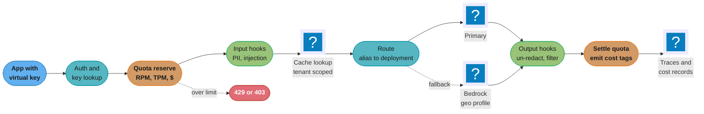
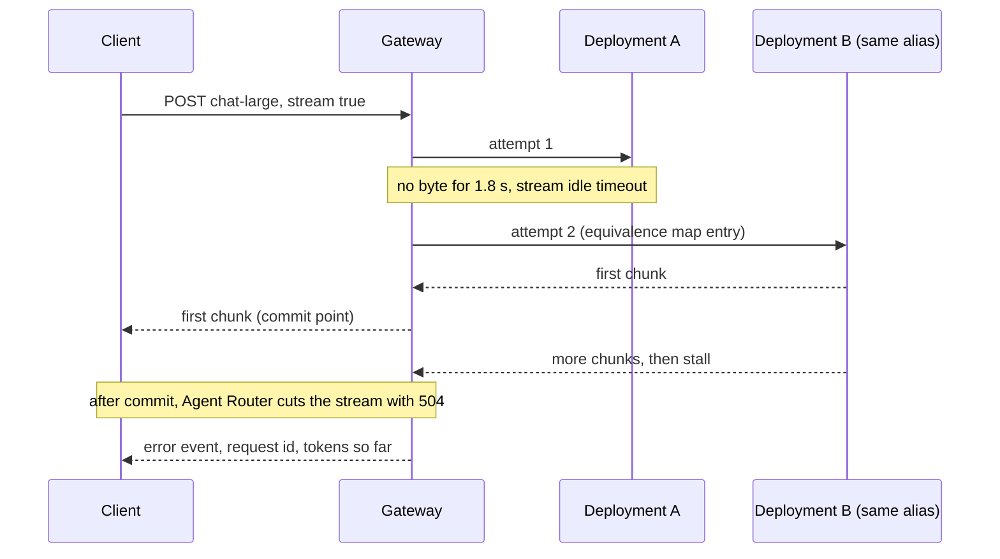
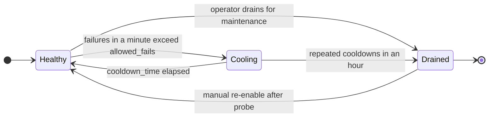
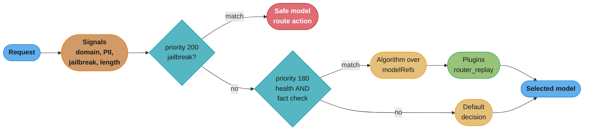

# AI Gateway Operations

> **Version anchor (2026-10-18).** LiteLLM v1.106.0 (2026-10-18) disables stdio MCP servers by default (PR #44066); only `LITELLM_ENABLE_MCP_STDIO=true` in the proxy's process environment turns them back on. Agent Router v1.2.0 (2026-10-07) is the first release under the project's new name (formerly Envoy AI Gateway); the API group `aigateway.envoyproxy.io` and the CRD kinds (`AIGatewayRoute`, `AIServiceBackend`, `BackendSecurityPolicy`, `GatewayConfig`, `MCPRoute`) are unchanged. vLLM Semantic Router v0.4.0 (2026-09-27) routes by signal-driven decisions; its Router Replay plugin has shipped since v0.2.0. Checked 2026-10-18 from vendor docs: the Azure API Management `llm-token-limit` policy, and Amazon Bedrock cross-Region inference, where AWS lists global profiles at approximately 10% below geographic pricing. Every version-tagged claim on this page is checked against these rows.

---

## 1. Concept Overview

An AI gateway is the process that sits between every application and every model endpoint, hosted or self-hosted, and enforces the platform's rules on each request. A small team starts with an SDK call per service and a provider key in each service's environment. At about the third team or the second provider, that stops working: nobody can say which team spent $41,000 last month, a leaked key has no owner, one service's retry storm uses the whole organization's rate limit, and a provider outage takes down every feature at once.

The gateway is where those problems are fixed in one place. It is a platform with its own owners, config, release process and on-call, not a library that each team configures as it likes. This module treats it as such.

| Responsibility | What the gateway does | Failure without it |
|---|---|---|
| Identity | issues virtual keys per team, service and environment; holds the provider keys | provider keys in 40 repos, no revocation path |
| Quota | RPM, TPM, concurrency and dollar budgets per key, team and model | one batch job exhausts the org's provider limit |
| Routing | maps a model alias to deployments, weights, priorities and rules | every service hard-codes a provider model id |
| Fallback | moves traffic to an equivalent model on errors, timeouts and context overflow | a provider incident is an outage for every feature |
| Retry policy | retries only where retrying is safe, including streams | duplicated text, duplicated tool side effects |
| Cache | exact or semantic response cache, scoped per tenant | stale or cross-tenant answers |
| Guardrails | PII redaction and input and output checks as hooks | each team implements its own, or none |
| MCP | authenticates agents to tool servers and filters tool lists | agents see every tool on every server |
| Cost tags | emits model, tokens, price and owner on every request | spend arrives as one provider invoice line |
| Residency | keeps a tenant's requests in permitted regions | EU prompts processed in a US region |

The unit of change here is the **gateway config**: model aliases, deployment lists, fallback chains, quotas, guardrail policy versions, MCP allowlists and routing rules. A one-line edit to a fallback chain changes which model answers for every feature that uses that alias. That makes the config a release artifact with the same gate as a prompt or a model, which is the theme of section 6.11.

**Not here.** How to choose which model a request should go to (cascades, classifiers, cost and quality frontiers) lives in [LLM Routing and Model Selection](../../llm/llm_routing_and_model_selection/llm_routing_and_model_selection.md); this page runs the router, it does not design the policy. Cache mechanics (exact, semantic, provider prompt caching, KV-prefix reuse) live in [LLM Caching](../../llm/llm_caching/llm_caching.md); this page only places the cache in the gateway pipeline and sets its key. Writing the serving API in front of a model with FastAPI lives in [Serving LLM and AI Workloads](../../fastapi/serving_llm_and_ai_workloads/serving_llm_and_ai_workloads.md). Attribution and chargeback from the cost tags emitted here live in [AI Cost Engineering and Unit Economics](../ai_cost_engineering_and_unit_economics/ai_cost_engineering_and_unit_economics.md).

---

## 2. Intuition

**One-line analogy.** The AI gateway is the airport for model traffic: one set of security checks, one departures board, gate changes when a runway closes, and a passenger manifest per flight. Each airline (provider) still flies its own planes.

**Mental model.** Every request passes through a fixed pipeline: authenticate, check quota, run input guardrails, look up cache, route, call with retry and fallback, run output guardrails, settle the quota and emit the cost record. Each stage reads config that someone owns and versions. When behavior changes, the first question is which stage's config changed.

**Why it matters.** The gateway is the only point that sees every model call in the company. That makes it the right place to enforce budgets and residency, and also the place where one bad edit has the largest blast radius. A routing bug in a gateway is a routing bug in every feature.

**Key insight.** A gateway feature is only correct when it accounts for streaming and concurrency. Rate limits that count tokens after the response, retries that fire after the first byte, and PII un-redaction that waits for a full response all work in a demo with one blocking request and break with 60 concurrent streams.

---

## 3. Core Principles

1. **One choke point, many owners.** All model traffic goes through the gateway. The platform team owns the gateway; each team owns its keys, budgets and aliases within the limits the platform sets.
2. **Applications name aliases, never provider model ids.** `chat-large` is a contract the gateway resolves. A provider model id in application code is a migration nobody can run centrally.
3. **Equivalence is measured, not assumed.** A fallback target is equivalent only if it passed the same eval set as the primary for that alias. An untested fallback is an unreviewed model change that triggers during an incident.
4. **Retry only what the client has not seen.** Before the first byte of a response reaches the client, a retry or fallback is invisible. After it, a retry duplicates or splices output.
5. **Reserve, then settle.** Token quotas reserve an estimate at admission and settle to the actual `usage` after the response. Counting only after the response lets concurrent requests overshoot.
6. **Every request carries an owner and a cost.** The gateway writes team, key, feature, model, tokens and price on every request at the time of the call, because the provider invoice cannot be split after the fact.
7. **Config is code.** Gateway config lives in git, is reviewed, and rolls out with a canary and a rollback, like a prompt or a model.
8. **Fail closed on governance, fail open only on optimization.** A failed budget check or residency check blocks the request. A failed cache lookup or a failed cost-tag write must not.

---

## 4. Types / Architectures / Strategies

### 4.1 Deployment shapes

| Shape | Where it runs | Examples | Good for | Weak at |
|---|---|---|---|---|
| In-process SDK router | inside each service | LiteLLM Python SDK `Router` | one service, many providers | no central quota, keys in every service |
| Central proxy service | a stateless service plus a database and Redis | LiteLLM Proxy, Portkey open-source gateway | most companies; virtual keys and budgets | its own HA and scaling |
| Envoy data plane on Kubernetes | Envoy pods driven by CRDs | Agent Router (`AIGatewayRoute`, `MCPRoute`) | teams already on Gateway API and Envoy Gateway | needs Kubernetes and Envoy skills |
| API management product | a managed API gateway with LLM policies | Azure API Management `llm-token-limit`, Kong AI Gateway | enterprises with an existing API platform | LLM features lag the dedicated tools |
| Managed edge gateway | the vendor's edge network | Cloudflare AI Gateway | caching, rate limits, logs with no servers to run | data passes through another vendor |
| Provider-side routing | inside one cloud's model service | Amazon Bedrock cross-Region inference profiles | capacity across regions of one cloud | one provider only; residency trade-off |

These shapes compose. A common layout is a central proxy (LiteLLM or Agent Router) that calls Bedrock through a geographic inference profile, Azure OpenAI through an APIM instance, and self-hosted vLLM through an in-cluster route.

### 4.2 Routing layers

| Layer | Decides | Mechanism | Owner |
|---|---|---|---|
| Alias resolution | which model family serves `chat-large` | static map in gateway config | platform plus the feature team |
| Deployment selection | which of N deployments of that model | weights, priorities, least-busy, latency | platform |
| Fallback | what to call when the selected deployment fails | ordered chain over an equivalence map | platform, gated by eval |
| Signal-driven decision | which candidate models, algorithm and plugins apply to this request | boolean rules over request signals (vLLM Semantic Router) | the routing policy owner |

The vLLM Semantic Router term "decision" means a routing rule: a priority, a boolean rule over signals (domain, keyword, complexity, PII, jailbreak, context length and others), a set of `modelRefs`, an `algorithm` and `plugins`. It is unrelated to a [decision model](../decision_models/decision_models.md), which is a model that returns labels and probabilities. A decision model can be one of the signals a routing decision reads, which is where the two meet.

### 4.3 Quota types

| Quota | Unit | Protects against | Enforced when |
|---|---|---|---|
| RPM | requests per minute | request floods, retry storms | at admission |
| TPM | prompt plus completion tokens per minute | provider TPM limits, one key starving others | reserve at admission, settle after response |
| Concurrency | in-flight requests | long streams holding capacity | at admission, released at stream close |
| Dollar budget | USD per period (`max_budget`, `budget_duration`) | cost overrun | settled after response; checked at admission |
| Token quota | tokens per hour, day, month (APIM `token-quota`) | monthly allocation per subscription | settled after response |

A key needs at least RPM, TPM and a dollar budget. Concurrency matters for agents and long streams, where a few requests hold a deployment for minutes.

### 4.4 Product landscape

| Product | Type | Notable operational features |
|---|---|---|
| LiteLLM Proxy | open-source proxy | virtual keys, budgets per key, team, user and model; fallbacks; cooldowns; MCP gateway |
| Agent Router | Envoy-based, Kubernetes CRDs | `llmRequestCosts` into Envoy rate-limit buckets; backend priority and weight; `streamIdleTimeout`; `MCPRoute` |
| vLLM Semantic Router | signal-driven router | decisions with priorities, selection algorithms, plugins such as `router_replay` and `shadow_dispatch` |
| Portkey | open-source gateway plus hosted service | fallbacks, load balancing, conditional routing, simple and semantic cache, budget and rate limits |
| Kong AI Gateway | plugins on Kong | AI Rate Limiting Advanced (cost-based limits), AI Semantic Cache, AI Prompt Guard, AI Sanitizer (PII) |
| Cloudflare AI Gateway | managed edge | caching, rate limiting, retries and fallback, logging, cost analytics |
| Azure API Management | API management | `llm-token-limit` (429 on rate, 403 on quota), token metrics policy |
| Amazon Bedrock | provider-side | geographic and global cross-Region inference profiles |

---

## 5. Architecture Diagrams

### Request pipeline through the gateway



Each stage reads its own versioned config. A cost record is written for every request, including denied and cached ones, so that budgets and chargeback reconcile with what the gateway actually did.

### Budget and quota hierarchy

```
org: acme                         max_budget  $250,000 / 30d
├─ team: support                  max_budget   $60,000 / 30d   tpm 2,000,000
│  ├─ key: support-bot-prod       max_budget   $45,000 / 30d   tpm 1,500,000   rpm 3,000
│  ├─ key: support-bot-staging    max_budget    $2,000 / 30d   tpm   100,000   rpm   200
│  └─ key: support-evals          max_budget    $3,000 / 30d   tpm   200,000   rpm   300
└─ team: search                   max_budget   $90,000 / 30d   tpm 3,000,000
   ├─ key: search-answers-prod    max_budget   $80,000 / 30d   tpm 2,500,000   rpm 6,000
   └─ key: search-backfill        max_budget    $8,000 / 30d   tpm   400,000   rpm   100
```

A request is admitted only if every level on its path has room. Here the children sum below each parent (support keys $50,000 under a $60,000 team cap, search keys $88,000 under $90,000, teams $150,000 under $250,000). A platform that overcommits, letting child limits sum above the parent, relies on the parent cap to bind when several children spike together.

### Token quota: charge after response vs reserve then settle

```
TPM limit 100,000 for key support-bot-prod, 60 requests arrive in the first 2 s
each request: prompt 1,200 tokens, max_tokens 1,500, actual completion about 1,400

charge after response (broken)
  counter at admission             :       0  -> all 60 admitted
  counter after responses (~40 s)  :  60 x 2,600 = 156,000   (56% over the limit)

reserve then settle (fixed)
  reserve per request              :  1,200 + 1,500 = 2,700
  admitted                         :  37   (37 x 2,700 = 99,900)
  settle each to actual usage      :  37 x (2,700 - 2,600) = 3,700 tokens refunded
  admitted after refunds           :  1 more   (total 38 x 2,600 = 98,800)
```

The broken counter is correct for one blocking request and wrong for any burst. Reserving `max_tokens` is conservative; a gateway that lets callers omit `max_tokens` has to reserve a default ceiling instead.

### Retry window on a streaming request

```
time (ms)    gateway state                              retry or fallback?
0            request admitted, attempt 1 to deployment A
0..1,800     no byte from A                             safe: client has seen nothing
1,800        stream idle timeout fires on A             fall over to deployment B
2,300        first byte from B reaches the client       <- commit point
2,300..6,100 1,140 tokens streamed to the client
6,100        B stalls for 30 s                          unsafe: client holds 1,140 tokens
             options: end the stream with an error, or splice a second model's text
```

The commit point is the first byte the client receives, not the first byte the gateway receives. A gateway that buffers the first few chunks for an output guardrail moves the commit point later and widens the safe retry window by the same amount.

### Fallback on a streaming request



The two halves of this diagram have opposite rules. Before the commit point the gateway owns recovery. After it, the client owns recovery, and the gateway's job is to fail clearly with enough information for the client to resume or retry the whole turn.

### Deployment health and cooldown



LiteLLM's `allowed_fails` and `cooldown_time` implement the first two transitions. The `Drained` state is an operator action; automating it from repeated cooldowns is a policy each platform sets.

### Signal-driven routing decision



Under the default `priority` strategy, the matching decision with the highest priority wins. Changing one priority number can move that rule ahead of or behind every other rule that matches the same traffic, which is why routing rules go through the replay check in section 6.11.

---

## 6. How It Works - Detailed Mechanics

### 6.1 Virtual keys and the key hierarchy

A virtual key is a gateway-issued credential that maps to an owner (team, service, environment), a set of allowed model aliases, limits, and metadata. Provider keys live only in the gateway's secret store. Revoking a leaked virtual key affects one service; rotating a provider key affects nobody downstream.

LiteLLM issues keys through `/key/generate` (key basics are in [LiteLLM Routing](../../llm/agentic_frameworks/litellm_routing.md)). The fields below are the documented ones; `model_max_budget` (a separate budget per model) requires an Enterprise license.

```bash
curl 'http://litellm.internal:4000/key/generate' \
  --header 'Authorization: Bearer <master-key>' \
  --header 'Content-Type: application/json' \
  --data-raw '{
    "key_alias": "support-bot-prod",
    "team_id": "support",
    "models": ["chat-large", "chat-small", "embed-default"],
    "max_budget": 45000,
    "budget_duration": "30d",
    "tpm_limit": 1500000,
    "rpm_limit": 3000,
    "max_parallel_requests": 400,
    "metadata": {"feature": "support-chat", "env": "prod", "cost_center": "cc-4120"}
  }'
```

Three operational facts from the LiteLLM docs decide whether this works in production:

- `max_budget` defaults to `null`, and a `null` budget is not checked. A key generated without the field has no spend cap.
- If `budget_duration` is not set, the budget never resets. A 30-day budget written as `max_budget` alone is a lifetime budget.
- Key, team and user budgets need a database, because virtual keys resolve from it. Without one, the global `litellm_settings.max_budget` fails open and requests continue past it.

Each exceeded scope returns a different error shape (`ExceededTokenBudget` for a key budget, `budget_exceeded` with code `"400"` for a per-model key budget, `"429"` for an internal user's per-model budget). Client libraries that retry on 429 will retry a budget denial forever if the gateway maps it to 429, so the platform publishes one table of denial codes and what a client should do with each.

### 6.2 RPM, TPM and the reservation problem

Token limits are hard because the cost of a request is unknown at admission. The gateway knows the prompt (it can count or estimate it) and the requested `max_tokens`, but not the completion length.

The broken version counts after the response:

```python
# Broken: tokens are charged only after the response completes.
async def admit(key: str) -> bool:
    used = await redis.get(f"tpm:{key}:{minute()}") or 0
    return int(used) < LIMITS[key].tpm

async def on_response(key: str, usage: dict) -> None:
    await redis.incrby(f"tpm:{key}:{minute()}", usage["total_tokens"])
```

Sixty requests that arrive in the same two seconds all read `used = 0` and are all admitted, as the diagram in section 5 shows. Streams make it worse: a stream admitted at second 2 settles at second 40.

The fixed version reserves an upper bound and settles to the actual usage:

```python
# Fixed: reserve prompt + max_tokens atomically, settle to actual usage after.
RESERVE = """
local used = tonumber(redis.call('GET', KEYS[1]) or '0')
if used + tonumber(ARGV[1]) > tonumber(ARGV[2]) then return -1 end
redis.call('INCRBY', KEYS[1], ARGV[1])
redis.call('EXPIRE', KEYS[1], 120)
return used + tonumber(ARGV[1])
"""

async def admit(key: str, prompt_tokens: int, max_tokens: int | None) -> int | None:
    ceiling = max_tokens or DEFAULT_COMPLETION_CEILING   # e.g. 4,096
    reserve = prompt_tokens + ceiling
    bucket = f"tpm:{key}:{minute()}"
    ok = await redis.eval(RESERVE, 1, bucket, reserve, LIMITS[key].tpm)
    return None if ok == -1 else reserve

async def settle(key: str, bucket: str, reserved: int, usage: dict | None) -> None:
    actual = usage["total_tokens"] if usage else reserved   # no usage: keep the reservation
    await redis.incrby(bucket, actual - reserved)            # negative = refund
```

Details that matter in production:

- **Settle into the bucket the request was reserved in**, not the current minute. Otherwise a 40-second stream refunds into the next window and lets that window overshoot.
- **Streams need usage at the end.** OpenAI-compatible streams report usage in a final chunk only when the request asks for it (`stream_options: {"include_usage": true}`); the gateway should add it on the way upstream. Without usage, the gateway keeps the reservation or estimates from the streamed text.
- **Cancelled streams still cost.** A client that disconnects after 300 tokens has used the prompt plus about 300 tokens. Settle on disconnect with what was streamed.
- **Concurrency limits pair with TPM.** A key with 400 parallel streams of 5 minutes each holds a deployment's batch slots even when its TPM is under the limit.

Managed products make the same trade-off explicit. Azure API Management's `llm-token-limit` uses actual `usage` from the response when `estimate-prompt-tokens="false"`, so prompts can still reach the backend after the limit is crossed, and it documents that concurrent requests can temporarily exceed the limit. With `stream: true`, prompt and completion tokens are always estimated. On the v2 tiers the counter is a token bucket; on classic tiers it is a sliding window. The counter is per gateway: a multi-region APIM deployment does not aggregate token counts across regional gateways, so a 100,000 TPM limit on three regional gateways admits up to 300,000.

Agent Router does the settling through Envoy's global rate limiter. `llmRequestCosts` on the `AIGatewayRoute` writes token counts into Envoy dynamic metadata under the namespace `io.envoy.ai_gateway`, and a `BackendTrafficPolicy` rule charges that metadata against a bucket per tenant header:

```yaml
apiVersion: aigateway.envoyproxy.io/v1beta1
kind: AIGatewayRoute
metadata:
  name: chat
spec:
  parentRefs:
    - name: ai-gateway
      kind: Gateway
      group: gateway.networking.k8s.io
  llmRequestCosts:
    - metadataKey: llm_input_token
      type: InputToken
    - metadataKey: llm_output_token
      type: OutputToken
    - metadataKey: llm_total_token
      type: TotalToken
  rules:
    - matches:
        - headers:
            - type: Exact
              name: x-ai-eg-model
              value: chat-large
      backendRefs:
        - name: openai-primary
          priority: 0
        - name: bedrock-us-geo
          priority: 1
      streamIdleTimeout: 2s
---
apiVersion: gateway.envoyproxy.io/v1alpha1
kind: BackendTrafficPolicy
metadata:
  name: tenant-token-limit
spec:
  targetRefs:
    - group: gateway.networking.k8s.io
      kind: HTTPRoute
      name: chat
  rateLimit:
    type: Global
    global:
      rules:
        - clientSelectors:
            - headers:
                - name: x-tenant-id
                  type: Distinct
          limit:
            requests: 2000000
            unit: Hour
          cost:
            request:
              from: Number
              number: 0
            response:
              from: Metadata
              metadata:
                namespace: io.envoy.ai_gateway
                key: llm_total_token
```

`number: 0` on the request side means admission only checks that the bucket is not empty; the response side charges the real tokens. This is the charge-after-response model with a coarse guard, so it relies on the hour-long window to absorb bursts. For tight per-minute limits, add a request-count limit alongside it.

### 6.3 Fallback chains and equivalence maps

A fallback chain says what to call when the primary fails. An equivalence map says which models are allowed to stand in for an alias, and what evidence supports that. The chain should only contain models from the map.

LiteLLM's reliability settings, as documented:

```yaml
model_list:
  - model_name: chat-large
    litellm_params:
      model: azure/chat-large-eastus2        # Azure deployment name
      api_base: https://acme-eastus2.openai.azure.com
      api_key: os.environ/AZURE_EASTUS2_KEY
  - model_name: chat-large
    litellm_params:
      model: azure/chat-large-swedencentral
      api_base: https://acme-sweden.openai.azure.com
      api_key: os.environ/AZURE_SWEDEN_KEY
  - model_name: chat-large-alt
    litellm_params:
      model: bedrock/us.anthropic.claude-sonnet-4-5-20250929-v1:0
  - model_name: chat-large-long
    litellm_params:
      model: bedrock/us.anthropic.claude-sonnet-4-5-20250929-v1:0

router_settings:
  enable_pre_call_checks: true               # required for context-window fallbacks

litellm_settings:
  num_retries: 2
  request_timeout: 30
  allowed_fails: 3
  cooldown_time: 30
  fallbacks: [{"chat-large": ["chat-large-alt"]}]
  context_window_fallbacks: [{"chat-large": ["chat-large-long"]}]
```

Two deployments under one `model_name` are a load-balanced group; retries move between them first. `fallbacks` moves to a different group only after `num_retries` are spent. `context_window_fallbacks` catches prompts that exceed the primary's context, and needs `enable_pre_call_checks`. `content_policy_fallbacks` exists too, and deserves the most scrutiny: falling back after a provider's safety refusal routes exactly the requests one provider refused to another provider.

The equivalence map is a reviewed file next to the gateway config:

```yaml
# equivalence/chat-large.yaml
alias: chat-large
primary: azure/chat-large@2026-08-snapshot
eval_set: evals/chat-large-core@v14            # 1,800 cases, 6 slices
members:
  - model: bedrock/us.anthropic.claude-sonnet-4-5-20250929-v1:0
    role: fallback
    eval_run: runs/2026-10-02-chat-large-alt
    score_vs_primary: -1.9 pts overall, worst slice -4.6 (tool-call JSON)
    prompt_variant: prompts/support-system@v31-anthropic
    approved_by: support-ml, platform-ai
    expires: 2027-01-02                         # re-run eval before this date
  - model: azure/chat-small@2026-07-snapshot
    role: degrade-only                          # used by the kill switch, not by fallback
    score_vs_primary: -9.8 pts overall
```

Three rules make the map useful:

1. A fallback that needs a different prompt (tool-call format, system prompt conventions) names that prompt version, and the gateway applies it when it falls back. Sending the primary's prompt unchanged to a different model family is the most common reason a fallback "works" in a health check and fails on real traffic.
2. Every entry expires. Provider snapshots change, and a fallback evaluated in March is not evidence in October.
3. A fallback event is a quality event. Count fallbacks per alias and alert at a threshold, so that a primary silently failing over for three days shows up before the quality dashboards do. The monitoring side lives in [Production Quality Monitoring and Drift](../production_quality_monitoring_and_drift/production_quality_monitoring_and_drift.md).

### 6.4 Retries, idempotency and streams

Model calls look idempotent because the gateway can resend the same request. Three things make that untrue:

| Case | Why a blind retry is wrong | Rule |
|---|---|---|
| Stream after the commit point | the client already holds partial text; a second attempt duplicates or splices it | no transparent retry; end with an error event and the request id |
| Gateway-executed tool calls (MCP through the gateway) | the first attempt may have run `create_refund` before failing | retry the model call, never the tool call, unless the tool takes an idempotency key |
| Stateful provider APIs (stored responses, background jobs) | a retry creates a second stored object or job | pass a client-generated request id and dedupe at the gateway |

Gateways differ on the first row, and the platform has to know which one it runs:

- Agent Router's `streamIdleTimeout` (per rule) resets the upstream stream if it fires before the first response byte, and a retry policy can then fall over to the next backend. If it fires mid-stream, the stream is cut and the client receives a 504. `Timeouts.Request` is the overall deadline and defaults to 60 s when unset, so long streams need it raised.
- LiteLLM's reliability docs state that a fallback still runs when a stream breaks mid-stream; the fallback target keeps only the readable summary of each Responses reasoning item and drops thinking blocks whole. The client then receives one response assembled from two models. With `disable_fallbacks` set on the request or key, a stream that fails before its first chunk returns that deployment's own error.

A client wrapper that is safe on any gateway:

```python
# Broken: retries the whole stream after partial output reached the user.
async def stream_answer(req):
    for attempt in range(3):
        try:
            async for chunk in gateway.stream(req):
                yield chunk                       # user sees chunks from attempt 1
            return
        except StreamError:
            continue                              # attempt 2 starts from token 0

# Fixed: retry only before the first chunk, then surface a resumable error.
async def stream_answer(req):
    request_id = req.headers.setdefault("x-request-id", uuid4().hex)
    for attempt in range(3):
        sent = 0
        try:
            async for chunk in gateway.stream(req):
                sent += 1
                yield chunk
            return
        except StreamError as e:
            if sent == 0 and e.retryable and attempt < 2:
                await asyncio.sleep(0.2 * 2 ** attempt)
                continue
            raise PartialAnswer(request_id=request_id, chunks=sent) from e
```

`PartialAnswer` lets the product decide: show a "response interrupted, retry" control, or regenerate the whole turn. Both are honest. Splicing silently is not.

### 6.5 Signal-driven routing with vLLM Semantic Router

vLLM Semantic Router v0.4.0 evaluates signals on each request (keyword, embedding, domain, complexity, PII, jailbreak, language, context length, modality, user feedback and others in the reference config), then, under the default `priority` strategy, picks the highest-priority decision whose rule matches. A decision names candidate `modelRefs`, an optional selection `algorithm` (for example `static`, `ratings`, `latency_aware`, `hybrid`) and route-local `plugins`. Hard requirements such as authorization, local-only processing and context capacity should make a route eligible or ineligible before any optimizer compares cost or latency.

A decision, in the shape of the project's v0.4.0 reference config (`config/config.yaml`, where signals and decisions sit under `routing`):

```yaml
routing:
  signals:
    pii:
      - name: restricted_pii
        threshold: 0.85
        pii_types_allowed: [EMAIL_ADDRESS]
    jailbreak:
      - name: prompt_injection
        threshold: 0.8

  decisions:
    - name: prompt_attack_guard
      priority: 200
      rules:
        type: jailbreak
        name: prompt_injection
      action:
        type: route
        destination: guard-small            # overrides a caller-pinned model
      modelRefs:
        - model: guard-small

    - name: pii_stays_local
      priority: 190
      rules:
        operator: AND
        conditions:
          - type: pii
            name: restricted_pii
          - operator: NOT
            conditions:
              - type: jailbreak
                name: prompt_injection
      modelRefs:
        - model: local-qwen-32b             # self-hosted, in-region
      algorithm:
        type: static
      plugins:
        - type: router_replay
          configuration:
            enabled: true
            max_records: 10000
            capture_request_body: false     # PII route: keep bodies out of replay storage
            capture_response_body: false
```

Operational notes:

- The `route` action sends every matching request to its destination even when the caller named a model, so a detected prompt attack cannot bypass the guard by naming a stronger model.
- `router_replay` records routing decisions so an engineer can answer "why did this request go to that model". It stores request and response bodies when configured to, which makes the replay store a data store with the same retention and access rules as prompt logs. The `max_tool_trace_steps` option caps tool-trace steps per record; the reference config notes that long agent sessions otherwise grow the trace without bound and can run the router out of memory.
- `shadow_dispatch` sends a sample of a decision's traffic to a candidate model without the primary response waiting on it. It is the routing equivalent of a shadow deployment, and its cost lands on the gateway's budget unless it is tagged.
- Each signal is a classifier with its own false positive rate. A jailbreak signal at 2% false positives sends 2% of benign traffic to the guard model; measure that rate per slice before raising a decision's priority.

### 6.6 Cache layers in the pipeline

The gateway can hold an exact-match cache, a semantic cache, or both; provider prompt caching happens upstream and the gateway only has to preserve the prefix. The mechanics are in [LLM Caching](../../llm/llm_caching/llm_caching.md). The gateway's job is placement and keying:

| Decision | Rule | Reason |
|---|---|---|
| Position | after auth, quota and input guardrails; before routing | a cache hit should still be authorized, counted and filtered |
| Key scope | tenant id (or key) in the key | otherwise one tenant's answer is served to another |
| Key content | normalized prompt plus model alias, resolved model id, prompt version, decoding params, guardrail policy version | a model or policy change must miss the old entries |
| Redaction | key on the redacted prompt, store the redacted response | the cache never holds raw PII |
| Quota | a hit still counts against RPM, at zero TPM | keeps abuse visible |
| Cost tag | hits write a cost record with `cache_hit=true` and $0 | savings become measurable |

The policy-version rule is the one teams miss. A cached answer produced under guardrail policy v7 keeps being served after v8 tightens the output filter, until the TTL expires, unless the policy version is in the key.

### 6.7 PII and guardrail hooks

Guardrails run as hooks at three points: pre-call (on the prompt), during the stream (on chunks), and post-call (on the full response). The checks themselves are covered in [Guardrails and Content Safety](../../llm/guardrails_and_content_safety/guardrails_and_content_safety.md); the gateway operates them.

Uber's GenAI Gateway (July 2024) shows the redaction pattern: sensitive values are replaced with numbered placeholders such as `ANONYMIZED_NAME_0` before the request goes to a third-party vendor, and the response is un-redacted to restore the values. Kong's AI Sanitizer plugin and LiteLLM's guardrail hooks implement the same idea.

Streaming breaks naive un-redaction. A placeholder can arrive split across chunks (`ANONYM` then `IZED_NAME_0`), so a per-chunk replace misses it. The fix is a small hold-back buffer:

```python
PLACEHOLDER = re.compile(r"ANONYMIZED_[A-Z]+_\d+")
MAX_PLACEHOLDER = 32

async def unredact_stream(chunks, mapping):
    def restore(text):
        return PLACEHOLDER.sub(lambda m: mapping.get(m.group(0), m.group(0)), text)
    buf = ""
    async for text in chunks:
        buf += text
        cut = len(buf) - MAX_PLACEHOLDER          # an unfinished placeholder starts after this
        for m in PLACEHOLDER.finditer(buf):
            if m.start() < cut < m.end():
                cut = m.start()                   # never split a complete placeholder
        if cut > 0:
            out, buf = buf[:cut], buf[cut:]
            yield restore(out)
    yield restore(buf)
```

The hold-back adds latency equal to about 32 characters of output, a few tokens. Output classifiers that need whole sentences hold back more, and every held-back token moves the stream's commit point later (section 5). A platform should publish the latency budget of each hook: for example, pre-call PII detection 15 ms p95, jailbreak classifier 25 ms p95, stream hold-back under 8 tokens.

### 6.8 MCP through the gateway

Agents reach tool servers through the gateway for the same reason applications reach models through it: one place for credentials, allowlists, audit and limits. The tool lifecycle (pins, listing digests, trajectory gates) is in [Agent, Tool and MCP Server Lifecycle](../agent_tool_and_mcp_server_lifecycle/agent_tool_and_mcp_server_lifecycle.md). The gateway's part:

- **Authentication.** The agent authenticates to the gateway with its own identity. The gateway holds, or exchanges, the credential for the tool server. Agent Router v1.2.0 adds `authorizationServerMetadataUrl` for OAuth on `MCPRoute`, and `injectionPolicy: IfNotPresent` for caller-supplied credentials; it also requires tokens to match `oauth.issuer` exactly, including a trailing slash, or they get a 401.
- **Allowlists.** A key or team sees only the servers and tools granted to it. LiteLLM servers can be marked `allow_all_keys` or scoped through `access_groups`; anything else is granted per key, team or organization.
- **Name prefixing.** LiteLLM prefixes each tool name with its server name (`github_mcp_server_create_issue`), with `mcp_aliases` to shorten the prefix. Agent Router's `prefixMode: Never` turns prefixing off, which brings back collisions when two servers expose the same tool name. Pick one convention and keep it, because renaming tools is a behavior change for every agent.
- **Transports.** LiteLLM v1.106.0 disables stdio MCP servers by default. Disabled stdio servers stay registered but never start, are skipped in tool listings, return 403 on calls and health checks. Creating one returns 422, and an update is rejected unless it switches the server to a remote transport. Only `LITELLM_ENABLE_MCP_STDIO=true` in the process environment (or a `.env` file beside the proxy) re-enables them; the flag is ignored in `config.yaml` and in database-stored environment variables. The stated reason is that stdio servers run local commands on the proxy host.
- **Session state.** Agent Router v1.2.0's chart no longer defaults to a fixed MCP session seed, so the upgrade ends active MCP sessions. Long-running agents need to reconnect cleanly or the upgrade is an outage.

### 6.9 Cost tags per request

Every request produces one cost record at the gateway, at the time of the call. The record is the input to attribution and chargeback, which live in [AI Cost Engineering and Unit Economics](../ai_cost_engineering_and_unit_economics/ai_cost_engineering_and_unit_economics.md).

```json
{
  "ts": "2026-10-18T09:14:07.412Z",
  "request_id": "9f3c2e7a41b04c1d",
  "virtual_key": "support-bot-prod",
  "team": "support",
  "feature": "support-chat",
  "cost_center": "cc-4120",
  "alias": "chat-large",
  "resolved_model": "azure/chat-large-swedencentral",
  "route": "primary",
  "decision": null,
  "region": "swedencentral",
  "tokens": {"input": 1840, "cached_input": 1200, "output": 412, "cache_write": 0},
  "price_table": "prices@2026-10-01",
  "cost_usd": 0.0071,
  "cache_hit": false,
  "guardrail_policy": "gr-policy@v8",
  "status": 200,
  "latency_ms": {"ttft": 640, "total": 5120}
}
```

Rules for the record:

- **Price table version, not just a price.** Recomputing last month's cost with this month's prices produces a different number. Store the price table version used.
- **Cached and cache-write tokens separately.** Agent Router v1.2.0 added `cache_write_tokens` to its cache metrics and costs; providers bill them differently from plain input.
- **Denied, cached and failed requests get records too.** A 429 costs nothing but explains a support ticket; a failed attempt that consumed prompt tokens upstream does cost money.
- **Write asynchronously and never block the response.** A cost pipeline outage is a reporting gap, not a product outage. Buffer locally and replay.

### 6.10 Residency routing

Residency is a routing constraint that must be checked before any cost or latency optimization. A tenant tagged `residency=eu` must never reach a deployment outside the permitted regions, including through a fallback chain.

Amazon Bedrock makes the trade-off explicit in its two cross-Region inference profile types:

| Profile | Routing | Residency | Price (checked 2026-10-18) |
|---|---|---|---|
| Geographic (prefixes such as `us`, `eu`, `apac`, `in`) | within the Regions listed in the profile | requests stay inside the geography | standard pricing |
| Global | any supported AWS commercial Region | no geographic boundary | approximately 10% savings |

Details from the AWS docs that matter for operations: with a geographic profile, prompts and outputs can still leave the source Region (within the geography), and data stored for abuse detection is stored in the destination Region. Cross-Region inference can route to Regions that are not enabled in the account. CloudTrail logs every request in the source Region with `additionalEventData.inferenceRegion`, which is the field to audit. SCPs that block unused Regions must allow every destination Region in the profile, or use a `bedrock:InferenceProfileArn` exception, or the calls fail.

The gateway rule is simple to state and easy to break: residency is a filter applied to the equivalence map before the fallback chain is built. A global fallback added to `chat-large` for an outage must not be visible to `eu` tenants, and a test should assert that for every alias.

### 6.11 Gateway config as a release artifact

Gateway config changes behavior for every consumer. It gets the same pipeline as other release inputs in [AI Release Engineering](../ai_release_engineering/ai_release_engineering.md):

1. **Diff and classify.** Quota changes, alias changes, fallback changes, routing rule changes, guardrail policy changes and MCP allowlist changes are separate classes with separate reviewers.
2. **Static checks.** Every alias resolves; every fallback member is in the equivalence map and not expired; no `eu` alias can reach a non-EU deployment; every key has `max_budget` and `budget_duration`.
3. **Replay.** Run the last 24 hours of routing inputs (signals and headers, not bodies) through old and new config and diff where each request would go. A priority change that moves 18% of traffic to a different model should not be a surprise at review.
4. **Eval when routing changes.** If the replay shows traffic moving between models, run the eval set for each affected alias on the new mix.
5. **Canary.** Roll the config to one gateway replica or one tenant group first. Watch error rate, fallback rate, p95 TTFT and spend per minute.
6. **Rollback.** The previous config digest is one command away; config is never edited in place on a live gateway.

---

## 7. Real-World Examples

**Anthropic, context-window routing error (postmortem 2025-09-17).** On August 5, 2025, some Claude Sonnet 4 requests were routed to servers configured for the upcoming 1M-token context window, affecting 0.8% of Sonnet 4 requests. A routine load-balancing change on August 29 increased the share; in the worst hour on August 31, 16% of Sonnet 4 requests were affected. Routing was sticky, so follow-up requests often went back to the same wrong server type, and about 30% of Claude Code users who made requests in the period had at least one message misrouted. For a gateway team the lessons are concrete: a routing change is a quality change, sticky routing amplifies a bad route for the users who hit it, and a load-balancing edit needs the same replay and canary as a model change.

**OpenAI, December 11, 2024 outage.** A new telemetry service configuration generated heavy Kubernetes API load on every node, overloaded the API servers, and broke DNS-based service discovery. All OpenAI services degraded or went unavailable from 3:16 PM to 7:38 PM PST, across nine API components including Chat Completions, Embeddings and Batch. A fallback chain whose members all called OpenAI's API had nowhere to go for those four hours; only a member on a different provider could serve. Fallback targets need independent failure domains, not just independent endpoints.

**Uber GenAI Gateway (July 2024).** Uber's internal gateway mirrors the OpenAI HTTP and JSON interface, so developers write code as if they use the native OpenAI client while reaching OpenAI, Vertex AI and Uber-hosted open models. It redacts PII into numbered placeholders before vendor calls and restores the values in the response, and its audit logs feed cost attribution, security audits and quality evaluation. Uber reported close to 30 customer teams and 16 million queries per month at a peak of 25 QPS. The example shows that the governance value of a gateway arrives long before its traffic is large.

**Samsung, source code pasted into ChatGPT (2023).** Samsung engineers uploaded internal source code to ChatGPT, and in May 2023 the company restricted employee use of generative AI tools. A gateway with pre-call DLP and an approved-providers list is the control that lets a company allow these tools rather than ban them.

**LiteLLM v1.106.0 (2026-10-18).** The release made stdio MCP servers opt-in through a process environment variable. A platform that runs internal tools as stdio servers on the proxy loses them from every agent's listing on upgrade; the listing skips them quietly, so agents get no error and answer without the tools. The gateway is a dependency of every agent and its upgrades need the agent trajectory gate.

**Amazon Bedrock cross-Region inference.** AWS documents global profiles at approximately 10% below geographic ones (checked 2026-10-18), with routing to any supported commercial Region. A platform that switched its default Bedrock profile to global for the saving would have moved EU tenants' prompts out of the EU. Residency-tagged routing in the gateway turns that into a per-tenant choice.

**Azure API Management in multi-region deployments.** The `llm-token-limit` policy tracks usage separately at each gateway, including regional gateways in a multi-region deployment. A subscription limited to 100,000 TPM on an instance with three regional gateways can use up to three times that. Teams that need a global limit set per-region limits that sum to the target, or enforce the limit in a layer with a shared counter.

---

## 8. Tradeoffs

### Build on an open-source proxy vs an Envoy data plane vs a managed gateway

| Dimension | Central proxy (LiteLLM, Portkey OSS) | Envoy data plane (Agent Router) | Managed (Cloudflare, APIM) |
|---|---|---|---|
| Time to first value | hours | days, needs Envoy Gateway | hours |
| Budgets and virtual keys | built in | assemble from rate limits plus cost metadata | product-dependent |
| Latency added | one extra hop through a Python or Node service | Envoy filter in the existing path | one hop to the vendor edge |
| Fits Kubernetes Gateway API | as a backend | natively, CRDs | no |
| Self-hosted model routing | yes | yes, including InferencePool backends | through public endpoints |
| Data leaves your network | no | no | yes, to the gateway vendor |
| Upgrade blast radius | proxy release changes behavior (stdio MCP example) | CRD and chart changes (MCP session seed example) | vendor-scheduled |

### Rate-limit enforcement models

| Model | Overshoot under burst | Extra latency | Use when |
|---|---|---|---|
| Charge after response | high, up to burst size times request size | none | coarse hourly or daily quotas |
| Estimate at admission, settle after | low, bounded by estimate error | token counting at admission | per-minute TPM in front of a provider limit |
| Reserve `max_tokens`, settle after | none above the limit; under-uses capacity | token counting plus a reservation write | shared provider capacity, strict tenants |
| Concurrency cap | not a token limit | none | long streams and agents |

### Fallback across providers vs within a provider

| Dimension | Same model, other region or deployment | Other provider's model |
|---|---|---|
| Quality change | none if the snapshot matches | measurable; needs an eval and often a prompt variant |
| Failure independence | low for control-plane outages | high |
| Residency | easy to keep in-region | must be checked per tenant |
| Cost | same price table | different price, different tokenizer |
| Operational load | low | equivalence map, prompt variants, expiry |

---

## 9. When to Use / When NOT to Use

**Use a central AI gateway when:**

- more than one team or more than one provider calls models;
- spend needs an owner below the invoice line, or budgets need enforcement before the invoice;
- residency, PII or approved-provider rules apply to any traffic;
- agents call tools through MCP and need central credentials and allowlists;
- you need a fallback that can be changed for every consumer in one release.

**Use an in-process SDK router instead when:**

- one service with one owner calls models and the cost fits in one budget line;
- latency budgets cannot afford a network hop (on-device, in-process ranking);
- the "gateway" would only re-export one provider's API with nothing enforced.

**Do not:**

- put business logic (prompt assembly, retrieval, agent loops) in the gateway; it becomes a monolith every team deploys through;
- use content-policy fallbacks to route around a provider's safety refusal without a documented reason and a review;
- route by signal-driven decisions before the basic controls (keys, budgets, quotas, fallbacks, cost tags) are in place; the router adds classifiers whose errors you then have to measure.

---

## 10. Common Pitfalls

The scenarios below are composites of common incident patterns unless a source is named.

**The budget that never reset.** A team created keys with `max_budget: 20000` and no `budget_duration`. In month one everything worked. On day 9 of month two, every key hit its lifetime cap at once and the support assistant returned budget errors for 40 minutes until someone raised the caps by hand. Fix: a config check that rejects any key without `budget_duration`, and an alert at 80% of any budget.

**Budgets with no database.** An internal tools team ran the LiteLLM proxy without a database and relied on `litellm_settings.max_budget` as its only spend cap. Without a database that global check fails open, so requests kept flowing past the cap, and a runaway batch job spent $11,600 over a weekend. Fix: run every proxy with the database that holds keys and spend, fail readiness when it is unreachable, and fail-closed admission for budgeted keys.

**429 means retry.** The gateway mapped budget exhaustion to HTTP 429. Every client library retried 429 with backoff, so exhausted keys generated a steady 3,000 requests per minute of denied traffic, which filled the gateway's logs and hid real rate-limit events. Fix: budget denials return a distinct error type that clients do not retry, documented in one table.

**Charge-after-response overshoot.** A batch summarization job launched 500 concurrent streams at the top of a minute. The gateway's TPM limiter charged on completion, admitted all 500, and the shared provider deployment returned 429 to every other team for four minutes. Fix: reserve at admission, settle to `usage`, add a concurrency cap per batch key.

**Multi-region counters.** A platform set `tokens-per-minute="100000"` in APIM for a partner subscription, then deployed two more regional gateways for latency. The partner's effective limit tripled and the backing Azure OpenAI deployment ran out of quota. Fix: divide the limit by the number of gateways that can serve the subscription, or enforce it once upstream.

**The untested fallback.** A `chat-large` alias fell back to another provider's model during a 3-hour primary incident. Tool-call JSON from the fallback used a different argument convention, and the support agent's refund tool rejected 22% of calls. The health check had only sent "Say OK". Fix: equivalence map entries with an eval run on the real eval set, a prompt variant per fallback, and an expiry date.

**Fallback into the same failure domain.** A fallback chain listed a second deployment of the same provider in another region. During a provider-wide control-plane outage like OpenAI's on December 11, 2024, both failed together. Fix: at least one fallback per critical alias in an independent failure domain, and a quarterly drill that forces the chain.

**Spliced streams.** A gateway retried mid-stream on a different deployment and appended the new attempt's output to what the client had already received. Users saw answers that restarted halfway ("The refund policy is... The refund policy is that..."). Fix: retry only before the first byte, end the stream with an error event after it.

**Cache across a policy change.** The guardrail team tightened the output filter for medical advice (policy v8). The gateway's exact-match cache, keyed on prompt and model only, served v7 answers for the 24-hour TTL. Fix: include guardrail policy version, prompt version and resolved model id in the cache key.

**Cross-tenant cache hit.** A semantic cache was keyed on the embedding of the prompt only. Two customers of a B2B product asked near-identical questions about "our contract renewal terms" and one received the other's answer, including a price. Fix: tenant id in every cache key, and no semantic cache for prompts that include retrieved private context.

**Split placeholders.** PII un-redaction ran per chunk. About 1 in 60 streamed responses that contained a placeholder showed raw `ANONYMIZED_EMAIL_0` text to the user, because the token boundary fell inside the placeholder. Fix: the hold-back buffer in section 6.7.

**The upgrade that removed tools.** After upgrading LiteLLM to v1.106.0, stdio MCP servers stopped starting and their tools disappeared from listings. Agents did not fail; they answered without the tools, and task success fell until a support lead noticed. Fix: run the agent trajectory gate on gateway upgrades, and alert when an agent's resolved tool set is smaller than its allowlist.

**Global profile for an EU tenant.** A cost review switched the default Bedrock model id from a geographic profile to a global one for the roughly 10% saving. EU tenants' prompts became eligible for any commercial Region. Fix: residency is a filter on the equivalence map, enforced by a config check, and CloudTrail `inferenceRegion` is audited weekly.

**Sticky routing amplifies a bad route.** Session affinity, added to improve prefix-cache hits, kept users on a misconfigured backend for the whole conversation. The share of affected users was far larger than the share of affected requests, as in Anthropic's 2025 routing error. Fix: monitor quality per backend, not just per alias, and make affinity breakable when a backend's error or quality signal degrades.

---

## 11. Technologies & Tools

| Tool | Role | Notes |
|---|---|---|
| LiteLLM | open-source proxy and SDK router | v1.106.0; virtual keys, budgets, fallbacks, cooldowns, MCP gateway; stdio MCP off by default |
| Agent Router | Envoy-based AI gateway with Kubernetes CRDs | v1.2.0, renamed from Envoy AI Gateway; `AIGatewayRoute`, `MCPRoute`, `llmRequestCosts` |
| Envoy Gateway | Gateway API implementation under Agent Router | `BackendTrafficPolicy` global rate limits consume token cost metadata |
| vLLM Semantic Router | signal-driven routing | v0.4.0; decisions with priorities, algorithms and plugins; `router_replay`, `shadow_dispatch` |
| Portkey | gateway with open-source core | fallbacks, load balancing, conditional routing, caching, budget and rate limits |
| Kong AI Gateway | AI plugins for Kong | AI Rate Limiting Advanced, AI Semantic Cache, AI Prompt Guard, AI Sanitizer |
| Cloudflare AI Gateway | managed edge gateway | caching, rate limiting, retries and fallback, logs, cost analytics |
| Azure API Management | API management with LLM policies | `llm-token-limit`: 429 on rate, 403 on quota; per-gateway counters |
| Amazon Bedrock | provider-side cross-Region routing | geographic and global inference profiles; CloudTrail `inferenceRegion` |
| Redis | shared counters and cache store | atomic reserve and settle with Lua; tenant-scoped cache keys |
| OpenTelemetry | traces and metrics from the gateway | GenAI semantic conventions; no stability level claimed here |
| Prometheus | gateway metrics and alerts | fallback rate, denial rate by code, spend per minute |

Related pages: [Design an LLM Gateway](../../llm/case_studies/design_llm_gateway.md) for the system design interview version of this platform, [LiteLLM Routing](../../llm/agentic_frameworks/litellm_routing.md) for the SDK-level router, [Envoy Proxy](../../technologies/envoy_proxy/envoy_proxy.md) for the data plane under Agent Router, [Rate Limiting in Depth](../../backend/rate_limiting_in_depth/rate_limiting_in_depth.md) for the counter algorithms, and [Fault Tolerance Patterns](../../backend/fault_tolerance_patterns/fault_tolerance_patterns.md) for retries, timeouts and circuit breakers in general.

---

## 12. Interview Questions with Answers

**Q: The gateway retries a streaming chat request on a second deployment after the first one stalls mid-answer. What goes wrong?**
**Short:** The client already holds part of the first answer, so a retry duplicates or splices text; retries are safe only before the first byte reaches the client.

A streaming retry is invisible only before the commit point, which is the first byte the client receives. Before it, the gateway can reset the upstream and fall over to another deployment. After it, the user has seen text, and the new attempt starts from token zero with possibly different content, so the gateway either duplicates the opening or splices two models' answers. Gateways differ: Agent Router cuts the stream with a 504 when `streamIdleTimeout` fires mid-stream, while LiteLLM documents that its fallback still runs mid-stream. Know which one you run, retry only before the first byte, and after it end the stream with an error event carrying the request id so the client can offer a clean regenerate.

**Q: A key has a 100,000 TPM limit, yet logs show it consumed 156,000 tokens in one minute. How?**
**Short:** The limiter charged tokens after each response, so a burst of concurrent requests all saw an empty counter at admission; reserve at admission and settle to actual usage instead.

At admission the gateway does not know the completion length. A limiter that only adds `usage.total_tokens` when a response finishes admits every request in a burst, because each reads the same low counter. Sixty requests of 2,600 tokens arriving in two seconds all pass and land 156,000 tokens in the window. The fix is to reserve prompt tokens plus `max_tokens` (or a default ceiling) atomically at admission, then settle the difference against the bucket the request was reserved in. Add a concurrency cap for streams, and settle cancelled streams with the tokens actually streamed.

**Q: You set `max_budget` on every LiteLLM key, but a runaway job overspent anyway. What are the likely causes?**
**Short:** Without a database the global budget fails open, a missing `budget_duration` makes the cap lifetime, and a key created without `max_budget` defaults to null, which is never checked.

Three documented behaviors cause most of these incidents. Without a database, LiteLLM's global `litellm_settings.max_budget` fails open, and key, team and user budgets cannot apply because virtual keys resolve from the database. `max_budget` defaults to `null`, and a null budget is not checked, so any key minted by a script that omits the field is uncapped. Without `budget_duration` the budget never resets, which looks fine until it locks everyone out in month two. Guard all three: fail readiness when the budget store is down, reject keys without both fields in a config check, and alert at 80% of any budget.

**Q: Your APIM `llm-token-limit` is 100,000 TPM per subscription, and you add two regional gateways. What happens to the limit?**
**Short:** It roughly triples, because the policy counts tokens separately at each gateway and does not aggregate across regional gateways in a multi-region deployment.

Azure documents that the policy tracks usage independently at each gateway where it is applied, including regional and workspace gateways. A caller spread across three regions gets 100,000 TPM at each. If the backend deployment was sized for 100,000, it runs out of quota and other subscriptions see 429s from the backend. Set per-gateway limits that sum to the intended total, or enforce the global limit in one layer with a shared counter. Also note that with `stream: true` APIM always estimates tokens, so limits on streaming APIs are estimates.

**Q: Why is adding a fallback model to an alias a model change and not just an availability setting?**
**Short:** During an incident the fallback answers real users with a different model, so it needs the same eval, prompt variant and approval as a primary change, recorded in an equivalence map.

A fallback is dormant until the worst moment, then serves a share of production traffic without anyone deploying anything. A different model family often needs a different prompt, emits tool calls with different conventions, and scores differently per slice. A health check that sends "Say OK" proves only reachability. Keep an equivalence map per alias that lists each fallback with its eval run, score against the primary, prompt variant, approvers and an expiry date, and refuse a fallback chain that names a model outside the map. Count fallback events as quality events.

**Q: What is a "decision" in vLLM Semantic Router, and how is it different from a decision model?**
**Short:** It is a routing rule: a priority plus a boolean rule over request signals that selects candidate models, an algorithm and plugins; a decision model is a model that returns labels and probabilities.

In vLLM Semantic Router v0.4.0 a decision has a `priority`, a `rules` block that combines signals with `AND`, `OR` and `NOT` (domain, PII, jailbreak, complexity, context length and more), `modelRefs` for candidates, an optional `algorithm` such as `static` or `latency_aware`, and route-local `plugins`. The highest-priority matching decision wins. A decision model is a different artifact: a model served behind a typed-decision endpoint that returns probabilities for labels. The two meet when a decision model is used as a signal, for example a classifier that labels the domain. Operate them separately: routing rules go through replay and canary, decision models through calibration and eval gates.

**Q: After a LiteLLM upgrade, agents still work but stop using several internal tools. What happened?**
**Short:** LiteLLM v1.106.0 disables stdio MCP servers by default, so their tools vanish from listings; only `LITELLM_ENABLE_MCP_STDIO=true` in the process environment brings them back.

Disabled stdio servers stay registered but never start, are skipped in tool listings, return 403 on calls, and cannot be created or updated. The flag is read only from the proxy's process environment; setting it in `config.yaml` or in database-stored variables does nothing. Agents do not error when a tool is missing, they answer without it, so the symptom is a quality drop, not an outage. Treat the gateway version as part of every agent's dependency set, run the trajectory gate on gateway upgrades, and alert when an agent's resolved tool set is smaller than its allowlist. Consider whether those tools should move to remote servers anyway, since stdio servers run commands on the gateway host.

**Q: Where in the gateway pipeline does the response cache go, and what must its key contain?**
**Short:** After auth, quota and input guardrails and before routing, keyed on tenant, normalized redacted prompt, alias, resolved model id, prompt version, decoding params and guardrail policy version.

Placing the cache after auth and quota means a hit is still authorized and counted; placing it after input redaction means the cache never stores raw PII. The key needs the tenant so one customer cannot receive another's answer, and the resolved model id, prompt version and guardrail policy version so that a model upgrade or a tightened output filter misses old entries instead of serving them until the TTL expires. A hit should still write a cost record with `cache_hit=true` so savings are measurable. Do not use a semantic cache for prompts that contain retrieved private context.

**Q: RPM, TPM, concurrency and dollar budgets all exist. What does each one protect against?**
**Short:** RPM stops request floods, TPM protects shared provider token capacity, concurrency stops long streams from holding slots, and dollar budgets cap spend; a production key needs all four.

RPM catches retry storms and loops of tiny requests that TPM barely notices. TPM matters because provider limits and self-hosted capacity are token-bound, and one key with long prompts can starve others while staying under its RPM. Concurrency limits agents and long streams, where 400 open five-minute streams occupy a deployment while using little TPM per minute. Dollar budgets bound cost across models with different prices, which tokens alone cannot. Each catches a failure the others miss, and denial responses should say which one fired.

**Q: How should the gateway emit cost data, and why not compute it later from provider invoices?**
**Short:** Write one cost record per request at call time, with owner, alias, resolved model, token types, price table version and cache flag, because an invoice cannot be split by team or feature afterwards.

Provider invoices aggregate by account, model and day. Only the gateway knows which virtual key, team, feature, alias, route and region a request used. Agent Router captures input, output, total and cached tokens through `llmRequestCosts` into Envoy metadata; LiteLLM tracks spend per key and team. The record should include the price table version so historical cost does not change when prices do, cached and cache-write tokens separately, and records for denied and failed requests. Write it asynchronously so a cost pipeline outage never blocks a response; attribution and chargeback then run downstream.

**Q: How do you redact PII at the gateway and still stream responses?**
**Short:** Replace PII with numbered placeholders before the vendor call, then un-redact on the way back with a small hold-back buffer so a placeholder split across chunks is still restored.

The pattern Uber described for its GenAI Gateway swaps values for placeholders like `ANONYMIZED_NAME_0` and restores them in the response. A per-chunk replace fails when a token boundary falls inside a placeholder, which leaks raw placeholder text to users. Hold back the last few characters that could start a placeholder, emit everything before them, and flush at the end. Every hold-back delays the stream slightly and moves the retry commit point later. Store the placeholder mapping only for the request's lifetime, and key caches on the redacted prompt.

**Q: How should an MCP gateway handle authentication and tool visibility for agents?**
**Short:** Agents authenticate to the gateway with their own identity, the gateway holds or exchanges tool-server credentials, and each key sees only allowlisted servers and tools under a stable naming convention.

Central credentials mean an agent never holds a CRM token directly, and revoking an agent's key cuts every tool at once. Allowlists per key or team limit the listing the model sees, which matters because every visible tool is a choice the model can make. Name prefixing (LiteLLM prefixes tools with the server name) prevents collisions across servers; turning it off, as Agent Router's `prefixMode: Never` allows, brings collisions back. Watch upgrades: Agent Router v1.2.0 ends active MCP sessions because the chart no longer defaults a fixed session seed, and enforces an exact `oauth.issuer` match.

**Q: How do you roll out a change to gateway routing rules safely?**
**Short:** Treat the config as a release artifact: static checks, replay of recent routing inputs to diff where traffic moves, an eval on any moved traffic, a canary on part of the fleet, and a one-step rollback.

Routing config changes behavior for every consumer at once, as Anthropic's 2025 routing error showed when a load-balancing change raised misrouted Sonnet 4 traffic from 0.8% to a peak of 16% in one hour. Replay yesterday's signals and headers through the old and new config and report the share of requests that change model, per alias and tenant. Any moved traffic runs the alias eval set on the new mix. Roll out to one replica or tenant group, watch fallback rate, error rate, TTFT and spend per minute, and keep the previous config digest ready. Router Replay and `shadow_dispatch` in vLLM Semantic Router support the replay and shadow steps.

**Q: An alias has two deployments and `allowed_fails: 1`. Why can a brief provider blip take the whole alias down?**
**Short:** Each deployment that fails more than `allowed_fails` times in a minute is removed for `cooldown_time`, so both cool down at once and requests go to the fallback chain or fail.

Cooldown is a per-deployment circuit breaker. It stops the gateway from sending traffic to an endpoint that is failing, which also stops retry storms from making the provider's recovery slower. The trap is a cooldown that is too aggressive on a small group: with two deployments, `allowed_fails: 1` and a brief provider blip, both cool down and the alias goes to fallback or fails entirely. Size `allowed_fails` to the group's traffic, alert when an alias has more than half its deployments cooling, and make sure the fallback chain has an independent failure domain.

**Q: Session affinity improved prefix-cache hits. Why can it make a routing bug worse?**
**Short:** Affinity keeps a user on the same backend for the whole session, so a bad backend affects every turn for its users, and the share of affected users far exceeds the share of affected requests.

Anthropic's postmortem of the August 2025 context-window routing error noted that sticky routing sent follow-up requests to the same wrong server type, and about 30% of Claude Code users who made requests in the period had at least one message misrouted. Affinity is worth keeping for cache hits, but quality and error metrics must be split by backend, and affinity must break when a backend's health or quality signal degrades. Report incidents by affected users as well as by affected requests.

**Q: How much latency should a gateway add, and how do you keep it from becoming a single point of failure?**
**Short:** Budget a few tens of milliseconds at p95 for the whole hook chain, run the gateway stateless behind a load balancer across zones, and keep governance checks fail-closed but optimizations fail-open.

Model calls take hundreds of milliseconds to seconds, so a gateway that adds 20 to 50 ms at p95 is acceptable; publish a budget per hook (PII detection, jailbreak classifier, cache lookup) and alert when one exceeds it. Run replicas in at least two zones with shared state only in the counter store and database. Decide failure modes per stage: a failed budget or residency check blocks the request, while a failed cache lookup or cost-record write lets it through and records the gap. Test the counter store setup explicitly: LiteLLM's docs note that without Redis each worker counts limits on its own, so 100 requests per minute across 4 workers lets through 400.

**Q: Should the gateway also own prompt assembly, retrieval and the agent loop?**
**Short:** No, keep it to cross-cutting policy (identity, quota, routing, fallback, cache, guardrails, MCP access, cost tags) or it turns into a monolith every feature must deploy through.

Product logic changes daily and belongs to feature teams; gateway config changes affect every consumer and need a platform release process. Putting retrieval or agent loops in the gateway couples every team's release to the platform team's review queue and widens the blast radius of each change. The useful boundary is: anything that must be enforced for all traffic, the gateway; anything that defines what a feature does, the application. Expose hooks for guardrails rather than letting teams ship code into the gateway.

---

## 13. Best Practices

- Route all model and MCP traffic through the gateway; applications call aliases, never provider model ids.
- Issue virtual keys per service per environment with RPM, TPM, concurrency, `max_budget` and `budget_duration`; reject keys missing any of them.
- Fail readiness when the budget store or counter store is unreachable; make governance checks fail closed.
- Reserve tokens at admission and settle to `usage` in the same bucket; request usage on streams; settle cancelled streams.
- Keep an equivalence map per alias with eval runs, prompt variants and expiry dates; build fallback chains only from it.
- Put at least one fallback per critical alias in an independent failure domain; drill the chain quarterly.
- Retry only before the first byte reaches the client; never retry a tool call with side effects without an idempotency key.
- Key caches on tenant, redacted prompt, resolved model id, prompt version, decoding params and guardrail policy version; un-redact streams with a hold-back buffer.
- Apply residency as a filter before routing and fallback; audit the region each request was processed in.
- Write a cost record for every request, including cached, denied and failed ones, with a price table version.
- Treat gateway config and gateway upgrades as release artifacts: static checks, replay, eval on moved traffic, canary, rollback.
- Alert on fallback rate, denial rate by code, spend per minute per key, and resolved tool count per agent.

---

## 14. Case Study

### Scenario: consolidating 23 services onto one AI gateway

A composite scenario based on common patterns. A B2B SaaS company has 23 services calling models directly: 14 with OpenAI keys, 6 with Azure OpenAI deployments in two regions, and 3 with Bedrock. Monthly model spend is about $310,000, reported as four invoice lines. Two incidents in one quarter triggered the project:

1. A provider outage of about four hours took down the support assistant, document search and meeting summaries together. Only one service had a fallback, and it pointed to the same provider.
2. An internal eval job, run with a production key, spent $27,000 over a long weekend. Nobody could tell which team owned the key until Monday.

EU enterprise customers (31% of revenue) have a contractual commitment that prompts are processed in the EU.

**Design.**

| Layer | Choice | Reason |
|---|---|---|
| Gateway | LiteLLM Proxy, 6 replicas across 3 zones, Postgres for keys and spend, Redis for counters | virtual keys and budgets built in; team already runs Python services |
| Aliases | `chat-large`, `chat-small`, `embed-default`, each with `-eu` variants | applications stop naming provider models |
| Keys | one per service per environment, 71 keys, each with RPM, TPM, concurrency and 30-day budget | owner and cap on every request |
| Quota | reserve prompt plus `max_tokens` at admission, settle to `usage` | shared Azure deployments stop returning 429 to other teams |
| Fallback | `chat-large` falls back from Azure to Bedrock geographic profile, with a prompt variant; `-eu` variants fall back only to EU deployments | independent failure domain without breaking residency |
| Equivalence map | eval set of 1,800 cases, 6 slices; entries expire after 90 days | fallback is a gated model change |
| Guardrails | pre-call PII placeholders, stream un-redaction with hold-back, output filter policy versioned | one implementation for 23 services |
| Cost records | per request, with team, feature, alias, resolved model, region, price table version | chargeback per team and feature |
| Config | git repository, CI static checks, 24-hour routing replay, canary on 1 of 6 replicas | config changes behave like releases |

**Migration.** Services moved in four waves over six weeks, lowest risk first (internal tools, then batch jobs, then search, then the support assistant). Each wave ran with the gateway in shadow for 48 hours: services called the provider directly while mirroring requests to the gateway with a `dry_run` header, and the team compared resolved models, token counts and denials before switching. Two problems surfaced in shadow: a batch job that sent 12,000-token prompts with short outputs and no `max_tokens`, so the default 4,096 ceiling reserved about 16,100 tokens per request against about 12,200 used and would have cut its admitted rate by about a quarter, and a service whose Azure deployment name did not match the alias map.

**Result after one quarter.**

| Metric | Before | After |
|---|---|---|
| Spend attributed to a team and feature | 0% | 97% (3% is shared eval and platform traffic) |
| Keys with no budget | all provider keys | 0 |
| 429s caused by another team's traffic | about 40 hours per month | under 2 hours per month |
| Features with a tested fallback | 1 | 11 of 11 customer-facing |
| A 2-hour Azure incident in month 3 | would have been a full outage | served by Bedrock fallback; support resolution rate dropped 1.8 points for the window |
| EU requests processed outside the EU | unknown | 0, checked weekly from gateway records and CloudTrail |
| Added latency, gateway hook chain | none | 31 ms p95 |
| Spend | $310,000 per month | $284,000 per month, mostly from budgets on eval keys and the exact-match cache on internal tools |

**What went wrong anyway.** In week 9 a routing change raised the `chat-small` share for the meeting-summary feature from 20% to 65%. The replay check flagged the shift and the reviewer approved it as intended, but nobody ran the summary eval on the new mix. Summary ratings fell 0.3 points before the change was rolled back. The pipeline now runs the alias eval automatically whenever replay shows more than 5% of a feature's traffic moving between models.

**Discussion points.**

- The EU fallback chain has only one independent failure domain. Is a degraded EU-only mode (smaller model, cached answers) better than a cross-region fallback that breaches the contract, and who signs off on that choice? The degradation modes are covered in [AI Incident Response and Reliability](../ai_incident_response_and_reliability/ai_incident_response_and_reliability.md).
- Should the eval cost of every equivalence map refresh be charged to the platform team or to the teams whose aliases use it?
- The gateway now sees every prompt. What retention and access rules apply to its request logs and to Router Replay records, and who audits them?
