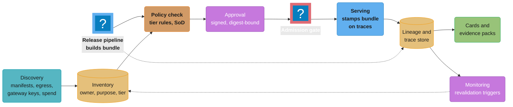
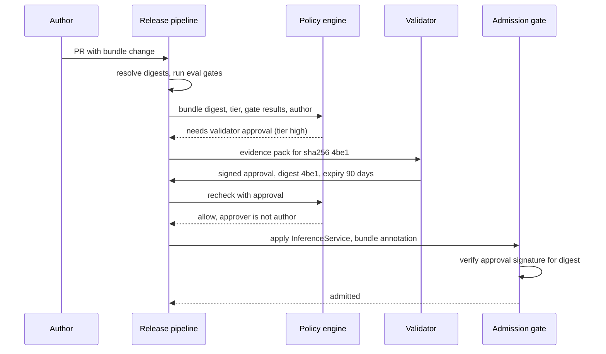
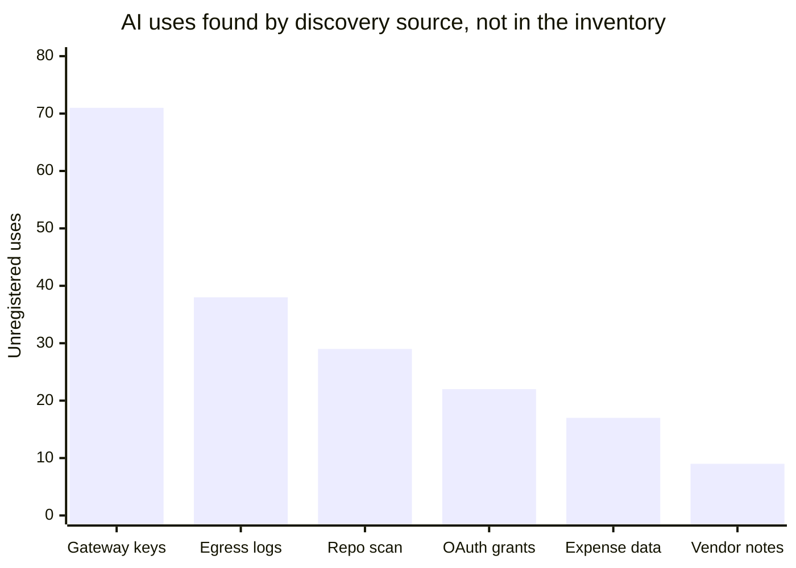

# AI Governance and Model Risk Operations

> **Version anchor (2026-10-18).** Tools appear as examples at the mlops pin-table versions:
> MLflow 3.17.1 (2026-10-13) for registered models, aliases and version tags; Kubeflow Hub
> v0.3.17 (2026-09-21), renamed from Kubeflow Model Registry at v0.3.9, with MCP and Agents
> catalogs added in v0.3.14 and v0.3.16; Kubernetes 1.37 (1.37.1 2026-09-15) for admission;
> OpenSSF Model Signing (`sigstore/model-transparency`) v1.1.1 (2025-10-10) for signed approvals.
>
> **Guidance anchor (fetched 2026-10-18).** SR 26-2 "Revised Guidance on Model Risk Management"
> (Federal Reserve, OCC and FDIC, issued 2026-04-17) supersedes SR 11-7 (2011-04-04) and SR 21-8.
> NIST AI RMF 1.0 (2023-01-26; NIST states it is being revised) and its Generative AI Profile,
> NIST AI 600-1 (2024-07-26). PRA SS1/23, current version effective 2026-04-23. OSFI Guideline
> E-23, published 2025-09-11, effective 2027-05-01. ISO/IEC 42001:2023. EU AI Act application
> dates, including the Digital Omnibus deferrals, are kept on the
> [AI Regulations and Compliance](../../llm/ai_regulations_and_compliance/ai_regulations_and_compliance.md)
> page and are not repeated here.

## 1. Concept Overview

AI governance is the set of controls that decides which AI systems may run, for what purpose,
under whose accountability, and with what evidence. Model risk management (MRM) is the banking
form of the same idea, with supervisory guidance behind it. Both fail the same way: a policy
document, a quarterly committee and a spreadsheet inventory, sitting next to a release pipeline
that ships a prompt change every afternoon.

This module treats governance as an operational system built on the artifacts the rest of the
section versions and gates: an inventory discovered from the platform (models, adapters,
prompts, agents, tool servers, decision schemas, datasets, third-party model APIs), a risk tier
computed per system, model and system cards generated per release, approvals bound to a content
digest with separation of duties, audit evidence produced by queries over lineage and traces and
mapped once to each framework (SR 26-2, PRA SS1/23, OSFI E-23, NIST AI RMF, ISO/IEC 42001, EU
AI Act), vendor model risk for APIs whose weights you never see, and discovery of shadow AI.

The release bundle (defined in
[Artifact Versioning and Lineage](../artifact_versioning_and_lineage/artifact_versioning_and_lineage.md))
is the unit of governance. An approval, a card, a risk tier and an audit record all key on the
bundle digest. Prompt changes enter governance through
[Prompt Lifecycle and Versioning](../prompt_lifecycle_and_versioning/prompt_lifecycle_and_versioning.md),
signature checks through [ML Supply Chain Security](../ml_supply_chain_security/ml_supply_chain_security.md),
and serious-incident handling through
[AI Incident Response and Reliability](../ai_incident_response_and_reliability/ai_incident_response_and_reliability.md).
Whether to buy a governance platform or assemble one is part of
[ML Platform Architecture and Build vs Buy](../ml_platform_architecture_and_build_vs_buy/ml_platform_architecture_and_build_vs_buy.md).

**Not here.** The law itself (EU AI Act risk categories, Annex III, GPAI duties, GDPR Art. 22,
US state laws) and every application date, including the Digital Omnibus changes, live in
[AI Regulations and Compliance](../../llm/ai_regulations_and_compliance/ai_regulations_and_compliance.md).
Fairness metrics, bias mitigation and responsible-AI principles live in
[Fairness and Responsible AI](../../ml/fairness_and_responsible_ai/fairness_and_responsible_ai.md),
with a worked system in
[Responsible AI, Fairness and Explainability](../../ml/case_studies/cross_cutting/responsible_ai_fairness_and_explainability.md).
Explanation methods (SHAP, counterfactuals) live in
[Interpretability and Explainability](../../ml/interpretability_and_explainability/interpretability_and_explainability.md).
Rego, Gatekeeper, Kyverno and Conftest mechanics live in
[Policy as Code and Compliance](../../devops/policy_as_code_and_compliance/policy_as_code_and_compliance.md).
Personal-data handling in prompts, logs and training sets lives in
[Privacy and Data Governance](../../llm/llm_security/privacy_and_data_governance.md).

---

## 2. Intuition

**One-line analogy:** AI governance is an airline's maintenance records system. Every part has a
serial number, a certification, an owner and a log, and a plane does not leave the gate when a
part fitted last night has no signed work order against that serial number.

**Mental model:** three tables joined on one key. The **inventory** says what exists and why
(owner, purpose, tier). The **policy** says what a change at each tier must show (gates, approver
roles, monitoring). The **evidence** says what actually happened (eval results, approvals,
deploy events, traces). The join key is the bundle digest. An audit question is a query over
the three tables, and a governance gap is a row in one table with no partner in another.

**Why it matters:** a bank with 400 models in its MRM inventory and a team shipping 30 prompt
versions a week has two governance systems: the one the auditor sees and the one that runs.
The first time a regulator, a court or a customer asks "which version answered this person, who
approved it, and what did you test", the gap between them is the finding.

**Key insight:** evidence produced at release time from lineage costs almost nothing. Evidence
reconstructed months later for an audit costs weeks of engineer time and is often wrong,
because the alias has moved, the eval set was overwritten and the approver has left. Governance
that runs inside the release pipeline is cheaper than governance that runs beside it, and it is
the only kind whose answers match production.

---

## 3. Core Principles

- **Inventory by discovery, confirmed by owners.** Build the list from deploy manifests,
  registries, gateway keys, egress logs and spend. Owners confirm purpose and tier. A list that
  only teams fill in misses every system whose team skipped the form.
- **Govern the system, not the model file.** A credit assistant is base weights, an adapter, a
  prompt, a retrieval index, three tools and a threshold. A change to any of them can change
  the decision. The inventory entry is the system; the bundle lists its parts.
- **Tier drives everything.** Gates, approver roles, monitoring frequency and revalidation
  triggers come from the tier. Low tiers get automation and a veto window; high tiers get
  independent validation. One process for all tiers is either too slow or too loose.
- **Bind approval to a digest.** An approval of "fraud-scorer" approves nothing. An approval of
  bundle `sha256:4be1...` with an expiry approves exactly what will run.
- **Separate author, approver and deployer.** Effective challenge (SR 26-2's term) needs
  expertise, independence and standing. Enforce the independence part in the toolchain, not in
  a policy PDF.
- **Vendor models are your models.** A third-party API in a decision path carries the same risk
  as one you trained. You cannot validate its weights, so you validate its outputs, pin its
  version and monitor it continuously.
- **Exceptions expire.** Every waiver has an owner, a compensating control and an end date, and
  the gate re-closes on that date without anyone remembering to close it.

---

## 4. Types / Architectures / Strategies

### 4.1 Inventory asset types

| Asset | Identity in the inventory | Typical owner | What makes a change material |
|---|---|---|---|
| Trained model (classic or deep) | Registry name plus version digest | Model team | Retrain, new features, new training window, threshold change |
| Base LLM, self-hosted | Weights digest | Platform team | Any digest change; quantization change |
| Third-party model API | Provider, model id, dated snapshot id | Vendor management plus product team | Snapshot change, alias move, provider retirement |
| Adapter (LoRA) | Adapter digest plus base digest | Product team | Retrain; base change |
| Prompt template | Prompt registry version | Product or content team | Any edit that moves the eval gate |
| Agent | Agent config digest: prompt, model, tool manifest, step limits | Product team | New tool, wider tool permission, step-limit change |
| Tool or MCP server | Image digest plus tool-schema hash | Owning service team | New write action, scope change, schema change |
| Decision schema | Schema version: labels, thresholds, action map | Risk or product owner | New label, threshold move, action remap |
| Dataset and eval set | Snapshot id | Data team | New source, new labeling guideline |
| Embedded vendor feature | Vendor product and feature name | Procurement | Vendor enables AI on an existing product |

The last row is the one inventories miss. A CRM or HR suite that switches on an AI scoring
feature in a release note has added a model to your decision path without a deploy.

### 4.2 Risk tiering schemes

| Scheme | Inputs | Output | Where it comes from |
|---|---|---|---|
| Materiality (SR 26-2) | Inherent risk (assumptions, complexity, data quality), exposure (portfolio size, business impact), purpose (regulatory, financial risk) | Higher materiality, more rigorous oversight | Supervisory guidance for US banks |
| Model risk classification (PRA SS1/23) | Model identification and complexity, materiality | Tiered MRM requirements | UK banks with internal-model approval for capital |
| EU AI Act category | Intended purpose against Annex III and the prohibited list | Prohibited, high-risk, transparency-only, minimal | Law; see the law page |
| Internal composite tier | Decision impact, autonomy, reversibility, affected population, data sensitivity, model opacity | Low, medium, high (plus prohibited) | The organization's own policy |

Most organizations run an internal composite tier and record the external categories as
attributes. The composite tier is the one the pipeline reads. A system that is EU AI Act
high-risk is forced to the high internal tier; the reverse does not hold.

### 4.3 Frameworks and what each asks the pipeline for

| Framework | Type | Scope | What it asks for, in pipeline terms | GenAI coverage |
|---|---|---|---|---|
| SR 26-2 | Supervisory guidance, non-binding | US banks; "most relevant" above $30 billion total assets | Inventory with enough information for individual and aggregate risk; validation before first use (conceptual soundness, outcomes analysis, ongoing monitoring) scaled to materiality; effective challenge; vendor model validation | Generative and agentic AI are explicitly out of scope |
| SR 11-7 (superseded) | Supervisory guidance | US banks | Same three pillars, with a periodic review "at least annually" | Pre-dates GenAI |
| PRA SS1/23 | Supervisory statement | UK banks with internal-model approval for capital | Five principles: identification and classification, governance, development and use, independent validation, risk mitigants | Sub-principle on AI and ML techniques |
| OSFI E-23 | Guideline | Canadian federally regulated financial institutions (banks, insurers, trust and loan companies), from 2027-05-01 | Model risk management across the model lifecycle | The model definition names AI/ML methods |
| NIST AI RMF 1.0 | Voluntary framework | Any organization | GOVERN, MAP, MEASURE, MANAGE; GOVERN 1.6 asks for an AI system inventory | AI 600-1 profile lists 12 GenAI risks |
| ISO/IEC 42001:2023 | Certifiable management system standard | Any organization | AI policy, risk and impact assessment (clause 6), operation (8), monitoring and internal audit (9), Annex A controls | Technology-neutral |
| EU AI Act | Law | Providers and deployers in the EU market | Risk management (Art. 9), data governance (10), technical documentation (11), logs (12), human oversight (14), accuracy and robustness (15), post-market monitoring (72), serious incidents (73) | GPAI duties for model providers |

### 4.4 Approval models

| Model | How it works | Throughput | Fits |
|---|---|---|---|
| Central committee | Every change goes to a monthly MRM or AI review board | 20 to 60 decisions a month | High-tier models with slow change rates |
| Tiered delegation | Low tier auto-approves on gates with a veto window; medium needs a named reviewer; high needs independent validation and a committee | Thousands a month | Mixed portfolios with GenAI release rates |
| Change envelope | Validation approves a range (prompt edits that keep the gate above X, threshold within a band, retrains on the same features); changes inside the envelope ship on gates | Thousands a month inside the envelope | High-change systems whose risk is understood |
| Post-hoc review | Ship, then review a sample | Unbounded | Low tier only, never for decision paths |

---

## 5. Architecture Diagrams

### Governance control plane



The inventory and the release pipeline meet at the policy check: the pipeline brings the bundle,
the inventory brings the tier and owner, and the policy decides what approval is needed.
Everything downstream keys on the bundle digest, so cards, evidence packs and monitoring
alerts describe the bytes that run. Monitoring writes back to the inventory, which is how a
degraded model gets its revalidation date pulled forward.

### Risk tier grid

```
 internal tier = f(decision impact, autonomy); then raised by modifiers

                          autonomy ->
 decision impact          suggests,          decides, human       decides, no human
                          human decides      reviews a sample     in the loop
 -------------------------------------------------------------------------------
 legal or similar         medium             high                 high (or prohibited)
 effect on a person
 (credit, hiring,
 claims, access)
 -------------------------------------------------------------------------------
 money or customer        low                medium               high
 outcome, reversible
 (pricing, routing,
 refunds under cap)
 -------------------------------------------------------------------------------
 internal productivity    low                low                  medium
 (search, drafting,
 summaries for staff)
 -------------------------------------------------------------------------------
 modifiers: +1 tier if special-category data, if the model is a third-party API in the
 decision path with no fallback, or if more than 1M people are affected per year.
 EU AI Act high-risk (Annex III) forces "high" regardless of the cell.
```

The two axes are the ones reviewers argue about least: what the output does to a person and how
much a human stands between the output and the effect. Modifiers raise the tier and never lower
it. A drafting assistant for staff starts low; a refund model with sampled review starts at
medium and moves to high once it touches more than a million customers a year.

### Release approval with separation of duties



The policy engine checks identities, not just the presence of an approval: the approver must
hold the validator role and must not be the author. The admission gate re-verifies the signed
approval against the digest it is about to run, so a manual `kubectl apply` of an unapproved
bundle fails even though it never went through CI.

### One evidence artifact, many frameworks

```
 evidence artifact (generated per bundle)     SR 26-2   SS1/23   NIST RMF   ISO 42001   EU AI Act
 ---------------------------------------------------------------------------------------------
 inventory record (owner, purpose, tier)        ✓         ✓       GOVERN      cl. 6/8     Art. 11
 risk tier worksheet                            ✓         ✓       MAP         cl. 6.1     Art. 9
 eval report vs gate, per slice                 ✓         ✓       MEASURE     cl. 9.1     Art. 15
 data snapshot lineage + datasheet              ✓         ✓       MAP         Annex A     Art. 10
 signed approval bound to digest                ✓         ✓       GOVERN      cl. 8       Art. 17
 monitoring log and alert history               ✓         ✓       MANAGE      cl. 9.1     Art. 72
 decision logs keyed to bundle                  -         -       MANAGE      Annex A     Art. 12
 human-oversight design and override rate       -         -       MANAGE      Annex A     Art. 14
 incident records                               ✓         ✓       MANAGE      cl. 10      Art. 73
 vendor model assessment                        ✓         ✓       GOVERN      Annex A     Art. 25
```

Each row is produced once, by the pipeline, and filed against several frameworks. The columns
are the mapping table a compliance team maintains; the rows are what engineering produces.
A `-` means that framework does not ask for it directly, not that it is useless there.

---

## 6. How It Works - Detailed Mechanics

### 6.1 Inventory record schema

Broken first. This is the inventory most organizations start with: a spreadsheet row, typed by
the model owner at launch.

```
name: Fraud Scorer | owner: j.smith | tier: 2 | last validated: 2025-03 | status: Production
```

Every field is wrong within a year. `j.smith` moved teams. "Fraud Scorer" names three models
behind one alias. "Production" says nothing about which version. The tier was chosen by the
person who wanted fast approval. Nothing links the row to a deploy.

Fixed: a record whose identity fields are derived from the platform and whose judgment fields
are declared, versioned and reviewed.

```yaml
inventory_id: ai-0412
kind: system                       # system | model | vendor_api | agent | tool_server
name: card-fraud-decisioning
purpose: >
  Score card-not-present transactions and decline or step up above threshold.
owner_team: payments-risk          # team, not person; on-call rotation resolves the person
accountable_exec: head-of-fraud
tier:
  internal: high
  computed_from: {impact: money_reversible, autonomy: decides_no_human, people_per_year: 4.1e6}
  external: {eu_ai_act: not_annex_iii, sr_26_2_materiality: high}
  approved_by: mrm-validator-07
components:                        # derived from the live bundle, never typed
  bundle_digest: sha256:4be1c0...
  model: {registry: mlflow, name: fraud-gbdt, version: 31, digest: sha256:77c0...}
  decision_schema: {name: fraud-actions, version: 6}
  vendors: []
validation:
  last: {date: 2026-08-14, report: val-2026-118, outcome: approved_with_findings}
  next_due: 2027-02-14             # computed: tier high -> 6 months, or earlier on trigger
  open_findings: [F-2231]
monitoring:
  dashboard: grafana/fraud-decisioning
  revalidation_triggers: [psi_gt_0.25_two_weeks, decline_rate_shift_gt_15pct, base_change]
exceptions: []
```

Two rules keep the record accurate. Components are written by the release pipeline from the bundle, so the
record cannot name a model that is not running. And a reconciliation job compares the inventory
with discovery (6.9) every night; a live endpoint with no record, or a record with no live
endpoint, opens a ticket for the owner team.

### 6.2 Risk tiering as code

A tier chosen in a meeting drifts with whoever is in the room. A tier computed from recorded
answers is repeatable, and a reviewer can challenge the answers instead of the outcome.

```python
IMPACT = {"internal_productivity": 0, "money_reversible": 1, "legal_effect_on_person": 2}
AUTONOMY = {"suggests": 0, "decides_sampled_review": 1, "decides_no_human": 2}
GRID = [[0, 0, 1], [0, 1, 2], [1, 2, 2]]  # rows: impact, cols: autonomy
TIERS = ["low", "medium", "high"]


def tier(impact, autonomy, *, special_data=False, vendor_no_fallback=False,
         people_per_year=0, eu_high_risk=False) -> str:
    t = GRID[IMPACT[impact]][AUTONOMY[autonomy]]
    t += special_data + vendor_no_fallback + (people_per_year > 1_000_000)
    return TIERS[2 if eu_high_risk else min(t, 2)]


if __name__ == "__main__":
    assert tier("internal_productivity", "suggests", people_per_year=3_000) == "low"
    assert tier("money_reversible", "decides_sampled_review") == "medium"
    assert tier("money_reversible", "decides_sampled_review", people_per_year=2_500_000) == "high"
    assert tier("legal_effect_on_person", "suggests", special_data=True, eu_high_risk=True) == "high"
```

Two design choices matter more than the weights. Modifiers only raise the tier, so a team cannot
answer its way down from a cell. And the answers are stored with the record and versioned, so a
later reviewer sees that `autonomy` was declared `suggests` and can check it against the product,
which is where most mis-tiering is found.

### 6.3 Living model and system cards

A model card describes one model. A system card describes the deployed system: the bundle, its
tools, its human-oversight design and its limits. Both are generated on every release.

| Card section | Source | Updated when |
|---|---|---|
| Identity and components | Bundle manifest | Every release |
| Intended use, out-of-scope use | Declared field in the inventory record, versioned | Purpose change, reviewed |
| Training and eval data | Lineage edges to dataset and eval-set snapshots | Every release |
| Performance by slice | Eval gate results for this bundle | Every release |
| Known limits and open findings | Validation report fields, finding tracker | Validation, finding closure |
| Human oversight | Declared design plus measured override and review rates | Monthly from traces |
| Monitoring and triggers | Monitoring config | Config change |
| Approval | Signed approval record | Every approval |

The card is stored next to the bundle and its digest goes into the approval, so the approver
signs the card they read. A card whose `bundle` field differs from the live bundle is stale by
definition, and the nightly reconciliation flags it.

### 6.4 Separation of duties as policy

Broken: an approval keyed to a model name, checked in CI.

```rego
package governance.release

deny contains msg if {
    input.tier == "high"
    not approved
    msg := "high-tier release needs validator approval"
}

approved if {
    some a in input.approvals
    a.model == input.model_name
    a.role == "model_validator"
}
```

Three holes. An approval for `fraud-gbdt` from March approves every later retrain. The author can
hold the validator role and approve their own change. Nothing expires.

Fixed: the approval names the bundle digest, the approver is not the author or the deployer, the
approval has not expired, and the approval's signature was verified upstream.

```rego
package governance.release

deny contains msg if {
    input.tier == "high"
    not valid_approval
    msg := sprintf("bundle %s has no valid independent approval", [input.bundle_digest])
}

valid_approval if {
    some a in input.approvals
    a.role == "model_validator"
    a.bundle_digest == input.bundle_digest
    a.signature_verified
    a.subject != input.author
    a.subject != input.deployer
    time.parse_rfc3339_ns(a.expires_at) > time.now_ns()
}
```

Run it with Conftest in the pipeline and keep the same rules as the source of truth for the
admission layer. `a.signature_verified` is set by the step that checks the approval with
Sigstore, covered in [ML Supply Chain Security](../ml_supply_chain_security/ml_supply_chain_security.md);
Rego does not verify signatures itself.

### 6.5 Admission gate for model servers

CI can be skipped by anyone with cluster credentials. The admission layer refuses a model server
that carries no governance identity. This Kyverno `ValidatingPolicy` (CEL, `policies.kyverno.io/v1`,
the API the devops page uses) rejects a KServe `InferenceService` without an inventory id, a
bundle digest and a valid tier.

```yaml
apiVersion: policies.kyverno.io/v1
kind: ValidatingPolicy
metadata:
  name: require-ai-governance-identity
spec:
  validationActions: [Deny]
  matchConstraints:
    resourceRules:
      - apiGroups: [serving.kserve.io]
        apiVersions: [v1beta1]
        operations: [CREATE, UPDATE]
        resources: [inferenceservices]
  validations:
    - expression: >-
        has(object.metadata.annotations) &&
        'governance.example.com/inventory-id' in object.metadata.annotations &&
        'governance.example.com/bundle-digest' in object.metadata.annotations &&
        object.metadata.annotations['governance.example.com/bundle-digest'].startsWith('sha256:')
      message: "InferenceService needs inventory-id and a sha256 bundle-digest annotation"
    - expression: >-
        has(object.metadata.labels) &&
        'governance.example.com/risk-tier' in object.metadata.labels &&
        object.metadata.labels['governance.example.com/risk-tier'] in ['low', 'medium', 'high']
      message: "risk-tier label must be low, medium or high"
```

The metadata check is cheap and catches the common case, a hand-applied manifest. The approval
itself is verified as a signed attestation on the bundle artifact at admission, which is the
supply-chain module's mechanism. Start the policy with `validationActions: [Audit]` for two weeks
to list every existing server that would fail, then switch to `Deny`. Exclude the policy
engine's own namespace, or a policy outage blocks the restart that would fix it.

### 6.6 Material change and revalidation triggers

Revalidation on a calendar alone misses the change that matters and repeats work on models
that did not change. The trigger list is part of the policy and is evaluated by the pipeline.

| Change | Low tier | Medium tier | High tier |
|---|---|---|---|
| Retrain, same features and window rules | Gates only | Gates, reviewer | Gates, validator inside the change envelope; full revalidation outside it |
| New feature, new data source | Gates, reviewer | Validator | Full revalidation |
| Base model or provider snapshot change | Gates, reviewer | Validator | Full revalidation |
| Prompt edit, gate passes | Gates only | Gates, reviewer | Gates, validator if any protected slice moves more than the envelope |
| New tool or wider tool permission on an agent | Reviewer | Validator | Full revalidation |
| Threshold or decision-schema change | Reviewer | Validator | Validator plus outcomes analysis |
| Use for a new purpose | Re-tier first | Re-tier first | Re-tier first |
| Monitoring trigger fires | Ticket | Validator review | Validator review, possible restriction |

The last-but-one row is the one SR 26-2 calls out: using a model beyond its intended purpose adds
risk and calls for analysis of the new use. In the pipeline this means the inventory `purpose`
field is part of the bundle's governance context, and a new consumer of an existing endpoint
needs its own inventory record.

### 6.7 Third-party and vendor model risk

SR 26-2 keeps vendor models in scope: the organization validates vendor products, builds an
understanding of the vendor model's design, development data and performance, and runs ongoing
monitoring and outcomes analysis. For a hosted LLM API that means:

| Control | What it looks like for a model API |
|---|---|
| Pin the version | Call a dated snapshot id, never a moving alias. Record the id in the bundle |
| Detect silent change | Fingerprint suite: 200 fixed prompts at temperature 0 hourly, compare output distribution to the baseline |
| Outcomes analysis | The same eval gate as a self-hosted model, run on every snapshot change before switching |
| Contract terms | Notice period for snapshot retirement, data-use and retention terms, region, incident notification |
| Fallback | A second provider or a self-hosted model that passed the same gate, wired through the gateway |
| Concentration | Count systems per provider; one provider behind 60% of high-tier systems is an aggregate risk finding |
| Vendor documentation | Provider model cards and system cards filed against the inventory record |

Aggregate risk is the part single-model reviews miss. SR 26-2 asks for model risk to be assessed
"both individually and in aggregate", including reliance on common data and methods. Forty
systems on one provider snapshot fail together on its retirement date.

### 6.8 Lineage-backed audit queries

An audit question becomes a query when every trace carries the bundle digest and every bundle
has lineage edges. Two questions auditors ask, as Postgres queries over the lineage edge table
from [Artifact Versioning and Lineage](../artifact_versioning_and_lineage/artifact_versioning_and_lineage.md):

```sql
-- Which live systems depend, at any depth, on a dataset snapshot found to be mislabeled?
WITH RECURSIVE downstream AS (
    SELECT dst AS node FROM lineage_edge WHERE src = 'dataset:claims-labels@snap-2026-05-02'
    UNION
    SELECT e.dst FROM lineage_edge e JOIN downstream d ON e.src = d.node
)
SELECT i.inventory_id, i.name, i.tier, b.digest
FROM downstream d
JOIN bundle b ON b.digest = d.node
JOIN inventory i ON i.bundle_digest = b.digest
WHERE b.live;

-- Which bundle decided this applicant's case, who approved it, and what did its gate show?
SELECT t.decided_at, t.bundle_digest, a.subject AS approver, a.signed_at,
       g.metric, g.slice, g.value, g.threshold
FROM decision_trace t
JOIN approval a ON a.bundle_digest = t.bundle_digest
JOIN gate_result g ON g.bundle_digest = t.bundle_digest
WHERE t.case_id = 'APP-2026-118734';
```

The second query is the one that separates governance systems. Without the bundle digest on the
trace, the answer is "the model in production that week", and the approver of that week is a
guess. With it, the answer is one row per fact and takes milliseconds.

### 6.9 Shadow AI discovery

Shadow AI is AI use the inventory does not know about: a team calling a model API with a
personal key, a no-code agent connected to a CRM, an MCP server on a laptop with production
credentials, a vendor feature switched on in a release. Discovery joins several weak signals.

| Source | What it finds | Blind spot |
|---|---|---|
| Egress proxy and DNS logs | Calls to model API hostnames from servers and laptops | Calls through an approved SaaS that proxies the model |
| Expense and card data | Personal or team subscriptions to AI products | Free tiers |
| OAuth grants and SaaS admin logs | AI apps granted access to mail, drive, CRM | Apps installed outside SSO |
| Code and config scanning | SDK imports, API keys, MCP server configs in repos | Code outside the main forge |
| Gateway virtual keys | Who calls what through the sanctioned path | Everything that bypasses it |
| Vendor release notes and contracts | AI features added to existing products | Unannounced features |

The repository scan is a regex pass for SDK imports (`openai`, `anthropic`, `litellm`,
`langchain`), model API hostnames and `"mcpServers"` keys in JSON config, run over every
repository nightly; each hit carries the repository, path and last committer's team.

Each hit is matched against the inventory by repository and owning team. Unmatched hits become
tickets with three outcomes: register it (record, tier, owner), move it onto the sanctioned
gateway path, or shut it down. Blocking without a sanctioned path drives use to personal devices,
where discovery sees nothing. The gateway that becomes the sanctioned path is covered in
[AI Gateway Operations](../ai_gateway_operations/ai_gateway_operations.md).

### 6.10 GenAI inside a model risk program

SR 26-2 states that generative and agentic AI models are not within its scope, while saying the
organization's own risk management should guide controls for anything the guidance does not
cover. It also excludes simple spreadsheet arithmetic and deterministic rule-based processes from
its definition of a model. For a bank this produces three populations:

| Population | Governed by | Validation shape |
|---|---|---|
| Statistical and non-generative ML models | SR 26-2 MRM program | Conceptual soundness, outcomes analysis, ongoing monitoring |
| Generative and agentic systems | The bank's own AI governance policy, often modeled on NIST AI RMF, AI 600-1 and ISO/IEC 42001 | Eval gates per slice, red-team results, human-oversight design, tool permission review |
| Rule engines and spreadsheets | Change management and end-user computing controls | Testing and access control, no model validation |

The trap is reading "out of scope" as "ungoverned". A GenAI assistant that drafts adverse-action
letters still sits in a credit decision path, and a fair-lending exam will ask how it was tested.
The usual answer is one inventory and one tiering rule for all three populations, with the
validation shape chosen per population. NIST AI 600-1's 12 risk categories (confabulation,
information security, value chain and component integration, harmful bias, data privacy and
others) work as the MAP checklist for the generative population.

### 6.11 Agents and tool servers in the inventory

An agent's risk changes when its tools change. The agent's record carries a tool manifest
digest (tools, schemas, permission scopes); a new write-scoped tool is a revalidation trigger and
recomputes the tier. Kubeflow Hub v0.3.17's MCP and Agents catalogs can serve as the registry the
manifest resolves against; the server lifecycle is in
[Agent, Tool and MCP Server Lifecycle](../agent_tool_and_mcp_server_lifecycle/agent_tool_and_mcp_server_lifecycle.md).

### 6.12 Erasure and retrain decisions

When an erasure request reaches a dataset that trained a live model, lineage lists the affected
artifacts and governance records one decision per artifact: retrain without the data, keep with a
recorded legal basis, or retire. The record holds inventory id, bundle digest, legal basis,
approver and date.

---

## 7. Real-World Examples

**JPMorgan Chase, the London Whale (2012).** The bank's own task-force report (January 2013)
found that a new value-at-risk model for the Synthetic Credit Portfolio was built in spreadsheets
with manual copy-and-paste steps, and that a formula divided by a sum where it should have
divided by an average, which understated volatility. Losses reached about $6.2 billion, and the
bank paid about $920 million in penalties to US and UK regulators in 2013. The governance lesson
is not "check formulas"; it is that the model was approved and put into use with weak
implementation testing and without effective challenge.

**Air Canada chatbot (2024).** In Moffatt v. Air Canada, a British Columbia tribunal held the
airline responsible for a fare policy its website chatbot invented. The governance point is that a
deployer owns its assistant's outputs, so a customer-facing assistant needs an inventory record,
an owner and tested limits. The incident itself is covered in
[AI Incident Response and Reliability](../ai_incident_response_and_reliability/ai_incident_response_and_reliability.md).

**Samsung (2023).** After engineers pasted internal source code and meeting notes into a public
chatbot in separate incidents in spring 2023, Samsung restricted generative AI tools on company
devices. It is the reference case for shadow AI: the risk came from use that no inventory
listed, and the first response was a block, followed by work on an internal sanctioned tool. The
gateway control that allows such tools instead of banning them is in
[AI Gateway Operations](../ai_gateway_operations/ai_gateway_operations.md).

**Mobley v. Workday.** A job applicant sued the HR software vendor over AI screening. In 2024 a
US federal court let claims proceed on the theory that the vendor could be liable as an agent of
the employers using its screening, and in 2025 the court allowed age-discrimination claims to
proceed as a collective action. For deployers, the case is why vendor AI in a hiring path is an
inventory item with its own validation, not a procurement checkbox.

---

## 8. Tradeoffs

### Inventory source

| Approach | Coverage | Accuracy of components | Effort | Fails when |
|---|---|---|---|---|
| Self-declared spreadsheet | What teams remember | Drifts within months | Low to start, high to maintain | Any audit that samples production |
| Registry-derived | Everything registered | Exact for registered models | Medium | Prompts, vendor APIs and agents outside the registry |
| Discovery plus registry, owner-confirmed | Close to complete | Exact for components, declared for purpose | High once, low after | Discovery signals are not maintained |

### Build vs buy for the governance layer

| Option | Strength | Weakness |
|---|---|---|
| Commercial governance platform | Workflow, policy packs, questionnaires, reporting ready on day one | Sees only what you feed it; integration with your registry, gateway and traces is the real work |
| Assembled from registry, policy engine and lineage store | Evidence comes from production data by construction | Workflow and reporting UIs to build and staff |
| Hybrid | Platform for workflow and reporting, pipeline for evidence | Two sources of truth unless the platform reads from the pipeline |

---

## 9. When to Use / When NOT to Use

**Build the full operational system when:**

- The organization is a regulated financial institution with an MRM function, or deploys
  EU AI Act high-risk systems.
- AI outputs make or shape decisions about credit, employment, insurance, health, housing or
  access to services.
- Release rates are high (weekly prompt and adapter changes), so a document-based process cannot
  keep up and teams will route around it.
- More than a handful of teams build AI features, so nobody can name every system from memory.
- Customers or auditors ask for ISO/IEC 42001 certification or AI governance attestations.

**Keep it light when:**

- A small company runs a few internal productivity assistants with no decision authority.
  A one-page inventory, a gateway with virtual keys and an owner per tool are enough.
- A prototype has no production users. Register it when it gets its first external user.

**Do not** route every prompt edit to a monthly committee, build a governance UI before the
inventory is derived from production, or treat certification as the goal: a certified management
system with a self-declared inventory passes the audit and misses the system that causes the incident.

---

## 10. Common Pitfalls

**Inventory counted, not discovered.** A bank's MRM inventory listed 410 models and had passed
two internal audits. A discovery pass over deploy manifests, gateway keys and egress logs found
1,130 distinct model endpoints and API consumers, of which about 300 were GenAI uses created in
the previous 18 months. None was malicious; none had a tier. Fix: discovery feeds the inventory
nightly, and the audit samples production, not the list.

**Approval bound to a name.** A credit-line model was approved as `limit-model` in March. Over
the next six months the team shipped nine retrains through the same alias, each passing an
AUC gate. An outcomes analysis in September found approval rates for one age band had drifted
4 points; none of the nine versions had been seen by a validator. Fix: approvals key on the
bundle digest and expire; retrains inside the change envelope are summarized to the validator
monthly.

**The validator queue becomes the bottleneck.** Twelve validators, each completing about four
full validations a month, faced 140 requests a month after GenAI features took off. Median wait
reached 11 weeks, and two product teams started shipping through an "experiment" flag that
skipped governance. Fix: tiered delegation and change envelopes, which cut full validations to
about 35 a month; the rest shipped on gates with reviewer sign-off.

**Vendor alias moved.** A claims-triage assistant called a provider's model alias. The provider
pointed the alias at a newer snapshot; triage accuracy on one claim type dropped from 91% to 84%,
and nobody linked it to a change because no deploy happened. Fix: pin snapshot ids, run a
fingerprint suite against the provider hourly, and treat a snapshot change as a material change.

**Exceptions without expiry.** A waiver let a fraud model skip a fairness slice "until the label
fix lands". The label fix landed; the waiver stayed for 19 months and was cited in three later
approvals as precedent. Fix: every exception has an end date, and the policy check fails after
it without manual action.

**GenAI out of scope read as ungoverned.** After SR 26-2 excluded generative and agentic AI from
MRM scope, one business line dropped its GenAI assistants from validation entirely. An exam on
complaint handling then asked how the assistant that drafted customer responses had been tested.
Fix: one inventory and one tiering rule for all AI; the validation shape differs by population,
not the existence of governance.

---

## 11. Technologies & Tools

| Tool | Role | Notes |
|---|---|---|
| MLflow | Registered models, version tags, aliases, prompt registry | 3.17.1. Version tags carry `inventory_id` and bundle digest; aliases are resolved to versions before approval |
| Kubeflow Hub | Model, MCP server and agent catalogs on Kubernetes | v0.3.17. Renamed from Kubeflow Model Registry at v0.3.9 |
| OPA | Policy engine for release rules in Rego | Same rules in CI and at admission |
| Conftest | Runs Rego against bundle manifests and approval records in CI | Fast feedback at PR time |
| Kyverno | Admission policies in CEL (`ValidatingPolicy`, `ImageValidatingPolicy`) | Metadata and attestation checks on `InferenceService` |
| Gatekeeper | OPA-based admission with ConstraintTemplates | Alternative to Kyverno |
| model-transparency | OpenSSF Model Signing for weights and approval attestations | v1.1.1 |
| OpenLineage | Lineage run events for datasets and jobs | Feeds the lineage store the audit queries read |
| ValidMind | Model risk management and validation documentation | Cites SR 26-2 |
| Credo AI | AI registry, policy packs, shadow AI discovery | Policy packs for EU AI Act, ISO/IEC 42001, NIST AI RMF |
| IBM watsonx.governance | AI governance platform | Shadow AI detection, risk management, policy enforcement |

Framework texts are not tools; their scope and dates are in the guidance anchor at the top of
this page. The admission mechanics are taught in
[Policy as Code and Compliance](../../devops/policy_as_code_and_compliance/policy_as_code_and_compliance.md).

---

## 12. Interview Questions with Answers

**Q: The model inventory has 400 entries and passed last year's audit. Why is that not evidence that it is complete?**
**Short:** A declared inventory lists what teams chose to register; completeness needs discovery from deploys, gateways, egress logs and spend.

An audit that samples the inventory and checks each entry's documentation proves the entries are
documented, not that every model is listed. Prompts, vendor APIs, agents and AI features switched
on inside SaaS products rarely get registered by hand. The fix is to derive the inventory from
deploy manifests, registries and gateway keys, add egress, OAuth and expense signals for what
bypasses the platform, and reconcile nightly. Ask the auditor to sample production endpoints and
trace each back to a record, which is the test that finds gaps.

**Q: An approval was recorded for "fraud-scorer v12". Why can the model serving traffic still be unapproved?**
**Short:** A name or alias can point at different bytes over time; only an approval bound to the bundle digest, with an expiry, approves what runs.

Aliases and mutable tags move by design, and a retrain can reuse a version label in a registry
that allows it. The approval also says nothing about the prompt, threshold or tools that changed
around the model. Bind each approval to the bundle digest, sign it, give it an expiry, and make
the admission layer and the serving runtime check that the digest they run is the digest that
was approved. A version string in a ticket is a description, not a control.

**Q: SR 26-2 puts generative and agentic AI outside its scope. Does a bank's GenAI assistant then need no model risk governance?**
**Short:** No; the guidance says the bank's own risk management should cover what it excludes, and exams still ask how a GenAI system in a decision path was tested.

SR 26-2 excludes generative and agentic models because they are "novel and rapidly evolving", not
because they are low risk. A GenAI assistant drafting adverse-action letters or complaint
responses is still part of a regulated process. Keep one inventory and one tiering rule for all
AI, and choose the validation shape by population: conceptual soundness and outcomes analysis
for statistical models, eval gates, red-team results and oversight design for generative systems.
NIST AI RMF, AI 600-1 and ISO/IEC 42001 give the vocabulary for the generative side.

**Q: A vendor says its model is validated. What can you validate when you cannot see the weights?**
**Short:** Outputs and behavior: run your own eval gate per slice, pin the snapshot, monitor outcomes continuously and review the vendor's documentation and contract terms.

SR 26-2 keeps vendor products in scope and expects an understanding of the vendor model's design,
development data and performance plus ongoing monitoring and outcomes analysis. For an API that
means a gate on your own labeled data, a pinned snapshot id in the bundle, an hourly fingerprint
suite that detects silent changes, contract terms for change notice and data use, and a fallback
that passed the same gate. The vendor's validation report is evidence to file, not a substitute
for testing in your context.

**Q: Why is a model card written at launch a liability a year later?**
**Short:** It describes a model that no longer runs; after retrains and prompt changes it misstates data, slices and limits, and auditors treat it as unreliable documentation.

A card typed once drifts with every retrain, threshold move and prompt edit. An auditor who finds
one card that contradicts the registry widens the scope to every card. Generate cards on every
release from the bundle manifest, lineage edges and eval results, keep human-written fields
(intended use, known limits) as versioned fields, and store the card's digest in the approval so
the approver signs what they read. A card whose bundle differs from the live one is an alert.

**Q: A prompt edit changes how a credit-servicing assistant answers hardship questions. Is that a model change that needs revalidation?**
**Short:** It is a material change if it moves the behavior the validation relied on; the policy decides by gate results and tier, not by artifact type.

The decision path changed even though the weights did not. Treat the prompt as a bundle component,
run the same eval gate with protected slices, and compare against the change envelope the
validator approved. Inside the envelope it ships with a reviewer; outside it, or touching a slice
the validator flagged, it goes back to validation. Calling prompts "content" and exempting them
is the most common way GenAI changes escape governance.

**Q: How do you enforce separation of duties when one engineer can write, approve and deploy through CI?**
**Short:** Encode it in policy: the approver must hold the validator role, differ from the author and deployer, and sign an approval bound to the digest.

A policy PDF does not stop a self-approval; a Rego rule that compares `approval.subject` with the
commit author and the deploy identity does. Signed approvals stop a forged record, and admission
re-verification stops a deploy that skips CI. Role membership comes from the identity provider,
and the validator group is managed outside the product team. Break-glass exists, but it is logged,
time-boxed and reviewed within a set number of days.

**Q: What does SR 26-2 change compared with SR 11-7?**
**Short:** It replaces SR 11-7 with risk-based, non-binding guidance most relevant to banks over $30 billion in assets, drops the fixed annual review, and excludes generative and agentic AI.

SR 26-2 (April 2026, Federal Reserve, OCC and FDIC) supersedes SR 11-7 and SR 21-8. It keeps the
core: inventory, validation through conceptual soundness, outcomes analysis and ongoing
monitoring, effective challenge, and vendor model validation. It frames model risk as inherent
risk set against materiality (exposure and purpose), lets validation timing vary with the model,
excludes spreadsheets and deterministic rules from the model definition, and says non-compliance
alone does not bring supervisory criticizm. SR 11-7 asked for a periodic review at least annually.

**Q: How do you assign a risk tier to an AI system?**
**Short:** From recorded answers on decision impact and autonomy, raised by modifiers such as sensitive data, vendor dependence and scale, with legal categories forcing the top tier.

Compute the tier in code from a questionnaire whose answers are stored and versioned, so a
reviewer challenges the answers rather than the outcome. Impact (what the output does to a person)
and autonomy (how much a human stands between output and effect) set the base cell. Modifiers
only raise it. EU AI Act high-risk status forces the top tier. Recompute on any change to purpose,
tools or autonomy, which is where most mis-tiering appears.

**Q: ISO/IEC 42001, NIST AI RMF and the EU AI Act all ask for documentation. How do you avoid running three compliance programs?**
**Short:** Produce each evidence artifact once in the pipeline and keep a mapping table from artifacts to each framework's clauses and articles.

The frameworks ask overlapping questions: inventory, risk assessment, testing, monitoring,
incidents, oversight. One eval report answers NIST MEASURE, ISO/IEC 42001 clause 9 and EU AI Act
Art. 15; one monitoring log answers MANAGE, clause 9 and Art. 72. Engineering produces the rows;
compliance maintains the column mapping. Separate programs per framework produce three versions of
the same fact, and the auditor finds the one that disagrees.

**Q: Should a governance deploy gate run in CI or at admission?**
**Short:** Both: CI gives early feedback with full bundle context, and admission is the check a manual deploy cannot skip.

CI has the approvals, gate results and author identity, so it can evaluate the full policy at PR
time. Anyone with cluster credentials can skip it. Admission sees only the object being applied,
so it checks metadata (inventory id, bundle digest, tier) and verifies signed attestations. Start
admission in audit mode to list what would fail, exclude the policy engine's namespace, and test
what happens when the engine is down before switching to deny.

**Q: How do you find shadow AI in a company of 20,000 people?**
**Short:** Join weak signals: egress and DNS logs, expense data, OAuth grants, code and config scans, gateway keys and vendor release notes, then match each hit to the inventory.

No single signal is complete. Egress misses SaaS that proxies the model, expense data misses free
tiers, code scans miss tools outside the forge. Match each hit to a team and an inventory record;
unmatched hits get one of three outcomes: register, move onto the sanctioned gateway, or shut down.
Provide the sanctioned path before blocking, or use moves to personal devices where discovery sees
nothing, which is the pattern after Samsung's 2023 restriction.

**Q: What makes an audit "lineage-backed", and what question does it answer that a document review cannot?**
**Short:** Every trace carries the bundle digest and every bundle has lineage edges, so "which version decided this case and who approved it" is a query.

A document review shows that a process exists. A lineage-backed audit shows what happened to a
specific case: the bundle that decided it, the data that trained it, the gate results it passed and
the approver who signed it. It also answers blast-radius questions, such as which live systems
depend on a dataset snapshot found to be mislabeled. Without the digest on the trace, both answers
are reconstructions from deploy logs and memory.

**Q: When can a model run before its validation is complete?**
**Short:** When an urgent business need is documented and the model runs under recorded limits and closer monitoring, with a deadline after which it stops.

SR 26-2 recognizes that urgent needs may require use before validation completes, with more
attention to limits, informed stakeholders and controls such as usage caps. In the inventory this
is a conditional-use state with a deadline, a cap (traffic share, exposure limit, human review of
every decision) and an owner. Without the deadline, conditional use becomes permanent for the
models that are busiest and riskiest.

**Q: How do you govern an agent whose tool set changes without any model or prompt change?**
**Short:** Put a tool manifest digest in the agent's bundle and treat a new or wider write-scoped tool as a material change that recomputes the tier.

The agent's risk comes from what it can do. Adding a refund or account-change tool raises autonomy
over money, which can move the tier from medium to high without any model change. Record tools,
schemas and permission scopes in the bundle, check the tool schema hash at startup, and route
write-scope additions to validation. Read-only tool additions can ship on gates and a reviewer.

---

## 13. Best Practices

- Derive inventory components from the release pipeline and reconcile against discovery nightly.
- Register systems, not files: one record per deployed AI system, listing its components by digest.
- Compute the risk tier in code from versioned answers; let modifiers raise it and never lower it.
- Bind every approval to a bundle digest, sign it, give it an expiry, and verify it at admission.
- Enforce author, approver and deployer separation in policy, with roles from the identity provider.
- Generate model and system cards per release; keep human-written fields versioned inside the record.
- Use change envelopes for high-change, high-tier systems so validators review ranges, not every release.
- Treat prompts, thresholds, tools and vendor snapshots as material-change candidates, decided by gates.
- Pin vendor snapshot ids, fingerprint providers continuously, and count systems per provider for aggregate risk.
- Map each evidence artifact to every framework once; do not run a separate program per framework.
- Give every exception and every conditional use an end date the policy engine enforces.
- Provide a sanctioned AI path (gateway, approved tools) before blocking shadow AI.
- Run admission policies in audit mode first and exclude the policy engine's own namespace.

---

## 14. Case Study

### Lineage-backed governance for a regional insurer

**Scenario.** A regional insurer with 9 million policies runs 340 registered models (pricing,
claims triage, fraud, reserving) and, by 2026, about 60 GenAI features: a claims-notes summarizer,
an underwriting assistant, a broker email triage agent with four tools, and a customer chat
assistant. It operates in the EU and the UK. Governance was a model risk committee meeting
monthly, a spreadsheet inventory and Word-document model cards.

**Before.** A self-declared 340-row inventory refreshed yearly; committee review for every
model change, median 7 weeks to a decision; GenAI under an "innovation exemption" with no expiry;
annual audit preparation took 6 weeks from 14 people, mostly reconstructing which version ran when.

**Trigger.** A claims-triage assistant began routing water-damage claims to the low-priority queue
more often. Complaints rose 30% in that category over five weeks. The investigation took three
weeks to establish that a provider alias had moved to a new snapshot and that a prompt edit two
weeks earlier had removed an instruction about property damage. Neither change had passed any
governance step, and the inventory listed the assistant as "pilot".

**Discovery results.** The first discovery pass joined gateway keys, egress logs, expense data,
OAuth grants and repository scans.



186 unregistered uses, after de-duplication 141 distinct systems. 97 were registered and tiered,
31 moved onto the gateway with team keys, 13 were shut down. Gateway keys found the most because
the gateway had been rolled out a year earlier without an inventory link; vendor release notes
found the fewest but included two AI scoring features switched on inside the policy
administration system.

**After.**

| Change | Effect |
|---|---|
| Inventory derived from bundles plus nightly discovery | 468 systems tracked (340 plus 128 registered or moved onto the gateway); new unregistered uses fell to about 4 a month, each ticketed within a day |
| Computed tiers | 52 high, 147 medium, 269 low; 23 systems moved up a tier from their self-declared one |
| Tiered delegation and change envelopes | Full validations fell from about 60 a month to 18; median decision time for medium tier 2 days |
| Approvals bound to bundle digest, verified at admission | Two manual deploys of unapproved bundles blocked in the first quarter |
| Vendor snapshots pinned, hourly fingerprint suite | The next provider alias change was detected in 40 minutes and never reached traffic |
| GenAI exemption replaced by one tiering rule | The claims-triage assistant became high tier; prompt edits now run a per-peril eval gate |
| Evidence packs generated per bundle | Audit preparation fell from 6 weeks with 14 people to 3 days with 2 |

**What the team did not build.** A custom governance UI. The insurer bought a governance platform
for questionnaires, workflow and committee reporting, and had it read inventory, approvals and
evidence from the pipeline's store instead of keeping its own copy. The one rule written into the
contract was that the platform never becomes the source of truth for components.

**What remained hard.** Purpose drift. Three teams started using the underwriting assistant's
endpoint for broker correspondence, a different purpose with a different tier. Discovery saw the
traffic but not the purpose. The fix was organizational: each gateway key is issued against an
inventory record, so a new consumer must register a purpose before it gets a key.

**Related modules.** The bundle and lineage store are in
[Artifact Versioning and Lineage](../artifact_versioning_and_lineage/artifact_versioning_and_lineage.md);
prompt review flow in
[Prompt Lifecycle and Versioning](../prompt_lifecycle_and_versioning/prompt_lifecycle_and_versioning.md);
signed approvals in [ML Supply Chain Security](../ml_supply_chain_security/ml_supply_chain_security.md);
the complaint-spike response in
[AI Incident Response and Reliability](../ai_incident_response_and_reliability/ai_incident_response_and_reliability.md).
