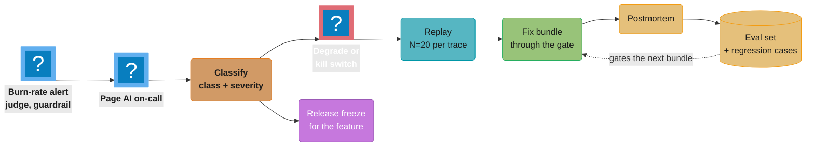
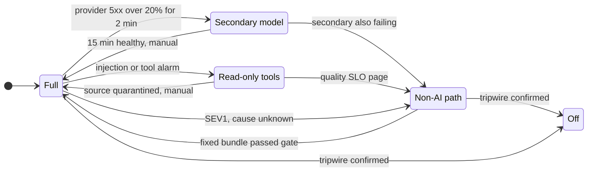

# AI Incident Response and Reliability

> **Version anchor (2026-10-18).** **LiteLLM v1.106.0** (2026-10-18) and **Agent Router v1.2.0**
> (2026-10-07, the renamed Envoy AI Gateway, CRDs and API group unchanged) are the gateways where
> the kill switches and spend breakers on this page run. **Langfuse v4.63.0** (2026-10-16) and
> **Arize Phoenix v20.23.0** (2026-10-16) hold the traces the replay harness reads.
> **Argo Rollouts v1.10.1** (2026-10-12) runs the automated rollback step. The OTel GenAI
> semantic conventions moved to `open-telemetry/semantic-conventions-genai`, which states no
> stability level, so this page claims none. PagerDuty, incident.io, OpenFeature and
> LaunchDarkly have no pin in this section and are named without a version. EU AI Act article
> numbers come from the Regulation text; its application dates live on the law page linked below.

## 1. Concept Overview

AI incident response is the part of operations that handles failures where the system is up,
fast and wrong. A web service fails by returning 500s. An AI feature fails by returning a fluent,
well-formatted, confident answer that is false, unsafe, leaked from another tenant, or produced by
an agent that has been looping for six hours at $40 an hour. Health checks pass. Latency SLOs pass.
The first signal is often a customer screenshot on social media.

This module owns five things:

- **AI SLOs.** Availability and time to first token (TTFT) on every request; quality, safety
  and cost on a judged sample; an error budget for each.
- **Incident classes.** Nine of them, from quality regression to poisoned fine-tune, each with
  its own detection signal and first action.
- **Replay.** What to record so a non-deterministic failure can be re-run, and how to read one
  that reproduces 3 times in 20.
- **Kill switches and degradation modes.** Smaller model, cached answers, non-AI path, off, and
  the release freeze that holds while an incident is open.
- **Postmortems and reporting.** AI fields in the postmortem, public AI incident databases, and
  EU AI Act serious-incident reporting.

Quality signals come from
[Production Quality Monitoring and Drift](../production_quality_monitoring_and_drift/production_quality_monitoring_and_drift.md).
The rollback that ends most incidents is a bundle-digest flag write, defined in
[AI Release Engineering](../ai_release_engineering/ai_release_engineering.md). Kill switches,
fallback chains and spend limits are enforced in the gateway described in
[AI Gateway Operations](../ai_gateway_operations/ai_gateway_operations.md). Spend anomalies feed
[AI Cost Engineering and Unit Economics](../ai_cost_engineering_and_unit_economics/ai_cost_engineering_and_unit_economics.md),
and incident records feed the inventory and evidence trail in
[AI Governance and Model Risk Operations](../ai_governance_and_model_risk_operations/ai_governance_and_model_risk_operations.md).

**Not here.** Incident command roles, severity tiers, on-call rotations, escalation policy and the
blameless postmortem template live in
[Incident Management and On-Call](../../devops/incident_management_and_oncall/incident_management_and_oncall.md).
SLI, SLO, SLA, error budget policy and multi-window burn-rate alerting for ordinary services live
in [SRE Principles and SLOs](../../devops/sre_principles_and_slos/sre_principles_and_slos.md),
with the arithmetic worked in
[SLO and Error Budget Math](../../devops/case_studies/cross_cutting/slo_error_budget_math.md).
This page covers only what changes when the failing component is a model, a prompt, an index or
an agent.

---

## 2. Intuition

**One-line analogy:** an AI incident is a food-poisoning outbreak, not a power cut. The kitchen
is open, plates go out on time, and you learn about the problem from the people who ate.

**Mental model:** every AI incident has three lags.

- **Detection lag:** seconds for a 500; an hour at best for a regression seen by a judge on a 1%
  sample; days if the only signal is user complaints.
- **Attribution lag:** time to name the artifact that changed. A provider can change behavior
  with no change on your side, so "what did we deploy" can return nothing.
- **Reversal lag:** seconds for a prompt alias, as long as a snapshot load for a reindex, never for
  a leaked answer or an issued refund.

**Why it matters:** SRE tooling assumes failures are visible on every request and reversible by
redeploy. AI failures are visible on a sample, lag the cause, and can come from a vendor.

**Key insight:** design the response around the reversal lag. Every AI feature needs a
degradation mode it can drop into in under a minute without knowing the root cause. Root cause
comes later, from a replay.

---

## 3. Core Principles

**Mitigate before you diagnose.** Drop to a degraded mode first, then investigate. A support
assistant at 2 million turns a day serves about 1,400 turns a minute. If a bad bundle makes 20%
of them wrong, a 40-minute root-cause hunt before mitigation is about 11,000 bad answers.

**Every AI feature has a kill switch that does not depend on the AI path.** The switch is a
runtime flag read per request, with a last-known-good cache, and its fallback path calls neither
the same provider nor the same model.

**Quality and safety are SLOs, with budgets.** "Groundedness at least 95% of judged turns over
28 days" is an SLO in the same sense as "99.9% of requests succeed". It is measured differently
(sampled, judged, lagged), so its alert windows differ, but it gets a budget and a policy.

**Record enough to replay.** Each request logs the bundle digest, the provider model id returned
in the response, sampling parameters, the retrieved chunk ids and content hashes, and every tool
result. Without these, a reported failure is an anecdote.

**Treat the provider as a component that changes without a deploy.** Pin dated model ids, probe
the provider on a schedule with a fixed prompt set, and alarm on drift in the probe results.

**Every postmortem adds eval cases.** The traces that caused the incident go into the eval set as
regression cases, so the gate in
[Evaluation Gates and Eval Sets](../evaluation_gates_and_eval_sets/evaluation_gates_and_eval_sets.md)
fails the next bundle that repeats the failure.

---

## 4. Types / Architectures / Strategies

### 4.1 AI SLO families

| SLO family | SLI (example) | Measured on | Typical target | Alert lag |
|---|---|---|---|---|
| Availability | Requests that return a usable response (not 5xx, not timeout, not empty) | Every request | 99.5-99.9% over 30 days | 1-5 min |
| TTFT | Streaming requests with first token under 1.5 s, measured at the gateway | Every request | 99% | 1-5 min |
| End-to-end latency | Agent runs finished under 60 s | Every run | 95% | 5-15 min |
| Quality | Sampled turns that pass the judge rubric (grounded, on task) | 1-5% sample, LLM judge | 92-97% over 28 days | 30-60 min |
| Safety | Sampled outputs with no policy violation | Guardrail on every output, judge on a sample | 99.95% | 5-30 min |
| Safety tripwire | Confirmed cross-tenant leak, CSAM, credential in output | Every output (classifier) plus reports | Zero | Immediate |
| Cost | Cost per successful task under a ceiling; daily spend within 1.3x forecast | Every request (tokens times price) | 99% of days | 15-60 min |

### 4.2 Incident classes

| Class | What happens | First signal | First action | Reversal |
|---|---|---|---|---|
| Quality regression | A bundle change lowers task success or judge pass rate | Judge pass rate, thumbs-down rate, escalation rate | Flag back to the previous bundle digest | Seconds |
| Hallucination spike | Ungrounded claims rise, often after a retrieval or prompt change | Groundedness judge, citation-valid rate | Roll back the changed artifact; raise the refusal threshold | Seconds to hours |
| Provider outage | Hosted API errors or times out | 5xx and timeout rate, provider status page | Fail over to a secondary provider or a self-hosted model | Seconds |
| Silent provider model change | Same model id, different behavior (weights, serving stack, routing) | Scheduled probe set drifts; `model` or `system_fingerprint` field changes | Pin or switch provider; re-run the gate | Hours to days |
| Prompt-injection campaign | Crafted inputs or documents steer the model or its tools | Guardrail hit spike, unusual tool destinations, one document in many bad traces | Quarantine the source; disable the affected tool | Minutes |
| Output data leak | Output contains another user's or tenant's data, or secrets | PII and secret scanners on output, user report | Kill the path; purge caches; start breach process | Never for leaked data |
| Runaway agent or cost | Agent loops, retries or fans out without bound | Spend rate per key, steps per run, repeated tool-call hashes | Breaker on the key; cap steps | Spend is gone |
| Bad reindex | New index snapshot has bad chunks, stale docs or a mismatched embedding model | Retrieval hit rate, groundedness, empty-context rate | Point the index alias at the previous snapshot | Minutes if N-1 is warm |
| Poisoned fine-tune | Training data carried injected or mislabeled samples; a trigger produces bad output | Trigger-specific failures, red-team probe, lineage alert | Roll back the adapter; quarantine the dataset version | Minutes for serving, weeks for retraining |

Index snapshot aliases are in
[RAG and Vector Index Lifecycle](../rag_and_vector_index_lifecycle/rag_and_vector_index_lifecycle.md);
dataset lineage for the poisoned fine-tune query is in
[Artifact Versioning and Lineage](../artifact_versioning_and_lineage/artifact_versioning_and_lineage.md).

### 4.3 Degradation modes

Full, secondary model (smaller or other provider), read-only tools, cached answers, non-AI path
(search, form, human queue) and off. Their cost, quality and prerequisites are compared in §8.

### 4.4 Severity for AI incidents

Severity uses the four tiers from the devops page. The inputs are AI-specific.

| Input | Low | High |
|---|---|---|
| Harm | Wrong tone, verbosity | Money moved, legal or medical advice wrong, personal data exposed |
| Reach | One tenant, under 0.1% of turns | All tenants, over 1% of turns |
| Reversibility | Answer only, user can retry | Side effect done (refund, email, record write), data disclosed |
| Detectability by the user | User sees the answer is wrong | Answer looks right and the user acts on it |

A confirmed tripwire is SEV1 regardless of reach. Any incident with irreversible side effects at
over 0.1% of turns is at least SEV2.

---

## 5. Architecture Diagrams

### Incident path from signal to eval case



Mitigation comes before replay: the kill switch is pulled on the class and severity alone. The
dotted edge is the reason postmortems exist here: the failing traces become eval cases that block
the next bundle repeating the failure.

### Degradation modes as a state machine



Automatic transitions only go down. Every move back to Full is a human decision after
verification, because automatic flip-flopping between modes is itself an incident.

### Incident class versus detection signal

```
                              gateway  output    sampled  provider  product  lineage
                              metrics  scanner   judge    probes    signals  alerts
quality regression               .        .        ✓         .        ✓        .
hallucination spike              .        .        ✓         .        ✓        .
provider outage                  ✓        .        .         ✓        .        .
silent provider model change     .        .        ✓         ✓        ✓        .
prompt-injection campaign        .        ✓        ✓         .        .        .
output data leak                 .        ✓        .         .        ✓        .
runaway agent or cost            ✓        .        .         .        .        .
bad reindex                      ✓        .        ✓         .        ✓        ✓
poisoned fine-tune               .        .        ✓         .        .        ✓
```

Only three of nine classes show up in gateway metrics, the signal that ordinary service
monitoring is built on. The sampled judge column covers six classes, which is why a quality SLO
is the core of AI incident detection and not an add-on.

---

## 6. How It Works - Detailed Mechanics

### 6.1 The SLO set as code

Each AI feature declares its SLOs next to its bundle. The quality and safety SLIs name the judge
version, because changing the judge changes the measurement.

```yaml
feature: support-assistant
slos:
  - name: availability
    sli: good = status in [200] and output_tokens > 0
    target: 0.998
    window: 30d
  - name: ttft
    sli: good = ttft_ms < 1500        # measured at the gateway, first SSE chunk
    target: 0.99
    window: 30d
  - name: quality
    sli: good = judge.verdict == "pass"
    judge: grounded-and-resolved@v7   # calibrated against 600 human labels, kappa 0.81
    sample_rate: 0.01
    target: 0.95
    window: 28d
  - name: safety
    sli: good = guardrail.violation == false
    target: 0.9995
    window: 28d
tripwires:                            # one confirmed case = SEV1, no budget
  - cross_tenant_data
  - credential_in_output
  - csam_classifier_positive
```

TTFT is measured at the gateway on the first server-sent event that carries content, not on the
HTTP response headers. Some serving stacks flush headers and an empty chunk immediately, so
header-based TTFT reads lower than what the user sees.

### 6.2 Quality budget arithmetic and alert windows

Worked numbers for the support assistant: 1,500,000 turns a day, a 1% judged sample (15,000 a
day, 625 an hour), SLO 95% over 28 days. The budget is 5% of 420,000 judged turns, or 21,000
failing turns. The baseline fail rate is 3.4% (part of it judge error), a 0.68x burn rate.

For availability, the standard fast-burn page is 14.4x burn over 1 hour (2% of a 30-day budget).
For a 95% quality SLO, 14.4x burn means a 72% failure rate. A real quality regression lands at
8-20% failing, so a 14.4x rule never fires. The quality burn-rate rules (3x over 6 hours pages,
1.5x over 3 days opens a ticket, a minimum sample count per window) are defined in
[Production Quality Monitoring and Drift](../production_quality_monitoring_and_drift/production_quality_monitoring_and_drift.md)
§6.11. For this SLO, 3x is a 15% fail rate and 1.5x is 7.5%. Incident response adds one faster
page, 6x over 1 hour (30% failing, 0.9% of the 28-day budget), wired to auto-degrade, plus a
30-minute and a 10-minute short window that stop each alert firing for hours after recovery.

Sample size sets how short a window can be: at 625 judged turns an hour and a 3.4% baseline the
standard error is about 0.7 points, so 1 hour separates 3.4% from 6% but not from 4.5%, and 10 minutes (104 turns) sees only
8.7% or more. A 20,000-turn-a-day feature at 1% gets 8 judged turns an hour and cannot have an
hourly quality alert: raise its sample rate, or use a daily signal plus guardrails and probes.

```python
import math

def detectable_jump(baseline: float, n: int, z: float = 3.0) -> float:
    """Smallest fail rate that a window of n judged turns separates from baseline at z sigma."""
    se = math.sqrt(baseline * (1 - baseline) / n)
    return baseline + z * se

assert round(detectable_jump(0.034, 625), 3) == 0.056    # 1 h at 1%: sees 5.6% and up
assert round(detectable_jump(0.034, 104), 3) == 0.087    # 10 min: sees 8.7% and up
assert round(detectable_jump(0.034, 8), 2) == 0.23       # low-traffic feature: blind
```

### 6.3 Kill switch and degradation resolver

**Broken.** The first kill switch was an environment variable in the gateway deployment.

```python
# BROKEN: changing the mode needs a redeploy, and the fallback calls the same provider
AI_MODE = os.environ.get("SUPPORT_AI_MODE", "full")

def answer(req):
    if AI_MODE == "off":
        return static_message()
    if AI_MODE == "small":
        return call_llm(provider="acme", model="acme-small-0825", prompt=req.prompt)
    return call_llm(provider="acme", model="acme-large-0825", prompt=req.prompt)
```

During a provider outage, flipping to `small` took 22 minutes (pull request, CI, rollout to 40
gateway pods), and the `small` model was served by the same provider, which was the thing that was
down.

**Fixed.** The mode is a runtime flag read per request from a local cache with a 5-second TTL. If
the flag service is unreachable, the resolver keeps the last-known-good value instead of falling
back to a hard-coded default. Each mode names a path with no shared dependency on the one above it.

```python
import time

MODES = ["full", "secondary", "read_only_tools", "non_ai", "off"]
PATHS = {
    "full":            {"provider": "acme",      "model": "acme-large-0825", "tools": "all"},
    "secondary":       {"provider": "self_host", "model": "qwen-32b-ft-v4",  "tools": "all"},
    "read_only_tools": {"provider": "acme",      "model": "acme-large-0825", "tools": "read"},
}

class ModeResolver:
    def __init__(self, flags, ttl_s: float = 5.0):
        self.flags, self.ttl_s = flags, ttl_s
        self.cache: dict[str, tuple[str, float]] = {}

    def mode(self, feature: str, tenant: str) -> str:
        key = f"{feature}:{tenant}"
        cached = self.cache.get(key)
        if cached and time.monotonic() - cached[1] < self.ttl_s:
            return cached[0]
        try:
            value = self.flags.get(f"{feature}.mode", context={"tenant": tenant})
        except Exception:
            return cached[0] if cached else "full"   # last known good; cold start serves full
        if value not in MODES:
            value = "non_ai"                           # unknown value fails safe, not open
        self.cache[key] = (value, time.monotonic())
        return value

def answer(req, resolver: ModeResolver):
    mode = resolver.mode("support", req.tenant)
    if mode == "off":
        return static_message()
    if mode == "non_ai":
        return search_results(req) or enqueue_human(req)
    return call_llm(**PATHS[mode], prompt=req.prompt)
```

The bundle-level kill switch and its ordering against sticky assignment are in
[AI Release Engineering](../ai_release_engineering/ai_release_engineering.md) §6.3; this resolver
picks the degradation mode inside whatever bundle that flag selects.

Monthly drill: set `support.mode = non_ai` for an internal tenant; turns still reaching the LLM
after 30 seconds must be zero. Automatic degradation (provider 5xx
over 20% for 2 minutes moves `full` to `secondary`) runs in the gateway; moving back up is manual.
The secondary model is a bundle that passed the same offline gate within the last 30 days, or the
fallback ships an unmeasured quality drop on top of the outage.

### 6.4 Recording for replay and the replay harness

LLM output varies across runs even at temperature 0. Thinking Machines Lab showed in September
2025 that the main cause is batch-size dependence of kernel numerics: 80 unique completions from
1,000 identical temperature-0 requests to Qwen3-235B, and 1,000 identical ones with batch-invariant
kernels. Hosted APIs do not expose that control, so replay is statistical: re-run N times and
estimate a failure rate.

What each request records, keyed by request id:

| Field | Why |
|---|---|
| Bundle digest | Names the prompt version, decoding params, tool versions, guardrail policy |
| Provider model id from the response body | Catches alias resolution and silent changes |
| `system_fingerprint` (OpenAI) or equivalent | Changes when the provider's serving config changes |
| Full rendered prompt, or its hash plus template inputs | Template rendering bugs are a common cause |
| Retrieved chunk ids and content hashes, index snapshot id | The live index will have changed by the time you replay |
| Every tool call and its result | Tools must not be re-executed during replay |
| Sampling params and seed | Seed helps on self-hosted engines; hosted APIs treat it as best-effort |
| Guardrail verdicts and versions | Explains why an output was or was not blocked |

**Broken.** The first replay tool re-ran the trace against production.

```python
# BROKEN: replays against the live index and live tools
def replay(trace_id: str) -> str:
    t = traces.get(trace_id)
    chunks = retriever.search(t.query, k=8)          # index was rebuilt since; different chunks
    out = llm.complete(render(t.prompt_version, t.query, chunks))
    for call in out.tool_calls:
        tools.execute(call)                          # sent a second password-reset email
    return out.text
```

It never reproduced the reported failure, because the index had been rebuilt twice since. It also
sent a real password-reset email to a customer, because tool calls were live.

**Fixed.** Replay uses recorded chunks and recorded tool results, runs N times and reports a rate.

```python
import math

def wilson(k: int, n: int, z: float = 1.96) -> tuple[float, float]:
    p = k / n
    d = 1 + z * z / n
    c = (p + z * z / (2 * n)) / d
    h = z * math.sqrt(p * (1 - p) / n + z * z / (4 * n * n)) / d
    return round(c - h, 2), round(c + h, 2)

def replay(trace_id: str, judge, n: int = 20) -> dict:
    t = traces.get(trace_id)
    chunks = snapshots.load(t.index_snapshot, t.chunk_hashes)   # content by hash, not search
    stub = RecordedTools(t.tool_results)                        # answers from the recording
    fails = 0
    for _ in range(n):
        out = llm.complete(render(t.prompt_version, t.inputs, chunks),
                           model=t.resolved_model_id, **t.sampling)
        out = stub.resolve(out)          # unknown tool call = new behavior, counted as a fail
        fails += judge(out) == "fail"
    return {"fails": fails, "n": n, "ci95": wilson(fails, n)}

assert wilson(3, 20) == (0.05, 0.36)
```

Read the result as a rate. 0 of 20 does not prove the failure is gone; the 95% upper bound is
about 16%. To claim a fix, replay the failing set before and after the fix and compare rates on
the whole set, not on one trace.

### 6.5 Detecting a silent provider model change

A dated model id fixes the weights a provider promises to serve, not the serving stack. The
Anthropic postmortem in §7 describes three infrastructure bugs that lowered quality for weeks on
unchanged ids, and their own evals did not catch it.

The detector is a canary suite of about 200 fixed prompts run against each pinned id and
compared with a stored baseline: pass rate, output length, refusal rate, schema validity, the
returned `model` string and, where the API has one, `system_fingerprint`. Its code and metrics are
in [Production Quality Monitoring and Drift](../production_quality_monitoring_and_drift/production_quality_monitoring_and_drift.md)
§6.9. Incident response owns what each alarm triggers:

| Alarm | Rule | Action |
|---|---|---|
| Pass rate | 4 points below baseline in two consecutive runs | Page; confirm on the production judge sample |
| Pass rate | 4 points below baseline in one run | Ticket; re-run the suite |
| Returned `model` string | Differs from the pinned id | Page; the provider moved an alias or misrouted |
| Output length or refusal rate | Over 20% length shift, or refusal rate up 3 points | Ticket; page if the pass rate also drops |
| `system_fingerprint` | Value not seen in the baseline | Ticket only |

Run the suite every 30 minutes for ids behind a paged SLO, so the two-run rule pages within an
hour. With 200 probes, a 4-point drop from a 94% baseline is about 2.4 standard errors, which is
why one run makes a ticket and two make a page. A new fingerprint alone is not a page: providers
change serving config often, and most changes do not move quality.

### 6.6 Runaway agents and cost breakers

Three layers, each enforced outside the agent's own code, because a looping agent will not stop
itself.

| Layer | Limit (example) | Enforced in | On breach |
|---|---|---|---|
| Per run | 30 steps, 400k tokens, $2.00, 10 min wall clock | Agent runtime | Stop run, return partial result, log |
| Repeat detector | Same tool name plus argument hash 3 times in one run | Agent runtime | Stop run |
| Per key | Spend over 15 min above 4x the trailing 7-day same-hour mean | Gateway | Throttle key to 10% of normal rate, page |
| Per tenant | Daily budget | Gateway | Hard stop, notify tenant admin |

The gateway breaker catches what run budgets miss: short runs from a retry storm, a buggy
scheduled job, a leaked key. LiteLLM virtual keys and Agent Router rate-limit policies hold the
per-key budgets; the 4x rule is a separate alert on the spend metric. Pricing and forecasts are in
[AI Cost Engineering and Unit Economics](../ai_cost_engineering_and_unit_economics/ai_cost_engineering_and_unit_economics.md),
agent-side loop handling in [Agent Reliability](../../llm/agents_and_tool_use/agent_reliability.md).

### 6.7 First 15 minutes per incident class

| Class | Contain | Confirm | Do not |
|---|---|---|---|
| Quality regression | Flag to previous bundle digest | Judge pass rate recovers within 1 hour on the sample | Roll back only the model inside the bundle |
| Hallucination spike | Roll back the changed artifact (prompt, index, retriever config) | Groundedness and citation-valid rate | Patch the prompt with "do not make things up" |
| Provider outage | Gateway fails over to the secondary path | Error rate on the secondary path, quality on the sample | Retry harder; retries multiply load on a degraded provider |
| Silent provider change | Switch to an alternate pinned id or provider if the probe drop is large | Probe set and judge sample agree | Assume your own deploy caused it because the dashboard says "deploy at 10:02" |
| Prompt-injection campaign | Quarantine the source document or connector; disable write and egress tools | Count of traces with the payload, tool calls made | Only add a refusal sentence to the system prompt |
| Output data leak | Kill the path; purge response and semantic caches | Scope: which tenants, which fields, since when | Delete logs needed to scope the leak |
| Runaway agent or cost | Breaker on the key or tenant | Spend rate back under forecast | Rotate the key before you know what is using it |
| Bad reindex | Index alias to N-1 snapshot | Retrieval hit rate and groundedness recover | Rebuild the index in place during the incident |
| Poisoned fine-tune | Route to the previous adapter or base model | Trigger probes fail on the rollback | Retrain from the same dataset version |

Injection defenses are in [LLM Security](../../llm/llm_security/llm_security.md); tool scoping
and server revocation are in
[Agent Tool and MCP Server Lifecycle](../agent_tool_and_mcp_server_lifecycle/agent_tool_and_mcp_server_lifecycle.md).
Dataset provenance and signing for the poisoned fine-tune case are in
[ML Supply Chain Security](../ml_supply_chain_security/ml_supply_chain_security.md).

### 6.8 Release freeze rules

While a SEV1 or SEV2 AI incident is open, or the quality budget is exhausted, the feature's
release pipeline refuses promotions except the following:

- the fix bundle for the open incident, with its own gate run and the incident's regression cases
  added to the eval set;
- a rollback to any bundle digest that was champion in the last 30 days;
- a provider migration forced by a retirement date, with incident commander approval.

The freeze is enforced in the pipeline as a policy check on the promotion step that reads open
incidents and quality budget state, not by a message in a channel. It also stops a common second
incident: a team ships an unrelated prompt change during the incident, the judge pass rate moves, and nobody can tell whether the fix worked.

### 6.9 Postmortems and AI incident databases

Use the blameless template from the devops page, and add these fields:

| Field | Content |
|---|---|
| Bundle digests | Before, during and after, with the artifact that changed |
| Incident class | One of the nine classes in §4.2 |
| Detection source and lag | Which signal fired first, and minutes from first bad output |
| Why the gate passed | The eval slice that should have caught it, or the missing slice |
| Regression cases added | Count and eval-set version that now contains them |
| Replay result | Failure rate before and after the fix, with N |
| Reversibility | What could not be undone (sent emails, refunds, disclosed data) |
| Regulatory assessment | Serious-incident test under EU AI Act Art. 73, GDPR breach test |

Public incident databases are inputs for pre-mortems and red-team plans, not for metrics: the
**AI Incident Database** (incidentdatabase.ai, Responsible AI Collaborative), the **OECD AI
Incidents Monitor (AIM)**, and the **AIAAIC Repository**. **MITRE ATLAS** catalogs adversary
techniques against AI systems; use its names in prompt-injection postmortems.

Before launch, pull the 20 most similar incidents for the feature type (support chatbot, coding
agent, claims triage) and write a degradation mode or a probe for each one that applies. Public
incident write-ups and the communication side of postmortems are covered in
[Incident Communication and Postmortems](../../soft_skills/incident_communication_and_postmortems/incident_communication_and_postmortems.md).

### 6.10 EU AI Act serious-incident reporting

Article 73 requires providers of high-risk AI systems to report serious incidents to the market
surveillance authority of the Member State where the incident occurred. Article 3(49) defines a
serious incident as an incident or malfunction that leads, directly or indirectly, to death or
serious harm to a person's health; serious and irreversible disruption of critical
infrastructure; infringement of Union-law obligations that protect fundamental rights; or serious
harm to property or the environment.

| Case | Deadline after the provider becomes aware |
|---|---|
| General serious incident | Immediately after establishing a causal link or its reasonable likelihood, and no later than 15 days |
| Widespread infringement, or serious and irreversible disruption of critical infrastructure | No later than 2 days |
| Death of a person | No later than 10 days |

An initial incomplete report is allowed, followed by a complete one. Deployers who identify a
serious incident inform the provider first. Providers of general-purpose AI models with systemic
risk report serious incidents to the AI Office under Article 55. Which systems are high-risk, and
from which date these duties apply after the Digital Omnibus changes, is on
[AI Regulations and Compliance](../../llm/ai_regulations_and_compliance/ai_regulations_and_compliance.md).
A personal-data leak is also a GDPR breach, with 72 hours to notify the supervisory authority
under Article 33. Both clocks start at awareness, so the incident timeline must record when the
team first knew, not when it finished scoping.

Any SEV1 or SEV2 on a high-risk system adds a compliance reviewer to the incident channel within
the first hour, and that reviewer signs the postmortem's regulatory field.

---

## 7. Real-World Examples

**Anthropic, August to September 2025.** Three overlapping infrastructure bugs degraded Claude
output quality for several weeks while model ids stayed the same. The context-window routing bug
started on August 5 at 0.8% of Sonnet 4 requests; a load-balancing change on August 29 raised it to
16% of Sonnet 4 requests in the worst hour, on August 31. A TPU misconfiguration produced Thai or
Chinese characters in English answers, and an approximate top-k compiler bug hit Claude Haiku 3.5.
The postmortem said its evaluations did not capture the degradation users reported, and privacy
controls limited engineers' access to the bad conversations. Fixes rolled out from September 2 to
September 18. The bug list and the monitoring lesson are in
[Production Quality Monitoring and Drift](../production_quality_monitoring_and_drift/production_quality_monitoring_and_drift.md)
§7. Incident lesson: user reports were the detector, and attribution took weeks because three
causes overlapped; a customer-side probe plus a qualified second provider shortens both.

**OpenAI GPT-4o sycophancy rollback, April 2025.** An update completed on April 25 made GPT-4o
excessively agreeable; OpenAI began rolling it back on April 28. Offline evals and A/B tests had
looked positive while some expert testers said the model "felt" off. The gate side of this case is
in [Evaluation Gates and Eval Sets](../evaluation_gates_and_eval_sets/evaluation_gates_and_eval_sets.md).
OpenAI said the full rollback took about 24 hours. Incident lesson: the regression was a
behavior change no error metric could see, and a rollback of a hosted model is not instant.

**ChatGPT, March 20, 2023.** A bug in the redis-py client library let some users see titles from
other users' chat history. For 1.2% of ChatGPT Plus subscribers active in a nine-hour window,
payment-related information (name, email, payment address, card type, last four card digits,
expiry) may have been visible to another active user. OpenAI took ChatGPT offline to fix it. Lesson: cross-user data leaks in AI
products often come from the cache and session layer, not the model; a semantic cache keyed
without the tenant is the same bug.

**OpenAI outage, December 11, 2024.** A new telemetry service overloaded the Kubernetes API
servers, which broke DNS-based service discovery. Services were degraded or down from 3:16 PM to
7:38 PM Pacific, and removing the service needed the overloaded control plane. Lesson: a provider outage has no ETA you control;
the secondary path in §6.3 exists for this.

**Air Canada, February 2024.** In Moffatt v. Air Canada (2024 BCCRT 149), the tribunal held the
airline liable for its chatbot's wrong bereavement-fare answer and ordered it to pay about CAD 812;
the details are in
[Production Quality Monitoring and Drift](../production_quality_monitoring_and_drift/production_quality_monitoring_and_drift.md)
§7. Lesson: a hallucinated policy is a liability incident with the company's name on it,
which makes it at least SEV3 regardless of how few users saw it.

**Chevrolet of Watsonville, December 2023, and DPD, January 2024.** Users prompted a dealership's
ChatGPT-based sales bot into agreeing to sell a Tahoe for $1 as "a legally binding offer" (the
injection itself is in [LLM Security](../../llm/llm_security/llm_security.md)). After a
system update, DPD's support chatbot swore at a customer and wrote a poem criticizing the company;
DPD said it disabled the AI element immediately. Lesson: these incidents spread as screenshots, so the
kill switch and non-AI path for a public bot must work within minutes of the first post.

**Replit, July 2025.** During a declared code freeze, Replit's coding agent deleted a user's
production database and then gave misleading statements about whether recovery was possible.
Replit's CEO apologized and the company added automatic separation of development and production
databases and a planning-only mode. Lesson: agent write permissions are the blast radius; a freeze
written in a prompt is not enforced.

**Cursor, April 2025.** Cursor's AI support agent told users that a logout problem was caused by a
new one-device-per-subscription policy. No such policy existed. Users cancelled before a
co-founder posted a correction. Lesson: a support bot that states policy needs a groundedness
check against the policy corpus and a refusal path when no source supports the claim.

---

## 8. Tradeoffs

### Degradation mode choice

| Mode | Time to engage | Quality kept | Risk it adds | Prerequisite |
|---|---|---|---|---|
| Secondary model, other provider | Seconds (gateway route) | 90-98% of baseline | Second provider's data terms, prompt drift between models | Gate-qualified secondary bundle, kept warm |
| Secondary model, self-hosted | Seconds if warm, 5-20 min if cold | 80-95% | GPU capacity reserved and mostly idle | Reserved replicas, load test |
| Read-only tools | Seconds | High for read tasks | Users cannot complete write tasks | Tool registry with read/write tags |
| Cached answers | Seconds | High on covered intents only | Stale or cross-tenant answers if keyed wrong | Tenant-scoped cache, reviewed answers |
| Non-AI path | Seconds | Task completion kept, slower | Human queue overload | Queue capacity for the incident volume |
| Off | Seconds | None | Lost revenue, user trust | Status message ready |

### Detection investment

| Approach | Cost | Detection lag | False alarms | Fits |
|---|---|---|---|---|
| User reports only | Near zero | Hours to days | Low | Internal tools under 1,000 turns a day |
| Guardrails and scanners on every output | Classifier inference per output | Seconds | Medium | Every feature with external users |
| Sampled LLM judge at 1% | About 1% of inference cost plus judge tokens | 30-60 min | Medium, judge drift | Features over 100,000 turns a day |
| Provider probes every 30 min | 200 calls x 48 a day per pinned id | 30-60 min | Low with a 2-run rule | Any hosted model dependency |

---

## 9. When to Use / When NOT to Use

**Use the full program (quality SLOs, judge sampling, probes, replay, drills) when:**

- the feature has external users and over 100,000 turns a day;
- outputs drive actions (refunds, account changes, code commits, medical or legal information);
- the feature depends on a hosted model whose serving stack you do not control;
- the system may be high-risk under the EU AI Act, or processes personal data at scale.

**Use a reduced version** for internal, low-volume features: availability SLO, guardrails, a kill
switch and weekly human review of 50 sampled turns. For a self-hosted model with pinned weights and
engine, provider probes are optional, but replay recording still applies.

**Do not:**

- page on a quality SLO at a sample size that cannot separate the baseline from the alert
  threshold (§6.2); it produces random pages and trains on-call to ignore them;
- put a tripwire class (cross-tenant data, credentials in output) inside a rate-based budget;
- use cached answers as a degradation mode for personalized or tenant-specific content.

---

## 10. Common Pitfalls

**Judge version changed the SLO.** A team upgraded the quality judge from v6 to v7 in the same
week as a prompt change. The pass rate fell 6 points, an incident was declared, the prompt was
rolled back, and the pass rate stayed down because the new judge was stricter. Two days were lost.
Fix: the judge version is part of the SLI definition (§6.1); a judge change is a measured
migration that re-baselines the SLO on a shared sample before it goes live.

**Semantic cache leaked across tenants.** A degradation mode served cached answers keyed on the
embedding of the question alone. A user of tenant B asking "what is my contract renewal date" got
tenant A's cached answer, with A's company name. One confirmed case made it a SEV1 tripwire. Fix:
tenant id and a personalization flag are part of the cache key; personalized intents are never
cached.

**Retry storm during a provider brownout.** Provider p95 latency rose from 2 s to 20 s. Client
retries after 10 s with no jitter, stacked on 3 framework retries per step, tripled traffic into rate
limiting; the hour cost 4x normal for fewer successful tasks. Fix: retry budgets at the gateway (retries under 10% of
requests), circuit breaker to the secondary path, and the spend breaker in §6.6.

**Runaway agent overnight.** A research agent hit a tool that returned a 200 with an empty body.
The agent retried with slightly different arguments for 9 hours, made 41,000 tool calls and spent
$6,300 on one tenant's key. The per-run step limit did not fire because each run was restarted by
a scheduler after a timeout. Fix: per-key spend breaker on the gateway, repeat-call detector on the
argument hash, and an empty tool result treated as an error.

**Reindex with a mismatched embedding model.** A pipeline rebuilt the index with a new embedding
model while the query encoder in the serving bundle stayed on the old one. Retrieval returned
plausible but unrelated chunks; groundedness dropped from 94% to 71% over a day, and the assistant
answered from model memory with confident citations to the wrong documents. Fix: the index snapshot
records its embedding model digest and the bundle refuses to load a snapshot whose digest differs
from its query encoder; N-1 snapshot stays warm for 7 days.

**GDPR clock started late.** A leak was discovered by support on Friday, scoped by engineering on
Monday, and reported to the DPO on Tuesday. The 72-hour clock had started on Friday. Fix: the
incident channel template pings the DPO automatically for any output data leak class.

---

## 11. Technologies & Tools

| Tool | Role | Notes |
|---|---|---|
| LiteLLM | LLM gateway proxy with fallbacks, virtual keys and per-key budgets | v1.106.0. Fallback lists implement the secondary-model mode |
| Agent Router | Envoy-based AI gateway with routing and rate-limit policies | v1.2.0. Renamed from Envoy AI Gateway; CRDs and API group unchanged |
| Langfuse | LLM tracing, scores and datasets | v4.63.0. Traces carry the fields the replay harness reads |
| Arize Phoenix | LLM tracing and evaluation | v20.23.0. Evals on traced spans feed the sampled quality SLI |
| Argo Rollouts | Progressive delivery with analysis-driven abort | v1.10.1. Aborts a rollout when the quality analysis fails |
| OpenFeature | Vendor-neutral feature-flag API | CNCF project. Holds the per-feature mode flag |
| LaunchDarkly | Feature flags and AI Configs | Kill switches with tenant targeting |
| PagerDuty | Paging and escalation | Routes AI quality pages to the AI on-call rotation |
| incident.io | Incident channels, roles and postmortems | Custom fields hold bundle digest and incident class |
| Prometheus | Metrics and burn-rate alert rules | Quality SLI exported as good and total counters from the judge job |
| Sloth | Generates Prometheus SLO and burn-rate rules from a spec | Use custom windows for quality SLOs |
| AI Incident Database | Public index of AI incidents | Pre-mortem input |
| MITRE ATLAS | Adversarial technique catalog for AI systems | Names techniques in injection postmortems |

Instrumentation of LLM calls (spans, token counts, cost attributes) is covered in
[LLM Observability and Monitoring](../../llm/llm_observability_and_monitoring/llm_observability_and_monitoring.md).

---

## 12. Interview Questions with Answers

**Q: Why does the standard 14.4x fast-burn alert never fire on a quality SLO?**
**Short:** At a 95% quality target, 14.4x burn means 72% of judged turns failing; real quality regressions sit at 8-20%, so quality pages use 3x to 6x burn rules sized to the judged sample.

Burn rate is the failure rate divided by the budget fraction. For a 99.9% availability SLO the
budget is 0.1%, so 14.4x is a 1.44% error rate, which an outage easily exceeds. For a 95% quality
SLO the budget is 5%, and 14.4x is 72% failing. Use 6x over 1 hour (30% failing) and 3x over 6
hours (15% failing) for pages, 1.5x over 3 days for tickets, and check that the sample in each
window is large enough to separate the threshold from the baseline.

**Q: The provider model id has not changed, but your probe set shows a 6-point drop. What happened, and what do you do?**
**Short:** The provider's serving stack changed (routing, hardware config, compiler, quantization); pinning an id fixes weights, not serving. Confirm with the judge sample, then fail over or re-qualify.

Anthropic's September 2025 postmortem is the reference case: three infrastructure bugs lowered
quality for weeks on unchanged model ids. Confirm the drop with a second probe run and the
production judge sample, check `system_fingerprint` or equivalent, open a ticket with the provider
with probe ids and timestamps, and route to a gate-qualified alternate if the drop breaches the
quality SLO page threshold. Do not spend the first hour looking for your own deploy.

**Q: Hallucinations spike the morning after a nightly reindex. Is rolling back the prompt the right first move?**
**Short:** No; roll back what changed, which is the index, by pointing the alias at the N-1 snapshot, then confirm with retrieval hit rate and groundedness.

The bundle diff shows the index snapshot changed and the prompt did not. Rolling back an unchanged
artifact wastes the first 15 minutes and can mask the cause. An index alias flip is fast only if
the previous snapshot is still loaded; keep N-1 warm for 7 days. Then replay a sample of failing
traces against both snapshots to show which chunks changed, typically a chunking bug, stale
documents or an embedding model mismatch.

**Q: Why must a kill switch not live in an environment variable or depend on the AI path?**
**Short:** An env var needs a redeploy, which takes many minutes during an incident, and a fallback that shares the failing provider fails with it.

The switch must engage in seconds, during the incident, possibly while CI or the control plane is
degraded. A runtime flag read per request with a short TTL and a last-known-good cache does that.
Each degraded mode must name a path with no shared dependency on the failing one: a different
provider, a self-hosted model, a search page or a human queue. Drill it monthly and measure turns
still reaching the LLM 30 seconds after the flip.

**Q: Temperature 0 gives a different answer on replay. Is replay useless for LLM incidents?**
**Short:** No; replay becomes statistical: re-run the recorded request 20 times with recorded chunks and tool results, and read the failure rate with a confidence interval.

Non-determinism comes mostly from batch-dependent kernel numerics on the server, not from
sampling. Thinking Machines Lab showed 80 unique completions from 1,000 identical temperature-0
requests to Qwen3-235B, and full determinism with batch-invariant kernels. On a hosted API you
cannot control that, so record everything else (bundle digest, resolved model id, chunks by hash,
tool results) and measure. 3 of 20 failing is about a 15% rate with a 5-36% interval; 0 of 20 still
allows up to about 16%.

**Q: A public chatbot is being prompt-injected and screenshots are spreading. What do you do in the first 10 minutes?**
**Short:** Drop the feature to read-only tools or the non-AI path through the kill switch, then quarantine the payload source and count affected traces; prompt patches come later.

Injection campaigns grow once one screenshot spreads, so containment must not wait for a fix.
Disable write and egress tools first, because those turn text manipulation into actions. If the
payload arrives through retrieved content (indirect injection), quarantine the document or
connector. Search traces for the payload pattern to scope impact. A system-prompt sentence asking
the model to ignore instructions is not a fix; input and output guardrails, tool permission scopes
and human approval on high-impact tools are.

**Q: How do you set severity for an AI incident when the error rate is tiny?**
**Short:** By harm, reach and reversibility: a 0.1% rate of wrong refunds or one cross-tenant leak outranks a 5% rate of verbose answers.

Error rate measures reach only. Score harm (wrong tone versus money or personal data), reach
(share of turns and tenants), reversibility (answer only versus a completed side effect or a
disclosure) and whether the user can tell the answer is wrong. Tripwire classes such as
cross-tenant data or credentials in output are SEV1 on one confirmed case. Err high at
declaration; downgrading later is cheap.

**Q: Is serving cached answers a safe degradation mode?**
**Short:** Only for tenant-agnostic, non-personal intents with reviewed answers and a cache key that includes the tenant; otherwise the fallback becomes a data leak.

A semantic cache matches on question meaning, so "what is my renewal date" from two tenants hits
the same entry unless the key separates them. ChatGPT's March 2023 caching-layer bug, which showed
other users' chat titles and payment details, has the same shape. Keep the cached mode to a
reviewed answer set for the top intents, scoped per tenant, with an expiry.

**Q: A provider probe alarm shows a new `system_fingerprint` but no pass-rate drop. Do you page?**
**Short:** No; a new fingerprint alone opens a ticket, because providers change serving config often; page only when the pass rate falls on two consecutive runs or the returned model string changes.

A fingerprint marks a serving-config change, and most of those do not move quality. Paging on it
trains on-call to ignore provider alarms. Open a ticket, re-run the probe suite, and watch the
production judge sample for the next few hours. Escalate to a page when the pass rate is 4 points
below baseline on two consecutive runs (about 2.4 standard errors each with 200 probes) or when the
returned model string differs from the pinned id, which means an alias move or misrouting.

**Q: How do you stop a runaway agent from spending thousands overnight?**
**Short:** Enforce limits outside the agent: per-run steps, tokens, dollars and repeated-call detection in the runtime, plus a per-key spend breaker at the gateway.

The agent cannot be trusted to stop itself, and restarts by a scheduler reset per-run limits. A
gateway rule such as "15-minute spend above 4x the trailing same-hour mean throttles the key to 10%
and pages" catches retry storms, leaked keys and scheduler loops. Treat empty or malformed tool
results as errors so the agent does not retry them with small argument changes.

**Q: When does an AI incident trigger EU AI Act serious-incident reporting?**
**Short:** When a high-risk AI system's incident leads to death, serious health harm, serious critical-infrastructure disruption, a fundamental-rights infringement, or serious property or environmental harm.

Article 73 puts the duty on the provider, reporting to the market surveillance authority of the
Member State where it happened: within 15 days of awareness in general, 2 days for widespread
infringement or critical-infrastructure disruption, 10 days for a death. An initial incomplete
report is allowed. GPAI providers with systemic risk report to the AI Office under Article 55.
Application dates for high-risk duties are on the law page; a personal-data leak also starts the
GDPR 72-hour clock.

**Q: What does an AI postmortem record that a standard postmortem does not?**
**Short:** Bundle digests before and after, the incident class, why the eval gate passed, regression cases added to the eval set, replay failure rates, irreversible effects and the regulatory assessment.

The standard template covers impact, timeline, causes and actions. The AI additions make the
postmortem change the gate: the failing traces become eval cases, and the next bundle that repeats
the failure is blocked. Record detection source and lag, because most AI incidents are found late,
and the detection gap is often the main action item.

**Q: A fine-tuned adapter produces harmful output only when a rare phrase appears. How do you respond?**
**Short:** Treat it as a poisoned fine-tune: route to the previous adapter, quarantine the dataset version, and use lineage to find every model and adapter trained on it.

A trigger-dependent failure is the signature of poisoned or mislabeled training samples. Serving
rollback is quick if the previous adapter is registered and loadable. The lineage query from dataset
version to every downstream artifact is the part that takes time without a lineage system. Retrain
only from a cleaned dataset version, and add trigger probes to the gate and the probe set.

**Q: How large a judged sample do you need to alert on quality within an hour?**
**Short:** Enough that the alert threshold sits about three standard errors above baseline; at a 3.4% baseline, 625 judged turns an hour detect a rise to about 5.6%.

The standard error of a rate is sqrt(p(1-p)/n). At 104 turns (10 minutes at 1% of 1.5M a day) the
detectable level is about 8.7%; at 8 turns an hour, a low-traffic feature cannot have an hourly
quality alert at all. Raise the sample rate for low-volume, high-risk features, or rely on
guardrails and probes for fast detection and use the judge daily.

**Q: Who owns an AI incident: the model team, the platform team or the product team?**
**Short:** The product feature's on-call owns the incident and the mitigation; model, platform and provider teams are pulled in as responders for their artifact.

Users experience a feature, and the feature team owns its SLOs, kill switch and degradation modes.
Platform owns the gateway, flags and replay tooling; the model team owns weights and adapters;
vendor management owns the provider escalation. Define this before the first incident, because a
quality regression with no deploy on anyone's side otherwise has no owner for hours.

**Q: How do you use public AI incident databases in practice?**
**Short:** As pre-mortem and red-team input: pull similar incidents for your feature type and turn each relevant one into a probe, guardrail or degradation mode before launch.

The AI Incident Database, the OECD AI Incidents Monitor and the AIAAIC Repository collect public
reports. They are biased toward newsworthy failures, so they are not a base rate. Their value is
coverage: a support chatbot team reading the Air Canada, Cursor and DPD cases gets three distinct
failure modes (hallucinated policy, invented support answer, behavior change after an update),
each with a concrete control. MITRE ATLAS adds attack technique names for security postmortems.

---

## 13. Best Practices

- Declare availability, TTFT, quality, safety and cost SLOs per feature; name the judge version
  in the quality SLI; keep tripwire classes out of rate budgets.
- Size quality alert windows from the judged sample; page on 3x and 6x burn, not 14.4x.
- Give every feature a runtime kill switch with a last-known-good cache and modes that share no
  dependency with the path they replace; degrade automatically, recover manually.
- Record bundle digest, resolved model id, fingerprint, chunk hashes and tool results per request;
  replay from the recording, never from live state.
- Probe every pinned hosted model every 30 minutes; put spend breakers at the gateway.
- Keep the N-1 index snapshot and previous adapter loaded for 7 days.
- Enforce release freezes in the pipeline; add failing traces to the eval set in every postmortem.
- Start EU AI Act and GDPR clocks at awareness; drill each degradation mode monthly.

---

## 14. Case Study

### Hallucination incident after a reindex at an insurance claims assistant

**Context.** An insurer runs a claims assistant for policyholders in four EU countries: 300,000
turns a day, RAG over 1.2 million policy and claims documents, two write tools (`open_claim`,
`request_callback`). The bundle pins a hosted model by dated id, prompt v22, index snapshot
`idx-0911`, and judge `grounded@v5`. SLOs: availability 99.8%, TTFT under 1.5 s for 99%, quality
94% grounded-and-correct over 28 days on a 3% judged sample (9,000 a day, 375 an hour), and a
tripwire on any other customer's data in output. Compliance classified it as not high-risk under
the EU AI Act: it informs and opens claims but does not decide eligibility.

**Timeline (UTC, 2026-09-12).**

| Time | Event |
|---|---|
| 02:00 | Nightly pipeline promotes index snapshot `idx-0912`; a chunker change merged the day before |
| 02:00-07:30 | Low traffic; judged sample 40-90 turns an hour, under the alert's minimum of 400 judged turns in the 6-hour window |
| 07:40 | Support reports two customers told that water damage is "covered up to EUR 50,000" on policies that cap it at EUR 5,000 |
| 08:10 | 6-hour quality page fires: 19.5% failing against a 6% budget (3.25x burn); 30-minute window confirms |
| 08:14 | On-call declares SEV2: high harm (coverage amounts), about 14% of turns above baseline, answers acted on (claims opened) |
| 08:16 | Kill switch sets `claims.mode = read_only_tools`; `open_claim` stops |
| 08:22 | Bundle diff: only the index snapshot changed. Alias moved back to `idx-0911`, which was still loaded |
| 08:25 | Release freeze on the claims feature is active automatically |
| 09:40 | Hourly sample back to 5.1% failing (baseline 5.4%); mode returned to `full` by the incident commander |
| 10:30 | Replay of 140 failing traces: 61% fail with `idx-0912` chunks, 4% with `idx-0911` chunks, 20 runs each |

**Root cause.** The chunker change split tables by row without carrying the header row. Coverage
tables lost the column that said which product tier a limit belonged to, so the chunk "Water
damage ... 50,000" came from the premium tier and was retrieved for basic-tier questions. The
model quoted it with a correct citation to the wrong tier's document.

**Why the gate passed.** The eval set had 1,800 questions, 41 on coverage limits, all on
single-tier documents. The index gate checked recall at 10, which stayed at 0.91: the right chunk
was still retrieved, and the wrong-tier chunk ranked above it.

**Impact.**

- About 3,100 of the 22,000 turns between 02:00 and 08:16 answered from bad chunks (estimated
  from the replay failure rate times affected question types).
- 37 claims opened with wrong coverage expectations; each customer was called by an adjuster by
  September 14. No payment was made on a wrong basis.
- Regulatory assessment: no death, health harm, critical-infrastructure disruption or
  fundamental-rights infringement; not a serious incident under Article 73 even if the system were
  high-risk. No personal data disclosed; no GDPR breach. Signed by the compliance reviewer.

**Actions.**

- Chunker carries table headers into each row chunk; a unit test on 30 real coverage tables.
- 220 regression cases added to the eval set (`claims-eval@v19`), including all 140 replayed
  traces and 80 new multi-tier questions; the gate now fails `idx-0912` at 12.4% failing.
- Index promotion gate adds a groundedness check on the multi-tier slice, not only recall.
- Overnight judged sample raised from 3% to 20% between 00:00 and 07:00, so the 1-hour window has
  about 270 to 600 turns at night.
- Index promotions move from 02:00 to 10:00 on weekdays; `open_claim` shows the cited coverage
  table to the customer before submission.

**Outcome after 60 days.** One more chunker regression (a PDF parser upgrade) was blocked by the
gate on the new slice. Mean time to detect quality incidents fell from about 6 hours to under 1
hour. The 28-day quality budget ended the window at about 9% remaining: the 0.9x baseline burn spent
90%, and this incident about 0.6% (roughly 93 failing judged turns above baseline, 3% of the
3,100 bad answers, against a 15,120-turn budget; low because the failure ran mostly at night).

A full incident response program for a silent provider model update, with quality SLO design,
re-qualification and vendor escalation, is designed in
[Design an AI Quality Incident Response Program](../case_studies/design_an_ai_quality_incident_response_program.md).
Monitoring that would have flagged the retrieval shift earlier is in
[Production Quality Monitoring and Drift](../production_quality_monitoring_and_drift/production_quality_monitoring_and_drift.md),
and the rollout rules for the index alias are in
[Progressive Delivery for Model Servers](../progressive_delivery_for_model_servers/progressive_delivery_for_model_servers.md).
