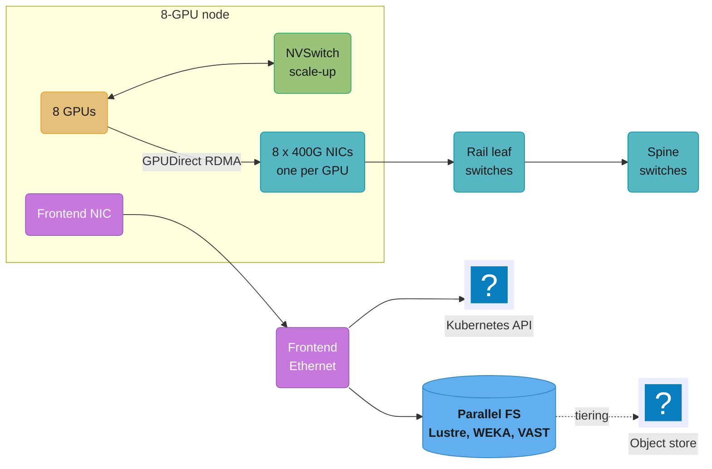
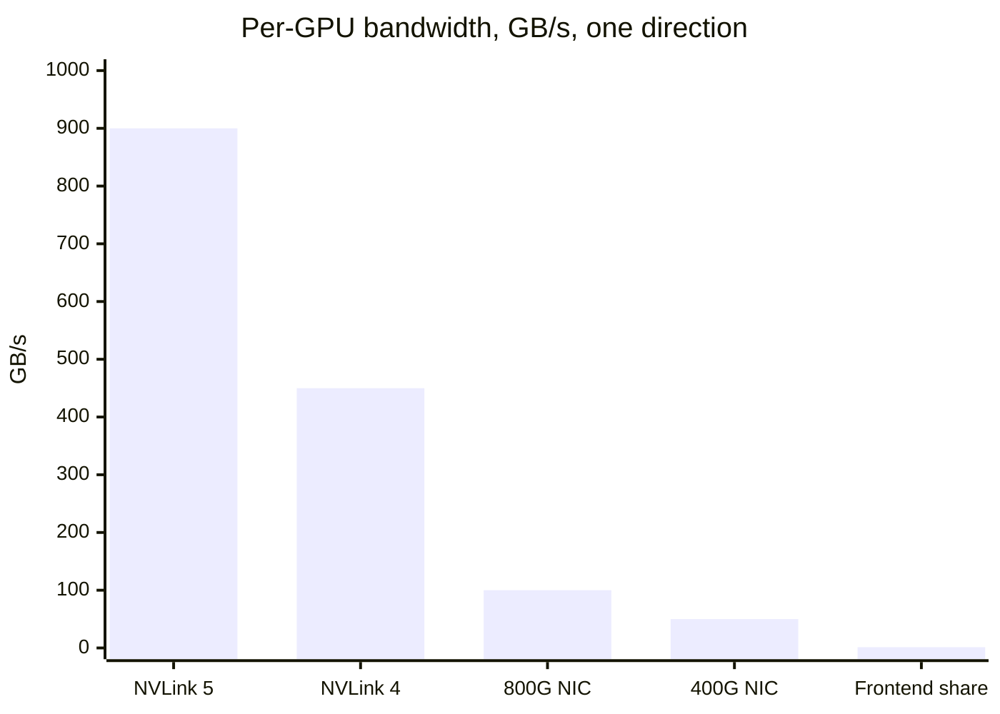
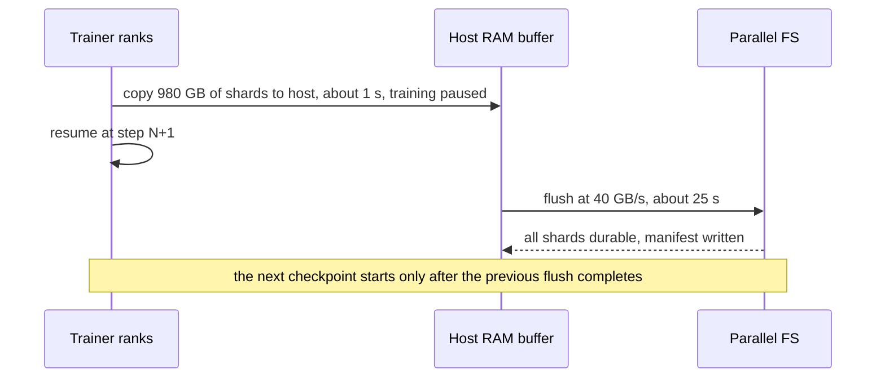
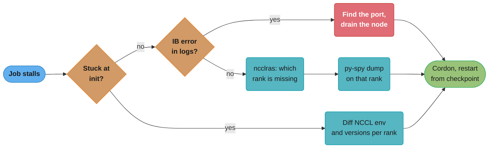

# AI Networking and Storage Fabric

> **Version anchor (2026-10-18).** NVIDIA Network Operator v26.7.1 (2026-10-16), whose
> `NicClusterPolicy` deploys the DOCA/MOFED driver container, the RDMA shared device plugin, the
> SR-IOV network device plugin, Multus and NV-IPAM. NVIDIA GPU Operator v26.7.2 (2026-10-14).
> Ultra Ethernet specification 1.1 (release notes in the PDF date it 2026-10-12). Kubernetes
> 1.37. Tools outside the section pin table were fetched from their release pages and docs on
> 2026-10-18: NCCL v2.32.3-1 (2026-09-17), where `NCCL_IB_GID_INDEX`, `NCCL_IB_SL` and
> `NCCL_IB_TC` default to `AUTO` since 2.32; aws-ofi-nccl v1.21.1 (2026-08-20); PyTorch 2.14 docs,
> where the NCCL process-group timeout defaults to 10 minutes. Cloud limits (FSx for Lustre, EFA,
> S3 Express One Zone, GPUDirect-TCPX) come from the provider docs on the same date.

A training step on 1,024 GPUs is a compute phase followed by a communication phase, and every GPU
waits for the slowest link in the collective. Checkpoints add a second traffic pattern: a burst of
hundreds of gigabytes to terabytes that the whole job waits on. This page is the operator's view of
the wires and file systems underneath both: which fabric to buy, how NCCL finds and uses it, how
Kubernetes hands an RDMA device to a pod, and how much storage throughput a checkpoint needs.

---

## 1. Concept Overview

A GPU cluster runs four networks. They have different jobs, different bandwidths and different
failure modes, and most fabric incidents start with traffic on the wrong one.

| Network | Carries | Typical hardware | Per-GPU bandwidth, one direction |
|---|---|---|---|
| Scale-up | Tensor-parallel and expert-parallel traffic inside one NVLink domain | NVLink plus NVSwitch (8 GPUs on HGX H100, 72 on GB200 NVL72) | 450 GB/s (NVLink 4), 900 GB/s (NVLink 5) |
| Scale-out, or backend | Data-parallel and pipeline collectives between nodes | InfiniBand, RoCEv2 Ethernet, AWS EFA, Google GPUDirect-TCPX | 50 GB/s with one 400 Gb/s NIC per GPU |
| Frontend | Kubernetes pod network, SSH, image pulls, metrics, often storage | Ordinary data-center Ethernet | A shared 80 to 200 Gb/s per node |
| Storage | Dataset reads and checkpoint writes | Frontend Ethernet, a dedicated storage network, or the backend fabric | Set by the file system, not the NIC |

The **fabric** is the scale-out network plus the storage path. The operational questions are:

- **Transport.** InfiniBand, RoCEv2, Ultra Ethernet, or the cloud's own (AWS EFA, Google TCPX).
- **Topology.** Rail-optimized leaves, oversubscription per tier, size of the non-blocking domain.
- **Data path.** GPUDirect RDMA and GPUDirect Storage, or a bounce through host RAM.
- **NCCL configuration.** Environment variables, net plugins, topology files and timeouts.
- **Kubernetes exposure.** Network Operator, Multus, SR-IOV or shared RDMA devices, pod settings.
- **Storage tiers.** NVMe, Lustre, WEKA, VAST, FUSE over object storage, sized by checkpoint math.

Who uses it: the training platform runs on all of it
([Training Infrastructure Operations](../training_infrastructure_operations/training_infrastructure_operations.md)
owns job restarts and checkpoint frequency). Disaggregated inference moves KV caches across the
same backend fabric
([Distributed Inference and Disaggregation](../distributed_inference_and_disaggregation/distributed_inference_and_disaggregation.md)).
Link errors and fabric health metrics land in
[GPU Observability and Fleet Health](../gpu_observability_and_fleet_health/gpu_observability_and_fleet_health.md).
Weight loading for serving is in
[Model Storage, Loading and Cold Start](../model_storage_loading_and_cold_start/model_storage_loading_and_cold_start.md).
Placing a gang of pods so it lands on one rail group or one NVLink domain is a scheduler concern in
[GPU Cluster Scheduling and Quotas](../gpu_cluster_scheduling_and_quotas/gpu_cluster_scheduling_and_quotas.md).

**Not here.** The programming view of NCCL (communicators, the collective API, ring and tree
algorithms, `nccl-tests` source, peer access in CUDA) is in
[Multi-GPU Programming and NCCL](../../cuda/multi_gpu_programming_and_nccl/multi_gpu_programming_and_nccl.md),
and GPU-initiated transfers (NVSHMEM, device-side NCCL) are in
[Device-Initiated Communication](../../cuda/multi_gpu_programming_and_nccl/device_initiated_communication.md).
NVLink, NVSwitch and PCIe inside one node are described in
[GPU Hardware Architecture](../../cuda/gpu_hardware_architecture/gpu_hardware_architecture.md).
Parallelism theory (which of TP, PP, DP, EP and FSDP to use) is in
[LLM Training Infrastructure](../../llm/training_infrastructure/training_infrastructure.md).
Volumes, CSI drivers and access modes are in
[Kubernetes Storage and State](../../devops/kubernetes_storage_and_state/kubernetes_storage_and_state.md),
and general Ethernet, IP, DNS and load balancing are in
[Networking for DevOps](../../devops/networking_for_devops/networking_for_devops.md).

---

## 2. Intuition

**One-line analogy.** A collective is a convoy that drives at the speed of its slowest truck, and the
fabric is the road network: lane count, junctions and traffic control decide that speed.

**Mental model.** Write three numbers next to every training job: bytes per collective, per-GPU
link bandwidth and the slowest hop on the path. An all-reduce of S bytes over N GPUs in a ring sends
`2 x (N-1)/N x S` bytes per GPU. With 14 GB of BF16 gradients (a 7B model under plain data
parallelism) and 50 GB/s per GPU, that is about 0.56 s per step at line rate. If one link runs at
half speed, the whole step takes 1.1 s. If NCCL silently falls back to TCP sockets on the frontend
network, it takes tens of seconds.

**Why it matters.** At 1,024 H100s, one percent of step time is about 250 GPU-hours a day. A fabric
running at 60% of its line rate instead of 95% costs more than most model-side optimizations save.
NVIDIA states that standard Ethernet at the 100,000-GPU scale of xAI's Colossus delivered 60% data
throughput, against 95% with Spectrum-X congestion control. Meta reports that before tuning, large
cluster utilization on its 24,576-GPU clusters ranged from 10% to 90%.

**Key insight.** Fabric failures are quiet. A missing RDMA device, a wrong GID index, a disabled
GPUDirect path or a single-stripe checkpoint file does not crash anything. The job runs, slower,
and the loss curve looks normal. The only defense is to measure each path against a known baseline
before the job starts and to read the NCCL init log on every run.

---

## 3. Core Principles

1. **Keep the heaviest traffic in the fastest domain.** Tensor and expert parallelism go inside the
   NVLink domain. Only data-parallel and pipeline traffic crosses the scale-out fabric.
2. **One NIC per GPU, on the same PCIe switch.** GPUDirect RDMA needs a short PCIe path between
   the GPU and its NIC. A GPU that reaches its NIC across the CPU interconnect loses bandwidth or
   loses GPUDirect altogether.
3. **Never trust the default path; prove it.** Read the NCCL `INFO` log for `NET/IB` and
   `GDRDMA`, run `nccl-tests` per node pair and per rail, and compare against the acceptance
   baseline.
4. **A lossy fabric needs a congestion story.** InfiniBand has credit-based link flow control.
   RoCEv2 runs over Ethernet and needs PFC, ECN or both, plus a load-balancing scheme that copes
   with a few large flows.
5. **Bound every wait.** NCCL, PyTorch and the scheduler each have a timeout. A hang that nobody
   bounded holds every GPU in the job until the default expires.
6. **Size storage by write bandwidth, not by capacity.** A checkpoint is a burst that the job waits
   on. Parallel file systems sell throughput per TiB, so the capacity bill follows the bandwidth
   target.
7. **Stripe big files, spread small ones.** A single large file on one storage target is limited to
   what one server can serve to one client.
8. **Treat fabric config as versioned infrastructure.** Driver container, firmware, NCCL version,
   net plugin version and NCCL environment variables belong in the job's pinned runtime, the same
   way a model digest belongs in the release bundle.

---

## 4. Types / Architectures / Strategies

### 4.1 Scale-up domains

| System | GPUs in one NVLink domain | NVLink bandwidth per GPU, both directions | What fits inside |
|---|---|---|---|
| HGX H100 or H200 (8 GPUs, NVSwitch) | 8 | 900 GB/s (NVLink 4) | TP up to 8, EP across 8 |
| GB200 NVL72 | 72 GPUs and 36 Grace CPUs in one rack | 1.8 TB/s (NVLink 5); 130 TB/s across the domain | TP and EP across a rack; large MoE models without cross-node all-to-all |

The NVL72 changes placement. On HGX, an MoE model with 64 experts spreads expert-parallel
all-to-all across nodes and pays scale-out bandwidth for it. On NVL72 the same all-to-all stays on
NVLink. The scheduler then has to place a job's pods inside one rack, which is the topology-aware
scheduling problem covered in
[GPU Cluster Scheduling and Quotas](../gpu_cluster_scheduling_and_quotas/gpu_cluster_scheduling_and_quotas.md).

### 4.2 Scale-out transports

| Transport | Where | Reliability and congestion | Software path | Notes |
|---|---|---|---|---|
| InfiniBand (NDR 400 Gb/s, Quantum-X800 at 800 Gb/s) | On-prem, Azure ND H100 v5, many GPU clouds | Credit-based, lossless link layer; adaptive routing; subnet manager | Verbs, NCCL `NET/IB` | SHARP in-network reduction on Quantum switches (SHARP v4 on Quantum-X800) |
| RoCEv2 | On-prem Ethernet, Meta, many neoclouds | Needs PFC and usually ECN with a congestion-control algorithm; ECMP load balancing | Verbs over UDP, NCCL `NET/IB` | Same NICs as InfiniBand; GID index and traffic class must be right |
| Ultra Ethernet (specification 1.1) | New Ethernet NICs and switches | Ultra Ethernet Transport (UET) with its own congestion control (NSCC, RCCC), packet spraying across paths | libfabric with a UET provider | 1.1 adds In-Network Collectives, congestion signaling (CSIG) and a "Unified Local" profile for scale-up endpoints |
| AWS EFA | p5, p5e, p5en, p6 instances | SRD protocol with built-in congestion control and OS bypass | libfabric, NCCL via aws-ofi-nccl | 3,200 Gbps per p5 instance; EFA traffic is not routable and cannot cross AZs or VPCs |
| GPUDirect-TCPX and TCPXO | Google A3 High, A3 Edge (TCPX), A3 Mega (TCPXO) | TCP-based; TCPXO offloads the stack | NCCL net plugin plus a receive data path manager sidecar | Up to 1,800 Gbps on A3 machine types |

### 4.3 Topologies

- **Fat tree (Clos).** Leaf and spine switches with full bisection bandwidth. Every GPU can reach
  every other at line rate if the tiers are not oversubscribed. Cost grows with switch tiers.
- **Rail-optimized.** GPU `i` of every node plugs into leaf switch `i` (rail `i`). Collectives
  that pair GPU `i` with GPU `i` on another node cross one switch. Traffic between rails moves to the
  right GPU over NVLink first (NCCL's PXN), so it still enters the fabric on the correct rail.
- **Oversubscribed upper tiers.** Meta's RoCE design groups racks into an "AI Zone" with a
  two-stage Clos (RTSW leaves, CTSW spines) and connects zones through an ATSW layer that is
  oversubscribed by design. The scheduler keeps a job inside one zone where it can.

### 4.4 GPUDirect family

| Feature | Moves bytes between | Needs | Fallback when missing |
|---|---|---|---|
| GPUDirect P2P | Two GPUs in one node over NVLink or PCIe | Peer access, no PCIe ACS blocking | Copy through host memory |
| GPUDirect RDMA | NIC and GPU memory | DMA-BUF (open kernel module driver, Linux 5.12+, CUDA 11.7+) or the legacy `nvidia-peermem` module | NIC writes to host memory, CUDA copies to GPU |
| GPUDirect Storage | Storage (local NVMe or RDMA file system) and GPU memory | `nvidia-fs` kernel module, a supported file system, cuFile API | Compatibility mode: POSIX reads through a host bounce buffer |
| GPUDirect Async | NIC operations triggered by the GPU | Supported NIC and instance (EFA lists it per instance type) | CPU proxy thread drives the NIC |

### 4.5 Storage tiers for data and checkpoints

| Tier | Example | Throughput model | Good for | Weak at |
|---|---|---|---|---|
| Local NVMe | 8 drives on Azure ND H100 v5 (28 TiB), instance store on p5 | Per node, 10 to 25+ GB/s striped | Data cache, local checkpoint staging | Lost with the node; not shared |
| Parallel file system | FSx for Lustre, DDN EXAScaler, WEKA, VAST | Scales with servers; FSx sells MB/s per TiB | Shared checkpoints, shared datasets | Cost per TiB is paid for throughput; metadata limits |
| FUSE over object storage | Cloud Storage FUSE, Mountpoint for Amazon S3 | Object-store throughput through a client cache | Read-mostly datasets, checkpoint archive | Not POSIX: no file locking; directory renames are not atomic or not supported |
| Low-latency object class | S3 Express One Zone | Single-AZ directory buckets, up to 2 million requests per second each | Many small reads, frequent checkpoint shards | One AZ; different bucket type and API behavior |
| Standard object storage | S3, GCS, Azure Blob | Per-prefix request limits, high aggregate | Durable copies, datasets, archives | Latency, request-rate throttling under fan-out |

---

## 5. Architecture Diagrams

### Four networks on one GPU node



The backend NICs carry collectives at 400 Gb/s per GPU. The frontend NIC carries everything else on
a fraction of that. On Azure ND H100 v5 the backend is 3.2 Tbps per VM and the frontend limit is
80 Gbps, a 40 times gap. Any NCCL traffic that lands on the frontend runs at a small fraction of
the speed the job was planned for.

### Per-GPU bandwidth by link



NVLink 4 is 9 times a 400 Gb/s NIC, and the NIC is 40 times a GPU's share of an 80 Gbps frontend
link. These ratios are why parallelism is mapped to links (TP inside NVLink, DP across NICs) and why
a socket fallback is a large regression, not a small one.

### Rail-optimized leaf layer

```
                rail 0    rail 1    rail 2    rail 3    ...    rail 7
                leaf 0    leaf 1    leaf 2    leaf 3           leaf 7
                  │         │         │         │                │
node A          GPU0      GPU1      GPU2      GPU3      ...    GPU7
node B          GPU0      GPU1      GPU2      GPU3      ...    GPU7
node C          GPU0      GPU1      GPU2      GPU3      ...    GPU7
                (inside each node, all 8 GPUs share one NVSwitch domain)

A.GPU2 -> B.GPU2   same rail            NIC2 -> leaf 2 -> NIC2              1 switch hop
A.GPU2 -> B.GPU5   cross rail, PXN      NVLink to A.GPU5, then rail 5       1 switch hop
A.GPU2 -> B.GPU5   cross rail, no PXN   leaf 2 -> spine -> leaf 5           3 switch hops
```

Columns are rails. A ring or tree that pairs equal GPU indices never leaves its leaf. Cross-rail
traffic either uses NVLink inside the sending node (PXN) or climbs to the spine, where
oversubscription and ECMP collisions live.

### PCIe distance between a GPU and its NIC

```
CPU socket 0 (root complex)
 ├─ PCIe switch SW0
 │   ├─ GPU0
 │   └─ NIC0 mlx5_0          GPU0 <-> NIC0   PIX   one PCIe switch        GDR expected
 ├─ PCIe switch SW1
 │   ├─ GPU1
 │   └─ NIC1 mlx5_1          GPU0 <-> NIC1   PHB   through host bridge    GDR may be off
CPU socket 1 (root complex)
 └─ PCIe switch SW4
     ├─ GPU4
     └─ NIC4 mlx5_4          GPU0 <-> NIC4   SYS   across CPU sockets     GDR off, slow
```

`nvidia-smi topo -m` prints this matrix with the same codes (`PIX`, `PXB`, `PHB`, `NODE`, `SYS`).
NCCL picks the NIC closest to each GPU and decides per pair whether GPUDirect RDMA is worth using;
`NCCL_NET_GDR_LEVEL` overrides that threshold with the same codes.

### Checkpoint write with an asynchronous flush



The job waits only for the device-to-host copy. The storage write overlaps with training, so the
file system needs enough bandwidth to finish one flush inside one checkpoint interval, not inside
the training pause.

---

## 6. How It Works - Detailed Mechanics

### 6.1 How NCCL picks a path

At communicator init, NCCL builds a topology graph from PCIe sysfs, NVLink and the NICs it can open,
or from an XML file in `NCCL_TOPO_FILE` (it loads `/var/run/nvidia-topologyd/virtualTopology.xml`
when present, which is how cloud VMs expose their real layout). It then:

1. Loads a net plugin if one is set or found (`libnccl-net.so`): aws-ofi-nccl for EFA, Google's
   GPUDirect-TCPX plugin, the SHARP CollNet plugin.
2. Falls back to its built-in `IB` transport (InfiniBand and RoCE through verbs) if RDMA devices are
   visible, and to `Socket` (TCP) if not.
3. Chooses a NIC per GPU by PCIe distance, and enables GPUDirect RDMA per pair by distance and by
   whether the kernel path (DMA-BUF or `nvidia-peermem`) is present.
4. Builds rings and trees, and enables NVLS (NVLink SHARP inside NVSwitch) and CollNet (SHARP in
   InfiniBand switches) when available.

Every one of those choices is printed with `NCCL_DEBUG=INFO`. A healthy multi-node H100 run on
InfiniBand prints lines of this shape:

```text
NCCL INFO NET/IB : Using [0]mlx5_0:1/IB [1]mlx5_1:1/IB ... [7]mlx5_7:1/IB ; OOB eth0:10.0.0.12<0>
NCCL INFO Channel 00/0 : 0[0] -> 8[0] [send] via NET/IB/0/GDRDMA
NCCL INFO Connected all rings
```

A broken one prints this, and still trains:

```text
NCCL INFO NET/Socket : Using [0]eth0:10.0.0.12<0>
NCCL INFO Channel 00/0 : 0[0] -> 8[0] [send] via NET/Socket/0
```

`NET/Socket` means collectives run over TCP on the frontend NIC. `NET/IB/0` without `GDRDMA` means
RDMA works but each transfer bounces through host memory.

### 6.2 NCCL variables an operator sets

| Variable | Default | Set it when |
|---|---|---|
| `NCCL_DEBUG` | unset (values `VERSION`, `WARN`, `ATTN`, `INFO`, `TRACE`) | `INFO` on the first run of every new image, node type or fabric change |
| `NCCL_DEBUG_SUBSYS` | `INIT,BOOTSTRAP,ENV` | Add `NET,GRAPH,TUNING` to see NIC and algorithm choices |
| `NCCL_SOCKET_IFNAME` | Prefers `ib*`; skips `lo` and `docker*` unless nothing else exists | Pin the bootstrap interface (`=eth0` exact, `^docker` exclude) |
| `NCCL_IB_HCA` | All RDMA devices | Exclude the frontend or storage NIC that also exposes RDMA (`^mlx5_8`) |
| `NCCL_IB_GID_INDEX` | `AUTO` since 2.32 | RoCE on an older NCCL, where the default was not RoCEv2 |
| `NCCL_IB_TC`, `NCCL_IB_SL` | `AUTO` since 2.32 | RoCE traffic class must match the switch's lossless class |
| `NCCL_IB_TIMEOUT` | 20 (4.096 us x 2^20, about 4.3 s) | Raise on very large fabrics with long recovery times |
| `NCCL_IB_RETRY_CNT` | 7 | Rarely; more retries delay error reporting |
| `NCCL_IB_ADAPTIVE_ROUTING` | 1 on InfiniBand, 0 on RoCE | Enable on RoCE only when the switches support it |
| `NCCL_IB_QPS_PER_CONNECTION` | 1 | Raise to spread flows across ECMP paths on RoCE |
| `NCCL_CROSS_NIC` | 2 (prefer the same NIC per ring) | 0 on strict rail-optimized fabrics where rails do not connect |
| `NCCL_NET_GDR_LEVEL` | Chosen per platform | Force or forbid GPUDirect RDMA by distance (`PIX`, `PXB`, `PHB`, `SYS`) |
| `NCCL_COLLNET_ENABLE` | 0 | 1 to use SHARP through the CollNet plugin |
| `NCCL_NVLS_ENABLE` | 2 (use when possible) | 0 to rule NVLS out while debugging |
| `NCCL_ALGO`, `NCCL_PROTO` | Auto | Only to isolate a bug; never as a permanent setting |
| `NCCL_RAS_ENABLE` | 1 | Leave on; the RAS subsystem answers "which rank is stuck" |

Pin these in the job's runtime image or training runtime template. A variable that differs between
ranks produces a mismatched topology and a hang at init.

### 6.3 Broken then fixed: RoCE cluster running on sockets

A team moved a working InfiniBand job to a new RoCEv2 cluster. Throughput dropped by 90% and no error
appeared.

```yaml
# Broken: pod has the GPU but no RDMA device and no secondary network
spec:
  containers:
    - name: trainer
      image: registry.example.com/train:2026.10.1
      resources:
        limits:
          nvidia.com/gpu: 8
      env:
        - name: NCCL_DEBUG
          value: WARN
```

The container saw no `/dev/infiniband` devices, so NCCL chose `NET/Socket` on `eth0`, the pod
network. `WARN` hid the choice. The fix requests the RDMA resource, attaches the backend networks
through Multus, grants `IPC_LOCK` for memory registration, and logs at `INFO` until the run is
verified.

```yaml
# Fixed: RDMA devices, eight backend interfaces, locked memory, verbose init
metadata:
  annotations:
    k8s.v1.cni.cncf.io/networks: rail0,rail1,rail2,rail3,rail4,rail5,rail6,rail7
spec:
  containers:
    - name: trainer
      image: registry.example.com/train:2026.10.1
      securityContext:
        capabilities:
          add: ["IPC_LOCK"]
      resources:
        limits:
          nvidia.com/gpu: 8
          rdma/rdma_shared_device_a: 1
      env:
        - name: NCCL_DEBUG
          value: INFO
        - name: NCCL_DEBUG_SUBSYS
          value: INIT,NET,GRAPH
        - name: NCCL_SOCKET_IFNAME
          value: eth0
        - name: NCCL_IB_HCA
          value: mlx5_0,mlx5_1,mlx5_2,mlx5_3,mlx5_4,mlx5_5,mlx5_6,mlx5_7
```

The resource name `rdma/rdma_shared_device_a` comes from the RDMA shared device plugin config in
the `NicClusterPolicy`; an SR-IOV setup exposes virtual functions under the name its device plugin
config defines. The eight `NetworkAttachmentDefinition` objects (`rail0` to `rail7`) give the pod an
IP on each rail for RoCE, since RoCEv2 is routed over IP. Verified result: the log showed
`NET/IB/<n>/GDRDMA` on every channel and `all_reduce_perf` across two nodes returned to the
acceptance baseline.

### 6.4 The Network Operator in one object

The NVIDIA Network Operator acts on exactly one `NicClusterPolicy`, named `nic-cluster-policy`. An
object with any other name is ignored. Each spec field below is optional and shows up as one or more
entries in `status.appliedStates` (`state-OFED`, `state-RDMA-device-plugin` and so on), each `ready`, or
`ignore` when the field is not set:

| Sub-state | Installs | Needed for |
|---|---|---|
| `ofedDriver` | DOCA/MOFED driver container on Mellanox NIC nodes | Current NIC drivers and firmware tooling; optional when the host OS drivers suffice |
| `rdmaSharedDevicePlugin` | Device plugin that shares one RDMA device among pods | Simple setups, one training pod per node |
| `sriovDevicePlugin` | SR-IOV network device plugin | One virtual function per pod, isolation between tenants |
| `ibKubernetes` | InfiniBand partition key (PKey) management | Tenant isolation on InfiniBand |
| `secondaryNetwork` | Multus, CNI plugins, IPoIB CNI | Extra pod interfaces on the backend fabric |
| `nvIpam` | NVIDIA IPAM | IP addresses for the rail interfaces |
| `nicConfigurationOperator` | NIC firmware parameter management | Fleet-wide NIC settings |

GPUDirect RDMA on the GPU side is the GPU Operator's job. NVIDIA recommends DMA-BUF over the
`nvidia-peermem` module; DMA-BUF needs the open kernel module driver, Linux 5.12 or later and CUDA
11.7 or later. `driver.rdma.enabled=true` switches to the legacy `nvidia-peermem` path, and
`driver.rdma.useHostMofed=true` tells the operator the NIC drivers come from the host. GPUDirect
Storage is `gds.enabled=true`, which loads `nvidia-fs` in the driver pod.

### 6.5 Timeouts and how long a hang costs

Three timers decide how long a dead link holds a job:

| Layer | Timer | Value | Effect |
|---|---|---|---|
| InfiniBand or RoCE transport | `NCCL_IB_TIMEOUT` 20, `NCCL_IB_RETRY_CNT` 7 | About 4.3 s per attempt, 8 attempts, about 35 s before NCCL reports the link failure | Surfaces a dead link as a NCCL error |
| PyTorch process group | `timeout` in `init_process_group` | 10 minutes for NCCL by default | Watchdog aborts collectives that never complete |
| Scheduler or job controller | Pod restart and gang restart policy | Platform specific | Replaces the bad node, restarts from checkpoint |

A rank that stops calling collectives (a stuck data loader, a deadlocked Python thread) never trips
the transport timer, because no packet is in flight. Only the 10-minute watchdog catches it. On
16,384 GPUs that wait is 16,384 x 10 / 60, about 2,730 GPU-hours per hang. Teams lower the
process-group timeout for steady-state steps (for example to 2 to 5 minutes, after measuring the
slowest legitimate step, which is usually the checkpoint save) and use NCCL RAS (enabled by default,
queried with the `ncclras` client) to find which rank is missing. Watchdog settings and the PyTorch
flight recorder are in
[Training Infrastructure Operations](../training_infrastructure_operations/training_infrastructure_operations.md).

### 6.6 Acceptance tests before a node joins

```bash
# 1. Link and firmware state on every NIC
ibstat | grep -E "State|Rate"            # expect Active, 400 (or 800)

# 2. Raw RDMA bandwidth, one rail at a time, between two nodes
ib_write_bw -d mlx5_3 --report_gbits                 # on node B (server)
ib_write_bw -d mlx5_3 --report_gbits nodeB-rail3     # on node A

# 3. NCCL across two nodes, all 16 GPUs
mpirun -np 16 -N 8 ./build/all_reduce_perf -b 8 -e 8G -f 2 -g 1

# 4. GPUDirect Storage path on nodes that use it
/usr/local/cuda/gds/tools/gdscheck.py -p
```

Record `busbw` at 1 GB and 8 GB message sizes for the node type during acceptance, then gate every
new or repaired node against that number. A node that is 10% below its peers in a pairwise test
usually has one degraded cable, one NIC at a lower link rate, or a PCIe link trained at a lower width
after a reboot. The `nccl-tests` build and the algorithm behind `busbw` are covered in
[Multi-GPU Programming and NCCL](../../cuda/multi_gpu_programming_and_nccl/multi_gpu_programming_and_nccl.md).

### 6.7 NCCL hang triage



Init hangs are configuration (a rank with a different NCCL version or `NCCL_IB_HCA`, no route to the
bootstrap interface). Mid-run hangs are fabric errors (in logs within about 35 s) or a rank that
stopped calling collectives (seen only by RAS or the watchdog).

### 6.8 Checkpoint bandwidth arithmetic

Mixed-precision training with Adam keeps about 14 bytes per parameter in a full checkpoint: BF16
weights (2), FP32 master weights (4) and two FP32 optimizer moments (4 + 4).

```python
def checkpoint_plan(params_b: float, nodes: int, write_budget_s: float,
                    mbps_per_tib: float, stripe_targets: int) -> dict:
    """Size a parallel file system for one full checkpoint inside a time budget."""
    state_gb = params_b * 14                        # BF16 + FP32 master + Adam m and v
    need_gbs = state_gb / write_budget_s            # aggregate write rate
    capacity_tib = need_gbs * 1000 / mbps_per_tib   # FSx-style throughput per TiB
    per_node_gbs = need_gbs / nodes
    per_client_cap_gbs = stripe_targets * 5 / 8     # 5 Gbps per client per OSS without EFA
    return {
        "state_gb": round(state_gb),
        "need_gbs": round(need_gbs, 1),
        "capacity_tib": round(capacity_tib, 1),
        "per_node_gbs": round(per_node_gbs, 2),
        "per_node_cap_gbs": per_client_cap_gbs,
    }

print(checkpoint_plan(70, nodes=64, write_budget_s=30, mbps_per_tib=1000, stripe_targets=1))
# {'state_gb': 980, 'need_gbs': 32.7, 'capacity_tib': 32.7,
#  'per_node_gbs': 0.51, 'per_node_cap_gbs': 0.625}
print(checkpoint_plan(70, nodes=64, write_budget_s=30, mbps_per_tib=125, stripe_targets=1))
# capacity_tib: 261.3 for the same 32.7 GB/s on the 125 MB/s per TiB tier
```

Read the result three ways:

- **Aggregate.** 980 GB in 30 s needs 32.7 GB/s. On FSx for Lustre PERSISTENT-1000 (1,000 MB/s
  per TiB of disk throughput) that is about 33 TiB of file system. On PERSISTENT-125 it is 261 TiB,
  even if the datasets fit in 20 TiB. Throughput, not data, sets the bill.
- **Per client.** FSx limits one client to 100 Gbps without EFA, 700 Gbps with EFA and 1,200 Gbps
  with EFA plus GPUDirect Storage. 0.51 GB/s per node is far below all of them.
- **Per client per storage server.** On a client without EFA, FSx limits traffic between one client
  and one object storage server to 5 Gbps (0.625 GB/s). A rank that writes one 15 GB shard into a file with stripe count 1
  writes at 0.625 GB/s at best, about 24 s, no matter how large the file system is. FSx file systems
  created after August 25, 2023 use a progressive layout that stripes files over 100 GiB across 32
  targets and 10 to 100 GiB files across 16, but any file created in append mode gets stripe count 1
  regardless of the directory layout.

The training loop only pauses for the device-to-host copy if the save is asynchronous. The file
system still has to finish each flush before the next checkpoint starts. Checkpoint frequency itself
(Young/Daly against measured MTBF) is set in
[Training Infrastructure Operations](../training_infrastructure_operations/training_infrastructure_operations.md).

### 6.9 Data loading arithmetic

Text pretraining reads very little. A 16-million-token global batch stored as 4-byte token ids is
64 MB per step. At one step every few seconds, that is tens of MB/s for the whole cluster. Datasets
for LLM pretraining are a capacity problem, not a bandwidth problem.

Multimodal training is different. 1,024 GPUs each consuming 500 images per second at 150 KB per
image read 77 GB/s, continuously, with random access. That workload needs a parallel file system or
a node-local cache filled ahead of the epoch, and the same storage then competes with checkpoint
bursts. Separate the two by tier (datasets cached on local NVMe, checkpoints to the parallel file
system) or by schedule.

---

## 7. Real-World Examples

**Meta, two fabrics at 24,576 GPUs.** Meta built two clusters of 24,576 H100 GPUs each, one on RoCE
(Arista 7800 with Wedge400 and Minipack2 OCP rack switches) and one on NVIDIA Quantum2 InfiniBand,
both with 400 Gbps endpoints. After co-designing network, software and model, both ran large GenAI
jobs without network bottlenecks; before that work, large-cluster utilization ranged from 10% to
90%. Storage used a FUSE API over a flash-optimized version of Meta's Tectonic, built so thousands
of GPUs could save and load checkpoints in a synchronized way.

**Meta, RoCE lessons.** Meta's RoCE backend runs PFC without DCQCN at 400G, after DCQCN showed
firmware bugs and poor visibility. NCCL uses receiver-driven admission (CTS packets on a
high-priority queue) to limit in-flight data. Plain ECMP performed poorly because training traffic
has low flow entropy. Path pinning degraded training by more than 30% under fragmented placement.
Enhanced ECMP that hashes on the destination queue pair, with more queue pairs per connection, gave
up to 40% better AllReduce.

**xAI Colossus.** NVIDIA reports that the 100,000-Hopper-GPU Colossus cluster runs its RDMA network
on Spectrum-X Ethernet and holds 95% data throughput, against 60% and thousands of flow collisions
with standard Ethernet at that scale.

**AWS.** p5, p5e and p5en instances have 3,200 Gbps of EFA networking and deploy in UltraClusters
of up to 20,000 H100 or H200 GPUs. NCCL reaches EFA through libfabric and the aws-ofi-nccl plugin.
FSx for Lustre recommends EFA for file systems above 10 GBps and supports GPUDirect Storage over EFA
at up to 1,200 Gbps per client.

**Google Cloud.** A3 High and A3 Edge use GPUDirect-TCPX, an optimized guest TCP stack; A3 Mega uses
GPUDirect-TCPXO, an offloaded RDMA-like stack. Both need Google's NCCL plugin and a receive data
path manager container next to the workload.

**Microsoft Azure.** ND H100 v5 VMs give each of the 8 GPUs a dedicated 400 Gbps Quantum-2 ConnectX-7
InfiniBand link (3.2 Tbps per VM) with GPUDirect RDMA, plus 8 local NVMe disks totaling 28 TiB.

---

## 8. Tradeoffs

### Scale-out transport

| Choice | Performance at scale | Operational burden | Vendor spread | Choose when |
|---|---|---|---|---|
| InfiniBand | High and predictable out of the box; adaptive routing; SHARP | Separate fabric, subnet manager, separate skills | One main switch vendor | Large training clusters where time to full utilization matters |
| RoCEv2 | Matches InfiniBand after tuning (Meta) | PFC, ECN, QoS classes, ECMP tuning, GID config | Many switch and NIC vendors | Ethernet operations teams, mixed workloads, very large builds |
| Ultra Ethernet | Designed for multipath and new congestion control | New NICs and switches, young software | Consortium standard | Greenfield Ethernet builds with UEC-capable hardware |
| Cloud fabric (EFA, TCPX) | Set by the provider | Plugin and driver versions only | One provider | Cloud training; no fabric to own |

### Kubernetes RDMA exposure

| Method | Isolation | Pods per NIC | Notes |
|---|---|---|---|
| Host network | None | Any | Simplest; pods see every host interface; no network policy |
| RDMA shared device plugin plus Multus macvlan or ipvlan | Weak | Many | One training pod per node is the usual case |
| SR-IOV device plugin plus SR-IOV CNI | Strong (one VF per pod) | Number of VFs | Multi-tenant clusters; VF counts set in firmware |
| InfiniBand with `ibKubernetes` PKeys | Partition isolation | Many | Tenants on one InfiniBand fabric |

---

## 9. When to Use / When NOT to Use

**Use InfiniBand** for a dedicated training cluster above a few hundred GPUs when the team does not
already run lossless Ethernet at scale. It reaches line rate with fewer tuning steps.

**Use RoCEv2** when the organization runs Ethernet everywhere, wants several switch vendors, or is
building at a scale where it will tune congestion control and load balancing anyway. Budget the
tuning time.

**Use Ultra Ethernet** only on NICs and switches that ship the specification revision you plan on.

**Use SR-IOV** when tenants share GPU nodes; for one training job per node the shared plugin is simpler.

**Use GPUDirect Storage** when checkpoint or data loading time is a measured bottleneck and the file
system supports it. Do not enable it without checking `gdscheck -p`, because compatibility mode hides
a missing driver.

**Use a parallel file system** for shared checkpoints and multimodal datasets. Do not buy one for
text pretraining data alone; object storage plus a local cache covers that.

**Do not run collectives on the frontend network.** If the backend fabric is unavailable for a
job, the job should fail at init, not run at a few percent of its speed.

---

## 10. Common Pitfalls

**Socket fallback for three weeks.** A fine-tuning platform moved to new nodes whose base image
lacked the RDMA user-space libraries. NCCL chose `NET/Socket` on every job. Jobs ran 6 to 8 times
slower, and users blamed the new model sizes. Fix: an init check that fails the job if the NCCL log
contains `NET/Socket` while RDMA devices are expected, plus `NCCL_DEBUG=INFO` on the first step.

**Wrong GID index on RoCE.** On a RoCE cluster with an older NCCL, the default GID index selected
an address that was not RoCEv2. Collectives worked inside a rack and failed with timeouts across the
spine. Fix: set `NCCL_IB_GID_INDEX` to the RoCEv2 IPv4 GID shown by `show_gids`, or move to NCCL
2.32, where the default is `AUTO`.

**Lossless class mismatch.** The switches had PFC on traffic class 3 and the NICs sent RoCE on class
0. Under load, packets dropped, the transport retried, and all-reduce bandwidth swung between full
rate and a fraction of it. Fix: align `NCCL_IB_TC` and the NIC's QoS settings with the switch
configuration, and alert on PFC pause and drop counters.

**PCIe ACS turned back on.** A BIOS update re-enabled PCIe Access Control Services on the GPU
servers. Peer traffic between GPU and NIC was forced up to the root complex, GPUDirect RDMA bandwidth
dropped by half, and only the nodes from that update batch were slow. Fix: include ACS state and
`nvidia-smi topo -m` output in the node acceptance test, and re-run it after every firmware change.

**NicClusterPolicy with a custom name.** An engineer created `nicclusterpolicy-prod`. The operator
ignored it, no driver or device plugin pods appeared, and the logs showed nothing wrong. Fix: the
object must be named `nic-cluster-policy`.

**GPUDirect Storage in compatibility mode.** A team enabled GDS for checkpoint writes and saw no
change. `gdscheck -p` showed `nvidia-fs` was not loaded, and `allow_compat_mode` in
`/etc/cufile.json` let cuFile fall back to POSIX through host memory without an error. Fix: load
`nvidia-fs` through the GPU Operator (`gds.enabled=true`) and fail the job when `cufile.log` reports
POSIX mode.

**Single-stripe checkpoint shards.** A 70B job saved through 8 writer ranks on FSx for Lustre, one
file each, created in append mode, so each got stripe count 1. Every writer ran at about 0.6 GB/s,
and a checkpoint planned for 30 seconds took over 3 minutes (980 GB at 4.8 GB/s). Fix: set a stripe layout on the checkpoint directory before writing
(`lfs setstripe -c 16` or a progressive layout), and write each shard in one pass.

**Ten-minute watchdog on a 16K-GPU job.** A data loader worker deadlocked on one rank. No packets
were lost, so NCCL saw nothing, and the job held 16,384 GPUs until the PyTorch 10-minute default
expired. It happened twice a day. Fix: a shorter process-group timeout measured against the slowest
legitimate collective, NCCL RAS queries in the hang runbook, and a data-loader health check (the
watchdog and flight-recorder setup is in Training Infrastructure Operations).

**EFA across subnets.** A job's nodes landed in two subnets of different AZs after a capacity
shortage. EFA traffic cannot cross AZs, so NCCL fell back for those pairs and the job ran far below
plan. Fix: placement groups and node pools pinned to one AZ for EFA jobs.

**Storage traffic on the backend rails.** A team mounted the parallel file system over the backend
fabric to get more bandwidth. Checkpoint bursts collided with all-reduce traffic on the same rails,
and step time rose by 15% every checkpoint interval. Fix: storage on its own network or class of
service, or checkpoint flushes rate-limited below the gap between collectives.

---

## 11. Technologies & Tools

| Tool | Role | Notes |
|---|---|---|
| NCCL | Collective communication library | v2.32.3-1 (2026-09-17); `NCCL_IB_GID_INDEX`, `NCCL_IB_SL`, `NCCL_IB_TC` default `AUTO` since 2.32 |
| nccl-tests | Collective bandwidth tests | `all_reduce_perf`, `all_gather_perf`; record `busbw` per node type |
| NVIDIA Network Operator | NIC drivers and RDMA plumbing on Kubernetes | v26.7.1; one `NicClusterPolicy` named `nic-cluster-policy` |
| NVIDIA GPU Operator | GPU stack on Kubernetes | v26.7.2; DMA-BUF GPUDirect RDMA, `gds.enabled` for GPUDirect Storage |
| Multus | Secondary pod interfaces | Deployed by the Network Operator `secondaryNetwork` sub-state |
| SR-IOV Network Device Plugin | Virtual function allocation | One VF per pod for tenant isolation |
| InfiniBand | Lossless scale-out fabric | NDR 400 Gb/s, Quantum-X800 at 800 Gb/s with SHARP v4 |
| RoCEv2 | RDMA over routed Ethernet | Needs PFC, ECN, correct GID and traffic class |
| Ultra Ethernet | Ethernet transport specification | Specification 1.1; UET, NSCC and RCCC congestion control, In-Network Collectives |
| Amazon EFA | AWS RDMA-style interface | SRD protocol; libfabric; not routable across AZs |
| aws-ofi-nccl | NCCL net plugin for EFA | v1.21.1 (2026-08-20) |
| GPUDirect-TCPX | Google A3 GPU networking | TCPX on A3 High and A3 Edge, TCPXO on A3 Mega |
| GPUDirect Storage | Storage to GPU memory DMA | cuFile API, `nvidia-fs`, `gdscheck -p` |
| Amazon FSx for Lustre | Managed Lustre | Throughput per TiB tiers; EFA and GDS on EFA-enabled file systems |
| WEKA | Parallel file system on NVMe | Shared checkpoints and datasets |
| VAST Data | All-flash shared storage | NFS and object access |
| Cloud Storage FUSE | GCS as a file system | File, stat and list caches; not POSIX compliant |
| Amazon S3 Express One Zone | Single-AZ low-latency object storage | Directory buckets; up to 2 million requests per second each |
| perftest | RDMA micro-benchmarks | `ib_write_bw`, `ib_read_lat` per rail |

---

## 12. Interview Questions with Answers

**Q: A multi-node job on 400G RDMA NICs gets a few GB/s in all-reduce and no errors. What is the first thing to check?**
**Short:** The NCCL INFO log: `NET/Socket` means it fell back to TCP on the frontend network, and missing `GDRDMA` means RDMA bounces through host memory.

Set `NCCL_DEBUG=INFO` and `NCCL_DEBUG_SUBSYS=INIT,NET,GRAPH` and read the transport line. `NET/IB`
with `GDRDMA` on each channel is the healthy case. `NET/Socket` appears when the container sees no
RDMA devices (no device plugin resource, missing user-space libraries, wrong `NCCL_IB_HCA`) and NCCL
quietly uses `eth0`. Make the job fail at init when the log shows a socket transport on a node type
that is supposed to have RDMA.

**Q: Why does RoCEv2 need explicit congestion and flow-control configuration when InfiniBand does not?**
**Short:** Ethernet drops packets under congestion and RDMA reacts badly to loss, so RoCE needs PFC and usually ECN, while InfiniBand has credit-based lossless links built in.

InfiniBand switches only send when the next hop has buffer credit, so the link layer does not drop.
RoCEv2 rides on routed Ethernet and UDP, where a full buffer drops packets and the RDMA transport
retries in slow, costly ways. Operators configure PFC on a dedicated traffic class, ECN marking and a
congestion-control algorithm, and make the NIC send on that class. Meta runs its 400G RoCE backend
with PFC and without DCQCN, using NCCL receiver-driven admission to keep in-flight data bounded.

**Q: Why does plain ECMP perform poorly for training traffic?**
**Short:** Training creates a few long, large flows with low hash entropy, so ECMP piles several onto one uplink while others sit idle.

ECMP picks a path by hashing packet headers per flow. A collective between two nodes may be one or
a few queue pairs, so the hash has little to spread. Meta measured poor ECMP performance for this
reason, saw path pinning degrade training by more than 30% under fragmented placement, and got up to
40% better AllReduce by hashing on destination queue pair with more queue pairs per connection
(`NCCL_IB_QPS_PER_CONNECTION` on the NCCL side). Adaptive routing and Ultra Ethernet multipath solve
the same problem in the switch or transport.

**Q: GPUDirect RDMA is enabled, but transfers still go through host memory. What are the usual causes?**
**Short:** The kernel path is missing (no DMA-BUF support or `nvidia-peermem`), or the GPU and NIC are too far apart on PCIe, so NCCL turns GDR off for that pair.

Check three things. The GPU Operator must provide DMA-BUF (open kernel module driver, Linux 5.12+,
CUDA 11.7+) or the legacy `nvidia-peermem` module. `nvidia-smi topo -m` must show each GPU and its
NIC at `PIX` or `PXB`, not `PHB` or `SYS`. PCIe ACS must be disabled on the switches in that path,
or peer traffic is forced up to the root complex. The NCCL log shows the outcome per channel:
`NET/IB/0/GDRDMA` versus `NET/IB/0`.

**Q: GPUDirect Storage was turned on, yet checkpoint load time did not change. Why?**
**Short:** cuFile is probably in compatibility mode: without `nvidia-fs` or a supported file system it falls back to POSIX through a host bounce buffer and raises no error.

`allow_compat_mode` in `/etc/cufile.json` lets cuFile-based code run without GDS. `gdscheck -p`
shows whether the driver is loaded and which file systems are supported. With `logging:level` at
`TRACE`, `cufile.log` reports `cufile IO mode: POSIX`. Load `nvidia-fs` through the GPU Operator
(`gds.enabled=true`), confirm `nvidia_fs` in `lsmod`, and treat POSIX mode as a failed check on
nodes that are supposed to use GDS.

**Q: The Network Operator is installed and a NicClusterPolicy is applied, but no driver or device plugin pods appear. What is wrong?**
**Short:** The operator only acts on a NicClusterPolicy named `nic-cluster-policy`; an object with any other name is silently ignored.

The NVIDIA Network Operator watches one predefined name. Rename the object, then read
`status.appliedStates`: each sub-state (`state-OFED`, `state-RDMA-device-plugin`,
`state-multus-cni`, `state-nv-ipam-cni`) reports `ready`, or `ignore` when it is not defined. The
global state is the logical AND of the sub-states, so one failing driver container keeps the whole
policy not ready.

**Q: How long does a full checkpoint of a 70B model trained with Adam take to write, and how much Lustre does that imply?**
**Short:** About 980 GB at 14 bytes per parameter; writing it in 30 s needs 32.7 GB/s, about 33 TiB of FSx PERSISTENT-1000 or 261 TiB of PERSISTENT-125.

BF16 weights (2 bytes), FP32 master weights (4) and two FP32 Adam moments (8) give 14 bytes per
parameter. FSx for Lustre sells disk throughput per TiB (125, 250, 500 or 1,000 MB/s per TiB on
current SSD tiers), so the throughput target sets the capacity. With an asynchronous save, the 30 s
budget is the flush window between checkpoints, not a training pause. Check per-client and
per-server limits next; they often bind before the aggregate does.

**Q: Each rank writes its checkpoint shard at about 0.6 GB/s no matter how large the FSx file system is. Why?**
**Short:** The shard sits on one storage target and FSx caps a non-EFA client to one storage server at 5 Gbps; stripe the file across more targets.

Lustre stores file data on object storage targets. A file with stripe count 1 is served by one
server, and FSx limits each client without EFA to 5 Gbps (0.625 GB/s) per object storage server.
Files created in append mode get stripe count 1 whatever the directory layout says. Set a layout on the checkpoint directory before writing
(`lfs setstripe -c 16`, or a progressive layout), write each shard in one pass, and check with
`lfs getstripe`.

**Q: What changes for parallelism placement when the NVLink domain grows from 8 GPUs to 72?**
**Short:** Tensor and expert parallel groups can span a whole NVL72 rack on 1.8 TB/s NVLink, so MoE all-to-all no longer crosses the scale-out fabric.

On HGX H100, NVLink covers 8 GPUs at 900 GB/s each and everything else crosses 50 GB/s NICs, so TP
stops at 8 and expert all-to-all across nodes is a known bottleneck. GB200 NVL72 puts 72 GPUs on
NVLink 5 with 130 TB/s across the domain. The scale-out fabric then carries only data-parallel and
pipeline traffic, and the scheduler must place a job's pods within one rack, which makes rack
fragmentation a capacity problem.

**Q: What is a rail-optimized topology and why do GPU clusters use it?**
**Short:** GPU i on every node connects to leaf switch i, so collectives between same-index GPUs cross one switch and cross-rail traffic moves over NVLink first.

NCCL rings and trees mostly pair equal GPU indices across nodes, so a rail design keeps that
traffic on one leaf with no spine hop. When a GPU must reach a different index on another node,
NCCL's PXN sends the data over NVLink to the local GPU on the right rail, which then uses its own
NIC. This cuts spine bandwidth needs and ECMP collisions. `NCCL_CROSS_NIC=0` tells NCCL not to mix
rails when the rails are not interconnected.

**Q: For a new 4,000-GPU training cluster, how do you choose between InfiniBand, RoCEv2 and Ultra Ethernet?**
**Short:** Pick by operations skill and timeline: InfiniBand reaches line rate fastest, RoCEv2 fits Ethernet teams willing to tune, and Ultra Ethernet needs hardware that ships the spec.

InfiniBand brings credit-based flow control, adaptive routing, a subnet manager and SHARP, and
usually reaches target utilization with less tuning, at the cost of a separate fabric and one main
switch vendor. RoCEv2 matched it at Meta after network, NCCL and model co-design, and keeps Ethernet
tooling and vendor choice. Ultra Ethernet (specification 1.1) adds a transport with multipath load
balancing and new congestion control; plan on it only for NICs and switches that implement it.
Compare time to 90% utilization, not peak bandwidth on a datasheet.

**Q: What does SHARP do, and how does NCCL use it?**
**Short:** SHARP performs reductions inside the switch, so data crosses each link once; NCCL uses it through the CollNet plugin on InfiniBand and through NVLS inside NVSwitch.

In a ring all-reduce each GPU sends about twice the buffer size. With in-network reduction, each GPU
sends its buffer up the tree once and receives the reduced result, which roughly halves the traffic
and cuts latency at large scale. On InfiniBand it needs Quantum switches with SHARP enabled, the
SHARP plugin and `NCCL_COLLNET_ENABLE=1` (default 0). NVLink SHARP (NVLS) runs in NVSwitch inside the
node or rack and is on by default when available (`NCCL_NVLS_ENABLE=2`).

**Q: How does AWS EFA differ from InfiniBand for an operator?**
**Short:** EFA uses AWS's SRD protocol through libfabric and the aws-ofi-nccl plugin, gives 3,200 Gbps on p5, and its traffic cannot cross AZs or VPCs.

There is no switch to configure: SRD handles reliability and congestion control inside the AWS
network. The operator's job is the software stack (EFA installer, libfabric, aws-ofi-nccl matched to
the NCCL version) and placement (one AZ, cluster placement groups or UltraClusters). Security groups
must allow all traffic between the instances in the group. GPUDirect RDMA support varies by instance
type; p5, p5e and p5en list it.

**Q: What does a Kubernetes pod need before NCCL can use RDMA inside it?**
**Short:** An RDMA device from a device plugin, backend interfaces through Multus, the `IPC_LOCK` capability for memory registration, and NCCL variables that name the right NICs.

The Network Operator installs the RDMA shared or SR-IOV device plugin, so the pod requests a
resource such as `rdma/rdma_shared_device_a`. Multus attaches one secondary interface per rail from
`NetworkAttachmentDefinition` objects, with IPs from NV-IPAM, which RoCEv2 needs because it is routed
over IP. `IPC_LOCK` lets the process pin memory. `NCCL_IB_HCA` lists the backend devices, and
`NCCL_SOCKET_IFNAME` names the bootstrap interface.

**Q: How long does NCCL take to report a dead InfiniBand link with default settings?**
**Short:** About 35 s: each attempt waits 4.096 us x 2^20, about 4.3 s, and the NIC makes 8 attempts (1 plus 7 retries) before NCCL sees the error.

`NCCL_IB_TIMEOUT` defaults to 20 and `NCCL_IB_RETRY_CNT` to 7. Raising the timeout helps on very
large fabrics where link recovery takes longer, but every step up doubles the wait. This timer only
covers data in flight. A rank that never posts its send is caught by the framework watchdog, not by
the transport.

**Q: For LLM pretraining, is storage bandwidth driven by data loading or by checkpoints?**
**Short:** By checkpoints: a 16M-token batch of 4-byte token ids is 64 MB per step, while a 70B checkpoint is about 1 TB written in a burst.

Text data is compact and read sequentially, so a text dataset is a capacity problem that object
storage plus a local cache handles. Checkpoints are bursts the job depends on, and their size grows
with parameter count times 14 bytes. Multimodal training reverses this: 1,024 GPUs reading 500 images
per second each at 150 KB is 77 GB/s of random reads. Size the file system for whichever burst or
stream is larger, and keep the two on separate tiers when both are large.

**Q: When is S3 Express One Zone a better checkpoint target than a Lustre file system?**
**Short:** When the job runs in one AZ, writes many shards and wants object semantics without provisioning file system throughput; not when it needs POSIX or multi-AZ durability.

S3 Express One Zone uses directory buckets in one AZ, with single-digit millisecond access and up to
2 million requests per second per bucket. Checkpoint libraries that write shards as objects benefit
from the request rate and pay per request and per GB, not per provisioned MB/s. Lustre is better
when tools expect a file system, when the same checkpoints feed evaluation and serving through
mounts, or when GPUDirect Storage is needed. Copy finished checkpoints to a regional bucket either
way.

**Q: How do you accept a new or repaired GPU node into the fabric?**
**Short:** Run link checks, per-rail `ib_write_bw`, a two-node `nccl-tests` run and `gdscheck`, and admit the node only if each matches the recorded baseline for its type.

`ibstat` confirms every port is Active at the expected rate. `ib_write_bw` per rail finds one bad
cable or NIC. `all_reduce_perf` between the new node and a known-good node checks NCCL, GPUDirect
RDMA and PCIe together, and should land within a few percent of the baseline `busbw`. Add
`nvidia-smi topo -m` and PCIe ACS state, which change after firmware updates. Repeat the test after
every BIOS, firmware or driver change, not only at first install.

**Q: What is GPUDirect-TCPX, and why does it exist?**
**Short:** Google's GPU networking for A3 High and A3 Edge: an optimized TCP path that moves data to GPU memory with less host copying; A3 Mega uses the offloaded TCPXO.

Google's A3 machines do not expose InfiniBand. TCPX keeps TCP as the transport but reduces the
copies through host memory, and TCPXO offloads the stack into an RDMA-like path; both reach up to
1,800 Gbps on A3 machine types. NCCL uses them through Google's net plugin, and each workload needs
the receive data path manager container beside it. If the plugin or sidecar is missing, NCCL falls
back to plain sockets.

---

## 13. Best Practices

- Map parallelism to links: TP and EP inside the NVLink domain, DP and PP across the NICs.
- Give each GPU its own backend NIC on the same PCIe switch; verify with `nvidia-smi topo -m`.
- Run `NCCL_DEBUG=INFO` on the first run of every image, node type and fabric change, and fail the
  job on `NET/Socket` where RDMA is expected.
- Pin NCCL, the net plugin, the NIC driver container and the NCCL environment in the job runtime
  image, versioned like any other release input.
- Name the policy `nic-cluster-policy` and alert on any sub-state that is not `ready`.
- Gate every node on per-rail `ib_write_bw` and two-node `nccl-tests` against a stored baseline,
  after install and after every firmware change.
- On RoCE, align NIC traffic class, switch PFC class and ECN; watch pause and drop counters.
- Set the collective timeout from the measured slowest step; put NCCL RAS in the hang runbook.
- Size checkpoint storage from bytes per parameter, write window and per-client limits, then
  buy capacity to match the throughput.
- Keep checkpoint bursts off the backend rails. Verify GPUDirect Storage with `gdscheck -p`; treat compatibility mode as a failure on GDS nodes.
- Feed fabric counters (link errors, PFC pauses, symbol errors) into the fleet health pipeline in
  [GPU Observability and Fleet Health](../gpu_observability_and_fleet_health/gpu_observability_and_fleet_health.md).

---

## 14. Case Study

### 1,024-GPU RoCE training cluster: from 41% to 93% of baseline all-reduce bandwidth

**Setup.** A company builds a 128-node H100 cluster (1,024 GPUs) on RoCEv2: eight 400G ConnectX-7
NICs per node, a rail-optimized leaf layer, a spine with 1:1 bisection inside a 512-GPU pod and 2:1
between the two pods. Kubernetes 1.37 with the NVIDIA GPU Operator v26.7.2 and Network Operator
v26.7.1. Training uses PyTorch FSDP on a 70B model. Checkpoints go to a parallel file system
provisioned at 40 GB/s on a separate storage network.

**Symptom.** Two-node `all_reduce_perf` hits the baseline. A 512-GPU job reaches 41% of the
expected bus bandwidth, step time varies by 30% from step to step, and checkpoint steps add 3 minutes.

**Measurement.**

| Check | Finding |
|---|---|
| NCCL INFO log | `NET/IB/<n>/GDRDMA` on all channels; no socket fallback |
| Switch counters | PFC pauses on 6 spine uplinks, near zero elsewhere |
| ECMP hash distribution | 4 of 32 uplinks per leaf carry over half the traffic |
| Job placement | Pods spread across both pods; half the rings cross the 2:1 tier |
| `lfs getstripe` on checkpoint shards | Stripe count 1 on every file |
| Checkpoint writers | 8 writer ranks, about 0.6 GB/s each |

**Changes, in order of effect.**

1. Topology-aware placement: the scheduler places the 512-GPU job inside one pod, so no ring
   crosses the oversubscribed tier. Bus bandwidth rises from 41% to 68% of baseline.
2. More queue pairs per connection (`NCCL_IB_QPS_PER_CONNECTION=4`) and switch hashing that
   includes the queue pair, so flows spread across uplinks. Bus bandwidth reaches 89%, and
   step-time variance falls below 5%.
3. Traffic class alignment: NICs moved RoCE to the switch's lossless class, which also carries ECN
   marking. PFC pause storms on the spine stop. Bus bandwidth reaches 93%.
4. Checkpoint directory striped across 16 targets before writing (8 writers at up to 10 GB/s
   each now saturate the 40 GB/s file system), and the save made asynchronous.
   The checkpoint pause drops from 3 minutes to about 2 seconds of device-to-host copy, and the
   flush completes in 25 s, well inside the 30-minute checkpoint interval.
5. A new-node gate: per-rail `ib_write_bw`, a two-node `nccl-tests` run, ACS state and
   `gdscheck -p`, all compared with the stored baseline before the node is schedulable.

**Result.** Step time fell by 38%. At the same token budget the run finished 9 days earlier on the
reserved capacity. The team kept the 2:1 tier between pods and documented that jobs larger than 512
GPUs pay for it; the next expansion budget goes to spine capacity only if the queue shows a demand
for jobs of that size.

**What they did not do.** They did not switch to InfiniBand or replace the spine: placement, load
balancing and QoS configuration were the causes, all fixable in software and switch config. Job
restarts and checkpoint frequency for this cluster are in
[Training Infrastructure Operations](../training_infrastructure_operations/training_infrastructure_operations.md);
KV-cache transfer traffic that a later inference deployment added to the fabric is in
[Distributed Inference and Disaggregation](../distributed_inference_and_disaggregation/distributed_inference_and_disaggregation.md).
