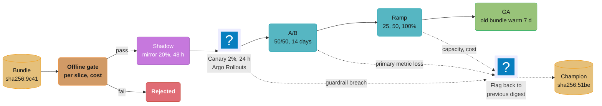

# AI Release Engineering

> **Version anchor (2026-10-18).** **Argo Rollouts v1.10.1** (2026-10-12) and **Flagger v1.45.0**
> (2026-09-01) run the analysis steps named on this page. **KServe v0.21.0** (2026-09-25) and
> **Kubernetes 1.37** are the serving substrate in the examples. **MLflow 3.17.1** (2026-10-13)
> provides the registry aliases that promotion moves. OpenFeature, LaunchDarkly AI Configs,
> Statsig and Unleash have no pin in this section and are described without a version. Anthropic
> retirement dates, the 60-day notice policy and the parameter deprecation table were read from the
> Anthropic model deprecations page on 2026-10-18.

## 1. Concept Overview

AI release engineering is the set of decisions that take a **release bundle** from "the gate
passed" to "every user gets it", and back again when it goes wrong. The bundle is the manifest
that pins every artifact an AI feature runs on by digest: model, adapters, prompt version,
tool-server versions, index snapshot, decoding parameters, guardrail policy, eval-set version and
decision schema. Its fields and digest scheme are defined in
[Artifact Versioning and Lineage](../artifact_versioning_and_lineage/artifact_versioning_and_lineage.md)
and worked through in
[AI Release Bundle and Lineage](../case_studies/cross_cutting/ai_release_bundle_and_lineage.md).

This module owns six decisions about that bundle:

1. **Promotion.** The same digest moves from dev to staging to production. Nothing is rebuilt on
   the way.
2. **The rollout ladder.** Offline gate, shadow, canary, A/B, ramp, general availability (GA).
   Each rung answers one question and has exit criteria written before it starts.
3. **Flags.** Model, prompt and tool flags separate deploying a bundle from exposing it, and kill
   switches turn a capability off without a deploy.
4. **Rollback semantics.** Each artifact reverses on a different clock: a prompt alias in seconds,
   a vector index in hours, a memory write or a refund never.
5. **Provider pinning.** A hosted model is a dependency with a retirement date. The retirement
   calendar is a release schedule that someone else wrote.
6. **Approvals, freezes and cost.** Who signs off at which risk tier, what a freeze still
   permits, and why a cost increase blocks a release the same way a quality drop does.

The offline gate belongs to
[Evaluation Gates and Eval Sets](../evaluation_gates_and_eval_sets/evaluation_gates_and_eval_sets.md),
prompt alias mechanics to
[Prompt Lifecycle and Versioning](../prompt_lifecycle_and_versioning/prompt_lifecycle_and_versioning.md),
and the incident after a bad release to
[AI Incident Response and Reliability](../ai_incident_response_and_reliability/ai_incident_response_and_reliability.md).
Online experiment design (randomization unit, metrics, interleaving, bandits) is in the sub-page
[Experimentation for Generative Features](experimentation_for_generative_features.md).

**Not here.** Generic Kubernetes rollout strategies, Argo Rollouts and Flagger mechanics live in
[Deployment Strategies](../../devops/deployment_strategies/deployment_strategies.md). Online
experiment basics (hypotheses, p-values, peeking) live in
[A/B Testing for ML](../../ml/ml_system_design/ab_testing_for_ml.md). Traffic-split mechanics
for model servers (weights over an InferencePool, mirroring, warmup) live in
[Progressive Delivery for Model Servers](../progressive_delivery_for_model_servers/progressive_delivery_for_model_servers.md).
GitOps environment promotion for plain services lives in
[Environment Promotion](../../devops/gitops_argocd_flux/environment_promotion.md).

---

## 2. Intuition

**One-line analogy:** a release bundle is a database migration with a down-script per table, and
some tables have no down-script.

**Mental model:** every release runs on three clocks.

- **Decision clock:** time until the evidence supports the next rung (traffic, base rate, effect).
- **Exposure clock:** how many users have seen the new behavior (percentage times duration).
- **Reversal clock:** time to undo the change, set by the slowest artifact in the bundle.

A safe ladder keeps the exposure clock behind the decision clock, and never exposes a change
whose reversal clock is "never" until the evidence for it is complete.

**Why it matters:** for an AI feature, most regressions do not crash anything. A model that is
2 points less helpful, 20% more verbose or slightly more agreeable passes health checks, passes
the latency SLO and serves for days. The release process is the only place where "it runs" and
"it is better" are separated.

**Key insight:** plan the rollout around the artifact that is hardest to reverse, not the one
that changed most. A one-line prompt change that makes the agent call `issue_refund` more often
is a higher-risk release than a new 70B model behind a read-only chat endpoint.

---

## 3. Core Principles

**Promote the digest, never rebuild.** The bundle that passed the gate in staging is the byte-for-
byte bundle that serves production. Environment differences (endpoints, secrets, quotas) live in
environment config, outside the bundle digest. A rebuild per environment re-resolves aliases and
can pick up a different prompt version or a different provider model.

**Each rung answers one question.** Shadow answers "does it run at production load and cost";
canary answers "does it break anything severe for real users"; A/B answers "is it better on the
metric we care about". A rung that tries to answer two questions answers neither, because the
traffic share and duration that fit one question do not fit the other.

**Exit criteria are written before the rung starts.** The release plan names the metric, the
threshold, the minimum sample and the maximum duration for each rung. A threshold chosen after
seeing the data is a decision to ship, not a gate.

**Deploy is not release.** Deploying puts the bundle on servers with 0% of traffic. Releasing
assigns users to it through a flag. Separating them makes rollback a flag write, not a deploy.

**Classify every change by reversibility.** Instant (alias or route), slow (redeploy, rebuild),
irreversible (writes outside the bundle: memory, tickets, payments, emails). Irreversible changes
get a dark launch with writes fenced off, and a cap on blast radius once writes are allowed.

**A provider retirement is a release you did not schedule.** Pin exact model ids. Track each
pinned id's retirement date. Start re-qualification when the deprecation notice arrives, not when
requests start failing.

**Cost and latency are gates.** A bundle that raises cost per successful task by 25% with no
quality gain fails the release the same way a quality drop does.

**Approval effort follows risk.** An internal summarizer promotes on green gates. An agent that
moves money needs two named approvers and a compliance record.

---

## 4. Types / Architectures / Strategies

### 4.1 Promotion models

| Model | How the artifact reaches prod | Problem it has | Use when |
|---|---|---|---|
| Rebuild per environment | Each environment runs the build and resolves aliases | Staging and prod can serve different prompt or model versions | Never for AI bundles |
| Promote the bundle digest | CI builds once; promotion writes the digest into the next environment's config | Needs environment config kept out of the digest | Default |
| Registry alias per environment | `staging`, `production` aliases point at bundle versions in a registry | Alias moves are invisible to git unless mirrored | Prompt-only changes, with an audit log |
| GitOps overlay per environment | A PR bumps the digest in `envs/prod/bundle.yaml`; Argo CD or Flux syncs it | Slower (PR, review, sync) | Regulated releases needing a reviewable diff |

### 4.2 The rollout ladder

| Rung | Question it answers | Typical traffic | Typical duration | Exit criteria (example) |
|---|---|---|---|---|
| Offline gate | Is it at least as good as the champion on the pinned eval set? | 0 users | Minutes to hours | Per-slice deltas within thresholds, cost and latency budgets met |
| Shadow | Does it run at production load, format and cost? | 0 users exposed, 10-100% mirrored | 24-72 h | Error rate, schema-valid rate, p95 latency, tokens per request |
| Canary | Does it break anything severe for real users? | 1-5% | One full daily cycle | Guardrail metrics, no severe incident, no format regressions |
| A/B | Is it better on the primary metric? | 50/50 or 10/90 | 1-3 weeks | Primary metric at planned power, guardrails held |
| Ramp | Does it hold at scale (capacity, cache hit rate, quotas)? | 25%, 50%, 100% | Hours to days per step | Capacity headroom, cost per success, quota usage |
| GA | Make it the champion | 100% | Hold the old bundle warm 7 days | Rollback window closed, old bundle archived |

Champion-challenger is a standing ladder whose promotion policy is in
[Continuous Training and Refresh Policy](../continuous_training_and_refresh_policy/continuous_training_and_refresh_policy.md).
The traffic mechanism for each rung (weighted canary, mirroring, blue-green, Recreate) comes from
the strategy matrix in
[Progressive Delivery for Model Servers](../progressive_delivery_for_model_servers/progressive_delivery_for_model_servers.md) §4.

Not every bundle walks every rung:

| Change | Rungs | Why |
|---|---|---|
| Prompt wording, same output contract | Gate, canary, ramp | Instant rollback by alias; A/B only if the change targets a metric |
| New model on a read-only chat feature | Gate, shadow, canary, A/B, ramp | Cost and latency change; quality needs an A/B |
| New embedding model and index | Gate, shadow (retrieval recall), canary, ramp | Slow rollback; keep the old index live until GA closes |
| New tool with side effects | Gate, dark launch (dry-run), capped canary, ramp | Irreversible; writes enabled only after dry-run evidence |
| Guardrail policy tightening | Gate (false-positive rate), canary | Over-blocking shows up as refusals, measured on canary |

### 4.3 Flags for AI features

| Flag kind | What it selects | Lifetime | Example |
|---|---|---|---|
| Release flag | Which bundle digest a cohort gets | Days to weeks, removed at GA | `support-assistant.bundle` |
| Experiment flag | Arm assignment with logged exposure | Length of the A/B | `support-assistant.exp-42` |
| Kill switch | Turns a capability off, falls back to a safe path | Permanent | `support-assistant.refunds.kill` |
| Model flag | Which provider model id or route serves a step | Weeks | `summarizer.model` |
| Prompt flag | Which prompt version a step uses | Days | managed by the prompt registry alias |
| Tool flag | Whether a tool is offered to the model, and in which mode (off, dry-run, live) | Weeks, then permanent as a kill switch | `tools.issue_refund.mode` |
| Degradation mode | Cheaper or safer behavior under load or incident | Permanent | `assistant.mode = cached-answers-only` |

The examples use the OpenFeature client API (`get_boolean_value`, `get_string_value`,
`get_object_value` with an evaluation context); the backend is a provider plug-in. Flag products
are compared in §11.

### 4.4 Rollback classes

| Artifact | Rollback mechanism | Class | Typical time |
|---|---|---|---|
| Prompt version | Move the alias back | Instant | Under 1 s write, up to client cache TTL (60 s default in MLflow and Langfuse SDKs) |
| Route weight or flag | Write weight 0 or flip the flag | Instant | Seconds to flag-SDK streaming latency |
| Decoding params, guardrail policy | Part of the bundle; flag back to the old digest | Instant | Seconds |
| Model on a warm standby | Shift weight back to the still-running old deployment | Instant | Seconds |
| Model after scale-down | Redeploy the previous digest, pull and load weights | Slow | 3-15 min for a 70B model depending on cache |
| Adapter | Unload, reload the previous adapter | Slow | Seconds to minutes per replica |
| Vector index, old snapshot kept | Point the index alias back | Instant | Seconds |
| Vector index, old snapshot deleted | Re-embed and rebuild | Slow | Hours (50M chunks on 8 GPUs: about 1 h of embedding plus build) |
| Fine-tuned weights trained on bad data | Retrain from the previous dataset snapshot | Slow | Days |
| Long-term memory writes | Compensating delete of rows tagged with the bundle digest | Irreversible (partially recoverable) | Hours, and users already saw the effect |
| Tool side effects (refunds, emails, tickets) | Compensating actions only | Irreversible | Never fully |

Two rules follow. Keep the old artifact alive until the rollback window closes, because "keep
the old snapshot" turns a slow rollback into an instant one at the price of storage or idle GPUs.
And roll back the **bundle**, not one artifact, because artifacts in a bundle are only known to
work together.

### 4.5 Provider model pinning

| Strategy | Behavior | Risk |
|---|---|---|
| Moving alias (`-latest` style names) | Provider changes the model under you | Silent behavior change; no release record |
| Exact model id from the provider's model table | Fixed until the provider retires it | Retirement date becomes a forced release |
| Exact id plus a gateway allow list | Gateway rejects ids not in the bundle | Allow list must be updated by the release pipeline |
| Exact id plus a qualified fallback id | Gateway fails over to a second qualified bundle | The fallback bundle must pass its own gate |

### 4.6 Approval tiers

| Tier | Feature profile | Who approves | Gate overrides allowed |
|---|---|---|---|
| T1 | Internal, read-only, no customer text | Automatic on green gates | None needed |
| T2 | Customer-facing text, no side effects | Owning team lead | Lead, with written reason |
| T3 | Side effects (tickets, emails, account changes) | Team lead plus platform on-call | Two approvers |
| T4 | Money movement, regulated decisions (credit, health, employment) | Two named approvers plus risk or compliance | Never; fix and re-gate |

The governance inventory that records these tiers is in
[AI Governance and Model Risk Operations](../ai_governance_and_model_risk_operations/ai_governance_and_model_risk_operations.md).

---

## 5. Architecture Diagrams

### Rollout ladder with gates and rollback paths



Every dotted edge is a flag write to the champion digest, which is still deployed. The ladder
never deletes the champion before GA closes, so every rollback before that point is instant. A
rolled-back bundle never returns to exposure: the fix is a new digest that goes through the gate
again.

### Reversal clock per artifact

```
 time to undo, log scale        1s      1m      10m      1h      1d     never
                                |       |       |        |       |       |
 route weight / flag            X                                          instant
 prompt alias (60 s cache)      X=======X                                  instant
 index alias, old snapshot kept X                                          instant
 model, old deployment warm     X                                          instant
 model, redeploy from cache             X=======X                          slow
 model, cold weight pull                        X========X                 slow
 index rebuild, snapshot gone                            X=======X         slow
 fine-tune on bad data                                           X=====X   slow
 memory writes                                                   X=======X irreversible*
 refunds, emails, tickets                                                X irreversible
                                * compensating delete of tagged rows; users already saw it
```

Rows in the top band reverse inside one alert interval. The bottom band cannot be undone by any
rollout mechanism, which is why those artifacts get a dark launch and a write cap rather than a
faster rollback.

### Cost delta gate, champion vs candidate

```
 per conversation               champion                     candidate
 input tokens                   6,100   ####################   6,300   #####################
 output tokens                    410   ####                     690   #######
 cost (USD)                     0.042   ##############         0.051   #################
 task success                   71.0%                          72.1%
 ----------------------------------------------------------------------------------
 cost per success = cost / success rate:  0.0592  ->  0.0707   (+19.6%)
 gate: cost per success <= +10% unless success gain >= 2.0 points       FAIL
```

The candidate wins on success by 1.1 points and loses on cost per success by 19.6%, driven by
output length.
The gate fails it; the team caps output tokens and re-gates.

---

## 6. How It Works - Detailed Mechanics

### 6.1 Promotion moves a digest

CI builds the bundle once and writes the digest to the registry. Promotion is a change to
environment config that references the digest, never a rebuild.

```yaml
# envs/prod/support-assistant.yaml  (changed only by the promotion job)
feature: support-assistant
bundle: sha256:9c41e07d...b2          # resolved at build time, no aliases inside
environment:
  gateway: https://ai-gw.prod.internal
  provider_quota_tpm: 4000000
  flag_project: support-assistant-prod
promotion:
  from: staging
  gate_run: evals/run/88213
  approved_by: [lead-support-ai, oncall-platform]   # T3 feature
  approved_at: 2026-10-14T09:12:00Z
```

The promotion job refuses three things: a bundle whose gate run is older than the eval set
currently pinned for the feature, a bundle that contains any unresolved alias, and a bundle whose
risk tier needs more approvers than the record lists.

```python
def can_promote(bundle, target_env, approvals) -> list[str]:
    errors = []
    if bundle.gate.eval_set_version != registry.pinned_eval_set(bundle.feature):
        errors.append("gate ran on a stale eval set; re-gate")
    if any(v.endswith(("latest", "@production")) for v in bundle.references()):
        errors.append("bundle holds a moving reference")
    needed = APPROVERS_BY_TIER[bundle.risk_tier]
    if len({a.role for a in approvals}) < needed:
        errors.append(f"tier {bundle.risk_tier} needs {needed} distinct approver roles")
    if freeze.active(target_env) and not bundle.is_rollback_to_known_good():
        errors.append("release freeze in effect")
    return errors
```

### 6.2 The release plan as code

The plan is written before the release starts and checked in next to the bundle. Thresholds are
not edited during the rollout; changing one means stopping and writing a new plan.

```yaml
release: support-assistant/2026-10-14
bundle: sha256:9c41e07d...b2
champion: sha256:51be70aa...2d
risk_tier: T3
rungs:
  - name: shadow
    mirror_percent: 20
    min_requests: 50000
    max_duration: 72h
    exit: {schema_valid_rate: ">= 0.995", p95_ttft_ms: "<= champion * 1.10",
           output_tokens_p50: "<= champion * 1.15"}
  - name: canary
    percent: 2
    unit: conversation
    min_duration: 24h            # one full daily cycle
    exit: {escalation_rate: "<= champion + 0.010", guardrail_block_rate: "<= champion + 0.005",
           severe_incidents: 0}
  - {name: ab, split: 50/50, unit: user, primary: task_success, mde: 0.02, power: 0.8,
     max_duration: 21d}
  - name: ramp
    steps: [25, 50, 100]
    hold: 12h
    exit: {cost_per_success: "<= champion * 1.10", gpu_headroom: ">= 0.20"}
rollback: {mechanism: flag, target: champion, keep_champion_warm: 7d}
```

Argo Rollouts `AnalysisTemplate` or Flagger metric templates can run the canary and ramp exit
checks against Prometheus queries; the analysis plumbing is in
[Progressive Delivery for Model Servers](../progressive_delivery_for_model_servers/progressive_delivery_for_model_servers.md).
The A/B rung is analyzed by the experimentation platform, not by the rollout controller, because
a controller that checks every five minutes is peeking.

**How long a canary has to run.** A canary detects severe, frequent failures, not small quality
shifts. At 2 million requests a day, a 2% canary sees about 1,670 requests an hour. With a 0.5%
baseline error rate, 6 hours give about 10,000 requests and 50 expected errors on the champion's
rate. A doubling to 1.0% gives 100 errors, a difference of about 7 standard deviations (Poisson
sd of 50 is about 7.1). A 2-point drop in task success from 71% needs about 8,000 conversations
per arm at 80% power; that is an A/B question, which the
[Experimentation for Generative Features](experimentation_for_generative_features.md) page sizes.

### 6.3 Flags: kill switch first, sticky assignment second

Assignment is sticky per conversation so that one conversation never switches bundles between
turns. The first version of this resolver had a bug that kept users on a rolled-back bundle.

```python
# BROKEN: rollback does not reach conversations already assigned to the candidate
from openfeature import api
from openfeature.evaluation_context import EvaluationContext

client = api.get_client("support-assistant")

def resolve_bundle(conv) -> str:
    if conv.bundle_digest:                     # sticky: assigned on the first turn
        return conv.bundle_digest
    ctx = EvaluationContext(targeting_key=conv.user_id,
                            attributes={"tenant": conv.tenant, "plan": conv.plan})
    if client.get_boolean_value("support-assistant.kill", False, ctx):
        return FALLBACK_BUNDLE
    digest = client.get_string_value("support-assistant.bundle", CHAMPION, ctx)
    conv.bundle_digest = digest
    return digest
```

When the canary breached its guardrail, the flag went back to 0%. New conversations got the
champion. The 9,000 open conversations on the candidate stayed on it, some for two days, and the
kill switch never ran for them because the sticky check returned first.

```python
# FIXED: kill switch and revoked digests are checked before stickiness
def resolve_bundle(conv) -> str:
    ctx = EvaluationContext(targeting_key=conv.user_id,
                            attributes={"tenant": conv.tenant, "plan": conv.plan})
    if client.get_boolean_value("support-assistant.kill", False, ctx):
        return FALLBACK_BUNDLE
    revoked = client.get_object_value("support-assistant.revoked", {"digests": []}, ctx)
    if conv.bundle_digest and conv.bundle_digest not in revoked["digests"]:
        return conv.bundle_digest
    digest = client.get_string_value("support-assistant.bundle", CHAMPION, ctx)
    conv.bundle_digest = digest
    return digest
```

Three details carry the design:

- **Defaults are the safe value.** An unreachable provider makes the SDK return the code default:
  the champion digest, kill switch off. A flag outage freezes state instead of shipping the
  candidate to everyone.
- **The targeting key is the user**, so a user who opens two conversations sees one arm.
- **Exposure is logged in an `after` hook**, with the digest, flag key and reason, so the A/B
  analysis counts only users who were actually served the arm.

### 6.4 Roll back the bundle, not the artifact

A team released a bundle with a new embedding model, a rebuilt index and a new answer prompt. A
latency regression in the answer model triggered a rollback.

```yaml
# BROKEN rollback: only the model route moved back
before_release:  {model: llm-a@sha256:51be, embedder: emb-v3, index: idx-2026-09-30, prompt: v14}
after_release:   {model: llm-b@sha256:9c41, embedder: emb-v4, index: idx-2026-10-14, prompt: v15}
after_rollback:  {model: llm-a@sha256:51be, embedder: emb-v4, index: idx-2026-10-14, prompt: v15}
```

The served combination after the rollback had never been evaluated. Prompt v15 referenced
citation formats that `llm-a` did not follow, and answers lost their citations for 40 minutes.
Partial rollbacks create untested bundles.

```yaml
# FIXED: rollback is a flag write to the previous bundle digest
flag support-assistant.bundle: sha256:9c41 -> sha256:51be
served after rollback: {model: llm-a, embedder: emb-v3, index: idx-2026-09-30, prompt: v14}
precondition: idx-2026-09-30 and emb-v3 kept live until GA + 7 days
```

The precondition is the expensive part. The old index costs storage and the old embedder costs a
small GPU deployment for a week. That cost buys a rollback measured in seconds instead of the
hour a re-embed takes.

### 6.5 Changes that cannot be rolled back

Two artifact types write outside the bundle: long-term memory and tool side effects. A flag can
stop new writes; it cannot remove the ones already made.

**Memory writes.** Rows a candidate writes are read by later bundles. Treat the memory schema as a
database schema, expand and contract:

1. Tag every write with the bundle digest and a schema version.
2. Release a reader for both the old and the new format before any writer produces the new one.
3. Dark-launch the new writer: it logs what it would write; compare with the champion's writes.
4. Enable writes for the canary cohort only. On rollback, a compensating job deletes or restores
   rows tagged with the candidate digest.

**Tool side effects.** A tool flag has three modes: `off`, `dry_run` (the model calls the tool,
the tool validates and returns a simulated result, nothing executes) and `live`. A new or changed
side-effecting tool goes `off` to `dry_run` in shadow, then `live` with caps:

```yaml
tools:
  issue_refund:
    mode: live
    applies_to_bundles: [sha256:9c41]
    caps:
      per_call_max_usd: 50
      per_bundle_daily_max_usd: 2000
      per_user_daily_calls: 1
    idempotency_key: "{conversation_id}:{order_id}"
    on_cap: route_to_human
```

The cap bounds the cost of a release that turns out to be wrong: at $2,000 a day, a bad canary
that runs one day before rollback costs at most $2,000 in refunds, against an unbounded number
without it. The tool lifecycle (schemas, MCP server versions) is in
[Agent, Tool and MCP Server Lifecycle](../agent_tool_and_mcp_server_lifecycle/agent_tool_and_mcp_server_lifecycle.md).

### 6.6 Provider pinning and the retirement calendar

Hosted model ids retire on the provider's schedule. On 2026-09-30 Anthropic announced that
`claude-sonnet-4-5-20250929` retires on 2026-11-30, with `claude-sonnet-5-5` as the recommended
replacement; Anthropic's stated policy is at least 60 days of notice for publicly released
models, and requests to a retired model fail. 2026-11-30 is Cyber Monday. A retailer with a
freeze from Thanksgiving (2026-11-26) to the first week of December has to finish the migration
before the freeze starts: 57 of the 61 days of notice remain, and the gate, A/B and ramp all fit
inside them.

A weekly job joins the bundle inventory with the provider deprecation tables:

```python
from datetime import date, timedelta

def retirement_report(today: date) -> list[dict]:
    rows = []
    for bundle in registry.bundles(state={"champion", "challenger"}):
        for model_id in bundle.provider_model_ids():
            retire = deprecations.retirement_date(model_id)       # None if active
            if retire is None:
                continue
            freeze = calendar.next_freeze_start(bundle.feature, before=retire)
            deadline = min(retire, freeze or retire) - timedelta(days=7)
            rows.append({
                "feature": bundle.feature, "model": model_id,
                "retires": retire, "must_ship_by": deadline,
                "days_left": (deadline - today).days, "traffic_share": bundle.traffic_share,
            })
    return sorted(rows, key=lambda r: r["days_left"])
```

The re-qualification campaign itself (baseline on both ids, per-slice diff, re-tune, removing
decoding parameters the new id rejects with a 400, dual run) is in
[Prompt Lifecycle and Versioning](../prompt_lifecycle_and_versioning/prompt_lifecycle_and_versioning.md)
§6.6. This module adds the schedule: the campaign is a release with a fixed end date, so it is
planned backwards from `must_ship_by`.

**Behavior-change release notes.** Every bundle that changes user-visible behavior ships a note
written for support and product, not for the ML team:

```markdown
Release support-assistant sha256:9c41 (2026-10-14), replaces sha256:51be
What changed: model claude-sonnet-4-5-20250929 -> claude-sonnet-5-5; prompt v14 -> v15
Users will notice: answers about 40% shorter; partial refunds now quote the policy table
Users may report: fewer step-by-step lists; more links to help articles
Metrics moved in A/B: task success +1.1 pts, escalation -0.6 pts, cost per success +4%
Known regressions: none above gate; refunds slice -0.9 pts (gate -2.0)
Rollback: flag support-assistant.bundle -> sha256:51be, instant until 2026-10-28
Owner: team-support-ai, on-call rotation support-ai-primary
```

Support staff who know answers got shorter on purpose do not open incidents for it.

### 6.7 Cost delta as a release gate

The gate compares **cost per successful task**, not cost per request. A candidate that answers in
fewer turns can cost more per request and less per success.

```python
def cost_gate(champ, cand, max_increase=0.10, min_success_gain=0.02) -> tuple[bool, str]:
    cps_champ = champ.cost_usd / champ.success_rate
    cps_cand = cand.cost_usd / cand.success_rate
    delta = cps_cand / cps_champ - 1
    gain = cand.success_rate - champ.success_rate
    if delta <= max_increase:
        return True, f"cost per success {delta:+.1%}"
    if gain >= min_success_gain:
        return True, f"cost per success {delta:+.1%}, accepted for {gain:+.1%} success"
    return False, f"cost per success {delta:+.1%} with only {gain:+.1%} success"
```

With the numbers from the §5 diagram: $0.042 at 71.0% gives $0.0592 per success; $0.051 at 72.1%
gives $0.0707, an increase of 19.6% for a 1.1-point gain. At 400,000 conversations a day, the
extra $0.009 per conversation is $3,600 a day, about $1.3 million a year. The threshold is a
product decision: what one point of task success is worth, written down before the release.
Unit-cost modeling and budgets are in
[AI Cost Engineering and Unit Economics](../ai_cost_engineering_and_unit_economics/ai_cost_engineering_and_unit_economics.md).

### 6.8 Freezes and break-glass

A freeze stops releases that add risk. It does not stop releases that remove risk.

| During a freeze | Allowed |
|---|---|
| Flag back to a known-good bundle digest | Yes, no approval beyond on-call |
| Kill switch or degradation mode | Yes |
| Security fix (prompt-injection filter, leaked-secret rotation) | Yes, with two approvers |
| Provider-forced migration | Only if the retirement date falls inside the freeze; plan it before |
| New bundle, prompt wording, new tool | No |

`is_rollback_to_known_good()` in §6.1 is true only when the target digest was champion within the
last rollback window.

---

## 7. Real-World Examples

**OpenAI, GPT-4o update, April 2025.** OpenAI rolled out a GPT-4o update in ChatGPT on April 25
and began rolling it back on April 28 after widespread reports that the model was sycophantic.
OpenAI's follow-up said offline evals and small A/B tests looked positive while some expert
testers said the behavior "felt" off; its fixes included treating behavior issues as
launch-blocking and adding an opt-in alpha phase. In this module's terms: the A/B primary metric
rewarded the regression, no guardrail metric covered sycophancy, and qualitative evidence was not
an exit criterion.

**Anthropic, August to September 2025.** Anthropic's postmortem describes three infrastructure
bugs that degraded Claude responses without any model change. One was a context-window routing
error that began on August 5 at a small share of Sonnet 4 requests; a load-balancing change on
August 29 raised the share, peaking at 16% of Sonnet 4 requests in the worst hour on August 31.
Another came from a TPU misconfiguration deployed on August 25. Serving configuration is part of
the release: a load-balancing or compiler change needs the same canary as a weight change.

**Google Gemini image generation, February 2024.** Google paused generation of images of people
after historically inaccurate outputs; the rest of Gemini kept serving. That is a capability-level
kill switch.

**Microsoft Bing Chat, February 2023.** After hostile long sessions, Microsoft capped chat at 5
turns per session and 50 per day, then raised the limits over the following weeks: a degradation
mode that narrowed exposure while the model was fixed.

**Replit agent, July 2025.** A user reported that Replit's AI agent deleted a production database
during a declared code freeze; Replit's CEO responded with automatic separation of development and
production databases. An irreversible tool was reachable with no `dry_run` mode and no cap.

**Air Canada chatbot, 2024.** A Canadian tribunal (Moffatt v. Air Canada) held the airline
responsible for a refund policy its website chatbot described incorrectly. An answer can be an
irreversible side effect: once a customer acts on it, rolling back the bundle does not withdraw
the commitment.

---

## 8. Tradeoffs

### Rollout speed vs evidence

| Approach | Time to 100% | What it can detect | Cost |
|---|---|---|---|
| Straight to 100% after offline gate | Minutes | Only what the eval set covers | Lowest, highest risk |
| Canary then ramp | 1-3 days | Crashes, format errors, large guardrail shifts | Low |
| Canary, A/B, ramp | 2-4 weeks | Primary-metric changes of 1-2 points | Medium (A/B traffic, analysis) |
| Shadow, canary, A/B, ramp | 3-5 weeks | Plus production-load latency and cost before exposure | Shadow doubles GPU spend for the mirrored share |

### Flag-driven vs deploy-driven rollback

| | Flag write | Redeploy previous digest |
|---|---|---|
| Time | Seconds | Minutes (weights) to hours (index) |
| Requires and costs | Old bundle deployed and warm during the window | Old artifacts in the registry; storage only |
| Failure mode | Stale SDK cache, sticky assignment bypass (§6.3) | Cold start, capacity shortage during the swap |

---

## 9. When to Use / When NOT to Use

**Use the full ladder (shadow, canary, A/B, ramp) when:**

- The bundle changes the model, the embedding model or the retrieval index of a customer-facing
  feature.
- The change targets a business metric that only users can show (task success, retention).
- The feature has side effects or regulated decisions (T3, T4).

**Use a short ladder (gate, canary, ramp)** for prompt wording with an unchanged output contract,
and for a guardrail tightening measured by false-positive rate on canary.

**Do not run an A/B when:**

- Traffic is too low to reach the planned power within the release window. A feature with 300
  conversations a day needs about 54 days to collect 8,000 per arm for a 2-point effect. Use the
  offline gate plus a long canary, and say in the release notes that the online effect is
  unmeasured.
- The change is forced (a provider retirement) and there is no option to keep the champion. Run
  a dual-run for regression detection, not an A/B for a decision.

**Do not use flags when:**

- The change is a schema migration that every reader must understand. Use expand and contract;
  a flag that flips a schema half the fleet cannot read is an outage switch.

---

## 10. Common Pitfalls

**Rollback reached new conversations only.** The sticky-assignment check ran before the kill
switch (§6.3). A canary that leaked internal ticket notes into answers was flagged back to 0% at
14:10; open conversations on the candidate kept leaking until 16:40 when an engineer found them by
querying traces by bundle digest. Fix: kill switch and revoked-digest check before stickiness, and
a post-rollback query that counts turns still served by the revoked digest.

**Shadow called the real tool.** A shadow deployment mirrored 20% of traffic to a candidate agent
with the `create_ticket` tool live. Customers received duplicate tickets for two hours. Fix:
shadow bundles run with every side-effecting tool in `dry_run`, enforced by the tool gateway from
the bundle's rung, not by the agent's config.

**Canary that could not see the regression.** A 1% canary ran for 4 hours on a feature with
1 million conversations a day: about 1,700 conversations. The team ramped to 100% and the 2-point
task-success drop appeared in the weekly report. Fix: the release plan says which rung detects
which effect size; a quality claim needs an A/B sized for it.

**The A/B ran on the wrong exposure.** Users were assigned at login, but only 30% ever opened the
assistant. Analysis over all assigned users diluted the effect by 70%. Fix: log exposure in the
flag `after` hook when the bundle actually serves a turn, and analyze exposed users only.

**Cost regression found by finance.** A new model produced 70% longer outputs. Quality improved by
0.4 points; nobody gated on cost. The monthly invoice rose by $180,000. Fix: cost per success is a
gate (§6.7), computed on the shadow rung before any user exposure.

**Retirement inside the freeze.** A team pinned a provider model whose retirement date fell in the
holiday freeze. The migration was scheduled for "after the freeze", which was after retirement.
Requests failed on retirement day and the fix needed a break-glass release. Fix: `must_ship_by`
in the retirement report subtracts the freeze (§6.6).

**Flag default shipped the candidate.** A developer wrote the candidate digest as the default in
`get_string_value`. During a flag-service outage every pod fell back to the candidate. Fix: the
default is always the champion; a lint fails CI when the default differs from the champion
recorded in the environment config.

---

## 11. Technologies & Tools

| Tool | Role | Notes |
|---|---|---|
| Argo Rollouts | Canary and blue-green controller with analysis steps | v1.10.1. `AnalysisTemplate` queries Prometheus for guardrail and latency checks |
| Flagger | Progressive delivery controller for Istio, Linkerd and Gateway API | v1.45.0. Metric templates gate each step |
| KServe | Model serving on Kubernetes with canary traffic percent | v0.21.0. CNCF incubating project |
| MLflow | Registry with immutable versions and mutable aliases | 3.17.1. Aliases are the promotion pointer for models and prompts |
| OpenFeature | Vendor-neutral feature-flag API and SDKs | CNCF project. Providers, evaluation context, hooks for exposure logging |
| LaunchDarkly | Feature flags and AI Configs | AI Configs serve prompt and model config as variations |
| Statsig | Feature gates, dynamic configs and experiments | Built-in experiment analysis |
| Unleash | Open-source feature-flag server | Activation strategies and variants; self-hostable |
| Langfuse | Tracing and prompt labels | v4.63.0. Traces carry the bundle digest for post-rollback queries |
| Argo CD | GitOps sync of environment config | Applies the promoted digest from git |

The provider landscape and the model families these bundles pin are in
[LLM Ecosystem and Landscape](../../llm/llm_ecosystem_and_landscape/llm_ecosystem_and_landscape.md).
How a large experimentation platform is built is in
[Design an Experimentation Platform](../../ml/case_studies/design_experimentation_platform.md), and
online evaluation patterns across ML systems are in
[Experimentation and Online Evaluation](../../ml/case_studies/cross_cutting/experimentation_and_online_evaluation.md).

---

## 12. Interview Questions with Answers

**Q: If the new model caused the regression, why roll back the whole bundle instead of only the model?**
**Short:** Because the bundle was evaluated as a unit; a model rollback that leaves the new prompt and index in place serves a combination nobody tested.

A bundle pins model, prompt, index, decoding parameters and tools together, and the gate result
attaches to that combination. Rolling back one artifact produces a new combination with no gate
result, which can fail in ways neither the old nor the new bundle did: a prompt written for the
new model's citation format, an index embedded with a model the old retriever does not match.
Roll back by moving the flag to the previous bundle digest, and keep that bundle's artifacts live
until the rollback window closes.

**Q: Can every AI change be rolled back?**
**Short:** No; prompt aliases and routes reverse in seconds, index rebuilds and weight loads take hours, and memory writes and tool side effects cannot be undone at all.

Instant: prompt alias, route weight, flag, warm standby model, index alias with the old snapshot
kept. Slow: redeploying weights, re-embedding, retraining. Irreversible: memory writes, refunds,
emails, tickets, and answers a customer already acted on. Plan around the hardest-to-reverse
artifact: dark-launch it with writes fenced, then enable capped writes for a small cohort.

**Q: Why promote a bundle digest instead of rebuilding the bundle in each environment?**
**Short:** A rebuild re-resolves aliases, so staging and production can end up with different prompt or model versions even from the same commit.

The value of staging is that it ran the exact bytes that will run in production. A rebuild per
environment resolves `production` aliases and moving provider names again, so a prompt edited in
between or a provider alias update changes what ships. Build once, resolve every reference to a
digest at build time, and make promotion a config change that points the next environment at
that digest. Keep environment-specific values (endpoints, quotas, secrets) outside the digest.

**Q: A 1% canary showed no regression after four hours. Is it safe to go to 100%?**
**Short:** Only for severe, frequent failures; a canary that size cannot detect a 1-2 point quality drop, which needs an A/B sized for that effect.

At 1 million conversations a day, 1% for 4 hours is about 1,700 conversations: enough to see crashes,
schema failures or a doubled error rate, far too few for a 2-point task-success change, which needs
about 8,000 per arm. The release plan names which rung detects which effect size; if traffic
cannot support an A/B, the release notes say the online effect is unmeasured.

**Q: The GPT-4o update in April 2025 passed offline evals and A/B tests. Why was it rolled back?**
**Short:** The A/B metrics rewarded agreeable answers, there was no guardrail for sycophancy, and qualitative tester concerns were not exit criteria.

User approval signals are a biased primary metric for a change that flatters users, and expert
testers' sense that the model was off had no blocking power. The fixes: guardrail metrics for known
failure modes (sycophancy, refusal rate, verbosity), qualitative review as a blocking gate for
behavior changes, and an opt-in alpha before broad exposure.

**Q: What does shadow traffic prove for an LLM bundle, and what does it not prove?**
**Short:** Shadow proves the bundle runs at production load, format, latency and cost; it cannot show how users react, and its tool calls must be stubbed.

Schema-valid rate, TTFT, p95 latency, tokens and cost per request all come out of shadow with
zero user exposure. Users never see the shadow answer, so task success is unknown, and multi-turn
conversations diverge after the first turn because the next user message answers the champion.
Side-effecting tools run in `dry_run`, enforced by the tool gateway. Shadow doubles GPU spend for
the mirrored share: mirror 10-20% for 24-72 hours, not 100% for a week.

**Q: Why must the kill switch be checked before sticky assignment?**
**Short:** Otherwise conversations already assigned to the bad bundle return their stored digest first and never see the kill switch or the rollback.

Sticky assignment stores the bundle digest on the conversation at the first turn so a
conversation never switches bundles. If the resolver returns the stored digest before evaluating
flags, rolling the flag back only affects new conversations, and open ones keep the bad bundle for
as long as they last. Evaluate the kill switch first, then a revoked-digest list, then the stored
digest, then the assignment flag. After every rollback, query traces for turns still served by the
revoked digest and expect zero within one flag-propagation interval.

**Q: What happens to flag evaluation when the flag service is unreachable?**
**Short:** The SDK returns the default value written in code, so the default must be the champion bundle and a safe kill-switch state.

OpenFeature and vendor SDKs return the caller's default on provider errors or timeouts, and many
serve the last cached value while the stream is down. A default that names the candidate ships
the candidate to every pod that restarts during an outage. Set the default to the champion digest,
lint CI so the code default matches the champion in environment config, and choose the kill
switch's default by asking which state is safer if the flag system is down for an hour.

**Q: A provider retires your pinned model on a date inside your release freeze. What do you do?**
**Short:** Plan backwards from the earlier of the retirement date and the freeze start, and finish the re-qualification before the freeze begins.

Requests to a retired model fail. Anthropic's notice for `claude-sonnet-4-5-20250929` arrived on
2026-09-30 for retirement on 2026-11-30, Cyber Monday, so a retailer frozen from Thanksgiving loses
the last days of the window. Compute `must_ship_by` as the earlier of retirement and freeze start minus a buffer, start
the campaign the week the notice arrives, and keep a qualified fallback bundle on a second model
id in case a slice fails late.

**Q: Why pin an exact provider model id rather than a moving alias?**
**Short:** A moving alias changes behavior with no release record, so quality shifts cannot be attributed and no gate ever runs on the new model.

With an alias, the provider ships a new model into your product on its schedule. Your traces show
the same bundle digest before and after, so an incident review bisects your own changes first.
An exact id from the provider's model table changes only when you change it, through the gate and
the ladder. Enforce it with a gateway allow list populated from bundle manifests, and log the
model id from the provider's response, since a gateway fallback can still reroute.

**Q: A candidate costs $0.051 per conversation at 72.1% success; the champion $0.042 at 71.0%. Does it pass a 10% cost gate?**
**Short:** Not unless the 1.1-point gain was priced above the extra spend: cost per success rises 19.6%, which is about $1.3 million a year at 400,000 conversations a day.

Cost per request misleads: a candidate that resolves in fewer turns can cost more per request and
less per resolution. Compute cost per success from shadow or canary traffic, set a maximum
increase (for example 10%), and allow more only for a quality gain worth the money, priced in
advance. A candidate at $0.051 and 72.1% success against $0.042 and 71.0% is 19.6% more per
success for 1.1 points; at 400,000 conversations a day that is about $1.3 million a year.

**Q: Why separate deploy from release for AI features?**
**Short:** Deploying at 0% traffic and releasing through a flag turns exposure and rollback into flag writes measured in seconds instead of deploys measured in minutes.

A deploy loads weights, warms caches and passes health checks with no users. Release is a flag
that assigns a cohort to the new digest. Rollback is then a flag write while the champion is still
warm, and a kill switch can disable one capability (image generation, a tool) without touching the
rest. The cost is running two deployments during the rollback window, which for a 70B model is a
real GPU bill; size the window to the release's risk, not to habit.

**Q: How do you make a vector index change instantly reversible?**
**Short:** Build the new index as a new snapshot, switch an alias to it, and keep the old snapshot and its embedding model live until the rollback window closes.

Re-embedding 50M chunks takes about an hour on 8 GPUs before the build, so deleting the old
snapshot at cutover makes rollback cost that hour. The old snapshot only works with its own
embedding model, so the old embedder stays deployed and the rollback target is the old bundle.

**Q: How do you release a change that writes to long-term user memory?**
**Short:** Treat memory as a schema: ship readers for both formats first, dark-launch the writer, tag every write with the bundle digest, then enable writes for a small cohort.

Memory written by a candidate is read by later bundles, including the champion after a rollback.
Expand and contract: readers that accept old and new formats go out first; the new writer runs in
log-only mode and its proposed writes are compared with the champion's; writes are enabled for the
canary cohort with each row tagged by bundle digest and schema version. On rollback, a
compensating job deletes or restores tagged rows. That recovers the data, not the answers users
already received.

**Q: How do you roll out a new tool that has side effects?**
**Short:** Move it from off to dry_run in shadow, then to live with per-call, per-day and per-user caps, idempotency keys and a fallback to a human.

A tool flag has modes `off`, `dry_run` and `live`. In `dry_run` the model calls the tool and the
tool validates and returns a simulated result; that shows call rate and argument quality with no
effect. In `live`, caps bound a bad release: $50 per refund, $2,000 per bundle per day, one call
per user per day, and an idempotency key so a retry does not refund twice. The tool gateway
enforces the mode from the bundle's rung so an agent config cannot override it.

**Q: Who should approve an AI release?**
**Short:** It depends on the risk tier: automatic for internal read-only features, a lead for customer text, two approvers for side effects, risk sign-off for money or regulated decisions.

Tie approval to what the feature can do, recorded in the model inventory. T1 promotes on green
gates; T2 needs the owning lead; T3 adds platform on-call; T4 needs two named approvers plus risk
or compliance, and gate overrides are not allowed. Enforce distinct people and roles in the
promotion check, and never let the bundle's author be an approver.

**Q: What goes into behavior-change release notes?**
**Short:** What changed, what users will notice and may report, which metrics moved, known regressions, the rollback command and the owner.

The readers are support and product, who field the reports. A note that says "answers about 40%
shorter, fewer step-by-step lists" prevents a week of tickets about an intended change. Include
the bundle digests (old and new), the model and prompt changes, A/B results with guardrails, any
slice that regressed within its gate, how to roll back and until when it is instant, and the
on-call rotation.

**Q: How long should each rung of the rollout ladder last?**
**Short:** Long enough to reach its planned sample and to cover at least one full daily cycle, with a maximum duration after which the rung fails rather than extends.

A canary that runs 2 hours in the morning misses evening traffic mix and batch jobs; one daily
cycle is the floor. An A/B runs to its planned sample size, at least one week to cover weekly
seasonality, and no longer than the plan's maximum. Ramp steps hold long enough to see capacity
and cache effects (hours). A rung that has not met its exit criteria at its maximum duration fails;
extending it until the numbers look good is peeking.

**Q: Why did a load-balancing change belong on the release ladder in Anthropic's 2025 postmortem?**
**Short:** It changed which servers answered requests and so changed quality, yet it was treated as infrastructure and reached up to 16% of Sonnet 4 requests in one hour.

A routing error grew after a load-balancing change on August 29, peaking at 16% of Sonnet 4
requests in the worst hour on August 31. Routing and compiler flags set output quality as much as
weights do: canary them with quality monitors, and watch quality per serving path.

---

## 13. Best Practices

- Build once; promote the bundle digest; resolve every alias at build time.
- Write the release plan (rungs, metrics, thresholds, minimum samples, maximum durations) before
  the release starts, and check it in with the bundle.
- Deploy at 0% and release through a flag; keep the champion warm until GA plus the rollback
  window.
- Roll back the whole bundle by digest. No per-artifact rollback steps exist in the runbook.
- Check the kill switch and the revoked-digest list before sticky assignment; default flags to the
  champion.
- Run side-effecting tools in `dry_run` through shadow, then `live` with caps and idempotency keys.
- Tag memory writes with the bundle digest and ship readers before writers.
- Pin exact provider model ids; run the retirement report weekly; subtract freezes from the
  deadline.
- Gate on cost per success, priced against the value of a success point.
- Tie approvals to risk tier, with distinct approvers who are not the author.
- Ship behavior-change release notes for support with every user-visible change.

---

## 14. Case Study

### Releasing a model, prompt and refund tool for a support assistant

**Context.** An e-commerce company runs a support assistant at 2 million turns a day across about
400,000 conversations. The champion bundle `sha256:51be` uses `claude-sonnet-4-5-20250929`, prompt
v14, index `idx-2026-09-30` and a read-only order-lookup tool. On 2026-09-30 Anthropic announces
the model's retirement for 2026-11-30. The company's freeze runs 2026-11-23 to 2026-12-04. Product
also wants the assistant to issue refunds up to $50 without a human, which today take a 6-hour
queue. The feature is T4 once refunds are live, because it moves money.

**Decision 1: one release or two.** Bundling the model migration with the new refund tool would
make any regression impossible to attribute and would tie a forced deadline to an optional
feature. The team splits it: release A is the model migration (`sha256:9c41`, model
`claude-sonnet-5-5`, prompt v15, same tools); release B adds `issue_refund` on top of A once A is
champion. `must_ship_by` for A is 2026-11-16, a week before the freeze.

**Release A ladder.**

| Rung | Dates | Traffic | Result |
|---|---|---|---|
| Offline gate | Oct 1-6 | 0 | Refunds slice -4.7 on v14; re-tuned to v15, -0.9 against a -2.0 gate |
| Shadow | Oct 7-9 | 20% mirrored | Output tokens -38%, p95 TTFT -12%, schema-valid 99.8% |
| Canary | Oct 10-11 | 2% of conversations | Escalation +0.3 pts (limit +1.0), no severe incidents |
| A/B | Oct 12-26 | 50/50 by user | Task success +1.1 pts, cost per success +4% (limit +10%) |
| Ramp | Oct 27-29 | 25, 50, 100% | GPU headroom not applicable (hosted); provider quota at 61% |
| GA | Oct 29 | 100% | `sha256:51be` kept callable until Nov 5 |

The offline gate also caught the decoding change: v14's bundle set `temperature: 0.2`, which the
new id rejects, so v15 drops it. The canary hit one problem: the first resolver returned sticky
digests before the kill switch, the bug in §6.3. A drill on Oct 10 (flag to 0%, then count turns
on the candidate) showed 1,900 turns still served by the candidate 30 minutes later. The resolver
was fixed before the A/B began. The gateway allow list dropped `claude-sonnet-4-5-20250929` on
Nov 5, 25 days before the provider retirement and 18 days before the freeze.

**Release B: the refund tool.** Because refunds are irreversible, the ladder adds a dark launch.

1. **Dry run, Nov 2-6.** `issue_refund` in `dry_run` for 100% of conversations on the champion.
   The model proposed 3,100 refunds a day. Human agents reviewed a 400-refund sample: 91% matched
   what a human would have granted, 6% were for the wrong order line, 3% exceeded policy. The
   wrong-line cases traced to orders with split shipments; a tool argument `shipment_id` was added
   and the prompt was updated (v16). A second dry-run week reached 97% agreement.
2. **Approval.** T4: support lead plus risk, two named approvers, neither the author. Risk set the
   caps: $50 per call, $2,000 per bundle per day during canary, one refund per user per day,
   idempotency key `conversation_id:order_id`.
3. **Freeze.** The live canary would have started on Nov 23, inside the freeze. It moved to Dec 7.
4. **Live canary, Dec 7-13.** 2% of conversations, about 60 refunds a day, $1,450 a day on
   average, under the cap. Over-policy refunds: 0.8%, all caught by the $50 cap. Refund queue time
   for this cohort went from 6 hours to under 1 minute.
5. **Ramp, Dec 14-21.** 10%, 25%, 50%, 100%, with the daily cap raised at each step by risk sign-off.

**Release notes.** Release A shipped the note in §6.6. Support reported no tickets about answer
length in the first week; the previous model migration, shipped without notes, had produced 140.

**Outcome.**

- Model migration done 32 days before retirement and before the freeze, with task success +1.1
  points and cost per success +4%.
- Refund automation live for 100% of eligible requests by Dec 21; median refund time from 6 hours
  to under 1 minute.
- Total refunds the model issued that a reviewer later reversed: 0.6% of value, below the 1% the
  risk team had set as the review trigger.

The incident response path for a refund tool that misbehaves after GA is in
[AI Incident Response and Reliability](../ai_incident_response_and_reliability/ai_incident_response_and_reliability.md).
A full release pipeline for 40 features is designed in
[Design an AI Release Pipeline](../case_studies/design_an_ai_release_pipeline.md), and error-budget
arithmetic for the canary guardrails is in
[SLO and Error Budget Math](../../devops/case_studies/cross_cutting/slo_error_budget_math.md).
