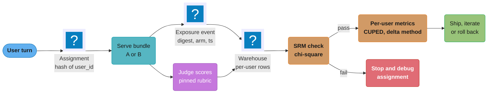
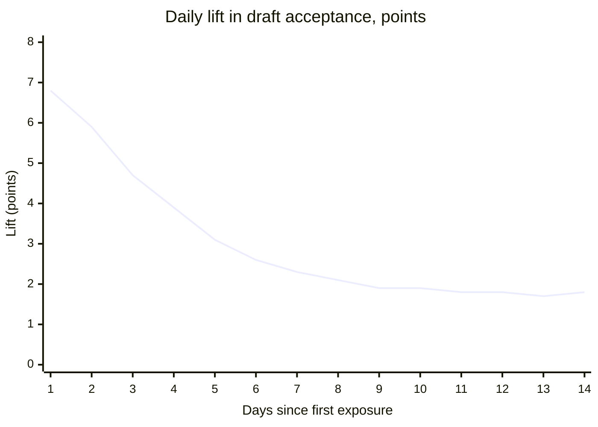

# Experimentation for Generative Features

> **Version anchor (2026-10-18).** **Langfuse v4.63.0** (2026-10-16) stores the per-trace scores
> and **MLflow 3.17.1** (2026-10-13) runs the judges that score each arm in the examples. The
> rule that Claude Opus 4.7 and later models reject a non-default `temperature`, `top_p` or `top_k`
> was read from the Anthropic model deprecations page on 2026-10-18. Statsig, LaunchDarkly,
> GrowthBook, Optimizely and OpenFeature have no pin in this section and are named without a
> version.

## 1. Concept Overview

An online experiment for a generative feature compares two or more release bundles on real users
and decides which one ships. The mechanics of a two-sample test are the same as for a button
color. What changes is everything around the test:

- **The unit.** A chat assistant has users, sessions, conversations and turns. Memory, tone and
  learned user habits carry across them, so the unit you randomize decides whether the arms stay
  separate.
- **The metric.** "Task success" for a generated answer is often scored by an LLM judge, edit
  distance, or a downstream action (sent, accepted, escalated), not by a click. Each has its own
  noise and bias.
- **The variance.** The same prompt gives different outputs, and judges disagree with themselves.
- **Time.** Novelty lasts days, labels arrive late, and shared caches and quotas couple the arms.
- **Allocation.** Cheap prompt variants invite bandits, which minimize regret but do not produce
  an unbiased effect estimate.

This page covers those differences: randomization unit, generative and guardrail metrics,
variance from non-determinism, novelty, interleaving for RAG and ranking, switchback tests,
bandit allocation and sample size. The release decision that consumes the result, and where the
A/B sits on the rollout ladder, is in the parent page
[AI Release Engineering](ai_release_engineering.md). The traffic mechanics that put a user on an
arm are in
[Progressive Delivery for Model Servers](../progressive_delivery_for_model_servers/progressive_delivery_for_model_servers.md).
Offline gate statistics (confidence intervals on eval pass rates, McNemar, multiple slices) are
in [Statistics of Release Gates](../evaluation_gates_and_eval_sets/statistics_of_release_gates.md).
Post-launch quality tracking is in
[Production Quality Monitoring and Drift](../production_quality_monitoring_and_drift/production_quality_monitoring_and_drift.md).

**Not here.** Hypothesis testing, p-values, peeking, CUPED derivation and classic interleaving
for recommenders live in [A/B Testing for ML](../../ml/ml_system_design/ab_testing_for_ml.md).
Online evaluation patterns across ML systems (holdouts, counterfactual evaluation, long-term
metrics) live in
[Experimentation and Online Evaluation](../../ml/case_studies/cross_cutting/experimentation_and_online_evaluation.md).

---

## 2. Intuition

**One-line analogy:** testing a generative feature is a drug trial where every dose comes out of
the bottle slightly different, the nurse grading the patient is also a little random, and
patients feel better for a week just because the pill is new.

**Mental model:** observed variance is a sum of three parts.

```
 Var(observed metric per unit) = Var(between users) + Var(sampling) + Var(judge)
                                  people differ       same prompt,     same answer,
                                                      new output       new score
```

Between-user variance dominates and is handled the usual way: more users, CUPED, a good unit.
Sampling and judge variance are new, and they shrink the measured effect or widen its interval.
Lowering temperature does not remove them on a hosted model you cannot configure, and a judge
that flips 10% of its labels shrinks every true difference by a fifth.

**Why it matters:** most bundle changes move the primary metric by 1-3 points. At that size, a
wrong unit, a biased metric or a bandit read as an A/B produces a confident wrong answer, and the
wrong answer ships to 100% of users.

**Key insight:** decide the unit and the metric before the variant. The unit is where the effect
lives (a user who learns the new assistant), and the metric is what the business pays for (a
draft sent with light edits), not what is easy to log (a thumbs-up from 2% of users).

---

## 3. Core Principles

**Randomize at the unit where effects persist.** If a bundle writes memory, changes a user's
habits, or is visible across conversations, randomize by user. Randomize by conversation only
when conversations are independent and the user cannot compare arms.

**Analyze at the randomization unit.** Randomizing users and running a test over conversations
treats correlated rows as independent and understates the standard error. Aggregate per user, or
use a cluster-robust or delta-method variance.

**One primary metric, several guardrails, written down first.** The primary metric decides the
ship. Guardrails (refusal rate, complaint rate, cost per success, latency) block a ship but do not
make one.

**Log exposure where the bundle serves, not where the user is assigned.** Users assigned but
never served dilute the effect. Users served the wrong arm (fallbacks, timeouts) bias it.

**Pin the judge.** A judge model, prompt and rubric are part of the measurement. Changing any of
them mid-experiment changes the metric under both arms at once, and not equally.

**Bandits optimize; A/B tests decide.** Use a bandit when the goal is to waste less traffic on
weak variants of a reversible, low-stakes choice. Use a fixed-allocation A/B when the goal is an
effect size someone will act on.

---

## 4. Types / Architectures / Strategies

### 4.1 Experiment designs

| Design | Unit | Sensitivity | Bias risks | Use for |
|---|---|---|---|---|
| A/B, user randomized | User | Baseline | Novelty, dilution | Model, prompt or tool changes with persistent effects |
| A/B, conversation randomized | Conversation | Higher (more units) | Cross-conversation carryover | Stateless features: one-shot summarize, classify |
| Interleaving | Query | 10-100x A/B for ranking | Position bias in the LLM context | Retriever, reranker or search ranking changes |
| Switchback | Time block | Low (few blocks) | Carryover between blocks | Changes that act on shared state: routing, batching, caches, quotas |
| Multi-armed bandit | User or request | Optimizes reward, biased estimates | Non-stationarity, delayed reward | Choosing among many cheap prompt variants |
| Long-term holdout | User | Low per week, high over months | Holdout users notice they lack features | Cumulative value of AI features over a quarter |

### 4.2 Randomization unit for a conversational feature

| Unit | Independence | Units per day (example) | Breaks when |
|---|---|---|---|
| Request or turn | Lowest: turns in one conversation see different arms | 2,000,000 | Always, for multi-turn chat: the transcript mixes two bundles |
| Conversation | Turns stay consistent | 400,000 | Memory writes, user habits, users comparing arms |
| Session | Groups short conversations | 300,000 | Long-lived sessions span a release |
| User | Highest | 120,000 | Shared accounts, team workspaces |
| Tenant or workspace | Needed when users in a team see each other's AI output | 3,000 | Few units; needs large effects or long runs |

The ASCII grid below shows the failure of conversation randomization on a feature with memory.

```
 randomize per conversation                      randomize per user
 user   conv1  conv2  conv3  conv4               user   conv1  conv2  conv3  conv4
 u1       A      B      A      B                 u1       A      A      A      A
 u2       B      B      A      A                 u2       B      B      B      B
 u3       A      B      B      A                 u3       A      A      A      A
          |      ^                                        one behavior per user,
          +------+  conv2 (B) reads memory                 memory written and read
             written by conv1 (A)                          by the same arm
```

When `u1` gets arm B in conversation 2, B reads facts A wrote in conversation 1. B's measured
quality now includes A's memory quality, and the difference between arms shrinks toward zero.

### 4.3 Metrics for generative features

| Metric | Kind | How it is computed | Noise and bias |
|---|---|---|---|
| Task success | Primary | Judge or rule on the conversation: resolved, no escalation, no reopen in 48 h | Judge noise; delayed label |
| Draft acceptance with light edits | Primary for drafting | Sent and normalized edit distance under 0.2 | Users who never edit inflate it |
| Code suggestion acceptance rate | Primary for completion | Accepted over shown | Suggestion length changes the denominator |
| Edit distance (normalized) | Secondary | Levenshtein(draft, sent) / len(sent) | Long drafts edited heavily look worse than short ones |
| Regeneration rate | Secondary | Regenerate clicks over answers | Can rise when users like exploring |
| Explicit feedback | Secondary | Thumbs up over thumbs shown | 1-3% response rate, skewed to strong opinions |
| Cost per success | Guardrail | Sum of cost over sum of successes | Ratio metric; needs delta method |
| Refusal rate | Guardrail | Refusals over answers | Rises with stricter guardrails |
| Complaint or report rate | Guardrail | Reports over conversations | Rare; needs long runs |
| TTFT p95, latency | Guardrail | Per-request percentile | Cache state differs by arm share |

---

## 5. Architecture Diagrams

### Assignment to decision



The sample ratio mismatch (SRM) check runs before any metric is read: 50.8% of 200,000 users in
one arm of a 50/50 test gives a chi-square p-value far below 0.001.

### Novelty effect in a drafting feature



The mean lift over the first 3 days is 5.8 points; the steady state from day 8 is about 1.8, a
third of what a team that stops at day 3 would report.

### Team-draft interleaving of two retrievers into one context

```
 retriever A ranking:  a1  a2  a3  a4          retriever B ranking:  b1  a2  b3  b4
                                                (a2 is in both lists)
 round 1: coin = A  ->  A picks a1, B picks b1
 round 2: coin = B  ->  B picks a2,  A picks a3     (a2 credited to B: B picked it)
 round 3: coin = A  ->  A picks a4, B picks b3

 context slots:   [1] a1(A)  [2] b1(B)  [3] a2(B)  [4] a3(A)  [5] a4(A)  [6] b3(B)
 answer cites:         [2]              [3]        [4]
 credit:               B=2  A=1   ->  this query votes for B
```

Each query yields one vote from the citations the answer used. Positions alternate by coin flip
per round, so neither retriever owns the top slots on average; the LLM's preference for early
and late context positions still needs the per-query position audit in §6.6.

---

## 6. How It Works - Detailed Mechanics

### 6.1 Sample size for a task-success change

For a binary metric with base rate `p`, minimum detectable effect `d`, two-sided `alpha = 0.05`
and power 0.8:

```
 n per arm = (z_0.975 + z_0.80)^2 x 2 p (1 - p) / d^2
           = (1.960 + 0.842)^2 x 2 x 0.71 x 0.29 / 0.02^2
           = 7.849 x 0.4118 / 0.0004
           = about 8,080 units per arm
```

```python
from math import ceil
from scipy.stats import norm

def n_per_arm(p: float, mde: float, alpha=0.05, power=0.8,
              design_effect=1.0, judge_flip=0.0, cuped_rho=0.0) -> int:
    z = norm.ppf(1 - alpha / 2) + norm.ppf(power)
    p_obs = judge_flip + p * (1 - 2 * judge_flip)   # symmetric flips pull the rate toward 0.5
    d_obs = mde * (1 - 2 * judge_flip)              # and shrink the effect
    n = z**2 * 2 * p_obs * (1 - p_obs) / d_obs**2
    n *= design_effect                    # clustered rows per unit
    n *= (1 - cuped_rho**2)               # variance removed by a pre-period covariate
    return ceil(n)

n_per_arm(0.71, 0.02)                                  # 8,081
n_per_arm(0.71, 0.02, judge_flip=0.10)                 # 13,600
n_per_arm(0.71, 0.02, judge_flip=0.10, cuped_rho=0.5)  # 10,200
```

Three generative-specific corrections change the answer. A judge that flips 10% of labels needs
68% more units at this base rate. A pre-period covariate with correlation 0.5 (the user's success rate in the four
weeks before) gives back 25%. Analyzing conversations while randomizing users needs the design
effect in §6.2, or the result is wrong rather than slow.

### 6.2 Randomized by user, analyzed by conversation

A team randomized 40,000 users and ran a two-proportion z-test over 200,000 conversations (5 per
user on average).

```python
# BROKEN: rows are conversations, but assignment was per user
from statsmodels.stats.proportion import proportions_ztest
succ = [conv_a.success.sum(), conv_b.success.sum()]
nobs = [len(conv_a), len(conv_b)]
z, p = proportions_ztest(succ, nobs)        # z = 2.60, p = 0.009 -> "ship it"
```

Conversations from one user are correlated: a user who writes clear questions succeeds in most of
them. With intra-cluster correlation (ICC) 0.25 and 5 conversations per user, the design effect is
`1 + (5 - 1) x 0.25 = 2.0`. The naive standard error is too small by a factor of `sqrt(2.0) = 1.41`.

```python
# FIXED: aggregate to the randomization unit, then compare per-user means
import numpy as np
from scipy.stats import ttest_ind

per_user = convs.groupby(["user_id", "arm"]).success.mean().reset_index()
a = per_user[per_user.arm == "A"].success
b = per_user[per_user.arm == "B"].success
t, p = ttest_ind(b, a, equal_var=False)     # t = 1.84, p = 0.066 -> keep running
```

Per-user means weight light and heavy users equally. If the business cares about conversations,
keep the conversation-level ratio and compute its variance with the delta method or a
cluster-robust estimator (`statsmodels` OLS with `cov_type="cluster"` on `user_id`). Either way,
the variance comes from the unit that was randomized.

### 6.3 Variance from non-determinism

Generation varies run to run even when the request is identical. Thinking Machines (Horace He,
September 10, 2025) sent "Tell me about Richard Feynman" 1,000 times at temperature 0 to
Qwen3-235B-A22B-Instruct-2507 and got 80 unique completions; the outputs agreed for 102 tokens and
diverged at token 103. The cause they identified was a lack of batch invariance: kernels give slightly
different numbers at different batch sizes, and server load sets the batch size. With
batch-invariant kernels all 1,000 completions matched.

| Source | Online effect | What to do |
|---|---|---|
| Sampling randomness | Adds within-unit variance; averages out across units | More units; never re-run a request to "confirm" an arm |
| Batch nondeterminism | Same as above, even at temperature 0 | Treat outputs as random; do not assume replays match |
| Hosted models that reject sampling params | `temperature: 0` returns a 400 on Claude Opus 4.7 and later | Remove the field from the bundle; size for the variance |
| Judge randomness | Attenuates the measured effect | Pin the judge; score each output once with a fixed seed where the engine supports it; calibrate flip rate |

Measuring the judge's flip rate is a one-hour job: re-score 500 outputs from last week with the
pinned judge and count disagreements with the first score. A flip rate `e` shrinks a true
difference `d` to `(1 - 2e) d`. At `e = 0.10`, a real 2.0-point gain shows as 1.6 points.

### 6.4 Ratio metrics: cost per success

Cost per success is `sum(cost) / sum(successes)` per arm. Both numerator and denominator vary
by user, so the variance of the ratio is not the variance of either.

```python
def ratio_and_se(cost: np.ndarray, succ: np.ndarray) -> tuple[float, float]:
    """Per-user sums in, ratio and delta-method standard error out."""
    n = len(cost)
    mx, my = succ.mean(), cost.mean()
    vx, vy = succ.var(ddof=1), cost.var(ddof=1)
    cxy = np.cov(succ, cost, ddof=1)[0, 1]
    r = my / mx
    var = (vy / mx**2 - 2 * my * cxy / mx**3 + my**2 * vx / mx**4) / n
    return r, var ** 0.5
```

Per-user cost and successes are strongly positively correlated (heavy users have more of both),
and the covariance term removes that shared variation; dropping it overstates the interval. The guardrail in the parent page's cost gate is
evaluated with this interval, not a point estimate.

### 6.5 Novelty, primacy and learning

Three time effects show up in generative features:

- **Novelty.** Users try the new behavior more, accept more drafts, and the lift decays (§5).
- **Primacy.** Users trained on the old behavior resist the new one; the lift grows over weeks.
  A shorter answer style often starts negative and turns positive.
- **Learning.** Users learn to prompt the new model; early weeks understate the long-run gain.

Plot the effect by days since first exposure, not by calendar date, which mixes new and old users.
Run at least two full weeks and report the day-8-onward effect.

### 6.6 Interleaving for RAG and ranking

Interleaving compares two rankers inside one result, so each query is a paired comparison and
between-user variance drops out. Netflix reported needing roughly 100 times fewer subscribers than
an A/B test for ranking decisions; the classic algorithm and its literature are in
[A/B Testing for ML](../../ml/ml_system_design/ab_testing_for_ml.md).

For RAG the "result list" is the context window and the "click" is a citation:

```python
import random

def team_draft(a: list[str], b: list[str], k: int) -> list[tuple[str, str]]:
    out, used, ia, ib = [], set(), 0, 0
    while len(out) < k and (ia < len(a) or ib < len(b)):
        order = ["A", "B"] if random.random() < 0.5 else ["B", "A"]
        for team in order:
            src, i = (a, ia) if team == "A" else (b, ib)
            while i < len(src) and src[i] in used:
                i += 1
            if i < len(src) and len(out) < k:
                out.append((src[i], team)); used.add(src[i]); i += 1
            if team == "A": ia = i
            else: ib = i
    return out

def credit(slots: list[tuple[str, str]], cited: set[int]) -> str:
    a = sum(1 for j in cited if slots[j][1] == "A")
    b = sum(1 for j in cited if slots[j][1] == "B")
    return "A" if a > b else "B" if b > a else "tie"
```

Two problems are specific to LLM contexts:

1. **Position bias is not symmetric.** Models use the start and end of a long context more than
   the middle. Team-draft balances which team gets early slots in expectation, but a context of 20
   chunks still sends more credit to slots 1-3 and 18-20. Log the slot index of every citation and
   check that credit per slot is the same for both teams.
2. **Citations are a proxy.** An answer can cite a chunk and still be wrong. Pair interleaving with
   a small A/B on task success before shipping a retriever that changes answers, not only
   rankings.

Interleaving picks the better retriever fast; it cannot measure the task-success change.

### 6.7 Switchback tests for shared state

Some changes act on state that all requests share: a cache-aware router, a batching policy, a
speculative-decoding config on a shared GPU pool, or a provider rate-limit split. Per-request
randomization lets both arms share the same cache and queue, so neither arm sees its own effect.

A switchback alternates the whole system between arms in time blocks:

```python
import random
from datetime import datetime, timedelta

def switchback_schedule(start: datetime, days: int, block_min=30, seed=7):
    rng = random.Random(seed)
    blocks, t = [], start
    while t < start + timedelta(days=days):
        blocks.append({"start": t, "arm": rng.choice("AB"),
                       "burn_in_until": t + timedelta(minutes=5)})
        t += timedelta(minutes=block_min)
    return blocks          # 14 days x 48 blocks = 672 blocks, about 336 per arm
```

The first 5 minutes of each block are dropped: prefix caches and the autoscaler carry over from
the previous arm. The analysis unit is the block. Compare block means with time-of-day and
day-of-week fixed effects, because a block at 03:00 and one at 14:00 differ more than the arms do.
With 336 blocks per arm the test detects only large effects (a 10-15% latency change), which is
what routing and batching changes usually produce.

### 6.8 Bandits for prompt variants

Thompson sampling for a binary reward keeps a Beta posterior per arm and serves the arm whose
sampled value is highest. It logs the propensity, the probability the chosen arm had of being
chosen, so the data can be re-weighted later.

```python
import numpy as np
rng = np.random.default_rng(0)

class Thompson:
    def __init__(self, arms): self.s = {a: 1 for a in arms}; self.f = {a: 1 for a in arms}

    def choose(self, draws=2000):
        samples = {a: rng.beta(self.s[a], self.f[a], draws) for a in self.s}
        stacked = np.vstack(list(samples.values()))
        p_best = np.bincount(stacked.argmax(0), minlength=len(self.s)) / draws
        arms = list(self.s)
        k = rng.choice(len(arms), p=p_best)
        return arms[k], p_best[k]            # arm and its propensity, both logged

    def update(self, arm, reward): (self.s if reward else self.f)[arm] += 1

def ipw_mean(log, arm):
    """Unbiased arm mean from bandit logs: weight each reward by 1 / propensity."""
    return sum(r / p for a, r, p in log if a == arm) / len(log)
```

Epsilon-greedy serves the current best with probability `1 - epsilon` (for example 0.9) and a
uniform arm otherwise. It never stops exploring.

Bandits break inference in four ways:

| Failure | Mechanism | Fix |
|---|---|---|
| Adaptive allocation | The naive mean of an arm that got traffic after a lucky start is biased upward | IPW with logged propensities, or an explore window with fixed allocation |
| Non-stationarity | Arm C got most traffic after a UI change on day 4; its "lift" is the UI change | Fixed allocation for the estimate; time-stratified analysis |
| Delayed reward | Task success arrives 48 hours later; the bandit updates on early, biased signals | Update on a proxy only if it is validated; otherwise batch updates daily |
| Many arms, small effects | Twelve prompt variants within 1 point of each other; the bandit chases noise | Prune offline first; run at most 3-4 arms online |

---

## 7. Real-World Examples

**GitHub Copilot, acceptance rate (2022).** GitHub's study "Productivity Assessment of Neural Code
Completion" (Ziegler et al., MAPS 2022) found that the acceptance rate of shown suggestions
predicted developers' perceived productivity better than measures of how much accepted code
persisted. That is a metric-selection result: the cheap, immediate metric was also the valid one,
which is not true for every generative feature.

**DoorDash, switchback tests (2018).** DoorDash described switchback experiments for dispatch
changes, where every order competes for the same drivers in a region. Randomizing orders would let
the arms share drivers; randomizing region and time blocks gives each arm its own supply. GPU
pools, prefix caches and provider rate limits are the same shared-supply problem for LLM serving.

CUPED's origin at Microsoft and Netflix's interleave-then-A/B pipeline are covered in
[A/B Testing for ML](../../ml/ml_system_design/ab_testing_for_ml.md) and
[Experimentation and Online Evaluation](../../ml/case_studies/cross_cutting/experimentation_and_online_evaluation.md).
For a generative feature, the CUPED covariate is the user's success or acceptance rate before the
experiment, and Netflix's two-stage shape fits retriever changes in RAG.

---

## 8. Tradeoffs

### A/B vs interleaving vs bandit

| | Fixed A/B | Interleaving | Bandit |
|---|---|---|---|
| Answers | How much does the metric change? | Which ranker is preferred? | Which arm should get traffic now? |
| Traffic needed | Most | Least | Medium |
| Effect size estimate | Unbiased | None | Biased without IPW |
| Cost of a bad arm | Half the traffic for the full run | Mixed into results | Shrinks quickly |
| Use when | Ship decision | Retriever or reranker choice | Many cheap, reversible variants |

---

## 9. When to Use / When NOT to Use

**Use each design when:**

- **User-randomized A/B:** the decision needs an effect size and traffic reaches the sample size
  within four weeks.
- **Interleaving:** two retrievers or rerankers on the same query stream.
- **Switchback:** the change acts on a shared cache, queue, GPU pool or rate limit, and the
  effect is large enough for a few hundred blocks.
- **Bandit:** several cheap variants, reward within minutes, easy to reverse, nobody quotes the lift.

**Do not run an online experiment when:**

- The change is forced (a provider retirement) and the old arm will not exist next month; use a
  dual run for regression detection.
- The feature has side effects that make the losing arm costly (refunds, legal commitments); use
  a dark launch and a capped canary from the parent page.
- Traffic is too low: 300 conversations a day cannot detect a 2-point change in any reasonable
  time. Rely on the offline gate and say the online effect is unmeasured.

---

## 10. Common Pitfalls

**A win that was clustering.** Users randomized, z-test over conversations, p = 0.009. Re-analyzed
per user: p = 0.066. The feature shipped on the first number and the next quarter's report showed
no change. Fix: the analysis job reads the randomization unit from the experiment config and
refuses a lower-level test without a cluster-robust variance.

**Thumbs-up as the primary metric.** A new model raised thumbs-up rate from 61% to 68%. Feedback
response rate also fell from 2.4% to 1.6%: only happy users kept clicking. Task success by judge
was flat. Fix: explicit feedback is secondary; the primary metric covers every exposed unit.

**SRM from timeouts.** The candidate arm timed out 3% more often; the gateway fell back to the
champion, and exposure was logged for the fallback bundle. Arm B ended with 48.6% of users and
looked better because its hardest requests had moved to arm A. Fix: log the assigned arm and the
served digest separately; analyze by assignment (intent to treat); alert on SRM daily.

**Judge changed mid-test.** The platform team upgraded the judge model on day 6 of a 14-day test.
Both arms' scores rose by 4 points, and the gap between them halved because the new judge preferred
the shorter answers of arm A. Fix: the judge digest is part of the experiment config and cannot
change while it runs.

**Small arm, cold cache.** A 5% candidate arm showed p95 TTFT 22% worse than the champion. The
champion's system prompt was in the provider's prompt cache for 95% of traffic; the candidate's new
prompt was mostly cold. At 50/50 the gap was 3%. Fix: compare latency and cost only at balanced
splits or after warming both prefixes.

**Bandit declared a winner.** A Thompson sampler over 4 prompt variants put 78% of traffic on
variant C by day 5, and the team reported C's naive acceptance rate as a 6-point lift. C had been
favored after a UI change on day 4 that raised acceptance for everyone. IPW-corrected, C's lift
was 1.2 points with an interval spanning zero. Fix: bandit results report IPW estimates only;
ship decisions use a fixed-split confirmation.

**Novelty shipped as the effect.** A drafting feature measured +6 points over three days and
shipped. Steady state was +1.8. The revenue model built on +6 missed by two thirds. Fix: minimum
two-week runs and reporting by days since first exposure.

**Edit distance on empty drafts.** Normalized edit distance divided by the sent length. Users who
deleted the draft and wrote their own reply scored 1.0, but users who discarded the draft and sent
nothing were dropped. The arm with worse drafts lost more users from the denominator and looked
better. Fix: count discard as a failure in the primary metric.

---

## 11. Technologies & Tools

| Tool | Role | Notes |
|---|---|---|
| Statsig | Feature gates and experiments with built-in analysis | Warehouse-native and hosted modes; CUPED and sequential testing options |
| LaunchDarkly | Flags, AI Configs and experimentation | Experiments run on flag variations; AI Configs carry prompt and model settings |
| GrowthBook | Open-source flags and warehouse-native experiment analysis | Bayesian and frequentist engines; self-hostable |
| Optimizely | Experimentation platform | Sequential testing in its stats engine |
| OpenFeature | Vendor-neutral flag API | Hooks log exposure at evaluation time |
| Langfuse | Traces and scores | v4.63.0. Judge and user scores attach to traces with the bundle digest |
| MLflow | GenAI evaluation and judges | 3.17.1. `make_judge()` defines pinned judges for online scoring |

Assignment uses the parent page's flag client, so experiment and release flags agree on the digest.

---

## 12. Interview Questions with Answers

**Q: You randomized by user but ran the test over conversations and got p = 0.009. What is wrong?**
**Short:** Conversations from one user are correlated, so a per-conversation test understates the standard error; analyze per user or with cluster-robust variance.

The test treats 200,000 conversations as independent when only 40,000 units were randomized. With
5 conversations per user and ICC 0.25, the design effect is 2.0, so the true standard error is 1.41
times larger and the z-score falls from 2.60 to 1.84 (p = 0.066). Aggregate to per-user means, or
keep the conversation ratio and use the delta method or a cluster-robust estimator on `user_id`.
The analysis unit must match the randomization unit.

**Q: Why is thumbs-up rate a poor primary metric for a generative feature?**
**Short:** Only 1-3% of users respond and they skew to strong opinions, so the rate moves with who responds rather than with quality.

A bundle can raise thumbs-up rate while the response rate drops, because unhappy users stop
clicking. The metric also misses every unit without feedback. Use a metric defined for every
exposed unit (task success by rule or judge, draft acceptance, escalation) as primary, keep
explicit feedback as secondary, and always report the response rate beside it.

**Q: A Thompson sampler moved 78% of traffic to variant C. Can you report C's lift from the logs?**
**Short:** Not from naive means; adaptive allocation biases them, so use inverse-propensity weighting with logged propensities or a fixed-split confirmation test.

The bandit gave C more traffic after C got lucky or after the environment changed, so C's naive
mean mixes arm quality with timing. Weighting each reward by one over the probability that its arm
was chosen gives an unbiased mean, which is why every bandit decision logs its propensity. For a
ship decision, run a fixed 50/50 confirmation between C and the champion.

**Q: When do bandits break experimental inference?**
**Short:** Under adaptive allocation, non-stationary traffic, delayed rewards, and many arms with small differences.

Adaptive allocation biases arm means. Non-stationarity (a UI change, a weekday pattern) gets
credited to whichever arm held traffic at the time. Delayed rewards, such as task success known
48 hours later, mean the bandit updates on early proxies. With a dozen variants within a point of
each other, it chases noise. Prune variants offline, keep 3-4 online arms, update in daily batches
for delayed rewards, and confirm with a fixed split.

**Q: What is a sample ratio mismatch and why are LLM features prone to it?**
**Short:** It is an arm-size split that differs from the design; LLM features cause it when timeouts, fallbacks or guardrail blocks change which arm gets logged.

A 50/50 test with 48.6% of users in arm B is broken, not unlucky. In LLM systems the slower or
stricter arm times out or is blocked more, the gateway serves the fallback bundle, and exposure
is logged for the fallback. The hardest requests leave the candidate arm, which then looks
better. Log assigned arm and served digest separately, analyze by assignment, and run a
chi-square SRM check before reading any metric.

**Q: Why did a 5% candidate arm show 22% worse p95 TTFT than the champion?**
**Short:** The champion's prompt prefix was warm in the provider prompt cache for 95% of traffic while the candidate's new prefix was mostly cold.

Prompt caches favor the arm with more traffic: cache hits skip prefill on the cached prefix and
are billed at a fraction of the input price. A small arm sees more misses, so its latency and cost
look worse for reasons that disappear at full rollout. Compare latency and cost at a balanced split,
or warm both prefixes, and read latency gates from the shadow rung where traffic shares match.

**Q: How do you detect and handle a novelty effect?**
**Short:** Plot the effect by days since first exposure; if it decays, run at least two weeks and report the steady-state effect from the later days.

Calendar-date plots mix new and returning users and hide the decay. A drafting feature that
showed +6.8 points on day 1 settled at about +1.8 from day 8. Primacy is the reverse pattern: a
lift that grows as users unlearn the old behavior.

**Q: Which randomization unit do you use for a chat assistant with long-term memory?**
**Short:** The user, because memory and learned habits carry across conversations and would mix both arms under conversation randomization.

If conversation 2 runs arm B and reads memory written by arm A in conversation 1, B's quality
includes A's writes and the arms converge. Users who see two behaviors also compare them.
Randomize by user (or by workspace when teammates share AI output), keep assignment sticky for
the experiment, and analyze at the user level.

**Q: How many users do you need to detect a 2-point change in a 71% task-success rate?**
**Short:** About 8,100 per arm at 80% power and alpha 0.05, before corrections for judge noise, clustering and CUPED.

`n = (1.96 + 0.84)^2 x 2 x 0.71 x 0.29 / 0.02^2`, about 8,080. A judge that flips 10% of labels
raises it to about 13,600. A pre-period covariate with correlation 0.5 lowers that by 25%. Multiply
by the design effect if rows are below the randomization unit. Then check the calendar: units per
day times the share in the test, and at least two full weeks for novelty.

**Q: How does judge noise affect an online experiment?**
**Short:** Symmetric judge errors shrink the measured difference by a factor of 1 - 2e, so a 10% flip rate cuts a real effect by a fifth and needs about 68% more units.

The judge's flip rate is measurable: re-score a sample with the pinned judge and count
disagreements. Attenuation does not create false wins, it hides real ones. Pin the judge model,
prompt and rubric for the whole experiment, include the judge digest in the experiment config,
and calibrate it against human labels before the test.

**Q: How does interleaving work for comparing two RAG retrievers, and what bias must you check?**
**Short:** Merge both rankings into one context with team-draft, credit each retriever by the chunks the answer cites, and check that LLM position bias does not favor one team.

Each query becomes a paired comparison, removing between-user variance, so it needs far fewer
queries than an A/B. Models favor the start and end of long contexts, so log the slot of every
citation and confirm credit per slot is balanced across teams. Interleaving picks a winner; it does
not estimate how much task success changes, so follow with a short A/B if answers change.

**Q: When do you choose a switchback test over an A/B test?**
**Short:** When the change acts on shared state such as a prefix cache, batch queue, GPU pool or rate limit, so per-request randomization would let both arms share it.

A switchback alternates the whole system between arms in time blocks (for example 30 minutes),
drops a burn-in at the start of each block for cache and autoscaler carryover, and analyzes block
means with time-of-day effects. Fourteen days give about 672 blocks, enough for 10-15% latency
or throughput effects. It is the right test for cache-aware routing or a new batching policy.

**Q: How do you measure edit distance for a drafting feature without biasing it?**
**Short:** Normalize Levenshtein distance by the sent length, and count discarded drafts as failures instead of dropping them from the denominator.

Dropping discards favors the arm with worse drafts, because its bad drafts leave the
denominator. Define the primary metric as "sent with normalized edit distance under 0.2" over all
shown drafts. Report edit distance as a secondary distribution, not a mean, because long drafts
edited heavily and short drafts sent untouched average into a meaningless number.

**Q: Why does cost per success need the delta method?**
**Short:** It is a ratio of two per-user random sums that are strongly correlated, so the variance of either alone gives the wrong interval.

A bundle with shorter answers and more successes moves both terms. Compute per-user sums of cost
and successes, then the delta-method variance from their means, variances and covariance. The
parent page's cost gate is applied to this interval: a +4% point estimate with an interval of -1%
to +9% passes a +10% limit; a +8% estimate with an interval reaching +14% does not.

**Q: Why log exposure at serve time instead of at assignment?**
**Short:** Users assigned but never served dilute the effect, and users served a fallback bundle bias it; only the serve-time record shows what each user actually got.

Assignment at login puts every user in an arm, but only some open the assistant. Analysis over
all assigned users divides the effect by the inverse share exposed. Log an exposure event when a
bundle answers a turn, with assigned arm, served digest and reason, and analyze exposed users by
assigned arm.

**Q: Which guardrail metrics belong in a generative-feature experiment?**
**Short:** Refusal rate, complaint or report rate, cost per success, TTFT p95, and a safety judge rate, each with a pre-set threshold that blocks the ship.

Guardrails catch a primary-metric win bought with harm: an assistant that resolves more tickets by
promising refunds, or one that wins on task success by refusing hard questions. Set each threshold
before launch, size the test for the rarest guardrail you care about (report rates need long
runs), and do not let a guardrail win argue for a ship.

---

## 13. Best Practices

- Choose the unit before the variant: user by default, conversation only for stateless features.
- Analyze at the randomization unit, or use cluster-robust or delta-method variance.
- Name one primary metric defined for every exposed unit; keep explicit feedback secondary.
- Pin the judge model, prompt and rubric, and put the judge digest in the experiment config.
- Run an SRM check before reading any metric; log assigned arm and served digest separately.
- Run at least two full weeks; report the effect by days since first exposure.
- Compare latency and cost only at balanced splits or with warm prefixes.
- Log propensities for every bandit decision; report IPW estimates; confirm with a fixed split.
- Count discards and abandonments as failures, never as missing data.

---

## 14. Case Study

### Prompt variants and a model swap for a reply-drafting feature

**Context.** A help-desk product drafts replies for 60,000 support agents a day across 3,000
customer workspaces. The champion bundle drafts with a mid-size hosted model and prompt v8. The
team has three new prompt variants (v9a, v9b, v9c) and wants to test a larger model with the best
prompt. The primary metric is "sent with normalized edit distance under 0.2", base rate 42%.

**Attempt 1: a bandit.** The team ran Thompson sampling over v8, v9a, v9b and v9c for 10 days,
updated on each draft. By day 5, v9c held 78% of traffic. The team reported a 6-point lift from
v9c's naive acceptance rate and asked to ship the model swap on top of it.

Review found three problems:

| Problem | Evidence | Effect |
|---|---|---|
| Non-stationarity | An editor UI change on day 4 raised acceptance for all arms by 3 points; v9c held most traffic after it | About half the naive lift |
| Adaptive bias | IPW from logged propensities | v9c lift 1.2 points, 95% interval -0.3 to 2.7 |
| Wrong unit | Each draft was a unit; agents saw several variants per hour and compared them | Arms not independent |

**Attempt 2: a fixed A/B.** Unit: agent (user), since agents learn a draft style. Workspace-level
randomization was considered and rejected: 3,000 workspaces are too few units for a 1.5-point
effect once between-workspace variance is counted, and running longer does not add workspaces. Design:

- Arms: champion (v8, mid-size model) against candidate (v9c, larger model), 50/50 by
  `hash(agent_id)`.
- Primary: sent with edit distance under 0.2, discards counted as failures. Target effect 1.5
  points.
- Guardrails: cost per sent draft at most +10%, TTFT p95 at most +15%, customer complaint rate
  per 10,000 replies no worse than +0.5.
- Judge: none for the primary metric; a pinned safety judge for the complaint-risk guardrail.
- Sample: `n_per_arm(0.42, 0.015)` gives about 17,000 agents per arm. CUPED on each agent's
  pre-period acceptance rate (correlation 0.55) cut that to about 11,900. Reached on the first day; run
  for 14 days for novelty.
- SRM check daily on assigned arm. Exposure logged when a draft is displayed, with assigned arm
  and served digest.

**Results.**

| Metric | Champion | Candidate | Difference |
|---|---|---|---|
| Sent with light edits, days 1-3 | 41.8% | 46.9% | +5.1 pts |
| Sent with light edits, days 8-14 | 42.1% | 44.0% | +1.9 pts (95% CI 1.1 to 2.7) |
| Cost per sent draft | $0.0061 | $0.0064 | +4.9% (CI +2.1% to +7.8%) |
| TTFT p95 at 50/50 | 820 ms | 905 ms | +10.4% |
| Complaints per 10,000 replies | 3.1 | 3.0 | -0.1 |
| SRM p-value | | | 0.41 |

On day 2, at a 5/95 warm-up split, TTFT p95 for the candidate had read +24%. At 50/50 it was
+10.4%. The difference was prompt-cache warmth, and the gate used the 50/50 number.

**Decision.** Ship the candidate at the steady-state +1.9 points, not the first-week +5.1. The
revenue model for the larger model's cost used +1.9; at the first-week number it would have
overstated the value by 2.7 times. The release moved to the ramp rung of the ladder in
[AI Release Engineering](ai_release_engineering.md), and the online metrics were added to
[Production Quality Monitoring and Drift](../production_quality_monitoring_and_drift/production_quality_monitoring_and_drift.md)
so the post-launch rate is tracked against the 44.0% the experiment measured.

**Platform changes.** Bandits stayed for suggestion phrasing with IPW-only reporting; the analysis
service now refuses tests below the randomization unit and blocks metrics until SRM passes.
