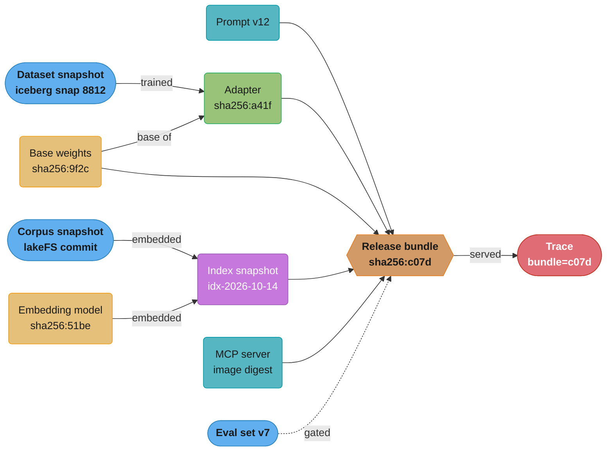
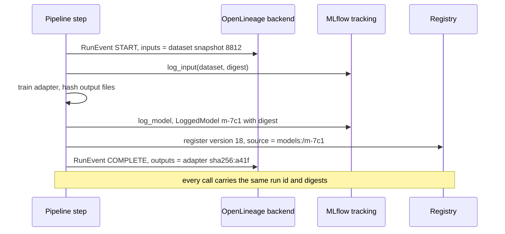
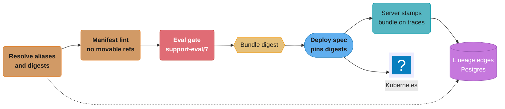

# Artifact Versioning and Lineage

> **Version anchor (2026-10-18).** MLflow 3.17.1 (2026-10-13); Kubeflow Hub v0.3.17 (2026-09-21), the project renamed from Kubeflow Model Registry at v0.3.9; Kubernetes 1.37 (1.37.1 2026-09-15), with ImageVolume GA since 1.36; OpenSSF Model Signing (`sigstore/model-transparency`) v1.1.1 (2025-10-10); CycloneDX specification 1.7 (repo tag 1.7.2, 2026-09-17).

An AI system in production is not one artifact. It is base weights, adapters, a tokenizer, a prompt template, an embedding model, a vector index snapshot, tool servers, decoding parameters, a guardrail policy, an eval set and the container that runs them. Each one changes on its own schedule, and several of them change without a deploy. This module covers how each artifact gets an identity that cannot drift, how a release pins a closed set of those identities, and how lineage records which artifact was built from which, so that "what was running at 14:02 on Tuesday" and "which models saw this customer's data" have answers.

---

## 1. Concept Overview

Three kinds of identifier name an artifact, and they behave differently:

| Identifier | Example | Can it point at different bytes later? | Use it for |
|---|---|---|---|
| Content digest | `sha256:9f2c...e41a` | No. It is computed from the bytes | Pinning, caching, dedup, signing, audit |
| Version number | `fraud-scorer/17`, `v2.3.0`, `corpus@v41` | Not if the store is immutable; yes on a store that allows overwrite | Human reference, ordering, changelogs |
| Alias or tag | `@champion`, `:latest`, `main`, `gpt-x-latest` | Yes, by design | Promotion and rollback, never as the recorded identity |

**Versioning** is the discipline of giving every artifact an identity from the first row and treating the other two rows as pointers to it. **Lineage** is the graph of typed edges between those identities: dataset snapshot `trained` model, model `embedded` corpus into index snapshot, prompt version `included in` release bundle, release bundle `served` trace. A lineage graph answers questions in both directions:

- Upstream (provenance): what produced this answer, this model, this index?
- Downstream (impact): what did this dataset, base model or tool server flow into?

The artifact types an AI release has to cover:

| Artifact | Natural identity | The default that drifts |
|---|---|---|
| Base weights | Per-file sha256 of safetensors shards, Hub commit id | `from_pretrained("org/model")` reads branch `main` |
| LoRA adapters | Per-file digest plus base-model digest it was trained against | Adapter loaded onto a different base revision |
| Tokenizer and chat template | Digest of `tokenizer.json`, `tokenizer_config.json` | Template edited in the model repo after release |
| Prompt template | Prompt registry version (`prompts:/support-answer/12`) | Edited in a UI with no version bump |
| Embedding model | Digest, plus output dimension | Query encoder upgraded, index not rebuilt |
| Vector index | Snapshot id plus embedding-model digest plus corpus snapshot | Index updated in place by an ingest job |
| Tool and MCP servers | Image digest, tool schema hash | Another team redeploys the server |
| Decoding and runtime config | Hash of the canonical config | Default `max_tokens` changed by an engine upgrade |
| Guardrail policy | Policy version | Policy file hot-reloaded |
| Eval set | Dataset version plus row-count and digest | Rows appended to "the" eval set |
| Container | OCI image digest | `:latest` or a re-pushed tag |
| Hosted provider model | Dated snapshot id | Alias that the provider moves |

A **release bundle** is the closed set of resolved identities for one deployable unit, written as a manifest and identified by the digest of that manifest. The bundle is what gets promoted, rolled back, diffed and audited. The manifest worked example lives in [AI Release Bundle and Lineage](../case_studies/cross_cutting/ai_release_bundle_and_lineage.md); this module covers the identity rules and the lineage machinery under it.

**Not here.** Run logging, metric comparison and hyperparameter search are in [Experiment Tracking and Versioning](../../ml/experiment_tracking_and_versioning/experiment_tracking_and_versioning.md). Data and label versioning tools (lakeFS, DVC, Iceberg snapshots, Label Studio exports) are in [Dataset and Label Versioning](../dataset_and_label_versioning/dataset_and_label_versioning.md). Registry stages, aliases and model packaging formats are in [Model Registry and Packaging](../model_registry_and_packaging/model_registry_and_packaging.md). Signing, attestation and provenance verification are in [ML Supply Chain Security](../ml_supply_chain_security/ml_supply_chain_security.md). Prompt authoring and review flow are in [Prompt Lifecycle and Versioning](../prompt_lifecycle_and_versioning/prompt_lifecycle_and_versioning.md).

---

## 2. Intuition

> **One-line analogy**: a release bundle is a bill of materials with part numbers stamped from the parts themselves, and lineage is the supplier record that says which batch each part came from.

**Mental model**: think of every artifact as a git object. The digest is the object id. A version number is a tag someone promised never to move. An alias is a branch: it moves on purpose. Git works because commits reference parents by object id, never by branch name. A release that references `@champion` is a commit whose parent pointer says "whatever main is today".

**Why it matters**: an LLM application can change behavior with zero commits in its repo. The provider moves an alias, a data team re-runs ingest into the live index, a platform team redeploys an MCP server, someone edits a prompt in a UI. If the release record holds names instead of digests, the incident review cannot say what changed, and rollback restores the names, not the behavior.

**Key insight**: identity must be captured at write time, by the process that produced the artifact, as a digest. Lineage reconstructed later from logs and naming conventions is a guess. Every downstream use (rollback, reproducibility, erasure, blast radius) depends on that first write being right.

---

## 3. Core Principles

**Identity comes from content.** A sha256 over the bytes is the only identifier that two parties can verify independently. Names, versions and timestamps are metadata attached to a digest.

**Names are pointers, resolved once.** Aliases exist so promotion and rollback are a pointer move. They are resolved to digests when the release bundle is built, and the bundle stores the resolved digest. A serving process does not re-resolve an alias per request or per pod start.

**Immutability is enforced by the store, not by convention.** A registry with tag immutability on, an object store with versioning and a deny on overwrite, a prompt registry that creates a new version on every save. "We do not overwrite tags" is a convention that fails at 2 a.m.

**A release is a closed set.** Every input that can change behavior is either pinned in the bundle or explicitly listed as unpinned with an owner (a provider alias you cannot pin, a live corpus). Nothing is implicit.

**Lineage edges are typed and written by the producer.** The training job writes `dataset -> model`; the indexer writes `embedding model + corpus -> index`; the release pipeline writes `bundle -> components`; the server stamps the bundle digest on every trace. No central team infers edges after the fact.

**Reproducibility is a stated level, not a yes or no.** Bit-exact, numerically within tolerance, statistically equivalent on the eval set, and behaviorally equivalent are four different promises with four different costs. A team picks one per artifact type and records what that level needs.

**Retention follows the reference graph.** An artifact referenced by a live or auditable bundle is not garbage. Garbage collection walks references from manifests, the way a container registry walks manifests before deleting blobs.

---

## 4. Types / Architectures / Strategies

### 4.1 Identity schemes

| Scheme | How it is produced | Collision or drift risk | Typical home |
|---|---|---|---|
| sha256 content digest | Hash of bytes, per file | None in practice | OCI registries, Hugging Face LFS pointers, model signing manifests |
| Merkle root over files | Hash of sorted `(path, file digest)` pairs | None, and order-independent | Sharded checkpoints, adapter sets, index snapshots |
| Git commit id | Hash of tree plus parents plus metadata | Same bytes, different commit if metadata differs | Hub repos, prompt repos, config repos |
| Monotonic version | Store increments a counter on write | Overwrite if the store allows it | MLflow model versions, MLflow prompt versions, W&B `v0, v1, ...` |
| Semantic version | Human decides major, minor, patch | Two people pick the same number for different bytes | Public model releases, tool server APIs |
| Alias or tag | Human or pipeline moves a pointer | Moves by design | `@champion`, `:latest`, `main`, provider `-latest` model names |
| Dated snapshot id | Provider freezes a model behind a dated name | Provider retires it on a schedule | Hosted LLM APIs |

Semver for models needs a written rule, because "breaking" is behavioral. A workable rule: major when the input or output contract changes (tokenizer, chat template, output schema, embedding dimension or space), minor when weights change and the eval gate passed, patch when only metadata or packaging changed and the weight digest is the same.

### 4.2 Release-bundle manifest fields

| Field | Resolved to | Why it is in the bundle |
|---|---|---|
| `model.digest` | Merkle root of weight shards | Base weights decide almost everything |
| `model.source` | Hub repo plus commit id, or registry URI plus version | Provenance and re-download |
| `adapters[].digest` and `adapters[].base_digest` | Adapter Merkle root, and the base it was trained on | An adapter on the wrong base loads without error |
| `tokenizer.digest` | Hash of tokenizer and template files | Template changes alter every prompt |
| `prompt.version` | Prompt registry version, plus template digest | Prompt edits are the most frequent change |
| `tools[]` | Server name, image digest, tool schema digest | Tool behavior changes model behavior |
| `index.snapshot_id` | Index snapshot, with embedding model digest and corpus snapshot | Retrieval quality depends on all three |
| `decoding` | Canonical hash of temperature, top_p, max_tokens, stop, seed | Engine defaults move between versions |
| `guardrails.policy_version` | Policy version and digest | Refusal and filtering behavior |
| `eval_set.version` | Dataset version and digest | Gate results are only comparable on the same set |
| `decision_schema.version` | Schema version for structured outputs | Downstream parsers depend on it |
| `runtime` | Container digest, engine version, CUDA, driver, GPU SKU | Numerics and kernels differ by stack |
| `unpinned[]` | Name, owner, reason | Provider aliases, live corpora, user memory |

### 4.3 Lineage capture models

| Model | Where edges come from | Strength | Gap |
|---|---|---|---|
| Event stream (OpenLineage) | Jobs emit `START` and `COMPLETE` run events with input and output datasets | Vendor-neutral, works across Spark, Airflow, dbt, custom jobs | Dataset-centric; models and prompts need custom facets |
| Tracking store links (MLflow 3) | `log_input`, `LoggedModel`, traces linked to a model id | Model, dataset digest and GenAI traces in one store | Only sees what code logs to it |
| Artifact graph (W&B Artifacts) | `use_artifact` and `log_artifact` calls inside a run | Automatic edges per run, digest-based versions | Only inside W&B runs |
| Catalog lineage (Unity Catalog) | Query engine records reads and writes | Column-level, no code changes for SQL workloads | Scoped to work that runs on the platform |
| Registry metadata (Kubeflow Hub) | Registration call carries source URI, version and properties | Kubernetes-native model and catalog records | Edges are properties you set, not captured reads |

Most platforms combine two: an event stream for data and pipeline edges, and the tracking store or registry for model, prompt and trace edges, joined on digests.

### 4.4 Reproducibility levels

| Level | Promise | What it needs | Typical for |
|---|---|---|---|
| Bit-exact | Same bytes out | Same container digest, same GPU SKU, deterministic kernels, fixed batch shape, fixed seed | Small classical models, regulated scoring |
| Numerical | Outputs within a tolerance (for example 1e-5 relative) | Same stack, deterministic algorithms where available | Embedding models, rankers |
| Statistical | Eval metrics within the confidence interval of the original | Same data snapshot, same eval set version, same code | LLM fine-tunes, most training |
| Behavioral | Same release-gate outcome | Same bundle, eval set and gate config | Hosted-model applications |

---

## 5. Architecture Diagrams

### Lineage graph across one release



Every edge carries digests on both ends, and the trace carries the bundle digest. Walking left from a trace answers "what produced this answer"; walking right from the dataset snapshot answers "what did this data reach".

### Alias drift: the same name, two different models

```
time ->        Mon 09:00          Tue 16:30 (alias moved)          Wed 10:00
               |                  |                                |
@champion  ->  v17 sha256:4be1    v18 sha256:77c0                  v18 sha256:77c0
               |                  |                                |
pod A start    resolves -> v17    .                                .
pod B start    .                  resolves -> v18                  .
batch job      .                  .                                resolves -> v18

Recorded "model = fraud@champion" for all three:   audit cannot tell A from B   ✗
Recorded "model = sha256:4be1 / sha256:77c0":       audit sees the split         ✓
```

Resolution at pod start left pod A on v17 and pod B on v18 behind one alias from Tuesday 16:30 until pod A restarts, and a record that says `fraud@champion` cannot show the split. The fix is to resolve the alias once, in the release pipeline, and ship the digest.

### Merkle manifest over a sharded checkpoint

```
model-00001-of-00030.safetensors   sha256:1a0c...   4.6 GB
model-00002-of-00030.safetensors   sha256:e93b...   4.6 GB
...                                ...
model-00030-of-00030.safetensors   sha256:07d2...   2.1 GB
config.json                        sha256:5c1e...   0.7 KB
tokenizer.json                     sha256:b8a4...   9.1 MB
tokenizer_config.json              sha256:61f0...  50.0 KB
        |
        |  sort by path, hash each "path  digest" line
        v
manifest root  sha256:9f2c...     <- the model's identity
```

Per-file hashing runs in parallel, lets a loader verify each shard as it streams, and makes the identity independent of how the files were archived. Changing only `tokenizer_config.json` changes the root, which is the point.

### Write-time lineage capture in a training step



The step that has the bytes in hand writes every edge. Nothing downstream has to guess which run produced version 18.

### Blast radius from one dataset snapshot

```
dataset snapshot 8812 (contains subject 4471's tickets)
├─ adapter sha256:a41f              trained on 8812
│  ├─ bundle sha256:c07d            prod, 100% traffic
│  └─ bundle sha256:91aa            staging
├─ eval set v7                      12 rows sampled from 8812
│  └─ gate results for c07d, 91aa
├─ index snapshot idx-2026-10-14    built from corpus that includes 8812 rows
│  └─ bundle sha256:c07d
└─ synthetic set syn-0930           generated from 8812
   └─ adapter sha256:d2e9           archived, still in registry
```

An erasure request for subject 4471 reaches five derived artifacts (two adapters, an eval set, an index snapshot and a synthetic set) and two bundles that reference them. Three of the five (the eval set, the synthetic set, the archived adapter) nobody would list from memory.

---

## 6. How It Works - Detailed Mechanics

### 6.1 Hashing model weights

A 70B-parameter model in BF16 is about 140 GB, usually shipped as around 30 safetensors shards under 5 GB each. sha256 runs at roughly 1 to 2 GB/s per core on CPUs with SHA extensions, so one core takes one to two minutes; with one worker per shard the job becomes disk-bound, and an NVMe drive at 3 to 7 GB/s finishes in 20 to 50 seconds.

```python
import hashlib
from concurrent.futures import ThreadPoolExecutor
from pathlib import Path

CHUNK = 8 * 1024 * 1024


def file_digest(path: Path) -> str:
    h = hashlib.sha256()
    with path.open("rb") as f:
        while block := f.read(CHUNK):
            h.update(block)
    return h.hexdigest()


def model_digest(root: Path) -> tuple[str, dict[str, str]]:
    files = sorted(p for p in root.rglob("*") if p.is_file() and ".cache" not in p.parts)
    with ThreadPoolExecutor(max_workers=16) as pool:
        digests = dict(zip((str(p.relative_to(root)) for p in files), pool.map(file_digest, files)))
    lines = "".join(f"{path}  {d}\n" for path, d in sorted(digests.items()))
    return "sha256:" + hashlib.sha256(lines.encode()).hexdigest(), digests
```

`hashlib` releases the GIL while hashing large buffers, so threads scale here. The per-file map is stored next to the root: a loader can verify each shard as it reads it, and a diff of two maps shows exactly which files changed.

Broken: hashing a tarball.

```bash
# BROKEN: same weights, different digest on every build
tar czf model.tgz model/ && sha256sum model.tgz
```

`tar` records mtimes, uid and file order, and gzip records a timestamp in its header. Two builds of identical weights produce different digests, so dedup and cache hits stop working, and a signature over the tarball says nothing about the files a loader reads after extraction. Hash the files, then archive.

### 6.2 Pinning sources: broken then fixed

```python
# BROKEN: reads whatever branch main points at today
model = AutoModelForCausalLM.from_pretrained("acme/support-7b")
tok = AutoTokenizer.from_pretrained("acme/support-7b")

# FIXED: a 40-hex commit id cannot move
REV = "3f9a1c0d8e7b6a5f4e3d2c1b0a9f8e7d6c5b4a39"
model = AutoModelForCausalLM.from_pretrained("acme/support-7b", revision=REV)
tok = AutoTokenizer.from_pretrained("acme/support-7b", revision=REV)
```

`revision` accepts a branch, a tag or a commit id. Only the commit id is immutable. Load the tokenizer from the same revision as the weights; a tokenizer from `main` with weights from a pinned commit is a quiet mismatch.

```yaml
# BROKEN: a tag that the registry allows to be re-pushed
image: registry.acme.io/rag-api:2.4.1

# FIXED: digest, with the tag kept for humans
image: registry.acme.io/rag-api:2.4.1@sha256:5d0e9c7a1b...e2
```

When both tag and digest are present, container runtimes pull by digest. Turn on tag immutability in the registry as well (ECR `imageTagMutability: IMMUTABLE`, Harbor immutability rules), so the tag cannot be re-pushed. [Artifact and Registry Management](../../devops/artifact_and_registry_management/artifact_and_registry_management.md) covers the registry side.

For model weights shipped as OCI artifacts, Kubernetes ImageVolume (GA since 1.36) mounts the artifact read-only into the pod, and the same rule applies:

```yaml
volumes:
  - name: weights
    image:
      reference: registry.acme.io/models/support-7b@sha256:9f2c4e...a1
      pullPolicy: IfNotPresent
```

### 6.3 The release-bundle manifest

```yaml
bundle: support-assistant
created: 2026-10-14T09:12:44Z
built_by: release-pipeline run 55120
model:
  source: hf://acme/support-7b@3f9a1c0d8e7b6a5f4e3d2c1b0a9f8e7d6c5b4a39
  digest: sha256:9f2c4e...a1
adapters:
  - name: billing-lora
    digest: sha256:a41f02...7c
    base_digest: sha256:9f2c4e...a1
tokenizer:
  digest: sha256:b8a4d1...90
prompt:
  uri: prompts:/support-answer/12
  template_digest: sha256:3e77aa...0b
tools:
  - name: refunds-mcp
    image: registry.acme.io/refunds-mcp@sha256:1c9e...44
    schema_digest: sha256:0f12...e3
index:
  snapshot_id: idx-2026-10-14
  embedding_model_digest: sha256:51be70...2d
  corpus: lakefs://kb/commits/8b2f61c0
decoding:
  temperature: 0.2
  top_p: 0.9
  max_tokens: 768
  digest: sha256:77d1...c8
guardrails:
  policy_version: pii-v9
eval_set:
  version: support-eval/7
  rows: 1840
  digest: sha256:e0a3...59
decision_schema:
  version: escalate-v3
runtime:
  image: registry.acme.io/serving@sha256:4410...be
  engine: vllm v0.32.0
  cuda: "12.9"
  driver: "580.95"
  gpu: H100-SXM-80GB
unpinned:
  - name: user memory store
    owner: personalization team
    reason: per-user state, versioned by user id and timestamp
```

The bundle's identity is the sha256 of its canonical form: keys sorted, no whitespace variation, UTF-8. Hashing the YAML text as written gives two digests for the same content whenever someone reorders keys.

```python
import hashlib, json, yaml

def bundle_digest(path: str) -> str:
    doc = yaml.safe_load(open(path))
    doc.pop("created", None)
    doc.pop("built_by", None)
    canonical = json.dumps(doc, sort_keys=True, separators=(",", ":"), ensure_ascii=False)
    return "sha256:" + hashlib.sha256(canonical.encode()).hexdigest()
```

`created` and `built_by` are removed before hashing so that two pipeline runs that resolve to identical components produce the same bundle digest. Rebuilding an unchanged release is then a no-op that the promotion system can detect.

### 6.4 Resolving aliases once

```python
from mlflow import MlflowClient

client = MlflowClient()

def resolve_model(name: str, alias: str) -> dict:
    mv = client.get_model_version_by_alias(name, alias)
    return {"uri": f"models:/{name}/{mv.version}", "version": mv.version, "source": mv.source}
```

The release pipeline calls resolvers like this for every aliased input, writes the resolved versions and digests into the manifest, and fails the build if any field still holds an alias, a branch name, an image tag without a digest, or a provider name ending in `latest`. A recursive lint over the manifest catches all four:

```python
import re

MOVABLE = re.compile(r"(@[a-z_]+$|:latest\b|-latest\b|@main\b|/main$)")

def lint(manifest: dict, path: str = "") -> list[str]:
    errors = []
    for key, value in manifest.items():
        here = f"{path}.{key}" if path else key
        if key == "unpinned":
            continue
        if isinstance(value, dict):
            errors += lint(value, here)
        elif isinstance(value, list):
            for i, item in enumerate(value):
                errors += lint(item, f"{here}[{i}]") if isinstance(item, dict) else []
        elif isinstance(value, str) and (
            MOVABLE.search(value) or (key == "image" and "@sha256:" not in value)
        ):
            errors.append(f"{here}: movable reference {value!r}")
    return errors
```

### 6.5 OpenLineage run events

OpenLineage defines three core entities: a **job** (a named process), a **run** (one execution, identified by a UUID), and a **dataset** (identified by namespace and name). Jobs emit run events with `eventType` `START`, `RUNNING`, `COMPLETE`, `ABORT`, `FAIL` or `OTHER`, listing inputs and outputs. Extra metadata rides in **facets**: schema, data source, column lineage, and custom facets with their own schema URL.

```json
{
  "eventType": "COMPLETE",
  "eventTime": "2026-10-14T08:41:07Z",
  "producer": "https://git.acme.io/ml/train-adapter",
  "job": {"namespace": "ml-training", "name": "train_billing_lora"},
  "run": {"runId": "0192b6c4-5e1f-7a3b-9c2d-4e8f1a6b7c90"},
  "inputs": [
    {"namespace": "iceberg://warehouse", "name": "support.tickets_curated",
     "facets": {"version": {"datasetVersion": "8812"}}}
  ],
  "outputs": [
    {"namespace": "s3://acme-models", "name": "adapters/billing-lora",
     "facets": {"version": {"datasetVersion": "sha256:a41f02...7c"}}}
  ]
}
```

The adapter is modeled as an output dataset whose version is its digest. That is the standard trick for putting models into a dataset-centric lineage graph. The `datasetVersion` on the Iceberg input is the snapshot id; the [Apache Iceberg](../../technologies/apache_iceberg/apache_iceberg.md) page covers why snapshot ids are stable and time-travel queries can re-read them. Marquez, the reference backend, stores these events and serves the graph over an API.

### 6.6 MLflow 3: LoggedModel and trace linkage

In MLflow 3 a model is a `LoggedModel` entity with its own id, not a path inside a run, as described in [MLflow Deep Dive](../../ml/mlflow_deep_dive/mlflow_deep_dive.md). For GenAI applications, the useful part is that traces link to a model id, so a production trace can be walked back to the exact application version that produced it.

```python
import mlflow

mlflow.set_experiment("support-assistant")

active = mlflow.set_active_model(name=f"support-assistant-{bundle_sha.removeprefix('sha256:')[:12]}")
mlflow.log_model_params(model_id=active.model_id, params={
    "bundle_digest": bundle_sha,
    "prompt_uri": "prompts:/support-answer/12",
    "index_snapshot": "idx-2026-10-14",
    "base_model_digest": "sha256:9f2c4e...a1",
})

prompt = mlflow.genai.load_prompt("prompts:/support-answer/12")

# every trace produced after set_active_model carries this model id
traces = mlflow.search_traces(model_id=active.model_id)
```

Two details make this work in practice. First, the model name includes the bundle digest prefix, so one bundle maps to one `LoggedModel`, and a redeploy of the same bundle reuses it. Second, the prompt is loaded by version URI, never by alias, so the prompt version recorded in params is the one that ran.

### 6.7 W&B Artifacts

```python
import wandb

with wandb.init(project="support-rag", job_type="build-index") as run:
    corpus = run.use_artifact("kb-corpus:v41")          # input edge recorded
    path = corpus.download()
    index_dir = build_index(path, embed_model_digest)
    out = wandb.Artifact("support-index", type="vector-index",
                         metadata={"embedding_model_digest": embed_model_digest})
    out.add_dir(index_dir)
    run.log_artifact(out, aliases=["candidate"])         # output edge, new version
```

W&B versions an artifact as `v0`, `v1`, ... and only creates a new version when the content digest changes. `use_artifact` and `log_artifact` inside the same run give the graph its edges with no extra code. `latest` and custom aliases move; `kb-corpus:v41` does not.

### 6.8 Unity Catalog lineage queries

Unity Catalog records table and column lineage for queries that run on the platform and exposes it through system tables.

```sql
-- every table written from the curated tickets table in the last 90 days
SELECT DISTINCT target_table_full_name, entity_type, MAX(event_time) AS last_write
FROM system.access.table_lineage
WHERE source_table_full_name = 'main.support.tickets_curated'
  AND event_time >= current_date() - INTERVAL 90 DAYS
GROUP BY target_table_full_name, entity_type;
```

This covers SQL and notebook jobs on the platform. A training job that reads Parquet files by path from object storage outside the catalog leaves no row here, which is why model edges are usually written explicitly.

### 6.9 Reproducibility manifest

The training or build job writes the environment it ran in next to the artifact:

```python
import os, platform, subprocess, torch

def runtime_facts() -> dict:
    driver = subprocess.run(
        ["nvidia-smi", "--query-gpu=driver_version,name", "--format=csv,noheader"],
        capture_output=True, text=True, check=True,
    ).stdout.strip().splitlines()[0]
    return {
        "image_digest": os.environ["IMAGE_DIGEST"],      # injected by the pipeline
        "python": platform.python_version(),
        "torch": torch.__version__,
        "cuda": torch.version.cuda,
        "cudnn": torch.backends.cudnn.version(),
        "driver_and_gpu": driver,
        "deterministic": torch.are_deterministic_algorithms_enabled(),
        "cublas_workspace": os.environ.get("CUBLAS_WORKSPACE_CONFIG"),
        "seed": int(os.environ["SEED"]),
    }
```

For a bit-exact or numerical level on PyTorch, the deterministic-algorithm flags, `CUBLAS_WORKSPACE_CONFIG` and the list of nondeterministic ops are in [PyTorch Deep Dive](../../ml/pytorch_deep_dive/pytorch_deep_dive.md). `runtime_facts()` records whether they were on.

Seeds are not enough. Three sources of drift survive a fixed seed:

1. Atomic adds in GPU kernels accumulate in arrival order, and floating-point addition is not associative.
2. Different GPU SKUs and library versions pick different GEMM tilings and split-K strategies, so the reduction order changes.
3. In inference, the batch a request lands in changes kernel shapes. Thinking Machines Lab reported on September 10, 2025 that 1,000 temperature-0 completions of one prompt on Qwen3-235B-A22B-Instruct-2507 produced 80 distinct outputs, and 1,000 identical outputs once they used batch-invariant kernels.

That is why the runtime block in the bundle records engine version, CUDA, driver and GPU SKU, and why most LLM teams promise the statistical or behavioral level rather than bit-exact.

### 6.10 Lineage queries for erasure and blast radius

Store edges in a plain table and walk them with a recursive query. Postgres is enough for millions of edges.

```sql
CREATE TABLE lineage_edge (
  src_digest  text NOT NULL,
  dst_digest  text NOT NULL,
  relation    text NOT NULL,      -- trained, base_of, embedded, sampled, generated, bundled, served
  recorded_at timestamptz NOT NULL DEFAULT now(),
  PRIMARY KEY (src_digest, dst_digest, relation)
);

-- downstream of a dataset snapshot, with depth and path
WITH RECURSIVE downstream AS (
  SELECT dst_digest, relation, 1 AS depth, ARRAY[src_digest, dst_digest] AS path
  FROM lineage_edge WHERE src_digest = 'iceberg:support.tickets_curated@8812'
  UNION ALL
  SELECT e.dst_digest, e.relation, d.depth + 1, d.path || e.dst_digest
  FROM lineage_edge e JOIN downstream d ON e.src_digest = d.dst_digest
  WHERE d.depth < 10 AND NOT e.dst_digest = ANY(d.path)
)
SELECT DISTINCT ON (dst_digest) dst_digest, relation, depth
FROM downstream ORDER BY dst_digest, depth;
```

The `path` array stops cycles; the depth cap stops runaway walks if a bad edge sneaks in.

**GDPR erasure.** The question is not only "delete the row". It is: which dataset snapshots contain this subject, and what was derived from them. The answer splits by artifact type:

| Derived artifact | Action |
|---|---|
| Raw and curated tables | Delete rows, then expire old snapshots past the retention window so time travel cannot read them |
| Vector index | Delete the subject's chunks by id; record the deletion as a new index snapshot |
| Eval sets and synthetic sets | Remove rows, publish a new version, re-run gates that used the old one |
| Fine-tuned weights and adapters | Record the decision: retrain without the data, or document the legal basis for keeping the model; the lineage row is the evidence either way |
| Traces and logs | Delete by subject id within the trace store's retention tooling |

Whether trained weights must be retrained is a legal question this module does not answer; [AI Governance and Model Risk Operations](../ai_governance_and_model_risk_operations/ai_governance_and_model_risk_operations.md) covers how the decision is recorded. Lineage makes the list complete, which is what an auditor checks first.

**Blast radius.** The same walk runs in the other direction of concern: a compromised base model, a poisoned dataset or a bad tool-server release. The query output is the list of bundles to roll back, sorted by traffic share. PyTorch's December 2022 incident is the template: a malicious `torchtriton` package on PyPI was installed by PyTorch-nightly Linux pip installs between December 25 and December 30, 2022. The useful question was "which images and environments installed nightly in that window", and teams with a per-build dependency record answered it in minutes.

---

## 7. Real-World Examples

**OpenAI GPT-4, March vs June 2023.** Chen, Zaharia and Zou compared the March 2023 and June 2023 versions of GPT-4 and reported accuracy on prime vs composite numbers dropping from 84% to 51%. The code calling the API did not change. Teams that had pinned dated snapshots saw no change; teams on the alias saw a behavior shift with no deploy on their side. Hosted model names belong in the bundle as dated snapshot ids, with the alias form failing the manifest lint.

**Meta Llama 3 Instruct generation-config fix, April 2024.** The chat template ends each turn with `<|eot_id|>`, but the shipped `generation_config.json` in `meta-llama/Meta-Llama-3-8B-Instruct` stopped only on `<|end_of_text|>`, so `generate` ran past the end of the turn. A Hugging Face PR merged on April 19, 2024 added `<|eot_id|>` as a stop token. Anyone loading from `main` picked up the change on their next download; anyone pinned to a commit kept the old stopping behavior until they chose to move. Both outcomes are fine when the bundle records the commit id, and confusing when it records the repo name.

**Netflix Metaflow.** Metaflow persists every step's artifacts to a content-addressed datastore, deduplicating by hash, and every run is addressable by flow name, run id and step. Lineage between steps comes from the flow structure itself, so it is recorded without extra calls.

**WeWork Marquez and OpenLineage.** Marquez started at WeWork as a metadata and lineage service; OpenLineage grew out of it as an open specification for lineage events and is an LF AI & Data project. Airflow, Spark and dbt integrations emit OpenLineage events, which is why it is the common choice for the data half of an ML lineage graph.

**Databricks Unity Catalog.** Unity Catalog captures table and column lineage for workloads that run on Databricks, and models registered there live in the same three-level namespace (`catalog.schema.model`) as the tables they were trained on. Lineage across tables, notebooks and models shows in one graph, scoped to the platform.

**Knight Capital, August 2012.** A deploy updated seven of eight servers; the eighth kept running old code that a reused flag re-activated. The SEC order put the loss at over $460 million in about 45 minutes. The lesson for model serving is the same: record and check the digest each replica is actually running, not the version the deploy tool intended to ship.

---

## 8. Tradeoffs

### Identity scheme

| Option | Pros | Cons | Choose when |
|---|---|---|---|
| Digest only | Exact, verifiable, dedup for free | Unreadable, no ordering | Machine-to-machine references, manifests |
| Monotonic version over immutable store | Readable, ordered, maps 1:1 to a digest | Needs a store that refuses overwrite | Registries, prompt stores |
| Semver | Communicates compatibility | Human judgment, can collide | Published models, tool APIs, schemas |
| Alias | One-call promotion and rollback | Moves, so it cannot be a record | Pointer for the release pipeline to resolve |

### Lineage capture

| Option | Coverage | Effort | Failure mode |
|---|---|---|---|
| Producer-written edges (OpenLineage, explicit logging) | Everything that adopts it | Code in every producer | A producer that does not emit leaves a hole |
| Platform-captured (Unity Catalog, W&B runs) | Everything on the platform | Low | Work off the platform is invisible |
| Reconstructed from logs | Whatever the logs mention | Low at first, high to maintain | Wrong edges with confidence |

### Reproducibility level

| Level | Cost | What you give up |
|---|---|---|
| Bit-exact | Deterministic kernels (slower; measure the cost per model), fixed hardware, fixed batch shapes | Throughput and hardware flexibility |
| Numerical | Same stack per release | Freedom to move GPU SKU without re-validation |
| Statistical | Pinned data and eval sets | Ability to explain a single changed answer |
| Behavioral | Pinned bundle and gate | Any claim beyond "the gate still passes" |

### Manifest granularity

| Option | Pros | Cons |
|---|---|---|
| One bundle per application | One digest to promote and roll back | A prompt edit produces a full release |
| Separate bundles per component | Components move on their own cadence | Combinations explode; the tested combination is not recorded |
| Bundle per application with component references | Each component keeps its version; the bundle records the tested combination | Two levels of identity to explain |

The third row is the usual answer: components version independently, and the bundle pins the combination that passed the gate.

---

## 9. When to Use / When NOT to Use

**Use full bundle manifests and producer-written lineage when:**
- More than one artifact type can change behavior (any RAG or agent system).
- A regulator, auditor or customer contract can ask what produced a given output.
- Personal data flows into training data, eval sets, indexes or memory.
- Several teams own artifacts in one request path (tool servers, shared indexes).
- Rollback must restore behavior, not just a container image.

**Use a lighter setup when:**
- A single classical model is trained on internal, non-personal data: an experiment tracker with dataset digests and a registry with immutable versions covers it.
- A prototype has no users. Pin the model and prompt by version and skip the lineage store.

**Do not:**
- Build a custom lineage graph when the data platform already captures table lineage. Add only the model, prompt and trace edges it lacks.
- Promise bit-exact reproducibility for LLM inference on shared, dynamically batched servers. Promise the behavioral level and test it.
- Version large artifacts in git. Store bytes in an object store or registry and put digests in git.

---

## 10. Common Pitfalls

**Alias resolved per pod during a rollout.** A serving image read `models:/ranker@champion` at startup. During a 40-minute rolling restart, the alias moved, and the fleet ran two models side by side for 17 hours until the next restart. The A/B dashboard showed an unexplained metric split. Fix: the release pipeline resolves the alias and bakes the version and digest into the deployment spec; the pod never resolves aliases.

**Embedding model upgraded, index not rebuilt.** A team upgraded the query-side embedding model to a newer version with the same 768-dimension output. No error fired, because the vector dimension matched. Retrieval returned near-random neighbors for two days until answer-quality complaints traced it to the mismatch. Vectors from two models live in unrelated spaces. Fix: the index snapshot records its embedding-model digest, and the retriever refuses to start if its encoder digest differs. [RAG and Vector Index Lifecycle](../rag_and_vector_index_lifecycle/rag_and_vector_index_lifecycle.md) covers the migration itself.

**Adapter on the wrong base.** A LoRA adapter trained on base revision A was loaded onto revision B after a base-model refresh. Shapes matched, so loading succeeded, and quality dropped on exactly the tasks the adapter was trained for. Fix: record `base_digest` with every adapter and check it at load.

**Prompt edited in place.** A prompt stored as a row in an application database was edited to fix a typo, and the edit also removed one instruction. No version existed to diff against. Fix: a prompt registry that creates a version on every save, loaded by version URI in production; see [Prompt Lifecycle and Versioning](../prompt_lifecycle_and_versioning/prompt_lifecycle_and_versioning.md).

**Eval set grew under a fixed name.** A team appended 300 hard cases to `support-eval`, and the next candidate scored 4 points lower than the champion. The champion had been gated on the old rows. Fix: eval sets are versioned datasets; a gate compares candidate and champion on the same version, and adding rows publishes a new version that re-scores the champion.

**Tarball digests.** A model cache keyed on the sha256 of a `.tgz` missed every time, because each build stamped new mtimes. The team paid for a full 140 GB download on every node scale-up. Fix: per-file digests with a Merkle root.

**Lineage reconstructed from logs.** A team inferred "dataset X trained model Y" from job names and timestamps. A rerun with a different dataset under the same job name produced a wrong edge, and an erasure report listed the wrong model. Fix: edges written by the producer, carrying digests.

**GDPR erasure that missed derived artifacts.** An erasure job deleted rows from the source tables and stopped. The subject's text was still in the vector index, an eval set and a synthetic training set generated from those rows. Fix: the erasure runbook starts with the downstream lineage query and closes only when every node in the result has an action recorded.

**Retention shorter than the model's life.** Object-store lifecycle rules deleted training snapshots after 90 days, while the model trained on them stayed in production for 14 months. An audit asked for the training data and got a 404. Fix: retention is computed from the reference graph; anything reachable from a live or auditable bundle is kept.

**Seed recorded, determinism assumed.** A postmortem tried to reproduce a bad output by replaying the request with the recorded seed and got a different answer. The server batched requests dynamically, so kernel shapes differed. Fix: record the bundle and runtime, test at the behavioral level, and use batch-invariant settings only where a bit-exact replay is a real requirement.

---

## 11. Technologies & Tools

| Tool | Role in versioning and lineage | Notes |
|---|---|---|
| MLflow | `LoggedModel`, dataset digests via `log_input`, trace to model linkage | 3.17.1; model, prompt and trace edges in one store |
| MLflow Prompt Registry | Prompt versions and aliases, loaded by `prompts:/name/version` | Version on every save |
| OpenLineage | Open spec for lineage run events with dataset facets | Integrations for Airflow, Spark, dbt |
| Marquez | Reference backend for OpenLineage events | Serves the lineage graph over an API |
| Unity Catalog | Table, column and model lineage on Databricks | Captured, not emitted; system tables for queries |
| W&B Artifacts | Digest-based artifact versions, edges from `use_artifact` and `log_artifact` | Aliases move, `vN` does not |
| Metaflow | Content-addressed artifact store per flow step | Lineage from the flow structure |
| Kubeflow Hub | Model registry and catalogs for Kubernetes platforms | v0.3.17; renamed from Model Registry at v0.3.9 |
| Hugging Face | Commit-id revisions, LFS sha256 per large file | Pin `revision` to a commit id |
| AWS ECR | Digest-addressed image and artifact registry | Set `imageTagMutability` to `IMMUTABLE` |
| Harbor | Self-hosted OCI registry | Tag immutability rules per project |
| Apache Iceberg | Table snapshot ids as dataset versions | See [Dataset and Label Versioning](../dataset_and_label_versioning/dataset_and_label_versioning.md) |
| DVC | Git-tracked pointers to data by content hash | 3.67.1 |
| OpenSSF Model Signing | Signs a per-file digest manifest of a model | v1.1.1; see [ML Supply Chain Security](../ml_supply_chain_security/ml_supply_chain_security.md) |
| CycloneDX | BOM format with ML model components | Spec 1.7; bundle manifests can export to it |
| PostgreSQL | Edge table with recursive queries | Enough for most lineage stores |

How the data side is produced and scheduled is in [Data Pipelines and Processing](../../ml/data_pipelines_and_processing/data_pipelines_and_processing.md). How a pinned bundle moves through environments is in [Environment Promotion](../../devops/gitops_argocd_flux/environment_promotion.md).

---

## 12. Interview Questions with Answers

**Q: Why is putting `@champion` or `:latest` in a release record a bug?**
**Short:** An alias moves by design, so the record no longer says which bytes ran; resolve it to a digest at release time and store the digest.

A release record has to answer "what ran", and an alias answers "what the pointer says today". After the alias moves, the record points at the new model while the incident happened on the old one. The fix is to resolve every alias in the release pipeline, write the resolved version and content digest into the manifest, and fail the build if any field still holds a movable reference. Keep aliases for the release pipeline to read; never for the record or the serving pod to read.

**Q: A registry shows the same tag `2.4.1` on Monday and Friday. Is it the same artifact?**
**Short:** Not necessarily; most registries let a tag be re-pushed unless tag immutability is on, so only the digest proves the bytes are the same.

Docker-style tags are mutable pointers by default. A re-push of `2.4.1` with different content leaves the tag name identical and changes the digest. Reference images and model artifacts as `name:tag@sha256:...`, which pulls by digest, and turn on tag immutability in the registry (ECR `IMMUTABLE`, Harbor immutability rules) so a re-push is rejected. The same holds for Hugging Face branches and git tags: only a commit id is fixed.

**Q: How do you stop a retriever from querying an index built by a different embedding model?**
**Short:** Record the embedding-model digest in every index snapshot and in the bundle, and make the retriever refuse to start when its encoder digest differs from the index's.

Two embedding models produce vectors in different coordinate systems even when both output 768 dimensions, so cosine similarity between them is noise. No component checks this because the shapes match. Record the embedding-model digest in every index snapshot and in the bundle, and make the retriever refuse to start when its encoder digest differs from the index's. Upgrading the encoder is an index migration: build a new snapshot with the new model, gate it, then switch both together.

**Q: Same code, same data, same seed, and the output differs. Why?**
**Short:** Seeds control sampling, not floating-point reduction order; atomics, GPU and library versions, and inference batch composition all change sums.

Floating-point addition is not associative, so anything that changes the order of a reduction changes the result in the last bits, and near-tied argmax decisions flip. Sources: atomic adds in kernels, different GEMM tilings across GPU SKUs and cuBLAS versions, and in inference, the batch a request lands in. Thinking Machines Lab showed 1,000 temperature-0 completions of one prompt producing 80 distinct outputs until batch-invariant kernels were used. Record the full runtime (image digest, engine, CUDA, driver, GPU) and choose a reproducibility level you can actually test.

**Q: Why hash model files individually instead of hashing the archive?**
**Short:** Archive digests change with mtimes, ownership and order, so identical weights get different ids; per-file digests with a Merkle root stay stable and verifiable.

`tar` and gzip embed timestamps and metadata, so two builds of the same weights produce different archive digests, which breaks caching, dedup and signatures. Per-file sha256 digests, sorted by path and hashed into a root, give a stable identity, let loaders verify each shard as it streams, and show exactly which file changed between two versions. Hashing runs one worker per shard and is usually disk-bound.

**Q: A provider offers no pinnable model id, only a floating name. How does the lineage record handle it?**
**Short:** List the model under the bundle's `unpinned` inputs with a named owner, record the provider's returned model string per request, and run a scheduled eval against it to detect drift.

A floating name lets the provider change behavior with no deploy on your side; the GPT-4 March and June 2023 measurements showed prime-number accuracy moving from 84% to 51% with identical client code. Where a dated snapshot id exists, pin it in the bundle, run the eval gate before moving to a newer one, and track retirement dates so the move is planned. Where none exists, the `unpinned` entry makes the gap explicit, the returned model string on each trace shows when it moved, and the scheduled eval shows whether the move mattered.

**Q: When should an alias be resolved: at request time, pod start, or release time?**
**Short:** At release time, once, in the pipeline; request-time and pod-start resolution let replicas of one release serve different models.

Resolving at pod start means a rolling restart that overlaps an alias move runs two models at once, and nothing records which replica had which. Resolving per request is worse. Resolving in the release pipeline makes the deployment spec carry the digest, so every replica runs the same bytes, rollback is a redeploy of the previous bundle, and the trace can carry one bundle digest.

**Q: What goes into a release-bundle manifest for a RAG or agent application?**
**Short:** Digests or fixed versions for weights, adapters, tokenizer, prompt, tools, index snapshot, decoding, guardrails, eval set, schema and runtime, plus an unpinned list.

Base model digest and source commit; adapters with the base digest they were trained on; tokenizer and chat template digest; prompt version and template digest; each tool or MCP server's image digest and tool schema digest; index snapshot id with its embedding-model digest and corpus snapshot; decoding parameters; guardrail policy version; eval set version; structured-output schema version; runtime image, engine, CUDA, driver and GPU. Anything that can change behavior but cannot be pinned (user memory, a live corpus) goes in an `unpinned` list with an owner.

**Q: How do you compute a stable identity for the bundle itself?**
**Short:** Hash a canonical serialization (sorted keys, fixed separators, UTF-8) with build metadata removed, so identical component sets give identical digests.

Hashing the YAML text gives different digests for reordered keys or whitespace changes. Parse it, drop fields like build time and run id, serialize as JSON with sorted keys and compact separators, and sha256 the bytes. Two pipeline runs that resolve to the same components then produce the same digest, which lets promotion detect a no-op and lets traces and incidents refer to one id.

**Q: How does OpenLineage model lineage, and how do models fit into it?**
**Short:** Jobs emit run events with input and output datasets plus facets; a model is represented as an output dataset whose version is its digest.

The core entities are job, run (a UUID per execution) and dataset (namespace plus name). A run emits `START` and `COMPLETE` (or `FAIL`, `ABORT`) events listing inputs and outputs, and facets carry schema, data source, column lineage, version and custom metadata. Because the spec is dataset-centric, ML teams write models, adapters and index snapshots as output datasets with a version facet set to the digest. Marquez is the reference backend that stores the events and serves the graph.

**Q: How does MLflow 3 connect a production trace back to the application version?**
**Short:** `set_active_model` creates or reuses a `LoggedModel`, and traces produced afterwards carry its model id, so `search_traces(model_id=...)` finds them.

In MLflow 3 a model is a `LoggedModel` entity with its own id, not a path in a run. A GenAI app calls `mlflow.set_active_model(name=...)` at startup, logs the bundle digest, prompt URI and index snapshot as model params, and every trace emitted after that is linked to the model id. Naming the model after the bundle digest makes one bundle map to one `LoggedModel`. Load prompts by version URI (`prompts:/name/12`) so the recorded prompt is the one that ran.

**Q: When can a GDPR erasure ticket be closed, in lineage terms?**
**Short:** Only when every node in the downstream lineage query from the subject's dataset snapshots has a recorded action, from deleted index chunks to a documented decision on trained weights.

Deleting source rows is the first step, not the last. The downstream query lists indexes, eval sets, synthetic sets and models built from those snapshots. Each type has its own action: delete index chunks and snapshot the index, publish new eval set versions and re-run affected gates, expire old table snapshots so time travel cannot read the data, and record whether trained weights are retrained or kept under a documented legal basis. The erasure ticket closes when every node in the query result has an action.

**Q: A base model you fine-tuned on turns out to be compromised. How do you find the blast radius?**
**Short:** Walk lineage downstream from the base model digest to adapters, bundles and environments, then rank the affected bundles by traffic for rollback.

The query starts from the base digest, follows `base_of` edges to adapters and merged models, then `bundled` edges to release bundles, then deployment records to environments. The result is a list of bundles with traffic share and owner. It only works if adapters record `base_digest` and deployments record bundle digests; a lineage graph keyed on names returns everything that ever used "llama" and nothing actionable.

**Q: What does a semver bump mean for a model?**
**Short:** Major for a contract change (tokenizer, template, output schema, embedding space), minor for new weights that passed the gate, patch for metadata-only changes.

Semver communicates compatibility, so the rule must be about contracts consumers depend on. A new tokenizer or chat template breaks prompt formatting; a new embedding space breaks every stored vector; a new output schema breaks parsers. New weights with the same contracts are a minor bump, provided the eval gate passed. Packaging or metadata changes with the same weight digest are a patch. Write the rule down; otherwise two engineers bump the same change differently.

**Q: Why should lineage be written by the producer at write time instead of reconstructed later?**
**Short:** Only the producer knows exactly which bytes it read and wrote; reconstruction from names and timestamps produces confident wrong edges.

A reconstructed edge like "job `train_billing` at 03:00 read table X" breaks when a rerun used a different snapshot, when two jobs share a name, or when a path was overwritten. The producer has the digests in hand and can write the edge in the same transaction as the output. A wrong edge is worse than a missing one, because erasure reports and blast-radius lists built on it look complete.

**Q: What reproducibility level should an LLM application promise?**
**Short:** Usually behavioral: the same bundle passes the same gate; bit-exact replay on dynamically batched GPUs costs throughput and fixed hardware.

Bit-exact needs deterministic or batch-invariant kernels, fixed GPU SKU and fixed batch shapes. Numerical needs the same stack. Statistical means eval metrics within the confidence interval on a pinned eval set. Behavioral means the same release gate outcome. Most hosted and self-served LLM apps promise behavioral and keep bit-exact replay for narrow cases such as regulated scoring. State the level per artifact type in the platform docs, and record what it depends on in the bundle.

**Q: OpenLineage, Unity Catalog or W&B Artifacts: how do you choose a lineage source?**
**Short:** Use what captures your data platform automatically, add producer-written edges for models, prompts and traces, and join everything on digests.

Unity Catalog captures table and column lineage with no code for work on Databricks, but sees nothing off the platform. OpenLineage covers heterogeneous pipelines (Airflow, Spark, dbt, custom jobs) if every producer emits. W&B Artifacts records edges inside W&B runs. None covers the whole AI release, so the pattern is one source for data lineage, one store for model, prompt and trace edges, and digests as the join key.

**Q: How long should artifacts and lineage records be kept?**
**Short:** At least as long as any live or auditable release references them; retention is computed from the reference graph, not a fixed age.

A flat 90-day lifecycle rule deletes the training snapshot of a model that serves for 14 months, and the audit then has nothing to show. Garbage collection should walk references from every live bundle and every bundle still inside the audit window, keep everything reachable, and expire the rest. Personal data is the exception that pulls the other way: erasure deletes it even when referenced, and the lineage record notes the deletion.

**Q: Where does Kubeflow Hub fit in a Kubernetes ML platform?**
**Short:** It is the Kubeflow registry and catalog service, renamed from Model Registry at v0.3.9, holding registered models, versions and their artifact locations.

Kubeflow Hub stores model metadata (name, versions, source artifact URIs and custom properties) for platforms built on Kubeflow and KServe, and v0.3.14 and v0.3.16 added MCP and Agents catalogs. It records what you register; it does not capture reads. Put the content digest and the bundle digest in the version's properties, and keep pipeline and data edges in a lineage backend.

---

## 13. Best Practices

- Give every artifact a sha256 content digest when it is written, by the process that wrote it.
- Store bytes in an object store or registry with overwrite disabled; store digests in git and manifests.
- Reference containers and model artifacts as `name:tag@sha256:...`, and turn on tag immutability.
- Pin Hugging Face models with `revision=<commit id>` for weights and tokenizer together.
- Resolve aliases once in the release pipeline; lint manifests for `latest`, `main`, `@alias` and tag-only references.
- Record adapter `base_digest` and index `embedding_model_digest`, and check them at load time.
- Version eval sets and compare candidate and champion on the same version.
- Compute the bundle digest from a canonical serialization without build metadata.
- Stamp the bundle digest on every trace and log line.
- Write lineage edges from producers with digests on both ends; never infer them from job names.
- Keep a downstream lineage query in the erasure and incident runbooks, and close tickets only when every result node has an action.
- Compute retention from the reference graph.
- State a reproducibility level per artifact type and record the runtime facts that level depends on.

---

## 14. Case Study

**Scenario.** A payments company runs a support assistant: a 7B base model with two LoRA adapters (billing, disputes), a retrieval index over 180,000 help-center and policy chunks, three MCP tool servers owned by other teams (refunds, account status, dispute filing), and a prompt edited by the support content team. About 1.2 million conversations a month.

**Before.** The deployment spec named `support-7b@champion`, the prompt lived in a database row, the index was updated nightly in place, and tool servers were called by service name. Traces logged the container tag.

**Incident one: quality drop with no deploy.** On a Thursday, escalation rate rose from 6.1% to 9.4% over four hours. The on-call engineer checked deploys: none in the assistant's repo since Monday. It took two days to find the cause. The disputes tool server team had shipped a version that returned dispute status as an enum code instead of a sentence, and the model started telling customers their dispute was "status 3". Nothing in the assistant's records named the tool server version.

**Incident two: erasure audit.** A data-protection audit sampled ten erasure requests and asked where each subject's data had gone. The team could show source-row deletion for all ten. For four, the subject's ticket text was still in the retrieval index; for two, it was in an eval set built from production tickets. The team had no record of which index or eval set versions those were.

**After.**



The release pipeline resolves every input to a digest, rejects movable references, runs the gate, computes the bundle digest and writes lineage edges for every component. Tool servers are referenced by image digest plus a hash of the tool schema the assistant fetched at release time, and the server checks at startup that each tool's live schema hash matches the bundle.

Changes and their numbers:

| Change | Effect |
|---|---|
| Tool schema hash in the bundle, checked at startup and every 5 minutes | The next incompatible tool release paged within 5 minutes instead of 2 days |
| Bundle digest on every trace, `LoggedModel` per bundle | Incident triage starts with a diff of two bundles, typically 3 to 5 changed fields |
| Index snapshots instead of in-place updates | Rollback of a bad ingest went from a 6-hour rebuild to a pointer switch |
| Eval sets as versioned datasets with source snapshot edges | Erasure query lists eval sets automatically |
| Lineage edge table, about 2.3 million edges after a year | Downstream query for one subject returns in under 200 ms |
| Retention from the reference graph | No artifact referenced by a live bundle has been deleted since |

**Erasure runbook after the change:**

1. To find affected artifacts, run the downstream lineage query from every dataset snapshot that contains the subject id.
2. Delete source rows and expire table snapshots past the retention window.
3. Delete the subject's chunks from the live index and record the result as a new index snapshot.
4. Publish new versions of affected eval sets and re-run the gates that used them.
5. Record the retrain-or-keep decision for each affected adapter, with the legal basis.
6. Close the ticket when every node from step 1 has an action recorded.

**What the team did not build.** Bit-exact replay. The assistant runs on a dynamically batched engine, and the team promised the behavioral level: the same bundle passes the same gate. Replaying a single bad answer is done by re-running the request against the recorded bundle and accepting that wording may differ; the investigation question is whether the behavior reproduces, not the bytes.

**Related modules.** The release flow that consumes the bundle is in [AI Release Engineering](../ai_release_engineering/ai_release_engineering.md); the registry the resolver reads is in [Model Registry and Packaging](../model_registry_and_packaging/model_registry_and_packaging.md); signing the bundle and its components is in [ML Supply Chain Security](../ml_supply_chain_security/ml_supply_chain_security.md).
