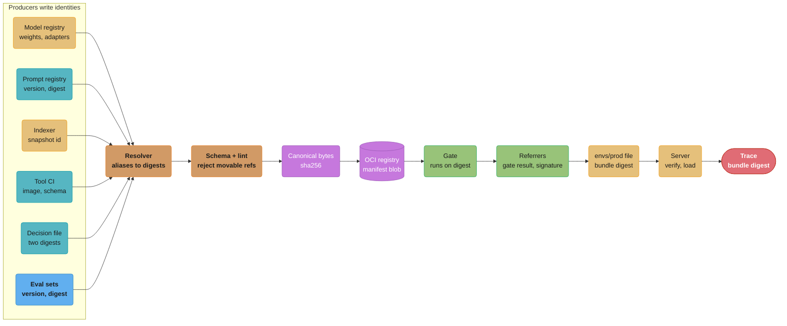
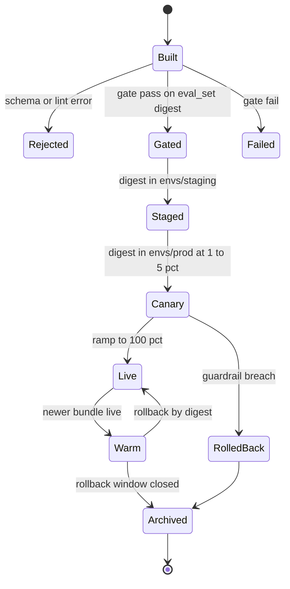
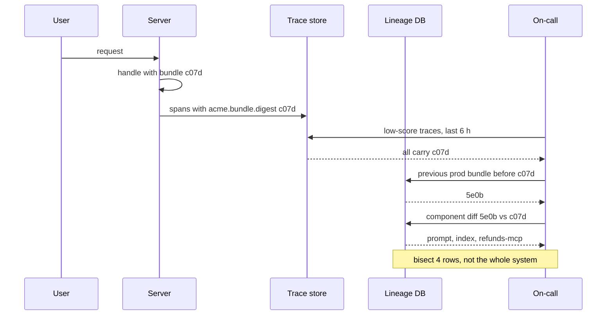

# AI Release Bundle and Lineage

> **Version anchor (2026-10-18).** MLflow 3.17.1 (2026-10-13); Kubeflow Hub v0.3.17 (2026-09-21), renamed from Kubeflow Model Registry at v0.3.9. The worked manifest also names vLLM v0.32.0 in its `runtime` block, MCP specification revision 2026-07-28 in its `tools` block, and exports to CycloneDX specification 1.7 (released 2025-10-21; repo tag 1.7.2 on 2026-09-17). ORAS and cosign are named without a version.

---

## 1. Concept Overview

A release bundle is the unit of release for one AI feature: a manifest that pins every artifact the feature runs on, by digest or immutable version, and is itself identified by the sha256 of its stored bytes. [Artifact Versioning and Lineage](../../artifact_versioning_and_lineage/artifact_versioning_and_lineage.md) defines the identity rules (digest over name, alias resolved once, store-enforced immutability). This page is the worked example those rules produce. It gives one manifest end to end:

- every field, what it pins, and what drifts if it is missing;
- the JSON Schema that the release pipeline validates against;
- how the digest is computed, stored and verified;
- which module writes each field and which module reads it;
- the lineage tables that index bundles, and the SQL that answers the five recurring questions: what was live at time T, what changed between two bundles, which bundles contain artifact X, which live bundles were gated on a stale eval set, and which artifacts are safe to delete.

The running example is `support-assistant`: a RAG and tool-calling support agent with one LoRA adapter on a self-hosted 7B base, one prompt, two MCP tool servers, a vector index, a guardrail policy and a ticket-triage decision file. It ships about 6 bundles a week. The pipeline in [Design an AI Release Pipeline](../design_an_ai_release_pipeline.md) runs 40 such features at about 300 bundles a week.

Three things are deliberately not inside the bundle digest:

| Kept out | Why | Where it lives |
|---|---|---|
| Build metadata (`created`, `built_by`, PR link) | Two builds of identical components must produce one digest, so a rebuild is a no-op | `metadata` block, stripped before hashing |
| Environment config (endpoints, secrets, quotas, flag project) | The digest that passed the gate in staging must be the digest that serves production | Per-environment file that references the digest |
| Gate evidence (eval scores, approvals, signatures) | Evidence is produced after the digest exists and points at it | OCI referrers and the `gate_result` table, keyed by digest |

**Not here.** Lineage tools (OpenLineage, Marquez, MLflow `LoggedModel` linkage, W&B Artifacts, Unity Catalog), Merkle digests over sharded weights, and reproducibility levels are in [Artifact Versioning and Lineage](../../artifact_versioning_and_lineage/artifact_versioning_and_lineage.md). Prompt storage and review flow are in [Prompt Lifecycle and Versioning](../../prompt_lifecycle_and_versioning/prompt_lifecycle_and_versioning.md). Promotion, flags and rollback ordering are in [AI Release Engineering](../../ai_release_engineering/ai_release_engineering.md). The decision file format is in [Decision Models](../../decision_models/decision_models.md). Registry stages and model packaging are in [Model Registry and Packaging](../../model_registry_and_packaging/model_registry_and_packaging.md).

---

## 2. Intuition

**One-line analogy**: the bundle is a lock file for behavior. `package-lock.json` pins every transitive dependency by integrity hash so that two installs on two machines are the same program; the bundle pins every behavior-changing input so that staging and production, Tuesday and Wednesday, are the same assistant.

**Mental model**: `behavior = f(bundle, world)`. The bundle is the part you control and can name with one digest. The world is user input, provider-side changes you cannot pin, and live state such as user memory. The manifest's `unpinned` list is the explicit boundary between the two.

**Why it matters**: in the incident in §14, the online judge pass rate for `support-assistant` dropped from 91.8% to 86.4% overnight with zero deploys by the owning team. With a bundle digest on every trace, triage started from a 4-row diff between the last two bundles plus one drift alert, and the cause was found in 25 minutes. Without it, the team would have started from "something changed".

**Key insight**: the bundle is only useful if three writes happen at the right time: producers write component digests when the artifact is made, the release pipeline writes the manifest and its digest once, and the serving path writes the digest on every trace. Every lineage query on this page is a join across those three writes.

---

## 3. Core Principles

**One manifest, one digest, one release.** Promotion, canary, rollback, audit and incident triage all operate on the bundle digest. No process promotes or rolls back a single component outside a bundle.

**The digest is over stored bytes.** The release pipeline serializes the manifest once in a canonical form and stores those exact bytes. Readers verify `sha256(bytes) == digest`. They never re-serialize, so a reader in Go or TypeScript cannot compute a different digest from a Python writer.

**Every field resolves to something that cannot move.** A digest, a 40-hex commit id, a registry version number, a dated provider snapshot id. Aliases, tags, branches and `-latest` names fail the build. Inputs that cannot be pinned are listed in `unpinned` with an owner and a signal that watches them.

**Producers write, the pipeline assembles, the server stamps.** Each module writes the identity of the artifact it produces. The release pipeline only resolves and assembles. The server stamps the digest it loaded, not the digest it was told to load.

**Evidence points at the bundle, the bundle does not contain evidence.** Gate results, approvals and signatures are attached to the digest after it exists. Putting them inside would change the digest after the gate ran on it.

**The schema is versioned and old bytes are never re-hashed.** A field added in schema v2 does not change the digest of a v1 bundle, because the v1 bytes are stored and verified as stored.

**Retention follows bundle references.** An artifact referenced by a live bundle, a bundle inside the rollback window, or a bundle inside the audit window is not garbage.

---

## 4. Types / Architectures / Strategies

### 4.1 Field groups in the manifest

| Group | Fields | Pinned by | Drift if missing |
|---|---|---|---|
| Identity | `apiVersion`, `kind`, `feature`, `risk_tier` | Constants and schema | Wrong schema applied, wrong approver count |
| Code | `code.repo`, `code.commit`, `code.image` | 40-hex commit, image digest | App logic changes with a re-pushed tag |
| Model | `model` (self-hosted or provider variant) | Weight Merkle root plus Hub commit, or dated snapshot id | Provider alias moves; `main` branch moves |
| Adapters | `adapters[].digest`, `adapters[].base_digest` | Adapter digest plus the base it was trained on | Adapter loads on the wrong base without an error |
| Tokenizer | `tokenizer.digest` | Digest of tokenizer files and chat template | Template edited in the model repo |
| Prompts | `prompts[].uri`, `prompts[].template_digest` | Registry version plus rendered template digest | UI edit with no version bump |
| Tools | `tools[].image`, `tools[].schema_digest`, `tools[].mcp_revision` | Image digest plus tool schema digest | Another team redeploys the server |
| Retrieval | `index.snapshot_id`, `index.embedding_model_digest`, `index.corpus`, `index.dim` | Snapshot id plus encoder digest plus corpus commit | Ingest job writes into the live index |
| Decoding | `decoding.*` | Values themselves | Engine default `max_tokens` changes on upgrade |
| Guardrails | `guardrails.policy_version`, `guardrails.digest` | Policy version plus digest | Policy file hot-reloaded |
| Decision | `decision.file`, `decision.schema_version`, `decision.questions_digest`, `decision.policy_digest` | Two digests over the decision file | Threshold edited in config, calibration silently stale |
| Gate contract | `eval_set.version`, `eval_set.rows`, `eval_set.digest` | Dataset version plus digest | Rows appended to "the" eval set; gate results not comparable |
| Runtime | `runtime.image`, `runtime.engine`, `runtime.engine_version`, `runtime.gpu` | Image digest plus engine version | Numerics and kernel choice change |
| Boundary | `unpinned[]` | Name, owner, reason, `observed_by` | Unpinned inputs are invisible in diffs |

The `decision` block carries two digests instead of one because the two halves of the file need different gates. A change to `questions` (instructions, criteria, option order, model) invalidates calibration and needs a full gate. A change to `policy` thresholds only needs the stored probabilities re-scored, which costs no model calls. [Decision Models](../../decision_models/decision_models.md) §6.3 states the rule; the manifest makes it machine-checkable.

### 4.2 Model field variants

| Variant | Fields | What the digest promises | What it cannot promise |
|---|---|---|---|
| Self-hosted | `kind: self_hosted`, `source: hf://org/repo@<40-hex>`, `digest` | Byte-identical weights on every replica | Kernel-level determinism (see runtime) |
| Provider snapshot | `kind: provider`, `provider`, `id` (dated snapshot) | The same requested model id | That the provider's serving stack is unchanged |
| Provider alias | Not allowed | Nothing | Everything: the schema rejects ids ending in `latest` |

For the provider variant, the gateway also logs the model id the provider returns in each response. A mismatch between the requested id and the returned id is a drift signal for [Production Quality Monitoring and Drift](../../production_quality_monitoring_and_drift/production_quality_monitoring_and_drift.md).

### 4.3 Where the manifest is stored

| Store | Identity | Promotion is | Strength | Weakness |
|---|---|---|---|---|
| Git file per feature | Commit plus file path | PR that edits `envs/prod/<feature>.yaml` | Reviewable diff, GitOps sync | Digest must still be computed and checked in CI |
| Registry model version (MLflow, Kubeflow Hub) | Registry version plus a digest property | Alias move | Lives next to model and prompt versions | Alias moves are not in git unless mirrored |
| OCI artifact (ORAS) | Blob digest of the manifest layer | `oras copy` by digest to the prod registry | Signing, referrers, replication, tag immutability | Two digests to explain (blob vs OCI manifest) |
| Database row | Primary key on digest | Insert into `deployment` | Fast lineage joins | Not a distribution channel |

The common combination is OCI for distribution and signing, a database for lineage queries, and a git file per environment for the promotion record. All three hold the same digest.

### 4.4 Manifest granularity

| Granularity | One digest covers | Use when |
|---|---|---|
| Per feature, components referenced by digest | Everything one feature runs on | Default |
| Per feature plus a shared platform bundle | Feature bundle references a platform bundle digest (gateway policy, shared guardrails) | A platform team ships shared components on its own cadence |
| Per component only | One artifact | Never as the release unit: the tested combination is not recorded |

### 4.5 Schema evolution

| Change | Old bundles | Rule |
|---|---|---|
| Add an optional field | Still valid under v1 | With `additionalProperties: false` (this schema), even an optional field needs a new `apiVersion`; readers accept both |
| Add a required field | Invalid under the new schema | New `apiVersion: bundle.acme.io/v2`; readers accept v1 and v2 |
| Rename a field | Invalid | New major version and a reader shim; never rewrite stored v1 bytes |
| Change canonical form | Digest would change | Forbidden for stored bundles; a new form applies only to new `apiVersion` |

---

## 5. Architecture Diagrams

### Bundle build and serve path



Producers own identity; the pipeline only resolves, checks and hashes. The gate and its evidence come after the digest exists, which is why evidence is attached as a referrer instead of written into the manifest.

### What the digest covers

```
bundle digest = sha256(canonical bytes)
|
+-- IN the digest (changes behavior)
|   +-- code.commit, code.image
|   +-- model.source, model.digest ............ Merkle root over safetensors shards
|   +-- adapters[].digest, adapters[].base_digest
|   +-- tokenizer.digest ........................ includes the chat template
|   +-- prompts[].uri, prompts[].template_digest
|   +-- tools[].image, tools[].schema_digest, tools[].mcp_revision
|   +-- index.snapshot_id, index.embedding_model_digest, index.corpus, index.dim
|   +-- decoding.{temperature, top_p, max_tokens, stop, seed}
|   +-- guardrails.digest
|   +-- decision.questions_digest, decision.policy_digest
|   +-- eval_set.digest ......................... the gate contract, not the gate result
|   +-- runtime.image, runtime.engine_version, runtime.gpu
|   +-- unpinned[] .............................. the boundary is part of the release
|
+-- OUT of the digest
    +-- metadata.{created, built_by, source_pr} . stripped before hashing
    +-- envs/<env>/<feature>.yaml ............... endpoints, quotas, secrets, flag project
    +-- referrers and signatures ................ gate result, approvals, cosign signature
```

The `unpinned` list is inside the digest on purpose: adding a new unpinned input (a user memory store, a live web search tool) is a release decision and must show up in a diff.

### Bundle states



A rolled-back digest never returns to traffic. The fix is a new digest that goes through the gate again. `Warm` is the rollback window from [AI Release Engineering](../../ai_release_engineering/ai_release_engineering.md): the previous bundle stays loadable for 7 days.

### Trace to bundle diff during an incident



The trace store answers "which bundle", the lineage DB answers "what changed". The two are joined only by the digest string.

---

## 6. How It Works - Detailed Mechanics

### 6.1 The worked manifest

The resolved manifest for `support-assistant`, as the release pipeline writes it before hashing. Digests are shortened to `...` in this listing; the stored form carries all 64 hex characters.

```yaml
apiVersion: bundle.acme.io/v1
kind: ReleaseBundle
feature: support-assistant
risk_tier: T2
metadata:                                   # stripped before hashing
  created: 2026-10-14T09:12:44Z
  built_by: release-pipeline/run/55120
  source_pr: support-ai#1412
code:
  repo: git.acme.io/support/assistant
  commit: 3f9c2e1b7d4a8c6e0f1a2b3c4d5e6f708192a3b4
  image: registry.acme.io/support/assistant@sha256:2b6d...e9
model:
  kind: self_hosted
  source: hf://acme/support-7b@3f9a1c0d8e7b6a5f4e3d2c1b0a9f8e7d6c5b4a39
  digest: sha256:9f2c...a1                  # Merkle root over safetensors shards
adapters:
  - name: billing-lora
    digest: sha256:a41f...7c
    base_digest: sha256:9f2c...a1           # must equal model.digest
tokenizer:
  digest: sha256:b8a4...90                  # tokenizer.json + tokenizer_config.json
prompts:
  - name: support-answer
    uri: prompts:/support-answer/12
    template_digest: sha256:3e77...0b
tools:
  - name: orders-mcp
    image: registry.acme.io/orders-mcp@sha256:7a10...d2
    schema_digest: sha256:c4e9...18
    mcp_revision: "2026-07-28"
  - name: refunds-mcp
    image: registry.acme.io/refunds-mcp@sha256:1c9e...44
    schema_digest: sha256:0f12...e3
    mcp_revision: "2026-07-28"
index:
  snapshot_id: idx-2026-10-14
  embedding_model_digest: sha256:51be...2d
  corpus: lakefs://kb/commits/8b2f61c0
  dim: 1024
decoding:
  temperature: 0.2
  top_p: 0.9
  max_tokens: 768
  stop: ["</answer>"]
  seed: null
guardrails:
  policy_version: pii-v9
  digest: sha256:6d0a...11
decision:
  file: decision/ticket_triage.yaml
  schema_version: 14
  questions_digest: sha256:88b1...4c        # instructions, criteria, model, temperature
  policy_digest: sha256:d3f0...a7           # thresholds and actions only
eval_set:
  version: support-eval/7
  rows: 1840
  digest: sha256:e0a3...59
runtime:
  image: registry.acme.io/serving@sha256:4410...be
  engine: vllm
  engine_version: v0.32.0
  gpu: H100-SXM-80GB
unpinned:
  - name: user memory store
    owner: personalization
    reason: per-user state, versioned by user id and timestamp
    observed_by: memory_write_rate, per-user eval slice
```

Size: about 2.6 KB as canonical JSON with full digests. A bundle with 8 tools and 4 adapters is about 4.6 KB.

Two YAML traps apply to this listing. `mcp_revision: "2026-07-28"` is quoted because an unquoted `2026-07-28` loads as a date object in PyYAML and serializes differently from the string. And a decoding value written `1e-5` loads as the string `"1e-5"` in PyYAML, because its YAML 1.1 float rule requires a dot; write `1.0e-5`. The schema's `"type": "number"` on decoding fields catches the second one at build time.

### 6.2 JSON Schema

The release pipeline validates every manifest against this schema before hashing. The parts that do the work are the digest and image-ref patterns, the commit pattern, the prompt URI pattern that only admits numeric versions, and the `not` on provider ids.

```json
{
  "$schema": "https://json-schema.org/draft/2020-12/schema",
  "$id": "https://schemas.acme.io/ai-release-bundle/v1.json",
  "type": "object",
  "additionalProperties": false,
  "required": ["apiVersion", "kind", "feature", "risk_tier", "code", "model",
               "prompts", "decoding", "eval_set", "runtime", "unpinned"],
  "$defs": {
    "digest": {"type": "string", "pattern": "^sha256:[0-9a-f]{64}$"},
    "imageRef": {"type": "string", "pattern": "^[a-z0-9./-]+@sha256:[0-9a-f]{64}$"},
    "name": {"type": "string", "pattern": "^[a-z0-9][a-z0-9-]*$"}
  },
  "properties": {
    "apiVersion": {"const": "bundle.acme.io/v1"},
    "kind": {"const": "ReleaseBundle"},
    "feature": {"$ref": "#/$defs/name"},
    "risk_tier": {"enum": ["T1", "T2", "T3"]},
    "metadata": {"type": "object"},
    "code": {
      "type": "object", "additionalProperties": false,
      "required": ["repo", "commit", "image"],
      "properties": {
        "repo": {"type": "string"},
        "commit": {"type": "string", "pattern": "^[0-9a-f]{40}$"},
        "image": {"$ref": "#/$defs/imageRef"}
      }
    },
    "model": {
      "oneOf": [
        {"type": "object", "additionalProperties": false,
         "required": ["kind", "source", "digest"],
         "properties": {
           "kind": {"const": "self_hosted"},
           "source": {"type": "string", "pattern": "@[0-9a-f]{40}$"},
           "digest": {"$ref": "#/$defs/digest"}}},
        {"type": "object", "additionalProperties": false,
         "required": ["kind", "provider", "id"],
         "properties": {
           "kind": {"const": "provider"},
           "provider": {"type": "string"},
           "id": {"type": "string", "not": {"pattern": "latest$"}}}}
      ]
    },
    "adapters": {
      "type": "array",
      "items": {"type": "object", "additionalProperties": false,
                "required": ["name", "digest", "base_digest"],
                "properties": {"name": {"$ref": "#/$defs/name"},
                               "digest": {"$ref": "#/$defs/digest"},
                               "base_digest": {"$ref": "#/$defs/digest"}}}
    },
    "tokenizer": {"type": "object", "additionalProperties": false, "required": ["digest"],
                  "properties": {"digest": {"$ref": "#/$defs/digest"}}},
    "prompts": {
      "type": "array", "minItems": 1,
      "items": {"type": "object", "additionalProperties": false,
                "required": ["name", "uri", "template_digest"],
                "properties": {"name": {"$ref": "#/$defs/name"},
                               "uri": {"type": "string",
                                       "pattern": "^prompts:/[a-z0-9-]+/[0-9]+$"},
                               "template_digest": {"$ref": "#/$defs/digest"}}}
    },
    "tools": {
      "type": "array",
      "items": {"type": "object", "additionalProperties": false,
                "required": ["name", "image", "schema_digest"],
                "properties": {"name": {"$ref": "#/$defs/name"},
                               "image": {"$ref": "#/$defs/imageRef"},
                               "schema_digest": {"$ref": "#/$defs/digest"},
                               "mcp_revision": {"type": "string"}}}
    },
    "index": {
      "type": "object", "additionalProperties": false,
      "required": ["snapshot_id", "embedding_model_digest", "corpus", "dim"],
      "properties": {"snapshot_id": {"type": "string"},
                     "embedding_model_digest": {"$ref": "#/$defs/digest"},
                     "corpus": {"type": "string"},
                     "dim": {"type": "integer"}}
    },
    "decoding": {
      "type": "object", "additionalProperties": false,
      "required": ["temperature", "top_p", "max_tokens"],
      "properties": {"temperature": {"type": "number"},
                     "top_p": {"type": "number"},
                     "max_tokens": {"type": "integer"},
                     "stop": {"type": "array", "items": {"type": "string"}},
                     "seed": {"type": ["integer", "null"]}}
    },
    "guardrails": {"type": "object", "additionalProperties": false,
                   "required": ["policy_version", "digest"],
                   "properties": {"policy_version": {"type": "string"},
                                  "digest": {"$ref": "#/$defs/digest"}}},
    "decision": {"type": "object", "additionalProperties": false,
                 "required": ["file", "schema_version", "questions_digest", "policy_digest"],
                 "properties": {"file": {"type": "string"},
                                "schema_version": {"type": "integer"},
                                "questions_digest": {"$ref": "#/$defs/digest"},
                                "policy_digest": {"$ref": "#/$defs/digest"}}},
    "eval_set": {"type": "object", "additionalProperties": false,
                 "required": ["version", "rows", "digest"],
                 "properties": {"version": {"type": "string"},
                                "rows": {"type": "integer", "minimum": 1},
                                "digest": {"$ref": "#/$defs/digest"}}},
    "runtime": {"type": "object", "additionalProperties": false,
                "required": ["image", "engine", "engine_version"],
                "properties": {"image": {"$ref": "#/$defs/imageRef"},
                               "engine": {"type": "string"},
                               "engine_version": {"type": "string"},
                               "gpu": {"type": "string"}}},
    "unpinned": {
      "type": "array",
      "items": {"type": "object", "additionalProperties": false,
                "required": ["name", "owner", "reason", "observed_by"],
                "properties": {"name": {"type": "string"}, "owner": {"type": "string"},
                               "reason": {"type": "string"}, "observed_by": {"type": "string"}}}
    }
  }
}
```

`unpinned` is required even when empty. An empty list is a claim ("nothing behavior-changing is outside this bundle") that a reviewer can challenge; a missing key is not a claim at all.

A schema cannot express cross-field rules. The builder checks two of them in code: every `adapters[].base_digest` equals `model.digest`, and `index.dim` equals the output dimension recorded for `index.embedding_model_digest` in the model registry.

### 6.3 Computing the digest: broken, then fixed

```python
# BROKEN: three ways to get a different digest for the same release
import hashlib, yaml

def bundle_digest(path):
    text = open(path).read()
    return "sha256:" + hashlib.sha256(text.encode()).hexdigest()
```

This hashes YAML text as written, so reordered keys, a changed comment, or a new `built_by` value each produce a new digest for the same components. The promotion system cannot tell "rebuilt, nothing changed" from "changed". And every reader that re-reads the YAML and hashes it again depends on matching whitespace exactly.

The fix serializes a validated document once, strips build metadata, sorts the lists that are sets, and stores the bytes. The listing below runs as is with `jsonschema` installed and the §6.2 schema saved as `bundle.schema.json`.

```python
import copy
import hashlib
import json
import re

from jsonschema import Draft202012Validator

SCHEMA = json.load(open("bundle.schema.json"))
VALIDATOR = Draft202012Validator(SCHEMA)
MOVABLE = re.compile(r"(@[a-z_]+$|:latest\b|-latest\b|@main\b|/main$)")
UNORDERED = ("adapters", "prompts", "tools", "unpinned")   # sets, not sequences


def build(doc: dict) -> tuple[bytes, str]:
    """Validate, lint and serialize a resolved manifest. Returns (bytes, digest)."""
    errors = [f"{'/'.join(map(str, e.path))}: {e.message}" for e in VALIDATOR.iter_errors(doc)]
    errors += lint(doc)
    if errors:
        raise ValueError("bundle rejected:\n  " + "\n  ".join(errors))
    body = copy.deepcopy(doc)
    body.pop("metadata", None)
    for key in UNORDERED:
        body.get(key, []).sort(key=lambda item: item["name"])
    raw = json.dumps(body, sort_keys=True, separators=(",", ":"), ensure_ascii=False).encode()
    return raw, "sha256:" + hashlib.sha256(raw).hexdigest()


def verify(raw: bytes, digest: str) -> dict:
    """Readers hash the stored bytes. They never re-serialize."""
    if "sha256:" + hashlib.sha256(raw).hexdigest() != digest:
        raise ValueError(f"manifest bytes do not match {digest}")
    return json.loads(raw)


def lint(node, path="") -> list[str]:
    out = []
    if isinstance(node, dict):
        for key, value in node.items():
            if key not in ("unpinned", "metadata"):
                out += lint(value, f"{path}.{key}" if path else key)
    elif isinstance(node, list):
        for i, item in enumerate(node):
            out += lint(item, f"{path}[{i}]")
    elif isinstance(node, str) and MOVABLE.search(node):
        out.append(f"{path}: movable reference {node!r}")
    return out
```

The serving side sorts tools by name too, so the order in which tool definitions reach the model matches the stored order. If tool order is meant to carry meaning (a preferred tool listed first), move `tools` out of `UNORDERED` and keep the list as authored; then a reorder is a real change and correctly produces a new digest.

`verify()` is the rule that removes the cross-language problem. Python's `json.dumps(0.00001)` writes `1e-05`, and a JavaScript serializer writes `0.00001`. Two writers that re-serialize the same document produce two digests. One writer that stores bytes, and many readers that hash those bytes, produce one. If more than one language must write bundles, use one canonical form for all of them, such as RFC 8785 (JSON Canonicalization Scheme).

### 6.4 Diff and the gate a change needs

The lineage store keeps one row per component. The same flattening drives a field-level diff, and the diff decides the cheapest gate that still covers the change.

```python
def components(doc: dict) -> dict[str, str]:
    """Flatten a manifest into field -> identity rows for the lineage store."""
    rows = {"code": doc["code"]["image"], "runtime": doc["runtime"]["image"]}
    if "gpu" in doc["runtime"]:
        rows["runtime.gpu"] = doc["runtime"]["gpu"]
    model = doc["model"]
    rows["model"] = model["digest"] if model["kind"] == "self_hosted" else model["id"]
    for a in doc.get("adapters", []):
        rows[f"adapters[{a['name']}]"] = a["digest"]
        rows[f"adapters[{a['name']}].base"] = a["base_digest"]
    for p in doc["prompts"]:
        rows[f"prompts[{p['name']}]"] = p["template_digest"]
    for t in doc.get("tools", []):
        rows[f"tools[{t['name']}]"] = t["image"]
        rows[f"tools[{t['name']}].schema"] = t["schema_digest"]
    if "index" in doc:
        rows["index"] = doc["index"]["snapshot_id"]
        rows["index.embedding_model"] = doc["index"]["embedding_model_digest"]
    for key in ("tokenizer", "guardrails", "eval_set"):
        if key in doc:
            rows[key] = doc[key]["digest"]
    if "decision" in doc:
        rows["decision.questions"] = doc["decision"]["questions_digest"]
        rows["decision.policy"] = doc["decision"]["policy_digest"]
    rows["decoding"] = sha(doc["decoding"])
    rows["unpinned"] = sha(sorted(doc["unpinned"], key=lambda u: u["name"]))
    return rows


def diff(old: dict, new: dict) -> dict[str, tuple]:
    a, b = components(old), components(new)
    return {f: (a.get(f), b.get(f)) for f in sorted(a.keys() | b.keys()) if a.get(f) != b.get(f)}


def sha(value) -> str:
    return "sha256:" + hashlib.sha256(json.dumps(value, sort_keys=True).encode()).hexdigest()


# Cheapest gate that still covers a change, ordered from most to least expensive.
GATES = [
    ("full_gate_plus_shadow", ("model", "adapters[", "tokenizer", "runtime")),
    ("full_gate", ("prompts[", "decoding", "tools[", "index", "code", "guardrails",
                   "eval_set", "decision.questions", "unpinned")),
    ("policy_replay", ("decision.policy",)),
]


def required_gate(changed: dict) -> str:
    for gate, prefixes in GATES:
        if any(f.startswith(prefixes) for f in changed):
            return gate
    return "none"
```

A self-check that fails if any of the rules above break:

```python
def d(c: str) -> str:
    return "sha256:" + c * 64

if __name__ == "__main__":
    base = {
        "apiVersion": "bundle.acme.io/v1", "kind": "ReleaseBundle",
        "feature": "support-assistant", "risk_tier": "T2",
        "metadata": {"created": "2026-10-14T09:12:44Z", "built_by": "run/55120"},
        "code": {"repo": "git.acme.io/support/assistant", "commit": "3f9c2e1" + "0" * 33,
                 "image": "registry.acme.io/support/assistant@" + d("4")},
        "model": {"kind": "self_hosted", "source": "hf://acme/support-7b@" + "3f9a" * 10,
                  "digest": d("9")},
        "adapters": [{"name": "billing-lora", "digest": d("a"), "base_digest": d("9")}],
        "tokenizer": {"digest": d("b")},
        "prompts": [{"name": "support-answer", "uri": "prompts:/support-answer/12",
                     "template_digest": d("3")}],
        "tools": [{"name": "refunds-mcp", "image": "registry.acme.io/refunds-mcp@" + d("1"),
                   "schema_digest": d("0"), "mcp_revision": "2026-07-28"},
                  {"name": "orders-mcp", "image": "registry.acme.io/orders-mcp@" + d("2"),
                   "schema_digest": d("5"), "mcp_revision": "2026-07-28"}],
        "index": {"snapshot_id": "idx-2026-10-14", "embedding_model_digest": d("5"),
                  "corpus": "lakefs://kb/commits/8b2f61c0", "dim": 1024},
        "decoding": {"temperature": 0.2, "top_p": 0.9, "max_tokens": 768,
                     "stop": ["</answer>"], "seed": None},
        "guardrails": {"policy_version": "pii-v9", "digest": d("6")},
        "decision": {"file": "decision/ticket_triage.yaml", "schema_version": 14,
                     "questions_digest": d("8"), "policy_digest": d("c")},
        "eval_set": {"version": "support-eval/7", "rows": 1840, "digest": d("e")},
        "runtime": {"image": "registry.acme.io/serving@" + d("7"), "engine": "vllm",
                    "engine_version": "v0.32.0", "gpu": "H100-SXM-80GB"},
        "unpinned": [{"name": "user memory store", "owner": "personalization",
                      "reason": "per-user state", "observed_by": "memory_write_rate"}],
    }
    raw, digest = build(base)
    assert verify(raw, digest)["feature"] == "support-assistant"

    rebuilt = copy.deepcopy(base)
    rebuilt["metadata"]["built_by"] = "run/55121"
    rebuilt["tools"].reverse()
    assert build(rebuilt)[1] == digest, "metadata and set order must not move the digest"

    moved = copy.deepcopy(base)
    moved["prompts"][0]["uri"] = "prompts:/support-answer@production"
    try:
        build(moved)
        raise AssertionError("alias accepted")
    except ValueError as e:
        assert "movable reference" in str(e)

    nxt = copy.deepcopy(base)
    nxt["decision"]["policy_digest"] = d("d")
    assert required_gate(diff(base, nxt)) == "policy_replay"
    nxt["adapters"][0]["digest"] = d("f")
    assert required_gate(diff(base, nxt)) == "full_gate_plus_shadow"
    assert required_gate(diff(base, base)) == "none"
    grown = copy.deepcopy(base)
    grown["unpinned"].append({"name": "web search", "owner": "search",
                              "reason": "live results", "observed_by": "citation_rate"})
    assert required_gate(diff(base, grown)) == "full_gate", "new unpinned input must be gated"
    print("ok", digest[:19])
```

What each gate class costs for `support-assistant` (1,840-row eval set, judge at about $0.02 per row, shadow at 5% of traffic for 24 hours):

| Gate class | Triggered by | Model calls | Wall time | Approx. cost |
|---|---|---|---|---|
| `none` | Metadata only, same digest | 0 | 0 | $0 |
| `policy_replay` | `decision.policy` | 0 (stored probabilities re-scored) | under 1 min | $0 |
| `full_gate` | Prompt, decoding, tools, index, code, guardrails, eval set, decision questions, `unpinned` | 1,840 app calls plus 1,840 judge calls | 12 to 20 min | about $37 judge plus app tokens |
| `full_gate_plus_shadow` | Model, adapter, tokenizer, runtime image or GPU | Full gate plus 24 h shadow | 1 to 2 days | full gate plus shadow GPU hours |

Gate statistics and how the eval set is sized are in [Evaluation Gates and Eval Sets](../../evaluation_gates_and_eval_sets/evaluation_gates_and_eval_sets.md).

### 6.5 Who writes each field and who reads it

| Field | Written by | Read by |
|---|---|---|
| `model` | Registration job, [Model Registry and Packaging](../../model_registry_and_packaging/model_registry_and_packaging.md) | Weight fetch and cache warm-up in [Model Storage, Loading and Cold Start](../../model_storage_loading_and_cold_start/model_storage_loading_and_cold_start.md); server startup check; blast-radius query |
| `adapters[]` | Adapter training pipeline | Hot-load and base check in [LoRA Adapter Serving and Lifecycle](../../lora_adapter_serving_and_lifecycle/lora_adapter_serving_and_lifecycle.md) |
| `tokenizer` | Packaging step, same module as `model` | Server startup check |
| `prompts[]` | Prompt registry, [Prompt Lifecycle and Versioning](../../prompt_lifecycle_and_versioning/prompt_lifecycle_and_versioning.md) | App loads by numeric URI; gate renders the same template |
| `tools[]` | Tool server CI, [Agent, Tool and MCP Server Lifecycle](../../agent_tool_and_mcp_server_lifecycle/agent_tool_and_mcp_server_lifecycle.md) | App startup and 5-minute schema check |
| `index` | Indexer, [RAG and Vector Index Lifecycle](../../rag_and_vector_index_lifecycle/rag_and_vector_index_lifecycle.md) | Retriever queries the named snapshot; erasure query |
| `decoding` | Feature team, tuned in [Inference Engine Operations and Benchmarking](../../inference_engine_operations_and_benchmarking/inference_engine_operations_and_benchmarking.md) | Server passes values explicitly, never relies on engine defaults |
| `guardrails` | Gateway policy owners, [AI Gateway Operations](../../ai_gateway_operations/ai_gateway_operations.md) | Gateway loads by digest |
| `decision` | Decision file tooling, [Decision Models](../../decision_models/decision_models.md) | Policy code; gate picks `policy_replay` or `full_gate` |
| `eval_set` | Eval set owners, [Evaluation Gates and Eval Sets](../../evaluation_gates_and_eval_sets/evaluation_gates_and_eval_sets.md) | Gate runner; promotion refuses a stale contract |
| `runtime` | Serving platform, [Model Serving Platforms](../../model_serving_platforms/model_serving_platforms.md) | Deployment spec; reproducibility claims |
| `unpinned[]` | Feature team, reviewed at release | [Production Quality Monitoring and Drift](../../production_quality_monitoring_and_drift/production_quality_monitoring_and_drift.md) watches each `observed_by` signal |
| Whole digest | Release pipeline | [AI Release Engineering](../../ai_release_engineering/ai_release_engineering.md) (promote, roll back), [Progressive Delivery for Model Servers](../../progressive_delivery_for_model_servers/progressive_delivery_for_model_servers.md) (traffic split by digest), [ML Supply Chain Security](../../ml_supply_chain_security/ml_supply_chain_security.md) (signature subject), [AI Incident Response and Reliability](../../ai_incident_response_and_reliability/ai_incident_response_and_reliability.md) (diff), [AI Governance and Model Risk Operations](../../ai_governance_and_model_risk_operations/ai_governance_and_model_risk_operations.md) (inventory evidence), [AI Cost Engineering and Unit Economics](../../ai_cost_engineering_and_unit_economics/ai_cost_engineering_and_unit_economics.md) (cost per bundle) |

No reader resolves a name. Every reader takes a digest or a numeric version from the manifest. A reader that needs "the current production prompt" asks the deployment table for the live bundle, then reads the prompt URI from that bundle.

### 6.6 Publishing: OCI artifact, referrers and registry records

The manifest bytes go to the OCI registry as a single-layer artifact with its own artifact type. Gate results and the signature attach to it as referrers.

```bash
# bundle.json holds the exact bytes returned by build()
oras push registry.acme.io/bundles/support-assistant:c07d4e19 \
  --artifact-type application/vnd.acme.ai-bundle.v1 \
  bundle.json:application/vnd.acme.ai-bundle.manifest.v1+json

# evidence points at the bundle; the bundle does not change
oras attach registry.acme.io/bundles/support-assistant@sha256:OCI_MANIFEST_DIGEST \
  --artifact-type application/vnd.acme.gate-result.v1 \
  gate.json:application/json

cosign sign --yes registry.acme.io/bundles/support-assistant@sha256:OCI_MANIFEST_DIGEST
oras discover registry.acme.io/bundles/support-assistant@sha256:OCI_MANIFEST_DIGEST
```

`OCI_MANIFEST_DIGEST` is the digest that `oras push` prints for the OCI manifest it created.

There are two digests here, and confusing them is a common bug. The **bundle digest** is the sha256 of `bundle.json`, which is the layer blob digest. The **OCI manifest digest** is the sha256 of the OCI manifest that wraps that layer, and it also covers the artifact type and annotations. Record the bundle digest everywhere (traces, deployment table, envs file) and store the OCI manifest digest alongside it as the pull and signing address. Adding an annotation changes the OCI manifest digest and leaves the bundle digest alone.

Registry records join the same identity:

- **MLflow 3.17.1**: one `LoggedModel` per bundle, named `support-assistant-<first 12 hex>`, with the bundle digest, prompt URI and index snapshot as params. Traces produced after `mlflow.set_active_model()` carry that model id, so `mlflow.search_traces(model_id=...)` returns every trace a bundle produced. The code is in [Artifact Versioning and Lineage](../../artifact_versioning_and_lineage/artifact_versioning_and_lineage.md) §6.6.
- **Kubeflow Hub v0.3.17**: a model version per bundle whose custom properties carry the bundle digest and the OCI reference, for platforms already built on Kubeflow and KServe. The Hub stores what you register; it does not compute or verify the digest.
- **CycloneDX 1.7**: an export of the bundle as a BOM with machine-learning model components, for auditors and customers who ask for a standard format. The export is generated from the stored bytes and is never the source of truth.

### 6.7 Serving: verify, load, stamp

The server receives only a digest. It pulls the bytes, verifies them, checks every component it can check locally, and stamps the digest it actually loaded.

```python
def start(bundle_digest: str):
    raw = pull_blob(bundle_digest)                 # OCI blob by digest
    doc = verify(raw, bundle_digest)
    errors = []
    if weights_root(MODEL_DIR) != doc["model"]["digest"]:
        errors.append("model digest mismatch")
    for a in doc.get("adapters", []):
        if a["base_digest"] != doc["model"]["digest"]:
            errors.append(f"adapter {a['name']} trained on another base")
    for t in doc.get("tools", []):
        if tool_schema_digest(t["name"]) != t["schema_digest"]:
            errors.append(f"tool {t['name']} schema drifted")
    if errors:
        raise SystemExit("refusing to serve: " + "; ".join(errors))
    set_resource_attribute("service.version", bundle_digest)
    return doc
```

Stamp at the narrowest scope that is still correct:

| Serving shape | Where the digest goes | Why |
|---|---|---|
| One process serves one bundle (canary pods are separate) | OTel resource attribute `service.version` | Set once, inherited by every span |
| One process serves several bundles (prompt or decision flags in-process) | Span attribute on the root span, here `acme.bundle.digest`, plus a response header | The resource attribute would be wrong for some requests |
| Provider-hosted model behind a gateway | Gateway span attribute plus the provider-returned model id | Shows requested vs served model on one span |

The attribute name `acme.bundle.digest` is a custom name; the OTel GenAI conventions do not define a bundle attribute. Tool schemas are checked again every 5 minutes, because a tool server can be redeployed by its own team while the bundle is live. A mismatch pages the feature owner; it does not stop serving, since the old schema may still be compatible. Tracing setup is in [OpenTelemetry for LLM Apps](../../../llm/case_studies/cross_cutting/opentelemetry_for_llm_apps.md).

### 6.8 Lineage tables

Four tables index every bundle. The edge table from [Artifact Versioning and Lineage](../../artifact_versioning_and_lineage/artifact_versioning_and_lineage.md) §6.10 (`lineage_edge`) joins to them on component digests.

```sql
CREATE EXTENSION IF NOT EXISTS btree_gist;

CREATE TABLE bundle (
  digest       text PRIMARY KEY,               -- sha256 of raw
  oci_digest   text NOT NULL,                  -- pull and signing address
  feature      text NOT NULL,
  api_version  text NOT NULL,                  -- bundle.acme.io/v1
  raw          bytea NOT NULL,                 -- exact bytes that were hashed
  manifest     jsonb NOT NULL,                 -- parsed from raw, for queries only
  created_at   timestamptz NOT NULL
);

CREATE TABLE bundle_component (
  bundle_digest    text NOT NULL REFERENCES bundle(digest),
  field            text NOT NULL,              -- model, adapters[billing-lora].base, tools[refunds-mcp]
  component_digest text NOT NULL,
  PRIMARY KEY (bundle_digest, field)
);
CREATE INDEX ON bundle_component (component_digest);

CREATE TABLE deployment (
  feature       text NOT NULL,
  env           text NOT NULL,
  bundle_digest text NOT NULL REFERENCES bundle(digest),
  traffic_pct   numeric(5,2) NOT NULL,
  valid         tstzrange NOT NULL,            -- [from, to); open upper bound = live
  change_ref    text NOT NULL                  -- promotion PR, flag change, rollback ticket
);
CREATE INDEX ON deployment USING gist (feature, env, valid);

CREATE TABLE gate_result (
  bundle_digest   text NOT NULL REFERENCES bundle(digest),
  eval_set_digest text NOT NULL,
  gate_class      text NOT NULL,               -- policy_replay, full_gate, full_gate_plus_shadow
  run_id          text NOT NULL,
  passed          boolean NOT NULL,
  finished_at     timestamptz NOT NULL
);
```

`bundle_component` holds the flattened rows from `components()`, so the base digest appears both as `model` and as `adapters[billing-lora].base`. A base-model query then finds bundles that use the base directly and bundles that carry an adapter trained on it. `deployment` gets a new row on every traffic change: a canary step from 5% to 25% closes one row and opens another. That is what makes "what was live at time T" a single range query.

### 6.9 Lineage queries

**What was serving at 14:02 on Tuesday?**

```sql
SELECT bundle_digest, traffic_pct, change_ref
FROM deployment
WHERE feature = 'support-assistant' AND env = 'prod'
  AND valid @> timestamptz '2026-10-13 14:02:00+00';
```

During a canary this returns two rows (for example 95% and 5%). The trace's own digest attribute says which of the two served a given request.

**What changed between the bundle on this trace and the one before it?**

```sql
WITH cur AS (
  SELECT lower(valid) AS started
  FROM deployment
  WHERE feature = 'support-assistant' AND env = 'prod' AND bundle_digest = :cur
  ORDER BY lower(valid) LIMIT 1
), prev AS (
  SELECT d.bundle_digest
  FROM deployment d, cur
  WHERE d.feature = 'support-assistant' AND d.env = 'prod'
    AND d.bundle_digest <> :cur AND lower(d.valid) < cur.started
  ORDER BY lower(d.valid) DESC LIMIT 1
)
SELECT field, a.component_digest AS before, b.component_digest AS after
FROM (SELECT field, component_digest FROM bundle_component
      WHERE bundle_digest = (SELECT bundle_digest FROM prev)) a
FULL JOIN (SELECT field, component_digest FROM bundle_component
           WHERE bundle_digest = :cur) b USING (field)
WHERE a.component_digest IS DISTINCT FROM b.component_digest
ORDER BY field;
```

`FULL JOIN ... USING` catches added and removed components (a new tool, a dropped adapter) as well as changed ones.

**Which live bundles contain this artifact? (blast radius)**

```sql
SELECT c.bundle_digest, c.field, d.feature, d.env, d.traffic_pct
FROM bundle_component c
JOIN deployment d ON d.bundle_digest = c.bundle_digest
WHERE c.component_digest = :suspect
  AND upper_inf(d.valid)
ORDER BY (d.env = 'prod') DESC, d.traffic_pct DESC;
```

The suspect can be a base-model digest, a tool image, an embedding model or a guardrail policy. Rolling back means finding, for each returned feature, the newest `Warm` bundle that does not contain the suspect, which is the same query with `NOT EXISTS`.

**Which live bundles were gated on an eval set that is no longer the pinned one?**

```sql
SELECT d.feature, d.bundle_digest, b.manifest->'eval_set'->>'version' AS gated_on,
       p.version AS pinned_now
FROM deployment d
JOIN bundle b ON b.digest = d.bundle_digest
JOIN pinned_eval_set p ON p.feature = d.feature
WHERE d.env = 'prod' AND upper_inf(d.valid)
  AND b.manifest->'eval_set'->>'digest' <> p.digest;
```

`pinned_eval_set` is the eval-set owners' table of the current version and digest per feature. A row here does not mean the bundle is bad. It means its gate result says nothing about the cases added since. The usual action is a re-gate of the live digest on the new eval set, with no redeploy.

**Which artifacts are safe to delete?**

```sql
SELECT a.digest
FROM artifact a
WHERE a.created_at < now() - interval '30 days'                -- grace for not yet bundled
  AND NOT EXISTS (
  SELECT 1
  FROM bundle_component c
  JOIN bundle b ON b.digest = c.bundle_digest
  LEFT JOIN deployment d ON d.bundle_digest = c.bundle_digest
  WHERE c.component_digest = a.digest
    AND (upper_inf(d.valid)                                  -- live
         OR upper(d.valid) > now() - interval '400 days'     -- audit window
         OR b.created_at > now() - interval '30 days')       -- built, not yet deployed
);
```

`artifact` is the inventory of stored component digests (weights, adapters, index snapshots, images) with the time each was stored. The `created_at` guard keeps an artifact that a producer wrote but no bundle references yet; without it, a fresh adapter is deleted before the resolver can assemble it. The 400-day window is the audit retention for this example; a regulated feature uses its own number from [AI Governance and Model Risk Operations](../../ai_governance_and_model_risk_operations/ai_governance_and_model_risk_operations.md). A bundle that was built but never deployed keeps its components for 30 days, then becomes eligible.

**Which bundles were derived from a dataset snapshot that holds an erased subject?** Walk `lineage_edge` downstream from the snapshot with the recursive query in [Artifact Versioning and Lineage](../../artifact_versioning_and_lineage/artifact_versioning_and_lineage.md) §6.10, then join the reached digests to `bundle_component.component_digest`. The result is the list of bundles whose adapter, index or eval set descends from that snapshot, with the deployments that served them.

### 6.10 Volume and cost at 300 bundles a week

| Quantity | Value | Basis |
|---|---|---|
| Bundles per year | about 15,600 | 300 a week |
| Component rows per bundle | 20 to 38 | §6.4 flattening: 20 for the worked bundle, 38 with 8 tools and 4 adapters |
| Component rows per year | about 450,000 | 15,600 x 29 |
| Manifest storage per year | about 100 MB | 15,600 x about 6 KB, raw bytes plus the jsonb copy |
| Deployment rows per year | about 90,000 | 6 traffic changes per bundle on average |
| Digest on each trace | 71 bytes uncompressed | `sha256:` plus 64 hex |
| Raw digest bytes at 50M traces a day | 3.55 GB a day | before compression |
| After dictionary encoding in a columnar trace store | a few MB a day | at most a few distinct digests per feature per day |

Postgres on one small instance holds this for years. The trace attribute looks expensive in raw bytes and is not, because columnar stores encode a low-cardinality string once per block. Do not shorten the digest to save space: a 12-hex prefix is 48 bits, fine for display and unsafe as a join key across 15,600 bundles plus every component digest in the company.

### 6.11 Rollback by digest

Rollback writes the previous digest into the environment file or the release flag. The server pulls, verifies and stamps it exactly as at deploy time. Each component's reversal clock differs (seconds for a prompt flag, minutes for a weight swap on a warm pool); [AI Release Engineering](../../ai_release_engineering/ai_release_engineering.md) has the per-artifact table. Three things a bundle rollback does not undo:

- writes the bundle made outside itself (user memory, tickets, emails, payments);
- changes to `unpinned` inputs, which by definition are not in either digest;
- a provider-side change behind a dated snapshot id, which both bundles share.

The `deployment` row for a rollback carries `change_ref` pointing at the incident, so the timeline query in §6.9 shows it as a rollback and not as a release.

---

## 7. Real-World Examples

**OpenAI GPT-4, March vs June 2023.** Chen, Zaharia and Zou evaluated the March 2023 and June 2023 versions of GPT-4 and measured accuracy on identifying prime vs composite numbers falling from 84% to 51% on the same questions. A bundle whose `model` field held only the name `gpt-4` would have shown no change between the two versions. The schema in §6.2 rejects that state: a provider model must be a dated snapshot id, and the returned model id goes on the trace.

**Dated model snapshot ids.** OpenAI shipped dated snapshots such as `gpt-4o-2024-08-06` next to the moving `gpt-4o` alias, and Anthropic model ids such as `claude-3-5-sonnet-20241022` carry a date suffix. The provider variant of the `model` field exists because these ids are the strongest pin a hosted model offers.

**Hugging Face revisions.** `from_pretrained(repo, revision=<commit>)` pins a Hub repo to a 40-hex commit id; without `revision` it reads branch `main`. The `model.source` pattern in the schema (`@[0-9a-f]{40}$`) enforces the pinned form. The Llama 3 Instruct configuration change in April 2024 (generation stopping on `<|eot_id|>`), described in [Artifact Versioning and Lineage](../../artifact_versioning_and_lineage/artifact_versioning_and_lineage.md) §7, is the case for pinning tokenizer and config files and not only weights.

**TFX ML Metadata (MLMD).** Google's MLMD records artifacts, executions and the events that connect them, grouped into contexts, as the lineage store under TFX pipelines. Its context is the closest open analogue to a bundle: a named group of artifacts that belong to one run or one release. The difference is that an MLMD context is assembled from recorded events, while a bundle is a declared, hashed manifest.

**MLflow 3 LoggedModel.** MLflow 3 made the model a first-class `LoggedModel` entity that traces link to. One `LoggedModel` per bundle digest gives a trace-to-bundle link inside a store many teams already run, without a separate lineage service for that one join.

**OCI artifacts and referrers.** Container registries that support the OCI 1.1 referrers API store signatures, SBOMs and attestations as artifacts that point at a subject digest; the mechanism is in [OCI Image Formats and Lazy Pulling](../../../devops/container_runtimes_and_oci/oci_image_formats_and_lazy_pulling.md). The bundle reuses that pattern unchanged: gate results are referrers of the bundle's OCI manifest, found with `oras discover`.

**CycloneDX ML-BOM.** CycloneDX added machine-learning BOM support (`modelCard` on model components) in specification 1.5; the pinned specification is 1.7. The bundle exports to it for parties that require a standard bill of materials, but the export is lossy for AI-specific fields such as `decoding` and `decision.policy_digest`, so it is generated from the bundle and never edited by hand.

---

## 8. Tradeoffs

### What goes inside the digest

| Choice | Benefit | Cost |
|---|---|---|
| Everything behavior-changing, nothing else (this page) | Same digest means same behavior input; rebuild is a no-op | Needs a strict split between bundle and environment config |
| Include environment config | One file per environment | Staging and prod digests differ, so "promote the digest" is impossible |
| Include gate evidence | One object to fetch | Digest changes after the gate ran on it; circular |
| Exclude decoding params | Fewer releases | Engine upgrades silently change `max_tokens` defaults and output length |

### Digest computation

| Approach | Stable across rebuilds | Stable across languages | Notes |
|---|---|---|---|
| Hash YAML text as written | No | No | Comments and key order change the digest |
| Re-canonicalize on every read | Yes | No | Float and Unicode formatting differ by serializer |
| Canonicalize once, store bytes, readers hash bytes (this page) | Yes | Yes | Needs the bytes stored, not only the parsed document |
| RFC 8785 JCS in every writer | Yes | Yes | Needed only if several languages write bundles |

### Trace stamping

| Approach | Correct when | Cost |
|---|---|---|
| Resource attribute `service.version` | One bundle per process | Free; inherited by all spans |
| Root span attribute | Several bundles per process | One attribute per trace |
| Every span | Sampled pipelines that drop root spans | Redundant bytes, cheap after encoding |
| Log line only | Never on its own | Logs and traces are retained and sampled differently |

### Lineage store

| Store | Answers | Misses |
|---|---|---|
| Postgres tables in §6.8 | All five queries in §6.9 in milliseconds | Not a distribution channel; needs the OCI registry beside it |
| OpenLineage events in Marquez | Dataset and job edges across pipelines | Bundle membership and traffic share need custom facets |
| MLflow `LoggedModel` per bundle | Trace to bundle | Traffic history, blast radius across features |
| Registry custom properties only | Bundle exists, who registered it | Any query that joins components |

---

## 9. When to Use / When NOT to Use

**Use a full bundle manifest when:**

- the feature has more than one artifact that can change behavior on its own schedule (prompt plus model, or any retrieval, tools or adapters);
- more than one team ships components the feature depends on, for example a platform team's tool servers;
- you need rollback in minutes to a known combination, not to a known model;
- an auditor, a customer or an incident review will ask what served a given answer;
- the feature is in a regulated risk tier and needs approval evidence per release.

**A lighter form is enough when:**

- a classic model behind a fixed feature pipeline, where the registry model version plus the container digest already is the whole bundle;
- an internal prototype with no users outside the team; record the prompt version and model id on traces and stop there;
- a batch scoring job whose output table already records the model version and input snapshot per run.

**Do not:**

- put environment config or gate evidence into the digest;
- let any process outside the release pipeline write a manifest;
- shorten the digest for joins, or use the OCI manifest digest and the bundle digest interchangeably;
- treat the `unpinned` list as optional documentation; it is reviewed at every release like any other field.

---

## 10. Common Pitfalls

**Environment config inside the digest.** A team put the gateway URL and per-environment token quota in the manifest. Staging and production bundles always had different digests, so promotion rebuilt the bundle for production, which re-resolved the prompt alias. Production ran prompt v13 while the gate had passed v12. Fix: environment config moved to `envs/<env>/<feature>.yaml`, which references the digest, and promotion copies the digest only.

**Gate result written into the manifest.** The pipeline wrote `gate.passed: true` back into the bundle after the gate. That changed the digest, so the digest in production had never been gated, and the promotion check that compared "gated digest" with "promoted digest" was comparing a value with itself. Fix: gate results as OCI referrers and `gate_result` rows keyed by the original digest.

**Tool order changed the digest on every build.** The resolver listed tools from a registry API that returned them in hash-map order. Each rebuild of an unchanged release produced a new digest, the rebuild no-op check never fired, and every build went through a full gate at about $37 in judge calls. Fix: sort set-like lists by name before hashing, and sort them the same way on the serving side.

**PyYAML read `1e-5` as a string.** A `min_p: 1e-5` decoding value loaded as `"1e-5"`, was hashed into the bundle as a string, and the engine rejected the request parameter on the first production call. The gate had run against a mock engine that ignored it. Fix: schema types on every decoding field, so the type mismatch fails the build.

**Prompt hot-reload behind the bundle.** The app loaded `prompts:/support-answer@production` at startup and refreshed it every 60 seconds. The bundle recorded version 12; for two days production served version 14, edited in the registry UI. Every trace still carried the bundle digest, which was now false. Fix: the schema only admits numeric prompt URIs, and the server stamps the version it loaded and alerts on a mismatch with the bundle.

**Bundle digest on the root span only, root spans sampled out.** Tail sampling kept error spans and dropped most root spans, so 70% of the error spans in the trace store had no bundle attribute. Fix: resource attribute `service.version` for single-bundle processes, which every span inherits.

**Garbage collection deleted the rollback target.** An object-store lifecycle rule expired adapters 60 days after upload. The `Warm` bundle for a feature referenced an adapter uploaded 63 days earlier. The rollback during an incident failed on weight fetch and the incident ran 40 minutes longer. Fix: retention from the §6.9 reference query, not from object age.

**OCI manifest digest used as the bundle id.** One service recorded the digest printed by `oras push`; another recorded `sha256(bundle.json)`. A platform change added an annotation to new pushes, the OCI manifest digest changed for identical bundles, and the incident diff showed two "different" bundles with the same components. Fix: the bundle digest is the blob digest everywhere; the OCI manifest digest is stored only as the pull address.

**Stale eval set on a live bundle.** The eval set grew from 1,840 to 2,300 rows after an incident added 460 refund-dispute cases. The live bundle had been gated on the old set and was never re-gated, and it failed 31 of the new cases. Nobody looked until the next release failed its gate on the same cases and was blamed for them. Fix: the stale-gate query in §6.9 runs daily, and a new eval set version triggers a re-gate of every live bundle that pins the old one.

---

## 11. Technologies & Tools

| Tool | Role for the bundle | Notes |
|---|---|---|
| JSON Schema | Manifest validation before hashing | Draft 2020-12; `additionalProperties: false` on every block except `metadata` |
| ORAS | Push the manifest as an OCI artifact, attach referrers, discover them | `--artifact-type`, `oras attach`, `oras discover` |
| cosign | Sign the bundle's OCI manifest digest | Server verifies the signature before it pulls the blob |
| Harbor | Self-hosted OCI registry for bundles | Tag immutability per project |
| MLflow | One `LoggedModel` per bundle; traces linked by model id | 3.17.1 |
| Kubeflow Hub | Model version per bundle with digest and OCI reference as custom properties | v0.3.17 |
| PostgreSQL | Lineage tables and range queries | `tstzrange`, `btree_gist` |
| OpenLineage | Dataset and job edges that join to bundle components | Models as output datasets versioned by digest |
| OpenTelemetry | Carry the bundle digest on every span | `service.version` resource attribute or a custom span attribute |
| CycloneDX | Standard BOM export of a bundle | Specification 1.7 |
| Argo CD | Sync the per-environment file that holds the digest | GitOps promotion record |
| PyYAML | Load authored YAML before canonical JSON | YAML 1.1 rules: `1e-5` is a string, unquoted dates are dates |

---

## 12. Interview Questions with Answers

**Q: Why is the gate result not stored inside the release bundle?**
**Short:** The gate runs on a digest that already exists; writing the result into the manifest would change the digest, so production would serve a digest that was never gated.

The bundle digest is the identity the gate evaluated. If the pipeline writes `gate.passed: true` into the manifest afterward, the bytes change, the digest changes, and the promoted digest is not the gated one. Evidence is attached instead: an OCI referrer pointing at the bundle, and a `gate_result` row keyed by the original digest. The promotion check then compares two independent records. Keep the eval set's version and digest inside the bundle (that is the gate contract) and keep the outcome outside (that is the evidence).

**Q: Why must environment config stay out of the bundle digest?**
**Short:** So the exact digest that passed in staging can be promoted to production; any per-environment value inside it forces a rebuild, and a rebuild can re-resolve aliases.

If endpoints, quotas or secrets are hashed, staging and production bundles always differ, and the only way to promote is to rebuild for production. A rebuild runs the resolver again, which can pick up a moved prompt alias or a new tool image. Put environment values in `envs/<env>/<feature>.yaml`, which references the bundle digest. Promotion is then a one-line change that copies a digest, and staging and production provably run the same behavior inputs.

**Q: How do you pin a model you do not host?**
**Short:** Pin the provider's dated snapshot id, reject aliases ending in latest in the schema, and log the model id the provider returns on every response to detect a served-vs-requested mismatch.

A hosted model has no weight digest you can verify. The strongest pin is a dated snapshot id such as `gpt-4o-2024-08-06`. The schema's provider variant requires `id` and rejects anything ending in `latest`. The gateway logs the returned model id on the trace, so a silent change in what the provider serves shows up as a mismatch. List the provider's serving stack in `unpinned` with an owner and a quality probe, because a dated id still does not freeze it.

**Q: What is the difference between the bundle digest and the OCI manifest digest, and which one goes on traces?**
**Short:** The bundle digest hashes the manifest bytes (the layer blob); the OCI manifest digest also covers artifact type and annotations. Traces and lineage use the bundle digest; OCI's is only the pull address.

`oras push` wraps `bundle.json` in an OCI manifest and prints that manifest's digest. The layer blob digest equals `sha256(bundle.json)`. Adding an annotation or changing the artifact type changes the OCI manifest digest while the bundle is identical. If two services record different ones, an incident diff shows two "different" bundles with the same components. Record the bundle digest everywhere and store the OCI manifest digest next to it in the `bundle` table for pulls and signatures.

**Q: Why do readers hash stored bytes instead of re-canonicalizing the manifest?**
**Short:** Serializers disagree on floats and Unicode, so two languages re-serializing one document get two digests; hashing the stored bytes gives every reader the same answer.

Python writes `0.00001` as `1e-05`; JavaScript writes `0.00001`. A Go service that parses the manifest and re-serializes it to verify the digest will fail on valid bundles, or a team will "fix" it by loosening the check. Canonicalize once in the release pipeline, store the bytes, and have every reader compute `sha256(bytes)`. If several languages must write bundles, standardize on RFC 8785 JCS across all writers.

**Q: Which lists in the manifest should be sorted before hashing?**
**Short:** Lists that are sets, such as adapters, prompts and tools keyed by name, so that registry iteration order does not change the digest; keep a list in authored order only if order changes behavior.

A resolver that reads tools from an API in hash-map order produces a new digest on every rebuild, which defeats the "same components, same digest" no-op check and triggers full gates for nothing. Sort set-like lists by `name`, and make the server present them in the same sorted order so the model sees what was gated. If order matters (a preferred tool listed first), keep the authored order; then a reorder is a real change that should produce a new digest.

**Q: What belongs in the `unpinned` list, and why is it inside the digest?**
**Short:** Inputs that change behavior but cannot be pinned, each with an owner and a monitoring signal; it is hashed so that adding a new unpinned input is a visible release change.

Typical entries are user memory, a live web search tool, a provider's serving stack behind a dated id, and a live corpus that is not snapshotted. Each entry carries `owner`, `reason` and `observed_by`, which names the metric or eval slice that watches it. Because the list is in the digest, a diff shows when a release starts depending on something new and unpinned. An empty list is required and means a reviewer accepted the claim that nothing is outside.

**Q: How do you answer "what was serving at 14:02 on Tuesday"?**
**Short:** Query a deployment table that stores a row per traffic change with a validity range, filter by feature and environment where the range contains the timestamp, and read the bundle digests and traffic shares.

Each traffic change (deploy, canary step, rollback) closes the current row's `tstzrange` and opens a new one, so the question is one `valid @> timestamp` predicate with a GiST index. During a canary it returns two rows, for example 95% and 5%; the trace's own digest attribute says which served a given request. Without the range table, the answer is reconstructed from deploy logs and flag audit logs, which rarely agree to the minute.

**Q: How do you stamp the bundle on traces when one process serves several bundles?**
**Short:** Put the digest on the root span of each request, plus a response header, because a process-wide resource attribute would be wrong for requests routed to another bundle by an in-process flag.

When one pod serves one bundle, `service.version` as an OTel resource attribute is correct and every span inherits it. When prompt or decision flags route requests to different bundles inside one process, set a span attribute per request, here `acme.bundle.digest`. If the trace pipeline tail-samples and drops root spans, also set it on the spans you keep, or the error spans arrive without the one field triage needs.

**Q: A base model is found to be compromised. How do you find what to roll back?**
**Short:** Look up its digest in the bundle component table, which also stores each adapter's base digest, join to live deployments, and roll each feature back to its newest warm bundle that does not contain it.

The flattening writes `model` and `adapters[x].base` rows, so one indexed lookup on `component_digest` finds bundles that use the base directly and bundles whose adapters were trained on it. Join to `deployment` rows with an open upper bound, order by production first and traffic share, and that list is the rollback plan. If no warm bundle is clean, the fix is a new bundle on a different base, which needs the full gate plus shadow.

**Q: How does a bundle diff decide which gate a change needs?**
**Short:** Flatten both manifests to field-to-digest rows, diff them, and map changed fields to the cheapest gate that covers them: policy replay, full gate, or full gate plus shadow.

A change only to decision thresholds re-scores stored probabilities with no model calls. Prompt, decoding, tools, index, code, guardrails or decision questions need the full eval-set gate, about $37 of judge calls on 1,840 rows in the example. Model, adapter, tokenizer or runtime changes add a shadow period, because numerics and latency move. This is why the decision file carries separate `questions_digest` and `policy_digest`: one digest would force the expensive gate for a threshold edit.

**Q: How do you evolve the manifest schema without breaking old digests?**
**Short:** Version the schema in apiVersion, store and verify old bundles as their original bytes, and never re-canonicalize a stored bundle under a newer schema or canonical form.

With `additionalProperties: false`, even an optional new field needs a new `apiVersion`. Readers accept every supported version and branch on it. A v1 bundle's digest stays valid because it is verified against its stored bytes, not rebuilt from a parsed document under v2 rules. Changing the canonical form for existing versions is forbidden, since it would change every historical digest and break every trace and audit record that references them.

**Q: Why should artifact retention follow bundle references rather than age?**
**Short:** Because a rollback target or an audited bundle can reference an artifact older than any age-based rule, and deleting it breaks rollback or the audit trail.

An object-store rule that expires adapters after 60 days will eventually delete one that a warm bundle still references, and the failure appears during an incident, when the rollback fails on weight fetch. Run the reference query: keep any component of a live bundle, of a bundle deployed within the audit window, or of a bundle built in the last 30 days and not yet deployed, and keep any artifact stored in the last 30 days that no bundle references yet. Everything else is eligible.

**Q: What does rolling back to the previous bundle not undo?**
**Short:** Side effects written outside the bundle, changes to unpinned inputs, and any provider change behind a snapshot id both bundles share.

A rollback restores the behavior inputs the bundle pins. It does not delete memory rows, tickets, emails or payments the bad bundle produced; those need compensating actions keyed by the bundle digest the writes were tagged with. It does not revert a live corpus or user memory listed in `unpinned`. And if both bundles pin the same provider snapshot id, a provider-side change is still there after the rollback, which is a reason to keep a second qualified model as a fallback bundle.

**Q: How do you detect that production is not running what the bundle says?**
**Short:** The server verifies component digests at startup, rechecks tool schemas on a timer, and stamps the versions it actually loaded, then alerts when any of them differs from the bundle.

Startup checks compare the weight Merkle root, each adapter's base digest and each tool's schema digest with the manifest and refuse to serve on a mismatch. A 5-minute tool schema check catches another team's redeploy while the bundle is live. Prompts are loaded only by numeric URI, so a registry UI edit cannot reach production without a new bundle. For provider models, compare the requested and returned model id on every response.

**Q: Where should the manifest live: git, a model registry, or an OCI registry?**
**Short:** Usually all three hold the same digest: OCI for distribution and signing, a database for lineage queries, and a git file per environment for the reviewable promotion record.

A git file gives a reviewable diff and GitOps sync but is not a distribution channel. A registry model version sits next to models and prompts but its alias moves are invisible to git unless mirrored. OCI gives digest addressing, replication, signatures and referrers for gate evidence. A database answers time-range and blast-radius joins in milliseconds. The digest is the key that keeps them consistent; none of them is allowed to compute it except the release pipeline.

**Q: Is bundle lineage expensive to store at 300 releases a week?**
**Short:** No: about 15,600 bundles and 450,000 component rows a year fit one small Postgres instance, and the 71-byte digest on traces compresses to almost nothing in a columnar store.

Manifests are about 2.6 to 4.6 KB each as raw bytes, about 100 MB a year with the parsed copy. Deployment rows add about 90,000 a year. The trace attribute is 3.55 GB a day raw at 50M traces, but a columnar trace store dictionary-encodes a string with a handful of distinct values per day. Do not cut the digest to a 12-hex prefix to save space: that is 48 bits and unsafe as a join key across every component digest in the company.

---

## 13. Best Practices

- Validate every manifest against a versioned JSON Schema with `additionalProperties: false` before hashing.
- Reject movable references (aliases, `:latest`, `-latest`, branch names, prompt aliases) in the schema and in a lint pass.
- Hash canonical bytes once; store the bytes; readers verify `sha256(bytes)` and never re-serialize.
- Strip build metadata before hashing so an unchanged rebuild produces the same digest.
- Sort set-like lists by name, and present them to the model in that same order.
- Keep environment config and gate evidence outside the digest; attach evidence as OCI referrers keyed by the digest.
- Split decision files into a questions digest and a policy digest so threshold edits get the cheap gate.
- Make `unpinned` required, with `owner`, `reason` and `observed_by` per entry.
- Record the bundle digest, not the OCI manifest digest, on traces and in the deployment table.
- Stamp the digest the server loaded, as `service.version` for single-bundle processes or a per-request span attribute otherwise.
- Write one `deployment` row per traffic change with a `tstzrange`, so "live at time T" is one query.
- Run the stale-gate query daily and re-gate live bundles when their eval set version is superseded.
- Drive artifact retention from bundle references and audit windows, never from object age alone.
- Use full 64-hex digests as join keys; show prefixes only in UIs.

---

## 14. Case Study

### `support-assistant`: a regression with zero deploys

**Setup.** The worked bundle in §6.1 went live on 2026-10-14 as digest `c07d...`, replacing `5e0b...`. The online judge pass rate, sampled at 3% of traffic, had been stable at 91.8%.

**Signal.** On the morning of 2026-10-15 the pass rate read 86.4% over 6 hours. The feature team had merged nothing since the 2026-10-14 release.

**Triage, using only the tables on this page.**

1. The trace store showed every low-score trace in the window carrying `c07d`, consistent with its 100% traffic share since 16:00 the previous day, so the regression was not limited to one canary cohort.
2. The diff query in §6.9 between `5e0b` and `c07d` returned 4 rows: `prompts[support-answer]` (v11 to v12), `index` (`idx-2026-10-13` to `idx-2026-10-14`), `tools[refunds-mcp]` (image `1a07...` to `1c9e...`), and `tools[refunds-mcp].schema`.
3. The prompt change had passed the full gate at 92.1% on `support-eval/7`. The gate ran against the index and tool images pinned in `c07d`, so those had been gated too.
4. The 5-minute tool schema check had fired at 23:40, paging only the refunds team: they had redeployed `refunds-mcp` under the same image tag with a new optional `reason_code` argument, and the live server no longer matched the bundle's image and `schema_digest`. The model now asked users for a reason code on 18% of refund conversations.

**Action.** No bundle rollback was needed, because the bundle was correct; the running tool server was not what the bundle pinned. The platform team pinned the tool deployment to the image digest in the bundle, which restored the gated schema in 6 minutes. Pass rate returned to 91.6% within 2 hours. The refunds team's change came back as a new bundle, `e41a...`, with a new `schema_digest`, through the full gate.

**What changed afterward.**

| Change | Effect |
|---|---|
| Tool deployments reference image digests from the live bundle, not tags | The same redeploy is now a bundle change and goes through the gate |
| Schema mismatch pages the feature owner, not only the tool owner | Time to detect dropped from about 9 hours (pass-rate alert) to 5 minutes |
| Incident template starts from the §6.9 diff query | Triage starts from 2 to 5 changed rows instead of the whole system |

### Where the other case studies use the bundle

- [Design an AI Release Pipeline](../design_an_ai_release_pipeline.md): 40 features and about 300 bundles a week. Uses the gate classes in §6.4 to keep eval spend inside a weekly budget, and the deployment table for rollback under 5 minutes.
- [Design an Embedding Model Migration](../design_an_embedding_model_migration.md): the `index` block changes `embedding_model_digest`, `snapshot_id` and `dim` together; the cross-field check that `dim` matches the encoder is what stops a half-migrated bundle.
- [Design a Multi-Tenant LoRA Serving Platform](../design_a_multi_tenant_lora_serving_platform.md): 5,000 adapters across 3 bases. The `adapters[x].base` component rows turn a base-upgrade campaign into one blast-radius query per base digest.
- [Design a Model Weight Distribution System](../design_a_model_weight_distribution_system.md): nodes pull weights by `model.digest`, and the server's startup Merkle-root check is the end of the distribution path.
- [Design an On-Device Model Delivery System](../design_an_on_device_model_delivery_system.md): the device reports the bundle digest it runs, so cohort rollout and telemetry join on the same key as server traces.
- [Design a Continuous Training and Champion-Challenger System](../design_a_continuous_training_and_champion_challenger_system.md): each challenger is a bundle; promotion moves a digest, and `decision.policy_digest` lets threshold changes ship with policy replay instead of retraining.
- [Design an AI Quality Incident Response Program](../design_an_ai_quality_incident_response_program.md): the trace-to-bundle diff in §5 and §6.9 is the first step of the runbook; `unpinned` is the list of suspects when the diff is empty.
- [Design an AI Governance and Model Inventory Platform](../design_an_ai_governance_and_model_inventory_platform.md): the inventory record for a use case is its sequence of bundle digests with gate results and approvals attached as referrers.

Related cross-cutting files: [LLM Eval Harness in Production](../../../llm/case_studies/cross_cutting/llm_eval_harness_in_production.md) for the gate runner, [OpenTelemetry for LLM Apps](../../../llm/case_studies/cross_cutting/opentelemetry_for_llm_apps.md) for span attributes, and [Supply Chain Security Pipeline](../../../devops/case_studies/cross_cutting/supply_chain_security_pipeline.md) for signing and attestation of the bundle's OCI manifest.
