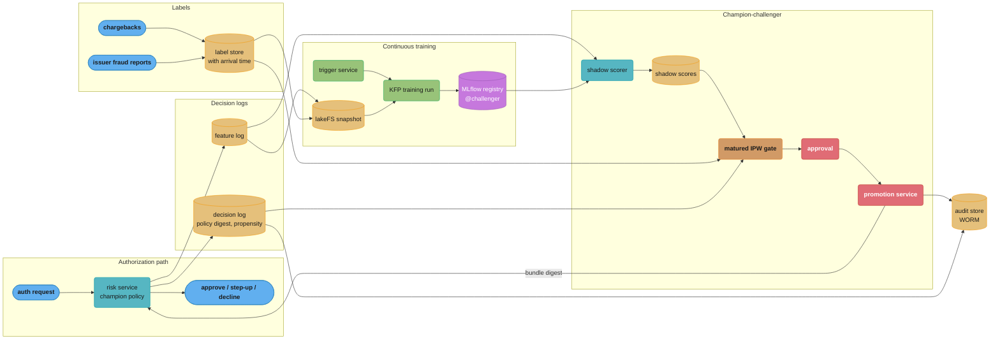
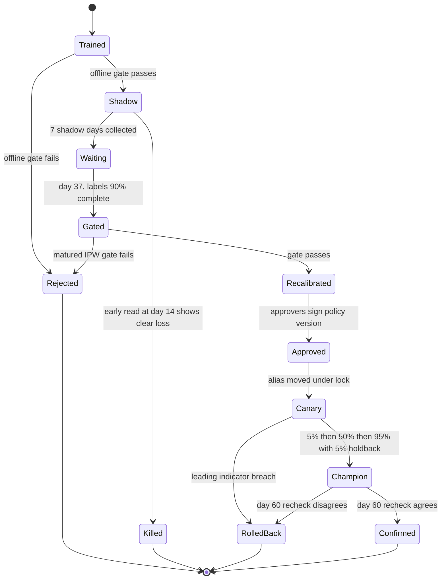
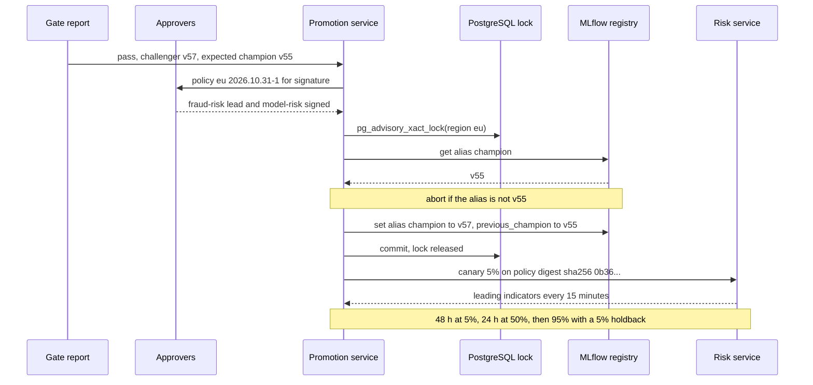

# Case Study: Design a Continuous Training and Champion-Challenger System

> **Version anchor (2026-10-18).** Tools appear at the mlops pin-table versions: MLflow 3.17.1
> (2026-10-13) for the registry and its `@champion` and `@challenger` aliases, Kubeflow Pipelines
> 2.17.2 (2026-09-04) for the training and gate pipelines, and lakeFS v1.88.0 (2026-10-01) for
> training-data snapshots. LightGBM, Kafka, Apache Iceberg and PostgreSQL are named without a
> version.
>
> **On numbers.** The processor, its volumes and its dollar figures are a worked scenario, not a
> company's data. Figures marked "simulated" come from the scripts in §4, run as printed.

## Intuition

> **Design intuition**: A risk score whose labels arrive a month late cannot be judged on the day
> it is trained. The continuous training system is therefore less a training system than a
> waiting system: it trains cheaply and often, scores every challenger silently beside the
> champion, keeps the evidence until the labels catch up, and then promotes a whole decision
> policy (model, calibration, thresholds, actions) as one versioned unit that an auditor can
> replay.

**Key insight for this design**: the champion's own decisions destroy the labels needed to judge
its replacement. A declined transaction never produces a chargeback, so every label in the store
comes from rows the champion approved. Any comparison built only on those rows measures the
challenger on the champion's mistakes and favors the challenger by construction. The design
buys back an unbiased view of the decline region with a small, priced, logged exploration slice,
and every gate in the system is computed with inverse-propensity weights over it.

Compute is the smallest line in this system's budget. Training all four regional models costs
about $50 a round. The expensive parts are the 30-day wait, the exploration slice (about $210,000
a month), and the people who sign promotions. The architecture is shaped around those three.

---

## 1. Requirements Clarification

### Functional Requirements

- Retrain four regional card-not-present (CNP) risk models (North America, Europe, Latin
  America, Asia-Pacific) on a calendar cadence, on drift and proxy-label signals, and on upstream
  events such as a feature schema change.
- Build every training set from labels that have matured: positives are chargebacks and
  issuer-reported fraud, which arrive over weeks.
- Validate each candidate offline, shadow-score it on 100% of live traffic, and judge it against
  the champion on paired, matured, propensity-weighted labels, with an early kill-only read.
- Version the decision policy (model, calibration, per-segment thresholds refitted on shadow
  scores, actions, rule overrides, exploration settings) as one artifact with one digest.
- Promote through risk-tier approval, a canary, and a 5% holdback on the previous policy.
- Record an audit trail that answers "which model, policy and features produced this decision"
  for any transaction in the retention window, and replays the score.

### Non-Functional Requirements

- Shadow scoring adds 0 ms to the authorization path. It runs asynchronously on logged features.
- Rollback of a promoted policy completes in under 5 minutes.
- Decline rate per region stays within 0.05 percentage points (pp) of target through a
  promotion; step-up rate within 0.10 pp.
- No promotion without matured labels: the gate refuses to run on a shadow day whose labels are
  younger than 30 days.
- Decision events are retained for 7 years (the processor's records policy, an assumption of this
  scenario) and are immutable once written.
- At most one promotion in flight per region. Alias moves are serialized.

### Out of Scope

**Not here.** The fraud model itself (features, graph signals, velocity counters, serving
latency) is designed in [Design Fraud Detection](../../ml/case_studies/design_fraud_detection.md),
and credit decisioning in
[Design Credit Risk Scoring](../../ml/case_studies/design_credit_risk_scoring.md). This study is
the continuous training and promotion system around a scoring model. Refresh policy as a concept
(value-of-freshness curve, warm start against from scratch, anchor drift budget) is on
[Continuous Training and Refresh Policy](../continuous_training_and_refresh_policy/continuous_training_and_refresh_policy.md);
this study applies it and does not re-derive it. PSI and drift statistics are in
[Drift Monitoring and Retraining](../../ml/case_studies/cross_cutting/drift_monitoring_and_retraining.md).
Calibration methods (Platt, isotonic) are in
[Model Calibration and Thresholding](../../ml/case_studies/cross_cutting/model_calibration_and_thresholding.md).
Sample size and paired-test arithmetic are in
[Statistics of Release Gates](../evaluation_gates_and_eval_sets/statistics_of_release_gates.md).

---

## 2. Scale Estimation

### Traffic and decisions

```
CNP authorization attempts:   40M/day   (NA 16M, EU 12M, LATAM 7M, APAC 5M)
Average rate:                 40M / 86,400 = 463 TPS
Peak (Black Friday, 3.5x):    ~1,600 TPS

Champion actions (policy targets, all regions):
  decline     0.90%   ->  360,000/day
  step-up     2.00%   ->  800,000/day   (3-D Secure challenge)
  approve    97.10%   ->  38.84M/day

Fraud attempts:               0.11%     ->  44,000/day
  declined by champion        55%       ->  24,200
  stopped at step-up          15%       ->   6,600
  approved (become labels)    30%       ->  13,200/day, average ticket $118
  fraud loss before recovery              ~$1.56M/day
```

### Label arrival

Positives arrive as chargebacks and issuer fraud reports. Completeness is measured from history,
on transactions old enough that every label has arrived:

```
days since auth    7     14     30     45     60     90
completeness      38%    66%    90%    95%    97%    99%
```

The system uses two maturity levels. Training windows end at 45 days (95%), because an
unlabeled fraud trains as a legitimate row. Gates read at 30 days (90%), because a paired
comparison only needs label delay to be independent of which model scored the row; §4.5 checks
that assumption at 60 days.

### Exploration slice

```
Would-be declines with amount <= $150:   70% of 360,000  = 252,000/day
Exploration rate 0.5%:                   1,260 approved-anyway rows/day
Fraud precision in the decline region:   24,200 / 360,000 = 6.7%  ->  ~85 frauds/day
Cost: 85 x ($70 average ticket + $20 chargeback fee)       = ~$7,650/day
Less margin on ~1,175 good rows approved                   = ~$650/day
Net exploration cost                                       = ~$7,000/day, ~$210,000/month
Share of fraud loss                                        = 7,000 / 1.56M = 0.45%

Explored rows per 30 days, all regions: 37,800 (about 2,550 frauds)
NA explored rows per 7-day shadow week: ~3,500 (about 240 frauds)
```

### Cadence and concurrency

```
Calendar cadence per region:       14 days
Training + offline validation:     ~4 hours
Shadow window used by the gate:    7 days
Label maturity before the gate:    30 days
Train-to-gate latency:             7 + 30 = 37 days (plus up to 1 day of pipeline lag)
Challengers in flight per region:  ceil(37 / 14) = 3
Shadow slots:                      4 regions x 3 = 12 concurrent shadow scorers
```

### Storage

```
Feature vectors logged at decision time:
  40M x 380 features x 4 B = 61 GB/day raw, ~20 GB/day zstd
  kept 400 days (training window + maturity + replay)       ->  ~8 TB
Decision events (ids, scores, policy digest, action, reasons):
  40M x ~600 B = 24 GB/day raw, ~8 GB/day compressed
  kept 7 years                                              ->  ~20 TB
Shadow scores: 3 challengers per region over all 40M rows x 32 B = 3.8 GB/day
  kept until the challenger is decided + 90 days            ->  ~0.6 TB peak
Labels: ~14,000 positive rows/day plus disputes and reversals ->  < 50 GB/year
```

### Compute

```
Training set per regional model (NA, the largest):
  window 120 days ending 45 days ago
  positives ~5,300/day x 120 = 0.64M (approved frauds + explored frauds)
  negatives sampled at 2%: 15.9M x 0.02 x 120 = 38M rows, weight 50
  LightGBM, 380 features binned to uint8: ~15 GB in memory, 1,200 trees
  ~3.5 node-hours on a 64-vCPU, 512 GB node
All four regions:                  ~10 node-hours x $4.80 = ~$48 per round
Shadow scoring: 1,200 trees, ~0.15 ms per row per core
  3 challengers x 40M rows x 0.15 ms = 18,000 core-seconds/day = 5 core-hours/day
```

---

## 3. High-Level Architecture



**Request and data flow.**

1. The risk service scores with the champion policy, acts, and writes the feature vector and a
   decision event (score, action, reason codes, policy digest, propensity) to Kafka.
2. The shadow scorer scores every logged vector with each challenger in the region's slots.
3. Labels land with transaction time and arrival time, so a query can ask "what was known on D".
4. The trigger service turns signals into at most one run per region per day (§4.1). A Kubeflow
   run trains on a lakeFS snapshot of matured rows and sets `@challenger` (§4.9).
5. 37 days later the gate computes the IPW comparison on matured labels (§4.4, §4.5).
6. A passed challenger gets refitted thresholds as a new policy version (§4.6), is signed, and
   is promoted under a lock through canary and holdback (§4.7), all recorded for audit (§4.8).

### Challenger lifecycle



---

## 4. Component Deep Dives

### 4.1 Trigger service

Four signal kinds feed it:

| Kind | Source | Example threshold | Bypasses cooldown |
|---|---|---|---|
| Calendar | cadence clock | 14 days since last run | No |
| Drift | PSI on the top 40 features and on the score, daily | score PSI above 0.20, or 5 features above 0.25 | No |
| Proxy label | 7-day issuer fraud reports, which arrive first | 7-day fraud rate 30% above its 8-week median | No |
| Event | feature schema registry, merchant onboarding, fraud-ops incident | schema version change on any model input | Yes |

Drift and proxy signals do not mean "the new model will be better". They mean "a fresh candidate
is cheap; start its 37-day clock now". The decision to promote still waits for matured labels.

The broken trigger service fired a run per signal. In one week of a card-testing attack the EU
region produced 11 runs, 9 of them on nearly identical windows, and filled every shadow slot so
the calendar challenger, the one with the newest matured labels, had nowhere to go. The fixed
service collapses a day's signals per region into one decision with cooldown, slot and budget
checks:

```python
from dataclasses import dataclass
from datetime import date, timedelta

@dataclass(frozen=True)
class Signal:
    region: str
    kind: str        # calendar | drift | proxy | event
    day: date
    detail: str

@dataclass
class RegionState:
    last_train: date
    in_flight: int              # challengers in shadow or waiting for labels
    month_spend_usd: float

POLICY = {"cadence_days": 14, "cooldown_days": 7, "max_in_flight": 3,
          "monthly_cap_usd": 2_000, "run_cost_usd": 20,
          "bypass_cooldown": {"event"}}

def decide(signals, state, today, p=POLICY):
    """Collapse one day's signals for a region into at most one training run."""
    if today - state.last_train >= timedelta(days=p["cadence_days"]):
        signals = signals + [Signal("", "calendar", today, "cadence")]
    if not signals:
        return None, "no signal"
    kinds = {s.kind for s in signals}
    cooling = today - state.last_train < timedelta(days=p["cooldown_days"])
    if cooling and not kinds & p["bypass_cooldown"]:
        return None, f"cooldown, dropped {sorted(kinds)}"
    if state.in_flight >= p["max_in_flight"]:
        return None, "shadow slots full"
    if state.month_spend_usd + p["run_cost_usd"] > p["monthly_cap_usd"]:
        return None, "budget cap"
    return "train", ",".join(sorted(kinds))

if __name__ == "__main__":
    d = date(2026, 10, 1)
    s = RegionState(last_train=d - timedelta(days=3), in_flight=1, month_spend_usd=300)
    assert decide([Signal("eu", "drift", d, "psi 0.27")], s, d)[0] is None
    assert decide([Signal("eu", "event", d, "schema v42")], s, d)[0] == "train"
    s.last_train = d - timedelta(days=15)
    assert decide([], s, d) == ("train", "calendar")
    s.in_flight = 3
    assert decide([], s, d) == (None, "shadow slots full")
    print("ok")
```

Every decision, including "cooldown, dropped ['drift']", goes to the audit store; a persistent
signal fires again after the cooldown. An attack in progress gets a rule override (§4.6), not a
run that cannot be judged for 37 days.

### 4.2 Training window and data snapshot

Training reads 120 days ending 45 days before the run; newer rows are excluded, not treated as
negatives. Window, label cut-off and lakeFS commit id go on the registry entry. The broken and
fixed label cut-off is on the
[refresh policy page](../continuous_training_and_refresh_policy/continuous_training_and_refresh_policy.md)
§6.2; this system adds two rules.

- **Explored rows enter training with their weights**, `1 / 0.005 = 200` capped at 50. Without
  them the training set has no labeled rows from the decline region (§9, "success erasure").
- **Features come from the feature log**, the vector the risk service scored. Point-in-time
  reconstruction is the fallback for rows logged before a feature existed, per
  [Feature Store and Point-in-Time Correctness](../../ml/case_studies/cross_cutting/feature_store_and_point_in_time_correctness.md).

### 4.3 Shadow scoring on logged features

The shadow scorer must see exactly what the champion saw. The first version did not.

```python
# BROKEN: shadow scorer fetches features from the online store when the event arrives
def shadow_score(event, challenger, feature_store):
    feats = feature_store.get_online(event.card_id, event.merchant_id)   # 200-900 ms later
    return challenger.predict(feats)
```

By the time the event reached the scorer, the velocity counters (`card_txn_count_1h`,
`card_amount_sum_24h`) already included the transaction being scored, and for declined
card-testing bursts they included the next five attempts as well. The challenger saw the future.
In shadow it looked 3.1 points better on recall; on the canary it was 0.8 points worse, and the
canary caught it only because the leading-indicator guard on decline rate fired.

```python
# FIXED: score the vector the champion scored, read from the feature log by transaction id
def shadow_score(event, challenger, feature_log):
    row = feature_log.get(event.txn_id)                  # written by the risk service
    if row.schema_version not in challenger.accepted_schemas:
        return None                                      # counted, never imputed
    return challenger.predict(row.vector)
```

### 4.4 Selective labels: the gate that always favors the challenger

The first gate compared models on the frauds the processor actually took: "of last month's
approved frauds, how many would the challenger have declined?" The champion's answer is zero by
construction, because it approved every one of them. Any challenger that declines anything looks
better. The fix is the exploration slice: a random 0.5% of would-be declines under $150 are
approved anyway, with the propensity written to the decision event. Those rows carry real labels
from inside the decline region, and inverse-propensity weighting rebuilds the whole population.

The script below simulates both. The challenger is constructed to be worse (noisier score). It
uses a 5% exploration rate so that 10 million rows produce enough explored frauds to read. An NA
shadow week in production holds about the same count, 240 explored frauds, each weighted 200
against about 123,000 frauds, so its estimate is about as noisy as this one; §4.5 sizes the paired
version.

```python
import numpy as np

rng = np.random.default_rng(7)
N = 10_000_000            # simulated authorizations
DECLINE_RATE = 0.009      # policy decline rate, the same for both models
EXPLORE = 0.05            # share of champion declines approved anyway (sim only, see text)

z = rng.normal(0, 1, N)                                   # latent risk
fraud = rng.random(N) < 1 / (1 + np.exp(-(3.0 * z - 11.0)))
champ = z + rng.normal(0, 0.55, N)                        # champion score
chall = z + rng.normal(0, 0.70, N)                        # challenger: noisier, so worse

def declines(score, rate=DECLINE_RATE):
    return score >= np.quantile(score, 1 - rate)

champ_dec, chall_dec = declines(champ), declines(chall)
explored = champ_dec & (rng.random(N) < EXPLORE)          # approved with a logged propensity
approved = ~champ_dec | explored                          # only these rows ever get a label
weight = np.where(explored, 1 / EXPLORE, 1.0)             # inverse propensity

def true_recall(dec):
    return (fraud & dec).sum() / fraud.sum()

def broken_recall(dec):
    # "Of the frauds we actually took, how many would this model have declined?"
    f = fraud & ~champ_dec
    return (f & dec).sum() / f.sum()

def ipw_recall(dec):
    f = fraud & approved
    return weight[f & dec].sum() / weight[f].sum()

for name, fn in [("true", true_recall), ("broken", broken_recall), ("ipw", ipw_recall)]:
    print(f"{name:7s} champion {fn(champ_dec):.3f}  challenger {fn(chall_dec):.3f}")
print("explored rows", explored.sum(), "explored frauds", (explored & fraud).sum())
```

Output (simulated):

```
true    champion 0.465  challenger 0.397
broken  champion 0.000  challenger 0.214
ipw     champion 0.457  challenger 0.381
explored rows 4519 explored frauds 238
```

The broken metric reports the worse model as 21 points better. The IPW estimate recovers the
true ordering and lands within 1.6 points of the true recall for each model. Two rules make the
fix hold in production:

- **The propensity is logged, never recomputed.** The decision event stores
  `explore_propensity = 0.005` for every row that was eligible (would-be decline, amount at or
  under $150), whether or not it was explored. Rows above $150 have propensity 0, so the IPW
  estimate covers only the eligible region; the gate reports recall above $150 separately, from
  the champion-approved rows only, and labels it as a lower-confidence slice.
- **Weights are clipped in training, not in the gate.** Training caps the weight at 50 to bound
  variance. The gate uses the true 200, because a clipped weight biases the recall estimate.

### 4.5 Matured paired gate

The gate runs on day 37 on the 7 shadow days, using labels known at 30 days, plus the older
explored rows described at the end of this section. Its unit of
evidence is the weighted count of frauds that one model declines and the other does not; rows
where both agree carry no information. The resampling unit is the day, because fraud rings
cluster in time and row-level resampling understates the variance.

```python
import random
from dataclasses import dataclass

@dataclass
class Day:
    """IPW-weighted tallies for one shadow day, read after its labels matured 30 days."""
    frauds: float           # weighted fraud count
    only_chall: float       # frauds the challenger declines and the champion does not
    only_champ: float       # frauds the champion declines and the challenger does not
    good_declines_delta: float   # challenger minus champion declines of good transactions

def recall_delta(days):
    f = sum(d.frauds for d in days)
    return 100 * (sum(d.only_chall for d in days) - sum(d.only_champ for d in days)) / f

def ci(days, stat, b=2000, seed=0):
    rnd = random.Random(seed)
    xs = sorted(stat([rnd.choice(days) for _ in days]) for _ in range(b))
    return xs[int(0.025 * b)], xs[int(0.975 * b)]

def gate(days, slices, anchor_gap_pts, margin_pts=1.0, budget_pts=1.0, slice_floor_pts=-1.5):
    lo, hi = ci(days, recall_delta)
    reasons = []
    if lo < -margin_pts:
        reasons.append(f"recall lower bound {lo:+.2f} below -{margin_pts}")
    if anchor_gap_pts + recall_delta(days) < -budget_pts:
        reasons.append("anchor budget spent")
    for name, sd in slices.items():
        s_lo, _ = ci(sd, recall_delta)
        if s_lo < slice_floor_pts:
            reasons.append(f"slice {name} lower bound {s_lo:+.2f}")
    fd = sum(d.good_declines_delta for d in days)
    if fd > 0.02 * sum(d.frauds for d in days):
        reasons.append(f"extra good declines {fd:.0f}")
    return ("pass" if not reasons else "fail"), round(recall_delta(days), 2), (lo, hi), reasons

if __name__ == "__main__":
    rnd = random.Random(42)
    def day(gain):
        f = rnd.gauss(4200, 300)
        return Day(f, f * rnd.gauss(0.040 + gain, 0.004), f * rnd.gauss(0.040, 0.004),
                   rnd.gauss(0, 15))
    better = [day(0.006) for _ in range(7)]
    verdict, delta, (lo, hi), why = gate(better, {"travel": [day(0.006) for _ in range(7)]}, 0.2)
    print(verdict, delta, f"[{lo:+.2f}, {hi:+.2f}]", why)
    assert verdict == "pass"
    worse = [day(-0.012) for _ in range(7)]
    verdict, *_, why = gate(worse, {}, 0.2)
    print(verdict, why)
    assert verdict == "fail"
```

Output (simulated):

```
pass 0.51 [+0.22, +0.80] []
fail ['recall lower bound -1.40 below -1.0']
```

- **Non-inferiority.** Pass if the lower bound of the recall change is above -1.0 point; fresh
  data has value at equal recall. The anchor budget (1.0 point against a frozen quarterly model,
  refresh policy page §6.3) stops a series of small losses.
- **Equal decline rate.** Each model's decline set is its own top 0.9% on shadow scores, so a
  ranking change is not mixed with a rate change.
- **Margin from replay.** A bootstrap on 7 day-blocks understates the tails. The 1.0 margin was
  set by replaying 26 past gates against their 60-day outcome: 2 of 26 passes would reverse.
- **60-day recheck.** On day 67 the gate re-runs on the same shadow days with 97% complete labels;
  a reversal beyond the margin rolls the policy back (§8). It catches an advantage that comes
  from late-arriving fraud types.

Sample size binds in the decline region. Frauds the challenger declines among champion approvals
are labeled directly, about 37,000 in NA per shadow week. Frauds it lets through among champion
declines show only in explored rows: about 240 a week in NA, each weighted 200. If the models
split on 1 in 10 of those, that term alone spans about plus or minus 1.6 points at 95%. So the gate
replays the challenger on every matured explored row it never trained on, from its training
cut-off (day -45) to the end of its shadow week (day +7). 52 days bring the term to about plus or
minus 0.6, which is why the margin is 1.0 point, not the 0.3 of the unweighted paired test on the
refresh policy page. Paired sample sizes are in
[Statistics of Release Gates](../evaluation_gates_and_eval_sets/statistics_of_release_gates.md),
and offline gate design in
[Evaluation Gates and Eval Sets](../evaluation_gates_and_eval_sets/evaluation_gates_and_eval_sets.md).

### 4.6 Decision policy versioning and threshold recalibration

The model is not what the business runs. It runs a decision policy: score, calibration, per-segment
thresholds, the mapping from bands to actions, fraud-ops rule overrides, and the exploration
settings. Each of these can change without the others, and each change alters decisions.

```yaml
apiVersion: risk.example.io/v1
kind: DecisionPolicy
region: eu
version: 2026.10.31-1
model: models:/risk-eu/57                 # MLflow version, resolved to a digest at build
calibration: {method: isotonic, artifact: calib-eu-57, fitted_on: shadow 2026-10-23..29}
thresholds:                     # cut-offs and the decline and step-up rates they were fitted to
  digital_goods: {decline_at: 0.1077, stepup_at: 0.0826, target: [0.016, 0.030]}
  travel:        {decline_at: 0.1161, stepup_at: 0.0882, target: [0.011, 0.025]}
  retail:        {decline_at: 0.1268, stepup_at: 0.0981, target: [0.007, 0.017]}
actions: {above_decline: decline, above_stepup: step_up_3ds, otherwise: approve}
rules: {ref: rules-eu@2026-10-14, max_active: 60, max_age_days: 30}
explore: {rate: 0.005, max_amount_usd: 150, eligible: would_be_decline}
reason_codes: rc-map-v9
```

Thresholds are refitted on every promotion. A retrained model with the same AUC can move its
score distribution, and an unchanged threshold then moves the decline rate (§9 has the incident).
Recalibration reads one week of the challenger's shadow scores, which are live-traffic scores
for the exact population the policy will act on:

```python
import hashlib
import json
import numpy as np

def recalibrate(shadow_scores, segments, targets):
    """Per-segment thresholds that hit the target decline and step-up rates on shadow scores."""
    out = {}
    for seg, (decline_rate, stepup_rate) in targets.items():
        s = shadow_scores[segments == seg]
        out[seg] = {
            "decline_at": round(float(np.quantile(s, 1 - decline_rate)), 4),
            "stepup_at": round(float(np.quantile(s, 1 - decline_rate - stepup_rate)), 4),
        }
    return out

def policy_digest(policy):
    blob = json.dumps(policy, sort_keys=True, separators=(",", ":")).encode()
    return "sha256:" + hashlib.sha256(blob).hexdigest()

if __name__ == "__main__":
    rng = np.random.default_rng(1)
    scores = rng.beta(1.2, 40, 2_000_000)            # a week of EU shadow scores, sampled
    segs = rng.choice(["digital_goods", "travel", "retail"], 2_000_000, p=[.2, .1, .7])
    targets = {"digital_goods": (0.016, 0.030), "travel": (0.011, 0.025),
               "retail": (0.007, 0.017)}
    thr = recalibrate(scores, segs, targets)
    for seg, (dr, _) in targets.items():
        got = (scores[segs == seg] >= thr[seg]["decline_at"]).mean()
        assert abs(got - dr) < 0.0005, (seg, got)
    policy = {"model": "models:/risk-eu/57", "calibration": "isotonic-eu-57",
              "thresholds": thr, "explore": {"rate": 0.005, "max_amount_usd": 150},
              "rules": "rules-eu@2026-10-14"}
    print(json.dumps(thr, indent=1))
    print(policy_digest(policy))
```

The YAML thresholds are this script's output. Digests over canonical JSON, and the YAML loading
traps, are in [AI Release Bundle and Lineage](cross_cutting/ai_release_bundle_and_lineage.md)
§6.1 and §6.3; the risk service's bundle carries the policy as its `decision` block. Consequences:

- **A threshold change is a release.** Moving `retail.decline_at` from 0.1268 to 0.1240 is a new
  digest, gated by a 7-day shadow replay of the rates and one approver. Never a config-map edit.
- **Rule overrides expire.** Fraud ops adds a rule (decline BIN range X at merchant category Y)
  through the same path with a 15-minute approval. `expires_at` is at most 30 days out; a rule
  worth keeping becomes a feature in the next training run.
- **Calibration is pinned with the model.** Model 57 with calibration 56 never passed a gate, and
  the loader refuses it.

The decision-model view of thresholds, abstain bands and action mappings is on
[Decision Models](../decision_models/decision_models.md).

### 4.7 Promotion: lock, canary, holdback

MLflow alias moves are last-writer-wins: two pipelines that both read "champion is v55" race, and
the second write silently wins (§9). The promotion service serializes per region with a
PostgreSQL advisory lock and re-reads the alias inside it.



```python
from mlflow import MlflowClient
import psycopg

def promote(region, challenger_version, expected_champion, policy_digest, dsn):
    name = f"risk-{region}"
    client = MlflowClient()
    with psycopg.connect(dsn) as conn, conn.transaction():
        conn.execute("SELECT pg_advisory_xact_lock(hashtext(%s))", (name,))
        current = client.get_model_version_by_alias(name, "champion").version
        if str(current) != str(expected_champion):
            raise RuntimeError(f"{name}: champion is v{current}, gate assumed v{expected_champion}")
        client.set_registered_model_alias(name, "previous_champion", current)
        client.set_registered_model_alias(name, "champion", challenger_version)
        client.set_model_version_tag(name, challenger_version, "policy_digest", policy_digest)
        conn.execute(
            "INSERT INTO promotions(region, from_v, to_v, policy_digest, at) "
            "VALUES (%s, %s, %s, %s, now())",
            (region, current, challenger_version, policy_digest))
```

The risk service does not read the alias on every request. It resolves the alias to a policy
digest when the canary controller tells it to, loads the bundle, and verifies the digest before
serving. Rollback is the same call in reverse with `previous_champion`, measured at 2 to 3
minutes including bundle load.

The canary cannot use fraud labels; they are 30 days away. It guards on leading indicators that
move within hours:

| Guard | Window | Breach |
|---|---|---|
| Decline rate per segment | 15 min, vs target | outside target plus or minus 0.05 pp for 3 windows |
| Step-up rate per segment | 15 min | outside target plus or minus 0.10 pp for 3 windows |
| 3-D Secure challenge success | 1 h | down more than 2 pp vs champion arm |
| Issuer approval rate on approved traffic | 1 h | down more than 0.3 pp vs champion arm |
| Score PSI, canary arm vs shadow week | 1 h | above 0.02 |
| Customer support contacts tagged "declined" | 4 h | up more than 15% vs champion arm |

The 5% holdback stays on the previous policy for 30 days after full rollout. It is the only
randomized comparison of actions, so it measures what shadow cannot: a step-up the new model
triggers more often changes cardholder abandonment, which recall never shows. Traffic-split
mechanics are on
[Progressive Delivery for Model Servers](../progressive_delivery_for_model_servers/progressive_delivery_for_model_servers.md),
and the online-experiment arithmetic for the holdback in
[Experimentation and Online Evaluation](../../ml/case_studies/cross_cutting/experimentation_and_online_evaluation.md).

### 4.8 Audit trail

Two tables carry the audit. Both are append-only Iceberg tables on object storage with object
lock in compliance mode, so neither the platform team nor an administrator can rewrite them.

```sql
CREATE TABLE audit.decision_events (
  txn_id STRING, ts TIMESTAMP, region STRING,
  policy_version STRING,
  policy_digest STRING,             -- sha256 of the canonical DecisionPolicy
  bundle_digest STRING,             -- release bundle of the risk service
  model_version INT,
  feature_log_key STRING,           -- pointer to the exact vector scored
  score DOUBLE, calibrated_p DOUBLE,
  action STRING,                    -- approve | step_up_3ds | decline
  explore_eligible BOOLEAN, explore_propensity DOUBLE, explored BOOLEAN,
  rule_hits ARRAY<STRING>, reason_codes ARRAY<STRING>
) PARTITIONED BY (days(ts), region);

CREATE TABLE audit.promotions (
  region STRING, from_version INT, to_version INT, policy_digest STRING,
  gate_report_uri STRING, gate_report_sha STRING,
  approvers ARRAY<STRING>,
  canary_outcome STRING,
  recheck_60d STRING,               -- confirmed | reversed | pending
  at TIMESTAMP
);
```

"Why was transaction X declined on 2026-08-14" is one query and one replay: read the event, load
`model_version` and the policy by digest from the registry, load the vector by
`feature_log_key`, re-score, and compare to `score`. A mismatch above 1e-6 is itself an incident.
Vectors expire after 400 days; the event, reason codes and policy digest stay for 7 years. Lineage
from policy to training snapshot follows the bundle model; who signs which tier is on
[AI Governance and Model Risk Operations](../ai_governance_and_model_risk_operations/ai_governance_and_model_risk_operations.md).

### 4.9 Orchestration

The training run and the gate run are separate Kubeflow pipelines, because they are 37 days
apart. The gate pipeline is scheduled daily and picks up every challenger whose window has
matured.

```python
from kfp import dsl

@dsl.component(base_image="registry.example.io/risk-ct:2026.10")
def train(region: str, end_offset_days: int, window_days: int) -> str:
    from risk_ct.data import snapshot
    from risk_ct.train import fit_lightgbm
    commit = snapshot(region, end_offset_days, window_days)   # lakeFS commit id
    return fit_lightgbm(region, commit)                        # MLflow run id, logs the commit

@dsl.component(base_image="registry.example.io/risk-ct:2026.10")
def offline_gate(region: str, run_id: str) -> str:
    from risk_ct.gates import offline
    return offline(region, run_id)                             # "pass" or "fail"

@dsl.component(base_image="registry.example.io/risk-ct:2026.10")
def register_challenger(region: str, run_id: str):
    from risk_ct.registry import register_and_alias
    register_and_alias(region, run_id, alias="challenger")

@dsl.pipeline(name="risk-ct-train")
def risk_ct_train(region: str, end_offset_days: int = 45, window_days: int = 120):
    fit = train(region=region, end_offset_days=end_offset_days, window_days=window_days)
    check = offline_gate(region=region, run_id=fit.output)
    with dsl.If(check.output == "pass"):
        register_challenger(region=region, run_id=fit.output)
```

The `@challenger` alias names the most recent candidate; the shadow scorer reads a list of up to
three versions per region from a `shadow_slots` table, because one alias cannot name three
models. Pipeline mechanics (caching, retries, artifact passing) are on
[ML Pipelines and Orchestration](../ml_pipelines_and_orchestration/ml_pipelines_and_orchestration.md).

---

## 5. Design Decisions & Tradeoffs

### When to judge a challenger

| Option | Time to decision | Bias | Chosen |
|---|---|---|---|
| Offline only, on the newest matured holdout | Same day | Holdout is 45+ days old; misses live shift and feature skew | Used as the first gate only |
| Shadow plus 14-day labels (66% complete) | 21 days | Late-arriving fraud types missing | Kill-only early read |
| Shadow plus 30-day labels | 37 days | Small, checked at 60 days | Promotion gate |
| Shadow plus 60-day labels | 67 days | Smallest | Recheck that can roll back |
| Online A/B with real actions | 30+ days plus exposure | None on labels, but costs real fraud on the worse arm | Holdback only, after promotion |

### Selective labels

| Option | What it costs | What it gives |
|---|---|---|
| Ignore (approved rows only) | Nothing up front | A gate that favors every challenger; success erasure in training |
| Reject inference (impute labels for declines from a model) | Modeling effort | Labels that inherit the champion's own beliefs |
| Exploration slice, 0.5% of declines under $150 | ~$210,000/month | Unbiased labels in the eligible decline region, with known variance |
| Exploration at 2% | ~$840,000/month | Tighter intervals the gate does not need at this volume |

The amount cap is a design decision, not a detail. It bounds the cost per explored row, and it
means the gate's unbiased region ends at $150. High-value declines are judged on approved rows
only and reviewed by a person for any policy that changes them.

### Promotion approval by change type

| Change | Gate | Approvers | Auto-promote |
|---|---|---|---|
| Scheduled retrain, same features | Full matured gate | Fraud-risk lead per region | No; 24 h veto window considered after 4 quarters without a 60-day reversal |
| New feature or architecture | Full gate plus model-risk review | Fraud-risk lead and model risk | No |
| Threshold refit only | 7-day shadow replay on rates | Fraud-risk lead | No |
| Rule override, 30-day expiry | Replay on 24 h of logs | Fraud-ops on-call | Yes, inside rule budget |
| Exploration rate or cap | Cost and variance review | Finance and fraud-risk lead | No |

### Regional models against one global model

Four models cost four pipelines and approvals, and APAC has the fewest labels (about 1,650
approved frauds a day). They stay because chargeback rules, 3-D Secure mandates and attacks differ
by region, and a regional promotion bounds blast radius. A global model would touch all 40M daily
decisions on every promotion.

---

## 6. Real-World Implementations

**Stripe.**
[Stripe's primer on machine learning for fraud protection](https://stripe.com/guides/primer-on-machine-learning-for-fraud-protection)
says a new model must outperform the production model on a held-out set before deployment, that
guardrail metrics (false positive rate, block rate, authorization rate) are watched in aggregate
and per merchant, and that old and new score distributions are compared to avoid disruptive
shifts. It notes that blocked payments leave outcomes unknown, so post-deployment precision and
recall need counterfactual analysis, and that retraining on newer data can raise recall by as
much as half a percentage point a month. Those map to §4.4, §4.6 and §4.7 here.

**Google TFX.** The [TFX Evaluator](https://www.tensorflow.org/tfx/guide/evaluator) compares a
new model against a baseline, such as the currently serving model or the latest "blessed" model
picked by a resolver, on metrics and slices with value and change thresholds. A model that meets
them is blessed, which tells the Pusher it may push it to production. That is the offline gate of §4.9 as a framework primitive. It does not
address label delay or selective labels; those sit outside the framework, in how the eval set is
built.

**Booking.com.** Bernardi, Mavridis and Estevez, "150 Successful Machine Learning Models: 6
Lessons Learned at Booking.com" (KDD 2019), report that gains in offline model metrics did not
reliably translate into business gains in their randomized experiments. For this system that is
the argument for the post-promotion holdback: recall at equal decline rate is the gate, but the
holdback measures the outcome of actions, which recall does not.

**US bank model risk management.** Banks run champion-challenger for credit and fraud strategies
under guidance that asks for outcomes analysis and ongoing monitoring; SR 26-2 (April 2026)
superseded SR 11-7 (2011-04-04). Who signs and what evidence a promotion carries is on
[AI Governance and Model Risk Operations](../ai_governance_and_model_risk_operations/ai_governance_and_model_risk_operations.md).

---

## 7. Technologies & Tools

| Concern | Tool in this design | Why | Alternative |
|---|---|---|---|
| Registry and aliases | MLflow 3.17.1 | `@champion`, `@previous_champion`, model version tags for policy digest | Kubeflow Hub v0.3.17 |
| Pipelines | Kubeflow Pipelines 2.17.2 | `dsl.If` on gate output, scheduled gate runs, artifact lineage | Airflow, Temporal |
| Training-data snapshots | lakeFS v1.88.0 | Commit id per training set, zero-copy branch for backfills | Iceberg snapshots, DVC 3.67.1 |
| Model | LightGBM | GBDT on tabular features, `init_model` for warm start | XGBoost |
| Logs | Kafka to Iceberg | Feature and decision logs, replayable by transaction id | Any append-only log plus a table format |
| Promotion lock | PostgreSQL advisory lock | Serializes alias moves per region | Single-writer promotion queue |
| Audit storage | Object storage with object lock (compliance mode) | Immutable decision and promotion records | WORM appliance |
| Drift statistics | PSI jobs over the feature log | Trigger signals only, never a promotion reason | Evidently, NannyML |

Registry patterns (aliases against stages, packaging, signatures) are covered in
[Model Registry and Packaging](../model_registry_and_packaging/model_registry_and_packaging.md),
and label and snapshot versioning in
[Dataset and Label Versioning](../dataset_and_label_versioning/dataset_and_label_versioning.md).

---

## 8. Operational Playbook

### Dashboards

| Panel | Source | Normal range |
|---|---|---|
| Decline and step-up rate per region and segment, per policy arm | decision log | target plus or minus 0.05 pp |
| Challengers in flight per region, days to gate | `shadow_slots` | 2 to 3, gate within 38 days of training |
| Label completeness curve, this month against the 12-month baseline | label store | within 3 pp at day 30 |
| Exploration volume, cost and explored frauds | decision log plus labels | 1,100 to 1,400 rows/day, $6,000 to $8,500/day |
| Shadow coverage: shadow rows over feature-log rows | shadow store | above 99.9% |
| Anchor gap per region | gate reports | above -1.0 point |
| Active rule overrides, oldest age | policy store | at most 60 per region, none older than 30 days |
| 60-day recheck outcomes, last 8 promotions | promotions table | 0 reversed |

### Alerts

- **Day-30 label completeness below 85% for a week.** A dispute timeline changed or the feed
  broke. Freeze the region's gates.
- **Shadow coverage below 99%.** The gate refuses that window; it would be a non-random subset.
- **Decline rate off target by 0.15 pp for 30 minutes.** Page fraud on-call; auto-rollback if
  within 2 hours of a promotion.
- **Zero explored rows for 1 hour.** A policy deploy broke the flag; every later gate is blind
  to the decline region.

### Runbook: promoted policy reversed at the 60-day recheck

1. Roll back to `previous_champion`. Confirm the previous policy digest on 100% of traffic.
2. Set `recheck_60d = reversed` and attach both gate reports.
3. Compare 30-day and 60-day frauds by type. If late-arriving types drove the reversal, raise
   the region's gate maturity to 45 days until the cause is fixed.
4. Re-run the gate for in-flight challengers compared against the reversed champion.

### Runbook: attack in progress

1. Fraud ops adds a rule override with a 7-day expiry; a 24-hour log replay shows its decline
   rate impact before the on-call approves it.
2. The event trigger starts a training run. Do not shorten the maturity window to "catch up";
   the newest rows are the most mislabeled.
3. Leave exploration on. Without it, nothing shows whether the rule is too broad.

---

## 9. Common Pitfalls & War Stories

**Gate on champion-approved frauds only.** The first NA gate argued that the challenger "would
have caught $410,000 of last month's fraud losses". It was promoted. Over the next 6 weeks NA
fraud losses rose 14% (about $2.6 million) before matured labels showed recall at equal decline
rate had fallen 2.3 points. Fix: the exploration slice and IPW gate in §4.4. Cost: about
$210,000 a month across regions.

**Threshold left in place on a retrain.** An EU challenger with equal AUC shifted its scores
upward. At the old threshold, EU decline rate went from 0.90% to 1.31%; about 12,300 good
transactions (about $1.1 million) were declined before rollback at hour 6. Fix: thresholds are
refitted on shadow scores and are part of the policy digest (§4.6).

**Shadow scored on re-fetched features.** Velocity counters already included the scored
transaction. Shadow showed +3.1 points of recall; the canary showed -0.8. Fix: shadow scores the
logged vector by transaction id (§4.3).

**Alias race.** Two regional pipelines shared a promotion script that set the alias without a
lock. Model v57 served with v56's thresholds for 40 minutes, declining 0.2 pp too few in the
digital-goods segment. Fix: advisory lock plus compare-and-set on the expected champion (§4.7).

**Rules that never expire.** LATAM had 212 active rule overrides, 61% older than 90 days,
declining 0.34 pp of traffic. Removing 140 cut decline rate 0.21 pp with no measurable fraud
change over 60 days. Fix: `max_age_days: 30` and 60 rules per region, enforced by the loader.

**Success erasure.** A first-quarter gift-card BIN attack was declined at high recall, so it left
almost no labels, and the third-quarter model ranked the pattern lower. When the attackers
returned, the new champion let through about $380,000 in 9 days. Fix: explored rows in training
(§4.2) and a "retired attack" slice of historical patterns in the offline gate.

**Early read promoted.** Before the state machine was enforced, a strong day-14 read was used to
promote early "because the signal was obvious". At day 60 the gain had shrunk from +1.4 to +0.1
points: the challenger caught early-reported card testing well and late-reported account
takeover poorly. Fix: the early read can only kill (§3).

---

## 10. Capacity Planning

### Monthly cost

```
Exploration (net fraud loss and fees)        ~$210,000
Approver time: 4 regions x 2 promotions x 2 approvers x 1.5 h x $150/h  ~$3,600
Fraud-ops rule approvals: ~120/month x 0.25 h x $120/h                   ~$3,600
Feature log storage: 8 TB object storage at $23/TB-month                    ~$190
Decision events, 7 years: 20 TB at a cold tier, $4/TB-month                  ~$80
Training: 2 rounds x $48                                                    ~$100
Shadow scoring: 5 core-hours/day x 30 x $0.05                                 ~$8
Kafka, Iceberg compaction, gate jobs (shared platform share)              ~$2,500
Total                                                                     ~$220,000
```

Exploration is about 95% of the system's direct cost, and it is the lever that sets the width of
every gate interval. Halving the rate to 0.25% everywhere saves about $105,000 a month and widens
the IPW recall interval by about 1.4 times (the square root of 2). NA can take it (plus or minus
0.6 to 0.8, inside the margin, saving about $42,000 a month). APAC, with under a third of NA's
explored rows, is already at plus or minus 1.0 at 0.5% and needs 1% (about $26,000 a month more).

### Growth to 100M transactions a day

```
Feature log:       61 GB/day raw scales linearly -> 150 GB/day, ~20 TB kept     fine
Shadow scoring:    5 -> 12.5 core-hours/day                                       fine
Training:          rows scale with positives; NA set ~38 GB in memory
                   above ~400 GB, move from one node to distributed LightGBM
                   or sample negatives at 1%
Exploration cost:  scales with declines -> ~$525,000/month at 0.5%
                   but explored frauds per gate also scale, so the rate can fall
                   to keep the same interval width: rate ~ 1 / volume
Gate latency:      unchanged at 37 days; volume does not shorten label delay
```

The levers on time to decision are faster label feeds (95% completeness at 30 days would allow a
30-day training cut-off) and a proxy-label model, which may kill challengers earlier but never
promotes them.

### Overlap of challengers per region

```
day   0      14     28     42     56     70     84
C1    Tsss..............G
C2           Tsss..............G
C3                  Tsss..............G
C4                         Tsss..............G
C5                                Tsss..............
slots 1      2      3      3      3      3      3

one column = 2 days; T = trained, s = 7 shadow days, . = labels maturing,
G = gate on day 37 after training
```

Three slots per region are full at steady state. A signal-triggered run while all three are
full is dropped (§4.1) rather than evicting the calendar challenger whose labels mature first.

---

## 11. Interview Discussion Points

**Q: Why can a challenger not be judged on the labels the system already has?**
**Short:** Every label comes from a row the champion approved, so an approved-only comparison measures the challenger on the champion's misses and favors it by construction.

Declines produce no chargebacks. On champion-approved frauds the champion's recall is zero, so
any challenger that declines anything looks better; in the §4.4 simulation a worse challenger
shows 21 points better. The fix is a randomized exploration slice with a logged propensity and
inverse-propensity weights in the gate. Price the slice explicitly; here it is 0.45% of fraud loss.

**Q: How do you choose the exploration rate and the amount cap?**
**Short:** Set the rate from the gate interval you need in the smallest region, and the cap to bound loss per explored row, then price both in dollars per month.

At 0.5% under $150 the system gets about 2,550 explored frauds a month, about 34 a day in NA,
each weighted 200. Pooled over 52 days of matured rows, that gives NA a recall interval of about
plus or minus 0.6 points, and APAC about 1.0, the full gate margin, so APAC needs a higher rate.
The interval scales with one over the square root of explored frauds, so halving the rate widens
it 1.4 times. The cap means the
unbiased region ends at $150; above it, policies that change declines need a human review.

**Q: Why train on 45-day-matured labels but gate on 30-day labels?**
**Short:** Training needs absolute label accuracy, while a paired gate only needs label delay to be independent of which model scored the row.

An unlabeled fraud in training is a legitimate example, so the training cut-off follows 95%
completeness. In the gate, both models are scored on the same rows, so missing labels hit both
equally, unless the challenger's advantage sits in fraud types that arrive late. The 60-day
recheck tests exactly that and rolls back on a reversal.

**Q: What does the early read at day 14 do, and why can it not promote?**
**Short:** It kills a challenger that is clearly worse on 66%-complete labels and never promotes, because early labels over-represent fast-reported fraud types.

Card testing is reported within days; account takeover and friendly fraud arrive weeks later.
A challenger strong on the first and weak on the second looks best at day 14. Asymmetric use is
safe: killing a good challenger costs one cycle, promoting a bad one costs fraud loss for weeks.

**Q: Why version the decision policy separately from the model, and then promote them together?**
**Short:** Thresholds, calibration, actions and rules each change decisions on their own, so each needs a version, but a model with stale thresholds is a policy no gate ever passed.

The policy digest covers model version, calibration, per-segment thresholds, action mapping, rule
set and exploration settings. A threshold-only change is a smaller release with its own gate. A
model change always ships with thresholds refitted on its own shadow scores, in one alias move.

**Q: How do you keep decline rate stable through a promotion?**
**Short:** Refit per-segment thresholds on a week of the challenger's live shadow scores to hit the target rates, and guard decline rate per segment on the canary.

Equal AUC does not mean equal score distribution. Quantile thresholds on shadow scores hit the
targets to within 0.05 pp. The canary then checks the rate every 15 minutes on real traffic, since
traffic mix shifts between the shadow week and the canary week.

**Q: Why shadow-score from the feature log instead of the feature store?**
**Short:** The store has moved on by the time the event is scored, so velocity features include the scored transaction and the challenger sees the future.

That leak made a challenger look 3.1 points better in shadow and 0.8 points worse live. Scoring
the logged vector makes the comparison paired on identical inputs. The cost is that a challenger
with a new feature must wait until the risk service logs that feature.

**Q: Retraining takes 37 days to judge. What do you do during an attack?**
**Short:** Ship a rule override through the policy path with a short expiry, start a training run so the pattern's labels enter a candidate, and leave exploration on.

A model cannot learn an attack whose labels have not arrived. Rules are fast and blunt, so every
rule carries an expiry of at most 30 days and a regional cap. A rule that keeps earning its place
becomes a feature in the next training run.

**Q: When would you allow auto-promotion in this system?**
**Short:** Only for changes with bounded blast radius and measured gate reliability, such as expiring rules, and for retrains only after quarters of 60-day rechecks with no reversal.

Auto-promotion needs a known false-pass rate. Replaying 26 past gates found 2 that the 60-day
recheck would have reversed. Until that rate is lower and the rollback path is tested every
quarter, a regional fraud-risk lead signs each retrain. A 24-hour veto window is the next step,
not removal of the human.

**Q: How do you answer a regulator or a merchant asking why a transaction was declined?**
**Short:** Read the decision event, load the model and policy by digest and the vector by its log key, re-score, and show reason codes, thresholds and approvers.

The decision event pins policy and bundle digests. The promotion record pins the gate report and
signatures. A re-score that does not match the logged score to 1e-6 is an incident. After 400 days
the vector is gone, but the event, policy and reason codes remain for 7 years.

**Q: What would you change if labels arrived in 3 days instead of 30?**
**Short:** Shorten the gate to days, drop the early read, consider a 24-hour veto auto-promotion, and spend effort on exploration and holdback rather than waiting.

Fast labels move the bottleneck from time to decision to regression risk per promotion, as in ads
ranking. Cadence could rise to weekly or daily, the anchor budget matters more because promotions
are frequent, and selective labels remain: fast labels from approved rows are still biased.
