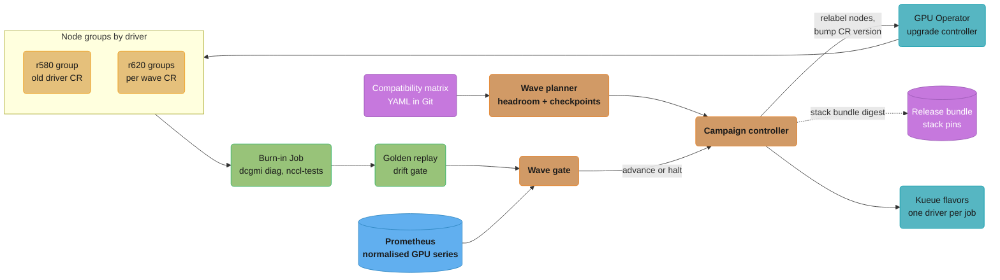
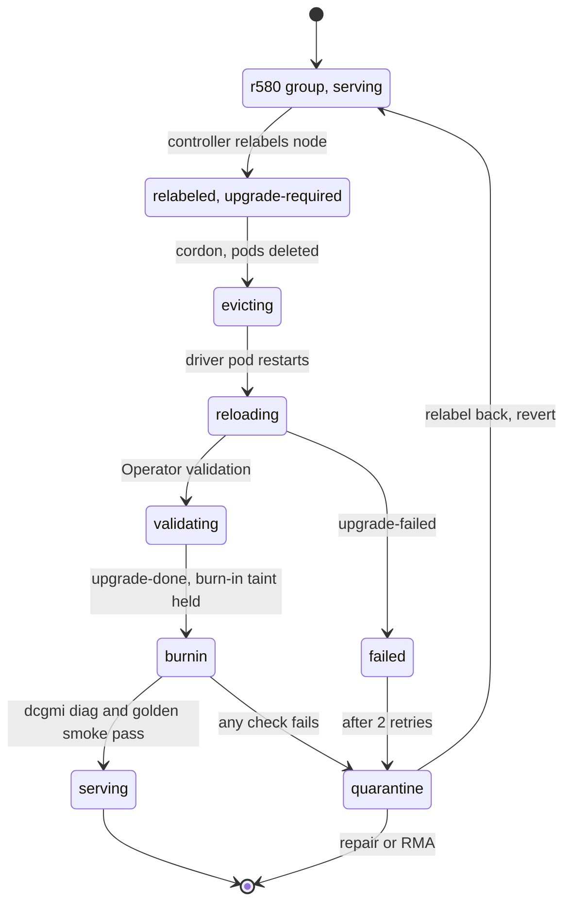
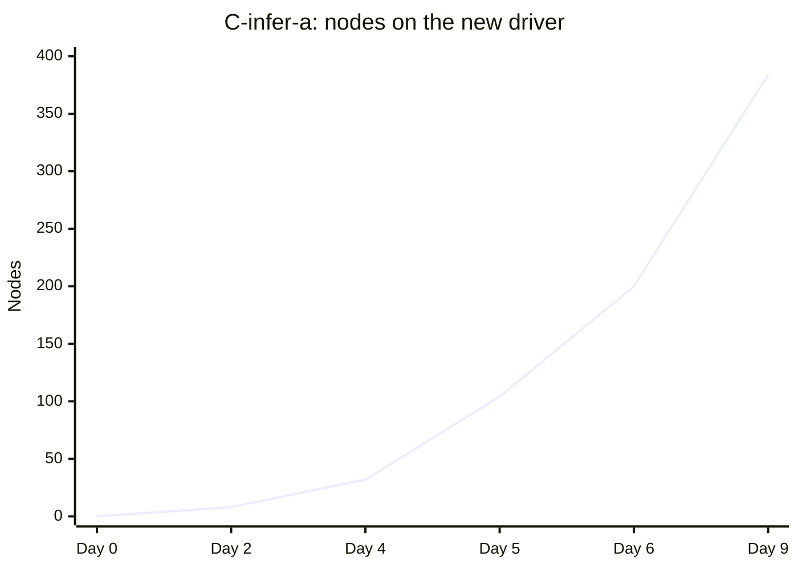

# Case Study: Design a GPU Fleet Driver and Engine Upgrade Campaign

> **Version anchor (2026-11-25).** NVIDIA GPU Operator v26.7.3 (2026-11-17; supported line 26.7.x,
> 26.3.x deprecated, 25.10.x and lower end of support), which ships DCGM 4.7.0 and dcgm-exporter
> 4.9.0 and lists the exporter renames as a breaking change. Data center driver branches read from
> the NVIDIA driver guide on 2026-11-25: R580 Long Term Support (end of life June 2028), R595
> Production (March 2027), R620 Long Term Support (September 2029); driver 620.70.06 released
> 2026-11-04. CUDA Compatibility guide (minor-version and forward compatibility) read 2026-11-25.
> vLLM v0.34.0 (2026-11-16, CUDA 13.0 binaries) from baseline v0.33.0 (tagged 2026-11-01). NCCL
> v2.32.7-1 (2026-11-24) from v2.32.6-1 (2026-11-09). Kubernetes 1.37 and Kueue v0.20.7 are frozen
> for the whole campaign. GPU prices are a planning rate (`P_GPU = $2.50` per H100-hour), not a
> quote. Node timings, failure rates and rule counts are assumptions for this fleet shape, so measure
> your own before sizing.

## Intuition

> **Design intuition**: A GPU driver upgrade on 10,240 GPUs is a maintenance operation on a
> machine room, not a software release. Every node stops serving, unloads a kernel module, loads
> a new one and proves it still computes the same numbers, while the fleet keeps answering
> requests and training jobs keep their checkpoints. The hard parts are keeping every pair of
> layers inside a combination somebody tested, keeping the instruments that watch the upgrade from
> changing in the same hour as the thing they watch, and knowing before wave 0 which steps can
> never be undone.

**Key insight for this design**: change one axis per wave, and make every state the fleet can roll
back to a cell of a tested compatibility matrix. The stack has five version axes (operator, driver,
CUDA runtime and NCCL inside images, serving engine, telemetry schema). Each axis can be upgraded
alone, and most pairs are compatible by NVIDIA's own rules, so the campaign is a path through the
matrix where a rollback of any single axis lands on a green cell. The incidents in this study are
places where two axes moved at once and nobody could say which one broke the dashboard, the job or
the answer.

**Not here.** This study does not redesign the cluster or its node provisioning
([Design a GPU Training and Inference Cluster](../../devops/case_studies/design_gpu_training_and_inference_cluster.md))
or the Kubernetes control plane upgrade
([Cluster Lifecycle and Fleet Upgrades](../../devops/kubernetes_architecture/cluster_lifecycle_and_fleet_upgrades.md)
covers minors, PDB arithmetic and Cluster API). Kubernetes is frozen here so the two campaigns
never overlap. The engine qualification method (flag diffs, goodput sweeps, numerics) is in
[Inference Engine Operations and Benchmarking](../inference_engine_operations_and_benchmarking/inference_engine_operations_and_benchmarking.md),
checkpoint design in
[Training Infrastructure Operations](../training_infrastructure_operations/training_infrastructure_operations.md),
and the release decision for a model bundle in
[AI Release Engineering](../ai_release_engineering/ai_release_engineering.md). This study covers the
layer under them, the GPU stack they run on.

---

## 1. Requirements Clarification

### Functional Requirements

- Move the whole fleet from the current stack to the target stack, one axis at a time: GPU
  Operator 26.3.x to v26.7.3, driver R580 (580.173.02) to R620 (620.70.06), dcgm-exporter 4.8.x
  and DCGM 4.6.x to 4.9.0 and 4.7.0, vLLM v0.33.0 to v0.34.0 on 14 models, NCCL v2.32.6-1 to
  v2.32.7-1 in training images.
- Hold a compatibility matrix as data. A node pool, an image and an operator version are admitted
  together only if the matrix validator accepts the triple.
- Run canary pools for every axis, then waves that grow geometrically, each behind a gate.
- Validate every upgraded node before it takes traffic: DCGM diagnostics, an NCCL test, and a
  golden inference replay for numeric drift on a sampled set of nodes.
- Upgrade training nodes at checkpoint boundaries without mixing driver versions inside one job.
- Keep every rollback inside a tested matrix cell, publish the steps that cannot be rolled back,
  and keep dashboards and alerts working across the dcgm-exporter 4.9.0 metric renames.

### Non-Functional Requirements

| Metric | Target |
|---|---|
| Inference availability during the campaign | 99.9% monthly, same as steady state |
| Inference capacity floor | at least 92% of nodes in service at peak, 75% off-peak |
| Training effective time during the campaign | at least 92% over the 8 execution weeks |
| Wave halt | automatic halt within 10 minutes of a gate breach |
| Node revert | 30 minutes per node batch, whole wave inside one 8-hour night window |
| Alert coverage | zero alert rules that lose their input series (checked by `absent()` guards) |
| Numeric drift | per model, greedy disagreement within 1.5x of the same-stack noise floor |
| Calendar and compute | 2 weeks preparation plus 8 weeks execution, under 10,000 GPU-hours direct |

### Out of Scope

- Kubernetes minor upgrades, Kueue upgrades and node OS or kernel image changes, all frozen from
  week 0 to week 8. A containerized driver is built against the kernel, so a kernel bump is a
  separate campaign.
- Firmware and fabric: VBIOS is only a pre-flight check here, and InfiniBand and OFED belong to the
  Network Operator's lifecycle
  ([AI Networking and Storage Fabric](../ai_networking_and_storage_fabric/ai_networking_and_storage_fabric.md)).
- Model weights, adapters and prompts, and AMD or Intel accelerators.

---

## 2. Scale Estimation

### Fleet

```
Clusters (all nodes: 8 x H100 80GB SXM, 8 GPUs per node)
  C-train    384 nodes  3,072 GPUs   3 slices of 128 nodes: job A, job B, one spare slice
  C-infer-a  384 nodes  3,072 GPUs   serving, 14 models, TP1 to TP8 replicas
  C-infer-b  384 nodes  3,072 GPUs   serving, same models, second region
  C-pool     128 nodes  1,024 GPUs   eval, batch, research, campaign canary
  Total    1,280 nodes 10,240 GPUs
```

```
Training: 2 jobs of 1,024 GPUs (128 nodes each), checkpoint every 17 minutes (Young, Section 4.6)
Inference: peak demand is 78% of provisioned capacity, 12% is the burst reserve we keep for spikes
           -> at most 8% of nodes may be out at peak, 25% off-peak (22:00 to 06:00 local)
Telemetry: 212 alert rules, 38 dashboards, 14 recording-rule groups reference DCGM metric names
```

### Time Per Node

An inference node takes 18 minutes out of service: drain 3 (`preStop` finishes in-flight
streams), driver unload, load and operator validation 8, weights from the warm local NVMe cache 4
(see [Model Storage, Loading and Cold Start](../model_storage_loading_and_cold_start/model_storage_loading_and_cold_start.md)),
warmup and graph capture 3. DCGM `-r 2` then adds up to 10.5 minutes, NVIDIA's Hopper bound for 8
GPUs. A training node is upgraded while idle, so its time costs spare-slice capacity and no job time.
The Operator's default `upgradePolicy` is `maxParallelUpgrades: 1` and `maxUnavailable: 25%`. At
one node at a time, `C-infer-a` alone takes `384 x 18 min = 115 hours`, almost 5 days with no
soak. Setting `maxParallelUpgrades: 0` (no limit) evicts a quarter of the cluster at once. The
campaign picks a wave size from headroom, not from either extreme.

### Wave Plan for `C-infer-a` (384 nodes)

| Wave | Nodes | Share | When | Soak before next |
|---|---|---|---|---|
| W0 canary | 8 | 2% | any hour, 8 nodes is under the 8% peak limit | 48 h |
| W1 | 24 | 6% | any hour | 48 h |
| W2 | 72 | 19% | night window | 24 h |
| W3 | 96 | 25% | night window, at the off-peak limit | 24 h |
| W4 | 184 | 48% | two night windows | 72 h before `C-infer-b` starts |

`C-infer-b` runs two waves, 24 nodes (6%) and 360 nodes (94%), because the control has already
passed 384 nodes of the same stack. `C-pool` goes first of all as the fleet canary: 8 nodes, then
120. The training rotation runs after `C-pool` and `C-infer-a` W2 are clean (Section 4.6).

### What a Canary Can See

A canary proves deterministic regressions (the node does not boot, a test fails, a number moves).
It cannot prove the absence of a rare fault. With one hardware-class XID per 4,000 GPU-hours as the
baseline rate and a regression to 3x:

```
W0:  8 nodes x 8 GPUs x 48 h =  3,072 GPU-h   P(0 events | 3x) = 10.0%   P(0 events | base) = 46.4%
W1: 24 nodes x 8 GPUs x 48 h =  9,216 GPU-h   P(0 events | 3x) =  0.1%   P(0 events | base) = 10.0%
W2: 72 nodes x 8 GPUs x 48 h = 27,648 GPU-h   P(0 events | 3x) <  0.1%
```

So a clean W0 leaves a 10% chance that a tripled fault rate went unseen. W1 and W2 are where rare
faults show up, which is why each wave is also the canary for the next and why the gate compares
against a paired control (Section 4.7).

### Campaign Cost, Direct (Driver Phase)

```
Node churn, all 1,280 nodes:   1,280 x 8 x 18/60 h               =  3,072 GPU-h
Training job moves:            2 jobs x 1,024 GPUs x 12/60 h     =    410 GPU-h
DCGM r2 on every node:         1,280 x 8 x 10.5/60 h             =  1,792 GPU-h  (upper bound)
DCGM r3 on 160 nodes:          160 x 8 x 35/60 h                 =    747 GPU-h  (upper bound)
NCCL slice tests (3 slices):   3 x 1,024 GPUs x 20/60 h          =  1,024 GPU-h
Golden replays:                14 models x 2 arms x 6 waves      =     40 GPU-h  (about)
Total                                                            =  7,085 GPU-h  =  $17.7k
```

The rehearsal, engine and NCCL phases add 1,585 GPU-hours (Section 10), so the all-in direct
compute is 8,670 GPU-hours. The reserved capacity costs far more (Section 10).

---

## 3. High-Level Architecture



The controller never talks to a node. It edits the node labels that decide which `NVIDIADriver`
resource owns a node, and the version on that resource. The Operator's upgrade controller does the
eviction, driver reload and validation and publishes the per-node state label. The controller
reads it, runs the burn-in and the gate, and only then moves the next batch. A rollback is the
same edit in the other direction, and the stack each wave moves to is a pinned bundle by digest
([AI Release Bundle and Lineage](./cross_cutting/ai_release_bundle_and_lineage.md)), so "what ran
on node X at time T" is a lookup.

### Components

| Component | Responsibility |
|---|---|
| Compatibility matrix | The rules in Section 4.1: which driver branch, CUDA toolkit, operator, exporter and DCGM versions may coexist, as data with CI |
| Wave planner | Turns headroom, PDBs, checkpoint cadence and the matrix into batches and soak times per cluster |
| Campaign controller | Owns the per-node state machine, relabels nodes, bumps `NVIDIADriver` versions, applies the burn-in taint, halts |
| GPU Operator upgrade controller | Cordon, wait for jobs, delete GPU pods, reload the driver, run `operator-validator`, uncordon (Section 4.3) |
| Burn-in Job and golden replay | `dcgmi diag` at level 2 or 3, an NCCL test, fixed prompt sets per model; releases the node taint on pass (Section 4.4) |
| Wave gate and canonical series | Compares canary to a paired control on latency, XIDs, drift and telemetry health, reading the normalised series of Section 4.5 |

---

## 4. Component Deep Dives

### 4.1 The Compatibility Matrix as Data

The matrix is a file in Git and a validator in CI. Every pool, image and operator change is a pull
request that the validator must accept. The rules come from NVIDIA's documents, and each rule
carries its source so a reviewer can re-read it.

```
 layer                  campaign axis                  rule that couples it to the layer below
 ---------------------------------------------------------------------------------------------
 serving image          vLLM v0.33.0 -> v0.34.0        built with CUDA 13.0, needs driver >= 580
 CUDA runtime + NCCL    NCCL 2.32.6-1 -> 2.32.7-1      CUDA 13.x runs on any driver >= 580
 DCGM + exporter        4.6.x -> 4.7.0 / 4.9.0         exporter 4.9.0 needs a DCGM 4.7+ host engine
 kernel driver          R580 -> R620                   R620 needs DCGM >= 4.3.x, Hopper VBIOS floor
 GPU Operator           26.3.x -> v26.7.3              upgrades only within a major or to the next
 Kubernetes, Kueue      frozen                         not part of this campaign
```

*Each campaign axis constrains only its neighbour, which is what allows one axis per wave.* The
rules that matter most, each with its source:

| Rule | Source |
|---|---|
| CUDA 13.x applications run on any driver at or above 580, CUDA 12.x at or above 525. Minor-version compatibility excludes PTX-only device code | CUDA Compatibility guide, minor-version section |
| `cuda-compat-<major>-<minor>` is for data center GPUs, older compat packages are unsupported on newer drivers, and a full driver upgrade should remove any compat package | CUDA Compatibility guide, forward compatibility |
| Driver 620.70.06 needs DCGM 4.3.x or newer, and fails to initialize on Hopper sub-revision 3 with VBIOS older than 96.00.68.00.xx | 620.70.06 release notes, known issues |
| dcgm-exporter 4.9.0 cannot start against a standalone DCGM 4.6.x host engine, and 4.7.1 paired with an earlier version fails API checks | GPU Operator upgrade guide, dcgm-exporter 4.9.0 release |

```python
from dataclasses import dataclass

# Native CUDA release that comes with each driver branch. The 13.5 pairing is the one the guide
# uses for cuda-compat-13-5, built from driver 620.
NATIVE_CUDA = {580: (13, 0), 620: (13, 5)}
MIN_DRIVER_FOR_MAJOR = {13: 580, 12: 525, 11: 450}


@dataclass(frozen=True)
class Image:
    name: str
    cuda: tuple          # toolkit the image was built with
    ships_ptx: bool      # any device code that exists only as PTX and is JIT compiled at load
    compat_pkg: bool     # cuda-compat-* baked in and placed on LD_LIBRARY_PATH


def check(image: Image, driver_branch: int) -> list[str]:
    errs = []
    major, minor = image.cuda
    if driver_branch < MIN_DRIVER_FOR_MAJOR[major]:
        errs.append(f"{image.name}: CUDA {major}.x needs driver >= {MIN_DRIVER_FOR_MAJOR[major]}")
    native = NATIVE_CUDA[driver_branch]
    needs_minor_compat = native[0] == major and minor > native[1]
    if needs_minor_compat and image.ships_ptx:
        errs.append(f"{image.name}: PTX-only code on a CUDA {native[0]}.{native[1]} driver, "
                    "minor-version compatibility does not cover PTX")
    if image.compat_pkg and native >= image.cuda:
        errs.append(f"{image.name}: compat package shadows a driver that already covers CUDA {major}.{minor}")
    return errs


vllm = Image("vllm-v0.34.0", (13, 0), ships_ptx=False, compat_pkg=False)
kernels = Image("custom-kernels-13.5", (13, 5), ships_ptx=True, compat_pkg=False)
old = Image("trainer-12.9", (12, 9), ships_ptx=False, compat_pkg=True)

assert check(vllm, 580) == [] and check(vllm, 620) == []          # engine bump is independent of the driver
assert "PTX-only" in check(kernels, 580)[0] and check(kernels, 620) == []
assert "shadows" in check(old, 620)[0]                            # the image that breaks after R620
```

The last assertion is the BROKEN case. The trainer image baked in `cuda-compat-12-9` with
`LD_LIBRARY_PATH` pointing at it, so it loads its own `libcuda` instead of the host's. On R580 it
works. After the node moves to R620 the guide says an older compat package is unsupported on a
newer driver, and the failure surfaces as `CUDA_ERROR_SYSTEM_DRIVER_MISMATCH` (803).

```bash
# BROKEN (Dockerfile): the compat directory is always first on the library path
ENV LD_LIBRARY_PATH=/usr/local/cuda-12.9/compat:${LD_LIBRARY_PATH}

# FIX (container entrypoint): decide at start, from the driver the node actually has
drv=$(nvidia-smi --query-gpu=driver_version --format=csv,noheader | head -1 | cut -d. -f1)
if [ "${drv}" -lt "${REQUIRED_DRIVER_BRANCH}" ] && [ -d "${CUDA_COMPAT_DIR}" ]; then
  export LD_LIBRARY_PATH="${CUDA_COMPAT_DIR}:${LD_LIBRARY_PATH}"      # old node, compat needed
fi                                                                      # new node: host libcuda wins
exec "$@"
```

Better still, the image build drops the compat package once the fleet is past the branch it
bridged, and CI enforces that. The matrix also answers a question sponsors ask: vLLM v0.34.0 ships
CUDA 13.0 binaries, so the engine bump needs R580 or newer and not R620. It can ship before the
driver, after it, or independently.

### 4.2 Ordering: One Axis Per Wave

The order is a decision, not a convention. Three rules produce it.

1. **Instruments first, then the thing they measure.** The telemetry schema changes before any
   driver wave, with a week of soak, so that a GPU utilization panel reading zero means the GPU
   is idle and not that a unit changed.
2. **Hardest to undo goes once, alone.** The driver reload evicts every GPU pod on the node. It
   goes after the operator and instruments are stable, with every image unchanged, so any
   regression in its waves is the driver's.
3. **Easiest to undo goes last.** Images (engine, NCCL) roll back by redeploying a previous
   digest. They move onto nodes that already have the target driver, and the cell "old image,
   new driver" is covered by NVIDIA's binary backward compatibility.

| Phase | Axis moved | Held fixed | Rollback |
|---|---|---|---|
| 0 Preparation (2 weeks) | none | all | n/a |
| 1 Operator (week 1) | 26.3.x to v26.7.3 | driver, DCGM and exporter pinned | Helm rollback plus pinned operands |
| 2 Telemetry (week 2) | DCGM 4.7.0, exporter 4.9.0 | driver, images | set both versions back together |
| 3 Driver (weeks 3 to 5) | R580 to R620 | images, operator, exporter | relabel node back, same cost as forward |
| 4 Engine (week 6) | vLLM v0.33.0 to v0.34.0 | driver, NCCL | redeploy previous image digest |
| 5 NCCL (week 7) | v2.32.6-1 to v2.32.7-1 | driver, engine | previous training image, at a restart |
| 6 Close (week 8) | none | | deletes old rules and compat packages, ends the rollback window |

Rollback closure makes the table safe: from every state on the path, undoing one axis lands on a
tested cell. Four driver-by-engine cells must be green before phase 3, each with a soak and a
golden replay on `C-pool` (about 1.5 days of 16 nodes): R580 with v0.33.0 (today), R580 with
v0.34.0 (a driver rollback after the engine bump), R620 with v0.33.0 (after phase 3, and an
engine rollback) and R620 with v0.34.0 (the target). Training has the same grid with NCCL in
place of the engine. Each cell is recorded as one pinned bundle, so a rollback redeploys a bundle
digest rather than editing fields
([AI Release Bundle and Lineage](./cross_cutting/ai_release_bundle_and_lineage.md)).

### 4.3 Driving the GPU Operator: One Resource Per Wave Group

The GPU Operator manages only containerized drivers, so a host-installed driver gets none of the
machinery below and is outside this design. The upgrade controller is on by default and gives the
campaign a per-node state machine and metrics. The cost is that the driver container is built
against the node kernel, which is why the kernel is frozen. Three documented properties matter:

- A node is owned by the `NVIDIADriver` resource whose `spec.nodeSelector` matches it, and each
  resource has its own `spec.upgradePolicy`, so groups get different parallelism and eviction.
- The v26.7.2 notes fix a bug where changing a label used in an `NVIDIADriver` node selector did
  not always reassign the node. The design relies on that fix, so the rehearsal proves the
  relabel path.
- `autoUpgrade: false` on a resource pauses upgrades only for the nodes it owns.

```yaml
# The old group never upgrades by itself. Nodes leave it only when the controller relabels them.
apiVersion: nvidia.com/v1alpha1
kind: NVIDIADriver
metadata: {name: r580-fleet}
spec:
  version: 580.173.02
  nodeSelector: {campaign.example.com/driver-group: r580}
  upgradePolicy: {autoUpgrade: false}
---
# Inference nodes that moved. Policy sized to headroom, not to the default.
apiVersion: nvidia.com/v1alpha1
kind: NVIDIADriver
metadata: {name: r620-infer}
spec:
  version: 620.70.06
  nodeSelector: {campaign.example.com/driver-group: r620-infer}
  upgradePolicy:
    autoUpgrade: true
    maxParallelUpgrades: 24        # peak-safe batch, 6% of a 384-node cluster
    maxUnavailable: 8%             # evaluated per resource, counts nodes already cordoned
    waitForCompletion:
      timeoutSeconds: 0
      podSelector: "campaign.example.com/wait=true"    # eval and batch jobs finish first
    podDeletion: {force: false, timeoutSeconds: 300, deleteEmptyDir: false}
    drain: {enable: false}         # drain evicts every pod on the node, keep it off
```

The node walks the Operator's own state machine, exposed as the label
`nvidia.com/gpu-driver-upgrade-state`: `upgrade-required`, `cordon-required`,
`wait-for-jobs-required`, `pod-deletion-required`, `drain-required` (only when drain is enabled
and pod deletion failed), `pod-restart-required`, `validation-required`, `uncordon-required`,
`upgrade-done` and `upgrade-failed`. The campaign adds a burn-in gate after the Operator's
validation.



*The node is out of the scheduler's reach from `evicting` until `burnin` passes. The burn-in
taint, not the Operator's uncordon, is what returns it to service.*

The controller adds a `NoSchedule` taint (`campaign.example.com/burn-in`) when the node enters
`cordon-required`, so the Operator's uncordon cannot put work on an unverified node.
`operator-validator` proves the driver loads and the device plugin advertises GPUs. It does not
prove the node computes correctly and communicates well, which is the burn-in's job (Section 4.4).
The same startup-taint idea at provisioning time is in
[GPU Node Lifecycle](../../devops/case_studies/cross_cutting/gpu_node_lifecycle.md).

The Operator's counters (`gpu_operator_nodes_upgrades_in_progress`, `_done`, `_failed`,
`_available`, `_pending`) and `GPUDriverUpgrade` events drive the wave dashboards. Two documented
traps shape the policy. `maxUnavailable` also counts nodes already cordoned for other reasons, so
a cluster with 25% of its nodes in repair makes the upgrade stop. And changing the Driver Manager
image triggers a driver upgrade on each node and can evict GPU workloads even when the driver
version is unchanged. The DRA driver and `vfio-pci` passthrough need Driver Manager v0.13.0, so
that bump is itself a driver wave.

### 4.4 Burn-In and Validation

Validation has three layers. The Operator's validator asks "did the driver load", DCGM diagnostics
ask "is the hardware healthy and connected", and the golden replay asks "does it still compute
the same thing". A node passes only when all three do.

**Pre-flight, before the relabel.** The R620 release notes name two ways the upgrade turns a
healthy node into a dead one: the driver fails to initialize on Hopper GPUs of sub-revision 3 with
a VBIOS older than 96.00.68.00.xx, and it needs DCGM 4.3.x or newer. Both are cheap to check
first, and a node that fails pre-flight never joins a wave.

```bash
#!/usr/bin/env bash
# preflight.sh: runs on the node before the controller relabels it. Fails closed.
set -euo pipefail
min_vbios="96.00.68.00"        # the release-note floor, applied to every GPU (stricter than needed)
bad=0
while IFS=', ' read -r idx vbios; do
  lowest=$(printf '%s\n%s\n' "${min_vbios}" "${vbios}" | sort -V | head -1)
  if [ "${lowest}" != "${min_vbios}" ]; then
    echo "GPU ${idx}: VBIOS ${vbios} is below ${min_vbios}" >&2
    bad=1
  fi
done < <(nvidia-smi --query-gpu=index,vbios_version --format=csv,noheader)
exit "${bad}"
```

**DCGM diagnostics, by tier.** NVIDIA's levels are cumulative, and the durations below are the
Hopper figures from the DCGM diagnostics guide. The campaign spends them where they pay.

| Level | Command | Adds | Bound on 8 GPUs | Used on |
|---|---|---|---|---|
| r1 | `dcgmi diag -r 1` | software checks | under 2.5 s | every pre-flight and every retry |
| r2 | `dcgmi diag -r 2 -i 0,1,2,3,4,5,6,7` | `pcie`, `memory`, `memory_bandwidth` | under 10.5 min | every upgraded node |
| r3 | `dcgmi diag -r 3` | `diagnostic`, `targeted_stress`, `targeted_power`, `nvbandwidth`, `nccl_tests` | under 35 min | W0 and W1 canaries, the spare training slice, any node back from repair |
| r4 | `dcgmi diag -r 4` | `memtest`, `pulse` | under 2.25 h | nodes that fail r3, as post-mortem before RMA |

The guide says DCGM diagnostics are "not designed to" provide comprehensive hardware diagnosis or
replace the field diagnosis tools, so a failure at r3 leads to r4 and then the vendor process, not
to a retry loop.

**NCCL at slice scale.** `dcgmi diag -r 3` runs an NCCL test inside one node. The campaign adds
the multi-node `nccl-tests` run, because a slow node poisons every collective of the job that
lands on it:

```bash
# 1,024 ranks on the 128-node spare slice, 8 B to 8 GiB doubling (nccl-tests, MPI build)
mpirun -np 1024 -N 8 ./build/all_reduce_perf -b 8 -e 8G -f 2 -g 1
```

The test reports `algbw = S / t` and `busbw = algbw x 2(n-1)/n` for AllReduce, with `n` ranks. The
factor is 1.875 at 16 ranks and 1.998 at 1,024, so `busbw` is the number comparable across slice
sizes. The gate compares `busbw` at 8 GiB to the baseline recorded for the same slice before its
upgrade, with a 95% floor. A straggler shows as a slice that misses the floor while every node
passes alone, and the response is a bisection with 2-node runs.

**Golden replay for numeric drift.** A driver upgrade can change numbers without changing any
file the engine ships: the PTX JIT compiler is part of the driver (one of the libraries in the
compat package), so device code shipped as PTX is recompiled by the new driver. Whether that moves
the output is what the replay measures, using the method of
[Inference Engine Operations and Benchmarking](../inference_engine_operations_and_benchmarking/inference_engine_operations_and_benchmarking.md)
(Section 6.6): compare candidate to control against the control's own noise floor.

The control and canary arms are paired by hardware and engine. For a driver wave the engine image
is identical (vLLM reproduces only on the same hardware and the same vLLM version). For an engine
wave the arms are v0.33.0 and v0.34.0 on R620, with a second v0.34.0 run that pins the old
defaults, and the budget is only the noise-floor ratio.
Per model the set has 2,000 prompts: 40% production-shaped chat, 20% code, 15% long context (8k to
32k tokens), 15% structured output with JSON schema, 10% multilingual. Decoding is greedy,
`max_tokens` 256, `logprobs` 20, with production batch load running beside it so batch-dependent
kernels are exercised.

```python
def agreement(a, b):
    """Fraction of prompts whose greedy outputs match token for token (each run: list of token lists)."""
    return sum(x == y for x, y in zip(a, b)) / len(a)


def drift_gate(control_1, control_2, canary, budget=1.5):
    noise = 1 - agreement(control_1, control_2)       # control vs control: scheduling noise
    delta = 1 - agreement(control_1, canary)          # control vs canary: noise plus the upgrade
    ratio = delta / noise if noise else (float("inf") if delta else 1.0)
    return {"noise": round(noise, 3), "delta": round(delta, 3), "ratio": round(ratio, 2),
            "pass": ratio <= budget}


c1 = [[i, 7] for i in range(100)]
c2 = [[i, 7] if i % 10 else [i, 8] for i in range(100)]            # 10% noise
noisy = [[i, 7] if i % 9 else [i, 8] for i in range(100)]          # 12% disagreement, inside the noise
shifted = [[i, 7] if i % 3 else [i, 8] for i in range(100)]        # 34% disagreement
assert drift_gate(c1, c2, noisy)["pass"] and not drift_gate(c1, c2, shifted)["pass"]
```

Two more signals sit beside the ratio, as in Section 6.6 of the engine operations page: the mean
top-20 logprob KL before the first divergence (budget 0.01), and the first-divergence position.
A noise-like flip diverges late on a near-tie, and a numerics regression diverges early on many
prompts. The structured-output slice has its own bar of no drop in schema validity, and the long
context slice a bar on p99 inter-token latency, since an aggregate score hides a failing slice.

### 4.5 The Telemetry Contract: Surviving the dcgm-exporter Renames

dcgm-exporter 4.9.0 is a breaking change to every dashboard and alert that reads GPU metrics,
and it rides in with the GPU Operator release. The GPU Operator v26.7.3 notes list it as a breaking
change: 23 default and profiling-preset fields move to DCGM 4.7 names, 11 of them change unit
(percent to a 0 to 1 ratio, MiB to bytes, MHz to hertz, millijoules to joules, MB/s to bytes per
second), and the driver-version label moves from `DCGM_FI_DRIVER_VERSION` to
`DCGM_FI_SYSTEM_DRIVER_VERSION`. The full old-to-new table and the per-rule fix is in
[GPU Observability and Fleet Health](../gpu_observability_and_fleet_health/gpu_observability_and_fleet_health.md)
Section 6.3.1. This section covers what a campaign adds: a layer that makes the rename invisible
to consumers, and a way to prove it.

Other 4.9.0 changes break things that are not names. Per-pod utilization and memory are exported
under both old and new names, and a pod's ratio can exceed 1.0, so pod dashboards can look healthy
while node rules are dark. GPU-wide fields under MIG are reported once per physical GPU, so a
`sum` over MIG instances changes. Pod labels need a non-empty allowlist (`.*` for all) or pod
attribution disappears. The preview v2 YAML is replaced by the final v2 and fails at startup, v1
YAML is deprecated (support ends in 4.10), and the exporter cannot start against a standalone
DCGM 4.6.x host engine, so `dcgm.version` and `dcgmExporter.version` change together.
The layer is a set of recording rules that every dashboard and alert reads instead of raw DCGM
names. It unions old and new names, converts units to the new ones, and drops the renamed label:

```yaml
groups:
  - name: gpu-canonical
    interval: 30s
    rules:
      - record: gpu:util_ratio
        expr: |
          max without (DCGM_FI_DRIVER_VERSION, DCGM_FI_SYSTEM_DRIVER_VERSION) (
            DCGM_FI_DEV_GPU_UTIL_RATIO or (DCGM_FI_DEV_GPU_UTIL / 100)
          )
      - record: gpu:fb_used_bytes
        expr: |
          max without (DCGM_FI_DRIVER_VERSION, DCGM_FI_SYSTEM_DRIVER_VERSION) (
            DCGM_FI_DEV_FB_USED_BYTES or (DCGM_FI_DEV_FB_USED * 1048576)
          )
      - alert: GPUCanonicalInputMissing
        expr: absent(gpu:util_ratio) or absent(gpu:fb_used_bytes)
        for: 10m
        labels: {severity: page}
```

Because `max without` collapses the two label sets, a pod that exports both names during the
transition is counted once. The `absent()` alert guards the failure the rename causes: a rule
whose input vanished and which therefore never fires. A team that wrote
`DCGM_FI_DEV_GPU_UTIL > 95` is in the BROKEN position of the sibling module; a team that writes
`gpu:util_ratio > 0.95` is not, whichever exporter runs on the node.

A contract test runs in CI over every rule and dashboard query. It fails the build when a name
is missing from the set the fleet will export at the next phase:

```python
import re

RENAMES = {                      # 4.8.x name -> (4.9.0 name, factor from old unit to new unit)
    "DCGM_FI_DEV_GPU_UTIL": ("DCGM_FI_DEV_GPU_UTIL_RATIO", 0.01),
    "DCGM_FI_DEV_FB_USED": ("DCGM_FI_DEV_FB_USED_BYTES", 1_048_576),
    "DCGM_FI_DEV_SM_CLOCK": ("DCGM_FI_DEV_SM_CLOCK_HERTZ", 1_000_000),
    "DCGM_FI_DEV_GPU_TEMP": ("DCGM_FI_DEV_GPU_TEMP_CELSIUS", 1),
}
TOKEN = re.compile(r"\bDCGM_FI_[A-Z0-9_]+\b")


def audit(rule_name: str, expr: str, fleet_has: set) -> list[str]:
    problems = []
    for tok in TOKEN.findall(expr):
        if tok not in fleet_has:
            new, factor = RENAMES.get(tok, ("nothing", 1))
            problems.append(f"{rule_name}: {tok} is gone, use {new}, old thresholds x {factor:g}")
    return problems


after_flip = {new for new, _ in RENAMES.values()}      # every pool on 4.9.0
before_flip = set(RENAMES)                             # every pool on 4.8.x
old_rule = "DCGM_FI_DEV_GPU_UTIL > 95 and DCGM_FI_DEV_GPU_TEMP > 85"
new_rule = "DCGM_FI_DEV_GPU_UTIL_RATIO > 0.95 and DCGM_FI_DEV_GPU_TEMP_CELSIUS > 85"

assert audit("hot", old_rule, before_flip) == []
assert len(audit("hot", old_rule, after_flip)) == 2    # both inputs gone after the flip
assert audit("hot", new_rule, after_flip) == [] and len(audit("hot", new_rule, before_flip)) == 2
```

The flip follows the instruments-first rule. The recording rules go live and run against the old
exporter for 5 days. In staging the exporter runs 4.9.0 for 24 hours and each canonical series must
stay within 1% of the old exporter's on the same nodes. Then `dcgm.version` and
`dcgmExporter.version` change together in the Operator values, one cluster at a time, and a
rollback sets both back. Prometheus keeps both name families, and the canonical series is
continuous across the flip in either direction. The layer costs 12 canonical metrics x 10,240
GPUs = 122,880 recorded series, inside the budget rules in
[Prometheus Cardinality and Scale](../../devops/case_studies/cross_cutting/prometheus_cardinality_and_scale.md).

### 4.6 Training: Slice Rotation at Checkpoint Boundaries

A training job cannot lose a node mid-step, and it must not run across two driver versions. The
fleet's two jobs each hold a 128-node slice and the third slice is spare. The campaign rotates
through the spare instead of upgrading in place:

```
 t0  Slice S (spare): upgrade to R620, burn-in r3, nccl-tests at 1,024 ranks (jobs A, B run on R580)
 t1  Job A checkpoints on demand, resumes on S (R620). Slice A is vacated, upgraded idle, burned in.
 t2  Job B checkpoints on demand, resumes on A (R620). Slice B is vacated, upgraded idle, burned in.
 t3  Slice B becomes the spare. Every slice is on R620 and no job ever ran on an unverified slice.
```

*Each job moves once, onto a slice already upgraded and tested at scale, instead of finding out at restart.*

The cost is the restart, not the upgrade. The checkpoint cadence uses the Young formula from the
training module, and a move that did not force a checkpoint also loses the mean half interval:

```
MTTF of a 1,024-GPU job = 1.8 h x 16,384 / 1,024 = 28.8 h   so T = sqrt(2 x 5 s x 28.8 h) = 17.0 min
in place: 1,024 GPUs x (18 + 10.5 upgrade + 12 restart) min / 60 = 691 GPU-h per job
rotation: 1,024 GPUs x 12 restart min / 60                       = 205 GPU-h per job
no forced checkpoint: + 1,024 GPUs x (17.0 / 2) min / 60        = + 145 GPU-h
```

| Option | GPU-hours lost per job | Property |
|---|---|---|
| In place | 691 | job runs on a slice nobody tested at scale |
| Rotation, on-demand checkpoint | 205 | the target slice passed r3 and a 1,024-rank NCCL test first |
| Rotation, wait for the periodic checkpoint | 350 | simpler, no hook into the job |

On-demand checkpoint means the controller asks the job to save now and waits for the commit
marker described in the training module, with a 10-minute timeout after which the move waits for
the next periodic checkpoint. The lower-priority job moves first.

Two guards keep drivers from mixing inside a job. Each driver generation is a Kueue
`ResourceFlavor` (`kueue.x-k8s.io/v1beta2`) whose `nodeLabels` select
`campaign.example.com/driver-group`, and each slice has its own `ClusterQueue` with one flavor, so a
single-podset job is admitted on exactly one driver
([GPU Cluster Scheduling and Quotas](../gpu_cluster_scheduling_and_quotas/gpu_cluster_scheduling_and_quotas.md)
owns the policy). And `waitForCompletion` with a pod selector holds an upgrade until labelled jobs
end, so eval and batch jobs carry `campaign.example.com/wait=true` and training pods never do.

NCCL v2.32.7-1 is a different, later step. It changes inside the training image, so it applies
only at a job restart that already happens. The 2.32.7 notes list Vera Rubin tuning, lower
profiler overhead when no plugin is loaded, a new `NCCL_SYM_GINBUFF_MAX_SIZE` cap and a build fix
for PTX. Nothing in them targets Hopper, so the gate is the same `all_reduce_perf` comparison
against the 2.32.6-1 baseline, plus 200 fixed-seed training steps whose loss curve must stay inside
the control-versus-control spread.

### 4.7 The Wave Gate

A wave advances only when a gate compares the canary group to a paired control of the same
cluster, models and hours, because load and time of day move every metric and a fleet average
hides a 3% regression under a 10% daily swing. XIDs need a statistical test because the counts are
small (Section 2): given the total events in both arms, the canary's share is binomial with its
GPU-hour share as the probability.

```python
from math import comb
from dataclasses import dataclass


def binom_tail(k, n, p):
    """P(X >= k) for X ~ Binomial(n, p)."""
    return sum(comb(n, i) * p**i * (1 - p) ** (n - i) for i in range(k, n + 1))


@dataclass
class Arm:
    gpu_hours: float
    xids: int                # hardware-class XIDs in the soak window
    ttft_p95_ms: float
    itl_p95_ms: float
    nodes: int
    upgrade_failed: int
    series_missing: int      # alert inputs that fired absent() during the soak


def wave_gate(control: Arm, canary: Arm, drift_ok: bool, alpha=0.05):
    """Return the breaches. An empty list means advance."""
    out = []
    if canary.ttft_p95_ms > 1.05 * control.ttft_p95_ms:
        out.append("ttft_p95 above control by more than 5%")
    if canary.itl_p95_ms > 1.05 * control.itl_p95_ms:
        out.append("itl_p95 above control by more than 5%")
    if canary.upgrade_failed / canary.nodes > 0.02:
        out.append("more than 2% of nodes ended upgrade-failed")
    n = control.xids + canary.xids
    share = canary.gpu_hours / (canary.gpu_hours + control.gpu_hours)
    if n and canary.xids and binom_tail(canary.xids, n, share) < alpha:
        out.append("XID rate above control (one-sided binomial test)")
    if canary.series_missing:
        out.append("telemetry dark, the gate would be blind")
    if not drift_ok:
        out.append("golden drift outside budget")
    return out


control = Arm(40_000, 10, 610, 41, 100, 0, 0)
assert wave_gate(control, Arm(3_072, 1, 618, 41.5, 8, 0, 0), True) == []
assert wave_gate(control, Arm(3_072, 4, 640, 41.5, 8, 0, 0), True) == ["XID rate above control (one-sided binomial test)"]
assert wave_gate(control, Arm(3_072, 0, 612, 41, 8, 0, 3), True) == ["telemetry dark, the gate would be blind"]
```

The third assertion earns its place: a gate fed by dark telemetry passes every numeric check,
since there is nothing to exceed. On a breach the controller halts without a human: it sets
`autoUpgrade: false` on the wave's `NVIDIADriver` resource, stops relabelling and pages. Pausing
removes the Operator's upgrade-state labels from the group's nodes, so the controller records
per-node state in its own store first and restores it on resume.

### 4.8 Rollback: What Can Be Undone

Rollback is a plan with a price and a list of exceptions, written before wave 0.

| Step | Undo | Cost | Limit |
|---|---|---|---|
| Node driver | relabel the node into the `r580` group, which reloads the old driver | 18 minutes plus DCGM r2 | evicts the GPU pods again, and the in-flight work lost at the first eviction is gone |
| Operator | `helm rollback`, operands pinned | minutes | Helm does not automatically upgrade existing CRDs (the NVIDIA guide says so), so expect them to stay at the new schema. NVIDIA documents upgrades only within a major or to the next one and says nothing of downgrades, so rehearse the old operator against the new CRDs |
| Exporter and DCGM | set `dcgm.version` and `dcgmExporter.version` back together | minutes | rolling the Operator back without restoring compatible DCGM versions can leave dashboards and alerts without GPU metrics (Operator notes) |
| Engine | redeploy the previous image digest per model | per the progressive-delivery policy | the previous engine on the new driver is cell c, tested before phase 3 |
| NCCL | previous training image at the next restart | one restart | none |
| Compat packages, old rules | not undoable after close | n/a | week 8 deletes them and the rollback window ends |
Four things no rollback restores. A node that fails burn-in on R620 after passing on R580 had a
latent fault that the new test or load surfaced, and reverting does not heal it, so it goes to
repair and not back to the old group. Old driver and engine images are kept for 14 days on purpose,
with registry cleanup paused. The Prometheus history keeps two name families forever. And whatever
the new stack wrote, such as engine compile caches or checkpoints from a job that ran on R620, is
not rewritten by a driver revert, which is why cells b and c are tested with those artifacts
present.

---

## 5. Design Decisions & Tradeoffs

| Decision | Chosen | Alternative | Why |
|---|---|---|---|
| Sequencing | One axis per wave: operator, telemetry, driver, engine, NCCL | One big-bang bundle | The driver reload evicts pods and the exporter changes every panel, so mixing them makes the first anomaly unattributable |
| Driver management | Containerized, `NVIDIADriver` resources per wave group | Host-installed in the OS image | Per-node state machine, metrics, events and pause/skip controls come with it; the cost is that kernel and driver container versions are coupled, so the kernel is frozen |
| Target branch | R620 LTSB (end of life September 2029) | Stay on R580 LTSB (June 2028) or move to R595 Production (March 2027) | R620 makes this the last driver campaign for 3 years. R595 is a 1-year branch and would need another campaign inside the same hardware cycle. Staying is valid and is the baseline in the branch-choice Q&A in Section 11 |
| Telemetry change | Recording-rule layer plus CI audit, exporter flipped first | Rewrite every rule and dashboard in place | A consumer-facing canonical name survives the next rename, and a rollback of the exporter is invisible |
| Wave shape | 2%, 6%, 19%, 25%, 48% with soak, sized from headroom | Fixed 10% batches, or Operator defaults | The defaults are one node at a time (115 hours per cluster), and the opposite extreme evicts a quarter of the cluster |
| Validation depth | r2 on every node, r3 on canaries, spare slice and repaired nodes | r3 on every node | r3 everywhere is 5,973 GPU-hours against 1,792 for r2, and the extra tests add little on a node that passes r2 and the golden smoke |
| Training upgrade | Rotate through the spare slice | In-place per slice | 205 against 691 GPU-hours per job, and the job never runs on an unverified slice |
| Engine canary | Two arms: v0.34.0 defaults, and the old sizing and block size pinned | One arm with v0.34.0 defaults | v0.34.0 changed three defaults at once, and the second arm separates a configuration effect from a code effect |
| Halt and advance | Automatic halt, automatic advance through W3, human approval for W4 and training moves | Human approval every wave | Halt latency must be minutes. The two steps with the largest blast radius keep a person in the loop |

---

## 6. Real-World Implementations

**Meta.** In "Maintaining large-scale AI capacity at Meta" (2024-06-12) the authors describe
dozens of training clusters with more than 30 maintenance operations, 50 components that are
updated, and thousands of disruptive AI host tasks per day. Their answers map onto this design:
maintenance trains take one maintenance domain out of service at a time so that all capacity minus
that domain stays up, the domain size is chosen from the cost of interruptions and the capacity
lost, jobs keep a consistent stack while lower-level components upgrade gradually, an orchestrator
("OpsPlanner") applies required upgrades before a host returns to production, and an autostop
halts trains when buffers are exhausted. They note that a move to a new CUDA version may need all
capacity on a new driver version, and that cluster consistency matters for debugging even where
there are rarely hard incompatibilities. This study borrows the maintenance-domain idea (wave
size) and the verify-before-production rule (the burn-in taint).

**Meta, Llama 3.** The Llama 3 paper reports up to 16K H100 GPUs for the 405B pre-training and,
over a 54-day snapshot, 466 job interruptions: 47 planned (firmware upgrades, configuration and
dataset updates) and 419 unexpected, about 78% of those attributed to confirmed or suspected
hardware issues. Effective training time stayed above 90% while automated maintenance such as
firmware and Linux kernel upgrades caused at least one interruption daily. Planned work was about
10% of interruptions, so a campaign competes with the failure budget and is priced in the same
unit, lost GPU-hours (Section 10).

**NVIDIA.** The Operator's upgrade controller unloads and reloads the driver modules per node in
five documented steps, exposes the state label, metrics and events, and supports pausing and
per-node skipping. Its lifecycle policy (a deprecated previous major, upgrades only within a major
or to the next) sets the shape of phase 1. The driver guide gives a Production branch 1 year of
fixes and an LTSB 3 years, which makes the target branch a calendar decision.

**Google Kubernetes Engine.** GKE can install the NVIDIA driver automatically at cluster or
node-pool creation, with the version based on the GKE version. On a managed service the driver
bump is therefore a node-pool upgrade, and the same waves, burn-in and drift gates apply to the
surge that carries it. The Ubuntu minimum drivers GKE lists (535 for H100, 550 for H200, 570 for
B200) are the same kind of matrix this study keeps as data.

---

## 7. Technologies & Tools

| Tool | Role here | Notes |
|---|---|---|
| NVIDIA GPU Operator v26.7.3 | Drives containerized driver upgrades | `NVIDIADriver` resources per wave group; floor for upgrades from 26.3.x |
| NVIDIA data center driver R620 (620.70.06) | Target kernel driver | LTSB, needs DCGM 4.3.x or newer; VBIOS floor on some Hopper sub-revisions |
| CUDA Compatibility (minor-version, forward) | Decouples toolkit from driver | `cuda-compat-<major>-<minor>` only where a driver cannot move |
| DCGM 4.7.0, dcgm-exporter 4.9.0 | Diagnostics and telemetry | `dcgmi diag -r 1/2/3/4`; renamed metrics; final v2 YAML config |
| NCCL v2.32.7-1 and nccl-tests | Collective library and its test | `all_reduce_perf`, `busbw` column, slice scale |
| vLLM v0.34.0 | Serving engine | CUDA 13.0 binaries; Model Runner V1 removed; block size 64; extensible KV cache on |
| Kueue v0.20.7 | One driver per job via `ResourceFlavor` | `kueue.x-k8s.io/v1beta2`; frozen during the campaign |
| Prometheus recording rules | Canonical GPU series | `max without (...)` over old and new names; `absent()` guards |
| Argo Rollouts or Flagger | Per-model engine rollout | Gates from [Progressive Delivery for Model Servers](../progressive_delivery_for_model_servers/progressive_delivery_for_model_servers.md) |

---

## 8. Operational Playbook

### Dashboards

| Panel | Source | Healthy range |
|---|---|---|
| Nodes by upgrade state, per cluster and group | `nvidia.com/gpu-driver-upgrade-state` label via kube-state-metrics | matches the wave plan, no node in one state over 45 minutes |
| `gpu_operator_nodes_upgrades_in_progress`, `_failed`, `_pending` | GPU Operator | in progress at or under `maxParallelUpgrades`, failed 0 |
| Inference capacity in service | ready GPU nodes over provisioned | at least 92% at peak, 75% off-peak |
| TTFT p95 and ITL p95, canary vs paired control | Gateway, labelled by driver group | canary within 5% of control |
| Hardware-class XIDs per 1,000 GPU-hours, canary vs control | canonical XID series | not above control (binomial test in the gate) |
| Golden drift ratio per model | replay job | at or under 1.5 |

### Alerts

| Alert | Condition | Severity |
|---|---|---|
| `WaveGateBreach` | the gate returns any breach | Page, automatic halt already applied |
| `NodeUpgradeFailed` | any node in `upgrade-failed` for 15 minutes | Ticket, page above 2% of the wave |
| `CapacityFloor` | in-service GPUs below the floor for 5 minutes | Page, controller stops relabelling |
| `GPUCanonicalInputMissing` | recorded input absent for 10 minutes | Page, the gate is blind so do not advance; check exporter versions and pod label allowlists |
| `MixedDriverJob` | a training job's pods span two driver groups | Page |

### Runbook: Node Stuck in `upgrade-failed`

1. Read the node's `GPUDriverUpgrade` events, the driver pod log and the init containers of
   `operator-validator`. If the driver cannot initialize on a Hopper GPU, check the VBIOS against
   the 620.70.06 floor and send the node back to the firmware window.
2. If the validator passes on retry, run `dcgmi diag -r 2`. A pass returns the node to the wave.
3. Otherwise relabel the node into the `r580` group and run r3. A node that fails r3 on both
   drivers is hardware: r4, then repair or RMA.
4. A node that works on R580 and fails on R620 twice is a campaign finding. Stop the wave, keep
   the node cordoned and open a case with NVIDIA with the driver log and the r2 output.

### Runbook: Wave Halted on XIDs

1. Group the canary's XIDs by code and by node. One node with most of the events is a hardware
   lemon: quarantine it and recompute the gate without it.
2. If events spread across nodes, compare the code distribution to the control's. A new code or
   a shifted ratio is a driver finding.
3. Revert the last wave to `r580` (Section 4.8), keep W0 on R620 for diagnosis, and resume only
   after a written conclusion and a fresh W0 pass.
---

## 9. Common Pitfalls & War Stories

These come from the design's rehearsal on a 64-node staging cluster and from failure modes that the
cited release notes document. The counts are the design's own.

**Alert rules went dark after the exporter flip.** A lint over 212 alert rules and 38 dashboards
found 57 rules and 23 panels on a renamed metric, 9 of them pages. Eleven carried unit-sensitive
thresholds: a rename-only fix would leave `> 95` on a 0 to 1 ratio (never true) and `> 70000` on a
bytes metric (always true). Fix: canonical series, CI audit, `absent()` guards, exporter flip a
week before any driver wave (Section 4.5).

**A compat package shadowed the host driver.** Four trainer images and two eval images had
`cuda-compat-12-9` baked in with `LD_LIBRARY_PATH` set. On the first R620 staging node a trainer
failed at its first CUDA call with error 803. Fix: the matrix validator and a runtime decision
(Section 4.1).

**`maxParallelUpgrades: 0` plus the default `maxUnavailable`.** To escape the 115-hour default,
a rehearsal removed the parallelism limit. The 25% `maxUnavailable` default took 16 of 64 staging
nodes out at once against a 12% headroom, and p95 TTFT tripled for 11 minutes. Fix: per-group
`upgradePolicy` sized from headroom and the capacity floor alert.

**VBIOS below the floor.** A fleet audit found 37 of 1,280 nodes (2.9%) below 96.00.68.00. The
620.70.06 notes say the driver does not initialize on some Hopper GPUs in that case, so these would
have ended `upgrade-failed` with no GPUs. Fix: the pre-flight script and a firmware window before W0.

**The exporter flip merged into the first driver wave.** The first draft flipped the exporter with
W0 on staging. Every upgraded node showed utilization 0.0 on the old dashboard, diagnosis took 3
hours, and the wave halted over a unit change. Fix: instruments first, with a 5-day soak.

**The block size default changed short-prompt latency.** On the engine wave the v0.34.0-defaults
arm showed TTFT p95 up 11% on three models with 48-token system prompts. v0.34.0 raised the
default block size from 16 to 64 and prefix caching reuses whole blocks only, so the shared prefix
stopped hitting. Golden accuracy passed and the paired latency comparison caught it. Fix:
`--block-size 16` for those models and the second canary arm kept.

### Impact Summary

| Control | Without | With |
|---|---|---|
| Canonical series and CI audit | 57 of 212 rules and 23 of 38 dashboards affected, 9 pages dark | 0 rules dark, 0 consumer edits |
| Pre-flight VBIOS check | 37 nodes (2.9%) would fail the upgrade | 0 failures from VBIOS |
| Headroom-sized waves | 25% of nodes at once, TTFT x3 for 11 minutes | 6% batches, TTFT within 5% of control |
| Training slice rotation | 691 GPU-hours lost per job | 205 GPU-hours per job |
| Compat-package validator | 6 images failed with error 803 | 0 images reach a node |

---

## 10. Capacity Planning

### Steady State and Campaign Resources

| Resource | Formula | Value |
|---|---|---|
| Fleet | Section 2 | 1,280 nodes, 10,240 H100 |
| Direct compute, driver phase | Section 2 total | 7,085 GPU-hours, $17.7k at `P_GPU` |
| Direct compute, all phases | phase table below | 8,670 GPU-hours, $21.7k |
| Reserved capacity | 32 nodes of `C-pool` held out of batch use for the burn-in queue, cell tests and rollback landing | 256 GPUs |
| Reserve cost | 256 x 168 h x $2.50 per week, 8 weeks | $107.5k a week, $860k (344,064 GPU-hours) |
| Reserve to all-in direct compute | 344,064 / 8,670, and one week $107.5k / $21.7k | 39.7x for the campaign, 5.0x per week |
| Old driver and engine images kept | 14 days after the last wave, one bundle digest per matrix cell ([AI Release Bundle and Lineage](./cross_cutting/ai_release_bundle_and_lineage.md)) | 2 engine images of about 15 GB per node cache, an assumption to measure |

The campaign's price is set by its calendar, not its compute. The reserve is mostly the idle
headroom the fleet already carries (12% of inference capacity) and becomes a real cost only when
batch or research would otherwise have used it, so the planning-rate figure is an upper bound. The
lever is the one in [GPU Pool Economics](../../llm/case_studies/cross_cutting/gpu_pool_economics.md):
idle reserved GPUs are the dominant waste, so shorten the time they are held, with shorter soaks
only where the previous wave's evidence allows and no idle wait for approvals the gate already
gives. The wider treatment is in
[AI Cost Engineering and Unit Economics](../ai_cost_engineering_and_unit_economics/ai_cost_engineering_and_unit_economics.md).

### Direct Cost by Phase

| Phase | Weeks | GPU-hours | What drives it |
|---|---|---|---|
| 0 Preparation | 2 | 1,200 | 16-node rehearsal, four matrix cells, golden baselines |
| 1 Operator | 1 | about 0 | pinned operands, no driver change, pods untouched |
| 2 Telemetry | 1 | about 0 | exporter and DCGM restart only |
| 3 Driver | 3 | 7,085 | churn 3,072, r2 1,792, r3 747, NCCL slices 1,024, training moves 410, golden replays 40 |
| 4 Engine | 1 | 300 | 14 model rollouts, two-arm canaries, surge pods |
| 5 NCCL | 1 | 85 | 200-step loss check, slice busbw tests |
| 6 Close | 1 | 0 | cleanup |
| Total | 8 plus 2 preparation | 8,670 | $21.7k |

82% of direct compute is in the driver phase. The engine phase, which gets the most scrutiny from
model teams, is 3.5% of it.



*The curve is flat at the beginning on purpose: W0 and W1 reach 32 nodes in 4 days, and the other
352 nodes move in the next 5, because the gate has 3,072 and then 9,216 GPU-hours of evidence by then.*

### Growth to 30,720 GPUs

| Pressure | At 10,240 GPUs | At 30,720 GPUs | Action |
|---|---|---|---|
| Direct compute | 8,670 GPU-hours | about 26,000 | Scales with nodes, no action |
| Calendar | 8 weeks | 9 to 10 | Clusters run in parallel, soaks do not shorten: the canary evidence per cluster is the floor |
| Gate and approval load | 14 models, 4 clusters | 14 models, 12 clusters | First thing to break. Automate advance through W3 everywhere, keep humans for W4 |

---

## 11. Interview Discussion Points

**Q: Why change one axis per wave instead of shipping the whole target stack as one release?**
**Short:** The driver reload evicts pods and the exporter changes every panel, so a combined wave leaves the first anomaly with five suspects and a rollback that undoes too much.

The stack has five version axes and each fails differently: the driver reload kills in-flight
work, the exporter changes what you see, the engine changes latency and memory defaults, NCCL
changes collective performance, and the operator changes how all of it is managed. Together they
turn a dashboard that reads zero into a three-hour investigation (Section 9). Move instruments
first, the hardest-to-undo axis alone, and images last, so every regression has one suspect and
every rollback lands on a tested cell.

**Q: Does vLLM v0.34.0 force the fleet onto the R620 driver?**
**Short:** No. v0.34.0 ships CUDA 13.0 binaries, and CUDA 13.x runs on any driver at or above 580 through minor-version compatibility, with limits for PTX-only code.

The engine and driver bumps are independent. R580 already satisfies the CUDA 13.x minimum, so
the engine could ship first. The caveats from NVIDIA's guide are the ones to test: a limited
feature set (a call can return `cudaErrorCallRequiresNewerDriver`), PTX-only device code does not
run on the older driver, and the build needs a target architecture argument. Any engine path that
JIT-compiles device code must be exercised on the old driver, which is why cell b (R580 with
v0.34.0) must be green.

**Q: How do you upgrade to dcgm-exporter 4.9.0 without silently disabling alerts?**
**Short:** Put recording rules in front of the raw names that union old and new names and units, guard them with absent(), audit rules in CI, and flip the exporter a week before any driver wave.

Version 4.9.0 renames 23 default fields, changes the unit of 11 and renames the driver-version
label. A rule on the old name evaluates against an empty vector and never fires, and a rule with
the new name and an old threshold fires always or never. Canonical series such as
`gpu:util_ratio` hide the rename from consumers and keep history continuous across a rollback,
the CI audit fails a build that names a metric the next phase will not export, and `absent()`
pages when an input vanishes anyway. Also check the non-name breaks: the final v2 config format,
pod label allowlists and the DCGM 4.7 host engine requirement.

**Q: Why is the GPU Operator upgrade itself a risk, before any driver changes?**
**Short:** Upgrading from 26.3.x with a release before v26.7.3 could delete the driver DaemonSets, and a Driver Manager image change triggers a driver upgrade on every node.

The v26.7.3 notes list a fix for an upgrade from 26.3.x that deleted existing driver DaemonSets
and removed driver pods from GPU nodes, so v26.7.3 is the floor for that path. Upgrades are
supported within a major release or to the next one, so 25.10.x must stop at 26.3 first. The
default operand versions keep the same driver and Driver Manager to avoid a disruptive upgrade,
but overriding the Driver Manager image (needed for the DRA driver or `vfio-pci`) is a driver wave
under another name. And v26.7.3 ships exporter 4.9.0, so an Operator bump with default operands
also flips the metric names fleet-wide unless the exporter is pinned in phase 1.

**Q: Why does a clean 8-node canary not prove that a driver is safe?**
**Short:** At one hardware XID per 4,000 GPU-hours, 8 nodes over 48 hours expect 0.77 events, so a tripled fault rate goes unseen 10% of the time.

A canary proves deterministic regressions: the node boots, DCGM passes, the NCCL test holds its
floor, the golden replay stays inside its noise budget. Rare faults need exposure:
`P(no event) = exp(-rate x GPU-hours)` gives 10% for 3,072 GPU-hours at the tripled rate and 0.1%
for W1's 9,216. So waves grow geometrically, each is the canary for the next, and the gate runs a
binomial test against a paired control, not a threshold on a count of zero or one.

**Q: How do you move 1,024-GPU training jobs to a new driver without losing the job or mixing driver versions?**
**Short:** Rotate through a spare slice upgraded and tested at scale, move each job once at an on-demand checkpoint, and admit each job on a single driver flavor.

The spare slice is upgraded first, passes `dcgmi diag -r 3` and a 1,024-rank `all_reduce_perf`,
and then job A checkpoints and resumes there. Slice A is upgraded idle and becomes job B's
target. The loss is the restart, 205 GPU-hours per job against 691 for upgrading in place, and no
job runs on an untested slice. One `ResourceFlavor` per driver generation and one `ClusterQueue`
per slice keeps a job on one driver. Meta's engineering post states the same principle: the job's
stack stays consistent while lower-level components upgrade gradually.

**Q: How does a golden replay detect numeric drift when greedy output is not deterministic anyway?**
**Short:** Compare canary to control against the control's own run-to-run disagreement, accept a ratio up to 1.5, and also check top-k logprob KL and where outputs first diverge.

vLLM's documentation says reproducibility holds only on the same hardware and the same vLLM
version, and batching changes floating-point results, so control against control already
disagrees on some prompts. The gate computes `(1 - agreement(control, canary)) /
(1 - agreement(control, control))`. For a driver wave the engine is identical, so the ratio should
sit near 1.0. A kernel recompiled from PTX by the new driver shows up as early divergence on many
prompts and a raised KL, while scheduling noise diverges late on near-ties.

**Q: What cannot be rolled back, and when is the point of no return?**
**Short:** Evictions already done, the Prometheus history, a Helm rollback that leaves new CRDs, and everything deleted at close. The point of no return is the week 8 cleanup, not a wave.

A node-level driver revert is the same path as the upgrade and costs the same. It does not return
the in-flight work lost at the first eviction or heal a node that revealed a latent fault. An
Operator rollback leaves CRDs at their new schema and NVIDIA documents no downgrade across
majors, so rehearse it. The exporter flip is reversible, but the TSDB keeps two name families
forever. See [AI Release Bundle and Lineage](./cross_cutting/ai_release_bundle_and_lineage.md)
for recording the exact stack a rollback returns to.

**Q: What dominates the cost of the campaign, and what is the lever?**
**Short:** Calendar time times reserved capacity: 256 reserved GPUs cost $107.5k a week at the planning rate, against 8,670 GPU-hours ($21.7k) of direct compute for the whole campaign.

Churn, burn-in, rehearsal and training moves add to 8,670 GPU-hours. The reserve for burn-in
queues, cell tests and a rollback landing zone is 39.7x that if priced in full for 8 weeks, an
upper bound since the reserve is mostly the headroom the fleet already carries. The lever is
calendar: shorten soaks only where the previous wave's evidence justifies it, avoid idle gaps for
approvals the gate already provides, and run clusters in parallel where canary evidence exists.
The accounting method is in
[GPU Pool Economics](../../llm/case_studies/cross_cutting/gpu_pool_economics.md).

**Q: When would you use a CUDA forward compatibility package, and when must you remove it?**
**Short:** Use it only when an image's toolkit is newer than a driver that cannot move yet, on data center GPUs, and remove it as soon as the driver covers the toolkit.

The guide says the `cuda-compat-<major>-<minor>` package serves applications built with a newer
toolkit on an older base driver across major families, on data center GPUs, with no OpenGL or
Vulkan interop. It shadows the host `libcuda`, and older compat packages are unsupported on newer
drivers, so an image that bakes one in breaks after the fleet moves, with error 803 as the
signal. Decide at container start from the node's driver, and let the matrix validator reject a
compat package in any image whose target driver already covers the toolkit.

**Q: How do you choose between R595, R620 and staying on R580?**
**Short:** Read the support calendar: R595 is a 1-year Production branch, while R620 and R580 are LTSBs ending September 2029 and June 2028, so R620 minimizes campaigns and staying is valid.

The driver guide gives Production branches 1 year of fixes and LTSBs 3 years. As read on
2026-11-25, R580 ends in June 2028, R595 in March 2027 and R620 in September 2029. The campaign
picks R620 because it makes this the last driver campaign until 2029 and because a fleet that adds
newer nodes wants one branch. Staying on R580 is legitimate but costs something: the Operator
line the fleet runs is deprecated, and a forced campaign under a CVE deadline is a worse time to
learn the tooling.

**Q: A CVE needs a driver patch within 72 hours. What changes in the campaign?**
**Short:** Keep pre-flight, r2 and the gate, shorten the early soaks to 12 hours, run waves on consecutive nights, and accept the larger blast radius only inside the headroom.

A patch on the same branch does not change the axes. The two matrix cells are tested on `C-pool`
in a day, W0 and W1 soak for 12 hours each, and nights run back to back without waiting on
approvals. No node returns without a burn-in pass, no wave exceeds the capacity floor, and the
exporter, engine and NCCL stay frozen so the patch is the only moving part. The error budget
side is in [SLO and Error Budget Math](../../devops/case_studies/cross_cutting/slo_error_budget_math.md).
