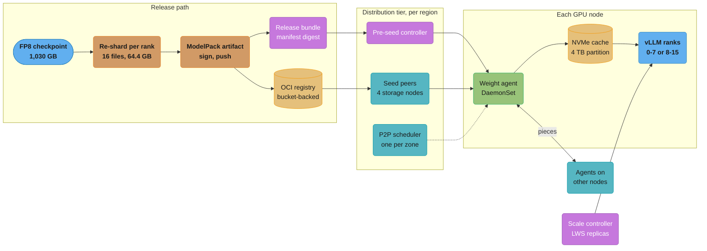
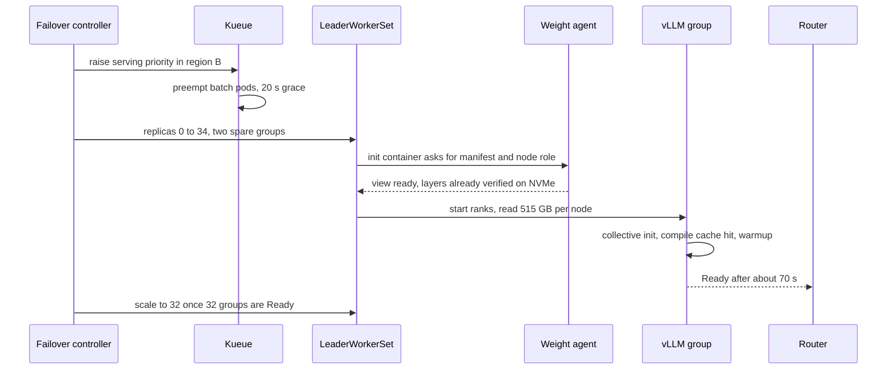
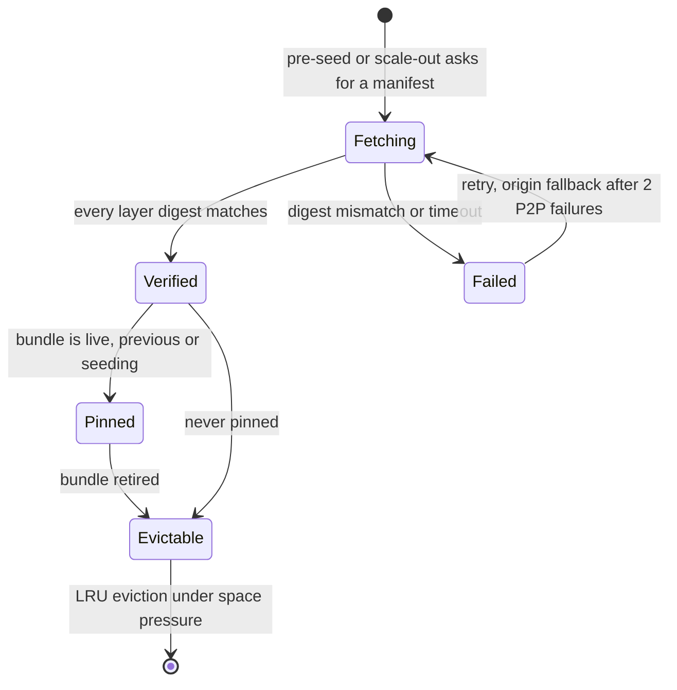
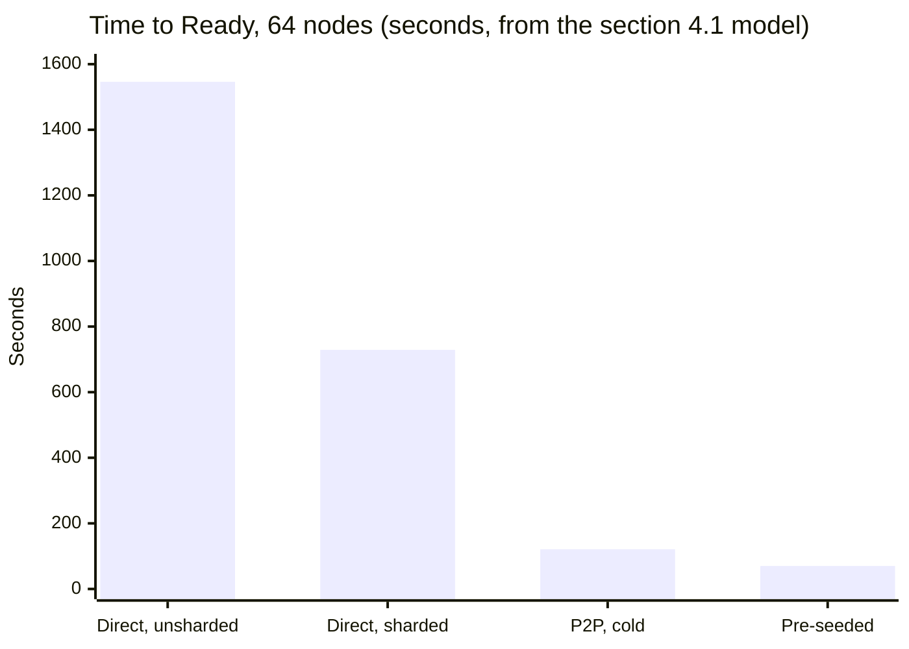
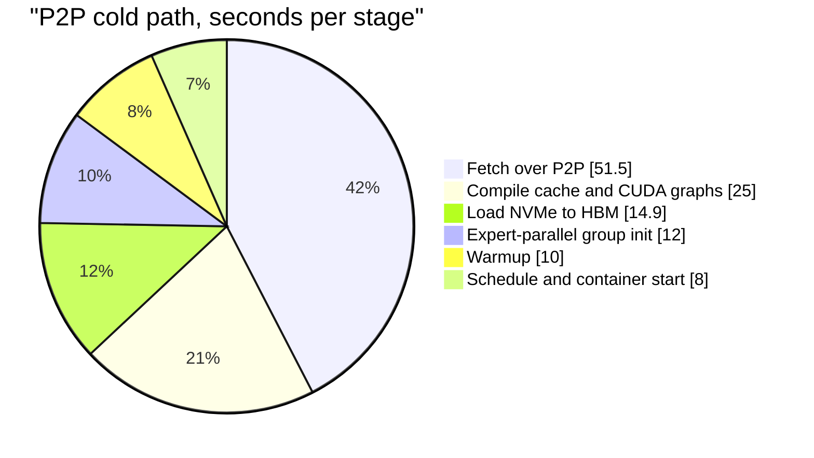

# Case Study: Design a Model Weight Distribution System

> **Version anchor (2026-10-18).** vLLM v0.32.0 (2026-10-18), with `--load-format`
> `runai_streamer_sharded` and `sharded_state` for per-rank checkpoints and `ipc_cache` for
> restarts. Model Streamer 0.17.0 (2026-10-13), repo `dsx-ai-factory/model-streamer`. KServe
> v0.21.0 (2026-09-25) with `LocalModelCache`. LeaderWorkerSet v1.0.0 (2026-10-16). Kubernetes 1.37
> (1.37.1 on 2026-09-15); the OCI image volume source has been GA since 1.36. ModelPack model-spec
> v0.0.7 (git tag of 2025-07-21). OpenSSF model-transparency v1.1.1 (2025-10-10). Dragonfly v2.5.2
> (2026-09-14) and Kraken v0.1.32 (2026-10-12), both checked on their release pages on 2026-10-18.
> KitOps v1.16.0 (2026-09-29), Kueue v0.20.2 (2026-10-15), Mooncake v0.3.13.post1 (2026-08-31) and
> NIXL v1.5.0 (2026-09-30). Moonshot AI's checkpoint-engine has no GitHub release objects and is
> named without a version.

---

## Intuition

> **Design intuition**: a frontier MoE checkpoint is about a terabyte. Sixty-four nodes that
> each need half of it make 33 TB of reads, and an object store that serves 50 GB/s needs 11
> minutes to hand them out. No loader flag fixes that. The fix is to stop treating the origin as
> the source for every node: shard the checkpoint per rank so each node fetches only its half,
> spread the bytes peer to peer so the origin serves each unique byte once, and move the whole
> transfer out of the scale-out path by pre-seeding node caches when the release is cut.

**Key insight for this design**: cold start for a large model is a bandwidth budget, and the
budget has a fixed part (container start, collective init, compile, warmup: about 55 s here) and
a variable part (weight fetch: 0 s to 22 minutes). Every design choice below exists to push the
variable part to zero on the common path and below 60 s on the worst path. Once the fetch is
gone, the remaining 70 s are the 55 s of fixed stages plus 15 s of NVMe-to-HBM load, and buying
more network bandwidth stops helping.

The study takes the loader and cache mechanics from
[Model Storage, Loading and Cold Start](../model_storage_loading_and_cold_start/model_storage_loading_and_cold_start.md)
and the packaging format from
[Model Registry and Packaging](../model_registry_and_packaging/model_registry_and_packaging.md),
and designs the fleet-level system that uses them.

---

## 1. Requirements Clarification

### Scenario

A model provider serves its own MoE model, `atlas-moe`, from two regions. Each region has 68 GPU
nodes: 64 for serving and 4 spares for the straggler hedge in §4.5. Region A serves the traffic.
Region B runs batch evaluation and offline inference at low priority on all 68 and takes over
serving when region A fails. Region A also lends 48 of its 64 serving nodes to batch work
overnight and takes them back at the morning ramp.

Both events are the same operation: a set of booted, healthy GPU nodes that run no serving pods
must serve the model at full latency within 3 minutes. That is the "0 to 64 nodes" requirement.

### Functional Requirements

- Distribute a new `atlas-moe` version (about 1,030 GB in FP8) to every node that may serve it,
  in both regions, before the version takes traffic.
- Bring 64 nodes (32 two-node replicas) from "no serving pod" to "Ready behind the router" in
  under 180 s, at p100 across the replicas the scale-out asked for.
- Roll back to the previous version on the same 64 nodes in under 180 s.
- Serve only bytes whose digests match the signed manifest named in the release bundle.
- Keep working when the origin, the P2P scheduler or one availability zone is degraded, at a
  slower, stated speed.
- Report per node and per stage where the time went for every scale-out.

### Non-Functional Requirements

| Requirement | Target |
|---|---|
| Time to Ready, 64 nodes, version already on node NVMe | p100 under 90 s |
| Time to Ready, 64 nodes, version not on any node | p100 under 180 s |
| Region failover, from decision to 64 nodes Ready | under 180 s including batch preemption |
| Origin reads per release, per region | about 1x the model size, not Nx |
| Serving impact of background pre-seeding on region A | p99 TTFT change under 5% |
| Integrity | zero unverified bytes reach GPU memory |
| Cache capacity on each node | current, previous and one seeding version, never evicted while pinned |

### Out of Scope

- Node provisioning and health fencing: [GPU Node Lifecycle](../../devops/case_studies/cross_cutting/gpu_node_lifecycle.md).
- When to scale and how far: [Inference Autoscaling and Capacity Planning](../inference_autoscaling_and_capacity_planning/inference_autoscaling_and_capacity_planning.md).
- Traffic shifting between versions: [Progressive Delivery for Model Servers](../progressive_delivery_for_model_servers/progressive_delivery_for_model_servers.md).
- LoRA adapter delivery: [Design a Multi-Tenant LoRA Serving Platform](design_a_multi_tenant_lora_serving_platform.md).

### Questions to ask before designing

| Question | Why it changes the design |
|---|---|
| Are the nodes already booted when the clock starts? | Node provisioning on a cloud GPU VM takes minutes by itself and would consume the whole budget |
| What is the serving layout: TP, EP, nodes per replica? | It sets how many bytes each node needs, which sets the fetch time |
| Can inference nodes reach each other over the RDMA fabric? | It decides whether live replicas can serve weights GPU to GPU |

**Not here.** The GPU cluster (DRA, Kueue gang admission, Karpenter, node health) is in
[Design a GPU Training and Inference Cluster](../../devops/case_studies/design_gpu_training_and_inference_cluster.md);
loader formats and single-node cold start are in
[Model Storage, Loading and Cold Start](../model_storage_loading_and_cold_start/model_storage_loading_and_cold_start.md).

---

## 2. Scale Estimation

### Model and layout

```
atlas-moe:        about 1.0T total parameters, MoE, FP8 block-quantized weights
Checkpoint bytes: 1,030 GB (all experts, attention, embeddings)

Serving layout:   one replica = 2 nodes x 8 GPUs = 16 ranks
                  attention TP 16, experts EP 16
Per-rank bytes:   1,030 GB / 16 = 64.4 GB
Per-node bytes:   8 ranks x 64.4 GB = 515 GB
Replicas at peak: 32  ->  64 nodes, 512 GPUs
```

A node never needs the whole checkpoint. It needs the files of the eight ranks at its position in the
group: ranks 0 to 7 on the leader node, ranks 8 to 15 on the worker node. This halves every
transfer in the design, but only if the checkpoint is stored per rank. A standard Hugging Face
layout splits files by tensor name, not by rank, so every rank opens every file.

### Node hardware (this design's assumption, not a vendor SKU)

| Component | Spec | Usable rate used in the math |
|---|---|---|
| GPUs | 8x H200, 141 GB HBM each | 1,128 GB HBM per node |
| Host RAM | 2 TB | holds one node's 515 GB in page cache |
| Local NVMe | 8 x 3.84 TB, striped | 20 GB/s sustained write, 40 GB/s read |
| Frontend network | 2 x 200 GbE | 25 GB/s usable ingress, 25 GB/s usable uplink |
| Backend fabric | 8 x 400 Gb/s RDMA | 50 GB/s per GPU, used only in the option in §4.6 |
| PCIe to each GPU | Gen5 x16 | about 50 GB/s; 64.4 GB per GPU in 1.3 s |
| Origin (per region) | OCI registry over an object-store bucket | 50 GB/s, load-tested ceiling with 512 parallel range GETs |

### Fan-out arithmetic

```
Unique bytes per version:                 1,030 GB
Bytes delivered for 64 nodes:             64 x 515 GB = 32,960 GB

Direct pull, unsharded (every node reads all 1,030 GB):
  64 x 1,030 GB / 50 GB/s               = 1,318 s   (22 min)
Direct pull, sharded:
  32,960 GB / 50 GB/s                    =   659 s   (11 min)
P2P, sharded:
  per-node floor   515 GB / 20 GB/s NVMe =  25.8 s
  aggregate floor  32,960 / (50 + 64 x 25) =  20.0 s
  origin floor     1,030 / 50            =  20.6 s
  planning factor  0.5 (from drills)     ->  51.5 s
Pre-seeded on NVMe:                           0 s
```

The node's NVMe write rate, not the network, is the binding limit for P2P. Ingress is 25 GB/s;
the striped drives sustain 20 GB/s. Writing through RAM and flushing to NVMe in the background
moves the floor to the ingress rate, which saves about 5 s and costs host-memory pressure while
the engine is also loading. This design keeps write-through and spends the 5 s.

### Release volume

```
Versions:         2 scheduled releases a month + about 1 hotfix
Nodes seeded:     64 (region A) + 64 (region B) + 8 spares = 136
Seed traffic:     136 x 515 GB = 70 TB per release across both regions
Origin reads:     1,030 GB per region per release with P2P
Registry storage: 12 retained versions x 1,030 GB = 12.4 TB per serving layout
NVMe cache:       4 TB partition per node = live + previous + seeding (3 x 515 GB = 1.55 TB)
                  sized so a one-node layout (3 x 1,030 GB = 3.1 TB) fits on the same image
```

---

## 3. High-Level Architecture



The release path produces one signed artifact per serving layout. The distribution tier moves
it to every node that might serve it, ahead of time. At scale-out the engine reads from local
NVMe, and the network is not on the critical path at all.

### Components

| Component | Role | Runs where |
|---|---|---|
| Re-shard job | Loads the checkpoint once in the target layout and saves one file per rank | GPU job in the release pipeline |
| ModelPack artifact | One OCI manifest; one weight layer per rank file, plus config and tokenizer layers | OCI registry |
| Release bundle | Pins the manifest digest, layout, engine version and compile-cache digest | Bundle store, see [AI Release Bundle and Lineage](cross_cutting/ai_release_bundle_and_lineage.md) |
| Pre-seed controller | Watches bundles; tells each node's agent which manifests to hold and pin | Control plane, one per region |
| P2P scheduler and seed peers | Hand out pieces; the seeds read from the origin once | 4 CPU storage nodes per region, 2 per zone |
| Weight agent | Fetches the node's layers, verifies digests, writes the cache, builds the view directory | DaemonSet on every GPU node |
| Scale controller | Sets LeaderWorkerSet replicas and hedges stragglers | Control plane |

### Scale-out after a region failover



The two spare groups are the straggler hedge in §4.5. When the version is not on NVMe, the agent
step is where the 51 s P2P fetch happens, and Ready arrives after about 121 s.

---

## 4. Component Deep Dives

### 4.1 Time budget model

The SLO is a sum of stages. This model is the one the team uses in design reviews and checks
against every drill. It runs as is.

```python
from dataclasses import dataclass

GB = 1e9


@dataclass(frozen=True)
class Fleet:
    nodes: int = 64
    model_bytes: float = 1030 * GB   # FP8 checkpoint, all 16 ranks
    ranks_per_replica: int = 16
    gpus_per_node: int = 8
    origin_bw: float = 50 * GB       # load-tested ceiling of the weights bucket
    node_ingress: float = 25 * GB    # usable share of 2 x 200 GbE frontend
    node_uplink: float = 25 * GB
    nvme_write: float = 20 * GB      # 8 drives striped, sustained
    nvme_read: float = 40 * GB
    p2p_efficiency: float = 0.5      # planning factor from drills

    @property
    def node_bytes(self) -> float:
        return self.model_bytes * self.gpus_per_node / self.ranks_per_replica


def fetch_direct(f: Fleet, sharded: bool) -> float:
    per_node = f.node_bytes if sharded else f.model_bytes
    sink = min(f.node_ingress, f.nvme_write)
    return max(per_node * f.nodes / f.origin_bw, per_node / sink)


def fetch_p2p(f: Fleet) -> float:
    sink = min(f.node_ingress, f.nvme_write)
    per_node_floor = f.node_bytes / sink
    aggregate_floor = f.node_bytes * f.nodes / (f.origin_bw + f.nodes * f.node_uplink)
    origin_floor = f.model_bytes / f.origin_bw   # each unique byte leaves the origin once
    return max(per_node_floor, aggregate_floor, origin_floor) / f.p2p_efficiency


def time_to_ready(f: Fleet, path: str, compile_cache: bool = True,
                  image_cached: bool = True) -> dict[str, float]:
    fetch = {
        "direct_unsharded": lambda: fetch_direct(f, sharded=False),
        "direct": lambda: fetch_direct(f, sharded=True),
        "p2p": lambda: fetch_p2p(f),
        "preseeded": lambda: 0.0,
    }[path]()
    read_bytes = f.model_bytes if path == "direct_unsharded" else f.node_bytes
    return {
        "schedule_and_start": 8 + (0 if image_cached else 20),
        "fetch": fetch,
        "load_to_hbm": read_bytes / f.nvme_read + 2,
        "ep_group_init": 12,
        "compile_and_graphs": 25 if compile_cache else 150,
        "warmup": 10,
    }


if __name__ == "__main__":
    f = Fleet()
    for path, cc, img in [("direct_unsharded", False, False), ("direct", True, True),
                          ("p2p", True, True), ("preseeded", True, True)]:
        stages = time_to_ready(f, path, compile_cache=cc, image_cached=img)
        print(f"{path:17s} total {sum(stages.values()):7.1f} s  "
              + "  ".join(f"{k}={v:.1f}" for k, v in stages.items()))
    assert sum(time_to_ready(f, "p2p").values()) < 180
    assert sum(time_to_ready(f, "direct").values()) > 600
```

Output:

```
direct_unsharded  total  1546.2 s  schedule_and_start=28.0  fetch=1318.4  load_to_hbm=27.8  ...
direct            total   729.1 s  schedule_and_start=8.0  fetch=659.2  load_to_hbm=14.9  ...
p2p               total   121.4 s  schedule_and_start=8.0  fetch=51.5  load_to_hbm=14.9  ...
preseeded         total    69.9 s  schedule_and_start=8.0  fetch=0.0  load_to_hbm=14.9  ...
```

The first row is the system before this design: unsharded files pulled straight from the bucket,
an image pulled per node, and no compile cache. It takes 25.8 minutes. The last two rows are the
design's cold and common paths. The fixed stages (start, collective init, compile, warmup) are
55 s in both; they are why the pre-seeded path cannot go much below 70 s.

### 4.2 Packaging: per-rank layers in one ModelPack artifact

The re-shard job loads the FP8 checkpoint once on 16 GPUs in the serving layout and saves each
rank's state with vLLM's sharded-state saver, with a maximum file size that yields four parts per
rank. The output is 64 files named `model-rank-{rank}-part-{part}.safetensors`, about 16.1 GB
each, plus `config.json` and `tokenizer.json`. The packer writes them as one ModelPack artifact:

```
registry.example.com/models/atlas-moe@sha256:9be2...      (manifest digest, pinned in the bundle)
├─ artifactType: application/vnd.cncf.model.manifest.v1+json
├─ config:       application/vnd.cncf.model.config.v1+json
│                 layout tp16-ep16, engine vLLM v0.32.0, gpu H200
└─ layers
   ├─ application/vnd.cncf.model.weight.config.v1.raw   config.json
   ├─ application/vnd.cncf.model.weight.config.v1.raw   tokenizer.json
   ├─ application/vnd.cncf.model.weight.v1.raw          model-rank-0-part-0.safetensors   16.1 GB
   │                                                    annotation com.example.weights.rank=0
   ├─ ...                                               (4 parts per rank, 64 weight layers)
   └─ application/vnd.cncf.model.weight.v1.raw          model-rank-15-part-3.safetensors  16.1 GB
                                                        annotation com.example.weights.rank=15
```

- **One artifact, many layers, instead of one artifact per node role.** A single manifest digest
  is what the bundle pins, signs and rolls back. The agent selects layers by annotation.
- **The rank is an annotation, not a filename convention.** §4.3 shows what broke when it was a
  filename.
- **The layout is part of the identity.** A TP16-EP16 shard set cannot serve a TP8-EP8 B200
  layout. A second layout is a second artifact with its own digest; the registry entry records
  both, and the bundle names exactly one. See
  [Model Registry and Packaging](../model_registry_and_packaging/model_registry_and_packaging.md)
  for the media types.

Why four parts per rank: a whole blob has to arrive before its digest can be checked, so a 64 GB
blob delays verification and retry to the end of the transfer. Kraken's README advises blobs of at
most 20 GB for best performance. Four parts also give the agent 32 independent layer streams per
node, which is what lets inline hashing keep up with the disk (§4.4). The sharded loader reads all
parts for its rank.

### 4.3 Layer selection: broken, then fixed

The first agent selected layers by matching the rank number in the filename.

```python
from dataclasses import dataclass, field

RANK_KEY = "com.example.weights.rank"


@dataclass(frozen=True)
class Layer:
    path: str
    size: int
    annotations: dict = field(default_factory=dict)


def build_manifest(ranks: int = 16, parts: int = 4,
                   rank_bytes: int = 64_375_000_000) -> list[Layer]:
    layers = [Layer("config.json", 10**4), Layer("tokenizer.json", 10**7)]
    for r in range(ranks):
        for p in range(parts):
            layers.append(Layer(f"model-rank-{r}-part-{p}.safetensors", rank_bytes // parts,
                                {RANK_KEY: str(r)}))
    return layers


def layers_for_node_broken(manifest: list[Layer], node_index: int, gpus: int = 8) -> list[Layer]:
    ranks = range(node_index * gpus, (node_index + 1) * gpus)
    return [l for l in manifest
            if "rank-" not in l.path or any(f"rank-{r}" in l.path for r in ranks)]


def layers_for_node(manifest: list[Layer], node_index: int, gpus: int = 8) -> list[Layer]:
    ranks = range(node_index * gpus, (node_index + 1) * gpus)
    return [l for l in manifest
            if RANK_KEY not in l.annotations or int(l.annotations[RANK_KEY]) in ranks]


if __name__ == "__main__":
    m = build_manifest()
    gb = lambda ls: sum(l.size for l in ls) / 1e9
    broken, fixed = layers_for_node_broken(m, 0), layers_for_node(m, 0)
    print(f"node 0 broken: {len(broken)} layers, {gb(broken):.0f} GB")
    print(f"node 0 fixed:  {len(fixed)} layers, {gb(fixed):.0f} GB")
    assert round(gb(fixed)) == 515 and round(gb(broken)) == 901
    rank_paths = lambda ls: {l.path for l in ls if RANK_KEY in l.annotations}
    assert rank_paths(layers_for_node(m, 0)).isdisjoint(rank_paths(layers_for_node(m, 1)))
```

Output:

```
node 0 broken: 58 layers, 901 GB
node 0 fixed:  34 layers, 515 GB
```

`"rank-1" in "model-rank-12-part-0.safetensors"` is true. The leader node, which owns ranks 0 to 7,
also fetched ranks 10 to 15: the parts of 14 ranks instead of 8, 901 GB instead of 515 GB.
Nothing failed. The engine opened only its own ranks and ignored the extra files, so the only
symptom was time: the modeled P2P fetch rose from 51 s to 90 s, and the cold path missed 180 s
in the first failover drill. Worker nodes were not affected, because `rank-8` through `rank-15` match no other
rank's name, which is why the per-node fetch histogram showed two humps instead of one.

The fix reads an exact integer from an annotation the packer writes, and the test asserts that
the two node roles select disjoint rank sets. A regex anchored on `-rank-(\d+)-` would also work;
the annotation is preferred because it survives a file rename in the packer.

### 4.4 Weight agent and the digest-keyed cache

The agent owns one NVMe partition per node. It keys every entry by manifest digest and every file
by layer digest, writes through a temporary name and renames only after the SHA-256 matches, and
never evicts a pinned manifest. This is the core of it, runnable with the standard library:

```python
import hashlib
import os
import tempfile
from dataclasses import dataclass, field
from pathlib import Path
from typing import Callable, Iterator

Fetch = Callable[[str], Iterator[bytes]]   # layer digest -> byte chunks (P2P or origin)


class DigestMismatch(Exception):
    pass


@dataclass
class WeightCache:
    root: Path
    capacity: int
    pinned: set[str] = field(default_factory=set)     # manifest digests: live, previous, seeding
    last_used: dict[str, float] = field(default_factory=dict)

    def ensure(self, manifest: str, layers: list[tuple[str, int]], fetch: Fetch, now: float) -> Path:
        entry = self.root / manifest.replace(":", "-")
        need = sum(size for digest, size in layers if not (entry / digest.replace(":", "-")).exists())
        self._make_room(need, keep=manifest)
        entry.mkdir(parents=True, exist_ok=True)
        for digest, _ in layers:
            target = entry / digest.replace(":", "-")
            if not target.exists():
                self._write_verified(target, digest, fetch)
        self.last_used[manifest] = now
        return entry

    def _write_verified(self, target: Path, digest: str, fetch: Fetch) -> None:
        h = hashlib.sha256()
        fd, tmp = tempfile.mkstemp(dir=target.parent, prefix=".partial-")
        with os.fdopen(fd, "wb") as out:
            for chunk in fetch(digest):
                h.update(chunk)
                out.write(chunk)
        if f"sha256:{h.hexdigest()}" != digest:
            os.unlink(tmp)
            raise DigestMismatch(digest)
        os.replace(tmp, target)    # a reader never sees a partial file under the final name

    def _used(self) -> int:
        return sum(p.stat().st_size for p in self.root.rglob("*") if p.is_file())

    def _make_room(self, need: int, keep: str) -> None:
        victims = sorted((m for m in self.last_used if m not in self.pinned and m != keep),
                         key=self.last_used.get)
        while self._used() + need > self.capacity:
            if not victims:
                raise OSError("weight cache full of pinned entries")
            victim = victims.pop(0)
            for p in sorted((self.root / victim.replace(":", "-")).rglob("*"), reverse=True):
                p.unlink() if p.is_file() else p.rmdir()
            (self.root / victim.replace(":", "-")).rmdir()
            del self.last_used[victim]


if __name__ == "__main__":
    blobs = {}
    def put(data: bytes) -> tuple[str, int]:
        d = "sha256:" + hashlib.sha256(data).hexdigest()
        blobs[d] = data
        return d, len(data)
    origin = lambda d: iter([blobs[d][i:i + 4] for i in range(0, len(blobs[d]), 4)])

    with tempfile.TemporaryDirectory() as tmp:
        c = WeightCache(Path(tmp), capacity=40)
        v1, v2, v3 = [put(b"rank0-v1-.."), put(b"rank0-v2-..")], [put(b"rank0-v3-..")], [put(b"rank0-v4-..")]
        c.ensure("sha256:aaa", v1, origin, now=1)
        c.pinned = {"sha256:aaa"}                       # live version
        c.ensure("sha256:bbb", v2, origin, now=2)
        c.ensure("sha256:ccc", v3, origin, now=3)       # evicts bbb, never the pinned aaa
        assert "sha256:aaa" in c.last_used and "sha256:bbb" not in c.last_used

        bad = put(b"good-bytes")
        blobs[bad[0]] = b"flipped-bit"
        try:
            c.ensure("sha256:ddd", [bad], origin, now=4)
            raise AssertionError("corrupt layer accepted")
        except DigestMismatch:
            assert not any(Path(tmp, "sha256-ddd").iterdir())
    print("cache checks pass")
```

The production agent adds three things the sketch leaves out.

1. **Hashing runs inline with the write.** SHA-256 with CPU hash extensions runs at roughly 1.5 to
   2 GB/s per core and is sequential within one blob. The node's 32 layer streams hash on 32
   cores at 48 GB/s or more, above the 20 GB/s NVMe rate, so verification adds no wall-clock
   time. A separate verify pass after the download would add about 30 s even spread over 8
   cores.
2. **Signature check once per manifest.** Before fetching any layer, the agent verifies the
   manifest's signature against the release identity (OpenSSF model signing, model-transparency
   v1.1.1, or a cosign signature stored as an OCI referrer). Layer digests are then trusted
   because the signed manifest names them. The pipeline that produces the signature is in
   [Supply Chain Security Pipeline](../../devops/case_studies/cross_cutting/supply_chain_security_pipeline.md),
   and the model-specific threats are in
   [ML Supply Chain Security](../ml_supply_chain_security/ml_supply_chain_security.md).
3. **A view directory.** Blobs are stored by digest. The engine wants file names. After
   verification the agent hard-links each selected blob into
   `/var/lib/weights/views/<manifest>/node-<role>/<filepath>` and writes a `READY` file last. Pods
   mount the view read-only through `hostPath`. The engine never sees a digest-named file and
   never sees a partial view.

The cache entry lifecycle:



Pinned entries are never evicted. If the partition fills with pinned entries the agent refuses
the new manifest and pages, which is the right failure: losing the previous version silently
would turn a 70 s rollback into a 121 s one at the worst moment.

### 4.5 Scale-out: LeaderWorkerSet, init container and straggler hedge

Each replica is a two-pod LWS group. An init container asks the local agent for the view and
blocks until `READY` exists. The engine then streams its rank's file from NVMe.

```yaml
apiVersion: leaderworkerset.x-k8s.io/v1
kind: LeaderWorkerSet
metadata:
  name: atlas-moe
spec:
  replicas: 34                      # 32 needed + 2 hedge groups during a scale-out
  startupPolicy: LeaderCreated
  leaderWorkerTemplate:
    size: 2
    restartPolicy: RecreateGroupOnPodRestart
    leaderTemplate:
      spec:
        initContainers:
          - name: weights
            image: registry.example.com/platform/weightctl@sha256:5d02...
            args: ["ensure", "--manifest", "sha256:9be2...", "--role", "0",
                   "--timeout", "150s"]
        containers:
          - name: vllm
            image: registry.example.com/serving/vllm@sha256:3f9a...
            command: ["sh", "-c"]
            args:
              - ray start --head --port=6379 &&
                vllm serve /weights
                  --load-format runai_streamer_sharded
                  --tensor-parallel-size 16
                  --enable-expert-parallel
                  --distributed-executor-backend ray
            env:
              - {name: VLLM_CACHE_ROOT, value: /compile-cache}
            volumeMounts:
              - {name: weights, mountPath: /weights, readOnly: true}
              - {name: compile-cache, mountPath: /compile-cache}
            startupProbe:
              httpGet: {path: /health, port: 8000}
              periodSeconds: 5
              failureThreshold: 120         # 600 s ceiling, never the target
            resources:
              limits: {nvidia.com/gpu: 8}
        volumes:
          - name: weights
            hostPath: {path: /var/lib/weights/views/sha256-9be2.../node-0, type: Directory}
          - name: compile-cache
            hostPath: {path: /var/lib/weights/compile/sha256-71aa..., type: Directory}
    workerTemplate:
      spec:
        # same init container with --role 1 and the node-1 view path; the engine container
        # runs ray start --address=$(LWS_LEADER_ADDRESS):6379 --block
```

- **The compile cache is a release artifact.** vLLM keys its `torch.compile` cache on model
  config, engine version, parallel layout and compilation config. The release pipeline builds it
  on the production GPU type and layout, and the bundle pins its digest next to the weights. The
  agent seeds it with the weights. A miss costs about 125 s and breaks the cold-path SLO by
  itself, so the release gate fails a bundle whose compile cache is missing.
- **The startup probe is a ceiling.** A liveness probe without a startup probe killed groups
  during a compile-cache miss (§9). The 600 s ceiling is for the failure case; the SLO alert fires
  at 150 s.
- **Group restart.** `RecreateGroupOnPodRestart` restarts both pods together, so a rank never
  waits on a dead peer during expert-parallel init. The LWS mechanics are in
  [Distributed Inference and Disaggregation](../distributed_inference_and_disaggregation/distributed_inference_and_disaggregation.md).
- **The hedge.** With 64 nodes, the slowest node sets the p100. One node with a degraded NVMe
  stripe (6 GB/s write instead of 20) takes 171 s to fetch 515 GB on the cold path, and its group
  is Ready at about 240 s. The scale controller asks for 34 groups, keeps the first 32 that reach
  Ready, and deletes the remaining two. Region B keeps 4 spare nodes for this, out of 68; they run
  batch work like the rest until a failover preempts them.

### 4.6 Pre-seeding and the RDMA option

**Pre-seeding.** When a bundle enters canary in region A, the pre-seed controller pins its
manifest on every node in both regions and on the spares. Agents fetch at a capped 5 GB/s per
node, marked with a low-priority DSCP class, and only while the node's serving load is below 70%
of its target concurrency. At 5 GB/s a node fills 515 GB in about 103 s of transfer; across the
fleet, with the cap and the load condition, seeding finishes within 2 hours of canary start. The
canary bake is 24 hours, so every node holds the version long before it can take full traffic.
When the bundle is promoted, the previous live manifest becomes `previous` and stays pinned; the
one before it becomes evictable.

**When the cold path still runs.** A node that was replaced, re-imaged or had its partition wiped
after a disk failure misses the pre-seed. So does any node if a hotfix is promoted with less than
2 hours of bake. Those nodes take the 121 s P2P path. The SLO holds for both.

**Backend RDMA from live replicas.** Inference nodes in region A share an RDMA fabric. A new
replica could pull its ranks directly from a live replica's GPU memory: 64.4 GB per GPU at 50 GB/s
per NIC is about 1.3 s, against 51.5 s for P2P over Ethernet. Moonshot AI's checkpoint-engine does
a version of this: its P2P mode uses Mooncake's transfer engine to send weights from CPU memory in
existing instances to GPUs in new instances. Perplexity
reported 1.3 s cross-machine weight updates for Kimi-K2 using one-sided RDMA WRITE (§6). This
design does not use it for scale-out. It helps only the cold path, since pre-seeded nodes already
skip the fetch and the 55 s of fixed stages remain. Region B has no live replica during a
failover, so the case that most needs speed has no source. And the fleet's RDMA partition for
batch training is separate from serving; sharing it needs its own isolation review.

It is the right tool for the different problem of updating weights in place many times a day,
such as RL rollouts that refresh policy weights after each training step. The fabric side is in
[AI Networking and Storage Fabric](../ai_networking_and_storage_fabric/ai_networking_and_storage_fabric.md).

---

## 5. Design Decisions & Tradeoffs

### How weights reach the node

| Option | Per-node bytes | Fetch on the critical path | Rank-aware | Fit for this design |
|---|---|---|---|---|
| Baked into the container image | 1,030 GB + engine | Yes, whole image pull | No | No: every engine patch re-ships 1 TB |
| Kubernetes image volume with ModelPack | Whole artifact, 1,030 GB | Yes, before the pod starts | No, unless one artifact per node role | Good for models under about 100 GB |
| KServe `LocalModelCache` | Whole model per node | No, if applied ahead | No | Good pre-seed for single-node models |
| Parallel file system (Lustre class) | 515 GB read per node | Yes | Yes, with sharded files | Throughput is bought per TiB and paid all the time; 33 TB in 60 s needs about 550 GB/s |
| Node agent + P2P + NVMe cache | 515 GB | No on the common path | Yes | Chosen |

The agent is about 2,000 lines of Go plus Dragonfly's client. It exists because no off-the-shelf
path in the anchor combined three needs: select a rank subset of one signed artifact, pin
versions against eviction, and run ahead of scale-out. `LocalModelCache` covers the third and is
used for the single-node 70B models on the same fleet; its controller is described in
[KServe Deep Dive](../model_serving_platforms/kserve_deep_dive.md). Image volumes cover the
smaller embedding and reranker models.

### P2P system

| Factor | Dragonfly | Kraken |
|---|---|---|
| What it fronts | Registry or object store, as a P2P layer | Is the registry, backed by blob storage |
| Large blob guidance | Pieces of a large file move independently | README: blobs up to 20 GB for best performance |
| Status | CNCF graduated (2025-10-28) | Open source from Uber |
| Chosen for | Both regions | Not used; the 4-part layout keeps it a drop-in option |

Image-side P2P is in [OCI Image Formats and Lazy Pulling](../../devops/container_runtimes_and_oci/oci_image_formats_and_lazy_pulling.md)
and [Design a Container Registry](../../devops/case_studies/design_container_registry.md).

### Hot standby or pre-seeded batch nodes

| Strategy | Failover time | Daily cost, region B (512 GPUs at a planning rate of $3.50/GPU-hour) |
|---|---|---|
| 64 nodes serving, idle | under 10 s | $43,008 of GPU time for no traffic |
| 64 nodes on batch, pre-seeded | about 90 s (20 s preemption + 70 s) | the batch work lost per failover only |
| 64 nodes on batch, not seeded | about 26 min before this design, about 141 s after | same, plus the larger SLO miss |

The $3.50 rate is a variable, not a quote. The batch work lost is bounded by the checkpoint
interval: batch jobs checkpoint every 10 minutes, so a failover costs on average 5 minutes of 512
GPUs, about 43 GPU-hours. The full pool-cost model is in
[GPU Pool Economics](../../llm/case_studies/cross_cutting/gpu_pool_economics.md).

### Key decisions

| Decision | Chosen | Rejected | Why |
|---|---|---|---|
| Unit of transfer | Per-rank layer | Whole checkpoint | Halves the bytes per node |
| Unit of identity | Manifest digest | Tag or URI | A tag change silently changes bytes, see §9 |
| When distribution runs | At canary start | At scale-out | Takes the network off the critical path |
| Where verification runs | Inline in the agent | In the engine, or not at all | Zero added time, no unverified byte in HBM |
| Straggler policy | Hedge 2 groups | Wait for all | p100 is set by the worst disk in the fleet |

---

## 6. Real-World Implementations

**Uber, Kraken.** Uber built Kraken as a P2P Docker registry backed by blob storage and has run
it in production since early 2018. Its README reports clusters of at least 15,000 hosts, more
than 1 million blobs a day in the busiest cluster, and a 3 GB two-layer image pulled by 2,600
hosts at p50 10 s and p99 18 s with a 300 MB/s per-agent limit. The same README recommends blobs
of at most 20 GB, which is why a rank file goes into Kraken as several parts.

**Dragonfly.** Accepted into the CNCF on 2018-11-13 and graduated on 2025-10-28. Its scope covers
container images, OCI artifacts and AI models. A scheduler tells each peer which pieces other
peers hold, and a seed peer fetches from the origin once. This design uses it as the P2P layer
in front of the registry.

**Moonshot AI, checkpoint-engine.** Middleware for updating weights inside running inference
engines. The README states that updating Kimi-K2 (1 trillion parameters) across thousands of
GPUs takes about 20 s. Its benchmark for Kimi-K2-Instruct FP8 at TP16 lists 16.04 s for a
broadcast update and 16.75 s for a P2P update on 256 H20 GPUs. Broadcast is for updating many
instances at once; P2P, built on Mooncake's transfer engine, sends weights from CPUs in existing
instances to GPUs in new instances.

**Perplexity, RDMA weight transfer.** A 2025-09-24 post describes moving Kimi-K2 weights from 256
training GPUs in BF16 to 128 inference GPUs in FP8 with 1.3 s cross-machine parameter updates,
built on RDMA WRITE as a one-sided primitive. It solves in-place updates for RL post-training,
not cold scale-out, which is the distinction §4.6 draws.

**Modal, GPU memory snapshots.** Modal restores a saved process state instead of re-running
initialization; GPU memory snapshots are an alpha feature. Its docs call them generally
incompatible with multi-GPU code, which rules them out for a 16-GPU MoE replica. The mechanics are
in [Model Storage, Loading and Cold Start](../model_storage_loading_and_cold_start/model_storage_loading_and_cold_start.md).

**NVIDIA Run:ai Model Streamer.** The library behind vLLM's `runai_streamer` and
`runai_streamer_sharded` formats. vLLM documents it reading from local paths, S3, GCS and Azure
Blob, with `concurrency` setting the number of reader threads and `memory_limit` bounding the CPU
buffer. Version 0.17.0 adds GPU streaming through its C API. This design uses it against local
NVMe; the same load format can read straight from the bucket, the last-resort path if the agent
itself is down.

---

## 7. Technologies & Tools

| Tool | Role in this design | Version or status |
|---|---|---|
| vLLM | Engine; `runai_streamer_sharded` load format, compile cache, expert parallelism | v0.32.0 |
| Model Streamer | Parallel streaming reads from NVMe into GPU memory | 0.17.0 |
| ModelPack model-spec | OCI media types for the weights artifact | v0.0.7 |
| KitOps | Optional packer that writes ModelPack with `kit pack --use-model-pack` | v1.16.0 |
| OCI registry (Harbor or cloud registry) | Origin, backed by the object-store bucket | named without a version |
| Dragonfly | P2P layer, seed peers, per-zone scheduler | v2.5.2 |
| Kraken | Alternative P2P registry, evaluated | v0.1.32 |
| LeaderWorkerSet | Two-pod replica groups, group restart | v1.0.0 |
| Kubernetes | Image volume source for small models | 1.37 |
| KServe | `LocalModelCache` for single-node models | v0.21.0 |
| Kueue | Preempts batch work on failover | v0.20.2 |
| model-transparency | Signs and verifies the weights manifest | v1.1.1 |
| checkpoint-engine, Mooncake, NIXL | RDMA weight transfer, evaluated and not used for scale-out | checkpoint-engine without a version; Mooncake v0.3.13.post1; NIXL v1.5.0 |
| Prometheus and Grafana | Per-stage time-to-ready, cache and origin metrics | named without a version |

The scheduling side (Kueue cohorts, preemption policy) is in
[GPU Cluster Scheduling and Quotas](../gpu_cluster_scheduling_and_quotas/gpu_cluster_scheduling_and_quotas.md).

---

## 8. Operational Playbook

### Metrics

| Metric | Labels | Alert |
|---|---|---|
| `weights_time_to_ready_seconds` (histogram) | stage, path (preseeded, p2p, origin), region | p100 of a scale-out over 150 s |
| `weights_cache_pinned_bytes` | node, state (live, previous, seeding) | partition over 85% |
| `weights_seed_coverage_ratio` | manifest, region | under 1.0 two hours after canary start |
| `weights_origin_bytes_total` | region, manifest | over 2x model size per release |
| `weights_digest_mismatch_total` | node, source (peer, origin) | any increase |
| `weights_peer_ingress_bytes_per_second` | node | under 10 GB/s during a cold fetch |
| `serving_bundle_digest_info` | replica | more than one manifest digest outside a rollout |

The last metric exists because of the incident in §9. Each replica exports the manifest digest it
loaded, and the dashboard counts distinct digests per endpoint.

### Runbook: seed coverage under 100% at promotion time

1. To find the missing nodes, query `weights_seed_coverage_ratio` by node for the manifest.
2. Check the agent log on one missing node for `DigestMismatch`, `ENOSPC` or peer timeouts.
3. If the partition is full of pinned entries, unpin the stale `seeding` pin of an abandoned
   candidate through the pre-seed controller.
4. Hold the promotion unless the uncovered nodes are fewer than the hedge (4 per region).

### Runbook: P2P scheduler down during a scale-out

1. Agents fall back to the origin after two failed peer attempts per layer.
2. The fallback uses a token bucket of 8 concurrent nodes per region, which keeps origin reads
   under the 50 GB/s ceiling (8 x 20 GB/s write = 160 GB/s demand would trigger throttling, so
   each fallback node is capped at 6 GB/s).
3. At 6 GB/s, 515 GB takes 86 s per node, 8 at a time: 64 cold nodes take about 11 minutes. State
   that number to the incident lead; the SLO is missed in this double failure, and the pre-seeded
   nodes are unaffected.
4. Restart the scheduler; agents return to P2P on their next layer.

### Runbook: digest mismatch

1. One mismatch from one peer: the agent drops that peer for the manifest and retries. No page.
2. Mismatches from the origin: stop promotion. The registry blob does not match the signed
   manifest, which is a supply-chain event, not a network fault. Follow the
   [Supply Chain Security Pipeline](../../devops/case_studies/cross_cutting/supply_chain_security_pipeline.md)
   response.
3. Repeated mismatches from one node's writes: suspect memory or disk on that node and fence it
   through the node health path in
   [GPU Node Lifecycle](../../devops/case_studies/cross_cutting/gpu_node_lifecycle.md).

### Drills

- Weekly in region B: scale from 0 to 34 groups on pre-seeded nodes, record per-stage time, scale
  back. Target: 32 groups Ready under 90 s.
- Monthly: wipe the cache partition on 8 random region B nodes before the drill, so the cold path
  is exercised on real hardware. Target: those groups Ready under 180 s.
- Quarterly: full region failover with traffic, including Kueue preemption. Target: under 180 s
  from decision to 64 nodes Ready.

Drill stage times feed the `Fleet` parameters in §4.1; `p2p_efficiency = 0.5` came from the
first three drills, which measured 0.46 to 0.58.

---

## 9. Common Pitfalls & War Stories

### Substring rank match: 75% extra bytes on leader nodes

Covered in §4.3. Leader nodes fetched 901 GB instead of 515 GB. The model predicted 160 s for
the cold path; the first failover drill measured 203 s p100 against a 180 s target, because the
extra 12 TB also loaded the seeds and peers that worker nodes fetched from. After the fix the same
drill measured 124 s. Lesson: assert the exact byte count each node role fetches in a unit test; the engine
will never complain about extra files.

### Mutable reference: 23 nodes on old weights for 40 minutes

Before the digest-only rule, the agent resolved `atlas-moe:prod` when a pod started. A hotfix
moved the tag while 23 nodes still held the old blob under the URI-keyed cache from the previous
version. Those nodes came up with old weights and new compile caches, served with 3% lower
task-eval scores, and nothing errored. The router mixed both versions for 40 minutes until an
eval sample flagged the endpoint. Fixes: references by manifest digest only, an admission policy
that rejects a tag in the `weightctl ensure` arguments, and the `serving_bundle_digest_info`
metric with an alert on more than one digest per endpoint. Identity rules are in
[AI Release Bundle and Lineage](cross_cutting/ai_release_bundle_and_lineage.md).

### Liveness probe during a compile-cache miss: 14 minutes at zero Ready

An engine version bump changed the compile-cache hash, and the release pipeline had not rebuilt
the cache. Every group compiled from scratch for about 150 s. The pods had a liveness probe with
a 120 s initial delay and no startup probe, so the kubelet killed the leader at 120 s,
`RecreateGroupOnPodRestart` restarted both pods, and the group compiled again. The 26 groups of a
morning-ramp scale-out in region A (24 needed plus 2 hedge) looped for 14 minutes, while the 16
nodes that stayed on serving overnight carried the traffic and shed 11% of requests. Fixes: startup probe with a 600 s ceiling, compile-cache digest in
the release bundle, and a release gate that fails when the cache for the bundle's engine,
layout and GPU type is missing.

### Pre-seed traffic on serving nodes: p99 TTFT up 35%

The first pre-seed run had no rate cap. Agents in region A pulled at full ingress while serving,
the frontend NICs saturated, and request traffic on the same NICs queued behind the weight
pieces. p99 TTFT rose 35% for the 40 minutes the seed took. Fixes: a 5 GB/s cap per node, a
low-priority DSCP class, and a rule that pauses seeding above 70% of target concurrency. With the
fixes, the seed takes 2 hours instead of 40 minutes and p99 TTFT moves by under 2%.

### Origin throttling when P2P was bypassed

During a P2P scheduler upgrade, agents fell back to the origin with no concurrency limit. 64
nodes opened 512 range GETs each, the bucket returned HTTP 503 Slow Down, the agents retried with
short backoff, and effective throughput fell to about 12 GB/s, a quarter of the ceiling. The token
bucket in the §8 runbook replaced the unlimited fallback. Lesson: a fallback path that has never
run at full fan-out is a second outage.

### Quantified result

| Measure | Before | After |
|---|---|---|
| Time to Ready, 64 nodes, cold | 25.8 min (model), 24 min (measured) | 121 s (model), 124 s (measured p100) |
| Time to Ready, 64 nodes, version on NVMe | not available | 70 s (model), 76 s (measured p100) |
| Region failover, decision to 64 nodes Ready | 26 min | 94 s |
| Origin reads per release per region | 66 TB | 1.03 TB |
| Rollback | same as a cold start | 76 s |
| Region B standby GPU cost | the hot-standby option: $43,008 a day at the planning rate | batch work lost per failover, about 43 GPU-hours |

---

## 10. Capacity Planning

### Time to Ready by path



The first two bars are why the design does not tune the direct path. The gap between the last
two is the fetch; the 70 s that remain are fixed stages.

### Where the cold-path 121 s go



### Sizing the distribution tier

```
Seed peers per region:     4 storage nodes, 2 per zone, 2 x 200 GbE each
Seed egress:               4 x 25 GB/s = 100 GB/s, above the 50 GB/s origin ceiling,
                           so the origin, not the seeds, bounds the first copy
Seed disk:                 3 versions x 1,030 GB = 3.1 TB per seed, 15 TB NVMe each

P2P scheduler:             1 per zone, 3 replicas each
Peer connections per node: about 20 during a cold fetch

NVMe cache per GPU node:   4 TB partition of 30.7 TB raw
  H200, 2-node layout: live + previous + seeding  3 x 515 GB   = 1.55 TB
  B200, 1-node layout: live + previous + seeding  3 x 1,030 GB = 3.09 TB
  one partition size for both node images         4 TB
```

### What changes the numbers

| Change | Effect | Response |
|---|---|---|
| Model grows to 2 TB | Per-node bytes 1,030 GB; P2P cold fetch about 103 s; cold path about 186 s, over target | Go to 4 nodes per replica, or make pre-seeding the only supported path |
| 128 nodes instead of 64 | Aggregate floor rises slightly; origin floor unchanged | P2P scales with peers; add seeds only if origin reads exceed the ceiling |
| B200 nodes, 1 node per replica | Each node needs the full 1,030 GB; cold path about 186 s | Separate layout artifact; pre-seeding becomes mandatory |
| Faster NVMe (40 GB/s write) | Per-node floor drops from 25.8 s to 20.6 s, now set by 25 GB/s ingress | Upgrade frontend to 2 x 400 GbE only if cold-path frequency justifies it |
| Releases weekly instead of twice monthly | Seed traffic about 1.8x (about 5.3 releases a month with hotfixes, against 3) | Seeding still fits in canary bake; check the 70% load rule leaves enough window |

---

## 11. Interview Discussion Points

**Q: Why not put the weights in the container image and let the registry and node cache handle it?**
**Short:** A 1 TB image re-ships the weights on every engine patch, pulls the whole model before the pod starts, and cannot select a node's rank subset.

The image becomes the unit of change for both the engine and the weights. A one-line engine fix
then rebuilds and redistributes 1,030 GB, and a weights hotfix rebuilds the engine layers. The
container runtime also pulls and unpacks the whole image before the pod starts, so the fetch is
on the critical path every time and covers all 16 ranks when a node needs 8. Image volumes fix
the coupling but not the subset or the timing. Keep engine and weights as separate digests in
one release bundle, and use image-shaped delivery only for models small enough that the full pull
fits the budget.

**Q: Why shard the checkpoint per rank, and what does it cost?**
**Short:** It halves the bytes each node fetches, 515 GB instead of 1,030 GB, at the cost of one artifact per parallel layout.

With a standard tensor-name layout, every rank opens every file and slices out its part, so
each node of a two-node replica reads the whole checkpoint. Saving one file per rank in the
serving layout means a node reads exactly its eight ranks. The cost is that the shard set is tied
to one layout: TP16-EP16 on H200 cannot serve a one-node B200 layout. Treat the layout as part of
the artifact's identity, record it in the registry, and build a new artifact per layout in the
release pipeline rather than re-sharding at load time.

**Q: In the cold path, which resource sets the fetch time, and how did you find out?**
**Short:** The node's NVMe write rate, 20 GB/s against 25 GB/s of usable ingress, found by computing every floor and then checking drills.

The model computes three floors: per-node (bytes over the slower of ingress and disk write),
aggregate (all bytes over origin plus all peer uplinks) and origin (unique bytes over the origin
ceiling). Here they are 25.8 s, 20.0 s and 20.6 s, so the disk wins by a small margin. The
practical factor of 0.5 from drills covers piece scheduling, TCP and imbalance. Any proposal to
"speed up the network" should first move the binding floor; here a faster frontend NIC buys
nothing until the NVMe write rate rises.

**Q: How does P2P keep 64 nodes from overloading the origin?**
**Short:** Seed peers fetch each unique piece from the origin once, and nodes then exchange pieces, so origin reads stay near 1x the model size.

Without P2P, 64 nodes ask the origin for 33 TB and get throttled near its 50 GB/s ceiling, which
is 11 minutes at best. With P2P, the scheduler assigns pieces so peers holding them serve others,
and aggregate supply grows with every node that already has pieces: 64 x 25 GB/s of uplink. The
fallback path is the dangerous one: when the scheduler fails, every agent goes to the origin at
once. Cap the fallback with a token bucket and test it at full fan-out.

**Q: Why is the cache keyed by manifest digest rather than by model name or URI?**
**Short:** A name or tag can point at new bytes while the cache keeps old ones, so nodes silently serve mixed versions.

The cache's job is to say "these bytes are that release". A tag or a URI with a mutable prefix
makes that claim false the moment someone moves the tag. In this design's incident 23 nodes
served old weights for 40 minutes with no error, because the cache hit on the name. A digest
cannot change under the key. Reference weights by manifest digest everywhere, reject tags at
admission, and export the loaded digest per replica so mixed versions show up on a dashboard.

**Q: How do you handle the one slow node in a 64-node scale-out?**
**Short:** Ask for two extra replica groups, keep the first 32 that become Ready, and delete the rest; the p100 then ignores the worst disk.

The SLO is p100, and a fleet of 64 nodes almost always has one with a degraded disk or NIC. One
node writing at 6 GB/s instead of 20 GB/s turns a 121 s cold path into about 240 s for its group.
Waiting for it fails the SLO; fencing it after the fact does not help this scale-out. Hedging
needs spare capacity: here 4 extra nodes per region that do batch work until a failover preempts
them. Feed the slow node's stage times to node health so it gets fenced before the next drill.

**Q: When would you move weights GPU to GPU over RDMA instead of through NVMe?**
**Short:** When a live replica holds the same weights on a reachable RDMA fabric and weights change often, as in RL weight updates; not for cold failover.

RDMA from HBM avoids disk and Ethernet: 64.4 GB per GPU at 50 GB/s is about 1.3 s. Perplexity
reports 1.3 s cross-machine updates of the 1T-parameter Kimi-K2 with RDMA WRITE, and Moonshot AI's
checkpoint-engine about 20 s for Kimi-K2 across thousands of GPUs. It
needs a source replica, a shared fabric partition and an engine hook to receive weights. For
scale-out after a region failure there is no source replica, and on pre-seeded nodes the fetch
is already zero. Use it for in-place updates on a running fleet; keep NVMe pre-seeding for cold
capacity.

**Q: How do you verify weight integrity without adding time to the cold path?**
**Short:** Verify the manifest signature once, then hash each layer inline while writing it and rename it into place only on a match.

The signed manifest names every layer digest, so per-layer trust follows from one signature
check. SHA-256 runs at about 1.5 to 2 GB/s per core and is sequential within a blob, which is
why each rank ships as four parts: 32 layer streams per node hash faster than a 20 GB/s disk
writes. Writing to a temporary name and renaming after the hash matches means the engine never
sees a partial or corrupt file. A separate verify pass after download would add about 30 s even
on 8 cores, a sixth of the budget.

**Q: Why not keep region B serving-hot instead of building all of this?**
**Short:** A 512-GPU hot standby costs about $43K a day at a $3.50 planning rate for zero traffic; pre-seeded batch nodes fail over in about 90 s.

The question is whether 90 s versus 10 s of failover is worth $1.3M a month. For most products
it is not, and the pre-seeded nodes do useful batch work the rest of the time. The cost of the
design is lost batch progress per failover, bounded by the checkpoint interval at about 43
GPU-hours, plus the NVMe partition and seed traffic. A product with a contractual RTO of seconds
should keep a small hot slice and use pre-seeded capacity for the rest.

**Q: How does rollback stay under three minutes?**
**Short:** The previous manifest stays pinned on every node, so rollback runs the pre-seeded path in about 70 s with no fetch.

Rollback redeploys the previous release-bundle digest, which names the previous weights manifest,
compile cache and engine image together. All three are already on NVMe because promotion moves
the old live manifest to the `previous` pin instead of evicting it, and because one digest names
all three, a rollback cannot pair old weights with a new compile cache. The cache refuses new
manifests rather than evict a pinned one, so the rollback path cannot be lost to space pressure
without a page. The measured rollback in drills was 76 s. Bundle mechanics are in
[AI Release Bundle and Lineage](cross_cutting/ai_release_bundle_and_lineage.md), and the traffic
side of a rollback in [AI Release Engineering](../ai_release_engineering/ai_release_engineering.md).

**Q: What breaks when you move the model to a new GPU type?**
**Short:** The per-rank shard set and the compile cache are both tied to layout and GPU type, so the new fleet needs its own artifacts and seeding.

A one-node B200 layout puts all 1,030 GB on one node, which doubles the per-node fetch and moves
the cold path to about 186 s, over the target, so pre-seeding becomes the only path that meets
it. The compile cache hash changes with GPU type and parallel layout, so it needs its own build.
On B200 nodes the cache holds 3 x 1,030 GB for live, previous and seeding, which is why the
partition is 4 TB rather than 1.6 TB. Build both artifacts from one checkpoint in the same
release, and pin each digest in the bundle for its fleet.

**Q: How do you prove the 3-minute target holds, month after month?**
**Short:** Weekly region B drills on pre-seeded nodes, monthly drills with wiped caches, and per-stage histograms that feed back into the budget model.

The budget model is only a plan until a drill measures each stage. The weekly drill checks the
common path; the monthly drill wipes 8 caches so the P2P path runs on real hardware; the
quarterly drill includes preemption and traffic. Each stage has its own histogram, so a
regression points at a stage: a compile-cache miss shows up in `compile_and_graphs`, a slow disk
in `fetch`. Alert at 150 s rather than 180 s, and update `p2p_efficiency` from measured runs.
