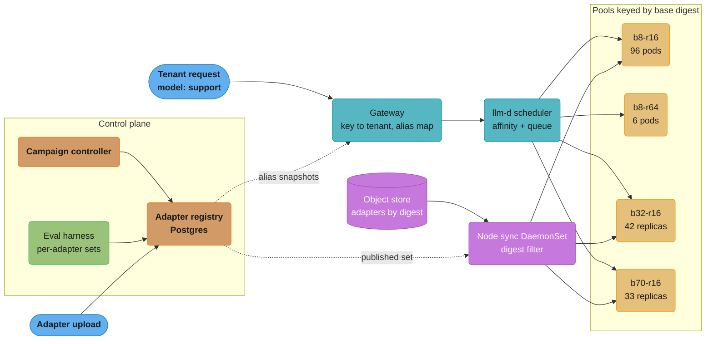
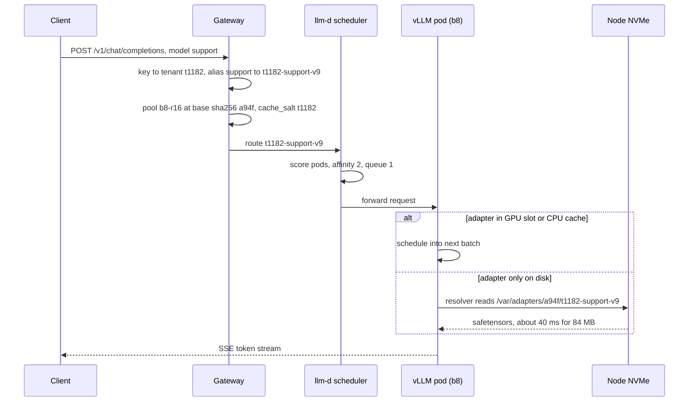
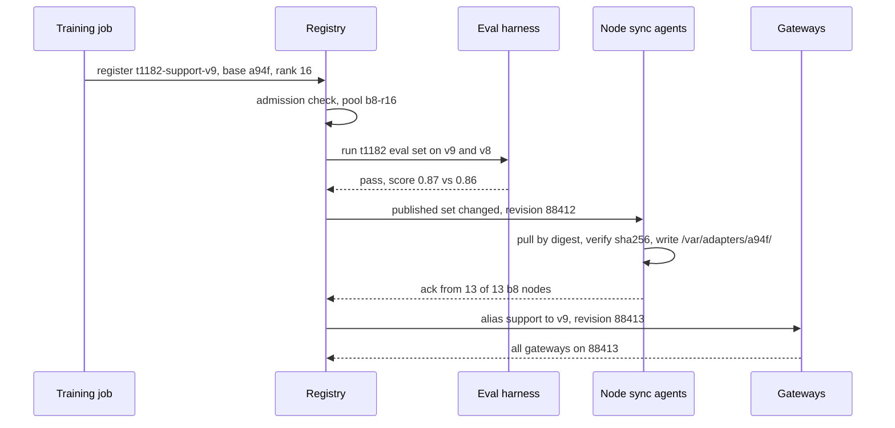
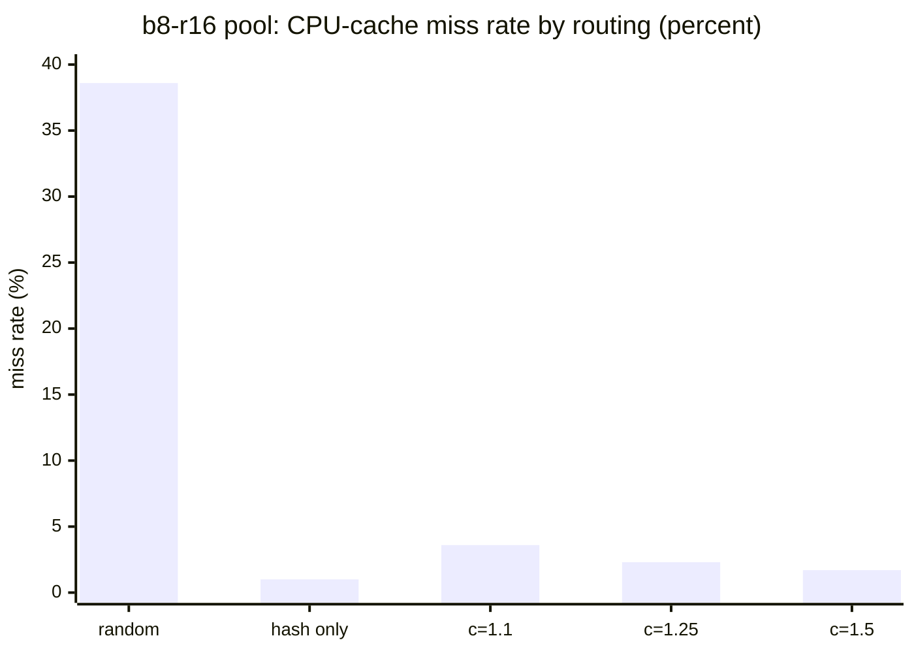
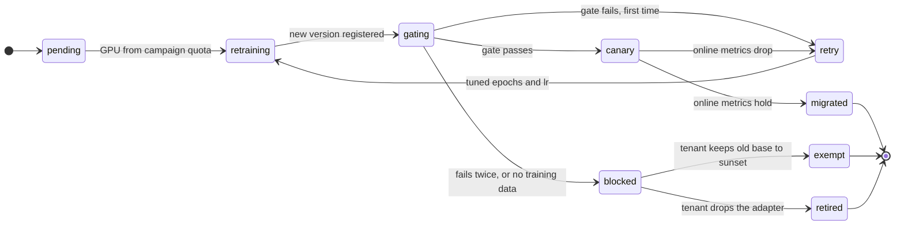
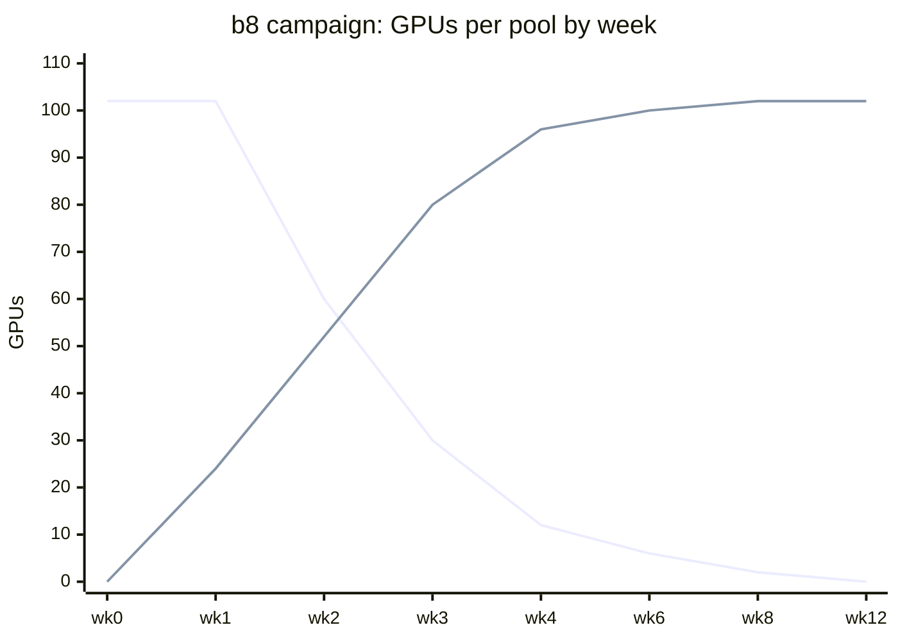

# Case Study: Design a Multi-Tenant LoRA Serving Platform

> **Version anchor (2026-10-18).** vLLM v0.32.0 (2026-10-18). llm-d v0.10.0 (2026-09-29),
> inference scheduler with the `lora-affinity-scorer` plugin. AIBrix v0.8.0 (2026-10-13),
> `ModelAdapter` CRD `model.aibrix.ai/v1alpha1`. Kueue v0.20.2 (2026-10-15). GPU prices in
> this study are a planning rate (`P_GPU = $2.50` per H100-hour), not a quote. Throughput per
> replica is an assumption for this workload shape; measure your own before sizing.

## Intuition

> **Design intuition**: A platform that hosts 5,000 customer LoRA adapters is a cache, a
> router and a migration tracker wrapped around three base models. The GPU math is the easy
> part: 5,000 adapters of 84 to 414 MB each fit on the local disks of the nodes that serve
> them. The hard parts are keeping each request on a pod that already holds its adapter
> without piling the hot adapters onto one pod, making sure no adapter ever runs on a base it
> was not trained on, and moving all 5,000 adapters to a new base without a quality drop that
> no error message reports.

**Key insight for this design**: an adapter is a diff against one base digest, so the base
digest is the partition key of the whole platform. The registry keys adapters by it, the node
sync filters by it, the router picks a pool by it, and the base-upgrade campaign is the
process of moving every adapter from one digest to another. Every serious incident in this
study is a place where some component used a base model *name* instead of its digest.

**Not here.** This study does not redesign the GPU inference platform underneath
([Design a GPU Inference Platform](../../llm/case_studies/design_gpu_inference_platform.md)
covers engines, cold starts, autoscaling and billing) or the training side
([Design an LLM Fine-Tuning Platform](../../llm/case_studies/design_llm_fine_tuning_platform.md)
covers data pipelines, training orchestration and adapter training). It covers the layer
between them: the adapter as a published, routed, isolated and migrated artifact at a scale
of thousands. Engine flags, slot memory and the single-adapter lifecycle are in
[LoRA Adapter Serving and Lifecycle](../lora_adapter_serving_and_lifecycle/lora_adapter_serving_and_lifecycle.md);
this study applies them to a fleet and does not repeat them.

---

## 1. Requirements Clarification

### Functional Requirements

- Tenants fine-tune adapters on one of three bases and call them through an
  OpenAI-compatible API (`/v1/chat/completions`, `/v1/completions`, `/v1/models`).
- The three bases: `b8` (Llama 3.1 8B Instruct, BF16, one H100 per replica), `b32`
  (Qwen2.5 32B Instruct, BF16, TP2) and `b70` (Llama 3.1 70B Instruct, BF16, TP4).
- A tenant names its adapter by an alias it owns (`support`, `extract`). The platform maps the
  alias to an immutable adapter version. Tenants never see internal serving names.
- Publish an adapter version: upload, admission check, per-adapter eval gate, prefetch to
  nodes, alias flip. Roll back by flipping the alias to the previous version.
- Rank limits per base: `b8` up to rank 64 (ranks above 16 go to a separate rank-class pool),
  `b32` and `b70` up to rank 16.
- Base-upgrade campaign: when a base changes (new generation, or a re-quantization), retrain,
  re-evaluate and migrate every adapter on it, with per-adapter state and a dated end of
  support for the old base.
- Four isolation tiers sold at fixed prices: shared pool, per-tenant adapter on a shared
  pool (the default), dedicated deployment, dedicated cluster.
- Tenant deletion: on contract end, every adapter version, its training snapshot and every
  node-cache copy is gone within 24 hours.

### Non-Functional Requirements

| Metric | Target |
|---|---|
| TTFT p95, adapter resident on the pod | under 800 ms for 1,200-token prompts on `b8` |
| TTFT p99, including a cold adapter | under 2 s |
| Inter-token latency p95 | under 60 ms on `b8`, under 90 ms on `b70` |
| Monthly availability, inference API | 99.9% |
| Publish to servable | under 5 minutes after the eval gate passes |
| Alias rollback | under 30 s to take effect on every gateway |
| Base campaign | 90% of traffic on the new base within 3 weeks of its eval release |
| Cross-tenant leakage | zero: no adapter, prompt, cached prefix or output reachable by another tenant |

### Out of Scope

- Adapter training internals, data pipelines and hyperparameter search (the fine-tuning
  platform study).
- Engine selection, cold start of the base weights and token-based autoscaling (the GPU
  inference platform study and
  [Inference Autoscaling and Capacity Planning](../inference_autoscaling_and_capacity_planning/inference_autoscaling_and_capacity_planning.md)).
- Multi-region placement and residency; the platform runs one region here, and
  [Multi-Region and Multi-Tenant Serving](../deployment_targets_and_serving_patterns/multi_region_and_multi_tenant_serving.md)
  extends it.
- Billing, invoicing and pricing.

---

## 2. Scale Estimation

### Adapter Inventory

```
Tenants:                     1,900
Adapters (live aliases):     5,000
  b8   3,400   (3,060 at rank <= 16, 340 at rank 32 or 64)
  b32  1,200   (rank <= 16)
  b70    400   (rank <= 16)
Versions kept per adapter:   about 25 (rollback history), 125,000 registry rows
New versions published:      about 400 per day across all bases
```

### Adapter Bytes

The adapter size depends only on rank, layer count and the projection shapes of the base:
`r * layers * sum(d_in + d_out)` parameters, the formula in
[LoRA Adapter Serving and Lifecycle](../lora_adapter_serving_and_lifecycle/lora_adapter_serving_and_lifecycle.md)
Section 6.1. All seven projections are targeted, stored in BF16. The 32B base has 64 layers,
hidden 5120, intermediate 27648 and 8 KV heads of 128.

```
          rank 16      rank 64
b8        83.9 MB      335.5 MB
b32      268.4 MB    1,073.7 MB
b70      414.2 MB    1,656.8 MB
```

```
Catalog bytes (one copy of every live version):
  b8    3,060 x 83.9 MB + 340 x 335.5 MB  =  256.7 + 114.1  =  370.8 GB
  b32   1,200 x 268.4 MB                                   =  322.1 GB
  b70     400 x 414.2 MB                                   =  165.7 GB
  total                                                    =  858.6 GB

Object store with 25 versions per adapter:   858.6 GB x 25  =  about 21.5 TB
Per node NVMe (8 x 3.84 TB = 30.7 TB):       one base catalog is 0.5% to 1.2% of it
```

The whole live catalog of a base fits on every node that serves it. That single number
removes the object store from the request path, and Section 4.2 builds on it.

### Traffic Estimates

```
Requests per day:        52M  (average 600 req/s)
Peak:                    1,500 req/s (2.5x average, weekday business hours)
Shape:                   1,200 prompt tokens, 250 output tokens (median)
Split at peak:
  b8    1,050 req/s  (1,008 on rank <= 16, 42 on the rank-64 pool)
  b32     300 req/s
  b70     150 req/s
Distribution over adapters: Zipf, s = 1.1
  top 50 b8 adapters carry 62% of b8 requests
  about 2,000 adapters (all bases) see under one request per minute at average load
```

### GPU Fleet Sizing

Replica throughput is the measured rate at which one replica holds the latency SLO for this
request shape with a mixed-adapter batch (16 adapter slots on `b8`). It includes the LoRA
kernel cost, which is about 10-15% below the same replica serving the base model alone.

| Pool | Replica | Req/s per replica at SLO | Peak req/s | Replicas (+headroom) | GPUs |
|---|---|---|---|---|---|
| `b8-r16` | 1 x H100 | 12 | 1,008 | 84 + 12 | 96 |
| `b8-r64` | 1 x H100 | 10 | 42 | 5 + 1 | 6 |
| `b32-r16` | 2 x H100, TP2 | 8 | 300 | 38 + 4 | 84 |
| `b70-r16` | 4 x H100, TP4 | 5 | 150 | 30 + 3 | 132 |
| Total | | | 1,500 | | 318 |

```
Shared pools:      318 GPUs x 730 h x P_GPU ($2.50)        =  $580k per month
Merged, dedicated: one deployment per adapter, 2 replicas for HA
  b8   3,400 x 2 x 1 GPU   =  6,800 GPUs
  b32  1,200 x 2 x 2 GPUs  =  4,800 GPUs
  b70    400 x 2 x 4 GPUs  =  3,200 GPUs
  total                    = 14,800 GPUs  =  $27.0M per month  (46.5x)
```

The 46.5x is the reason the platform exists. Most of those 14,800 GPUs would run at under 1%
utilization, serving the 2,000 adapters that get less than a request a minute. Pool economics
(utilization targets, spot blending, MBU) are in
[GPU Pool Economics](../../llm/case_studies/cross_cutting/gpu_pool_economics.md).

### Host Memory and Nodes

```
b8 replica:  --max-loras 16, --max-cpu-loras 128
             pinned host memory  128 x 83.9 MB  = 10.7 GB per pod
             8 pods per node                    = 86 GB of 2 TB host RAM
Nodes:       b8 13 (102 GPUs), b32 11 (84 GPUs, 88 slots), b70 17 (132 GPUs, 136 slots)
Publish fan-out: 400 versions/day x ~150 MB average x ~14 nodes = about 840 GB/day internal
```

---

## 3. High-Level Architecture



The request path has no registry or object-store call in it. The gateway holds an in-memory
alias snapshot pushed by the registry, the scheduler reads pod metrics it already scrapes, and
the pod reads the adapter from its own NVMe. The control plane writes to the registry; the
sync DaemonSet and the gateway follow it.

### Components

| Component | Responsibility |
|---|---|
| Gateway | Authenticates the key, maps `(tenant, alias)` to a serving name and pool, applies token budgets and the adapter-churn limit, adds `cache_salt` |
| llm-d inference scheduler | Picks a pod inside the pool: `lora-affinity-scorer` plus `queue-scorer`, with a rendezvous tie-break for adapters resident nowhere |
| vLLM pods | One base digest per pod, `lora_filesystem_resolver` over `/var/adapters/<base-digest>/`, load API on an internal listener only |
| Node sync DaemonSet | Mirrors the published set for the node's base digests from the object store to local NVMe, acknowledges each version to the registry |
| Adapter registry | Adapter versions, aliases, base digests, eval results, campaign state; the source of truth for every other component |
| Eval harness | Runs each adapter's own eval set on a candidate and on the current version; writes the gate result to the registry |
| Campaign controller | Drives a base upgrade: retrain queue, eval, canary share, migration, exemptions, old-pool shrink |

### Request Flow



---

## 4. Component Deep Dives

### 4.1 Adapter Registry and Alias Resolution

The registry is a small relational database. Its load is writes from publishes and
campaigns, plus watch streams to about 40 gateway instances and 41 node-sync agents. No
request reads it directly.

```sql
CREATE TABLE base_model (
  digest        text PRIMARY KEY,           -- sha256 of the weight files as served
  family        text NOT NULL,              -- b8, b32, b70: a label, never a key
  state         text NOT NULL,              -- active, campaign_target, sunset
  sunset_at     timestamptz
);

CREATE TABLE adapter_version (
  serving_name  text PRIMARY KEY,           -- t1182-support-v9, immutable
  tenant_id     text NOT NULL,
  alias         text NOT NULL,              -- support
  version       int  NOT NULL,
  adapter_digest text NOT NULL,             -- sha256 of adapter_model.safetensors
  base_digest   text NOT NULL REFERENCES base_model(digest),
  rank          int  NOT NULL,
  pool          text NOT NULL,              -- b8-r16, b8-r64, b32-r16, b70-r16
  state         text NOT NULL,              -- registered, eval_failed, published, canary, retired
  eval_run_id   text,
  training_snapshot text,                   -- dataset version the retrain will reuse
  UNIQUE (tenant_id, alias, version)
);

CREATE TABLE alias_target (
  tenant_id     text,
  alias         text,
  serving_name  text NOT NULL REFERENCES adapter_version(serving_name),
  canary_name   text REFERENCES adapter_version(serving_name),
  canary_share  real NOT NULL DEFAULT 0,
  revision      bigint NOT NULL,            -- bumps on every change, gateways compare it
  PRIMARY KEY (tenant_id, alias)
);
```

Three rules come from the schema. The serving name is immutable, so a retrain is a new row.
The pool is decided at admission from rank and base digest, so the router never discovers a
misfit. And an alias can point at a canary on a different base digest, which is how a
campaign moves one tenant at a time.

Gateways hold the whole alias table in memory: 5,000 rows, about 1 MB. The registry pushes a
new snapshot on every change with a monotonically increasing `revision`, and each gateway
reports the revision it serves. A rollback is complete when every gateway reports the new
revision, which is the number the 30 s rollback target is measured against. A TTL cache would
make rollback time equal the TTL; Section 9 has the incident.

Each tenant feature's release bundle pins the adapter digest, the base digest, the prompt
version and the decoding parameters together. A rollback redeploys the previous bundle, which
may point at the old base pool, so the old pool must exist until the rollback window of every
migrated adapter has passed. The bundle manifest and its lineage records are worked through in
[AI Release Bundle and Lineage](cross_cutting/ai_release_bundle_and_lineage.md). Registry
semantics, aliases and digest pinning in general are in
[Model Registry and Packaging](../model_registry_and_packaging/model_registry_and_packaging.md).

### 4.2 Publish Path: Prefetch, Then Flip

The catalog fits on every node (Section 2), so the platform never loads an adapter from the
object store at request time. The publish path makes that true by ordering two steps: copy
the adapter to every node of its pool first, flip the alias second.



The alias flips only after every node in the pool acknowledges the version. With 13 `b8`
nodes and an 84 MB adapter, the fan-out takes under a minute; the 5-minute publish target
leaves room for a node that is slow or draining. A node that does not ack within 4 minutes is
cordoned from the pool's routing, not waited on.

Admission checks (rank, target modules, safetensors only, PEFT features the engine rejects)
are the LoRA module's Section 6.8. This platform adds one: the base digest must name a
`base_model` row in state `active` or `campaign_target`, so an adapter trained on a sunset
base is refused at upload.

### 4.3 Affinity Routing Without Hot Spots

With 3,060 adapters on 96 `b8-r16` pods and a CPU cache of 128 adapters per pod, routing
decides whether a request finds its adapter in memory or pays a disk read and a slot swap.
Random routing spreads load evenly and misses often. Pure affinity (always the same pod per
adapter) almost never misses and piles the top adapters onto a few pods. The fix is
consistent hashing with bounded loads: walk the adapter's fixed pod order and take the first
pod whose in-flight count is under `c` times the pool mean. The simulator below sizes `c`
before anyone touches the fleet.

```python
import hashlib
import random
from collections import Counter, OrderedDict, deque

ADAPTERS, PODS, CPU_CACHE = 3060, 96, 128     # b8 r16 pool: adapters, pods, --max-cpu-loras
REQUESTS, ZIPF_S = 300_000, 1.1               # about 5 minutes of b8 peak traffic
WINDOW = PODS * 20                            # recent requests that count as in-flight


def main():
    weights = zipf(ADAPTERS, ZIPF_S)
    prefs = {a: pod_order(a) for a in range(ADAPTERS)}
    print(f"top 50 adapters carry {sum(weights[:50]):.0%} of requests")
    routes = {
        "random": lambda a, inflight, rng: rng.randrange(PODS),
        "hash only": lambda a, inflight, rng: prefs[a][0],
    }
    for c in (1.1, 1.25, 1.5):
        routes[f"bounded c={c}"] = bounded(prefs, c)
    for name, route in routes.items():
        miss, peak = simulate(route, weights)
        print(f"{name:15} cpu-cache miss {miss:6.1%}   busiest pod {peak:5.2f}x mean")


def bounded(prefs, c):
    """Consistent hashing with bounded loads: walk the adapter's pod order,
    take the first pod under c times the mean in-flight count."""
    cap = c * WINDOW / PODS

    def route(a, inflight, rng):
        for pod in prefs[a]:
            if inflight[pod] < cap:
                return pod
        return prefs[a][0]
    return route


def simulate(route, weights, seed=7):
    rng = random.Random(seed)
    caches = [OrderedDict() for _ in range(PODS)]
    recent, inflight, served = deque(), [0] * PODS, Counter()
    misses = 0
    for a in rng.choices(range(ADAPTERS), weights=weights, k=REQUESTS):
        pod = route(a, inflight, rng)
        served[pod] += 1
        recent.append(pod)
        inflight[pod] += 1
        if len(recent) > WINDOW:
            inflight[recent.popleft()] -= 1
        cache = caches[pod]
        if a in cache:
            cache.move_to_end(a)
            continue
        misses += 1
        cache[a] = True
        if len(cache) > CPU_CACHE:
            cache.popitem(last=False)
    return misses / REQUESTS, max(served.values()) / (REQUESTS / PODS)


def pod_order(adapter):
    """Rendezvous hashing: a stable pod order per adapter. Removing a pod
    moves only the adapters that ranked it first."""
    def score(pod):
        return hashlib.blake2b(f"{adapter}|{pod}".encode(), digest_size=8).digest()
    return sorted(range(PODS), key=score, reverse=True)


def zipf(n, s):
    w = [1 / (i + 1) ** s for i in range(n)]
    total = sum(w)
    return [x / total for x in w]


if __name__ == "__main__":
    main()

# top 50 adapters carry 63% of requests
# random          cpu-cache miss  38.6%   busiest pod  1.05x mean
# hash only       cpu-cache miss   1.0%   busiest pod 16.89x mean
# bounded c=1.1   cpu-cache miss   3.6%   busiest pod  1.10x mean
# bounded c=1.25  cpu-cache miss   2.3%   busiest pod  1.25x mean
# bounded c=1.5   cpu-cache miss   1.7%   busiest pod  1.50x mean
```



At 1,008 req/s, random routing sends 389 requests a second to a pod without the adapter in
memory, about 4 per pod per second, each one a 40 ms NVMe read plus a slot swap. Pure hashing
cuts that to 10 a second and sends 16.9 times the mean load to the busiest pod, which is the
pod holding the top adapter. With `c = 1.1` the pool takes 36 disk loads a second (about one
every 2.6 seconds per pod) and the busiest pod serves 11.6 req/s at peak, under the 12 req/s
SLO rate of Section 2. The platform runs `c = 1.1`; at `c = 1.25` the busiest pod would serve
13.1 req/s, more than the 12 extra replicas of headroom allow.

In production the scheduler is llm-d's, not this simulator. `lora-affinity-scorer` scores a
pod 1.0 when the adapter is active there, 0.8 when the pod has a free slot, 0.6 when the
adapter is already waiting to load there, and 0.0 when the pod is full. `queue-scorer`
supplies the load term, and the weight ratio (affinity 2, queue 1) plays the role of `c`. The
platform adds one custom scorer: when no pod holds the adapter, every pod with a free slot
scores 0.8, so the miss would land on an arbitrary pod. A small rendezvous-order term breaks
that tie, so the next miss for the same adapter lands on the same pod and the adapter does
not end up in 96 CPU caches. Scorer details and the `vllm:lora_requests_info` metric are in
the LoRA module, Section 6.6.

**Rank-class and base pools are routed first.** The pool is decided by the gateway from the
registry row (`b8-r64`, `b70-r16`), and the scheduler only scores pods inside it. A request
can never reach a pod whose `--max-lora-rank` is too small or whose base digest differs.

### 4.4 Placement Objects: Which Adapters Get One

AIBrix v0.8.0 models each adapter as a `ModelAdapter` object and creates a Service and
EndpointSlice per adapter. That is the right tool for adapters with a contract: a fixed
replica count, a named failover, a capacity floor. It is the wrong tool for the long tail
here. A `ModelAdapter` with `replicas` omitted loads on every matching pod, so 3,060 objects
would ask each of 96 pods to register 3,060 adapters, far past a 128-adapter CPU cache, and
every pod scale event would touch thousands of EndpointSlices.

The split the platform uses:

| Adapter class | Count | Placement |
|---|---|---|
| Contract tier (dedicated capacity bought by the tenant) | about 60 | AIBrix `ModelAdapter` with `replicas` set; never evicted |
| Hot tail (top 1% by traffic, no contract) | about 30 | llm-d affinity, spreads by load to several pods |
| Long tail | about 4,900 | Resolver on first request from local NVMe, llm-d affinity |

For those 60, `spec.baseModel` and the pod selector label carry the base digest prefix
(`b8-a94f`), not the family name, for the same reason as everything else in this study.

### 4.5 Node Sync: Broken, Then Fixed

The node sync DaemonSet decides which adapter files a node's pods can load. vLLM's filesystem
resolver loads whatever directory matches the requested name, without knowing what base the
adapter was trained on. So the sync filter is the last check between an adapter and a base it
does not belong to.

The first version filtered by base family, because the family was the human-readable column:

```python
from dataclasses import dataclass


@dataclass(frozen=True)
class AdapterVersion:
    name: str            # immutable serving name, e.g. t1182-support-v9
    base_family: str     # human label, e.g. b8
    base_digest: str     # sha256 of the exact base weights it was trained on
    state: str           # published, canary, retired, ...


def files_to_sync_broken(rows, pod_family):
    return {r.name for r in rows if r.base_family == pod_family and r.state != "retired"}
```

During the first `b8` campaign the new pool's pods carried family `b8` too. The sync agent on
new-base nodes copied every old-base adapter, the resolver loaded them on request, and the
shapes matched. Nothing failed. Requests that the gateway routed to the new pool under a stale
canary entry got an old adapter on a new base.

The fix keys the filter on the digest and on the states that may serve:

```python
def files_to_sync(rows, pod_base_digest):
    return {r.name for r in rows
            if r.base_digest == pod_base_digest and r.state in ("published", "canary")}


OLD, NEW = "sha256:7c1e", "sha256:a94f"
rows = [
    AdapterVersion("t1182-support-v8", "b8", OLD, "published"),
    AdapterVersion("t1182-support-v9", "b8", NEW, "canary"),
    AdapterVersion("t2040-extract-v3", "b8", OLD, "published"),
]

assert "t2040-extract-v3" in files_to_sync_broken(rows, "b8")   # old adapter on new pool
assert files_to_sync(rows, NEW) == {"t1182-support-v9"}
assert files_to_sync(rows, OLD) == {"t1182-support-v8", "t2040-extract-v3"}
```

Two more changes close the gap. The resolver directory is `/var/adapters/<base-digest>/`, and
each pod's `VLLM_LORA_RESOLVER_CACHE_DIR` points at its own base's directory, so even a wrong
file on the node is not in a path the pod reads. And the pool name the gateway routes to
contains the digest prefix (`b8-a94f`), so a canary entry cannot route an old-base adapter into
the new pool. A digest check in three places sounds redundant until one of them is a cache.

### 4.6 Base-Upgrade Campaign Controller

A base upgrade turns every adapter on that base into a retrain, a gate run and a canary. For
`b8` that is 3,400 adapters. The campaign controller is a per-adapter state machine plus a
scheduler that decides the order.



The order matters more than the speed. Retraining is cheap; what takes calendar time is the
gate runs, the canary windows and tenant sign-off, and those slots are limited per day. The
first campaign queued adapters in creation order. The planner below shows what that costs on
the retrain step alone.

```python
import heapq
import random

GPU_BUDGET = 64                                    # GPUs lent from the training quota
RETRAIN_MIN = {"b8": 20, "b32": 60, "b70": 150}    # GPU-minutes per adapter retrain
FIRST_PASS = 0.91                                  # share passing its eval gate first time


def main():
    fleet = b8_fleet()
    rng = random.Random(3)
    created = {a["id"]: rng.random() for a in fleet}   # creation order: unrelated to traffic
    for name, order in {
        "by traffic": lambda a: -a["share"],
        "by creation": lambda a: created[a["id"]],
    }.items():
        milestones, last = plan(fleet, order)
        print(f"{name:12} hours to 50/80/90% of traffic: {milestones}, all done {last} h")


def plan(adapters, order):
    """List-schedule one-GPU retrain jobs over GPU_BUDGET GPUs. Returns the hour at
    which each share of traffic has a retrained adapter that passed its gate."""
    free_at = [0.0] * GPU_BUDGET
    finished = []
    for a in sorted(adapters, key=order):
        start = heapq.heappop(free_at)
        end = start + RETRAIN_MIN[a["base"]] / 60
        heapq.heappush(free_at, end)
        finished.append((end, a["share"] * FIRST_PASS))
    finished.sort()
    targets, moved, hit = [0.5, 0.8, 0.9], 0.0, {}
    for end, share in finished:
        moved += share
        while targets and moved >= targets[0]:
            hit[targets.pop(0)] = round(end, 1)
    return hit, round(finished[-1][0], 1)


def b8_fleet(n=3400, s=1.1):
    w = [1 / (i + 1) ** s for i in range(n)]
    total = sum(w)
    return [{"id": f"a{i:04d}", "base": "b8", "share": x / total} for i, x in enumerate(w)]


if __name__ == "__main__":
    main()

# by traffic   hours to 50/80/90% of traffic: {0.5: 0.3, 0.8: 4.0, 0.9: 15.3}, all done 18.0 h
# by creation  hours to 50/80/90% of traffic: {0.5: 9.3, 0.8: 15.0, 0.9: 17.7}, all done 18.0 h
```

Both orders finish all 3,400 retrains in 18 hours on 64 GPUs (1,133 GPU-hours). Ordered by
traffic, half the traffic has a passing new adapter after 18 minutes and 80% after 4 hours.
Ordered by creation, 50% takes 9.3 hours. The same ratio applies to gate and canary slots,
which are the real bottleneck, and the difference there is weeks, not hours (Section 9).

The campaign controller's scheduling rules:

1. Order by traffic share, then by tier (contract tenants first inside a traffic band).
2. Hold 64 GPUs from the training quota through a Kueue `ClusterQueue` with `nominalQuota` 64
   and `borrowingLimit` 0, so the campaign cannot starve tenants' own fine-tuning jobs.
3. Gate each new version against its predecessor on the tenant's eval set: pass when the
   score is within the tenant's tolerance of the old adapter (default 1 point), not merely
   above a global bar.
4. Canary through the alias: `canary_share` 0.05, then 0.25, then 1.0, each held for at least
   24 hours for the top 50 adapters and 2 hours for the tail.
5. Retry once with tuned epochs and learning rate. A second failure, or a missing training
   snapshot, sets `blocked` and opens a ticket with the tenant.
6. Shrink the old pool as traffic leaves it; keep a 2-pod floor for exempt adapters until the
   base's `sunset_at` date, then retire it.

The per-adapter eval gate and its regression detector come from
[LLM Eval Harness in Production](../../llm/case_studies/cross_cutting/llm_eval_harness_in_production.md);
gate statistics are in
[Evaluation Gates and Eval Sets](../evaluation_gates_and_eval_sets/evaluation_gates_and_eval_sets.md).
The refresh cadence that decides *when* a base is upgraded is in
[Continuous Training and Refresh Policy](../continuous_training_and_refresh_policy/continuous_training_and_refresh_policy.md).



The first line is the old pool, the second the new one. The overlap from week 1 to week 4 is
the campaign's main cost, larger than retraining (Section 10).

### 4.7 Tenant Isolation

Every tenant shares GPUs, the base weights and the batch. What keeps them apart:

| Layer | Control | Failure it stops |
|---|---|---|
| Naming | Tenants call aliases; the gateway maps `(tenant, alias)` to a serving name | A tenant names another tenant's adapter |
| Load API | `/v1/load_lora_adapter` bound to an internal listener; only the AIBrix controller calls it | A caller loads an arbitrary path or fills every slot |
| Prefix cache | vLLM includes the LoRA name in the block hash; the gateway sets `cache_salt` per tenant | Timing probes of another tenant's cached prompt prefix |
| Token budgets | Per-tenant prompt-plus-max-tokens budgets and fair queuing at the gateway | One tenant's long prompts filling the KV cache |
| Adapter churn | Per-tenant cap on distinct adapters per minute on interactive pools | One tenant's sweep thrashing every pod's slots |
| Storage | Adapters and training snapshots encrypted per tenant; deletion removes object-store and node copies | Data surviving the contract |
| Tier | Dedicated deployment or cluster for about 40 regulated tenants | Shared failure domain where a contract forbids it |

The churn cap is the control that is specific to adapters. A request budget does not catch a
tenant whose eval job cycles through hundreds of its own adapter versions at a modest rate:
each request is cheap, but each one forces a slot swap and a disk read on the pod it lands on,
and with affinity routing those pods are the ones serving that pod's other tenants.

```python
from collections import defaultdict, deque


class AdapterChurnLimit:
    """Caps how many distinct adapters one tenant may touch per window on the
    interactive pool. Requests for adapters already in the window always pass."""

    def __init__(self, max_distinct=20, window_s=60.0):
        self.max_distinct, self.window_s = max_distinct, window_s
        self.seen = defaultdict(deque)       # tenant -> deque of (time, adapter)

    def allow(self, tenant, adapter, now):
        q = self.seen[tenant]
        while q and now - q[0][0] > self.window_s:
            q.popleft()
        distinct = {a for _, a in q}
        if adapter not in distinct and len(distinct) >= self.max_distinct:
            return False
        q.append((now, adapter))
        return True


limit = AdapterChurnLimit()
sweep = [limit.allow("t2040", f"t2040-exp-v{i}", now=i * 0.1) for i in range(450)]
assert sum(sweep) == 20                                  # the sweep is cut at 20 versions
assert limit.allow("t2040", "t2040-exp-v3", now=45.1)    # a known adapter still passes
assert limit.allow("t2040", "t2040-exp-v400", now=120.0) # new window, new budget
```

A refused request gets HTTP 429 with a pointer to the batch endpoint, which runs on a separate
low-priority pool where slot churn hurts nobody's latency. The defense-in-depth pattern
behind this table is in
[Tenant Isolation Patterns](../../llm/case_studies/cross_cutting/tenant_isolation_patterns.md);
token budgets and fair queuing are in
[Multi-Region and Multi-Tenant Serving](../deployment_targets_and_serving_patterns/multi_region_and_multi_tenant_serving.md)
Section 6.5.

---

## 5. Design Decisions & Tradeoffs

| Decision | Chosen | Alternative | Why |
|---|---|---|---|
| Partition key | Base digest | Base family name | A name survives a re-quantization or a new generation; adapters do not |
| Adapter source at request time | Local NVMe, prefetched at publish | Object store on miss | Catalog fits on every node (371 GB of 30.7 TB); removes a 0.4 s step from p99 |
| Alias propagation | Push with revision numbers | TTL cache at gateways | Rollback time must be a measured number, not a TTL |
| Routing | llm-d affinity plus queue, rendezvous tie-break | Random or pure affinity | 3.6% miss at 1.1x peak load vs 38.6% miss or 16.9x peak |
| Placement objects | `ModelAdapter` for about 60 contract adapters only | One object per adapter | 5,000 objects with per-adapter Services and slices do not fit the tail |
| Rank limits | Rank-class pool for `b8` ranks 32 and 64, rank 16 cap on `b32` and `b70` | One pool at the largest rank | Every slot is sized at `max_lora_rank`; one rank-64 adapter shrinks KV for all |
| Disaggregation | Off for LoRA pools | P/D split | KV is per adapter; pair placement doubles the routing problem |
| Campaign order | Traffic share, then tier | Creation order or tenant request | 80% of traffic migrates in 4 h of retrain time instead of 15 h |
| Old base after campaign | 2-pod floor until a dated sunset, billed to exempt tenants | Keep full pool or cut at once | Rollback needs the old pool; exempt tenants pay for the floor |
| Merging | Only for contract tenants whose adapter fills 4+ replicas | Merge the top 50 | Merging removes the 10-15% LoRA cost but needs a full model deploy per adapter version |

---

## 6. Real-World Implementations

**Fireworks AI.** Fireworks' multi-LoRA post (published 2024-09-18) describes serving hundreds
of fine-tuned LoRA adapters on one base model deployment at the base model's per-token price,
with throughput that the post says approaches 90% of base-model performance. That figure is
the same order as the 10-15% LoRA cost assumed in Section 2.

**Cresta.** The same Fireworks post cites Cresta, a contact-center AI company, running
thousands of LoRA adapters on one cluster of its Mixtral/Mistral-based Ocean model, and claims a
100x cost reduction against Cresta's earlier GPT-4 setup as of December 2023. It is the
closest public example of the per-customer adapter count in this study.

**Amazon SageMaker.** SageMaker's adapter inference components (November 2024) register an
adapter from S3 against a base inference component. The launch example keeps 30 adapters in
GPU memory, 70 in CPU memory and the rest on local SSD, the same three tiers this platform
sizes with `--max-loras`, `--max-cpu-loras` and the node NVMe catalog.

**Predibase LoRAX.** LoRAX, a TGI fork, added heterogeneous continuous batching and adapter
exchange scheduling between GPU and CPU. The repo is archived and its last release is
lorax-0.4.0 (January 2025). Platforms built on it move to vLLM or SGLang, and the migration is
mostly the request field that names the adapter.

**ByteDance AIBrix.** AIBrix, presented by ByteDance engineers at KubeCon events in 2025 and
hosted in the `vllm-project` organization, makes the adapter a Kubernetes object
(`ModelAdapter`). This study uses it for the contract tier (Section 4.4).

**Punica and S-LoRA (2023).** The research systems behind batched multi-adapter kernels. Punica
introduced the SGMV kernel for mixed-adapter batches; S-LoRA paged adapter weights and KV cache
in one pool. Both repos are archived. Their kernels and ideas run in vLLM and SGLang, which is
why this platform does not run a custom engine.

---

## 7. Technologies & Tools

| Tool | Role here | Notes |
|---|---|---|
| vLLM v0.32.0 | Engine on every pool | `--enable-lora`, `--max-loras 16`, `--max-cpu-loras 128`, `--max-lora-rank` per pool, `lora_filesystem_resolver` |
| llm-d v0.10.0 | Inference scheduler | `lora-affinity-scorer` reads `vllm:lora_requests_info`; `queue-scorer` for load; custom tie-break scorer |
| AIBrix v0.8.0 | Contract-tier placement | `ModelAdapter` with `replicas` set; controller calls the internal load API |
| Kueue v0.20.2 | Campaign GPU quota | `ClusterQueue` with a borrowing limit for retrain jobs |
| PEFT and safetensors | Adapter format | `adapter_config.json` plus `adapter_model.safetensors`; pickle refused at upload |
| PostgreSQL | Adapter registry | 125,000 version rows, alias table with revisions, campaign state |
| Object store (S3 or equivalent) | Adapter and training snapshot storage | Content-addressed by digest, per-tenant encryption keys |
| Prometheus | Pod and gateway metrics | Per-adapter series computed at the gateway, not on pods (Section 9) |

---

## 8. Operational Playbook

### Dashboards

| Panel | Source | Healthy range |
|---|---|---|
| CPU-cache miss rate per pool | Gateway join of route decision and pod load events | under 4% on `b8-r16` |
| Adapter loads per pod per minute | vLLM load logs | under 30 |
| TTFT p95 and p99, resident vs cold adapter | Gateway, split by a load flag | p95 under 800 ms, p99 under 2 s |
| Busiest pod load over pool mean | Scheduler | under 1.15x |
| Sync lag: newest published revision minus node revision | Sync agents | 0 within 2 minutes |
| Gateway alias revision spread | Gateways | one revision within 30 s of a change |
| Base-digest mismatch events | Pod-side resolver guard | 0, page on any |
| Campaign: share of traffic per state | Campaign controller | per plan |

### Alerts

| Alert | Condition | Severity |
|---|---|---|
| `AdapterBaseMismatch` | Any pod loads an adapter whose registry base digest differs from the pod's | Page |
| `SyncLagHigh` | A node more than 5 minutes behind the published revision | Ticket; cordon after 10 minutes |
| `AliasRevisionSplit` | Gateways on more than one revision for over 60 s | Page |
| `SlotThrash` | A pod above 120 adapter loads per minute for 5 minutes | Page |
| `HotPod` | Busiest pod over 1.25x pool mean for 10 minutes | Ticket |
| `CampaignStalled` | No adapter state change in 24 h while `pending` is non-zero | Ticket |

### Runbook: Adapter Quality Complaint With No Errors

1. To find what served the request, look up the request id in gateway logs: serving name,
   pool, pod, alias revision.
2. Compare the serving name's `base_digest` in the registry with the pod's base digest label.
3. If they differ, cordon the pool's sync agents, flip the alias to the last version on the
   pod's base, and open an incident: this is the Section 4.5 failure.
4. If they match, rerun the tenant's eval set on the serving version and its predecessor, and
   roll the alias back if the gap exceeds the tenant's tolerance.

### Runbook: Slot Thrash on a Pod Group

1. To find the source, group the pod's adapter loads by tenant for the last 15 minutes.
2. If one tenant accounts for most loads, confirm the churn cap is applied to its key and move
   its traffic class to the batch pool.
3. If the loads spread across tenants, check whether a pod scale-down or node drain removed
   pods: rendezvous order moves only the adapters that ranked the removed pods first, but
   those adapters miss once on their next pod.
4. If neither, raise `--max-cpu-loras` on the pool after checking pinned memory headroom.

---

## 9. Common Pitfalls & War Stories

**Family-name sync during the first campaign.** The node sync filtered on base family
(Section 4.5). For 31 hours, 212 tail adapters (6% of `b8` adapters, 3% of `b8` traffic) ran
on the new base when stale canary entries routed them there. No errors, no latency change.
Two tenants reported "worse answers"; the eval harness, run on the served versions, found a
median drop of 7 points on their task scores. Fix: digest filter, digest-named resolver
directories and digest-named pools. Since then `AdapterBaseMismatch` has fired twice, both
times on a node restored from an old disk image, both caught before any request was served.

**TTL alias cache made rollback take 10 minutes.** Gateways cached the alias map with a
10-minute TTL. A tenant's new version produced malformed JSON on 4% of calls; the alias was
rolled back in the registry in 20 seconds, but 40% of the tenant's requests still went to the
bad version for the next 10 minutes because each gateway expired its cache on its own clock.
About 9,000 bad responses went out. Fix: pushed snapshots with a `revision`, rollback complete
when every gateway reports it. Measured rollback since: 6 to 14 seconds.

**One `ModelAdapter` per adapter.** An early design created a `ModelAdapter` for every `b8`
adapter with `replicas` omitted. Each new pod received load calls for all of them and spent
about 25 minutes registering adapters before it was useful; each scale event updated
thousands of EndpointSlices, and API server write latency rose from 40 ms to over 1 s during a
morning scale-up. Fix: `ModelAdapter` only for about 60 contract adapters, with `replicas`
set. The tail loads through the resolver on first request.

**A tenant's eval sweep thrashed 9 pods.** A tenant's offline eval ran 450 of its own
experimental adapter versions round robin at 30 req/s against the interactive API. Affinity
routing spread the versions over 9 pods; each pod's slots and CPU cache turned over every few
seconds, and TTFT p95 for the other 140 tenants on those pods went from 600 ms to 1,900 ms for
40 minutes. The tenant was inside its request and token budgets. Fix: the per-tenant churn
cap (Section 4.7) and a batch pool for eval traffic.

**Campaign in creation order.** The first campaign's gate and canary slots (about 200 per day)
went to adapters in creation order. The top 50 adapters, 62% of traffic, reached canary in
week 3. The old `b8` pool stayed at full size two weeks longer than planned: about 96 GPUs x
336 hours = 32,000 GPU-hours, about $80k at the planning rate. Fix: traffic-ordered queue
(Section 4.6). The second campaign moved 80% of traffic in 6 days.

**Training snapshots expired before the campaign.** The fine-tuning platform kept training
data for 180 days. When the `b32` campaign started, 41 adapters had no training snapshot and
could not be retrained. They went to `exempt` and kept the old `b32` pool alive at its 2-pod
floor (two TP2 replicas, 4 GPUs) for 90 extra days: 8,640 GPU-hours. Fix: a published adapter's training snapshot is
kept as long as the adapter is live, with the tenant's consent recorded at upload, or the
tenant is told at upload that a base change will require new data.

**Per-adapter labels on pod metrics.** A TTFT histogram on every pod carried an `adapter`
label. With random routing in the first month, about 290,000 adapter-pod pairs appeared, and
at 14 series per histogram that was about 4M active series. Prometheus ran out of memory
twice. Fix: pods export per-pool histograms; per-adapter latency is computed at the gateway
(5,000 adapters x 14 series = 70,000). Cardinality budgets are in
[Prometheus Cardinality and Scale](../../devops/case_studies/cross_cutting/prometheus_cardinality_and_scale.md).

**Quantized base, same name.** A team proposed serving `b70` in FP8 to save half its GPUs and
labeled the FP8 weights with the same family name. Adapters trained against BF16 weights
showed a 2 to 5 point drop on 30% of tenant eval sets. Treated as a new base digest, the
change became a campaign with its own gate, and 12% of `b70` adapters needed a retrain on the
FP8 base to hold their scores.

### Impact Summary

| Change | Before | After |
|---|---|---|
| Bounded-load affinity routing | 38.6% CPU-cache miss, 4 disk loads per pod per second | 3.6% miss, one load per pod every 2.6 s |
| Prefetch at publish | p99 TTFT 6.1 s on first request after idle | p99 1.4 s |
| Pushed alias revisions | rollback up to 10 minutes | 6 to 14 s |
| Digest-keyed sync and pools | 212 adapters on the wrong base for 31 h | 0 served mismatches since |
| Traffic-ordered campaign | 80% of traffic migrated in week 3 | 80% in 6 days |
| Shared pools vs merged per adapter | 14,800 GPUs | 318 GPUs |

---

## 10. Capacity Planning

### Steady State

| Resource | Formula | Value |
|---|---|---|
| GPUs | Section 2 table | 318 H100 |
| GPU cost | 318 x 730 h x P_GPU | $580k per month |
| Node NVMe for adapters | catalog per base | 371 / 322 / 166 GB per node |
| Pinned host memory | `max_cpu_loras` x adapter size x pods per node | 86 GB per `b8` node |
| Object store | catalog x 25 versions | 21.5 TB |
| Registry rows | adapters x versions | 125,000 |
| Gateway alias snapshot | 5,000 rows | about 1 MB per gateway |
| Per-adapter metric series | 5,000 x 14 at the gateway | 70,000 |

### Campaign Cost for `b8`

```
Retrain:          3,400 x 20 GPU-min                   =  1,133 GPU-h  ($2.8k)
Eval generation:  3,400 x 300 items x 2 versions       =  2.04M requests
                  at 12 req/s per b8 replica           =  47 GPU-h     ($0.1k)
Judge calls:      2.04M x J (price per judge call)     =  set by the judge model
Pool overlap:     65 GPU-weeks above one pool (4.6)    =  10,900 GPU-h ($27k)
Exempt floor:     2 GPUs x 90 days                     =  4,320 GPU-h  ($10.8k)
```

The pool overlap, the area between the two lines of the Section 4.6 chart, costs about ten
times the retraining. Shortening the campaign's calendar time is
therefore the cost lever, and calendar time is set by gate and canary throughput, which is
why traffic order matters (Section 4.6). For `b70` the retrain line grows to 400 x 150
GPU-minutes = 1,000 GPU-hours, and the overlap, with the same curve on the 132-GPU pool, to
about 14,100 GPU-hours.

### Growth to 15,000 Adapters

| Pressure | At 5,000 | At 15,000 | Action |
|---|---|---|---|
| NVMe catalog per `b8` node | 371 GB | about 1.1 TB | Still fits; no change |
| CPU-cache miss with 128 per pod | 3.6% | rises as the tail grows | Raise `--max-cpu-loras` to 256 (21 GB pinned per pod) |
| Campaign retrain on 64 GPUs | 18 h | 54 h | Raise campaign quota or accept 3 days |
| Gate and canary slots | 200 per day | 600 per day needed | Automate tail canaries; human sign-off for top 2% only |
| Registry and sync | trivial | trivial | No change |
| Alias snapshot | 1 MB | 3 MB | Switch to delta updates above 10 MB |

The first limit to break is human: gate review and tenant sign-off. The platform's growth plan
is to keep human review for the top 2% of adapters by traffic and contract tier, and to let the
gate and online canary metrics decide the rest.

---

## 11. Interview Discussion Points

**Q: Why is the base model digest, not the model name, the key of this platform?**
**Short:** An adapter's deltas only fit the exact base weights it was trained on, and a name can point at re-quantized or newer weights with the same shapes.

A LoRA adapter on the wrong base does not fail: tensor shapes match, the server loads it and
quality drops by an amount nobody measures. Names such as `Llama-3.1-8B-Instruct` or a family
label survive a re-quantization and sometimes a new generation. So the registry stores the
digest per adapter version, the node sync filters by it, resolver directories and pool names
carry it, and the campaign is defined as moving adapters from one digest to another. Discuss
where a cache or a human-readable label could slip back in.

**Q: Random routing balances load well. Why not use it?**
**Short:** It sends 38.6% of requests to a pod without the adapter in memory, about 4 disk loads per pod per second on a 96-pod pool.

With 3,060 adapters and a 128-adapter CPU cache per pod, a random pod rarely holds a tail
adapter. Each miss costs a 40 ms NVMe read, a slot swap, and evicts something another request
needs. Pure affinity fixes misses but sends 16.9x the mean load to the pod with the top
adapter. Consistent hashing with bounded loads at `c = 1.1` gets 3.6% misses and caps the
busiest pod at 1.1x, inside the per-replica SLO rate; `c = 1.25` misses less but overloads
it. Ask the candidate how they would pick `c` and what headroom it consumes.

**Q: How does llm-d's scheduler relate to the bounded-load simulator?**
**Short:** The affinity scorer is the hash preference and the queue scorer is the load bound; the weight ratio between them plays the role of c.

`lora-affinity-scorer` reads which adapters each pod is running or waiting on from
`vllm:lora_requests_info` and scores 1.0, 0.8, 0.6 or 0.0. `queue-scorer` lowers the score of
busy pods. A hot adapter therefore spreads once its first pod's queue outweighs the affinity
bonus. The gap is the cold adapter: every pod with a free slot scores 0.8, so a tie-break
(rendezvous order) keeps repeated misses for one adapter on one pod. Good follow-up: what
happens to placement when a pod is removed.

**Q: Why prefetch every adapter to every node instead of loading from the object store on a miss?**
**Short:** The whole catalog for a base is 166 to 371 GB, under 1.5% of node NVMe, and prefetching removes a 0.4 s step from cold-request latency.

An 84 MB adapter from object storage takes about 0.4 s plus first-byte latency, half the TTFT
budget before prefill. Local NVMe takes about 40 ms. Since the catalog fits, the design copies
at publish time and flips the alias only after every node acknowledges. The cost is about 840
GB of internal transfer a day. The design changes when the catalog stops fitting, for example
at much higher rank or many more bases; then the node keeps a traffic-ranked subset.

**Q: Walk through a base-model upgrade for 3,400 adapters. Where does the time go?**
**Short:** Retraining takes about 18 hours on 64 GPUs; gate runs, canary windows and tenant sign-off take weeks, so ordering by traffic is the main lever.

Stand up the new pool, retrain from stored snapshots, gate each adapter against its
predecessor on its own eval set, canary through the alias, migrate, shrink the old pool, and
give exempt tenants a sunset date. Ordered by traffic, 80% of traffic has a passing adapter
after 4 hours of retraining; in creation order, 15 hours, and weeks once canary slots are the
limit. The pool overlap (about 10,900 GPU-hours) costs about ten times the retraining. Ask what the
candidate does with the 3% that cannot be retrained.

**Q: What is the failure mode that produces no errors at all, and how do you detect it?**
**Short:** An adapter served on a base it was not trained on; only a digest check at sync and load, or a per-adapter eval on served traffic, catches it.

In this study, a sync filter on the family name copied old-base adapters to new-base nodes for
31 hours. Latency, error rate and throughput were normal. Detection layers: a pod-side guard
that compares registry base digest with the pod's digest and pages on any mismatch, request
logs that record serving name and pod digest, and per-adapter online quality metrics during
canaries. Discuss why a shape check is useless here.

**Q: Why not create an AIBrix ModelAdapter for every adapter?**
**Short:** Per-adapter objects with replicas omitted load every adapter on every matching pod and multiply Service and EndpointSlice updates by thousands.

`ModelAdapter` fits adapters with contracts: a replica count, failover, never evicted. For a
long tail of 4,900 adapters, the resolver loading from local disk on first request plus affinity
routing gives the same result without per-adapter Kubernetes objects. In the war story, new
pods spent about 25 minutes registering adapters and API server write latency rose past 1 s.
A good answer names which adapters deserve an object and why.

**Q: A tenant is inside its request and token budgets but other tenants' latency triples. What happened?**
**Short:** Adapter churn: the tenant cycles through many adapter versions, each forcing slot swaps and disk reads on the pods it lands on.

Token budgets price work in tokens; adapter swaps are a separate cost. Under affinity routing,
a sweep over 450 versions concentrates on a few pods, and their other tenants pay. The fix is
a per-tenant cap on distinct adapters per minute on interactive pools, with sweeps sent to a
batch pool. Ask how the candidate would pick the cap (20 here) from the distribution of
distinct adapters per tenant per minute.

**Q: How do you make an adapter rollback fast and provable?**
**Short:** Roll back by flipping an alias to an immutable older version, pushed to gateways with a revision number that each gateway reports back.

Overwriting weights in place cannot be rolled back and serves mixed versions from caches.
Immutable serving names plus an alias table make rollback a pointer change. The proof is the
revision: rollback is done when every gateway reports it, measured at 6 to 14 seconds. With a
TTL cache the rollback time is the TTL, 10 minutes in the war story. Follow-up: what if the
older version is on a base pool that has been shrunk.

**Q: When would you merge a hot adapter into its own deployment?**
**Short:** When a contract pays for dedicated capacity and the adapter keeps several replicas busy; the saving is only the 10-15% LoRA kernel cost on those replicas.

Merging the top `b8` adapter (about 16% of `b8-r16` traffic, 165 req/s at peak) would save about
2 GPUs out of 14 and add a second release path
where every version is a 16 GB model deploy and every base change means a re-merge. The
bounded-load router already spreads it. Merge for isolation or contract reasons, and when the
tenant pays for the extra release machinery, not for a small throughput gain.

**Q: Why keep prefill/decode disaggregation off on the LoRA pools?**
**Short:** KV computed under an adapter is valid only for that adapter, so prefill and decode pods would both need it resident and routing would place pairs.

Disaggregation helps long prompts and tight inter-token targets on large models. Here, the
`b70` pool meets its TTFT target at 150 req/s without it, and the routing problem is already
the main source of latency variance. Turning it on would double the residency problem. The
decision changes when one adapter alone fills several `b70` replicas, where it can get its
own disaggregated deployment. The tradeoff is worked in
[Distributed Inference and Disaggregation](../distributed_inference_and_disaggregation/distributed_inference_and_disaggregation.md).

**Q: What breaks first if the platform grows from 5,000 to 15,000 adapters?**
**Short:** Human review in the campaign and publish gates; the GPU, disk, registry and routing math still fits with modest changes.

The `b8` catalog grows to about 1.1 TB per node, still small. CPU-cache misses rise and need
`--max-cpu-loras` at 256 (21 GB pinned per pod). Retraining a base takes 54 hours on 64 GPUs.
Gate and canary slots need to triple, which no review team does. The plan: human sign-off for
the top 2% by traffic and contract tenants, automated gates and canaries for the rest.
Discuss what evidence makes an automated canary trustworthy enough to skip a human.
