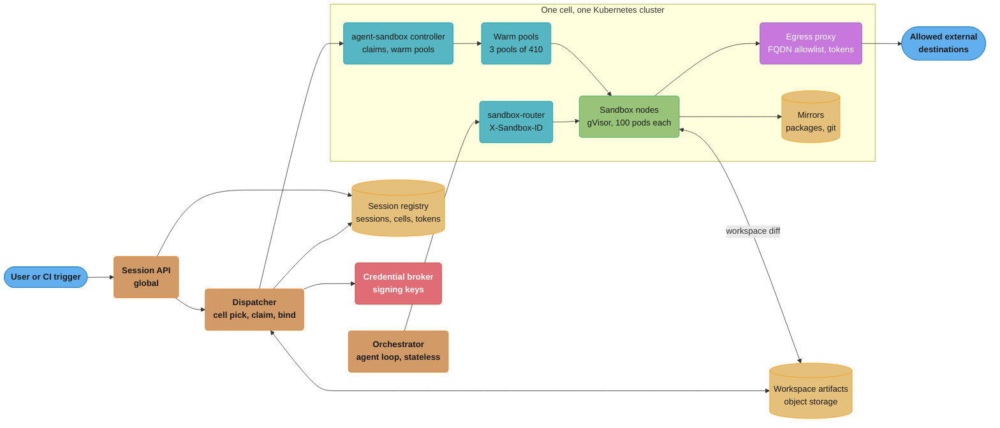
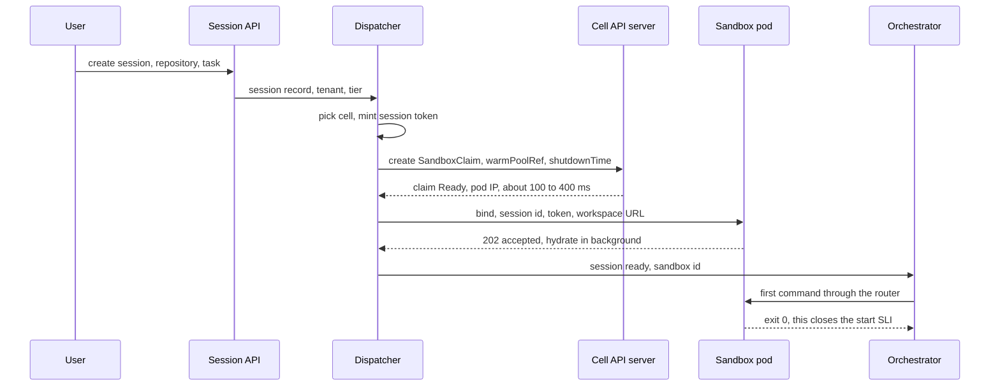

# Case Study: Design an Agent Sandbox Fleet

> **Version anchor (2026-11-25).** `kubernetes-sigs/agent-sandbox` v1.0.12 (released 2026-11-20,
> read from its releases page on 2026-11-25), served only as `v1beta1`. Kubernetes 1.37 (1.37.2 on
> 2026-10-13) with its scalability criteria of at most 110 pods per node, 5,000 nodes and 150,000
> pods per cluster. gVisor release 20261123.0 (2026-11-24), Kata Containers 4.4.0 (2026-11-17)
> and Firecracker v1.18.0 (2026-11-09). Read on 2026-11-25: the etcd limits page (default storage
> quota 2 GiB, 8 GiB suggested maximum), the gVisor filesystem guide, the E2B runtime README and
> sandbox docs, the Modal security page and the Firecracker page-fault guide. Warm-pool and
> controller numbers come from the project's own measurements as taught in
> [Agent Runtime and Sandbox Fleet Operations](../agent_runtime_and_sandbox_fleet_operations/agent_runtime_and_sandbox_fleet_operations.md).
> Everything marked "assumption" or "modeled" (node shape, node price, object sizes, session
> mix, egress volume) is arithmetic on stated inputs, not a measurement.

---

## Intuition

> **Design intuition**: a coding agent spends most of its life waiting for a model, then asks
> for a computer for a few seconds, then waits again. A fleet of 100,000 such sessions is a
> connection pool for kernels. The expensive things (a booted pod, a pulled image, a started
> runtime) are created before anyone asks, handed to one session, and destroyed when that
> session ends. Nothing about the sandbox is allowed to outlive its session, and nothing the
> session needs is allowed to be created on the request path.

**Key insight for this design**: "p99 start under 1 second" is not a latency target, it is a
hit-ratio target. A cold pod start takes 42 to 50 s. If a fraction `c` of claims miss the warm
pool, the p99 of the mixture is the cold time as soon as `c` exceeds 1%. Below 1%, the mixture's
p99 is the warm distribution's quantile at `0.99 / (1 - c)`, so at `c = 0.5%` the warm path must
hold its own p99.5 under 1 s, and every missed claim eats into the margin. Every
decision below buys hit ratio at the lowest idle cost: pools sized from Little's law and a
burst factor, cells small enough that one control plane never saturates, state kept out of the
sandbox so a resume is also a warm claim, and secrets kept out of the sandbox so a claim never
needs a per-session pod field that forces a cold start.

The study takes the primitives (CRDs, pool math, controller limits, snapshot semantics, egress
layers) from
[Agent Runtime and Sandbox Fleet Operations](../agent_runtime_and_sandbox_fleet_operations/agent_runtime_and_sandbox_fleet_operations.md)
and designs the service around them: session state, cells, credential broker, janitor, SLOs and
the bill.

---

## 1. Requirements Clarification

### Scenario

Forge is a hosted coding-agent product. A user (or a CI trigger) gives it a task and a
repository. The agent loop, which calls the model and decides the next step, runs in a
stateless orchestrator tier. Whenever the loop needs to read a file, run a test or start a
dev server, it sends a tool call to a **sandbox**: one isolated, single-tenant Linux
environment that holds the repository checkout and runs the commands. The loop is the brain and
stays outside. The sandbox is the hands and holds no model key.

Peak load is 100,000 concurrent live sandboxes (assumption: 20 minute mean holding time, a peak
to mean ratio of 1.8, so about 55,600 on average and 4.0 million sessions a day). About 5% of
sessions belong to enterprise organizations whose policy requires a dedicated kernel per sandbox.

### Functional Requirements

- Start a sandbox for a new or resumed session, with the repository workspace ready shortly after.
- Execute commands, read and write files, and expose a preview port through one gateway.
- Park an idle session without losing the workspace, and resume it for up to 14 days.
- End every session at a hard deadline and delete everything the session created.
- Allow only named network destinations, and let the agent push to the user's repository without
  the sandbox ever holding the user's credential.
- Run a separate tenant of RL and evaluation rollouts without starving interactive sessions.

### Non-Functional Requirements

| Requirement | Target |
|---|---|
| Sandbox start, claim created to first successful command, new or resumed | p99 under 1 s, with warm hit ratio of 99.5% or more |
| Workspace ready (repository checkout and parked diff applied) | p95 under 3 s |
| Concurrency | 100,000 live sandboxes at peak, nodes 10% above the planned count to cover autoscaler lag |
| Infra-caused session failure rate | under 0.5% of sessions |
| Isolation | Default tier: a userspace kernel between code and host. Regulated tier: a dedicated guest kernel per sandbox |
| Credentials | No long-lived secret ever present in a sandbox, a pod spec or etcd |
| Lifetime | Hard cap 4 h per live sandbox, idle park after 5 minutes, parked data deleted after 14 days |
| Cost | under 1 cent of sandbox compute per median session, reported per session |

### Out of Scope

- The agent loop, repository tools and evaluation of the agent:
  [Design an Autonomous SWE Agent](../../llm/case_studies/design_autonomous_swe_agent.md),
  [Design an Agent Platform](../../llm/case_studies/design_agent_platform.md) and
  [Coding Agents](../../llm/coding_agents/coding_agents.md).
- The code-execution tool contract an agent sees:
  [Sandboxed Code Execution](../../llm/agents_and_tool_use/sandboxed_code_execution.md).
- The model gateway: [AI Gateway Operations](../ai_gateway_operations/ai_gateway_operations.md). The RL trainer
  and weight sync: [Training Infrastructure Operations](../training_infrastructure_operations/training_infrastructure_operations.md).
  Only the rollout sandboxes appear here, as a second tenant. GPU sandboxes are out too: this
  fleet is CPU only ([GPU Cluster Scheduling and Quotas](../gpu_cluster_scheduling_and_quotas/gpu_cluster_scheduling_and_quotas.md)).

**Not here.** Node provisioning and the cluster itself are in
[Design a GPU Training and Inference Cluster](../../devops/case_studies/design_gpu_training_and_inference_cluster.md)
for the GPU case and [Multi-Cluster and Fleet Management](../../devops/multi_cluster_and_fleet_management/multi_cluster_and_fleet_management.md)
for the generic cell pattern. This study applies them to a CPU sandbox fleet.

---

## 2. Scale Estimation

### Load

```
Peak live sandboxes N:        100,000
Mean holding time D:          20 min = 1,200 s              (assumption)
Peak claim rate (Little):     lambda = N / D = 83.3 per s
Peak to mean ratio:           1.8   ->  mean live 55,600     (assumption)
Sessions per day:             55,600 x 86,400 / 1,200 = 4.0 million
Correlated surge:             2x peak for 60 s at a top-of-hour trigger wave (assumption)
```

### Cell layout

```
Cells:                 5, each a separate Kubernetes cluster     (2 regions: 3 + 2)
Per cell at peak:      20,000 live, 16.7 claims per s
Pool per cell:         1,230 ready sandboxes (3 pools of 410), see section 4.1
Pods per cell:         20,000 + 1,230 = 21,230
Fleet total:           106,150 pods, 1,065 nodes
```

One cluster could hold the pods (106,000 is under the 150,000 criterion), but not comfortably.
The cell decision is made on control-plane grounds, not pod count:

| Resource | One cluster | One cell of five | Limit |
|---|---|---|---|
| Pods | 105,858 | 21,230 | 150,000 per cluster (Kubernetes scalability criteria) |
| Nodes | 1,059 | 213 | 5,000 per cluster |
| etcd bytes (about 21 KB per session, assumption) | 2.22 GB | 0.45 GB | default quota 2 GiB, suggested maximum 8 GiB |
| Pool size, one pool object | 5,858 across 14 pools | 1,230 across 3 pools | one pool refills at about 70 to 85 sandboxes per s |
| Blast radius of an API server or etcd incident | 100% of sessions | 20% of sessions | |

The 21 KB per session is one `Sandbox` at about 10 KB (the project's figure) plus a Pod, a
`SandboxClaim` and a Service at assumed sizes. One cluster would sit above etcd's default 2 GiB
quota, so the options are to raise the quota toward the suggested maximum or to split. Cells
cost 5% more pool (6,150 pool pods instead of 5,858) and remove a shared fate.

### Node packing

```
Node:             32 vCPU, 128 GiB; allocatable 30 vCPU, 120 GiB        (assumption)
Sandbox:          request 0.25 vCPU and 1 GiB, limit 2 vCPU and 1 GiB   (memory not overcommitted)
gVisor overhead:  podFixed 0.05 vCPU and 64 MiB per pod                 (assumption, measure it)
CPU bound:        30 / 0.30        = 100 pods
Memory bound:     120 / 1.0625     = 112 pods
maxPods:          110
Pods per node:    min(100, 112, 110) = 100, CPU binds
Nodes per cell:   21,230 / 100 = 213, plus 10% autoscaler headroom = 234
```

The node shape was chosen so the three bounds sit within 12% of each other. A 96 vCPU node
would hit `maxPods = 110` with 70% of its CPU unused, the density trap in the module.

### Egress and storage (assumptions)

```
Downloads per session:         100 MB, aggregate 83.3 per s x 100 MB = 8.3 GB/s = 67 Gbps at peak
Cell-local mirror hit rate:    85%, so external traffic is 10 Gbps fleet, 2 Gbps per cell
Parked workspace diff:         8 MB mean, 30% of sessions park: 9.6 TB a day, 134 TB at 14 days
```

The ceilings matter during a surge and a recovery (section 4.1), not during the day. Steady
state sits at 7 to 8% of the sustained refill ceiling (5.6 sandboxes per s per pool against 70
to 85) and about 6% of the measured 300 per s burst adoption ceiling (16.7 claims per s).

---

## 3. High-Level Architecture



The dispatcher is the only component that writes claims, always as a `warmPoolRef`, a lifecycle
and a session label. The orchestrator talks to sandboxes only through the router. Sandboxes talk
to the outside only through the egress proxy and the cell-local mirrors. The broker's signing
keys never enter a cell.

### Session start, warm path



The start SLI closes at the first successful command, not at claim Ready. Workspace hydration
runs after the bind call and has its own SLI (p95 under 3 s), so a slow clone never hides inside
the start number or the other way round.

### Session lifecycle

A session moves through `Starting`, `Active`, `Parked` (idle for 5 minutes, diff saved), back to
`Starting` when the user returns, and ends as `Ended` (task done), `Expired` (the 4 h
`shutdownTime`) or `Deleted` (artifacts removed, 14 days after parking). A parked session holds
no sandbox at all. It is a row in the registry and a diff in object storage. This is the central
state decision of the design (section 4.5): resuming is a fresh warm claim plus a hydrate, so it
gets the same p99 as a new session.

### Components

| Component | Role | Runs where |
|---|---|---|
| Session API | Authenticates, creates the session record, returns a handle | Global, stateless |
| Session registry | Source of truth for session, cell, tier, token id, state and deadlines | Sharded, strongly consistent database |
| Dispatcher | Picks the cell, mints the token, writes the claim, makes the bind call, writes state changes | Global, stateless, one deployment per region |
| agent-sandbox controller | Reconciles `SandboxClaim`, `SandboxWarmPool`, `Sandbox`; enforces `shutdownTime` | Each cell |
| Warm pools | 3 pools of 410 per cell on the default template, plus smaller pools for other templates | Each cell |
| sandbox-router | Routes by `X-Sandbox-ID`, authorizes with sandbox-scoped tokens | Each cell, 6 replicas |
| Egress proxy and mirrors | FQDN allowlist, token to credential mapping, audit log, package and git caches | Each cell, 4 proxy replicas |
| Credential broker | Mints and revokes session tokens, holds signing keys and upstream app credentials | Global, behind a KMS |
| Janitor | Reconciles claims against registry state, deletes orphans and retained corpses | Each cell |

The template digest belongs in the release bundle that the agent ships under. A change to the
image, the runtime class or the network policy changes what an agent can do exactly like a
prompt change. Section 4.7 shows the bundle extension, and the digest rules are in
[AI Release Bundle and Lineage](cross_cutting/ai_release_bundle_and_lineage.md).

---

## 4. Component Deep Dives

### 4.1 Pool sizing and the burst model

Four inputs set the pool: the cell's claim rate `lambda`, the replacement time `T`, a burst
factor `b` for correlated starts, and the quantile `p`. The pool must cover every claim that
arrives while one replacement is in flight, so its size is the `p`-quantile of a Poisson count
with mean `lambda x T x b`. The module's derivation is in
[Agent Runtime and Sandbox Fleet Operations](../agent_runtime_and_sandbox_fleet_operations/agent_runtime_and_sandbox_fleet_operations.md);
this is the planner the platform team runs, standard library only.

```python
import math
from dataclasses import dataclass


def poisson_quantile(mu: float, p: float) -> int:
    """Smallest k with P(X <= k) >= p, summed in log space so mu in the thousands is safe."""
    cdf, k = 0.0, 0
    while True:
        cdf += math.exp(-mu + k * math.log(mu) - math.lgamma(k + 1))
        if cdf >= p:
            return k
        k += 1


@dataclass(frozen=True)
class Fleet:
    peak_live: int = 100_000
    session_s: float = 1_200.0       # D
    cells: int = 5
    replace_s: float = 45.0          # T, measured without pre-pulled images
    burst: float = 1.5               # correlated-start multiplier on arrivals in T
    quantile: float = 0.999
    pool_size: int = 450             # replicas per SandboxWarmPool object
    node_cpu: float = 30.0           # allocatable per node, assumptions
    node_mem_gib: float = 120.0
    max_pods: int = 110
    pod_cpu: float = 0.30            # 0.25 request + 0.05 RuntimeClass overhead, measure it
    pod_mem_gib: float = 1.0625      # 1 GiB request + 64 MiB overhead
    etcd_kb: float = 21.0            # per session, Sandbox 10 KB plus assumed Pod, claim, Service


def plan(f: Fleet) -> dict:
    live = f.peak_live / f.cells
    lam = live / f.session_s                              # Little's law
    mu = lam * f.replace_s * f.burst
    w = poisson_quantile(mu, f.quantile)
    per_node = min(math.floor(f.node_cpu / f.pod_cpu), math.floor(f.node_mem_gib / f.pod_mem_gib),
                   f.max_pods)
    pods = live + w
    return {"lambda_per_s": round(lam, 1), "pool_w": w, "pools": math.ceil(w / f.pool_size),
            "pods_per_node": per_node, "nodes": math.ceil(pods / per_node),
            "etcd_gb": round(pods * f.etcd_kb / 1e6, 2), "pool_share_pct": round(100 * w / pods, 1)}


for t, cells in ((45.0, 1), (45.0, 5), (15.0, 5)):
    print("T", t, "cells", cells, plan(Fleet(replace_s=t, cells=cells)))
```

Output of the run (section 2 figures): one cell at `T` = 45 s needs `pool_w` 1,230 (3 pools, 213
nodes, 0.45 GB of etcd, pool 5.8% of pods). One cluster needs 5,858 (14 pools, 1,059 nodes, 2.22
GB of etcd). One cell at `T` = 15 s needs 436 (1 pool, 205 nodes, pool 2.1% of pods).

The pool scales linearly with `T`: 161 sandboxes at 5 s, 300 at 10 s, 436 at 15 s, 836 at 30 s,
1,230 at 45 s and 2,398 at 90 s. Going from 45 s to 15 s removes 794 pooled pods per cell,
about 3,970 across the fleet, which is roughly 40 nodes. That is the whole business case for
pre-pulled images and, later, snapshot restore (section 4.6). Three more rules fall out of the
model:

- **Pools per cell.** 1,230 replicas is above the 500 to 1,000 replica guidance, so each cell
  runs 3 pools of 410, `--sandbox-warm-pool-concurrent-workers=3`, and a per-pool
  `--sandbox-warm-pool-max-refill-rate` of 50, with `--sandbox-warm-pool-replenish-delay` left
  at 0, because deferring refill lets one failed create drain a pool. Each pool needs 5.6
  sandboxes per second in steady state, so the cap is 9x the need and exists to flatten recovery
  bursts.
- **Recovery after a surge.** After `B` claims the pool needs `T + B / R` seconds to be whole.
  A 2,000 claim surge with a combined refill of 150 per second (3 pools at 50) recovers in
  `45 + 2,000 / 150 = 58 s`. A second surge inside that window meets a thin pool.
- **Diurnal sizing.** `W` follows `lambda`, so the pool is autoscaled from the dispatcher's own
  claim rate with a scheduled floor before known waves, and never scales down inside the
  recovery window ([Inference Autoscaling and Capacity Planning](../inference_autoscaling_and_capacity_planning/inference_autoscaling_and_capacity_planning.md)).

### 4.2 Latency budget and the mixture arithmetic

The SLI is claim created to first successful command, measured by the dispatcher.

| Stage | Budget at p99 | Source |
|---|---|---|
| Controller adopts a warm member and sets claim Ready | 376 ms | project measurement at 45 claims per s over 4 pools, conservative for 16.7 per s per cell |
| Bind call (session id, token) over the router | 40 ms | budget, assumption |
| First command through the router, `sandboxd` already running | 60 ms | budget, assumption |
| Sum, leaving 524 ms of margin to the 1 s objective | 476 ms | covers API server jitter and GC pauses |

The warm path alone is not the whole SLO. With cold fraction `c`, the fleet p99 is the warm
quantile at `0.99 / (1 - c)`:

| Cold fraction `c` | Warm quantile that must be under 1 s | Verdict |
|---|---|---|
| 0.5% (the alert threshold) | p99.5 | holds, margin shrinking |
| 1.0% | the cold start sets p99 | SLO broken, p99 is about 45 s |
| 13.6% (the 2x surge of section 9) | the p99 is a cold start | p99 is 42 to 50 s for the minute |

This is why the paging signal is the warm hit ratio and not the claim latency histogram, which
looks healthy until `c` crosses 1% and then falls off a cliff.

### 4.3 Cell routing: broken, then fixed

A session needs a cell. The tenant should keep landing in the same one, because that cell's git
mirror already holds the tenant's repositories, and adding a cell should disturb as few tenants
as possible. Hash modulo the cell count breaks the second property:

```python
# BROKEN: adding a sixth cell moves 83% of tenants, and every moved tenant starts with an empty mirror.
def pick_cell_mod(tenant: str, cells: list[str]) -> str:
    return cells[int(hashlib.md5(tenant.encode()).hexdigest(), 16) % len(cells)]
```

```python
import hashlib
import math


def _u(tenant: str, cell: str) -> float:
    h = hashlib.blake2b(f"{tenant}|{cell}".encode(), digest_size=8).digest()
    return (int.from_bytes(h, "big") + 1) / (2**64 + 2)        # open interval (0, 1)


def ranked_cells(tenant: str, weights: dict[str, float]) -> list[str]:
    """Weighted rendezvous hashing. Highest score first. A cell with weight 0 is drained."""
    live = {c: w for c, w in weights.items() if w > 0}
    return sorted(live, key=lambda c: live[c] / -math.log(_u(tenant, c)), reverse=True)


def choose(tenant: str, weights: dict[str, float], warm_hit: dict[str, float]) -> str:
    """Home cell unless its warm hit ratio is under 99%, then the next ranked healthy cell."""
    ranking = ranked_cells(tenant, weights)
    return next((c for c in ranking if warm_hit.get(c, 0.0) >= 0.99), ranking[0])
```

Measured on 20,000 synthetic tenants, modulo moves 83.3% of them on 5 to 6 cells and rendezvous
moves 16.1% (the ideal is 1/6 = 16.7%). With one cell's weight at 0.2 it holds 4.8% of tenants
and the other four hold 23.8% each.

Weights are the lever for everything operational. Set a cell's weight to 0.2 before an upgrade
and its tenants move gradually, and to 0 to evacuate. The spill rule makes the router the
second line of defense: a cell whose warm hit ratio has fallen under 99% (where the p99 is
already a cold start) stops receiving sessions it cannot serve warm, and the next cell in the
tenant's own ranking takes them, so the spill is stable per tenant instead of random.
Regulated-tier tenants are ranked only among cells in their residency region
([Multi-Region and Data Residency](../../hld/multi_region_and_data_residency/multi_region_and_data_residency.md)).

### 4.4 Egress policy and credential brokering: broken, then fixed

The sandbox runs code the model wrote on behalf of a user, so assume it is hostile. Three
layers hold, in this order.

| Layer | Control in this design | What it stops |
|---|---|---|
| Pod and runtime | gVisor default tier, Kata for regulated tenants, non-root, read-only rootfs, no service account token, `readinessGracePeriodSeconds` set | Kernel escape from a shared kernel, token theft from the pod |
| Network | One namespace policy: egress only to CoreDNS, the egress proxy and the cell mirrors; no public IPs, no RFC1918, no metadata server | Direct exfiltration, lateral movement to other sandboxes, cloud metadata |
| Proxy and broker | The proxy enforces an FQDN allowlist and swaps a per-session token for a real credential | A stolen filesystem, a prompt-injected agent calling an unlisted host |

Because the sandbox cannot reach the internet directly, `HTTPS_PROXY` in the image is
convenience and not a control: a process that ignores it fails to connect. DNS is also a
channel, so sandboxes resolve through a resolver that answers only allowlisted zones and logs
everything else.

The per-fleet policy uses `networkPolicyManagement: Unmanaged` on the templates and one policy
per namespace instead of one per template, the move the module records for the RL fleet:

```yaml
apiVersion: networking.k8s.io/v1
kind: NetworkPolicy
metadata:
  name: sandbox-egress
  namespace: agent-fleet
spec:
  podSelector:
    matchLabels:
      app.kubernetes.io/part-of: agent-fleet-sandbox     # set in every template's podTemplate
  policyTypes: ["Ingress", "Egress"]
  ingress:
    - from:
        - namespaceSelector:
            matchLabels: { kubernetes.io/metadata.name: agent-sandbox-system }   # the router
  egress:
    - to:
        - namespaceSelector:
            matchLabels: { kubernetes.io/metadata.name: sandbox-dns }
      ports: [{ protocol: UDP, port: 53 }, { protocol: TCP, port: 53 }]
    - to:
        - namespaceSelector:
            matchLabels: { kubernetes.io/metadata.name: sandbox-egress }   # egress proxy
      ports: [{ protocol: TCP, port: 3128 }]
    - to:
        - namespaceSelector:
            matchLabels: { kubernetes.io/metadata.name: sandbox-mirrors }  # package and git mirrors
      ports: [{ protocol: TCP, port: 8443 }]
```

NetworkPolicy cannot name a hostname, so the FQDN allowlist lives in the proxy, and a
cluster-wide FQDN-aware policy is the alternative the module lists. The policy must exist before
the first pool member starts, because a pod that no policy selects is open.

**The broken proxy.** The first version of the broker trusted a session header, because it was
the easiest thing for the sandbox to send:

```python
# BROKEN: the proxy believes the caller about who the caller is. Any sandbox can name any other
# session and inherit its scopes, and the header is a plain string with no expiry or revocation.
def authorize_broken(headers: dict, scopes_by_session: dict, destination: str) -> bool:
    return destination in scopes_by_session.get(headers["X-Session"], [])
```

The fix is a signed, scoped, expiring token minted at claim time, delivered over the bind call
(never through the pod spec, because a per-claim `env` would also force a cold start), capped at
the claim's `shutdownTime`, and revocable the moment the session ends:

```python
import base64
import hashlib
import hmac
import json
import time


def _b64(b: bytes) -> str:
    return base64.urlsafe_b64encode(b).decode().rstrip("=")


def _unb64(s: str) -> bytes:
    return base64.urlsafe_b64decode(s + "=" * (-len(s) % 4))


def mint(keys: dict[str, bytes], kid: str, session: str, user: str, scopes: list[str],
         ttl_s: int, shutdown_at: float, now: float | None = None) -> str:
    now = time.time() if now is None else now
    exp = min(int(now) + ttl_s, int(shutdown_at))              # never outlive the claim
    body = json.dumps({"kid": kid, "s": session, "u": user, "sc": sorted(scopes), "exp": exp},
                      separators=(",", ":"), sort_keys=True).encode()
    return f"{_b64(body)}.{_b64(hmac.new(keys[kid], body, hashlib.sha256).digest())}"


def verify(keys: dict[str, bytes], token: str, destination: str, revoked: set[str],
           now: float | None = None) -> dict:
    now = time.time() if now is None else now
    body_b64, sig_b64 = token.split(".")
    body = _unb64(body_b64)
    claims = json.loads(body)
    key = keys.get(claims.get("kid"))
    if key is None:
        raise PermissionError("unknown key id")
    if not hmac.compare_digest(hmac.new(key, body, hashlib.sha256).digest(), _unb64(sig_b64)):
        raise PermissionError("bad signature")
    if now >= claims["exp"]:
        raise PermissionError("expired")
    if claims["s"] in revoked:
        raise PermissionError("session ended")
    if destination not in claims["sc"]:
        raise PermissionError("destination not in scope")
    return claims
```

Run with a token minted for `["git:github.com/acme/app", "pkg:pypi.org"]` and a 3,600 s requested
TTL against a claim that shuts down in 1,800 s, the token's `exp` is mint time plus 1,800 (the
claim's `shutdownTime` won). At that instant `verify` raises `expired`. A revoked session raises
`session ended`, a destination outside the scopes raises `destination not in scope`, and a token
whose signature was altered raises `bad signature`.

After the proxy accepts a token it attaches the real credential: a short-lived installation
token scoped to one repository for `git:` destinations, a read-only mirror credential for
`pkg:` ones. Real credentials live only in the broker and the proxy, and key ids (`kid`) allow
signing key rotation without a flag day: verify against all active keys, mint with the newest.
The agent loop calls the model from the orchestrator, so the sandbox never sees a model key and
a compromised one can burn its session's scopes and nothing else. The agent-side identity model
is in
[AI Workloads and Agent Operations](../../devops/platform_engineering_and_idp/ai_workloads_and_agent_operations.md),
and the supply-chain controls for the mirrors in
[Supply Chain Security Pipeline](../../devops/case_studies/cross_cutting/supply_chain_security_pipeline.md).

### 4.5 Park, resume and the janitor

Four clocks and policies run on every session, and each is set explicitly.

| Clock | Value | Where it lives | If it is missing |
|---|---|---|---|
| Hard cap | 4 h | `lifecycle.shutdownTime` on the claim, token `exp` capped to it | A looping agent holds a sandbox for days |
| Idle park | 5 min with no tool call in flight and no process output | Orchestrator, then dispatcher parks | A closed tab holds a sandbox for the full cap, or a build is killed mid-run if idle means only "no user message" |
| Finished cleanup | 60 s | `lifecycle.ttlSecondsAfterFinished`, with `shutdownPolicy: Delete` on every claim (the CRD default is `Retain`) | A finished pod lingers, and 4.0M dead claims and Sandboxes a day (40 GB of etcd growth) pile up |
| Parked retention | 14 days | Object storage lifecycle rule | Diffs accumulate forever |

**Why a park is not `operatingMode: Suspended`.** A suspended `Sandbox` deletes its pod and
keeps its PVC. Resume creates a new pod from the current template, which is a cold start of 42
to 50 s because that pod is not a pool member. A claim that sets `volumeClaimTemplates` is a
cold start for the same reason. If 30% of sessions park and 40% of those resume, that is 480,000
resumes a day at 45 s, or 6,000 hours of user waiting a day. So the design parks by artifact:

1. The dispatcher asks the sandbox, through the router, for an archive of the repository diff and
   untracked files, and receives it over the same channel. The sandbox never holds a bucket
   credential.
2. The dispatcher writes the artifact to object storage, records its digest in the registry,
   sets the state to `Parked` and deletes the claim.
3. On resume the dispatcher makes a normal warm claim, then pushes the artifact over the bind
   channel. The sandbox clones from the cell mirror at the recorded base commit and applies the
   diff.

A resume therefore has the same start p99 as a new session. The cost is that running processes
do not survive a park, so the template bakes in the toolchain, and section 4.6 covers the case
where that is not enough.

**The janitor.** Callers crash after creating a claim, controllers restart, and a retained
object is a real etcd cost. The janitor reconciles every cell's claims against the registry:

```python
def reap(claims: list[dict], live: set[str], now: float, grace_s: int = 120, stuck_s: int = 600):
    """claims: dicts with name, session, created, shutdown_at, expired. Returns (delete, page)."""
    delete, page = [], []
    for c in claims:
        age = now - c["created"]
        if c["session"] not in live and age > grace_s:
            delete.append((c["name"], "orphan"))
        elif c["expired"]:
            delete.append((c["name"], "retained-after-expiry"))
        elif now > c["shutdown_at"] + stuck_s:
            page.append((c["name"], "past shutdownTime and still running"))
    return delete, page
```

Run against five claims (`a` live, `b` session gone, `c` expired but retained, `d` 700 s past
`shutdownTime` and running, `e` 30 s old with the session not yet in the registry), it returns
`b` and `c` for deletion and pages on `d`. The grace period keeps `e`, so a claim written a
moment before its registry row replicates is not killed. `d` is paged instead of deleted because
a claim that outlives its deadline by 10 minutes means the controller or the node is unhealthy,
and deleting hides the evidence. An admission policy rejects any claim without `shutdownTime`,
`shutdownPolicy: Delete` and the session label.

### 4.6 Snapshot and restore: where it earns its place

| Option | What it buys | What it costs | Verdict |
|---|---|---|---|
| None, pre-pulled images only | `T` falls from 45 s to an assumed 15 s | A node-level image prefetch DaemonSet | Ship first |
| Template snapshot to refill the pool (gVisor checkpoint, GKE Pod snapshots, microVM clone) | Smaller `T` again, seconds of restore with memory streaming in the background | Compatibility matching, a secret-free snapshot, an identity rebind | Add only if measured `T` stays above 30 s |
| Per-session snapshot for parking | Processes and memory survive a park | A snapshot per parked session, no PVC content, new IP | Only for templates that need a live dev server |

A snapshot does not replace the pool. Restore takes seconds and the p99 target is 1 s, so a
restored sandbox can refill a pool faster but cannot answer a claim directly. Measure restore at
the first command or a readiness probe, not at pod `Running`, because a restored pod can be
running while its memory is still filling.

The pool arithmetic gives the price of skipping it. Cutting `T` from 45 s to 15 s saves 794 pods
per cell, about 40 nodes fleet-wide. At the assumed $1.20 per node-hour that is $48 an hour, or
about $417,000 a year if the pool is held flat all day, and about 44% less if it follows the
1.8 peak to mean curve exactly. A snapshot pipeline needs an owner, a compatibility test per
kernel and CPU generation, and a secret-free build, so the decision rule is a measured `T`.

The design already satisfies the one hard rule for cloning from a snapshot: nothing unique is
in the pod before the bind call. The session id, the token and the workspace arrive afterwards,
so a template snapshot holds no identity and no secret.

### 4.7 Manifests: template and the bundle field

```yaml
apiVersion: extensions.agents.x-k8s.io/v1beta1
kind: SandboxTemplate
metadata:
  name: forge-default
  namespace: agent-fleet
spec:
  podTemplate:
    metadata:
      labels:
        app.kubernetes.io/part-of: agent-fleet-sandbox
    spec:
      runtimeClassName: gvisor            # regulated tier: a second template with runtimeClassName kata-qemu
      automountServiceAccountToken: false
      securityContext: { runAsNonRoot: true, runAsUser: 1000 }
      containers:
        - name: runtime
          image: registry.example.com/forge/runtime@sha256:2222222222222222222222222222222222222222222222222222222222222222
          env:                            # template-level env is fine, only claim-level env forces a cold start
            - { name: HTTPS_PROXY, value: "http://egress.sandbox-egress.svc:3128" }
          resources:
            requests: { cpu: 250m, memory: 1Gi }
            limits:   { cpu: "2",  memory: 1Gi }
          securityContext: { allowPrivilegeEscalation: false, readOnlyRootFilesystem: true, capabilities: { drop: ["ALL"] } }
  networkPolicyManagement: Unmanaged      # one namespace policy, section 4.4
  envVarsInjectionPolicy: Disallowed
```

The pool manifest is the module's (`replicas: 410`, `readinessGracePeriodSeconds: 90`). An
object-count `ResourceQuota` on `count/sandboxclaims.extensions.agents.x-k8s.io` (30,000 per
cell) turns a runaway dispatcher into a rejected claim instead of a control-plane incident.

The template digest becomes one more field in the agent's release bundle, in the `runtime`
group next to the image and engine pins: `runtime.sandbox.template_digest`, `runtime_class` and
`egress_policy_digest`. Adding it needs a new bundle `apiVersion`, because the schema rejects
unknown fields, and the rules for that are in
[AI Release Bundle and Lineage](cross_cutting/ai_release_bundle_and_lineage.md). A rollback of
the agent then also rolls back the sandbox's permissions. Without the field, a loosened egress
rule ships under the same bundle digest and no diff shows it.

---

## 5. Design Decisions & Tradeoffs

### Isolation tier

| Tier | Boundary | Start path | Density here | Compatibility | Where it runs in this design |
|---|---|---|---|---|---|
| Hardened container (runc, seccomp, dropped capabilities) | Shared host kernel | Fastest | 110 per node, `maxPods` binds before CPU | Full | Internal CI only, never external code |
| gVisor `systrap` | Userspace kernel (Sentry) plus Gofer, no VM | Warm claim, no VM boot | 100 per node with the assumed 0.05 vCPU overhead | Most syscalls, not all, slower syscall-heavy work | Default tier, about 95% of sessions, bare-metal pools may use the KVM platform |
| Kata Containers (QEMU or Cloud Hypervisor) | One VM and one guest kernel per pod | Warm claim, the VM is already booted | 60 per node with the documentation's example overhead of 0.25 vCPU and 120 MiB | Full Linux guest | Regulated tier, about 5% of sessions |
| Firecracker microVM directly | KVM guest per sandbox | Snapshot restore | High | Full Linux guest | Not used: it is not a Kubernetes runtime, and the fleet would need its own scheduler |

The default is gVisor `systrap` because the nodes are cloud VMs without nested virtualization
(assumption) and the boundary is a userspace kernel instead of a shared one. gVisor's own docs
state the limits: higher cost for syscall-heavy work, and not every syscall exists. Coding
agents run installs, compiles and test suites, so the decision has a gate. Run the ten most
common build and test workloads on runc, gVisor and Kata, and accept gVisor only if each
workload's median wall time stays within 25% of runc (a design threshold, not a standard).
A workload that fails moves to the Kata template, not to runc. gVisor's rootfs overlay is backed
by `self` by default and `directfs` is on by default, the two settings that decide file-heavy
performance, so record them in the template review.

Kata costs density and a bare-metal or nested-virtualization pool. Its 60 pods per node is
a 40% drop from 100, so a regulated sandbox costs about 1.67x a default one in sandbox-hours.
With 5% of sessions in the tier the blended cost rises by 3.3%.

### Where state lives

| Strategy | Keeps | Resume start | Why not here |
|---|---|---|---|
| Keep the sandbox running | Everything | None | Idle holding is the cost problem |
| `operatingMode: Suspended` with a PVC | Object, PVC | Cold pod start of 42 to 50 s | Misses the p99 on every resume |
| Pod or microVM snapshot per session | Memory and processes | Seconds | Snapshot per parked session, uniqueness rules, no PVC content |
| **Workspace artifact, fresh warm claim (chosen)** | Repository diff | Warm claim plus hydrate | Loses running processes |

### Cell and pool structure

| Option | Latency | Control-plane risk | Pool cost | Operations |
|---|---|---|---|---|
| One cluster, 14 pools | Warm | 100% blast radius, etcd over the default quota at 2.22 GB | Lowest, 5,858 pool pods | Lowest |
| **5 cells, 3 pools each (chosen)** | Warm | 20% blast radius, 0.45 GB etcd per cell | 6,150 pool pods | A router, per-cell dashboards |
| 20 small cells | Warm | 5% blast radius | Higher, small pools have a larger relative tail | A fleet-management problem |
| No pools | 42 to 50 s | None | None | Fails the SLO |

### The RL tenant

Rollout waves are synchronized: one training step claims thousands of sandboxes inside one
window, far more than a cell pool of 1,230, so the RL fleet gets its own cells sized to the
wave, with egress denied and its own quota. The module's rules apply unchanged: record the
template digest per rollout, retry infrastructure failures and never score them as zero reward,
and treat the policy being trained as adversarial code. The trainer side is in
[Training Infrastructure Operations](../training_infrastructure_operations/training_infrastructure_operations.md).

### Egress

The default managed policy leaves every public host reachable, so the fleet uses a namespace
policy that allows only DNS, the proxy and the mirrors (section 4.4). The cost is that a proxy
outage stops all sessions in a cell, so the proxy runs 4 replicas per cell at 4x the steady
load.

---

## 6. Real-World Implementations

**agent-sandbox project (SIG Apps).** The reference implementation measures about 300 claims
per second at p90 of 200 ms or less when draining a pre-warmed 3,700 replica pool (3,600 claims
in 12 s), about 70 to 85 sandboxes per second of sustained refill per pool, and warm adoption of
p50 92 ms, p90 182 ms and p99 376 ms at 45 claims per second across 4 pools. Cold starts measured
about 42 to 50 s at p50 on GKE. Idle suspend is on its roadmap as planned, so a design built
today supplies it itself.

**E2B.** The open-source E2B runtime runs one Firecracker microVM per sandbox. Its README says a
sandbox is a resumed snapshot: templates are pre-booted VMs stored in object storage, "creating"
restores one, memory pages are served lazily on a page fault through `userfaultfd`, and the root
filesystem is a copy-on-write overlay over a read-only image. It enforces a per-sandbox nftables
egress firewall with SNI and Host-inspecting domain lists, auto-pauses idle sandboxes by diffing
memory and disk against the template, and forks a running sandbox into up to a hundred new ones
per request. Its docs cap continuous runtime at 24 hours (Pro) or 1 hour (Hobby), with pause and
resume to go beyond that. It is the microVM branch of the same design space: a sandbox is a
snapshot restore, and a pool is not the primary mechanism.

**Modal.** Modal's security page states that each container runs in its own sandbox, isolated
from the host, "using primitives like gVisor or microVMs".

**GKE Sandbox and Pod snapshots.** GKE runs gVisor as GKE Sandbox and builds Pod snapshots on it.
The vendor documentation says workloads that already start fast gain little, the same
conclusion as section 4.6.

**Firecracker at AWS.** Firecracker was built to speed up and densify Lambda and Fargate. Its
specification promises a VMM overhead of 5 MiB or less for a 1 vCPU, 128 MiB microVM and boot
to guest init in 125 ms or less on a minimal kernel. Its snapshot rule, that a snapshot must not
be resumed more than once without re-establishing uniqueness, is the rule the bind-after-claim
design already satisfies.

---

## 7. Technologies & Tools

| Tool | Role in this design | Version or status |
|---|---|---|
| agent-sandbox | Sandbox orchestrator: claims, warm pools, router, `sandboxd` | v1.0.12 |
| Kubernetes | Substrate: `RuntimeClass`, `ResourceQuota` object counts, API Priority and Fairness, PodDisruptionBudget | 1.37 |
| gVisor | Default isolation tier, `systrap` platform | release 20261123.0 |
| Kata Containers | Regulated tier, QEMU or Cloud Hypervisor | 4.4.0 |
| Firecracker | MicroVM reference for snapshot semantics, not run directly | v1.18.0 |
| GKE Sandbox and Pod snapshots | Managed gVisor and snapshot path, evaluated | read from vendor docs 2026-11-25 |
| etcd | Control-plane store per cell | limits read from the v3.6 docs page |
| Prometheus and Alertmanager | Controller, API server and dispatcher metrics, alerts | named without a version |

---

## 8. Operational Playbook

### Metrics

| Metric | Source | Alert |
|---|---|---|
| Warm hit ratio per cell | `agent_sandbox_claim_creation_total{launch_type}` | ticket under 99.5% for 10 min, page under 99% for 5 min |
| Start SLI, claim to first command | Dispatcher histogram | p99 over 1 s for 10 min |
| Pool depth by status | `agent_sandbox_warmpool_size{warmpool_name,sandbox_status}` | ready under 25% of target for 3 min |
| Retained expired objects, etcd size | `agent_sandboxes{expired="true"}`, etcd metrics | any growth past retention, etcd over 60% of its quota |
| Egress proxy saturation and mirror hit rate | Proxy and mirror metrics | proxy over 60% of capacity, mirror hit under 80% |
| Token verification failures, infra-caused session and resume failures | Proxy, dispatcher | any `bad signature`, over 0.5% of sessions, over 0.1% of resumes |

The page-level alert as a Prometheus rule:

```yaml
apiVersion: monitoring.coreos.com/v1
kind: PrometheusRule
metadata:
  name: sandbox-fleet-slo
  namespace: monitoring
spec:
  groups:
    - name: sandbox-start
      rules:
        - alert: SandboxWarmHitRatioLow
          expr: |
            sum by (cluster) (rate(agent_sandbox_claim_creation_total{launch_type="warm"}[5m]))
              / sum by (cluster) (rate(agent_sandbox_claim_creation_total[5m])) < 0.99
          for: 5m
          labels: { severity: page }
          annotations:
            summary: "Cell {{ $labels.cluster }} cold fraction is over 1%, so the fleet start p99 is a cold start"
```

The signal that distinguishes a pool problem from a claim-field problem is the pair of pool
depth and hit ratio. Low depth and low hit ratio is a pool problem (capacity or refill). Healthy
depth and low hit ratio is a claim problem (someone set `env` or a volume, the template has
drifted, or the grace period expired). The module's latency and tracing material is in
[Agent Runtime and Sandbox Fleet Operations](../agent_runtime_and_sandbox_fleet_operations/agent_runtime_and_sandbox_fleet_operations.md)
and the SLO and burn-rate method in
[SRE Principles and SLOs](../../devops/sre_principles_and_slos/sre_principles_and_slos.md).

### Runbook: warm hit ratio under 99%

1. Compare pool depth with hit ratio for the cell. Low depth: step 2. Healthy depth: step 4.
2. If the claim rate is above `1.5 x` the planned rate for the hour, raise the pool floor now
   and open a capacity ticket.
3. If arrivals are normal, check refill: `agent_sandbox_creation_latency_ms` for a rise in `T`,
   pending pods, image pull failures and watch lag. A paced refill and
   `--separate-watch-connection=true` are the first levers.
4. If depth is healthy, list recent claims with `launch_type="cold"` and check for `env`,
   `volumeClaimTemplates` or a `warmPoolRef` that names a pool for an older template. The
   admission policy should have rejected them, so find out why it did not.
5. If step 2 or 3 will take more than 10 minutes, set the cell's router weight to 0.2 so new
   tenants spill to healthy cells.

### Runbook: a cell is lost or its control plane is browning out

1. Set the cell's weight to 0. New sessions go to the next-ranked cell for each tenant.
2. Sessions in the lost cell are gone with their sandboxes (a stateful singleton). The dispatcher
   marks them `Parked` from the last artifact checkpoint, and a user retry is a normal warm claim
   elsewhere.
3. Each survivor carries 25% more claims: `mu` rises from 1,125 to 1,406 and the p99.9 pool from
   1,230 to about 1,520, one replacement time of 45 s to build. Raise pool floors first. Ten
   cells would need 11% instead of 25%
   ([Multi-Cluster and Fleet Management](../../devops/multi_cluster_and_fleet_management/multi_cluster_and_fleet_management.md)).
4. Bring the cell back at weight 0.2, then 1.0 over an hour so its mirrors warm up.

### Runbook: suspected sandbox compromise or token theft

1. Add the session to the proxy's revoked set. The token dies at the next request.
2. Delete the claim with `DeleteForeground`, keeping the pod logs and the proxy audit trail.
3. If a signing key may be exposed, mint with the next `kid` and remove the old one after the
   longest token TTL (1 hour here).
4. Diff the session's bundle and template digest against the previous release through the lineage
   store in [AI Release Bundle and Lineage](cross_cutting/ai_release_bundle_and_lineage.md).
   Incident handling follows
   [AI Incident Response and Reliability](../ai_incident_response_and_reliability/ai_incident_response_and_reliability.md).

### Drills

- Weekly: a 2x surge for 60 s in one cell on a scheduled floor. Monthly: lose one cell with
  traffic, with the survivors holding the hit ratio above 99%.
- Quarterly: rotate the signing key and run a header-spoof test (expect `bad signature`).

---

## 9. Common Pitfalls & War Stories

Each story is an illustrative scenario built from documented controller and vendor behavior,
with modeled quantities from the assumptions in section 2. None is a claim about a named
company's incident.

### The top-of-hour surge: 13.6% of starts went cold

A CI trigger fires at the top of every hour and starts 2x the normal claim rate for a minute.
The pool was sized for a 1.5 burst factor, not for 2x. Per cell, arrivals are 33.4 per second.
The 1,230 ready sandboxes empty after 36.8 s, and replacements created at the start of the surge
only become ready at 45 s, so the next 8.2 seconds of arrivals, 273 claims, cold-start. That is
13.6% of the minute's 2,004 claims, each waiting 42 to 50 s, while the latency histogram stays
clean for the first 36 seconds. The hit ratio, not the histogram, is the SLI that drops first.
Fixes: a scheduled pool floor 10 minutes before every known wave (derived from last month's
per-minute claim maximum), a burst factor of 2 for cells that serve CI traffic, and admission
shaping that spreads a trigger's sessions across 60 seconds with a visible "queued" state.

### Retained corpses: etcd read-only in 6 hours

The first dispatcher wrote claims with only `warmPoolRef` and `shutdownTime`. The CRD default
for `shutdownPolicy` is `Retain`, so every expired claim and its `Sandbox` stayed in etcd with
`Ready=False`. At 800,000 sessions a day per cell and about 10 KB per `Sandbox`, that is 8 GB of
growth a day against a default 2 GiB quota, so a cell reaches its quota in about 6.4 hours and
etcd stops accepting writes.
Fixes: `shutdownPolicy: Delete` on every claim, enforced by an admission policy, the janitor of
section 4.5 as a backstop, an alert on `agent_sandboxes{expired="true"}`, and an etcd size alert at
60% of the quota.

### Recreate at peak: 751 sessions per cell waited 45 s

A template image bump rolled onto the live pools with `updateStrategy: Recreate`, which deletes
every stale unclaimed sandbox at once. The cell's pool dropped from 1,230 to 0 ready, so for 45
seconds all 751 arrivals (16.7 per second x 45 s) were cold starts, and with five cells rolled
in the same hour, 3,755 sessions waited.
Fixes: never `Recreate` a serving pool. Create a second pool on the new template, shift a share
of the dispatcher's claims to it, watch the start SLI and a canary egress test, shrink the old
pool, and roll one cell at a time with its router weight lowered first
([Progressive Delivery for Model Servers](../progressive_delivery_for_model_servers/progressive_delivery_for_model_servers.md)
has the same blue and green move for a different workload). The template digest in the release
bundle names what is rolling, as in
[AI Release Bundle and Lineage](cross_cutting/ai_release_bundle_and_lineage.md).

### Hash modulo: adding a cell moved 83% of tenants and saturated the proxy

The cell router used `hash(tenant) % cells`. Adding the sixth cell moved 83.3% of tenants onto
empty mirrors. With the 85% hit rate gone for them, external traffic rose from 10 Gbps to about
57.5 Gbps fleet-wide (67 Gbps total, 16.7% of tenants unmoved at 15% external, the rest at
100%), or 9.6 Gbps per cell across six cells against a proxy capacity of 8 Gbps. The proxy
saturated and workspace-ready p95 climbed past 3 s.
Fix: weighted rendezvous hashing (section 4.3), where adding a cell moves 16.1% of tenants, and a
router weight that ramps a new cell from 0.2 to 1.0 while its mirror warms.

### Force-pushed base commit: 1,440 failed resumes a day

A parked session records its base commit. If the user force-pushes the branch while it is
parked, the commit can be unreachable when the session resumes, and the clone from the cell
mirror fails. At 480,000 resumes a day, an assumed 0.3% with a force-pushed base is 1,440 failed
resumes a day, each a user who sees their work vanish.
Fixes: pin the base commit under a session ref in the cell mirror (`refs/forge/<session>`) with a
14 day expiry that matches parked retention, and store the diff as a full `git bundle` when the
ref cannot be pinned. The resume failure rate is an SLI.

### Quantified result

| Measure | Naive design | This design | Basis |
|---|---|---|---|
| Sandbox start p99 | about 45 s (cold create per session) | under 0.5 s warm path budget, 99.5% warm | modeled, section 4.2 |
| Resume p99 | about 45 s (suspend and new pod) | warm claim plus hydrate | modeled |
| Pool cost | none, or one huge pool | 5.8% of pods, 3 pools per cell | modeled, section 4.1 |
| etcd bytes per cell | unbounded with `Retain` | 0.45 GB, bounded by quota and janitor | modeled |
| Long-lived secrets in sandbox | the user's token in `env` | none, per-session token capped at the claim | by design |
| Sandbox compute per session | not measured | about $0.0062 at the assumed node price | section 10 |

---

## 10. Capacity Planning

### Cost per session (modeled)

The formula keeps the node price as a variable. With node price `P` per hour, 100 pods per node
and 85% average node utilization, one sandbox-hour costs `P / (100 x 0.85)`. The table uses a
planning rate of `P = $1.20` per node-hour (assumption, not a quote), so a sandbox-hour is $0.0141.

```
cost per session = sandbox-hours x P / 85 + storage + egress + control plane
sandbox-hours    = D + W / (3,600 x lambda) + slack      (D = 0.333 h, lambda = 16.7 per s per cell)
```

| Scenario | Warm pool `W` | Idle slack | Sandbox-hours | Not the session | Per session | Per day (4.0M) | Per 30 days |
|---|---|---|---|---|---|---|---|
| 45 s replacement, park after 5 idle minutes | 1,230 | 0.083 h | 0.437 | 24% | $0.0062 | $24,700 | $741,000 |
| 45 s replacement, park after 2 idle minutes | 1,230 | 0.033 h | 0.387 | 14% | $0.0055 | $21,900 | $656,000 |
| 15 s replacement, park after 2 idle minutes | 436 | 0.033 h | 0.374 | 11% | $0.0053 | $21,100 | $633,000 |

The two levers are not equal. Idle slack is 19% of the hours (0.0833 of 0.437) and warm pool
overhead is 5% (0.0205), so shortening the idle threshold from 5 to 2 minutes saves 11% of
compute while cutting `T` from 45 s to 15 s saves another 3.4%. A shorter idle threshold means
more parks, and every park is a resume the user may feel (a warm claim and a hydrate). The
regulated tier adds 3.3% when 5% of sessions run at 1.67x. Storage (134 TB of parked diffs) and
the control plane (five clusters plus the dispatcher fleet) stay variables because prices
change. The unit-economics method is in
[AI Cost Engineering and Unit Economics](../ai_cost_engineering_and_unit_economics/ai_cost_engineering_and_unit_economics.md)
and the GPU and instrument side in
[GPU and AI FinOps](../../devops/cloud_cost_optimization_finops/gpu_and_ai_finops.md). The honest
unit for this fleet is sandbox-hours per hour of agent work, because it exposes idle holding that
cost per session hides.

### What changes the numbers

| Change | Effect (per cell, modeled) | Response |
|---|---|---|
| Sessions double to 200,000 live | Linear: 10 cells with the same per-cell sizing | Add cells with weight ramps, the global registry and dispatcher scale horizontally |
| Mean session 10 s (code-execution tool calls) | Claim rate 2,000 per s per cell, 136,137 pooled pods, 87% of all pods | This design does not apply: the rate is 6.7x the 300 per s burst ceiling. Use a long-lived sandbox per session and exec into it, or a function service |
| Burst factor 3 instead of 1.5 | Pool 2,398 in 6 pools, pool share 10.7% | Needed only for event-driven traffic, so size by cell class |

---

## 11. Interview Discussion Points

**Q: Why is "p99 sandbox start under 1 second" a hit-ratio target and not a latency target?**
**Short:** A cold start takes 42 to 50 s, so once more than 1% of claims miss the warm pool the p99 is a cold start; the SLO is really a 99%-plus warm hit ratio.

The fleet p99 is the warm distribution's quantile at `0.99 / (1 - c)` where `c` is the cold
fraction. At `c = 0.5%` the warm path must hold its p99.5 under 1 s, which the 476 ms p99 budget
leaves room for. At `c = 1%` the cold start sets the p99 and no tuning of the warm path helps.
That is why this design pages on the warm hit ratio per cell (under 99% for 5 minutes) and
treats the latency histogram as a secondary signal. A histogram that looks healthy for the first
36 seconds of a surge hides the cold starts that follow.

**Q: Why not use `operatingMode: Suspended` with a PVC to park idle sessions?**
**Short:** A suspend deletes the pod, and a resume creates a fresh pod from the template, which is a 42 to 50 s cold start because it never touches the warm pool.

A claim that sets `volumeClaimTemplates` also forces a cold start, so a PVC-backed workspace
cannot ride the fast path in either direction. With 30% of sessions parking and 40% of those
resuming, 480,000 resumes a day at 45 s is 6,000 hours of waiting. This design parks by artifact:
the repository diff goes to object storage, the sandbox is deleted, and a resume is an ordinary
warm claim plus a hydrate. The price is that running processes do not survive a park, which the
baked-in toolchain and, where needed, per-session snapshots address.

**Q: How do you size the warm pool for 100,000 concurrent sessions, and how do you shard it across clusters?**
**Short:** Pool size is the p99.9 of arrivals during one replacement time, 1,230 per cell at 16.7 claims per second with a 45 s `T` and a 1.5 burst factor, in 5 cells with 3 pools each.

Little's law gives the claim rate (`N / D = 83.3 per s`), the pool covers `lambda x T x burst` plus a
Poisson tail, and one pool refills only about 70 to 85 sandboxes per second because its reconciles
are serialized, so split above about 500 to 1,000 replicas or 30 claims per second. The pod count
(106,000) fits one cluster, but one cluster would hold 2.2 GB in etcd against a 2 GiB default
quota and one blast radius, so cells cost 5% more pool and cut an incident to 20% of sessions.
Weighted rendezvous hashing keeps a tenant on the cell whose mirrors are warm and moves 16% of
tenants when a cell is added instead of 83%. Replacement time is the strongest lever, since the
pool is linear in `T`.

**Q: gVisor, Kata or Firecracker for model-written code?**
**Short:** gVisor `systrap` is the default for untrusted code on cloud VMs without nested virtualization, Kata is the tier for tenants that need a dedicated guest kernel, and Firecracker is not run directly here.

gVisor runs a userspace kernel per sandbox with high density and no VM boot, at the price of
higher cost for syscall-heavy work, so the tier is gated by a benchmark: the top ten build and
test workloads must stay within 25% of runc, and any that fail move to Kata. Kata needs hardware
or nested virtualization and, with the documentation's example overhead, fits 60 pods per node
instead of 100. Firecracker is a microVM monitor and not a Kubernetes runtime, so using it
directly means writing the scheduler, which E2B does and a Kubernetes platform should not.

**Q: How do you keep long-lived credentials out of the sandbox?**
**Short:** Route every authenticated call through an egress proxy that holds the real credential, and give the sandbox only a signed per-session token capped at the claim's shutdown time.

The token is minted at claim time and delivered over the bind call, never as a claim `env`,
because that would put a secret in etcd and force a cold start. The proxy verifies signature,
expiry, a revoked set and destination scope in constant time, then attaches a short-lived scoped
credential. A prompt-injected agent can misuse its session's scopes until the session ends and
nothing more, and a stolen filesystem holds nothing reusable. Never trust a session header, which
any sandbox can forge.

**Q: When do snapshots justify their complexity?**
**Short:** When measured replacement time stays above about 30 s after image prefetch, or when sessions need live processes across a park; otherwise a warm pool and a diff artifact are enough.

Restore takes seconds and the objective is 1 s, so a snapshot cannot answer a claim directly. It
refills the pool faster. Cutting `T` from 45 s to 15 s removes 794 pooled pods per cell, roughly 40
nodes fleet-wide, about $417,000 a year at the assumed price if the pool is held flat. A template
snapshot must hold no secret or identity, because every restore replicates the unique values in
it. Measure at the first command, not at pod `Running`.

**Q: How do you garbage-collect sandboxes at this scale?**
**Short:** Set every clock explicitly (shutdownTime, idle park, finished TTL, `shutdownPolicy: Delete`) and run a janitor that reconciles claims against the session registry.

The trap is that the CRD default for `shutdownPolicy` is `Retain`, so an expired claim and its
10 KB `Sandbox` stay in etcd: 8 GB of growth a day per cell at 800,000 sessions against a 2 GiB
default quota, about 6.4 hours to the limit. An admission policy rejects claims without a
deadline and without `Delete`. The janitor deletes orphans past a 120 s grace period and
retained corpses, and pages when a claim outlives its deadline by 10 minutes.

**Q: What is the first cost lever for an agent sandbox fleet?**
**Short:** Idle slack, the time a sandbox is held after useful work, is 19% of sandbox-hours here and larger than the warm pool overhead, so tune the idle park threshold before the pool.

At a 45 s `T`, a 5 minute idle threshold and a 20 minute session, the hours are 0.333 for the
session, 0.0205 for the warm pool and 0.0833 for slack. Moving the threshold to 2 minutes saves
11% of compute and cutting `T` to 15 s saves another 3.4%. Report sandbox-hours per hour of
agent work, because cost per session hides idle holding.

**Q: Does this design hold for 10 second code-execution tool calls instead of sessions?**
**Short:** No: 100,000 concurrent 10-second executions is 2,000 claims per second per cell against a measured 300 per second burst ceiling, and the pool would be 87% of all pods.

The model gives 136,137 pooled pods for 20,000 live ones per cell. Per-call claims are the wrong
unit. Keep one long-lived sandbox per session and exec into it, or use a function service or a
hosted execution API for stateless snippets. The warm pool design is for sessions of minutes or
longer, which is what a coding agent has.

**Q: What would you page on, and what would you only ticket?**
**Short:** Page on the per-cell warm hit ratio under 99%, infra-caused session failures over 0.5%, and any token signature failure; ticket on pool depth, retained objects and idle-park rate.

The hit ratio is the leading indicator of the start SLO because a cold fraction above 1% makes the
p99 a cold start. Depth and hit ratio together separate a pool problem (low both: capacity or
refill) from a claim problem (healthy depth, low ratio: a claim set `env` or a volume). A
`bad signature` from the proxy means someone forged a token.


