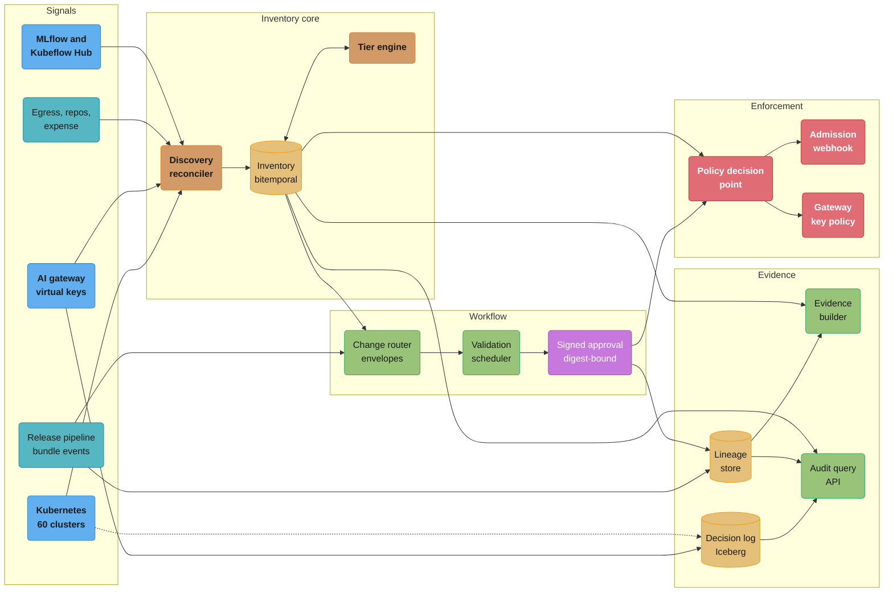
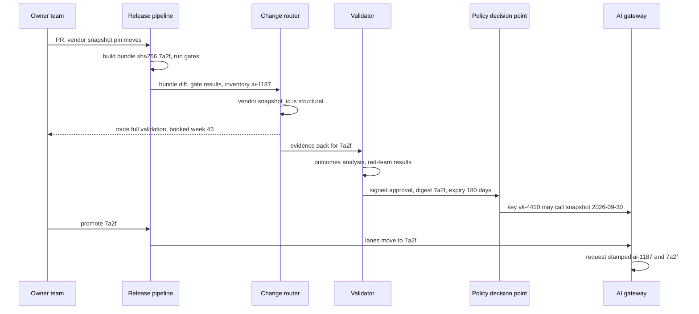
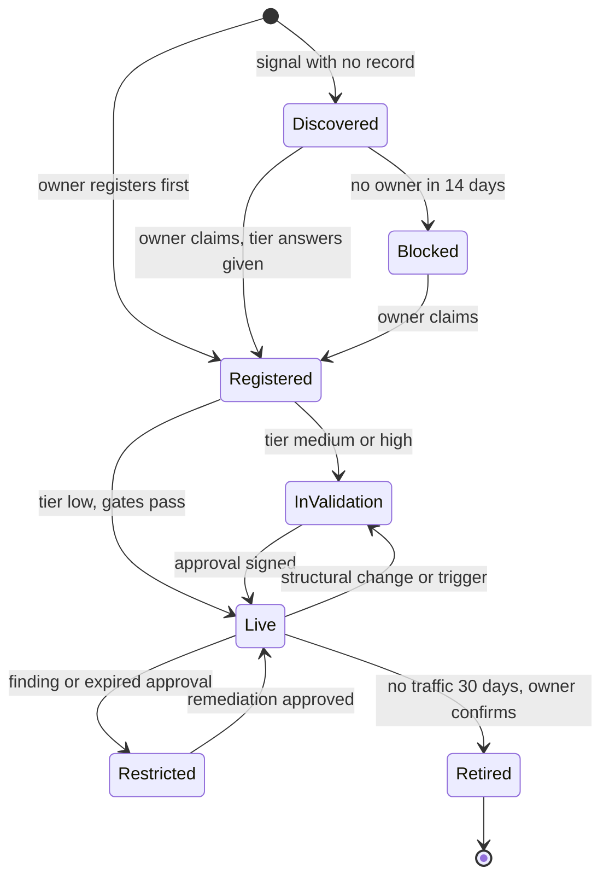
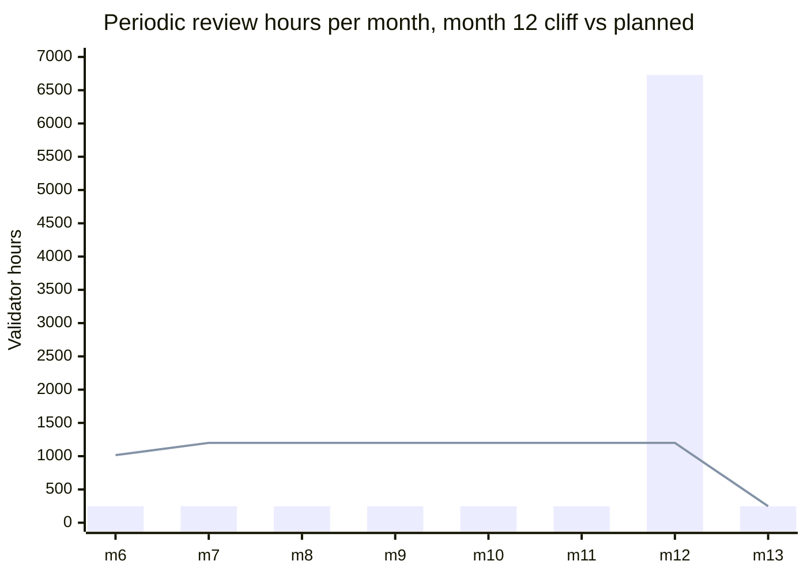
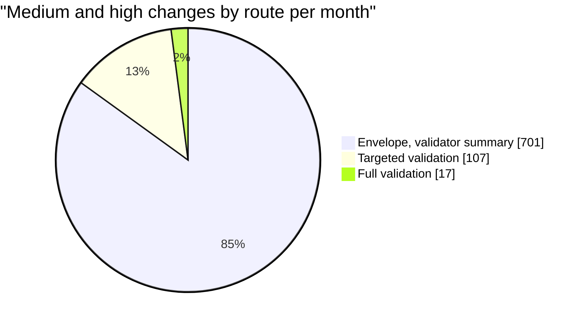

# Case Study: Design an AI Governance and Model Inventory Platform

> **Version anchor (2026-10-18).** **MLflow 3.17.1** (2026-10-13) is the registry for classic
> models and prompts; version tags carry `inventory_id` and the bundle digest. **Kubeflow Hub
> v0.3.17** (2026-09-21) holds the self-hosted model, MCP server and agent catalogs on Kubernetes.
> **Kubernetes 1.37** (1.37.1 2026-09-15) runs the admission layer. **model-transparency v1.1.1**
> (OpenSSF Model Signing, 2025-10-10) signs weights. **Langfuse v4.63.0** (2026-10-16) stores
> GenAI traces stamped with the bundle digest. Sigstore cosign, OPA, Kyverno, OpenLineage,
> PostgreSQL and Apache Iceberg are named without a version.
>
> **Guidance anchor (fetched 2026-10-18).** SR 26-2 "Revised Guidance on Model Risk Management"
> (issued 2026-04-17) supersedes SR 11-7 (2011-04-04) and SR 21-8, and states it is most relevant
> to banking organizations with over $30 billion in total assets
> ([federalreserve.gov SR 26-2](https://www.federalreserve.gov/supervisionreg/srletters/SR2602.htm)).
> Footnote 3 of its attached guidance puts generative and agentic AI models outside its scope.
> EU AI Act application dates live on
> [AI Regulations and Compliance](../../llm/ai_regulations_and_compliance/ai_regulations_and_compliance.md)
> and are not repeated here.

## Intuition

> **Design intuition**: a bank's model inventory is a ledger that three groups write and nobody
> trusts. Model owners type rows at launch, model risk management (MRM) types findings after
> validation, and internal audit samples production and finds what neither typed. This design
> turns the ledger into a system of record that the platform writes: discovery says what runs,
> the release pipeline says which bytes run, owners say why it runs, and validators say whether
> it may. Every audit question becomes a join on one key, the bundle digest, read as of the date
> the question is about.

**Key insight for this design**: the scarce resource in AI governance at a bank is validator
hours, not storage, compute or software. 60 validators give about 7,800 hours a month. Routing
every change to a medium- or high-tier system through a full validation asks for about 61,000.
The platform exists to spend those hours where risk changed: changes inside a validated envelope
ship on gates with a summary, changes outside it get a targeted validation, and only structural
changes (new base model, new provider snapshot, new tool scope, new purpose) get a full one. The
same routing brings demand down to about 6,500 hours.

The governance mechanics for one system (inventory record schema, tiering function, Rego
separation-of-duties rule, Kyverno admission policy, vendor controls) are taught in
[AI Governance and Model Risk Operations](../ai_governance_and_model_risk_operations/ai_governance_and_model_risk_operations.md).
The bundle and its lineage tables are in
[AI Release Bundle and Lineage](cross_cutting/ai_release_bundle_and_lineage.md). This page
designs the platform that runs those mechanics for 1,500 systems and 140 owning teams.

---

## 1. Requirements Clarification

### Context

A US bank holding company, regulated by the Federal Reserve and the OCC, with retail
subsidiaries in the EU and the UK. Its MRM inventory lists 1,200 statistical and ML models
(credit risk, fraud, AML, market risk, stress testing, pricing). In 2024 to 2026 business lines
added about 300 generative AI use cases (staff assistants, document extraction, customer-facing
drafting, agents with tools). Supervisors, the EU AI Act for the EU creditworthiness models, and
internal audit all ask the same questions: what runs, who owns it, how risky it is, who approved
which version, and what evidence backs the approval.

### Functional Requirements

- One inventory for every AI system: classic models, GenAI systems, agents, tool servers,
  vendor model APIs and AI features inside purchased software. One record per system, with
  components resolved to digests from the live release bundle.
- Nightly discovery (clusters, registries, gateway, egress, repos, expense) reconciled by key.
- A tier engine fed by versioned answers; it records SR 26-2 materiality and EU AI Act category.
- A change router that sends each bundle change to the cheapest sufficient review, and a
  scheduler that books validator hours against capacity.
- Approvals bound to a bundle digest, signed, with an expiry; enforced at admission for
  self-hosted servers and at the gateway for vendor APIs.
- Evidence packs generated per bundle and mapped once to SR 26-2 (and SR 11-7 for findings
  opened before April 2026), PRA SS1/23, NIST AI RMF, ISO/IEC 42001 and EU AI Act articles.
- An audit query API that answers "which bundle decided case X, at what tier, approved by whom,
  with what gate results" as of the decision time, over seven years.
- A vendor register (snapshot pins, retirement dates, concentration) and exceptions that close
  themselves on their end date.

### Non-Functional Requirements

| Requirement | Target | Why this number |
|---|---|---|
| Inventory coverage | 99% of discovered production endpoints matched to a record within 7 days | Internal audit samples production; an endpoint with no record is a finding |
| Unapproved high-tier serving | 0 bundles serving without a valid approval | The one control an examiner tests by sampling traces |
| Audit query latency | p95 under 2 s for one case, given the case id and decision date | Regulator and complaint requests arrive in batches of hundreds |
| Exam evidence pack | Any system, any past date, in under 1 hour | The legacy process took about 3 weeks per model |
| Admission decision | p99 under 50 ms, fail-closed only for high tier | Deploys and rollbacks must not wait on governance for low-tier systems |
| Validation wait | Median under 4 weeks for targeted, under 8 for full | Longer waits push teams to route around governance |
| Retention | 7 years after a system retires, write-once | Record-retention policy for credit decisions and model risk records |
| Discovery freshness | Every signal source reconciled nightly | Shadow AI found in days, not at the next annual attestation |

### Out of Scope

**Not here.** The law, its risk categories and dates:
[AI Regulations and Compliance](../../llm/ai_regulations_and_compliance/ai_regulations_and_compliance.md).
The ML platform that trains and serves models:
[Design an ML Platform](../../ml/case_studies/design_ml_platform.md). The release pipeline that
builds bundles and runs gates, whose events this platform consumes:
[Design an AI Release Pipeline](design_an_ai_release_pipeline.md). Fairness metrics and
explanation methods:
[Responsible AI, Fairness and Explainability](../../ml/case_studies/cross_cutting/responsible_ai_fairness_and_explainability.md).
Signing: [Supply Chain Security Pipeline](../../devops/case_studies/cross_cutting/supply_chain_security_pipeline.md)
and [ML Supply Chain Security](../ml_supply_chain_security/ml_supply_chain_security.md). Rego and
Kyverno mechanics:
[Policy as Code and Compliance](../../devops/policy_as_code_and_compliance/policy_as_code_and_compliance.md).
Prompt versioning:
[Prompt Lifecycle and Versioning](../prompt_lifecycle_and_versioning/prompt_lifecycle_and_versioning.md).

---

## 2. Scale Estimation

### Portfolio and tiers

```
Classic models:      credit 310, fraud and AML 180, market and treasury 160,
                     stress testing and capital 140, pricing and marketing 230, other 180
                                                                      = 1,200
GenAI use cases:     staff assistants 120, document extraction 70, customer drafting 45,
                     agents with tools 40, developer tooling 25        =   300
Systems in inventory:                                                    1,500

Tier split           high          medium         low
  classic            225           435            540
  GenAI               45           120            135
  total              270 (18%)     555 (37%)      675 (45%)

Components per system: classic about 4 (model, dataset, features, decision schema),
                       GenAI about 8 (model or vendor API, prompts, index, tools, guardrail,
                       eval set, decoding config, adapter)
Component records:     1,200 x 4 + 300 x 8 = 4,800 + 2,400 = 7,200
Owning teams: 140.  Validators (second line): 60.  Internal audit AI team (third line): 8.
```

### Change rate and naive validator demand

```
Classic: 3 changes a year each      1,200 x 0.25 = 300 a month
GenAI:   4 changes a month each       300 x 4    = 1,200 a month
Total                                               1,500 a month, about 70 per business day

Changes to medium or high systems:
  high:   225 x 0.25 + 45 x 4  =  56 + 180 = 236
  medium: 435 x 0.25 + 120 x 4 = 109 + 480 = 589
  total                                       825 a month
New systems: about 25 a month (mostly GenAI)

Naive routing, every medium/high change gets a full validation:
  high:   236 x 160 h = 37,760 h
  medium: 589 x  40 h = 23,560 h
  demand                61,320 h a month
Capacity: 60 validators x 130 productive h  =  7,800 h a month
Demand / capacity                            =  7.9x
```

A naive design does not slow down. It fails: the queue grows without bound, and teams start
shipping behind "experiment" flags. §4.3 routes changes; §10 shows the routed demand at about
6,500 hours.

### Data volumes

```
Decision log (one row per model decision, governance fields only):
  card fraud 35M/day, AML monitoring 8M/day, pricing and marketing 5M/day,
  credit decisions 2M/day, GenAI requests 4M/day                 = 54M rows/day
  row: case_id, decided_at, inventory_id, bundle_digest, outcome,
       override flag, channel                                     about 140 B raw
  raw:        54M x 140 B   = 7.6 GB/day
  Parquet:    about 5x      = 1.5 GB/day  = 550 GB/year  = 3.9 TB over 7 years

GenAI payloads kept for high tier only (45 systems, 20k requests/day each, 8 KB):
  45 x 20k x 8 KB = 7.2 GB/day raw, about 0.9 TB/year compressed

Bundles: 1,500 changes/month = 18,000 a year; lineage at 25 edges each
  = 450k edges/year, 3.2M over 7 years (PostgreSQL, about 1.5 GB with indexes)

Evidence objects: 18,000 packs x 2 MB = 36 GB/year
  + about 400 full validations x 500 MB = 200 GB/year
  = 236 GB/year, 1.65 TB over 7 years in object storage with object lock
```

### Discovery inputs

Each night: 60 Kubernetes clusters (about 2,100 model-serving workloads), 9,000 repositories
(about 3,000 model SDK call sites and MCP configs), 4,000 gateway virtual keys, and 2B egress log lines filtered to about 400 model API hosts, which
reduce to about 6,000 distinct source and destination pairs. Expense lines are tagged weekly.
That is about 15,000 observations to reconcile per night.

None of this is large. The inventory is thousands of rows; the decision log is the only data set
that needs a lake. The design work is in identity, time and routing, not throughput.

---

## 3. High-Level Architecture



Five groups. Signals feed a reconciler that binds what runs to inventory records by key. The
inventory is bitemporal: every row has the period it was true and the time it was recorded. The
release pipeline's bundle events enter the change router, which reads the system's tier and
envelope and books validator work. Approvals become signed records that the policy decision
point serves to two enforcement points: the Kubernetes admission webhook for self-hosted servers
and the gateway's key policy for vendor APIs. Evidence is assembled from lineage, inventory
versions and the decision log, and the audit API reads all three as of a date.

### Material change on a high-tier GenAI system



The gateway, not the release pipeline, holds the last check for vendor APIs: a virtual key is
bound to one inventory id and a list of approved model snapshot ids. A promotion that skips
validation fails at the first request, because the new snapshot is not on the key's list.

### Inventory record lifecycle



`Restricted` is the state supervisors care about: the system keeps serving under a compensating
control (lower autonomy, human review of every decision, traffic cap) while a finding is open.
`Blocked` exists only for discovered systems that nobody claims; the gateway revokes their keys
and egress rules drop their traffic after a 14-day notice.

---

## 4. Component Deep Dives

### 4.1 Inventory Service: Bitemporal Records

The inventory holds two kinds of fields. Identity fields (components, digests, endpoints) are
written by the release pipeline and the reconciler. Judgment fields (purpose, tier answers,
owner, accountable executive) are declared by owners and reviewed. Both change, and audits ask
about the past, so every change writes a new version row with two time ranges:

| Column | Meaning |
|---|---|
| `valid_from`, `valid_to` | When the fact was true for the system (business time) |
| `recorded_at` | When the platform learned it (system time) |
| `source` | `pipeline`, `reconciler`, `owner`, `validator` |

The tier of `ai-0731` (a credit line increase model) moved from medium to high on 2026-06-01,
when the business line extended it to automatic increases without a human. An auditor asks about
an application decided on 2026-03-14. The record schema itself is in the module's
[inventory record section](../ai_governance_and_model_risk_operations/ai_governance_and_model_risk_operations.md);
the question here is which version to join.

```python
import sqlite3

db = sqlite3.connect(":memory:")
db.executescript("""
CREATE TABLE inventory_version (
    inventory_id TEXT, tier TEXT, owner_team TEXT, purpose_hash TEXT,
    valid_from TEXT, valid_to TEXT,          -- when it was true for the system
    recorded_at TEXT                         -- when the platform learned it
);
CREATE TABLE decision_log (case_id TEXT, inventory_id TEXT, bundle_digest TEXT, decided_at TEXT);
CREATE TABLE approval (bundle_digest TEXT, approver TEXT, role TEXT, signed_at TEXT);

INSERT INTO inventory_version VALUES
  ('ai-0731', 'medium', 'cards-credit', 'p1', '2025-11-01', '2026-06-01', '2025-11-01'),
  ('ai-0731', 'high',   'cards-credit', 'p2', '2026-06-01', '9999-12-31', '2026-06-03');
INSERT INTO decision_log VALUES ('APP-118734', 'ai-0731', 'sha256:9c1e', '2026-03-14T10:22:00');
INSERT INTO approval VALUES ('sha256:9c1e', 'reviewer-12', 'model_reviewer', '2026-02-20');
""")

# BROKEN: joins the decision to the inventory row that is current today
BROKEN = """
SELECT d.case_id, v.tier, a.role
FROM decision_log d
JOIN inventory_version v ON v.inventory_id = d.inventory_id AND v.valid_to = '9999-12-31'
JOIN approval a ON a.bundle_digest = d.bundle_digest
WHERE d.case_id = ?
"""

# FIXED: joins to the row that was valid when the decision was made
FIXED = """
SELECT d.case_id, v.tier, a.role
FROM decision_log d
JOIN inventory_version v ON v.inventory_id = d.inventory_id
     AND d.decided_at >= v.valid_from AND d.decided_at < v.valid_to
JOIN approval a ON a.bundle_digest = d.bundle_digest
WHERE d.case_id = ?
"""

if __name__ == "__main__":
    broken = db.execute(BROKEN, ("APP-118734",)).fetchone()
    fixed = db.execute(FIXED, ("APP-118734",)).fetchone()
    assert broken == ("APP-118734", "high", "model_reviewer")   # reads as a high-tier SoD breach
    assert fixed == ("APP-118734", "medium", "model_reviewer")  # medium tier: a reviewer was enough
    print("ok")
```

The broken query reports a separation-of-duties breach that did not happen: in March a medium
tier needed a named reviewer, which the approval shows. The reverse error is worse. A system
whose tier was lowered after an incident looks compliant for decisions made while it was high.

`recorded_at` answers a second question: "what did the bank know on the date of the decision".
A tier raised on 2026-06-01 but recorded on 2026-06-03 means two days in which the platform
enforced the old tier. Exam reports ask for both views, so the audit API takes `as_of_valid` and
`as_of_recorded` and defaults both to the decision time.

PostgreSQL enforces no overlap with `EXCLUDE USING gist (inventory_id WITH =, tstzrange(valid_from,
valid_to) WITH &&)`, which needs the `btree_gist` extension; a change closes the open row first.

### 4.2 Discovery Reconciler: Identity by Key

Discovery produces about 15,000 observations a night. Each needs one of four outcomes: matched
to a record, orphan (running with no record), bad claim (says it belongs to a record that does
not exist), or stale record (a record with nothing running). The legacy approach matched names.

```python
from __future__ import annotations
from dataclasses import dataclass


@dataclass(frozen=True)
class Observation:
    source: str                        # k8s, gateway, egress, repo_scan
    key: str                           # stable id in that source
    name: str                          # whatever the source calls it
    inventory_id: str | None = None    # annotation or key metadata, if present


@dataclass(frozen=True)
class Record:
    inventory_id: str
    name: str
    keys: frozenset                    # source keys bound to this record by the pipeline


# BROKEN: fuzzy name matching
def reconcile_by_name(observed, records):
    names = {r.name.lower().replace("-", "_"): r.inventory_id for r in records}
    matched, orphans = {}, []
    for o in observed:
        rid = names.get(o.name.lower().replace("-", "_"))
        if rid:
            matched[o.key] = rid
        else:
            orphans.append(o.key)
    return matched, orphans


# FIXED: bind by key, then by annotation; names never decide
def reconcile(observed, records):
    by_key = {k: r.inventory_id for r in records for k in r.keys}
    known = {r.inventory_id for r in records}
    matched, orphans, bad_claims = {}, [], []
    for o in observed:
        if o.key in by_key:
            matched[o.key] = by_key[o.key]
        elif o.inventory_id in known:
            matched[o.key] = o.inventory_id    # annotation claim; owner confirms, key gets bound
        elif o.inventory_id:
            bad_claims.append(o.key)           # claims a record that does not exist
        else:
            orphans.append(o.key)
    stale = sorted(known - set(matched.values()))
    return matched, orphans, bad_claims, stale


if __name__ == "__main__":
    records = [
        Record("ai-0412", "card-fraud-scorer", frozenset({"k8s:prod-us1/fraud/fraud-scorer"})),
        Record("ai-0950", "claims-triage", frozenset({"gw:vk-7781"})),
        Record("ai-1102", "kyc-doc-extract", frozenset()),
    ]
    observed = [
        Observation("k8s", "k8s:prod-us1/fraud/fraud-scorer", "fraud-scorer"),
        Observation("k8s", "k8s:prod-eu1/fraud/card-fraud-scorer", "card-fraud-scorer"),
        Observation("gateway", "gw:vk-7781", "claims-triage-v2"),
        Observation("gateway", "gw:vk-9120", "claims_triage"),
        Observation("k8s", "k8s:prod-us2/ops/kyc-extract", "kyc-extract", "ai-1102"),
    ]

    m, o = reconcile_by_name(observed, records)
    assert m["gw:vk-9120"] == "ai-0950"                            # another team's use counted as governed
    assert "gw:vk-7781" in o                                       # the real one reported as shadow AI
    assert m["k8s:prod-eu1/fraud/card-fraud-scorer"] == "ai-0412"  # unapproved EU copy looks governed

    m, o, bad, stale = reconcile(observed, records)
    assert m["gw:vk-7781"] == "ai-0950" and m["k8s:prod-us2/ops/kyc-extract"] == "ai-1102"
    assert set(o) == {"k8s:prod-eu1/fraud/card-fraud-scorer", "gw:vk-9120"}
    assert bad == [] and stale == []
    print("ok")
```

Name matching fails in both directions at once. The EU copy of the fraud scorer, deployed by a
regional team with a different version, matches the US record by name and is counted as governed.
A second team that called its own use `claims_triage` inherits a record it does not own. And the
real claims-triage key, renamed `claims-triage-v2` in the gateway UI, shows up as shadow AI. Every
one of these errors moves the coverage number in the wrong direction while it looks better.

The fix depends on the release pipeline writing keys. When a bundle is promoted, the pipeline
binds the Kubernetes object path, the gateway virtual key and the registry version to the
inventory id. Annotation claims (`governance.example.com/inventory-id` on a workload) are
accepted provisionally: the owner of the claimed record gets a ticket to confirm, and the key is
bound only on confirmation, so a team cannot attach its workload to someone else's approval.

Key sources and their join key:

| Source | Stable key | Bound by |
|---|---|---|
| Kubernetes | `cluster/namespace/name` plus the bundle annotation | Release pipeline on promotion |
| AI gateway | Virtual key id | Key issuance, which requires an inventory id |
| MLflow, Kubeflow Hub | Registered model name plus version | Version tag `inventory_id` |
| Egress | Source workload identity plus destination host | Reconciler, after owner confirmation |
| Repository scan | Repository plus path of the SDK call or MCP config | Owner team from the code owners file |
| Expense | Cost center plus vendor | Finance owner of the cost center |

Egress and expense are weak signals: they open tickets and never bind a key alone.

### 4.3 Change Router and Validated Envelopes

The router turns 825 medium- and high-tier changes a month into work a 60-person team can do.
Its input is the bundle diff from the release pipeline (see the diff rules in
[AI Release Bundle and Lineage](cross_cutting/ai_release_bundle_and_lineage.md)), the gate
results per slice, and the system's envelope.

An envelope is set by the validator at the last full validation and versioned with that
validation. It names the bundle fields that may change without a validator, the most any
protected slice may lose, and the band a threshold may move in. It expires with the approval.

```python
from __future__ import annotations

# Fields whose change always leaves any envelope.
STRUCTURAL = {"model.base_digest", "vendor.snapshot_id", "tools.write_scopes",
              "inventory.purpose", "decision_schema.labels", "features.set"}

ENVELOPE = {   # set by the validator at the last full validation, versioned with it
    "ai-0731": {
        "fields": {"prompt.version", "model.weights_digest", "decision_schema.thresholds"},
        "max_slice_drop": 0.01,          # no protected slice may lose more than 1 point
        "threshold_band": (0.62, 0.70),
        "expires": "2027-06-01",
    },
}


def route(inventory_id, tier, changed, slice_deltas, thresholds, today):
    """Return (route, reasons). slice_deltas are measured against the bundle of the
    last full validation, not against the previous release."""
    reasons = sorted(changed & STRUCTURAL)
    if tier == "low":
        return ("reviewer", reasons) if reasons else ("gates_only", [])
    if reasons:
        return "full", reasons
    env = ENVELOPE.get(inventory_id)
    if env is None or today >= env["expires"]:
        return "targeted", ["no live envelope"]
    reasons = sorted(changed - env["fields"])
    worst = min(slice_deltas.values(), default=0.0)
    if worst < -env["max_slice_drop"]:
        reasons.append(f"slice drop {worst:+.3f}")
    lo, hi = env["threshold_band"]
    reasons += [f"threshold {t} outside band" for t in thresholds if not lo <= t <= hi]
    if reasons:
        return "targeted", reasons
    return "validator_summary", []


if __name__ == "__main__":
    d = "2026-10-18"
    assert route("ai-0731", "high", {"prompt.version"}, {"age_65_plus": -0.004}, [], d) == ("validator_summary", [])
    assert route("ai-0731", "high", {"prompt.version"}, {"age_65_plus": -0.021}, [], d)[0] == "targeted"
    assert route("ai-0731", "high", {"decision_schema.thresholds"}, {}, [0.74], d)[1] == ["threshold 0.74 outside band"]
    assert route("ai-0731", "high", {"vendor.snapshot_id"}, {}, [], d) == ("full", ["vendor.snapshot_id"])
    assert route("ai-0731", "high", {"prompt.version"}, {}, [], "2027-06-02") == ("targeted", ["no live envelope"])
    assert route("ai-0731", "medium", {"prompt.version"}, {}, [], d) == ("validator_summary", [])
    assert route("ai-2001", "low", {"prompt.version"}, {}, [], d) == ("gates_only", [])
    assert route("ai-2001", "low", {"model.base_digest"}, {}, [], d) == ("reviewer", ["model.base_digest"])
    print("ok")
```

The docstring line is the lesson from §9's envelope story. If slice deltas are measured against
the previous release, fourteen changes of 0.5 points each pass one at a time and move the slice
7 points. Measuring against the last validated bundle makes the envelope a fixed fence instead of
a moving one.

| Route | Who acts | Validator hours | Ships |
|---|---|---|---|
| `gates_only` | Nobody; gates decide | 0 | On gate pass |
| `reviewer` | Named first-line reviewer, not the author (structural change on a low-tier system) | 0 | On review |
| `validator_summary` | Validator reads a weekly digest of envelope changes (medium and high), can veto in 5 days | 0.5 per change | On gate pass; veto rolls back |
| `targeted` | Validator checks only what left the envelope | 12 (medium), 40 (high) | On approval |
| `full` | Full validation: conceptual soundness, outcomes analysis, monitoring plan | 40 (medium), 160 (high) | On approval |

Prompt-only GenAI changes are most `validator_summary` traffic; their gates are in
[Evaluation Gates and Eval Sets](../evaluation_gates_and_eval_sets/evaluation_gates_and_eval_sets.md).
For agents, a read-only tool keeps the envelope and a write-scoped one does not; validators read
red-team results per attack category from the
[Red Team Eval Harness](../../llm/case_studies/cross_cutting/red_team_eval_harness.md).

### 4.4 Validation Scheduler: Hours as the Budget

The scheduler holds two lanes. The change lane takes routed work in order of tier and wait time.
The periodic lane holds annual reviews for high tier and two-yearly reviews for medium. Each lane
has an hours cap per month; the change lane can borrow the periodic lane's unused hours but not
the reverse.

The trap is the calendar. When the bank loaded its legacy inventory, the migration recorded a
"last validated" date of January 2026 for every high-tier model whose real date was missing. All
270 annual reviews fell due in the same month.

```python
from __future__ import annotations
from collections import Counter

HOURS = {"high": 24, "medium": 8}          # periodic review effort per system


def plan(due, start, cap_hours):
    """due: list of (system_id, tier, due_month). Latest due date first, each review goes in
    the latest month on or before its due month with capacity, never before `start`."""
    load = Counter()
    placed, overflow = {}, []
    for sid, tier, month in sorted(due, key=lambda x: (-x[2], x[1] != "high")):
        h = HOURS[tier]
        m = month
        while m >= start and load[m] + h > cap_hours:
            m -= 1
        if m < start:
            overflow.append(sid)
            continue
        load[m] += h
        placed[sid] = m
    return placed, overflow, load


if __name__ == "__main__":
    # 270 high-tier systems with one recorded validation month, so all fall due in month 12.
    due = [(f"h{i}", "high", 12) for i in range(270)]
    due += [(f"m{i}", "medium", 6 + i % 18) for i in range(555)]

    naive = Counter()
    for _, tier, m in due:
        naive[m] += HOURS[tier]
    assert naive[12] == 270 * 24 + 31 * 8 == 6728

    placed, overflow, load = plan(due, start=1, cap_hours=1200)
    assert overflow == []
    assert max(load.values()) <= 1200
    assert all(placed[s] <= m for s, _, m in due)    # nothing moves past its due date
    print(sorted(load.items())[:13])
```

Unplanned, month 12 asks for 6,728 periodic hours, 86% of all validator time, while change work
keeps arriving. The plan fills months 7 to 12 to the 1,200-hour cap, puts the remaining 1,016
hours in month 6, and never pushes a review past its due date, because an overdue review is a
finding. The next cycle inherits the spread and stays flat.



Bars are the due-date load; the line is the planned load under the 1,200-hour cap.

### 4.5 Approvals and Enforcement Points

An approval is an in-toto attestation on the bundle digest, signed with Sigstore cosign under a
custom predicate type and stored as an OCI referrer of the bundle (mechanism in the
[Supply Chain Security Pipeline](../../devops/case_studies/cross_cutting/supply_chain_security_pipeline.md)).
model-transparency v1.1.1 signs the weights; its predicate is a fixed file manifest with no room
for approval fields. The approval predicate carries the inventory id, tier at signing, route,
approver identity and role, expiry, and the envelope version. The policy decision point (PDP) is OPA with the rules from the
module's separation-of-duties section, loaded with a bundle of current approvals and inventory
rows refreshed every 30 seconds.

Two enforcement points read it:

| Point | Protects | Check | Latency | On PDP outage |
|---|---|---|---|---|
| Kubernetes admission webhook | Self-hosted `InferenceService` and Deployments in governed namespaces | Approval for the annotated digest, approver not author or deployer, not expired | p99 18 ms (local OPA sidecar) | High tier fails closed; others admit and raise an alert |
| AI gateway key policy | Vendor model APIs and internal model endpoints | Virtual key's inventory id has an approved bundle whose snapshot id matches the request | In-memory map, under 1 ms | Gateway keeps the last policy for 24 h |

The per-tier failure policy is two `ValidatingWebhookConfiguration` objects. Both select
`InferenceService` and `Deployment` objects in governed namespaces; one adds an `objectSelector`
on `governance.example.com/risk-tier: high` with `failurePolicy: Fail`, the other matches every
other tier with `failurePolicy: Ignore`. Both exclude the policy engine's namespace, so a policy
outage cannot block the restart that fixes it (§9).

Vendor APIs have no admission step, so a config edit to a newer snapshot gets a 403 at the
gateway. The same key map gives concentration per provider snapshot. Fingerprint suites and
contract terms are in [AI Gateway Operations](../ai_gateway_operations/ai_gateway_operations.md).

### 4.6 Evidence Builder and the Control Map

Evidence is generated per bundle at promotion, not assembled at exam time. The builder writes a
content-addressed pack: system card, model card per model component, gate results by slice,
data lineage extract, approval attestation, envelope, monitoring plan, open findings. Each pack
is stored with S3 object lock in compliance mode for the retention period.

The control map is a table, versioned by framework version:

| control_id | framework | version | clause | evidence_type | tiers | jurisdiction |
|---|---|---|---|---|---|---|
| `mrm.validation.before_use` | SR 26-2 | 2026-04-17 | validation before first use | `approval`, `outcomes_report` | medium, high | US |
| `mrm.validation.before_use` | SR 11-7 | 2011-04-04 | validation before use | `approval`, `outcomes_report` | medium, high | US |
| `mrm.inventory.aggregate` | SR 26-2 | 2026-04-17 | individual and aggregate risk | `inventory_extract`, `concentration_report` | low, medium, high | US |
| `ai.oversight.design` | EU AI Act | per law page | Art. 14 | `oversight_design`, `override_rate` | high | EU |
| `ai.logs` | EU AI Act | per law page | Art. 12 | `decision_log_extract` | high | EU |
| `ai.measure.slices` | NIST AI RMF | 1.0 | MEASURE | `gate_results` | low, medium, high | any |

SR 11-7 stays in the map because exam findings opened before April 2026 cite it; a finding closes
against the version it was raised under. Gaps are a query, run nightly per live bundle:

```sql
-- Live bundles missing evidence their tier and jurisdiction require.
SELECT b.inventory_id, b.digest, c.framework, c.version, c.control_id, c.evidence_type
FROM live_bundle b
JOIN inventory_current i ON i.inventory_id = b.inventory_id
JOIN control_map c ON i.tier = ANY (c.tiers)
                  AND (c.jurisdiction IS NULL OR c.jurisdiction = ANY (i.jurisdictions))
                  AND c.retired_at IS NULL
LEFT JOIN evidence e ON e.bundle_digest = b.digest AND e.evidence_type = c.evidence_type
WHERE e.bundle_digest IS NULL
ORDER BY array_position(ARRAY['high', 'medium', 'low'], i.tier), b.inventory_id;
```

An exam pack for a system on a past date is then: resolve the bundle that was live on that date
from the inventory versions, fetch its evidence objects, and render the control map rows for the
frameworks the exam names. That takes minutes. The legacy process (find the owner, find the
documents, reconstruct which version ran) took about three weeks per model.

Fairness and explanation evidence for credit models (adverse-action reasons, disparate impact by
slice) is produced by the pipeline in
[Responsible AI, Fairness and Explainability](../../ml/case_studies/cross_cutting/responsible_ai_fairness_and_explainability.md);
the builder files it, it does not compute it.

### 4.7 Decision Log and the Audit Query API

Every serving path writes one governance row per decision to Kafka, landed in an Iceberg table
partitioned by day and inventory id, with a Parquet bloom filter on `case_id`. GenAI spans carry
the same fields as attributes (see
[OpenTelemetry for LLM Apps](../../llm/case_studies/cross_cutting/opentelemetry_for_llm_apps.md)),
and a collector pipeline copies the governance fields into the same table.

A case lookup with a decision date prunes to one day's partition of one system: about 6,000 to
90,000 rows for most systems, 35M for card fraud. The bloom filter skips most files, and the
result joins to inventory versions, approvals and gate results in PostgreSQL. The planned p95 is
about 1.3 s against the 2 s target. A lookup without a date would scan up to seven years, so the
API refuses it; callers supply the date from the case system.

The API returns one document per case: decision time, inventory id, bundle digest, tier as of
the decision, approver and role, gate results by slice, evidence pack digest, and the findings
that were open at the decision time.

---

## 5. Design Decisions & Tradeoffs

### Inventory unit: system or model

One record per model artifact matches the legacy MRM inventory, but a GenAI system has no single
model and a prompt change has nowhere to attach. Chosen: one record per system, with model
components as child records that can belong to several systems. A shared PD model used by three
credit products is validated once as a component and tiered by its highest-tier consumer.

### History model

| Option | For | Against |
|---|---|---|
| Current-state table plus audit log | Simple writes | Every as-of question replays the log; joins to decisions are hand-built |
| Event sourcing | Full history, replayable | Every reader rebuilds state; ad hoc audit SQL is hard |
| Bitemporal version rows | As-of joins are plain SQL; both "true then" and "known then" | Two ranges per row; writers must close and open in one transaction |

Chosen: bitemporal rows. Auditors write SQL, and the as-of join in §4.1 is the query they need.

### Governance platform: build, buy or hybrid

| Option | For | Against |
|---|---|---|
| Buy a governance product (ValidMind, Credo AI, IBM watsonx.governance) | Questionnaires, workflow, reports, policy packs on day one | Sees only what is fed to it; identity binding, admission and decision logs are still custom |
| Build all of it | Evidence comes from production by construction | Workflow UI, questionnaire engine and reporting to build and staff |
| Hybrid | Product for workflow and validator UI, platform for inventory identity, routing, enforcement and evidence | Two stores unless the product reads inventory from the platform |

Chosen: hybrid, with the platform as the system of record. The product reads inventory and
evidence by API and writes back validation outcomes and findings. If the product cannot take an
external system of record, it is the wrong product for this design. The general version of this
choice is in
[ML Platform Architecture and Build vs Buy](../ml_platform_architecture_and_build_vs_buy/ml_platform_architecture_and_build_vs_buy.md).

### Enforcement failure mode and decision log content

Enforcement fails per tier (§4.5), with rollbacks to a previously approved digest admitted from
a local cache, so the safe path never depends on the PDP. For the decision log, governance fields for every decision (3.9 TB over 7 years) plus full
payloads only for high-tier GenAI, where a complaint or exam replay is likely. Full payloads
everywhere would be about 8x the storage and a second 7-year copy of personal data. Payload
retention follows
[Privacy and Data Governance](../../llm/llm_security/privacy_and_data_governance.md); the log
keeps a payload hash so a retained payload can be proven unaltered.

---

## 6. Real-World Implementations

**Google: Model Cards (2019).** Mitchell and co-authors at Google published "Model Cards for
Model Reporting" at FAT* 2019: a short document per trained model with intended use, factors,
metrics, evaluation data and results disaggregated across groups. This platform's model card is
that structure, generated per bundle, with the disaggregated results filled from the gate's slice
results instead of written by hand.

**Microsoft: Responsible AI Standard v2 (June 2022).** Microsoft published the second version of
its Responsible AI Standard on June 21, 2022, with an impact assessment template and guide, and
described a Sensitive Uses review process required by the Standard for high-impact uses. The
pattern this design takes from it is the split between a light default path and a named review
for sensitive uses, which is the tier-based route table in §4.3.

**Meta: 22 system cards (June 2023).** On June 29, 2023, Meta released 22 system cards
explaining how AI ranks content in Facebook and Instagram surfaces. The unit is the system, not
the model, which is the inventory unit chosen in §5: a feed is many models plus rules, and the
card describes what the user experiences.

**Knight Capital (August 2012).** In the first 45 minutes after the market opened on August 1,
2012, Knight's order router sent more than 4 million orders into the market. The SEC found that
Knight deployed new code incorrectly to a router that still held an old function never meant to be
used, and that it lacked adequate controls for code deployment and testing. The firm lost more
than $460 million and agreed to a $12 million penalty on October 16, 2013. It is
a deployment-control failure, not a model failure, and it is why this design checks the bytes
that run at admission instead of trusting the release record.

**Citibank (October 2020).** On October 7, 2020, the OCC assessed a $400 million civil money
penalty against Citibank, N.A., citing deficiencies in enterprise-wide risk management,
compliance risk management, data governance and internal controls. For an AI inventory the
lesson is that supervisors treat data governance as a risk-management control in its own right:
lineage from a decision back to its data snapshot is evidence, not engineering hygiene.

---

## 7. Technologies & Tools

| Role | Tool | Version | Used for |
|---|---|---|---|
| Model and prompt registry | MLflow | 3.17.1 (2026-10-13) | Registered model versions, prompt versions, version tags with `inventory_id` |
| Kubernetes catalogs | Kubeflow Hub | v0.3.17 (2026-09-21) | Self-hosted model, MCP server and agent catalogs |
| Admission | Kubernetes, Kyverno | 1.37; Kyverno named without a version | Two `ValidatingWebhookConfiguration` objects by tier; Kyverno for the module's metadata policies |
| Policy decision point | OPA | Named without a version | Separation-of-duties and expiry rules, sidecar per webhook |
| Weight signing | model-transparency | v1.1.1 (2025-10-10) | OpenSSF Model Signing of weights and adapters |
| Approval signing | Sigstore cosign | Named without a version | In-toto approval attestations on the bundle digest |
| GenAI traces | Langfuse | v4.63.0 (2026-10-16) | Spans with `bundle_digest` and `inventory_id` |
| Lineage events | OpenLineage | Named without a version | Dataset and job edges into the lineage store |
| Inventory, lineage, approvals | PostgreSQL | Named without a version | Bitemporal versions, exclusion constraints |
| Decision log | Apache Iceberg on object storage | Named without a version | Day and inventory partitions, bloom filter on `case_id` |
| Workflow and validator UI | Governance product (ValidMind, Credo AI or IBM watsonx.governance) | Named without a version | Questionnaires, validation workpapers, findings |

Registry choices and their tradeoffs are in
[Model Registry and Packaging](../model_registry_and_packaging/model_registry_and_packaging.md);
bundle lineage tables are in
[Artifact Versioning and Lineage](../artifact_versioning_and_lineage/artifact_versioning_and_lineage.md).

---

## 8. Operational Playbook

### Dashboards

| Panel | Query shape | Alert |
|---|---|---|
| Inventory coverage | Matched observations over all production observations, per source | Under 99% for 7 days |
| Orphans by age | Observations with no record, grouped by owner team guess | Any over 14 days |
| Approvals expiring | Live bundles with approval expiry in 30 days | Any high tier inside 14 days |
| Validator load | Booked hours vs capacity, per lane, next 12 weeks | Change lane over 90% for 3 weeks |
| Validation wait | Median and p90 wait by route | Targeted median over 4 weeks |
| Evidence gaps | Rows from the §4.6 query | Any for high tier |
| Vendor concentration | High-tier systems per provider snapshot | Over 25% on one snapshot |

### Runbook: production endpoint with no record

1. To find the owner, read the observation's workload identity and the code owners of the
   repository that built its image.
2. Open a ticket to the owner team with the 14-day notice and the three outcomes: register,
   move onto the sanctioned path, or shut down.
3. If the endpoint makes or shapes decisions about customers, raise it to the business line's
   accountable executive on day 1, not day 14.
4. On registration, check that the tier answers match the observed traffic (for example, an
   "internal only" assistant with calls from the customer channel).
5. After 14 days with no owner, revoke gateway keys and request egress blocking; record the
   action in the inventory as `Blocked`.

### Runbook: regulator exam request

1. To build the population, query inventory versions valid in the exam period for the named
   business line and tiers.
2. For each sampled system, generate the evidence pack for the bundles live in the period.
3. For each sampled case, call the audit query API with the case id and decision date.
4. Check open findings at each decision date; disclose them in the response rather than leaving
   the examiner to find them.
5. Record the request, the packs and the responses as one evidence object with its own retention.

### Drills

- **Monthly PDP outage drill:** stop the OPA sidecars in one cluster. High-tier creates must be
  denied, low-tier creates admitted with an alert, rollbacks to approved digests admitted.
- **Quarterly exam and shadow AI drills:** audit times the API on 20 random cases (over 1 hour
  is a defect); a red team deploys an unregistered endpoint, which must be an orphan in 24 hours.

Incident handling when a governed system causes harm is in
[AI Incident Response and Reliability](../ai_incident_response_and_reliability/ai_incident_response_and_reliability.md).

---

## 9. Common Pitfalls & War Stories

**Migration counted the same model three times.** The legacy GRC tool listed 1,640 model rows.
Matching by registry version and deploy key reduced them to 1,200 live models and 40 retired
ones; 400 rows were duplicates created when a model was copied for a new product, renamed, or
re-entered after an owner change. Discovery then found 300 GenAI uses, of which 212 were in no
list. The inventory number reported to the board went from 1,640 to 1,500, down by 140, while
real coverage went up. Fix: identity by key from day one, and report coverage, not count.

**Annual reviews due in one month.** The migration filled 270 missing "last validated" dates
with the migration month. Twelve months later, 6,728 periodic hours fell due in one month against
7,800 hours of total capacity. The plan in §4.4 spread them over seven months with no review
overdue. Without it, month 12 had about 2,000 hours left after change work, enough for about 70
of the 270 high-tier reviews; about 200 would have gone overdue, each an exam finding.

**Fail-closed webhook blocked a fraud rollback.** The first admission webhook used
`failurePolicy: Fail` for every `InferenceService` in every namespace. During a node upgrade the
OPA pods were evicted and not rescheduled for 3 hours 10 minutes. 46 deploys were rejected,
including the rollback of a fraud model whose false-positive rate had doubled, which cost about
$310,000 in declined good transactions before a manual override. Fix: per-tier webhook
configurations, the policy namespace excluded, a PodDisruptionBudget for the PDP, and rollbacks
to approved digests admitted from a local cache.

**False separation-of-duties findings from current-state joins.** Internal audit's first sample
reported 37 "approvals by the wrong role". All 37 were systems whose tier was raised after the
decision; the audit query joined to today's tier. Clearing them took three weeks of validator
and auditor time. Fix: the bitemporal join in §4.1, and an audit API that refuses queries
without a decision date.

**Envelope that moved with each release.** A credit line model's envelope allowed a 1-point
slice drop per change, measured against the previous release. Over five months, 14 threshold
and retrain changes each passed, and the approval rate for thin-file applicants fell 6 points
against the last validated bundle. An outcomes analysis found it, not the gates. Fix: deltas
measured against the last fully validated bundle (§4.3), and a cumulative drift line on the
system card.

**Provider snapshot retirement.** A provider gave 60 days' notice on a snapshot that 41 systems
used, 9 of them high tier and 32 medium. A snapshot change is structural, so the scheduler needed
9 x 160 + 32 x 40 = 2,720 hours of full validation inside 30 days on top of booked work. Two
high-tier systems moved to a qualified fallback model for six weeks.
Fix: vendor concentration on the dashboard with a 25% alert, and a qualified fallback required
for every high-tier system that calls a vendor API.

**Shadow GenAI on personal subscriptions.** The expense scan found 23 teams paying for AI
products on corporate cards, 4 of them pasting customer complaint text into a consumer chatbot.
Blocking without a sanctioned path had failed once before; this time each team got gateway
access with logging and a tier, and 19 of the 23 moved within a month.

---

## 10. Capacity Planning

### Validator hours with routing

```
Change work (825 medium/high changes a month)
  high   236: envelope 200 x 0.5 =   100   targeted 31 x 40 = 1,240   full  5 x 160 =   800
  medium 589: envelope 501 x 0.5 =   251   targeted 76 x 12 =   912   full 12 x  40 =   480
New systems (25 a month):  high 6 x 160 = 960,  medium 10 x 40 = 400,  low 9 x 0 = 0
Periodic reviews:          high 270 / 12 x 24 = 540,  medium 555 / 24 x 8 = 185
Monitoring triggers:       30 x 8 = 240
Vendor requalification:    20 x 6 = 120
Exam and audit support:    300
                                                                    total  6,528 h a month
Capacity: 60 x 130 = 7,800 h          utilization 84%
```

84% is the ceiling for work items this large: a 160-hour validation holds one validator for over
a month. Two levers before hiring: widen envelopes for clean systems (each 1% of changes moved
from targeted to envelope saves about 160 hours), and make medium-tier periodic reviews
evidence-only after 24 clean months of monitoring.



### Storage and cost

```
Decision log         3.9 TB over 7 years   at $0.023/GB-month planning rate   ~ $90/month at 7 years
High-tier payloads   0.9 TB/year -> 6.3 TB at 7 years                          ~ $145/month
Evidence objects     1.65 TB at 7 years with object lock                        ~ $38/month
PostgreSQL           inventory, lineage, approvals: under 20 GB; 3-node HA cluster
Iceberg query        audit API: about 2,000 lookups a month at 1-2 s each
```

Storage prices here are planning inputs, not quotes. The cost of the platform is people: 60
validators and about 12 platform engineers. The infrastructure is under 1% of that.

### Request paths

Admission sees about 1,500 promotions and 3,000 config updates a month, about 150 webhook calls
a day at p99 18 ms. The gateway check runs 625 decisions a second on average and about 2,000 at
peak against an in-memory map. The reconciler clears 15,000 observations in under 10 minutes on
one worker, and the evidence builder writes 70 packs a business day at about 40 s each.

### What changes at 2x

| Driver | At 2x | Change needed |
|---|---|---|
| GenAI use cases 300 to 600 | Changes to medium/high go from 825 to about 1,480 a month | Most added changes stay inside envelopes; full validations for new systems add about 1,400 h, about 11 validators |
| Decision volume 54M to 108M a day | Decision log 7.8 TB over 7 years | No design change |
| Agents with write tools 40 to 120 | Structural changes triple for that group | Separate agent validation track with red-team specialists |
| A second regulator jurisdiction | New control map rows | Rows only; evidence types mostly reused |

---

## 11. Interview Discussion Points

**Q: Where does the inventory get its list of AI systems?**
**Short:** From discovery joined by stable keys: deploy objects, registry versions, gateway keys, egress, repos and expense, with owners confirming purpose and tier.

A list that teams fill in measures how many teams fill in lists. The platform builds the list
from what runs, binds each observation to a record by a key the release pipeline wrote, and
asks owners only for the judgment fields. Weak signals (egress, expense) open tickets but never
bind a key on their own. The coverage metric, matched production observations over all
observations, is what internal audit tests.

**Q: Why is name matching wrong for reconciliation if it finds most systems?**
**Short:** It errs in both directions at once: copies and other teams' uses look governed, and renamed real systems look like shadow AI.

In §4.2 the EU copy of the fraud scorer and a second team's `claims_triage` both match by name,
and the renamed real key does not. Coverage looks better while it is worse. Binding by
Kubernetes path, virtual key and registry version, with annotation claims confirmed by the
claimed record's owner, removes all three errors.

**Q: Validators are the bottleneck. How do you scale governance without hiring 400 people?**
**Short:** Route by change, not by system: envelope changes ship on gates with a summary, only changes outside the envelope get validator time.

Naive routing asks for about 61,000 hours a month against 7,800. A validated envelope (fields
that may change, maximum slice drop, threshold band, expiry) lets 85% of changes ship on gates
with a weekly summary and a veto window. Targeted validations check only what left the envelope;
full ones are kept for structural changes. Demand drops to about 6,500 hours.

**Q: What makes a change structural?**
**Short:** Anything that changes what the system is: base model or vendor snapshot, write-scoped tools, purpose, decision labels or feature set.

These change the conceptual basis the validator approved, so no envelope can cover them. A
prompt edit or a retrain on the same features changes behavior within a known shape and can be
bounded by gates. A new tool that can move money changes the harm a failure can cause. The list
is versioned policy, and the router's tests pin it.

**Q: An auditor asks who approved the model that decided an application in March. What can go wrong?**
**Short:** Answering from today's inventory: the tier, owner and envelope may have changed since, so the answer shows breaches that did not happen or hides ones that did.

The query must join to the inventory version valid at the decision time, the approval for the
bundle digest stamped on the decision, and the gate results for that digest. Bitemporal rows
also give "what did we know then", which matters when a tier change was recorded days after it
took effect. The API refuses queries without a decision date.

**Q: Why measure envelope deltas against the last validated bundle instead of the previous release?**
**Short:** Per-release deltas let small changes add up unseen; a fixed baseline turns the envelope into a fence instead of a ratchet.

Fourteen changes of half a point each pass a 1-point per-change limit and move a protected
slice by 7 points. Measuring every change against the bundle the validator last approved stops
the third change, when cumulative drift passes 1 point, and puts cumulative drift on the system card.

**Q: Should the admission webhook fail open or closed?**
**Short:** Closed for high tier, open with an alert for the rest, and rollbacks to approved digests always admitted from a local cache.

Fail closed everywhere turns a policy outage into a deploy outage, including the rollback that
fixes a bad model. Fail open everywhere leaves a gap an examiner will find. Two webhook
configurations selected by the tier label give each tier its own failure mode, and excluding the
policy namespace keeps the outage from blocking its own repair.

**Q: How do you govern a vendor model API that has no deploy step?**
**Short:** At the gateway: each virtual key is bound to an inventory id and a list of approved snapshot ids, and calls to anything else fail.

The approval is still digest-bound: the bundle pins the snapshot id. The gateway refuses a
snapshot not on the key's list, so a config edit cannot move a system to a new provider model
without validation. The same key map yields concentration per provider snapshot, which is the
aggregate risk SR 26-2 asks about.

**Q: SR 26-2 says generative AI is out of its scope. Why put the 300 GenAI use cases in the same inventory?**
**Short:** Out of the guidance's scope is not out of the bank's risk; one inventory and one tiering rule cover all AI, and the validation shape differs by population.

A GenAI assistant that drafts customer letters sits in a complaint or credit path, and an exam
on that path will ask how it was tested. Splitting inventories splits discovery, admission and
evidence. Keeping one inventory means the tier drives the route, and the validator checks eval
slices, red-team results and oversight design instead of conceptual soundness of a scorecard.

**Q: What do you buy and what do you build?**
**Short:** Buy workflow and validator tooling; build identity binding, routing, enforcement and evidence, because they need production data.

A governance product sees what it is fed. Inventory identity from deploys, digest-bound approvals
checked at admission and the gateway, and decision logs keyed to bundles all live in the
platform. The product must accept the platform as the system of record and read from it, or two
inventories drift apart within a quarter.

**Q: How do you keep exam evidence from becoming a three-week project?**
**Short:** Generate it at promotion, map it once per framework version, and resolve any past date to the bundle that was live.

The evidence builder writes a pack per bundle with object lock. The control map is rows per
framework version, so SR 11-7 findings opened before April 2026 close against SR 11-7 text and
new ones against SR 26-2. A pack for a past date is a lookup, not a reconstruction.
