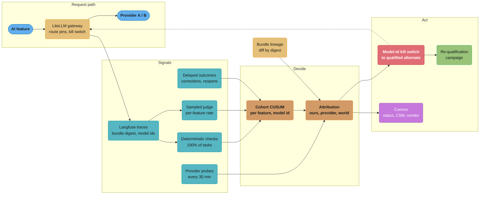
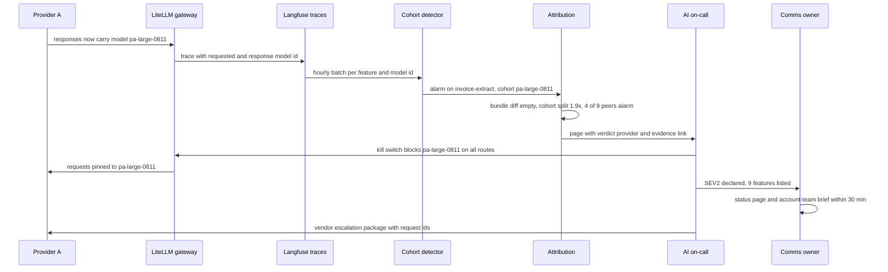
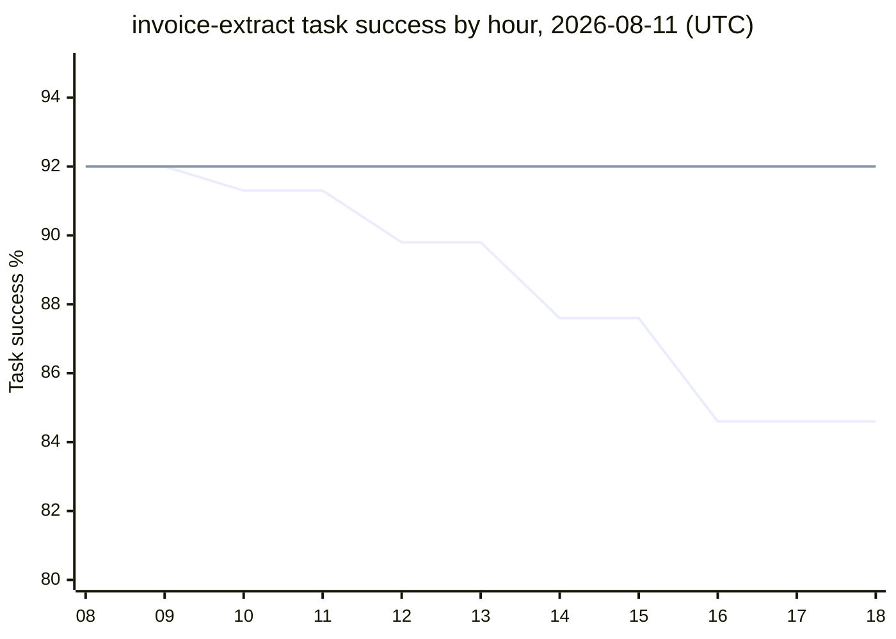
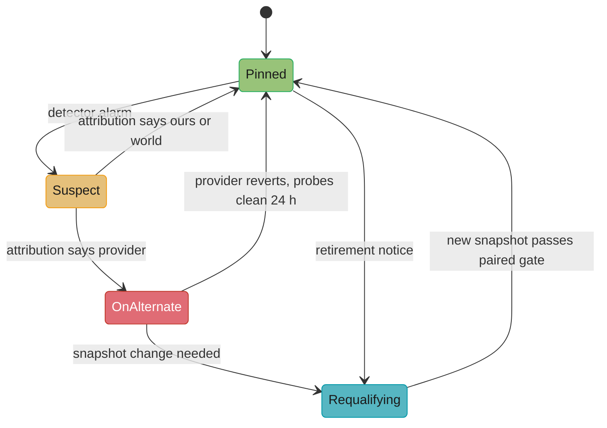

# Case Study: Design an AI Quality Incident Response Program

> **Version anchor (2026-10-18).** **LiteLLM v1.106.0** (2026-10-18) is the gateway that holds
> route pins, fallbacks and the model-id kill switch. **Langfuse v4.63.0** (2026-10-16) holds the
> traces, the online-eval scores and the cohort queries. The OTel GenAI semantic conventions moved
> to `open-telemetry/semantic-conventions-genai`, which states no stability level, so this page
> claims none. Azure OpenAI deployment upgrade policies are quoted from Microsoft Learn, checked
> 2026-10-18. PagerDuty, Statuspage and OpenFeature have no pin in this section and are named
> without a version. Provider A and Provider B are anonymized hosted-model vendors; their model
> ids (`pa-large-0611`, `pa-large-latest`) are scenario names, not real products.

---

## Intuition

> **Design intuition**: A web incident starts when something breaks. An AI quality incident
> starts when something someone else owns changes, nothing breaks, and your product gets worse.
> On Tuesday 2026-08-11 at 10:00 UTC, Provider A moved its `pa-large-latest` alias from
> `pa-large-0611` to `pa-large-0811` with a six-hour ramp. Acme's gateway route `default-large`
> pointed at that alias. Nine Acme features ran on the route. Task success on `invoice-extract`
> fell from 92.0% to 84.6%, a relative drop of 8%. Every health check, latency SLO and error-rate
> alert stayed green. A customer escalation found it 31 hours later.

The program this case study designs has one job: make the time from "a dependency changed
behavior" to "traffic is on a qualified path and the right people know" short and boring. It has
six parts, and each answers a question the 2026-08-11 incident could not:

| Question during the incident | Program part |
|---|---|
| Is the product worse, and by how much? | Task-success SLOs per feature, measured on outcomes |
| When did it start, and on which traffic? | A change-point detector keyed on the response model id |
| Did we do this, or did the provider? | An attribution step that reads the bundle diff, cohorts and probes |
| How do we stop the damage in minutes? | A model-id kill switch and a qualified alternate per route |
| How do we get back to a pinned, tested state? | Pinned snapshots and a re-qualification campaign |
| Who is told what, and when? | A communications plan for customers, account teams and the vendor |

**Key insight for this design**: the response model id is the join key for the whole program.
The provider writes it in every response. The gateway stamps it on every trace. The detector
splits cohorts on it. The attribution step compares cohorts on it. The kill switch blocks it. The
vendor escalation quotes it. A program that does not record the returned model id on every request
cannot tell a provider change from its own change, and spends the first hours of every incident
arguing about which one it was.

---

## 1. Requirements Clarification

### Context

Acme is a B2B finance-operations SaaS with 40 AI features in production. 26 run on hosted models
(19 on Provider A, 7 on Provider B) and 14 on self-hosted models. Every feature ships as a release
bundle, defined in
[AI Release Bundle and Lineage](cross_cutting/ai_release_bundle_and_lineage.md). Before the
incident, 9 hosted features referenced a gateway route name instead of a dated snapshot, which the
bundle schema allowed because the route name was not an alias string.

The 2026-08-11 incident, measured afterwards:

| Measure | Value |
|---|---|
| Features affected | 9 of 26 hosted |
| Worst feature | `invoice-extract`: 92.0% to 84.6% task success |
| Time to detect | 31 h (customer escalation, 2026-08-12 17:00 UTC) |
| Time to mitigate after detection | 2 h 40 min (9 bundles changed one at a time) |
| Extra failed tasks | about 27,000 across the 9 features |
| Customer-side cost | about 1,800 hours of manual rework at about 4 minutes a failed task |
| Provider changelog entry | 2026-08-13, two days after the change |

### Functional Requirements

- A task-success SLI for every AI feature, defined on the outcome the customer wanted (document
  posted without correction, ticket resolved without reopen, query executed), not only on a judge.
- Detection of a sustained relative drop of 8% or more in task success on all of a feature's
  traffic within 1 hour for every feature above 2,000 tasks an hour, and within 6 hours for every
  feature above 200 an hour. A drop that reaches only a ramping cohort is detected within 3 hours.
- Cohort attribution of each alarm to one of: our bundle change, a provider change, an input
  change, or unknown, with the evidence attached.
- A kill switch that moves every route on a given model id to its qualified alternate in one
  action, in under 2 minutes, without a deploy.
- A pinned-snapshot policy: no alias, no gateway route that resolves to an alias, a qualified
  alternate per route, and a retirement calendar.
- A re-qualification campaign that moves N prompt versions to a new snapshot with paired
  evaluation and slice-level gates.
- Communications: internal incident channel, customer status page, account-team brief, vendor
  escalation package, and a regulatory assessment record.

### Non-Functional Requirements

- False pages from the quality detector: fewer than 1 per feature per quarter.
- Kill switch: a flag read with a 5-second cache; propagation to all 40 gateway pods under 30 s.
- Online-eval spend under 3% of production model spend.
- Every trace carries bundle digest, requested model id and response model id. Coverage 100%,
  checked daily.
- Re-qualification of a full route (31 prompt versions) in under 10 working days.

### Out of Scope

- Incident command roles, severity tiers, rotations and the blameless template: owned by
  [Incident Management and On-Call](../../devops/incident_management_and_oncall/incident_management_and_oncall.md).
- The eval platform itself (trace collector, eval registry, dataset store): owned by
  [Design an LLM Eval Platform](../../llm/case_studies/design_llm_eval_platform.md).
- Gateway internals: [Design an LLM Gateway](../../llm/case_studies/design_llm_gateway.md) and
  [AI Gateway Operations](../ai_gateway_operations/ai_gateway_operations.md).
- The incident class catalog, replay harness and degradation resolver code: owned by
  [AI Incident Response and Reliability](../ai_incident_response_and_reliability/ai_incident_response_and_reliability.md).

---

## 2. Scale Estimation

### Traffic

| Quantity | Value | Basis |
|---|---|---|
| AI features | 40 | 26 hosted, 14 self-hosted |
| Model calls a day | 9.0M | 6.2M hosted, 2.8M self-hosted |
| Tasks a day | 2.4M | an agent task averages 3.8 calls |
| Route `default-large` | 1.7M calls, 520k tasks a day | the 9 affected features |
| `invoice-extract` | 96,000 documents a day, 4,000 an hour | 20% scanned PDFs by day, 45% from 00:00 to 06:00 |
| Prompt versions in production | 112 | 31 on `default-large` |
| Distinct hosted model ids in use | 12 | after pinning; 7 before, because 5 routes shared aliases |

### Detection power

The task-success baseline for `invoice-extract` is 92.0%, an 8.0% failure rate. An 8% relative
drop in success moves failures to 15.4%. The sample size a window needs to see that shift at
3 sigma with 90% power is:

```
n = ((z_a * sqrt(p0 (1 - p0)) + z_b * sqrt(p1 (1 - p1))) / (p1 - p0))^2
  = ((3 * 0.271 + 1.282 * 0.361) / 0.074)^2
  = 298 tasks per window
```

| Feature class | Tasks an hour | Outcome signal | n an hour | Window that reaches 300 |
|---|---|---|---|---|
| `invoice-extract` | 4,000 | deterministic checks on 100% | 4,000 | 5 min |
| `support-assistant` | 25,000 turns | judge on a 1.5% sample | 375 | 48 min |
| `close-checklist-agent` | 600 | judge on 20% | 120 | 2.5 h |
| `audit-memo-drafter` | 40 | judge on 100% | 40 | 7.5 h |

Two consequences shape the design. First, the standard SLO burn-rate pages are too coarse for this
shift: with a 90% task-success SLO (10% budget), 15.4% failures is a 1.54x burn, below the 3x
6-hour page and only a ticket on the 3-day window. The burn-rate math is in
[SLO and Error Budget Math](../../devops/case_studies/cross_cutting/slo_error_budget_math.md); a
quality program needs a change detector beside it. Second, sample rate is set per feature from
this table, not as one global percentage.

### Online-eval and probe cost

Prices change monthly, so cost is computed from two planning inputs: `P_in` and `P_out`, the
blended price per 1M input and output tokens for the judge model.

| Item | Volume a day | Tokens a day | Cost a day |
|---|---|---|---|
| Judge calls on sampled tasks | 140,000 | 140k x (3,000 in + 150 out) = 420M in, 21M out | 420 `P_in` + 21 `P_out` |
| Provider probes, 200 prompts per id every 30 min, 12 ids | 115,200 | 115k x (1,800 in + 300 out) = 207M in, 35M out | at production model prices |
| Deterministic checks | 2.4M tasks | none | CPU only |

Probes are 1.9% of hosted calls, run on their own virtual key, and are excluded from detector cohorts. At `P_in = $1.00` and `P_out = $4.00` per 1M tokens (planning
inputs, not quotes), judging costs $504 a day, about $15,000 a month.

### Trace storage

9.0M traces a day at about 6 KB each (prompt hash, rendered-input reference, output, scores,
bundle digest, model ids) is 54 GB a day, 1.6 TB for 30 days hot in the Langfuse ClickHouse
store. Full prompt and output text for the judged sample and for failed tasks is kept 90 days for
replay; the rest keeps hashes only.

---

## 3. High-Level Architecture



The request path is a normal gateway deployment. The program adds signals stamped with the
response model id, a detector per (feature, model id), an attribution step, and controls that act
on a model id rather than on one feature at a time.

### Signal layers

| Layer | Latency | Covers | Catches |
|---|---|---|---|
| Deterministic checks | seconds | 100% of tasks | schema breaks, missing fields, sums that do not reconcile, refused tool calls |
| Sampled judge | 2-10 min | 1-100% per feature | answer quality, groundedness, resolution |
| Provider probes | 30 min | 200 fixed prompts per model id | provider-side change with no traffic change |
| Delayed outcomes | 48 h to 7 days | 100% of tasks | the truth: accountant corrections, ticket reopens |

The delayed outcome is the SLI of record. The three faster layers are proxies, and each one is
backtested against the delayed outcome every month: on `invoice-extract`, the deterministic
reconcile check catches 71% of the documents an accountant later corrects, with a lead time of
48 hours. Signal design in depth is in
[Production Quality Monitoring and Drift](../production_quality_monitoring_and_drift/production_quality_monitoring_and_drift.md);
the span attributes the traces carry are in
[OpenTelemetry for LLM Apps](../../llm/case_studies/cross_cutting/opentelemetry_for_llm_apps.md).

### Incident path in the redesigned program



In the redesign the same change produces a page about 2 hours into the ramp, while only 10% of
traffic is on the new model, a verdict that names the provider, and one gateway action that covers all nine features.

---

## 4. Component Deep Dives

### 4.1 Task-success SLI catalog

Each feature declares its task-success SLI in the same repository as its bundle. The SLI names its
outcome source, its proxy signals and their measured lead time, and the slices the detector must
split on.

```yaml
feature: invoice-extract
owner: ap-automation
task_success:
  sli: good = posted and not corrected_within_48h
  source: ledger.corrections                 # delayed outcome, the SLI of record
  slo: 0.90
  window: 28d
proxies:
  - name: reconcile
    check: line_items_sum == total and tax_amount is not null and vendor_id resolves
    coverage: 1.0
    backtest: {recall_of_corrections: 0.71, lead_time_h: 48, checked: 2026-10-01}
  - name: judge_fields
    judge: field-faithfulness@v3
    sample_rate: 0.02
detector:
  split_by: [gen_ai.response.model, bundle.digest]
  slices: {input_type: [scanned, native]}
  reference: frozen                           # reference week, refreshed only on a bundle release
  shift: 1.5                                  # alert on failure rate 1.5x the reference
alternate:
  route: extract-large-alt
  qualified: 2026-10-02                       # gate run id ge-88412, must be under 30 days old
```

Three catalog rules matter in an incident:

- **Outcome first.** A judge pass rate that rises while corrections rise is a judge problem. The
  catalog makes the outcome the SLI and the judge a proxy, so the incident review reads the right
  number.
- **Frozen reference.** The detector compares against a reference week recorded at the last bundle
  release, not a rolling window. A rolling window absorbs a provider's gradual ramp.
- **Alternate with a date.** The alternate route is only valid if its gate run is under 30 days
  old. A fallback that was never evaluated adds an unmeasured quality change on top of the
  incident.

### 4.2 Cohort change-point detector: broken, then fixed

The first detector the program shipped was a Bernoulli CUSUM on the feature's hourly failure
count against one baseline rate. CUSUM sums the log-likelihood ratio of "failure rate is 1.5x the
reference" against "failure rate is the reference" and pages when the sum passes a threshold `h`.
It sees small sustained shifts that a fixed-threshold alert misses.

It failed in two ways on `invoice-extract`. Scanned PDFs fail 20% of the time and native PDFs 5%.
Overnight batch uploads raise the scanned share from 20% to 45%, so the feature's expected failure
rate moves from 8.0% by day to 11.75% at night with no change to anything. With `h = 12` the
detector paged every night. The team raised `h` to 400. A replay of the 2026-08-11 change then
paged 8 hours after the ramp began.

The fix has two parts. The expected failure rate is computed for each hour from that hour's slice
mix, so a mix shift is not a regression. And the CUSUM runs one stream per response model id, so
the new model's cohort is compared with the reference from its first request, without being
diluted by the 90% of traffic still on the old model.

```python
import math
import random

SLICE_FAIL = {"scanned": 0.20, "native": 0.05}       # reference-week failure rate per slice
P1_RATIO = 1.5                                       # shift the detector is tuned for: +50% failures


def scanned_share(hour: int) -> float:
    return 0.45 if hour % 24 < 6 else 0.20           # overnight batch uploads are mostly scans


def binom(rng, n, p):
    return sum(rng.random() < p for _ in range(n))


def llr(fails: int, n: int, p0: float) -> float:
    p1 = min(p0 * P1_RATIO, 0.99)
    return fails * math.log(p1 / p0) + (n - fails) * math.log((1 - p1) / (1 - p0))


# BROKEN: one baseline for the whole feature, one stream for all response models
class GlobalCusum:
    def __init__(self, p0: float, h: float):
        self.p0, self.h, self.s = p0, h, 0.0

    def update(self, hour: int, batch: dict) -> bool:
        n = sum(b["n"] for b in batch.values())
        fails = sum(b["fails"] for b in batch.values())
        self.s = max(0.0, self.s + llr(fails, n, self.p0))
        return self.s > self.h


# FIXED: expected rate from the hour's slice mix, one stream per response model
class CohortCusum:
    def __init__(self, h: float, min_n: int = 50):
        self.h, self.min_n, self.s = h, min_n, {}

    def update(self, hour: int, batch: dict) -> list:
        alarms = []
        for model, b in batch.items():
            if b["n"] < self.min_n:
                continue
            p0 = sum(b["mix"][s] * SLICE_FAIL[s] for s in SLICE_FAIL)
            s = max(0.0, self.s.get(model, 0.0) + llr(b["fails"], b["n"], p0))
            self.s[model] = s
            if s > self.h:
                alarms.append(model)
        return alarms


def simulate(hours: int, change_hour: int, ramp: list, per_hour: int = 4000, seed: int = 7):
    """Provider moves an alias to a new model and ramps it over 6 hours."""
    rng = random.Random(seed)
    for hour in range(hours):
        share_new = ramp[min(hour - change_hour, len(ramp) - 1)] if hour >= change_hour else 0.0
        mix = {"scanned": scanned_share(hour), "native": 1 - scanned_share(hour)}
        batch = {}
        for model, share in (("pa-large-0611", 1 - share_new), ("pa-large-0811", share_new)):
            n = int(per_hour * share)
            fails = 0
            for s, frac in mix.items():
                k = int(n * frac)
                bump = NEW_MODEL_BUMP[s] if model == "pa-large-0811" else 1.0
                fails += binom(rng, k, SLICE_FAIL[s] * bump)
            batch[model] = {"n": n, "fails": fails, "mix": mix}
        yield hour, batch


NEW_MODEL_BUMP = {"scanned": 2.0, "native": 1.85}   # daytime failures 8.0% -> 15.4%
RAMP = [0.10, 0.10, 0.30, 0.30, 0.60, 0.60, 1.0]
day_p0 = 0.20 * 0.20 + 0.80 * 0.05                   # daytime aggregate failure rate, 0.08

# Broken, tuned tight (h=12): pages every night on the mix shift, before any change.
g = GlobalCusum(day_p0, h=12)
night_pages = {h for h, b in simulate(14 * 24, 10**9, RAMP) if g.update(h, b)}
assert all(day * 24 + 3 in night_pages for day in range(14))     # every night, 03:00

# Broken, tuned loose (h=400) to stop the nightly pages: change at hour 10 is seen hours later.
g = GlobalCusum(day_p0, h=400)
late = next(h for h, b in simulate(48, 10, RAMP) if g.update(h, b))
assert late - 10 >= 6                                 # 8 hours with seed 7

# Fixed: no page in 14 quiet days, page on the second hourly batch of the 10% ramp.
c = CohortCusum(h=12)
assert not any(c.update(h, b) for h, b in simulate(14 * 24, 10**9, RAMP))
c = CohortCusum(h=12)
first = next((h, a) for h, b in simulate(48, 10, RAMP) for a in [c.update(h, b)] if a)
assert first[1] == ["pa-large-0811"] and first[0] - 10 <= 1
```

With seed 7 the loose global detector pages at hour 18, 8 hours after the change, and only
because the night mix added to the regression. The cohort detector pages at hour 11 on
`pa-large-0811` alone. The 10% ramp gives the new cohort 400 tasks in each of its first two hours:
the sum is 5.2 after the first batch and 18.4 after the second, past 12. On hourly batches that is
a page about 2 hours after the change started, 4 hours before the ramp completes. It stays silent
through 14 quiet days with the same threshold that made the global version page nightly.

In production, `min_n` stops a 3-request cohort (a retry on an old id) from alarming on noise.
After a page, the on-call resets the stream or marks the cohort as the new reference; neither is
automatic. `h` is set by simulating 90 days of the reference week and raising `h` until false
pages are under one, a 4-minute step in the bundle release job.



The falling line is the feature's aggregate task success; the flat line is the `pa-large-0611`
cohort alone. The `pa-large-0811` cohort sits at 84.6% from its first hour. The aggregate takes
six hours to show the full drop, which is why a detector on the aggregate is slow and a detector
on the cohort is not.

### 4.3 Attribution: ours, provider, or world

An alarm says the product got worse. The first decision is who owns the cause, because the action
differs: roll back our bundle, pin away from the provider's change, or look at the inputs. The
attribution step reads three sources that do not depend on each other:

| Source | Question it answers | Where it comes from |
|---|---|---|
| Bundle diff | Did any pinned field change in the window? | the lineage diff query in [AI Release Bundle and Lineage](cross_cutting/ai_release_bundle_and_lineage.md) |
| Response model cohorts | Is the drop confined to a new returned model id? | `gen_ai.response.model` on each trace |
| Probes and peers | Do fixed prompts, and other features on the same id, also drop? | the probe suite and alarm rules in [AI Incident Response and Reliability](../ai_incident_response_and_reliability/ai_incident_response_and_reliability.md) §6.5, and the detector state of the other features |

```python
from dataclasses import dataclass


@dataclass
class Evidence:
    bundle_diff: list                      # changed bundle fields in the window, from the lineage diff
    cohorts: dict                          # response model id -> (tasks, failures) in the window
    probe_alarms: dict                     # model id -> probe alarm names
    peers_alarming: int                    # other features on the same model id that alarm
    peers_total: int
    reference: str = ""                    # response model id in the reference week


def attribute(e: Evidence) -> tuple:
    """Return (owner, first action) for a confirmed quality drop on one feature."""
    rates = {m: f / n for m, (n, f) in e.cohorts.items() if n >= 200}
    new_ids = [m for m in rates if m != e.reference]
    if new_ids:
        worst = max(new_ids, key=rates.get)
        if e.reference in rates and rates[worst] > 1.3 * rates[e.reference]:
            return "provider", f"pin route to {e.reference}, block {worst}"
    shared = e.peers_total and e.peers_alarming / e.peers_total >= 0.3
    if e.probe_alarms.get(e.reference) and shared:
        return "provider", "fail over to the qualified alternate for every feature on this id"
    if e.bundle_diff:
        return "ours", f"roll back bundle; changed: {', '.join(e.bundle_diff)}"
    if e.peers_alarming == 0 and not e.probe_alarms.get(e.reference):
        return "world", "slice by input source and tenant; check upstream data"
    return "unknown", "hold mitigation on the alternate, escalate to provider with evidence"


# Alias cohort split: two response model ids under one requested alias
e = Evidence(bundle_diff=[], cohorts={"pa-large-0611": (2600, 210), "pa-large-0811": (1400, 162)},
             probe_alarms={}, peers_alarming=4, peers_total=9, reference="pa-large-0611")
assert attribute(e)[0] == "provider"

# Pinned snapshot, same returned id, probes and peers drop: serving-side change
e = Evidence(bundle_diff=[], cohorts={"pa-large-0611": (4000, 470)},
             probe_alarms={"pa-large-0611": ["pass_rate_drop"]}, peers_alarming=5, peers_total=9,
             reference="pa-large-0611")
assert attribute(e) == ("provider", "fail over to the qualified alternate for every feature on this id")

# Our prompt changed and nobody else moved
e = Evidence(bundle_diff=["prompts[extract-fields]"], cohorts={"pa-large-0611": (4000, 470)},
             probe_alarms={}, peers_alarming=0, peers_total=9, reference="pa-large-0611")
assert attribute(e)[0] == "ours"

# Nothing changed anywhere: look at the inputs
e = Evidence(bundle_diff=[], cohorts={"pa-large-0611": (4000, 470)}, probe_alarms={},
             peers_alarming=0, peers_total=9, reference="pa-large-0611")
assert attribute(e)[0] == "world"
```

The order of the rules is deliberate. A cohort split is checked first because it is a
contemporaneous comparison: both cohorts saw the same hour's inputs, the same bundle and the same
judge, so a gap between them can only come from the model. A bundle diff is checked after it,
because Acme ships about 300 bundles a week and almost every window contains some change; "we
deployed at 10:02" is true in most incidents and causal in fewer. The second case, a pinned id
with a serving-side change and no new returned id, is the Anthropic August 2025 pattern in §6:
only probes and peer features can see it.

`unknown` is a real outcome. When the step returns it, the on-call still moves traffic to the
qualified alternate if the drop is above the page line, and keeps the evidence for the vendor.
Waiting for a confident attribution costs more than a reversible failover.

### 4.4 Pinned snapshots, blast radius, and the model-id kill switch

**Pinning policy.** The bundle schema rejects ids ending in `latest`. After the incident it also
rejects gateway route names unless the route's own config pins a dated id, and the gateway config
is a versioned artifact gated like a bundle. The policy has four rules:

- Every hosted route pins a dated snapshot id.
- Every route has a qualified alternate: a different snapshot, ideally a different provider, with
  a gate run under 30 days old against the same eval set.
- The gateway logs `gen_ai.request.model` and `gen_ai.response.model` on every call. A mismatch
  is a ticket; a new response id on more than 1% of a route's calls in an hour is a page.
- A retirement calendar lists every pinned id with its announced deprecation and retirement
  dates. Re-qualification starts at announcement, not at the deadline.

On 2026-08-11 the only fallback, `pa-large-0611`, had not been evaluated in 9 weeks.

**Blast radius.** The first incident action is a query, not a guess. Every live bundle is a row in
the lineage store with its model ids:

```sql
-- Every live feature, route and prompt version that resolves to a given model id
SELECT b.feature, b.digest, r.route, p.name AS prompt, p.version, t.tasks_per_hour
FROM live_bundles b
JOIN bundle_routes r   ON r.digest = b.digest
JOIN bundle_prompts p  ON p.digest = b.digest
JOIN feature_traffic t ON t.feature = b.feature
WHERE r.pinned_model = 'pa-large-0611'
   OR r.observed_response_models @> ARRAY['pa-large-0811']
ORDER BY t.tasks_per_hour DESC;
```

The `observed_response_models` column is filled from traces, not from config. It is the column
that finds a route that asked for one id and received another.

**Kill switch at the model id.** The gateway config holds the pin and the alternate per route.
The kill switch is a block list keyed on response model id, read per request with a 5-second
cache, so blocking `pa-large-0811` moves every route that would receive it to its alternate in
one write.

```yaml
# LiteLLM proxy config, gateway release gw-2026.10.14
model_list:
  - model_name: extract-large
    litellm_params:
      model: openai/pa-large-0611            # Provider A, OpenAI-compatible endpoint
      api_base: https://api.provider-a.example/v1
  - model_name: extract-large-alt
    litellm_params:
      model: openai/pb-xl-20260904           # Provider B, qualified 2026-10-02
      api_base: https://api.provider-b.example/v1

router_settings:
  fallbacks: [{"extract-large": ["extract-large-alt"]}]
```

The block list itself lives in the flag service (OpenFeature provider in front of it) because a
config deploy to 40 gateway pods takes 6 to 9 minutes and a flag write propagates in under 30 s.
A gateway hook reads `blocked_response_models` and, when the provider returns a blocked id,
discards the response and retries on the fallback. For a provider that ramps a new model behind
the same requested id, this is the only control that works: the request cannot ask for "the old
weights", but it can refuse the new ones. The degradation resolver that sits above this, with its
last-known-good behavior, is in
[AI Incident Response and Reliability](../ai_incident_response_and_reliability/ai_incident_response_and_reliability.md)
§6.3.



Route state lives in the gateway config repository. The incident module's release freeze holds on
every feature in `Suspect` or `OnAlternate`.

### 4.5 Re-qualification campaign: broken, then fixed

Re-qualification moves prompt versions from one snapshot to another: after a provider change Acme
decides to keep, after a retirement notice, or after a failover that will last more than a week.
On 2026-08-14 Acme had to move 31 prompt versions on `default-large` to a dated snapshot. The
campaign steps (inventory, baseline, slice diff, re-tune, re-gate, dual-run, retire) are in
[Prompt Lifecycle and Versioning](../prompt_lifecycle_and_versioning/prompt_lifecycle_and_versioning.md)
§6.6. This section covers the comparison that decides each slice.

**Broken.** The first campaign compared the new snapshot's pass rate today with the pass rate the
old snapshot had at the prompt's release, stored in the gate record.

```python
# BROKEN: new snapshot today vs the score the old snapshot got at release, 9 weeks ago
def requalify_broken(stored_old_pass_rate: float, new_results: list, margin: float = 0.02) -> bool:
    new_rate = sum(new_results) / len(new_results)
    return new_rate >= stored_old_pass_rate - margin
```

Between the release and the campaign, the judge moved from `support-judge@v4` to `@v5`, which is
6 points stricter on the refunds slice. The old snapshot scores 83.0% today, not the stored
89.0%. The broken comparison failed the refunds slice for a snapshot that did not regress, and the
team spent 4 days re-tuning a prompt that was fine.

**Fixed.** Both snapshots run on the same rows, with the same judge version, on the same day. The
test reads only the rows where they disagree (exact McNemar), so row difficulty cancels out.

```python
import math


def mcnemar_p(b: int, c: int) -> float:
    """Exact two-sided McNemar: b = rows only the old snapshot passed, c = only the new one."""
    n, k = b + c, min(b, c)
    if n == 0:
        return 1.0
    tail = sum(math.comb(n, i) for i in range(k + 1)) / 2 ** n
    return min(1.0, 2 * tail)


def requalify(old_results: list, new_results: list, margin: float = 0.02, alpha: float = 0.05):
    assert len(old_results) == len(new_results)
    b = sum(o and not n for o, n in zip(old_results, new_results))
    c = sum(n and not o for o, n in zip(old_results, new_results))
    delta = (c - b) / len(old_results)
    p = mcnemar_p(b, c)
    worse = delta < -margin or (delta < 0 and p < alpha)
    return {"delta": round(delta, 4), "b": b, "c": c, "p": round(p, 4), "pass": not worse}


# Refunds slice, 400 rows, both snapshots judged by support-judge@v5 today
old_today = [True] * 332 + [False] * 68                                  # 0.830
new_same = [True] * 320 + [False] * 12 + [True] * 10 + [False] * 58      # 0.825, no regression
new_worse = [True] * 300 + [False] * 32 + [True] * 12 + [False] * 56     # 0.780, real regression

assert requalify_broken(0.89, new_same) is False       # rejects a snapshot that did not regress
assert requalify(old_today, new_same)["pass"] is True  # b=12, c=10, p=0.83

r = requalify(old_today, new_worse)
assert (r["b"], r["c"]) == (32, 12) and r["p"] < 0.01 and r["pass"] is False
```

The paired test also needs fewer rows. On the refunds slice, 44 of 400 rows disagree; the test
works on those 44, while an unpaired comparison of two pass rates would need about
1,000 rows per side to see a 5-point drop at the same confidence. Every slice in the campaign
runs 3 repeats per snapshot, and a row counts as passed when at least 2 of 3 repeats pass. The
statistics of repeated gate runs are in
[Statistics of Release Gates](../evaluation_gates_and_eval_sets/statistics_of_release_gates.md);
the harness that runs them is in
[LLM Eval Harness in Production](../../llm/case_studies/cross_cutting/llm_eval_harness_in_production.md).

A snapshot change also changes safety behavior, which the task-success eval set does not
measure. Every campaign runs the red-team suite from
[Red Team Eval Harness](../../llm/case_studies/cross_cutting/red_team_eval_harness.md) on both
snapshots, paired the same way, and a rise in attack success rate on any category blocks the
route regardless of task success.

### 4.6 Communications

The 2026-08-11 incident had no communications plan. Account teams learned about it from the
customer who escalated, and the status page said "all systems operational" for its whole
duration, which was true for every component it listed.

| Audience | Channel | First message | Then | Owner |
|---|---|---|---|---|
| Responders | incident channel, PagerDuty | at declaration | every 30 min | incident commander |
| Engineering and support | internal status post | 15 min after declaration | at each state change | comms owner |
| Customers | Statuspage, component per AI feature | 30 min after a SEV1 or SEV2 is declared | every 60 min, and at resolution | comms owner |
| Account teams | brief with affected tenants and task counts | 60 min | daily until closed | CSM lead |
| Provider | vendor escalation package | 60 min for a provider verdict | at each new finding | AI platform lead |
| Compliance | assessment record | 24 h | at closure | compliance reviewer |

The status page lists each AI feature as its own component. Statuspage has a fixed set of
component statuses (Operational, Degraded performance, Partial outage, Major outage, Under
maintenance), so a quality incident sets the feature's component to Degraded performance and
titles the incident "Degraded quality". The customer message names the feature, the time window, the
observable effect, and the action the customer should take. It does not name the provider and
does not say "fixed" until the detector has been clean for 2 hours on the mitigated path.

```
[Degraded quality] Invoice extraction

Since 10:00 UTC on 2026-08-11, invoice extraction has left the tax amount blank on more
documents than usual. Documents processed in that window may need review before posting.
We have moved processing to a different model configuration as of 19:40 UTC on
2026-08-12 and are watching results. Affected documents are marked "Review suggested" in
the AP queue. Next update by 21:00 UTC.
```

The vendor escalation package is built from the trace store by a script, so the AI platform lead
does not assemble it by hand during the incident:

```json
{
  "incident": "INC-2026-0811-Q",
  "requested_model": "pa-large-latest",
  "response_models": {"pa-large-0611": {"tasks": 41200, "failure_rate": 0.080},
                      "pa-large-0811": {"tasks": 38900, "failure_rate": 0.154}},
  "first_seen_response_model": "2026-08-11T10:00:41Z",
  "probe_delta": {"pass_rate": -0.061, "mean_output_tokens": "+18%", "json_valid": -0.004},
  "examples": [{"request_id": "req_7f3a...", "redacted_input_ref": "s3://inc/7f3a.json"}],
  "ask": ["change notice for pa-large-0811", "date pa-large-0611 stays available"]
}
```

Customer inputs never leave in the package: examples are request ids plus redacted references the
provider can match in its own logs. The compliance record covers the EU AI Act serious-incident
test and GDPR breach test, described in
[AI Governance and Model Risk Operations](../ai_governance_and_model_risk_operations/ai_governance_and_model_risk_operations.md).

---

## 5. Design Decisions & Tradeoffs

### Detector choice

| Option | Page delay on the 2026-08-11 replay, hourly batches | False pages | Cost to run | Chosen |
|---|---|---|---|---|
| SLO burn-rate pages only | no page (1.54x burn is a 3-day ticket) | very low | none | no, kept as the budget view |
| Fixed threshold on aggregate | never by day, nightly false pages | high | none | no |
| Global CUSUM | 8 h after re-tuning | nightly before re-tuning | low | no |
| Cohort CUSUM, mix-adjusted | 2 h, at 10% exposure | under 1 a quarter | 4 min simulation per release | yes |
| Bayesian change-point on all signals | similar to cohort CUSUM | similar | higher, harder to explain on a page | no |

CUSUM was chosen over a Bayesian online change-point model because the on-call must explain the
page in one sentence: "this cohort's failures are 1.9x the reference, sustained for 2 hours".

### Pinning and alternates

| Choice | Benefit | Cost |
|---|---|---|
| Dated snapshot only | Provider alias moves cannot reach production | Re-qualification work at every retirement, about 4 campaigns a year |
| Qualified alternate per route | Failover with a measured quality cost | Doubles gate runs, about 18% more eval spend |
| Alternate on a different provider | Survives a provider-wide outage or change | Prompt variants per provider, 1.4 prompt versions per feature on average |
| Kill switch on response model id | One action for all routes | A gateway hook to maintain, extra retry latency when it fires |

### Where to put the kill switch

| Location | Propagation | Covers | Verdict |
|---|---|---|---|
| Per-feature env var | 22 min per feature (CI and rollout) | one feature | rejected |
| Per-feature flag | under 30 s | one feature, 9 writes in this incident | kept for feature-level degradation |
| Gateway route flag | under 30 s | all features on a route | used for route failover |
| Gateway response-model block list | under 30 s | every route that receives the id | used for provider changes |

---

## 6. Real-World Implementations

**Anthropic, August to September 2025.** Anthropic's postmortem describes three infrastructure
bugs that degraded Claude responses for several weeks while model ids stayed the same: a
context-window routing error that reached 16% of Sonnet 4 requests in the worst hour on
August 31, an output-corruption bug, and an XLA:TPU miscompilation in approximate top-k. Anthropic
wrote that its evaluations did not capture the degradation users reported, and committed to more
sensitive evals run continuously on production systems. The lesson for this program: a pinned id
does not freeze serving behavior, so the probe job and the peer-feature check in §4.3 exist for
the case where the returned id never changes.

**OpenAI, April 2025.** OpenAI rolled back a GPT-4o update in ChatGPT after users reported
sycophantic behavior. Its follow-up said offline evals and A/B tests looked positive, and that an
added reward signal from user feedback weakened existing checks. The lesson: a provider's own
launch gates can pass a change that a downstream task-success SLI would fail. Acme's
re-qualification runs its own eval set even for a "minor" snapshot update.

**Chen, Zaharia and Zou (Stanford and UC Berkeley), 2023.** The paper "How is ChatGPT's behavior
changing over time?" compared March and June 2023 versions of GPT-4 and GPT-3.5 on the same tasks
and found large changes in accuracy and in format-following. It is the reference case for treating
a hosted model name as a moving dependency, and the reason probes check format validity as well as
correctness.

**Microsoft Azure OpenAI.** Azure deployments carry a version upgrade policy chosen per deployment:
"Opt out of automatic model version upgrades", "Upgrade once new default version becomes
available", and "Once the current version expires". Azure documents at least two weeks of notice
before a new version becomes the default, and a deployment that opts out stops working at
retirement (Microsoft Learn, checked 2026-10-18). For this program, the auto-upgrade policies are
aliases by another name and are banned; the opt-out policy is the pinned snapshot, and the
retirement date feeds the calendar in §4.4.

**OpenAI and Anthropic dated snapshots.** Both providers publish dated or versioned model ids and
retirement schedules. Anthropic deprecated `claude-sonnet-4-5-20250929` on September 30, 2026,
with retirement on November 30, 2026. OpenAI's Chat Completions response includes
`system_fingerprint`, which changes when the backend configuration changes. Acme stores both the
returned model string and the fingerprint per trace; the fingerprint alone is a ticket, not a
page, because most fingerprint changes do not move quality.

---

## 7. Technologies & Tools

| Tool | Version | Role in this program |
|---|---|---|
| LiteLLM proxy | v1.106.0 | Route pins, fallbacks to the qualified alternate, response-model block hook |
| Langfuse | v4.63.0 | Trace store, online LLM-as-a-judge evaluators on sampled traces, score API for the detector |
| OpenTelemetry GenAI conventions | no stability level stated | `gen_ai.request.model`, `gen_ai.response.model` on every span |
| OpenFeature | not pinned | Flag API for the kill switch and degradation modes |
| PagerDuty | not pinned | Paging and escalation for the AI on-call |
| Statuspage | not pinned | Per-feature components set to Degraded performance during a quality incident |
| Detector job | in-house, about 600 lines of Python | Cohort CUSUM per (feature, response model id), hourly and per 5 min for high-volume features |
| Attribution job | in-house | Rules in §4.3, writes the verdict and evidence link to the page |

The detector is in-house because no tool Acme evaluated split a CUSUM by an arbitrary trace
attribute with a mix-adjusted reference.

---

## 8. Operational Playbook

### First 30 minutes of a quality page

1. To confirm the page, open the evidence link and check that the alarming cohort has at least
   300 tasks and that the proxy agrees with a second signal (judge sample or probe).
2. To scope it, run the blast-radius query for the alarming response model id.
3. If attribution says `provider` or `unknown` and the drop is above the page line, write the
   response model id to `blocked_response_models`.
4. If attribution says `ours`, flip the feature's bundle alias to the previous digest; the
   rollback steps are in [AI Release Engineering](../ai_release_engineering/ai_release_engineering.md).
5. Declare severity with the incident module's matrix, and name a comms owner.
6. Confirm mitigation: the cohort detector on the alternate path is silent for 60 minutes, and the
   failed-task rate on the affected features is back within 1 point of the reference.

### Severity for quality incidents

| Severity | Condition | Comms |
|---|---|---|
| SEV1 | Task success down 20% relative on any customer-facing feature, or any wrong money movement | Status page at 30 min, executive brief |
| SEV2 | Down 8% relative on a feature above 1,000 tasks an hour, or on 3 or more features at once | Status page at 30 min, account teams at 60 min |
| SEV3 | Down 8% relative on a smaller feature, or 4-8% on any | Internal only, ticket to the feature team |

The 2026-08-11 incident is a SEV2 under this table.

### Drills

Each quarter a game day routes 10% of an internal tenant's `invoice-extract` traffic to a weaker
snapshot. Pass criteria:

| Check | Target | Last drill (2026-10-07) |
|---|---|---|
| Detector page | under 60 min | 42 min |
| Attribution verdict | `provider` | `provider` |
| Block-list write to clean traffic | under 2 min | 48 s |
| Internal status post | under 15 min | 11 min |
| Vendor package generated | under 10 min | 3 min |

A weekly review reads new response model ids per provider (announced or not), routes not in
`Pinned`, alternates older than 21 days, proxy backtest recall, and ids retiring within 120 days.

---

## 9. Common Pitfalls & War Stories

**The alias hidden in a route name.** Acme's bundle schema rejected `pa-large-latest` but accepted
the route name `default-large`, which the gateway resolved to that alias. 9 features had a fully
pinned bundle by schema and an unpinned model in practice. Impact: the whole 2026-08-11 incident,
about 27,000 extra failed tasks and 1,800 hours of customer rework. Fix: the bundle stores the
resolved model id of each route, and the gateway config is gated like a bundle.

**Nine flag writes instead of one.** The 2026-08-12 mitigation flipped each feature's mode flag
separately, with a separate owner approval for each. Mitigation took 2 h 40 min after detection,
during which about 2,300 more tasks failed. With the response-model block list, the same action
was one write in the 2026-10-07 drill, 48 seconds to clean traffic.

**The rolling baseline that absorbed the ramp.** Before the incident, a weekly report compared each
feature with its trailing 7 days. Provider A's six-hour ramp, followed by a day at 100%, moved the
trailing baseline down by 2.1 points within 3 days, and the report flagged nothing. Fix: the
reference week is frozen at the last bundle release (§4.1).

**The failover to an unqualified snapshot.** On 2026-08-12 the team pinned back to
`pa-large-0611`, which worked. In a separate incident on 2026-09-16, a Provider B serving change hit
4 features, and one feature's configured fallback was a snapshot last evaluated 11 weeks earlier.
It scored 3.2 points below the champion on the feature's eval set, so failover stopped one
regression and started a smaller one. Fix: the 30-day alternate expiry, checked in the weekly
review.

**The judge change read as a provider change.** In the 2026-08-14 re-qualification (§4.5), a judge
move from `@v4` to `@v5` failed the refunds slice and cost 4 engineer-days of re-tuning a prompt
that had not regressed. Fix: paired same-day runs with one judge version for the whole campaign.

**"Resolved" posted too early.** During the 2026-09-16 incident, the status page moved to resolved
15 minutes after failover. The detector on the alternate path then paged on one feature (the
unqualified fallback above), and the page went back to degraded. Two account teams had already
told customers it was fixed. Fix: "resolved" requires 2 hours of a silent detector on the
mitigated path.

### Program impact, 2026-09-01 to 2026-10-15

| Measure | Before (2026-08-11 incident) | After |
|---|---|---|
| Time to detect a provider-side quality change | 31 h | 52 min (2026-09-16 incident), 42 min (drill) |
| Time to mitigate after detection | 2 h 40 min | 11 min (2026-09-16), 48 s (drill) |
| Extra failed tasks per provider incident | about 27,000 | about 1,150 (2026-09-16) |
| Features with an outcome-based task-success SLI | 12 of 40 | 40 of 40 |
| Hosted features on an alias or alias-backed route | 9 | 0 |
| Routes with a qualified alternate under 30 days | 0 | 26 of 26 |
| Re-qualification of 31 prompt versions | 19 working days (August campaign) | 9 working days (October campaign) |
| Quality detector false pages | not measured | 1 in 6 weeks, across 40 features |

---

## 10. Capacity Planning

### Detector compute

40 features x an average of 2.3 response model ids x 2 slices is about 184 CUSUM streams. Each
hourly update reads counts from the trace store, not raw traces: one grouped ClickHouse query per
feature over the last hour, about 40 queries an hour and under 2 s of query time each. The 5-minute
cadence for the 6 highest-volume features adds 72 queries an hour. Detector compute is negligible;
the constraint is trace-ingest freshness, which must stay under 3 minutes for a 5-minute window to
be complete.

### Judge budget by feature

Each feature's sample rate reaches 300 judged tasks in its target window (§2):

| Feature tier | Tasks an hour | Target window | Sample rate | Judged a day |
|---|---|---|---|---|
| High volume | above 20,000 | 1 h | 1.5% | about 18,000 |
| Medium | 1,000 to 20,000 | 1 h, or deterministic proxy | 0-30% | about 75,000 |
| Low | 100 to 1,000 | 6 h | 20-50% | about 40,000 |
| Very low | under 100 | 24 h | 100% | about 7,000 |
| Total | | | | about 140,000 |

At 3,150 tokens per judge call this is 441M tokens a day. At the planning prices in §2, about
$15,000 a month, 2.1% of Acme's production model spend of about $720,000 a month, inside the 3%
target.

### Re-qualification campaign

A route with 31 prompt versions, eval sets averaging 1,200 rows, 2 snapshots and 3 repeats:

```
generation calls = 31 x 1,200 x 2 x 3       = 223,200
generation tokens = 223,200 x (2,400 + 350) = 614M
judge calls       = 223,200                  (one per generation)
judge tokens      = 223,200 x 3,150          = 703M
red-team suite    = 31 x 2 x 450 attacks     = 27,900 calls
```

At a dedicated batch key of 4M tokens a minute, generation takes about 154 minutes and judging
about 176 minutes, so one full pass is under 6 hours. The 9-day campaign is dominated by re-tuning
the slices that fail, not by compute: in October, 7 of 31 prompt versions needed a template change,
and each change re-ran its full slice table.

### People

| Role | Load | Staffing |
|---|---|---|
| AI on-call | about 2 quality pages a month across 40 features | one engineer a week from a rotation of 8, shared with the platform on-call |
| Comms owner | named per SEV1 and SEV2 | support operations lead, with a backup |
| Re-qualification owner | about 4 campaigns a year, 9 working days each | the feature teams, coordinated by the AI platform team |
| Program owner | weekly review, quarterly drill | AI platform lead, about 20% of one person |

---

## 11. Interview Discussion Points

**Q: Why is an SLO burn-rate alert not enough to catch a provider-side quality regression?**
**Short:** An 8% relative drop on a 90% task-success SLO is about a 1.5x burn, below the usual page thresholds; a CUSUM on the new model's cohort pages within hours, not days.

Burn-rate alerting was designed for availability, where a bad hour means a high error rate. A
quality regression is usually a modest, sustained shift: 8% to 15.4% failures on a 10% budget is
1.54x, which never reaches a 3x six-hour page and only opens a ticket on a 3-day window. Keep the
burn rate as the budget view, and add a CUSUM per (feature, response model id) with a
mix-adjusted reference to detect the change itself.

**Q: How do you tell whether a quality drop was caused by your change or by the provider?**
**Short:** Compare cohorts keyed on the returned model id first, then read probes and peer features, and only then the bundle diff, because a deploy happens in almost every window.

A cohort split is a contemporaneous comparison: same hour, same inputs, same bundle, same judge,
different model. If the new response id fails 1.3x more than the reference id, the provider changed
something. If the id did not change, fixed-prompt probes and other features on the same id falling
together point to a serving-side change. A bundle diff alone is weak evidence at 300 releases a
week. When the evidence is mixed, fail over anyway and keep the evidence for the vendor.

**Q: A team says "we pin a dated snapshot, so we are safe from provider changes". What do you say?**
**Short:** A dated id pins the weights the provider promises, not the serving stack; routing, compiler and config bugs can change output on an unchanged id, so probes and peer checks still run.

The Anthropic August 2025 postmortem described three infrastructure bugs that lowered quality on
unchanged model ids for weeks. Pinning removes alias moves, which are the most common silent
change, and it makes re-qualification a planned event. It does not remove the need for probes, for
`system_fingerprint` logging where available, and for a qualified alternate on a different
snapshot or provider.

**Q: Where should the kill switch live for a provider-side change, and why not on each feature?**
**Short:** On the gateway, keyed on the response model id, so one flag write moves every route that receives the bad id; per-feature switches took 9 writes and 2 h 40 min in the incident.

A provider ramping a new model behind the same requested id cannot be avoided by changing the
request; you can only refuse the new id and retry on the alternate. Per-feature flags stay useful
for feature-level degradation modes (non-AI path, read-only tools). The block list must skip the
primary for the rest of the request, or the retry logic multiplies load on the degraded provider.

**Q: What makes a fallback model "qualified", and why does it expire?**
**Short:** It passed the same eval set and gate as the champion within the last 30 days; after that, the provider, the eval set and the prompt have all moved, so its quality cost is unknown.

An unmeasured fallback converts one regression into another of unknown size, as in the 2026-09-16
case where the fallback scored 3.2 points below the champion. Re-run the alternate's gate on every
bundle release and at least every 30 days. The cost is about 18% more eval spend, which is cheap
next to a failover that makes things worse.

**Q: Why does the detector compare against a frozen reference week instead of a rolling baseline?**
**Short:** A rolling baseline follows a gradual provider ramp downward and stops seeing it; a reference frozen at the last bundle release keeps the drop visible until someone decides to accept it.

Providers ramp new models over hours or days, and real input mixes drift weekly. A trailing 7-day
baseline moved 2.1 points in 3 days at Acme and the report flagged nothing. Refresh the reference
only on an explicit event: a bundle release, or a qualified migration where the on-call marks the
new cohort as the reference.

**Q: How do you handle a feature that has only 40 tasks an hour?**
**Short:** Judge 100% of its tasks, widen the window to 6-24 hours, lean on probes and peer features for fast detection, and accept that the feature cannot have an hourly quality page.

Sample size bounds detection: about 300 tasks are needed to see 8% to 15.4% failures at 3 sigma
with 90% power. A low-volume feature borrows speed from the probe job and from higher-volume peers
on the same model id; if they alarm, the low-volume feature follows them to the alternate without
waiting for its own evidence.

**Q: How do you re-qualify 31 prompt versions on a new snapshot without being fooled by judge or eval-set drift?**
**Short:** Run both snapshots on the same rows, with one judge version, on the same day, and test the disagreeing rows with an exact McNemar test per slice.

Comparing today's new-snapshot score with a stored score from release time mixes in every change
since then. In Acme's August campaign a judge upgrade made the old snapshot look 6 points worse and
cost 4 engineer-days of needless re-tuning. Paired runs cancel row difficulty and judge drift, and
need far fewer rows than an unpaired comparison. Run the red-team suite paired too: task success
does not measure safety.

**Q: When do you tell customers about a quality incident, and what do you say?**
**Short:** For SEV1 and SEV2, post within 30 minutes on a per-feature status component set to Degraded performance, naming the effect and the customer action; say resolved only after 2 clean hours.

A status page that lists only availability components shows green during a quality incident,
which damages trust more than the regression. Say what the customer sees ("tax amount left blank")
and what to do ("review before posting"), not which provider changed. Brief account teams with
tenant-level task counts within 60 minutes so they hear it from you first.

**Q: What goes into a vendor escalation, and what must stay out?**
**Short:** Request ids, timestamps, the requested and returned model ids, cohort failure rates and probe deltas go in; customer inputs stay out and are referenced by redacted ids the vendor can match.

A vendor acts on evidence it can find in its own logs. A generated package (§4.6) arrives in
minutes and makes two concrete asks: a change notice for the new id, and a date until which the old
id stays available. Track the answer in the quarterly vendor review together with the count of
unannounced response-model changes.

**Q: Which metrics tell you the program works?**
**Short:** Time to detect and time to mitigate provider-side changes, extra failed tasks per incident, share of routes pinned with a fresh alternate, and false pages per quarter.

Acme's numbers moved from 31 hours to under an hour for detection and from 2 h 40 min to 11 minutes
for mitigation, and extra failed tasks per provider incident fell from about 27,000 to about 1,150.
Track drill results quarterly, because a kill switch that is never exercised tends to fail on the
day it is needed. Add proxy backtest recall so a decaying proxy is caught before it hides an
incident.

**Q: What would you not build in this program?**
**Short:** A custom trace store, a custom eval platform, or an automated failback; use the existing ones, and keep moving back to the primary a human decision after the provider confirms a fix.

Langfuse already runs sampled judges and stores scores by trace metadata; the eval harness already
runs paired gates. The pieces worth building are small: the cohort detector, the attribution rules,
the block-list hook and the vendor-package script. Automated failback is risky because a provider
can revert, re-ramp and revert again; require clean probes for 24 hours and a human approval before
leaving the alternate.
