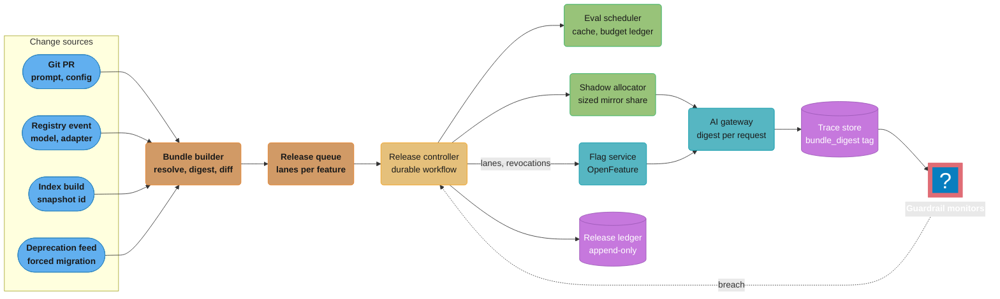
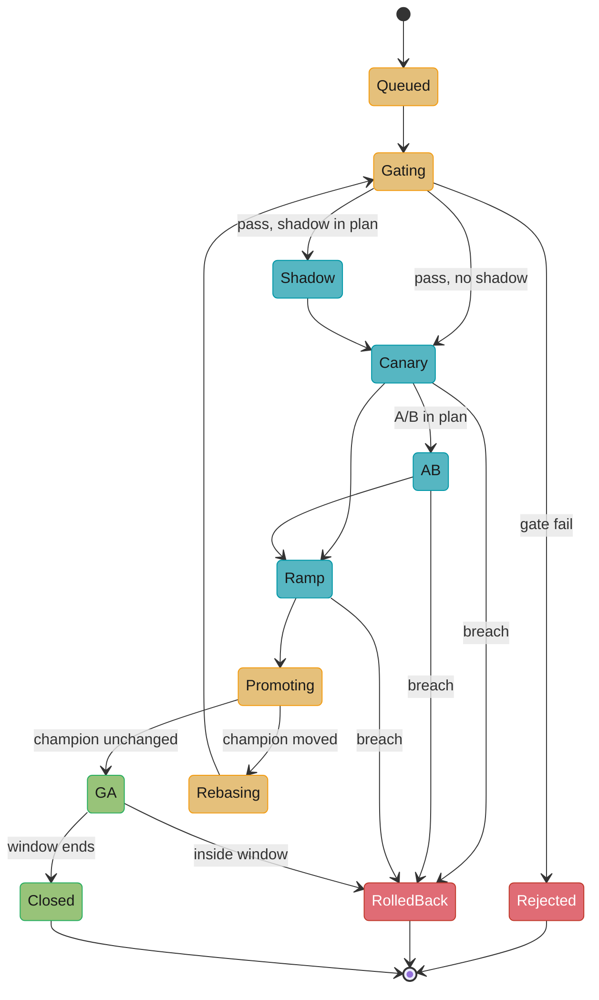
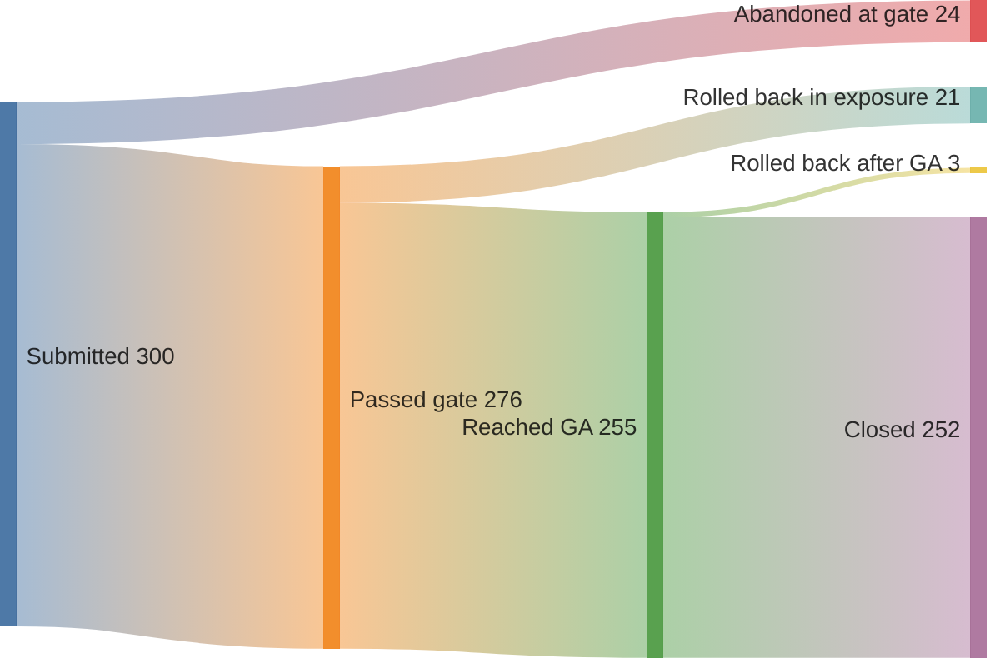
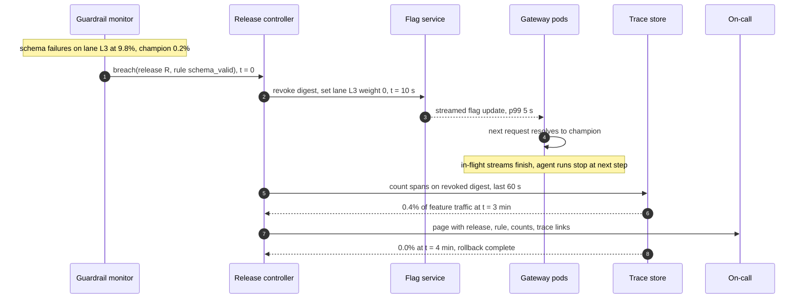
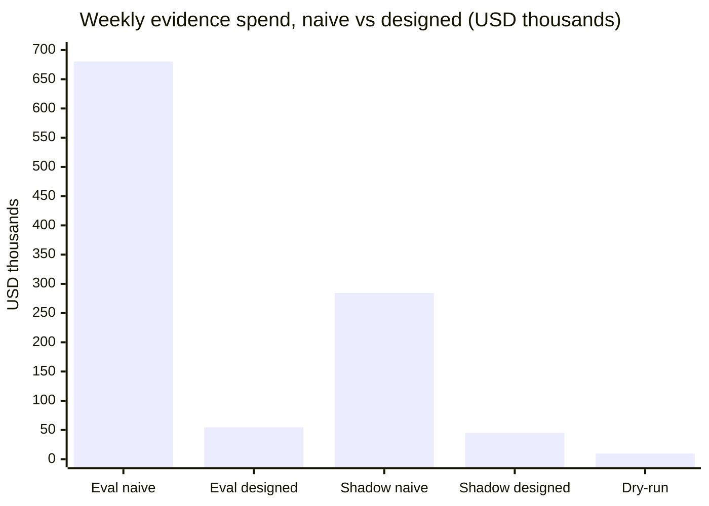

# Case Study: Design an AI Release Pipeline

> **Version anchor (2026-10-18).** **KServe v0.21.0** (2026-09-25) serves the self-hosted
> features and carries their traffic weights. **MLflow 3.17.1** (2026-10-13) holds the model and
> prompt registry and runs the judges; 3.17.1 adds Decision API support to `make_judge()`.
> **Langfuse v4.63.0** (2026-10-16) stores the traces and scores that the online gates read.
> **Argo Rollouts v1.10.1** (2026-10-12) drives the self-hosted canary steps. The OpenAI
> Decisions API price (input $0.10 per 1M tokens, no output charge, model `gpt-6-luna`, public
> beta) was read on 2026-10-18. OpenFeature and Temporal are named without a version. Every other
> price on this page is a planning input, labeled as such, not a quote.

## Intuition

> **Design intuition**: an AI release pipeline is a merge queue, a test runner and a traffic
> controller that share one ledger. Forty teams push about 300 bundles a week into it. The hard
> part is not one rung of the ladder; it is running about 190 ladders at once on shared traffic,
> a shared eval budget and a champion that keeps moving under them.

**Key insight for this design**: the release pipeline's scarce resources are evidence and
reversibility, and both cost money. Evidence is eval tokens, shadow tokens and user exposure.
Reversibility is a warm champion, an old index snapshot, a flag the gateway reads on every
request. A pipeline that spends evidence evenly (20% shadow for every release, full eval on every
PR push) costs about 46% of production inference. The design on this page buys the same evidence
for about 5%, by sizing each rung to the question it answers and by never paying twice for the
champion's scores.

The bundle is defined in [AI Release Bundle and Lineage](cross_cutting/ai_release_bundle_and_lineage.md);
the decisions for one release are in [AI Release Engineering](../ai_release_engineering/ai_release_engineering.md).
This page designs the system that runs those decisions for 40 features at once.

---

## 1. Requirements Clarification

### Functional Requirements

- Accept changes from git PRs (prompt, decoding, guardrail, tool config), registry events,
  index builds and provider deprecation notices (forced migrations).
- Build one immutable **release bundle** per change, resolved to digests, and diff it against
  the feature's champion.
- Choose the rollout ladder from the change class and the feature's risk tier (T1 to T4), then
  write the release plan with exit criteria before any rung starts.
- Run the offline gate through the shared eval service, paired against cached champion scores.
- Run shadow, dry-run, canary, A/B and ramp rungs on live traffic, with per-rung exposure caps.
- Roll back any release automatically on a guardrail breach, and manually from one command.
- Promote a release to champion only if the champion it was judged against is still champion.
- Record every rung transition, approval and rollback in an append-only release ledger.

### Non-Functional Requirements

| Requirement | Target | Why this number |
|---|---|---|
| Release throughput | 300 bundles a week, 60 on a peak weekday | 40 features, median 7 changes a week each |
| Rollback time | p99 under 5 min from rollback decision to under 1% of requests on the revoked digest | One alert interval plus actuation; inside the window most users see one bad turn at most |
| Rollback availability | Instant-class rollback for every exposed release until GA plus 72 h | Most post-GA rollbacks are expected early; slower after that, documented |
| Gate latency | Smoke gate under 10 min on a PR push; full gate under 2 h | Developers iterate on prompts several times a day |
| Eval and shadow spend | Under $130k a week, about 6% of production inference spend | Set by finance as a fixed weekly budget |
| Wrong promotions | Zero promotions of a bundle gated against a stale champion | Lost updates silently revert other teams' work |
| Ledger durability | Every release event kept 7 years | T4 features fall under model-risk review |

### Out of Scope

**Not here.** The eval platform, the A/B engine and the serving path; this page calls them.

- Eval platform internals (trace ingestion, scorer registry, dataset storage):
  [Design an LLM Eval Platform](../../llm/case_studies/design_llm_eval_platform.md).
- The A/B statistics engine: [Design an Experimentation Platform](../../ml/case_studies/design_experimentation_platform.md).
- Serving and gateway routing: [Design a Multi-Tenant GPU Inference Platform](../../llm/case_studies/design_gpu_inference_platform.md)
  and [Design an LLM Gateway](../../llm/case_studies/design_llm_gateway.md).

---

## 2. Scale Estimation

### Release mix

```
Features:                         40  (12 self-hosted on KServe, 28 on hosted provider APIs)
Bundle releases per week:         300

By change class (planning mix):
  prompt or decoding only         150   gate, canary, ramp
  guardrail policy                 35   gate, canary
  model or adapters                30   gate, shadow, canary, A/B, ramp
  index or embedding model         25   gate, shadow, canary, ramp
  decision schema                  20   gate, shadow, canary, ramp
  tool with side effects           40   gate, dry-run, canary, ramp
                                  ---
                                  300
Releases that need a shadow rung:  75   (model, index, decision schema)
Releases that need a dry-run:      40   (tools)
```

### Traffic

```
Production requests per day:      25,000,000 across all features
Skew:                             4 features at 3M/day, 8 at 1M, 12 at 300k, 16 at 87.5k
Average cost per request:         $0.012 (planning input: blended over models and caching)
Production inference spend:       25M x $0.012 x 7 = $2.1M per week
```

### Releases in flight (Little's law, L = arrival rate x time in system)

```
class              per week   median wall time   in flight
prompt/decoding       150         2.0 days          43
guardrail              35         1.5 days           7.5
model/adapters         30        14 days            60
index/embedder         25         5 days            18
decision schema        20         4 days            11.4
tools                  40         9 days            51
                                                   ----
                                                   191 releases in flight
per feature: 191 / 40 = 4.8 on average, about 12 on the four largest features
```

191 concurrent releases is the number that shapes the design. One canary at a time per feature
would cap throughput at about 7 one-day canaries per feature per week, 280 a week across 40
features, below the 300 required before counting A/Bs that last two weeks. Concurrent releases
per feature are a requirement, which makes the champion a contended resource (§4.2).

### Eval tokens per gate run

```
Full gate set:      1,500 cases median, 3 samples per case for non-determinism = 4,500 generations
Generation:         3,000 input + 500 output tokens per case
Judging:            2 rubric checks per generation = 9,000 judge calls,
                    4,000 input and 150 output tokens each

Planning rates (inputs, not quotes):  $3 per 1M input tokens, $15 per 1M output tokens
Decision-model judge:                 $0.10 per 1M input, no output charge (OpenAI Decisions API,
                                      read 2026-10-18)

Candidate generations:   13.5M in x $3  + 2.25M out x $15         = $74.25
Generative judges:       36M in x $3    + 1.35M out x $15         = $128.25
Decision-model judges:   36M in x $0.10                           = $3.60
```

### Storage

```
Release ledger:    300 releases x ~40 events x 2 KB = 24 MB a week, 8.7 GB over 7 years
Eval result cache: 480 full runs x 4,500 rows x 3 KB = 6.5 GB a week before champion-row dedup
```

---

## 3. High-Level Architecture



The controller is the only writer of release flags and the only caller of promotion. The gateway
resolves a bundle digest per request and tags every span with it, so every rollout signal is per
bundle, never per model or per prompt.

### Request path for one turn

1. The gateway evaluates `feature.lanes` with the user id as targeting key and gets a lane and its
   bundle digest. A digest on `feature.revoked` maps to the champion.
2. It loads the manifest by digest (immutable, cached in-process, no TTL) and calls what it pins.
3. Every span carries `bundle_digest`, `lane` and `rung`; the tool gateway forces side-effecting
   tools to `dry_run` on shadow and dry-run lanes.

### Release lifecycle



Each state is a step in one durable workflow per release (Temporal here); a restart resumes every
release with its rung deadlines intact. `Rebasing` is the state the race in §4.2 adds.

### Weekly release outcomes (planning numbers)



About 24 rollbacks a week, roughly 1,250 a year, is why rollback is a designed path with an SLO
and not a runbook. It is the most frequent operation the controller runs after "advance rung".

---

## 4. Component Deep Dives

### 4.1 Bundle Builder and Ladder Planner

The builder resolves every reference in a change to an immutable id (model digest, prompt
version number, index snapshot id, tool-server version), writes the manifest, and hashes it. It
then diffs the manifest against the champion's and picks the rungs. The rung table is the union
over changed fields, because a bundle that changes the prompt and the model needs everything a
model change needs.

```python
LADDER = ["gate", "shadow", "dry_run", "canary", "ab", "ramp"]
RUNGS = {
    "prompt":          {"gate", "canary", "ramp"},
    "decoding":        {"gate", "canary", "ramp"},
    "guardrail":       {"gate", "canary"},
    "model":           {"gate", "shadow", "canary", "ab", "ramp"},
    "adapters":        {"gate", "shadow", "canary", "ab", "ramp"},
    "index":           {"gate", "shadow", "canary", "ramp"},
    "decision_schema": {"gate", "shadow", "canary", "ramp"},
    "tools":           {"gate", "dry_run", "canary", "ramp"},
}
REVERSAL = {"prompt": 0, "decoding": 0, "guardrail": 0, "model": 1, "adapters": 1,
            "index": 1, "decision_schema": 1, "tools": 2}   # 0 instant, 1 slow, 2 irreversible


def ab_days(daily_units: int, p0=0.71, mde=0.02, z_a=1.96, z_b=0.84) -> float:
    n = (z_a + z_b) ** 2 * (p0 * (1 - p0) + (p0 + mde) * (1 - p0 - mde)) / mde ** 2
    return 2 * n / daily_units


def plan(champion: dict, candidate: dict, tier: str, daily_units: int) -> dict:
    changed = {k for k in candidate if candidate[k] != champion.get(k)} - {"eval_set"}
    if not changed:
        return {"rungs": [], "note": "eval-set change only: re-baseline the champion"}
    rungs = set().union(*(RUNGS[f] for f in changed))
    notes = []
    if "ab" in rungs and (tier == "T1" or ab_days(daily_units) > 21):
        rungs.discard("ab")
        notes.append(f"A/B dropped: {ab_days(daily_units):.0f} days to power")
    return {
        "changed": sorted(changed),
        "rungs": [r for r in LADDER if r in rungs],
        "reversal": max(REVERSAL[f] for f in changed),
        "approvers": {"T1": 0, "T2": 1, "T3": 2, "T4": 3}[tier],
        "notes": notes,
    }


if __name__ == "__main__":
    champ = {"model": "m@51be", "prompt": "v14", "tools": "orders-ro@1.4", "eval_set": "es-22"}
    p = plan(champ, champ | {"prompt": "v15"}, "T2", 400_000)
    assert p["rungs"] == ["gate", "canary", "ramp"] and p["reversal"] == 0
    assert "ab" not in plan(champ, champ | {"model": "m@sha256:9c41"}, "T3", 300)["rungs"]
    assert plan(champ, champ | {"tools": "orders-rw@2.0"}, "T4", 400_000)["reversal"] == 2
    assert plan(champ, champ | {"eval_set": "es-23"}, "T2", 1)["rungs"] == []
    print(round(ab_days(300)), round(ab_days(753), 1))     # 53 21.0
```

Three rules sit in this code. An eval-set bump is not a release: the champion is re-scored and
nothing rolls out. The A/B is dropped when it cannot reach power in 21 days: at 71% task success
and a 2-point effect it needs about 7,900 units per arm, so 300 conversations a day would need
53 days (753 a day is the break-even), and the plan records the online effect as unmeasured. And
the reversal class is the maximum over changed fields, so a prompt tweak bundled with a refund
tool inherits the tool's dry-run. The output becomes the frozen release plan, format as in
[AI Release Engineering](../ai_release_engineering/ai_release_engineering.md) §6.2.

### 4.2 Release Queue, Lanes and the Champion Race

**Lanes.** Each feature's traffic is hashed by user id into 1,000 buckets. The champion owns
every bucket not assigned to a lane. A candidate in canary gets a lane of 20 to 50 buckets (2% to 5%); a
candidate in A/B gets 100 buckets plus a 100-bucket champion control lane of the same size, so
the two arms are comparable and other lanes keep running beside it. The queue enforces two caps
per feature: at most 8 candidate lanes, and at most 25% of traffic outside the champion. A
release that would exceed a cap waits in `Queued`.

Concurrent lanes are safe for measurement: every candidate is compared with the champion on
disjoint users. They are not safe for promotion.

**The race.** Two releases on the `support` feature start from the same champion `A`. Release 1
changes the prompt from v14 to v15. Release 2 changes `retriever_top_k` from 8 to 12. Both are
gated against `A`, both pass canary, both promote.

```python
import hashlib
import json
import sqlite3


def digest(manifest: dict) -> str:
    return "sha256:" + hashlib.sha256(json.dumps(manifest, sort_keys=True).encode()).hexdigest()[:8]


db = sqlite3.connect(":memory:")
db.executescript("""
CREATE TABLE bundles  (digest TEXT PRIMARY KEY, manifest TEXT);
CREATE TABLE champion (feature TEXT PRIMARY KEY, digest TEXT NOT NULL);
""")


def put(manifest: dict) -> str:
    d = digest(manifest)
    db.execute("INSERT OR IGNORE INTO bundles VALUES (?, ?)", (d, json.dumps(manifest)))
    return d


def manifest(d: str) -> dict:
    return json.loads(db.execute("SELECT manifest FROM bundles WHERE digest = ?", (d,)).fetchone()[0])


def champion(feature: str) -> str:
    return db.execute("SELECT digest FROM champion WHERE feature = ?", (feature,)).fetchone()[0]


# BROKEN: last writer wins
def promote_broken(feature: str, candidate: str) -> None:
    db.execute("UPDATE champion SET digest = ? WHERE feature = ?", (candidate, feature))
```

Release 2's bundle was built from `A`, so it still carries prompt v14. When it promotes after
release 1, the champion becomes "v14 plus top_k 12". Prompt v15 is gone, no gate ran on the
result, and the team that shipped v15 sees its dashboard drift back with no release record that
says why. This is a lost update; the bundle digests make it invisible because each promotion
looks like a clean swap to a gated digest.

```python
# FIXED: promotion is compare-and-set on the champion the release was gated against
class Superseded(Exception):
    pass


def promote(feature: str, candidate: str, gated_against: str) -> None:
    cur = db.execute("UPDATE champion SET digest = ? WHERE feature = ? AND digest = ?",
                     (candidate, feature, gated_against))
    if cur.rowcount == 0:
        raise Superseded(f"champion moved from {gated_against}; rebase and re-gate")


def rebase(base: str, ours: str, theirs: str) -> dict:
    b, o, t = manifest(base), manifest(ours), manifest(theirs)
    clash = [k for k in b if o[k] != b[k] and t[k] != b[k] and o[k] != t[k]]
    if clash:
        raise ValueError(f"both releases changed {clash}; a human picks")
    return {k: (t[k] if t[k] != b[k] else o[k]) for k in b}


if __name__ == "__main__":
    a = put({"model": "m-51be", "prompt": "v14", "retriever_top_k": 8})
    db.execute("INSERT INTO champion VALUES ('support', ?)", (a,))
    r1 = put(manifest(a) | {"prompt": "v15"})          # release 1, gated against a
    r2 = put(manifest(a) | {"retriever_top_k": 12})    # release 2, gated against a

    promote_broken("support", r1)
    promote_broken("support", r2)
    assert manifest(champion("support"))["prompt"] == "v14"    # v15 silently reverted

    db.execute("UPDATE champion SET digest = ? WHERE feature = 'support'", (a,))
    promote("support", r1, gated_against=a)
    try:
        promote("support", r2, gated_against=a)
    except Superseded as e:
        print(e)
        r2b = put(rebase(a, champion("support"), r2))
        assert manifest(r2b) == {"model": "m-51be", "prompt": "v15", "retriever_top_k": 12}
        # r2b goes back through the gate against r1; only then:
        promote("support", r2b, gated_against=r1)
    assert manifest(champion("support"))["prompt"] == "v15"
    print("champion", champion("support"), manifest(champion("support")))
```

The fix has three parts. **Compare-and-set**: the conditional `UPDATE` succeeds only if nobody
promoted in between. **Three-way rebase**: base is the champion the release was gated against,
"ours" the current champion, "theirs" the candidate; disjoint field changes merge, and two edits
to the same field stop for a human. **Re-gate, not re-ladder**: `r2b` runs the offline gate
against `r1`, whose scores are already cached (§4.3), and if its own changes were already exposed
on canary as `r2`, it goes straight to a short ramp.

Planning estimate: about 18% of promotions on the four largest features hit
`Superseded`. Each costs one candidate-only gate run, about $103 (§4.3), against a silently
reverted change.

### 4.3 Eval Scheduler: Result Cache, Tiers and the Budget Ledger

Three mechanisms take the eval bill from $680k to about $55k a week.

**Tiered gate sets.** A PR push runs a 200-case smoke set with one sample per case and
decision-model judges: about $3.46 and under 10 minutes. The full 1,500-case, 3-sample gate runs
once per release candidate, when the bundle enters `Gating`. A developer iterating on a prompt
four times a day pays four smoke runs, not four full runs.

**Paired scoring against cached champion rows.** The gate compares candidate and champion on the
same cases (paired comparison, statistics in
[Statistics of Release Gates](../evaluation_gates_and_eval_sets/statistics_of_release_gates.md)).
The champion's per-case scores do not change between two candidates unless something that
affects them changes, so they are computed once and reused. The cache key must contain
everything that can change a score:

```python
import hashlib
import heapq
import json

SERVING_FIELDS = ("model", "adapters", "prompt", "decoding", "tools", "index", "guardrail")


# BROKEN: the judge and scorer are missing from the key
def key_broken(bundle: dict, case_id: str, sample: int) -> str:
    raw = [bundle[f] for f in SERVING_FIELDS] + [bundle["eval_set"], case_id, sample]
    return hashlib.sha256(json.dumps(raw).encode()).hexdigest()


# FIXED: judge pin and scorer code version are part of the identity of a score
def key(bundle: dict, case_id: str, sample: int, judge: str, scorer: str) -> str:
    raw = {"serving": {f: bundle[f] for f in SERVING_FIELDS}, "eval_set": bundle["eval_set"],
           "case": case_id, "sample": sample, "judge": judge, "scorer": scorer}
    return hashlib.sha256(json.dumps(raw, sort_keys=True).encode()).hexdigest()
```

With `key_broken`, a judge upgrade leaves the champion's cached rows in place: candidates are
scored by the new judge, the champion by the old one, and the delta mixes a judge change into a
bundle change (the incident is in §9). The fixed key makes a judge or scorer change a champion
cache miss, which the scheduler queues as a `rebaseline` job.

**The budget ledger.** The week's eval budget is a ledger. Work is admitted by priority, and a
reserve is held back that only rollback re-qualification and forced migrations may spend:

```python
PRIORITY = {"rollback_requal": 0, "forced_migration": 1, "risk_fix": 2, "feature": 3,
            "rebaseline": 4}


class Ledger:
    """Weekly eval budget with a reserve that only priority 0-1 work may spend."""

    def __init__(self, weekly_usd: float, reserve: float = 0.15):
        self.left = weekly_usd
        self.reserve = weekly_usd * reserve
        self.queue: list[tuple[int, int, str, float]] = []
        self.seq = 0

    def submit(self, release: str, kind: str, est_usd: float) -> None:
        heapq.heappush(self.queue, (PRIORITY[kind], self.seq, release, est_usd))
        self.seq += 1

    def admit(self) -> list[str]:
        admitted, held = [], []
        while self.queue:
            prio, seq, release, cost = heapq.heappop(self.queue)
            floor = 0 if prio <= 1 else self.reserve
            if self.left - cost >= floor:
                self.left -= cost
                admitted.append(release)
            else:
                held.append((prio, seq, release, cost))
        for item in held:
            heapq.heappush(self.queue, item)
        return admitted


if __name__ == "__main__":
    b = {"model": "m-9c41", "adapters": [], "prompt": "v15", "decoding": {"max_tokens": 800},
         "tools": ["orders@1.4"], "index": "idx-1014", "guardrail": "g-7", "eval_set": "es-22"}
    old = key(b, "case-0017", 0, judge="judge@2026-09", scorer="rubric-3")
    new = key(b, "case-0017", 0, judge="judge@2026-10", scorer="rubric-3")
    assert old != new                                    # judge upgrade invalidates
    assert key_broken(b, "case-0017", 0) == key_broken(b, "case-0017", 0)  # cannot tell
    assert key(b | {"eval_set": "es-23"}, "case-0017", 0, "judge@2026-10", "rubric-3") != new

    ledger = Ledger(weekly_usd=1_000)
    for i in range(9):
        ledger.submit(f"feat-{i}", "feature", 103)
    ledger.submit("retire-claude-x", "forced_migration", 103)
    got = ledger.admit()
    assert got[0] == "retire-claude-x" and len(got) == 8, got
```

In a $1,000 week the forced migration goes first, seven feature runs follow, and two wait rather
than eat into the $150 reserve. A held release shows "held: budget" in its status, not a stall.

**Judge mix.** 80% of rubric checks are yes/no or label checks (format, policy, groundedness
label) that a decision-model judge answers from input tokens alone, at $3.60 per 9,000 checks.
The other 20% need a written rationale for the reviewer and stay on a generative judge. The
blended judge cost per full run is 0.8 x $3.60 + 0.2 x $128.25 = $28.53. Every decision-model
judge is calibrated against human labels before it gates anything; the calibration method is in
[Evaluation Gates and Eval Sets](../evaluation_gates_and_eval_sets/evaluation_gates_and_eval_sets.md),
and the judge pinning and regression-detector code is in
[LLM Eval Harness in Production](../../llm/case_studies/cross_cutting/llm_eval_harness_in_production.md).

```
Per full gate run (candidate only, champion cached):  $74.25 generation + $28.53 judges = $102.78
Per smoke run:                                        $3.30 generation + $0.16 judges   = $3.46
```

### 4.4 Shadow Allocator and Dry-Run Enforcement

Shadow answers "does it run at production load, format and cost". That question needs a fixed
number of requests (50,000 in this design, enough to estimate a 0.5% schema-failure rate to
within about 0.06 points at 95% confidence), not a fixed share of traffic. The allocator picks the smallest mirror
share that reaches the count inside the window:

```python
import math


def mirror_plan(daily_requests: int, min_requests: int = 50_000, window_h: int = 48,
                max_window_h: int = 72, cost_per_request: float = 0.012) -> dict:
    """Smallest mirror share that reaches min_requests inside the window."""
    for hours in (window_h, max_window_h):
        seen = daily_requests * hours / 24
        share = min_requests / seen
        if share <= 1.0:
            share = math.ceil(share * 1000) / 1000           # round up to 0.1%
            return {"mirror": share, "hours": hours,
                    "usd": round(share * seen * cost_per_request)}
    seen = daily_requests * max_window_h / 24
    return {"mirror": 1.0, "hours": max_window_h, "usd": round(seen * cost_per_request),
            "short_by": round(min_requests - seen)}

```

| Feature traffic per day | Sized mirror | Window | Sized cost | 20% for 48 h cost |
|---|---|---|---|---|
| 8,000,000 | 0.4% | 48 h | $768 | $38,400 |
| 2,000,000 | 1.3% | 48 h | $624 | $9,600 |
| 400,000 | 6.3% | 48 h | $605 | $1,920 |
| 30,000 | 83.4% | 48 h | $600 | $144 |
| 10,000 | 100% | 72 h, 20,000 short | $360 | $48 |

The saving comes from the large features. On small ones the sized rule costs more than a flat
20%, because 20% of 30,000 a day never collects the evidence. A feature that cannot reach the
count in 72 h gets a recorded shortfall and a doubled canary minimum.

Shadow responses are dropped after scoring, never shown or written to history or memory. Side
effects are fenced by the tool gateway from the span's `rung` tag, not by the candidate's config:
on `shadow` and `dry_run` lanes every tool marked `side_effects: true` returns a simulated
result. Mirroring mechanics for self-hosted pools are in
[Progressive Delivery for Model Servers](../progressive_delivery_for_model_servers/progressive_delivery_for_model_servers.md).

### 4.5 Guardrail Monitors, Detection Time and Automatic Rollback

The rollback SLO (p99 under 5 minutes) counts from the rollback decision. Detection is a separate
budget, and it depends on canary traffic, not on the pipeline. On a canary lane receiving `r`
requests a minute, a jump in a failure rate from `p0` to `k x p0` is distinguishable at `z`
standard deviations (Poisson approximation) after about `z^2 / (p0 x (k - 1)^2)` requests:

```python
import math


def requests_to_detect(p0: float, ratio: float, z: float = 4.0) -> int:
    """Requests on the canary before a rate jump from p0 to ratio*p0 clears z (Poisson)."""
    return math.ceil(z * z / (p0 * (ratio - 1) ** 2))


def minutes_to_detect(daily_requests: int, canary: float, p0: float, ratio: float) -> float:
    per_min = daily_requests * canary / 1440
    return requests_to_detect(p0, ratio) / per_min

```

`z = 4` rather than 2: a one-sided test at `z = 2` fires on noise 2.3% of the time, and about 190
lanes are tested on several metrics every minute, so healthy releases would be rolled back many
times a day. At `z = 4` the per-test false-alarm rate is about 3 in 100,000.

| Feature traffic, 5% canary | Error rate 0.5% to 1.0% (3,200 req) | 0.5% to 5% (40 req) | Schema failures 0.2% to 10% (4 req) |
|---|---|---|---|
| 8,000,000 a day | 11.5 min | 0.1 min | under 0.1 min |
| 2,000,000 a day | 46 min | 0.6 min | under 0.1 min |
| 400,000 a day | 3.8 h | 2.9 min | 0.3 min |
| 30,000 a day | 51 h | 38 min | 3.8 min |

On features above 400,000 requests a day a broken output format shows in under a minute and a
10x error rate in under 3. A doubling of a 0.5% error rate takes 46 minutes at 2M a day and
days on a small feature; that is the A/B's and the slow-burn alert's job. Burn-rate alerts follow
[SLO and Error Budget Math](../../devops/case_studies/cross_cutting/slo_error_budget_math.md),
with the canary lane's own guardrail as the SLI.

**Monitors read traces by digest.** Each span carries `bundle_digest`, `lane` and `rung`
(attribute conventions from
[OpenTelemetry for LLM Apps](../../llm/case_studies/cross_cutting/opentelemetry_for_llm_apps.md)).
A streaming job turns spans into per-digest counters (requests, errors, schema failures,
guardrail blocks, escalations, tokens) and exports them as metrics labeled by digest. About 230
live digests is a safe label cardinality; the label is dropped from the long-retention tier when
a release closes, per
[Prometheus Cardinality and Scale](../../devops/case_studies/cross_cutting/prometheus_cardinality_and_scale.md).

**The rollback path.**



| Step | p99 time | What bounds it |
|---|---|---|
| Controller reacts to breach | 10 s | Workflow signal handling |
| Flag write reaches every gateway pod | 5 s streaming, 30 s for polling SDKs | SDK mode; streaming is required for T2 to T4 |
| New requests resolve to champion | 0 s | Bundles resolve by digest; no prompt-alias cache TTL to wait out |
| In-flight streams drain | 120 s | Max stream duration; agents check `revoked` at each step |
| Verification query shows under 1% | 60 s window | Trace pipeline lag |
| **Total** | **3 min 15 s streaming, 3 min 40 s polling** | Inside the 5 min SLO with at least 1 min of slack |

Resolving by digest means no 60-second prompt-alias cache has to expire (alias mechanics in
[Prompt Lifecycle and Versioning](../prompt_lifecycle_and_versioning/prompt_lifecycle_and_versioning.md)), and the revocation list
is checked before conversation stickiness, the ordering bug taught in [AI Release Engineering](../ai_release_engineering/ai_release_engineering.md) §6.3.

**What rollback needs to stay instant.** For hosted-API features the champion is a model id and
a prompt version; it is always "warm". For the 12 self-hosted features the champion's KServe
deployment must hold enough replicas to take 100% of traffic. The controller keeps the
champion's minimum replica count at full size until 72 h after the candidate reaches 100%, then
lowers it to 25% for the rest of the 7-day window with weights cached on node NVMe. A rollback in
days 4 to 7 shifts traffic in steps as the champion scales up, and its SLO is 15 minutes. The
cost of that choice is in §10.

### 4.6 Release Ledger and Lineage

Every state transition is an event in an append-only table keyed by `(release_id, seq)`:

```sql
CREATE TABLE release_events (
  release_id   TEXT NOT NULL,
  seq          INTEGER NOT NULL,
  feature      TEXT NOT NULL,
  bundle       TEXT NOT NULL,          -- digest
  champion_at  TEXT NOT NULL,          -- champion digest when the event was written
  state        TEXT NOT NULL,          -- Queued, Gating, Shadow, ..., RolledBack, Closed
  lane         TEXT,
  traffic_pct  NUMERIC,
  evidence     JSONB,                  -- gate run id, metric snapshot, approvers
  actor        TEXT NOT NULL,          -- workflow id or a named human
  at           TIMESTAMPTZ NOT NULL,
  PRIMARY KEY (release_id, seq)
);
```

Joined with traces on `bundle_digest`, the ledger answers the questions that a model-risk review
and an incident review ask: which users saw bundle X, which gate run and eval-set version
admitted it, who approved it, and what the champion was at the time. The bundle-side lineage
queries (which bundles contain adapter Y, which features run on index snapshot Z) are in
[AI Release Bundle and Lineage](cross_cutting/ai_release_bundle_and_lineage.md) and
[Artifact Versioning and Lineage](../artifact_versioning_and_lineage/artifact_versioning_and_lineage.md).

---

## 5. Design Decisions & Tradeoffs

### Where the release logic runs

| Option | Strength | Weakness | Choice |
|---|---|---|---|
| Argo Rollouts per feature | Native canary steps and analysis on Kubernetes | Covers self-hosted pods only; 28 features are hosted-API, where the "rollout" is a flag | Used as an actuator for self-hosted traffic only |
| CI pipeline (one long job per release) | Familiar | A two-week A/B does not fit a CI job; restarts lose state | No |
| Durable workflow per release (Temporal) | Survives restarts, timers last weeks, one code path for hosted and self-hosted | Another system to run | **Chosen** |
| Feature-flag product's built-in rollout | Simple percentage ramps | No gate integration, no champion CAS, no rebase | Flags as actuator only |

### Rollback readiness for self-hosted models

| Option | Rollback time | Extra GPU-hours per release (16-GPU pool) | Choice |
|---|---|---|---|
| Scale champion to zero at GA | 3 to 15 min (weight pull and load) | 0 | No: breaks the SLO |
| Champion at 100% for 7 days | Seconds | 2,688 | No: pays for days 4 to 7 that rarely roll back |
| Champion at 100% for 72 h, then 25% to day 7 | Seconds, then 15 min SLO | 1,536 | **Chosen** |
| Qualified hosted-API fallback bundle | Seconds | 0 GPU, token spend during fallback | For T1 and T2 features with a qualified fallback |

### Concurrency per feature

| Option | Throughput | Promotion safety | Choice |
|---|---|---|---|
| One release in exposure per feature | About 280 a week, below target | Trivially safe | No |
| Lanes with CAS promotion and rebase | Meets 300 with headroom | Safe with rebase and re-gate | **Chosen** |
| Release trains (batch changes nightly) | High | Attribution lost inside a train | Allowed for T1 prompt-only changes |

---

## 6. Real-World Implementations

**Netflix and Google: Kayenta (April 2018).** Google and Netflix released Kayenta as an open,
automated canary analysis service integrated with Spinnaker, an evolution of Netflix's internal
canary system. Its canary judge runs a statistical test per metric, combines them into a score
from 0 to 100 with configured weights, and classifies the result as success, marginal or
failure: success continues the deployment, marginal can route to human approval, failure rolls
back. This pipeline's guardrail monitors follow the same shape (per-metric test, weighted
verdict, three outcomes), applied per bundle digest instead of per server group.

**Booking.com: "150 Successful Machine Learning Models" (KDD 2019).** Booking.com reported that
gains in offline model metrics did not reliably translate into business gains, and treated
offline performance as a health check while measuring every model through randomized controlled
experiments. That finding is why the ladder keeps an A/B rung for model changes, and why §4.1
records "online effect unmeasured" instead of skipping silently when traffic is too low.

**Google: "The ML Test Score" (2017).** Breck, Cai, Nielsen, Salib and Sculley published a rubric
of production-readiness tests for ML systems across data, model development, infrastructure and
monitoring. Among the infrastructure tests are that models are canaried before serving and that
serving models can be quickly rolled back, and the paper adds that operators should practice
rollback. This pipeline turns these into enforced properties and a weekly drill (§8): no bundle
reaches 100% without a canary rung, and no release closes before its rollback window ends.

**OpenAI (GPT-4o update, April 2025) and Anthropic (three infrastructure bugs, August to
September 2025).** Both incidents are covered in
[AI Release Engineering](../ai_release_engineering/ai_release_engineering.md) §7. This design takes
two rules from them. Guardrail metrics and qualitative review are exit criteria, because an A/B
primary metric can reward a regression. Serving configuration (decoding and runtime config) is a
bundle field, so a routing or compiler change walks a canary like a weight change does.

**CrowdStrike: Channel File 291 (July 19, 2024).** A Rapid Response Content update shipped at
04:09 UTC and was reverted at 05:27 UTC; a bug in the content validator let a faulty template
instance through, and Microsoft estimated that 8.5 million Windows devices were affected.
CrowdStrike's preliminary report committed to staggered deployment of that content, starting
with a canary, plus better monitoring during rollouts and customer control over delivery. A
prompt, a guardrail policy or a decision schema is content in the same sense: it is not code, it
ships fast, and it needs a canary because a validator can be wrong.

---

## 7. Technologies & Tools

| Component | Tool | Version or status | Role here |
|---|---|---|---|
| Release workflow | Temporal | Named without a version | One durable workflow per release, rung timers, signals for breaches |
| Flags | OpenFeature API with a streaming provider | Named without a version | Lanes, revocation list, kill switches; the gateway evaluates them |
| Self-hosted serving | KServe | v0.21.0 (2026-09-25), CNCF incubating | Candidate and champion pools; traffic weights set by the controller |
| Self-hosted canary steps | Argo Rollouts | v1.10.1 (2026-10-12) | Actuator for pod-level traffic steps on self-hosted features |
| Registry | MLflow | 3.17.1 (2026-10-13) | Model and prompt versions referenced by bundle manifests |
| Judges | MLflow `make_judge()` | 3.17.1 adds Decision API support | Generative and decision-model rubric checks |
| Decision-model judge backend | OpenAI Decisions API | Public beta, `gpt-6-luna`, $0.10 per 1M input, read 2026-10-18 | 80% of rubric checks in the gate |
| Traces and online scores | Langfuse | v4.63.0 (2026-10-16) | Spans tagged with `bundle_digest`, online judge scores per trace |
| Metrics and alerts | Prometheus | Named without a version | Per-digest counters, burn-rate alerts |
| Ledger | PostgreSQL | Named without a version | `release_events`, champion row with conditional update |

A/B analysis is delegated; metric design and peeking control are in
[Experimentation and Online Evaluation](../../ml/case_studies/cross_cutting/experimentation_and_online_evaluation.md).

---

## 8. Operational Playbook

### Dashboards

| Panel | Query shape | Alert |
|---|---|---|
| Releases by state per feature | Count of latest ledger state | `Queued` older than 24 h |
| Lanes and candidate share per feature | Sum of lane buckets | Candidate share over 25% |
| Rollback duration | Breach event to verification event | Any over 5 min (inside 72 h window) |
| Eval ledger | Spend vs budget, held releases | Spend over 85% before Thursday |
| Champion cache hit rate | Cache hits on champion rows per run | Under 90% for a day (key churn or judge change) |
| Spans on revoked digests | Count by digest, last 10 min | Any non-zero 5 min after a revocation |
| Superseded promotions | `Rebasing` events per feature per week | Over 30% on one feature |

### Runbook: automatic rollback fired

1. To confirm the breach is real, open the trace links in the page and compare the candidate
   lane with the champion control lane on the same minute.
2. To check that the rollback finished, run the revoked-digest span count. It must be 0 within 5
   minutes of the revocation.
3. If spans on the revoked digest persist, check for polling SDKs and for agent runs that did not
   check `revoked` at a step boundary, then use the feature kill switch.
4. For a release with side-effecting tools, query the tool gateway for live calls made by the
   revoked digest and start compensating actions.
5. Mark the release `RolledBack` with a cause. A fix is a new bundle that goes through the gate;
   the revoked digest is never re-exposed.

### Runbook: eval budget exhausted mid-week

1. To see what is held, list releases in `Gating` with status "held: budget".
2. Check whether a judge or eval-set change triggered a wave of `rebaseline` jobs. If so, spread
   them over two weeks; rebaselines have the lowest priority.
3. Forced migrations and rollback re-qualification continue from the reserve.
4. Optional: a budget raise needs the finance owner's approval and is recorded in the ledger.

### Drills

- **Weekly, per T3 and T4 feature:** open a 1% lane with the champion under a new digest, revoke
  it, time it to zero spans. Over 5 minutes is a P2 bug against the pipeline.
- **Monthly:** kill workflow workers mid-canary; every rung timer must resume with its deadline.
- **Quarterly:** block the flag service from one gateway zone; gateways keep the last known lanes.

Incident handling after a release-caused outage (severity, comms, kill switches) is in
[AI Incident Response and Reliability](../ai_incident_response_and_reliability/ai_incident_response_and_reliability.md).

---

## 9. Common Pitfalls & War Stories

The first five stories are from this design's first two quarters of operation (scenario numbers);
the last is a public incident with published figures.

**Lost update on the champion.** Before compare-and-set, two `support` releases promoted 40
minutes apart and the second reverted prompt v15 to v14, unseen for 3 days. Task success fell 1.4
points on about 1.2 million conversations, roughly 16,800 conversations that would otherwise have
resolved. Fix: §4.2 CAS, three-way rebase and re-gate.

**Judge upgrade against cached champion rows.** The `refunds` rubric was tightened; the cache key
did not include the judge, so 22 releases over 9 days were compared with champion scores from the
old rubric. Three good releases were rejected (each candidate looked about 3 points worse than
it was), and two engineers spent a week tuning prompts against a phantom regression. Fix: §4.3
cache key with judge and scorer version; a judge change schedules a rebaseline.

**Flat 20% shadow on the largest feature.** The first shadow allocator mirrored 20% for 48 h by
default. On a 3M-a-day feature that is 1.2 million mirrored requests, $14,400, to answer a
question 50,000 requests answer for $648. The ten shadows a week on the four largest features
came to $144,000 at that default, more than the whole $130,000 evidence budget, and held 11 other
releases. Fix: §4.4 sized mirror share; the weekly shadow bill went from a projected $284,400 to
$45,000.

**Champion scaled to zero at GA.** A self-hosted 70B feature released a new model, reached 100%,
and the autoscaler scaled the champion pool to zero the same afternoon. A memory leak in the new
engine build appeared after 30 hours. The rollback needed a weight pull and load on 16 GPUs:
14 minutes, during which 9% of requests timed out. Fix: champion minimum replicas held at 100%
for 72 h after GA (§4.5); cost 1,536 extra GPU-hours per self-hosted model release.

**Canary that could not see.** A 2% canary on a 30,000-a-day feature ran its 24 h minimum and
passed. It had served 600 requests; a doubling of a 0.5% error rate needs about 3,200 to show at
`z = 4`. The release reached 100% and the error rate doubled for every user for 2 days. Fix: the
planner computes the canary duration from `requests_to_detect` (§4.5) and the feature's traffic,
and small features get a larger canary share or a longer minimum.

**Knight Capital, August 1, 2012 (public).** According to the SEC's order, a technician did not
copy new code to one of eight servers, and the new code repurposed a flag that had activated the
retired "Power Peg" functionality. On the server with the old code the flag ran Power Peg, which
produced about 4 million executions in 154 stocks in about 45 minutes; Knight lost over $460
million. Two lessons carry over directly: a partial rollout creates a combination nobody tested
(the bundle digest exists to prevent that), and a flag name must never be reused for a new
meaning (lane flags here are created per release and deleted at close, and no flag key is reused).

---

## 10. Capacity Planning

### Weekly evidence spend

```
Eval
  smoke runs:     300 releases x 4 PR pushes = 1,200 x $3.46          =  $4,152
  full gates:     300 releases x 1.6 runs (re-gates, rebases) = 480
                  480 x $102.78                                       = $49,334
  rebaselines:    ~10 a week (judge or eval-set changes) x $102.78    =  $1,028
                                                                        -------
                                                                        $54,514
Shadow
  75 shadow rungs x 50,000 requests x $0.012                          = $45,000
  40 dry-run rungs x 20,000 requests x $0.012                         =  $9,600
                                                                        -------
Total eval + shadow                                                    $109,114
Budget                                                                 $130,000
  of which reserve (15%) for rollback re-qualification and forced
  migrations                                                           $19,500
Share of production inference spend ($2.1M a week)                     5.2%
```

The same evidence bought naively (every PR push runs the full gate, champion re-run every time,
generative judges only, 20% shadow for 48 h):

```
Eval:    1,680 full runs x $405.00                                    = $680,400
Shadow:  10 x $14,400 + 20 x $4,800 + 25 x $1,440 + 20 x $420        = $284,400
Dry-run: unchanged                                                     =   $9,600
Total                                                                  = $974,400 (46%)
```



Eval saves 92% through the smoke tier, the champion cache and the judge mix. Shadow sizing saves
84%, all on the 24 features above 87,500 requests a day. Budget and cost-SLO mechanics are in
[AI Cost Engineering and Unit Economics](../ai_cost_engineering_and_unit_economics/ai_cost_engineering_and_unit_economics.md).

### Rollback readiness for self-hosted features

```
Self-hosted base-model releases per week:          4   (adapter swaps reuse the base pool)
Champion pool per feature:                        16 GPUs
Hold at 100% for 72 h after GA:                   16 x 72         = 1,152 GPU-hours
Hold at 25% for days 4 to 7:                       4 x 96         =   384 GPU-hours
Per release:                                                        1,536 GPU-hours
Per week:                                          4 x 1,536      = 6,144 GPU-hours
At a planning rate of $3 per GPU-hour:                              $18,432 a week
```

The alternative, a 7-day full hold, is 2,688 GPU-hours per release, $32,256 a week. The chosen
policy buys instant rollback in the period when the rollback-after-GA rate is highest and accepts
a 15-minute SLO after it.

### Rollback SLO as an error budget

```
Rollbacks:         ~24 a week, ~310 a quarter
SLO:               99% of rollbacks inside the 72 h window complete in under 5 min
Error budget:      1% of 310 = 3 slow rollbacks per quarter
Burn policy:       a 4th slow rollback in a quarter freezes pipeline feature work until the
                   cause is fixed (same policy shape as a service error budget)
```

### Controller, flags and ledger

```
Workflows and timers:     300 starts a week, ~190 open, ~570 live timers
Flag evaluations:         25M requests a day = ~290 a second average, ~900 at peak,
                          evaluated in-process by the gateway SDK (no network hop per request)
Per-digest metric series: 230 digests x 12 metrics x 3 lanes = ~8,300 active series
```

### What changes at 2x

| Driver | At 600 releases a week | Action |
|---|---|---|
| Eval spend | About $109k | Smoke tier and cache scale linearly; raise the budget or cut the full-gate sample count from 3 to 2 on T1 |
| Lanes per feature | Largest features need about 24 concurrent releases | Raise the lane cap to 12 and use release trains for T1 prompt-only changes |
| Superseded promotions | About 35% on the largest features | Expected; each costs one $103 re-gate |

---

## 11. Interview Discussion Points

**Q: Why is a fixed 20% shadow for every release the wrong default?**
**Short:** Shadow needs a fixed request count, not a traffic share, so a flat 20% overpays on large features and under-collects on small ones.

Shadow answers a question with a fixed evidence requirement: enough requests to estimate format,
error and cost rates. On an 8M-a-day feature 20% for 48 hours is 3.2 million requests, $38,400,
where 50,000 requests cost $768 and answer the same question. On a 30,000-a-day feature 20% is
12,000 requests, which never answers it. Size the mirror share from the count, extend the window
for small features, and record a shortfall when even 100% for 72 hours is not enough.

**Q: Two releases for the same feature both passed their gates. Why can promoting both be wrong?**
**Short:** Each was judged against the old champion, so the second promotion can silently revert the first; promotion must be compare-and-set plus rebase.

Both candidates were built from champion A. If release 2 promotes after release 1, the champion
becomes A plus release 2's change, losing release 1's change with no gate run on the result. The
fix is a conditional update on the champion row that succeeds only if the champion is still the
one the release was gated against, then a three-way manifest rebase and a candidate-only re-gate.
The eval cache makes the re-gate cost one candidate run.

**Q: How do you get rollback under 5 minutes, and what does the 5 minutes not include?**
**Short:** Resolve bundles by digest from a streamed flag and keep the champion warm; the 5 minutes starts at the rollback decision, not at the regression.

The path is a controller reaction, a streamed flag update, immediate resolution to the champion
digest, a stream drain and a verification query: under 4 minutes when each step is at its p99. It excludes detection,
which depends on canary traffic: a 10x error spike is seen in under a minute on a 2M-a-day
feature, a doubling of a 0.5% rate takes 46 minutes, and on small features days. Promise the
rollback SLO from the decision and state detection time per traffic tier separately.

**Q: Why cache champion eval results, and what must the cache key contain?**
**Short:** The champion is scored on the same cases for every candidate, so reuse its rows, keyed on every input that can change a score, including the judge.

Paired gating needs champion scores on the same cases; re-running them doubles the eval bill.
The key must include the serving fields of the bundle, the eval-set version, the case id, the
sample index, the judge pin and the scorer code version. Leave the judge out and a rubric change
compares new-judge candidates with old-judge champion scores, which reads as a regression in
every candidate. A judge or eval-set change should trigger a scheduled rebaseline, not an
on-demand rerun inside someone's release.

**Q: A feature gets 300 conversations a day. How do you release a model change to it?**
**Short:** Drop the A/B, which would need about 53 days, run the offline gate and a long canary, and record that the online effect is unmeasured.

At 71% task success and a 2-point minimum effect, an A/B needs about 7,900 conversations per arm.
At 300 a day that is 53 days, longer than any reasonable release window. The offline gate carries
the quality decision, the canary runs at a large share for long enough to catch severe failures,
and the release notes say the online effect was not measured. If several small features share a
user base, a pooled experiment across them is an option worth raising.

**Q: How do you keep eval and shadow spend inside a fixed weekly budget without blocking forced migrations?**
**Short:** Admit eval work from a priority queue against a weekly ledger, and hold a reserve that only rollback re-qualification and forced migrations can spend.

Priority order is rollback re-qualification, forced migration, risk fix, feature, rebaseline. The
ledger admits work while the remaining budget stays above a 15% reserve for normal work, and down
to zero for the top two classes. Held work shows "held: budget" in the release status. A
deprecation wave from a provider then cannot starve, and a burst of rebaselines after a judge
change cannot starve feature releases.

**Q: Why run releases through a durable workflow engine rather than CI or Argo Rollouts?**
**Short:** A release lasts days to weeks, spans hosted and self-hosted features and must survive restarts, which a CI job or a pod-level rollout controller does not cover.

A two-week A/B with timers, signals from monitors and human approvals is a long-running stateful
process. CI jobs time out and lose state; Argo Rollouts only shifts pod traffic and has nothing to
shift for a feature backed by a provider API. A durable workflow per release gives one code path
for every feature and resumes each rung with its original deadline after a restart. Argo Rollouts
stays as an actuator for self-hosted pod traffic.

**Q: Why does the gateway resolve a bundle digest instead of a prompt alias like `production`?**
**Short:** A digest is immutable and needs no cache expiry, so rollback is one flag change; aliases add a client cache TTL and can change under a running conversation.

Resolving `prompts:/name@production` in each service means each SDK caches the alias for its TTL,
often 60 seconds, and a rollback waits for every cache to expire. It also lets the prompt move
independently of the model it was gated with. Resolving one digest per request from a streamed
flag pins every artifact together, and a rollback is the flag pointing back at the champion's
digest. Aliases remain useful in the registry as a human-readable pointer, written by the pipeline.

**Q: How much of the champion's GPU capacity do you keep after a self-hosted release reaches 100%, and why?**
**Short:** Full capacity for 72 hours, then 25% until day 7, buying instant rollback when it is most likely and a 15-minute SLO after.

Scaling the champion to zero at GA makes rollback a weight pull and model load: 3 to 15 minutes
for a 70B model, with timeouts while it loads. A full 7-day hold costs 2,688 GPU-hours per
release on a 16-GPU pool. The chosen policy costs 1,536 and keeps instant rollback for the first
72 hours. For lower-tier features, a qualified hosted-API fallback bundle can replace the warm
champion entirely.

**Q: How do you stop a shadow or dry-run candidate from causing real side effects?**
**Short:** Enforce it at the tool gateway from the span's rung tag, so the candidate under test cannot opt out.

If the candidate's own config decides whether tools are live, a misconfigured candidate creates
real tickets or refunds while "in shadow". The gateway tags each span with `rung`; the tool
gateway returns simulated results for every side-effecting tool on `shadow` and `dry_run` lanes.
Shadow responses are also dropped after scoring and never written to conversation history or
memory, which are side effects too.

**Q: What would you measure to know the release pipeline itself is healthy?**
**Short:** Rollback duration against its SLO, spans on revoked digests, superseded-promotion rate, champion cache hit rate, held releases and evidence spend share.

Rollback p99 and the count of slow rollbacks per quarter show the safety path works. Non-zero
spans on a revoked digest after 5 minutes show a bypass (polling SDKs, sticky assignment). The
superseded rate shows contention per feature, the cache hit rate shows key churn or judge
changes, and held releases plus spend as a share of production show whether the budget fits the
release rate. Drill the rollback weekly so the metric has data even in a quiet week.
