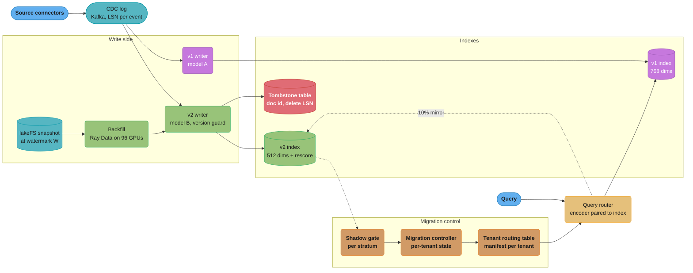
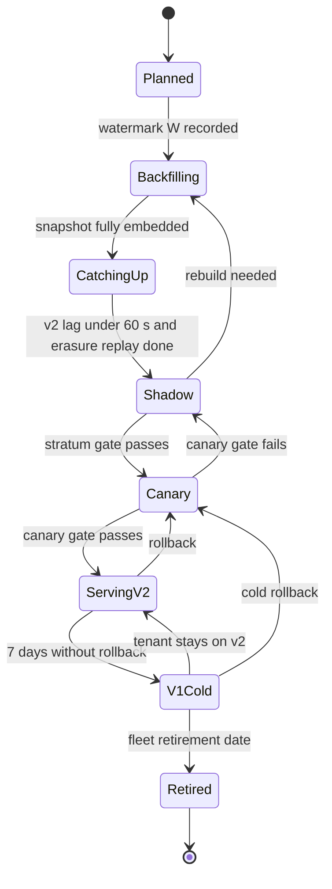
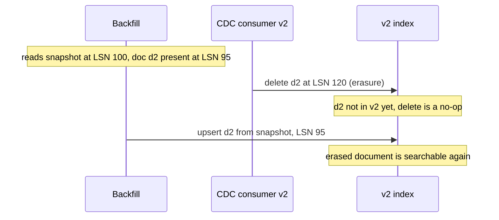
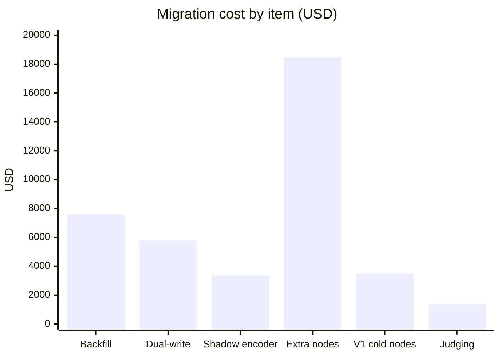

# Design an Embedding Model Migration

> **Version anchor (2026-10-18).** From the mlops pin table: **Ray 2.59.0** (2026-10-02) runs
> the re-embed backfill on Ray Data. **vLLM v0.32.0** serves the new query encoder behind an
> OpenAI-compatible embeddings endpoint. **Kueue v0.20.2** (2026-10-15) holds the borrowed GPU
> quota for the backfill. **KEDA v2.21.0** (2026-09-23) scales the dual-write embed workers.
> **lakeFS v1.88.0** (2026-10-01) holds the corpus snapshot. **MLflow 3.17.1** (2026-10-13)
> holds the encoder registry alias. OpenAI embedding model facts come from the OpenAI embeddings
> guide, checked 2026-10-18. Vector databases (Qdrant, Weaviate, Milvus, OpenSearch) are named
> without a version.
>
> **On prices.** GPU-hour, node-hour and judge-token rates on this page are stated assumptions,
> not list prices. Each dollar figure shows its rate so you can substitute your own.

## Intuition

> **Design intuition**: An embedding model defines a coordinate system. Every vector in the index
> is a point in that system, and every query is encoded into it. Changing the model replaces the
> coordinate system, so all 2 billion stored points become wrong at once, and a query in the new
> system scored against points in the old one returns numbers that look like similarities and mean
> nothing. A migration is therefore not an upgrade of a component. It is the construction of a
> second, complete search system next to the first, kept in exact sync with it for weeks, and then
> a controlled switch of which one answers.

**Key insight for this design**: The GPU re-embed is the part everyone budgets, and it is the
cheap part: about 5,400 GPU-hours and under $8,000 at the rates below. The expensive and risky
part is the window during which two indexes exist. That window costs memory (two indexes in RAM),
it costs correctness work (every delete, ACL change and erasure must reach both indexes and the
in-flight backfill), and it costs judgment (per-tenant gates, rollback readiness). A good design
shortens the window, makes every write to the new index safe against reordering, and treats the
encoder and the index as one artifact that can never be paired wrongly.

---

## 1. Requirements Clarification

### Context

A B2B enterprise search and assistant platform serves 9,000 tenants. It indexes 650 million
documents from connected sources (wikis, ticket systems, file stores, CRM notes) as 2.0 billion
chunks. Model A, a 768-dimension encoder, has embedded every chunk since launch. Model B is a
1024-dimension encoder trained with Matryoshka representation learning. An offline evaluation on
the platform's labeled query set showed nDCG@10 up 4.1 points overall and up 9 points on
non-English queries. Product wants model B in production. Customer contracts forbid sending
customer text to a third-party API, so model B is self-hosted.

### Functional Requirements

- Re-embed all 2.0B chunks with model B and build a complete v2 index.
- Keep v2 in sync with every insert, update, delete, ACL change and erasure that happens while it
  is built and while it waits for cutover.
- Shadow-evaluate v2 on mirrored production queries without any user seeing v2 results.
- Cut over tenant by tenant, with a per-tenant rollback to v1.
- Keep the query encoder and the index paired: a query encoded with model B never searches v1,
  and the reverse.
- Retire v1, its vector store of record and its encoder deployment at the end, with an audit
  record of what was deleted.

### Non-Functional Requirements

- Zero downtime. Retrieval p99 at most 120 ms through the whole migration.
- Freshness: p95 lag from source change to searchable at most 15 minutes, on both indexes.
- ACL: zero cross-principal leaks. A permission change is enforced within 5 minutes on every
  index that serves or shadows the tenant.
- Erasure: a document named in an erasure request is unsearchable within 24 hours and physically
  removed (compacted) within 30 days, from every index, snapshot and vector store.
- Rollback: under 2 minutes for a tenant while v1 is hot, under 30 minutes while v1 is cold.
- Budget: whole migration under $60,000 in infrastructure, completed within 8 weeks.

### Out of Scope

**Not here.** The pages below own these topics. This study links to them and does not repeat
them.

- Choosing model B. Model selection and benchmark design are in
  [Embedding Models](../../llm/rag_fundamentals/embedding_models.md).
- Vector database selection, sharding and HNSW internals. These are in
  [Design a Vector Search Platform](../../database/case_studies/design_vector_search_platform/design_vector_search_platform.md)
  and [Vector Databases](../../database/vector_databases/vector_databases.md).
- The generic index lifecycle (manifest, tombstones, compaction, freshness probes). This study
  builds on [RAG and Vector Index Lifecycle](../rag_and_vector_index_lifecycle/rag_and_vector_index_lifecycle.md)
  and does not repeat it. That module's §14 runs the same procedure at 150M chunks. This study
  is the system design at 2B chunks and 9,000 tenants, where the procedure needs a controller,
  per-tenant state and a cost model.

---

## 2. Scale Estimation

### Corpus and churn

```
Tenants:                      9,000
Documents:                    650M
Chunks:                       2.0B   (512-token windows, 64 overlap)
Mean tokens per chunk:        320    (short tail chunks pull the mean down)
Largest tenant:               140M chunks (7% of the corpus)
Top 50 tenants:               55% of chunks
Duplicate chunks inside one tenant: 9%  (templates, footers, signatures)

Daily churn:
  Upserts:                    40M chunks/day  (2% of corpus)  = 463/s avg, 1,500/s peak
  Deletes:                    3M chunks/day
  ACL-only changes:           25M chunks/day  (folder re-shares touch many chunks at once)
  Erasure-driven doc deletes: about 4,000 docs/day
```

### Re-embed compute

```
Tokens to embed:   2.0B x (1 - 0.09) x 320 = 582.4B tokens
Encoder throughput (assumption, H100, BF16, batch 256, seq 512): 30,000 tokens/s per GPU

GPU-seconds:       582.4B / 30,000         = 19.41M
GPU-hours:         19.41M / 3,600          = 5,393
Preemption overhead (section 4.2):          + 0.5%   = 5,420 GPU-hours
Wall clock on 96 GPUs:                      5,420 / 96 = 56.5 h

Cost at $1.40 per GPU-hour (spot assumption):     $7,588
Cost at $3.00 per GPU-hour (on-demand assumption): $16,260

Dual-write embed during the window (model B only, A runs on the existing fleet):
  40M chunks/day x 320 tokens = 12.8B tokens/day
  12.8B / 30,000 / 3,600       = 118.5 GPU-hours/day  = 5 GPUs running continuously
```

For comparison, a hosted API at the OpenAI `text-embedding-3-small` rate (derived below in §6
as $0.02 per 1M tokens) would charge 582,400 x $0.02 = $11,648 for the same token count. The
self-hosted run is cheaper at spot rates and is the only option the contracts allow. The point of
the comparison is scale: the re-embed is a five-figure line item, not the budget driver.

### Index memory

```
v1 (768 dims, int8 scalar quantization in RAM):
  vectors     2.0B x 768 B          = 1.54 TB
  HNSW graph  2.0B x 32 links x 4 B = 0.26 TB   (layer 0, m = 16)
  total RAM                          = 1.79 TB

v2 full (1024 dims, int8):
  vectors     2.0B x 1024 B         = 2.05 TB
  graph                              = 0.26 TB
  total RAM                          = 2.30 TB

v2 served at Matryoshka 512 dims (int8), rescore top-100 from full 1024 dims on NVMe:
  vectors     2.0B x 512 B          = 1.02 TB
  graph                              = 0.26 TB
  total RAM                          = 1.28 TB
  rescoring copy on NVMe (fp16)      2.0B x 1024 x 2 B = 4.10 TB

Payload (tenant id, doc id, chunk hash, ACL group ids, source LSN): about 200 B/chunk
  = 0.40 TB per index, on NVMe with an in-RAM filter index
```

### Cluster headroom

```
Vector cluster: 32 nodes x 96 GB usable for index RAM = 3.07 TB
v1 alone:                1.79 TB = 58% of RAM
v1 + v2 full:            4.09 TB = 133%   does not fit
v1 + v2 at 512 dims:     3.07 TB = 100%   fits with no headroom, rejected
Target utilization during the window: at most 80%
  Required RAM: 3.07 / 0.80 = 3.84 TB  = 40 nodes, so add 8 nodes for the window
After v1 retires:        1.28 TB on 40 nodes = 33%, so shrink to 20 nodes (67%)
```

The last line matters for the business case: the new index at 512 dimensions is 29% smaller in
RAM than v1. After cutover the cluster shrinks by 12 nodes, which pays back the 8 temporary
nodes in a few weeks (§10).

### Query load and shadow load

```
Retrieval QPS:      2,500 avg, 6,000 peak
Mean query length:  18 tokens
Query encode load (model B at 100%): 6,000 x 18 = 108,000 tokens/s = 4 GPUs at peak, run 8 for HA
Shadow mirror:      10% of queries = 600 QPS peak extra on v2 and on the model B encoder
Shadow queries:     2,500 x 0.10 x 86,400 = 21.6M per day
```

---

## 3. High-Level Architecture



The diagram shows the window. Two writers consume the same CDC log as separate consumer groups.
The backfill feeds the v2 writer from a snapshot, so the v2 writer is the only path into v2 and
the only place that enforces ordering. The query router reads a per-tenant manifest that names
the index and the encoder together. The migration controller moves each tenant through its
states and is the only component that edits the routing table.

### Per-tenant migration state



Backfill is global (one job over the whole snapshot), but every later state is per tenant. A
tenant whose stratum fails the gate stays in Shadow while others move on, so one bad language
or one bad connector does not block 9,000 tenants.

---

## 4. Component Deep Dives

### 4.1 Migration manifest and controller

Each tenant resolves to one manifest. A manifest is an immutable record, and the routing table
maps a tenant to a manifest id. Promotion and rollback change only that mapping.

```yaml
manifest_id: kb-2026-10-v2-tenant-cohort-07
space:
  encoder: registry://embed-b@sha256:5f1c0e
  revision: 5617a9f
  dims_served: 512
  dims_stored: 1024
  normalize: l2
  query_prefix: "query: "
  doc_prefix: "passage: "
index:
  collection: chunks_v2
  snapshot_id: lakefs://kb/main@a91f3c0
  build: { m: 16, ef_construct: 200, quant: int8, rescore_top: 100 }
acl:
  source_watermark_max_age_s: 300
fusion:
  method: rrf
  k: 60
```

The manifest is the index entry of the release bundle. The bundle pins the manifest digest
together with the reranker, prompt and generator versions, so a rollback of the AI feature
restores a consistent retrieval pair as well. The bundle fields and digest rules are in
[AI Release Bundle and Lineage](cross_cutting/ai_release_bundle_and_lineage.md), and the
promotion flow is in [AI Release Engineering](../ai_release_engineering/ai_release_engineering.md).

Three fields in the manifest cause most production failures when they are left implicit:

- **`revision`.** Two revisions of one model share a dimension count. A dimension check does not
  catch a mixed index. The v2 writer refuses any vector whose producer revision differs from the
  manifest.
- **`query_prefix` and `doc_prefix`.** Many encoders are trained with instruction prefixes. A
  query encoded without the prefix lands in a slightly different region of the space. Nothing
  fails, quality drops. The prefix is part of the space definition, not of the client code.
- **`fusion`.** Hybrid search fuses BM25 and vector results. Rank-based fusion (RRF) is unaffected
  by the new model's score distribution. Linear score fusion with a weight tuned on model A
  scores is not, and the weight has to be re-tuned as part of the migration (§9).

The controller is a small service with a database table of tenant states. It runs the transitions
in §3, writes each transition with the gate evidence that allowed it, and exposes one manual
action per tenant: roll back. It never flips a tenant whose ACL watermark on v2 is older than
`source_watermark_max_age_s`.

### 4.2 Re-embed backfill

The backfill reads the lakeFS snapshot taken after watermark W and embeds it on Ray Data, as in
[RAG and Vector Index Lifecycle §6.5](../rag_and_vector_index_lifecycle/rag_and_vector_index_lifecycle.md).
At 2B chunks four extra concerns appear.

**Quota.** 96 H100s for 56.5 hours is borrowed from the training pool through a Kueue
ClusterQueue with a borrowing limit, scheduled over a weekend when training jobs run at about 60%
of their quota. Pool economics, spot blending and preemption handling are in
[GPU Pool Economics](../../llm/case_studies/cross_cutting/gpu_pool_economics.md). Quota policy is in
[GPU Cluster Scheduling and Quotas](../gpu_cluster_scheduling_and_quotas/gpu_cluster_scheduling_and_quotas.md).

**Shards and checkpoints.** The snapshot is split into 40,000 shards of 50,000 chunks. A shard is
16M tokens, or 533 GPU-seconds (about 9 minutes). Each shard writes one parquet file to the v2
vector store of record and one completion row keyed by `(shard_id, encoder_revision)`. A preempted
worker loses on average half a shard plus 3 minutes of model load. At an assumed 4% preemption
rate per GPU-hour, the overhead is 0.04 x 7.5 min / 60 min = 0.5%.

**Dedupe.** Each chunk carries `chunk_hash = sha256(tenant_id, normalised_text)`. The backfill
embeds each distinct hash once per tenant and writes the vector to every chunk id that shares it.
The tenant id is in the hash on purpose: a cross-tenant dedupe would make one tenant's erasure
depend on whether another tenant holds the same text, and it would reveal through timing that the
other tenant does.

**Ordering.** The backfill writes old data. Every row it carries has a source LSN at or below W.
The dual-write consumer is already writing newer rows and deletes into v2. The next section is
the bug that this creates and the guard that removes it.

### 4.3 Dual write and the version guard

The v2 CDC consumer group starts at watermark W before the snapshot is read. From then on, two
writers write into v2: the CDC consumer with fresh events, and the backfill with snapshot rows.
They are not ordered with respect to each other.

#### Broken: unconditional upsert and delete



The first version of the v2 writer did a plain upsert for the backfill and a plain delete for CDC
events. The simulation below reproduces both failures it causes: a stale overwrite of an updated
document and the return of an erased one.

```python
class NaiveIndex:
    def __init__(self):
        self.rows = {}

    def upsert(self, doc_id, lsn, text):
        self.rows[doc_id] = (lsn, text)

    def delete(self, doc_id, lsn):
        self.rows.pop(doc_id, None)          # no row yet: nothing remembered


def run(index):
    snapshot = {"d1": (90, "refund policy v1"), "d2": (95, "Jane Roe address")}
    # CDC events after the snapshot LSN (100), applied before the backfill reaches these docs
    index.upsert("d1", 110, "refund policy v2")
    index.delete("d2", 120)                  # erasure request
    for doc_id, (lsn, text) in snapshot.items():
        index.upsert(doc_id, lsn, text)      # backfill writes from the old snapshot
    return index.rows


broken = run(NaiveIndex())
assert broken["d1"][1] == "refund policy v1"   # stale overwrite
assert "d2" in broken                          # erased document is back
```

On a 56-hour backfill with 3M deletes a day, about 7M deletes land in the window. Every delete
for a document the backfill has not reached yet is lost. In the scenario that found this bug, a
shadow parity check counted 412 erasure-request documents live in v2 and absent from v1 (§9).

#### Fixed: monotonic version guard with tombstones

Every write carries the source LSN. A delete records a tombstone even when the row is absent. An
upsert applies only if its LSN is newer than both the stored row and any tombstone.

```python
class GuardedIndex:
    def __init__(self):
        self.rows = {}
        self.tombstones = {}                 # doc_id -> LSN of the delete

    def upsert(self, doc_id, lsn, text):
        floor = max(self.rows.get(doc_id, (-1, None))[0],
                    self.tombstones.get(doc_id, -1))
        if lsn > floor:
            self.rows[doc_id] = (lsn, text)
            self.tombstones.pop(doc_id, None)

    def delete(self, doc_id, lsn):
        if lsn > self.rows.get(doc_id, (-1, None))[0]:
            self.rows.pop(doc_id, None)
            self.tombstones[doc_id] = max(lsn, self.tombstones.get(doc_id, -1))


fixed = run(GuardedIndex())
assert fixed == {"d1": (110, "refund policy v2")}
```

In production the guard is a conditional write in the vector database (a payload field
`source_lsn` checked in the same request) or, where the database has no conditional upsert, a
check against a key-value store keyed by doc id that the v2 writer consults before it writes.
The tombstone table holds `(doc_id, delete_lsn)` for every delete since W. It is dropped after
the backfill completes and the controller confirms that no shard is still running, because only
the backfill can write rows older than W. At about 1M deleted documents a day, a 4-day backfill
and catch-up leaves 4M rows of 40 bytes, 160 MB. The same guard covers ACL-only changes (§4.5).

### 4.4 Shadow evaluation and gates

Shadow mirrors 10% of production queries to the other index and logs both result lists with the
tenant id, the stratum and the query text. No user sees the shadow results. The general method,
including the two meanings of recall and judging only the disagreement set, is in
[RAG and Vector Index Lifecycle §6.6 and §6.7](../rag_and_vector_index_lifecycle/rag_and_vector_index_lifecycle.md).
The harness that runs the judges is in
[LLM Eval Harness in Production](../../llm/case_studies/cross_cutting/llm_eval_harness_in_production.md).
At 9,000 tenants the design question is how to stratify.

**Strata.** The top 50 tenants (55% of chunks) are their own strata. The other 8,950 tenants are
grouped into 40 cohorts by primary language and connector mix (for example "ja, ticketing" or
"de, file store"). That gives 90 strata. Grouping by language and connector catches the failures
that actually occur: a language where model B is weaker, or a connector whose chunks were parsed
differently.

**Sample per stratum.** 2,000 queries. Per-query recall@10 has a standard deviation of about 0.12,
so the 95% half-width is 1.96 x 0.12 / sqrt(2000) = 0.0053. For the paired nDCG difference the
standard deviation is about 0.08, giving a half-width of 0.0035, which resolves the 0.01
non-inferiority margin. The statistics of these gates, including multiple comparisons across 90
strata, are in [Statistics of Release Gates](../evaluation_gates_and_eval_sets/statistics_of_release_gates.md).

**Gate per stratum.** All must hold:

| Check | Threshold | Catches |
|---|---|---|
| ANN recall@10 vs exact kNN on v2 vectors, lower 95% bound | at least 0.95 | Bad build parameters, quantization loss at 512 dims |
| Paired nDCG@10 (v2 minus v1), lower 95% bound | at least -0.01 | Model B worse for this stratum |
| Empty-result rate increase | at most 0.2 percentage points | ACL or filter breakage, parser differences |
| ACL canary leaks | 0 of 5,000 probes | ACL sync gaps on v2 |
| Erased docs live in v2 and not in v1 | 0 | Write ordering bugs (§4.3) |
| Retrieval p99 on v2 | at most 120 ms | Bigger rescore, worse graph |

The gate evaluator is a pure function of the logged shadow data, so it can be re-run when a
threshold changes:

```python
import math
from dataclasses import dataclass


@dataclass
class Stratum:
    name: str
    ann_recall: list          # per-query recall@10 of v2 ANN against exact kNN on v2 vectors
    ndcg_live: list           # per-query nDCG@10, v1 serving
    ndcg_cand: list           # per-query nDCG@10, v2 candidate, same queries
    empty_live: int           # queries with no hit above the relevance floor
    empty_cand: int
    acl_leaks: int            # restricted canary docs returned to a principal without access
    erased_live_in_cand: int  # erased doc ids still live in v2


def mean_ci(xs, z=1.96):
    m = sum(xs) / len(xs)
    sd = math.sqrt(sum((x - m) ** 2 for x in xs) / (len(xs) - 1))
    return m, z * sd / math.sqrt(len(xs))


def gate(s: Stratum, margin=0.01, empty_pp=0.002):
    reasons = []
    r, h = mean_ci(s.ann_recall)
    if r - h < 0.95:
        reasons.append(f"ann_recall lower bound {r - h:.3f} < 0.95")
    diffs = [c - l for c, l in zip(s.ndcg_cand, s.ndcg_live)]   # paired
    d, h = mean_ci(diffs)
    if d - h < -margin:
        reasons.append(f"ndcg delta lower bound {d - h:+.3f} < -{margin}")
    n = len(s.ndcg_live)
    if (s.empty_cand - s.empty_live) / n > empty_pp:
        reasons.append(f"empty rate up {(s.empty_cand - s.empty_live) / n:.2%}")
    if s.acl_leaks or s.erased_live_in_cand:
        reasons.append(f"leaks={s.acl_leaks} erased_live={s.erased_live_in_cand}")
    return (not reasons), reasons


if __name__ == "__main__":
    import random
    rng = random.Random(7)
    n = 2000
    live = [min(1, max(0, rng.gauss(0.62, 0.2))) for _ in range(n)]
    good = Stratum("tenant-acme", [min(1, rng.gauss(0.975, 0.04)) for _ in range(n)],
                   live, [min(1, max(0, x + rng.gauss(0.03, 0.08))) for x in live],
                   empty_live=8, empty_cand=7, acl_leaks=0, erased_live_in_cand=0)
    bad = Stratum("cohort-ja-legal", good.ann_recall, live,
                  [min(1, max(0, x + rng.gauss(-0.02, 0.08))) for x in live],
                  empty_live=8, empty_cand=62, acl_leaks=0, erased_live_in_cand=0)
    for s in (good, bad):
        ok, why = gate(s)
        print(s.name, "PASS" if ok else "BLOCK", why)
    assert gate(good)[0] and not gate(bad)[0]
```

Running it prints `tenant-acme PASS []` and
`cohort-ja-legal BLOCK ['ndcg delta lower bound -0.023 < -0.01', 'empty rate up 2.70%']`.

**Labels.** nDCG needs relevance labels. Human labels exist for 6,000 queries in total, far below
90 x 2,000. The design uses an LLM judge on the disagreement set: for each shadow query, the
union of v1 and v2 top-10 is judged once per (query, chunk) pair, so chunks both indexes return
are judged once. With 35% top-10 disagreement, 180,000 judged queries need about 180,000 x 13
chunks = 2.3M pair judgments. The judge is calibrated against the 6,000 human-labeled queries
before it is trusted, and the judge prompt and model are pinned in the eval-set version, as
described in [Evaluation Gates and Eval Sets](../evaluation_gates_and_eval_sets/evaluation_gates_and_eval_sets.md).

**Eval set hygiene.** The golden set is a dataset with its own version. Erasures remove golden
queries whose expected documents were erased; otherwise every erased document shows as a v2
regression. The versioning rules are in
[Dataset and Label Versioning](../dataset_and_label_versioning/dataset_and_label_versioning.md).

### 4.5 ACL and erasure consistency across two indexes

ACL and erasure are where a migration turns into a security incident. During the window there
are four copies of each chunk's permissions: the source system, v1 payload, v2 payload, and any
row in flight in the backfill. The tenant isolation patterns used here (tenant filter in the
router, ACL group filter in the index, late check against the source for restricted corpora)
are described in [Tenant Isolation Patterns](../../llm/case_studies/cross_cutting/tenant_isolation_patterns.md).
The migration adds three rules.

**ACL changes are writes with an LSN.** A folder re-share emits one ACL event per affected
chunk, carrying the source LSN. Both CDC consumer groups apply it as a metadata-only patch, and
the v2 writer applies it through the same version guard as content writes. A backfill row older
than the ACL patch is rejected by the guard and re-read from the source by the catch-up step,
instead of overwriting the newer ACL with the snapshot's ACL.

**Each index has its own ACL watermark.** The watermark is the highest ACL-event LSN applied to
that index. The router fails closed for restricted corpora when the watermark of the index it is
about to search is older than 300 seconds. The controller refuses a cutover when the v2 watermark
trails v1 by more than 60 seconds.

**Canary principals.** Every stratum gets canary documents with ACLs restricted to a synthetic
principal. A probe searches as a different synthetic principal for an exact canary token, on
both indexes, every 5 minutes. A hit is a leak. It catches a filter bug in the v2 collection's
payload schema, which produces no error and no alert of its own.

**Erasure parity.** An erasure request is fanned out by an erasure service that records one row
per location: source, chunk store, v1 vector store of record, v2 vector store of record, v1 index,
v2 index, the tombstone table, snapshots, semantic cache, eval sets, traces. The request is closed
only when every row is acknowledged. Two migration-specific locations are easy to miss:

- **The v2 parquet store of record written by the backfill.** It was written from a snapshot
  older than the erasure. The erasure service deletes from it by doc id, and the parquet
  compaction job rewrites affected files within the 30-day SLA.
- **v1 after cutover.** v1 stays as the rollback target. It keeps consuming deletes and erasures
  until it is retired. A v1 that stops consuming deletes at cutover becomes a rollback that
  restores erased data.

The daily parity job computes, per tenant, the set of doc ids live in v1 and not in v2 and the
reverse, restricted to doc ids with an erasure or delete since W. Both sets must be empty.

### 4.6 Cutover, rollback and retirement

**Waves.** The controller moves tenants from Shadow to Canary in waves, sized by query share so
that each wave carries a bounded part of the traffic:

| Wave | Tenants | Share of queries | Minimum time in Canary |
|---|---|---|---|
| 1 | 200 internal and design-partner tenants | 2% | 3 days |
| 2 | 2,000 small tenants from passing cohorts | 10% | 2 days |
| 3 | remaining cohorts and the top-50 tenants ranked 26 to 50 | 40% | 3 days |
| 4 | top 25 tenants, one at a time | 48% | 2 days each, overlapped 5 at a time |

Within Canary a tenant serves v2 to a hashed 20% of its users for the first day, then 100%. The
canary signals are online: click-through on cited sources, answer-feedback rate, empty-result
rate and support tickets tagged "search". Traffic-split mechanics are in
[Progressive Delivery for Model Servers](../progressive_delivery_for_model_servers/progressive_delivery_for_model_servers.md),
and quality monitoring after cutover is in
[Production Quality Monitoring and Drift](../production_quality_monitoring_and_drift/production_quality_monitoring_and_drift.md).

**Routing is one lookup.** The router resolves the manifest per request from a cached routing
table with a 10-second TTL. A rollback writes one row. With the cache TTL and the 30-second
connection drain on the encoder pool, a tenant is fully back on v1 in under 1 minute.

```python
from dataclasses import dataclass


@dataclass(frozen=True)
class Manifest:
    index: str
    encoder_rev: str
    dims: int
    query_prefix: str

    @property
    def space(self):
        return f"{self.encoder_rev}:{self.dims}"


def search(tenant, text, routing, encoders, indexes, cache):
    m = routing[tenant]
    key = (m.space, tenant, text)              # cache never crosses spaces
    if key in cache:
        return cache[key]
    vec = encoders[m.encoder_rev](m.query_prefix + text, m.dims)
    if indexes[m.index].space != m.space:
        raise RuntimeError(f"{m.index} holds {indexes[m.index].space}, query is {m.space}")
    hits = indexes[m.index].search(vec, k=10, tenant=tenant)
    cache[key] = hits
    return hits
```

The cache key includes the space id. A semantic cache keyed on query text alone serves v1
answers to v2 tenants after cutover and v2 answers after a rollback, which hides both the
improvement and the regression from the canary metrics. Cache design is in
[LLM Caching](../../llm/llm_caching/llm_caching.md).

**Hot and cold rollback.** For 7 days after a tenant reaches ServingV2, its v1 shards stay in
RAM. After that the controller moves the tenant to V1Cold: v1 shards are kept on NVMe as
memory-mapped segments, still consuming deletes, ACL changes and erasures. A cold rollback reloads
the shards into RAM (a 140M-chunk tenant is 125 GB, about 20 minutes at an aggregate 100 MB/s
from the memory-mapped NVMe segments) and then flips the routing row.

**Retirement.** When every tenant has been in V1Cold for 14 days, the controller schedules
retirement: delete the v1 collection, the v1 vector store of record, the model A deployment and
its registry alias, and write the retirement record into the lineage store. The cluster shrinks
from 40 to 20 nodes after v1 RAM is freed.

---

## 5. Design Decisions & Tradeoffs

### 5.1 Migration strategy

| Strategy | Correct during window | Peak RAM | Rollback | When it fits |
|---|---|---|---|---|
| Dual index, per-tenant cutover (chosen) | Yes | v1 + v2 | Per tenant, under 1 min hot | Multi-tenant, ACLs, erasure, zero downtime |
| Dual index, global alias flip | Yes | v1 + v2 | Global, under 1 min | Single-tenant corpus, one quality profile |
| In-place re-embed | No, mixed spaces | v1 | None | Never for a served index |
| Lazy re-embed on read or write | No, unmigrated chunks unreachable | v1 | None | A cache, not an index |
| Projection adapter, then background re-embed | Partial | v1 + adapter | Remove adapter | Re-embed takes weeks, for example an API rate limit |
| Two named vectors in one collection | Yes | v1 + v2 in the same segments | Switch the vector name | Database supports adding a named vector; ACL and delete apply once per record |

The named-vector option is a real alternative. Weaviate documents adding a named vector to an
existing collection, each with its own index and compression (§6), and Qdrant points can hold
several named vectors. One record holding both vectors means one delete and one ACL patch reach
both spaces, which removes most of §4.5. The costs: the second vector is added by rewriting every
record (the same write volume as a new collection), compaction and segment size double for the
whole window, and retirement means rewriting every record again to drop the old vector. This
design chose separate collections because the vector database in use does not support adding a
named vector without a collection rebuild, and because separate collections let v1 move to NVMe
per tenant. With a database that adds named vectors in place, that tradeoff flips for corpora
with heavy ACL churn.

### 5.2 Dimensions served

| Option | v2 RAM | Extra nodes in window | nDCG@10 vs 1024 dims (offline) |
|---|---|---|---|
| 1024 dims int8 | 2.30 TB | 22 | 0 |
| 512 dims int8 + rescore top 100 from 1024 fp16 on NVMe (chosen) | 1.28 TB | 8 | -0.2 points |
| 256 dims int8 + rescore | 0.77 TB | 2 | -1.9 points |
| 1024 dims binary + rescore | 0.51 TB | 0 | -0.8 points, recall gate fails on 3 cohorts |

The extra-node counts assume the 80% RAM target from §2. Matryoshka truncation works only
because model B was trained for it. Truncating a model that was not trained that way drops
quality far more.

### 5.3 Self-hosted re-embed versus hosted API

| Factor | Self-hosted on borrowed GPUs | Hosted embedding API |
|---|---|---|
| Cost for 582B tokens | $7,588 at $1.40/GPU-hour | $11,648 at $0.02 per 1M tokens |
| Wall clock | 56.5 h on 96 GPUs | Bound by the account rate limit |
| Data leaves the boundary | No | Yes, blocked by contract here |
| Model pinning | Registry digest | Provider model id; the provider controls retirement |
| Query-time dependency | Own encoder pool | Every query calls the provider |

The last row outlasts the migration: a hosted encoder makes the provider's
deprecation schedule your migration schedule.

### 5.4 Hot rollback window length

Keeping v1 hot costs the 8 extra nodes. Each day of hot window for the whole fleet costs
8 x 24 x $2.60 = $499 at the node assumption. Per-tenant waves keep only the last waves' tenants
hot at a time. The 7-day hot window was chosen because 90% of the canary regressions in earlier
index releases on this platform showed within 4 days; the remaining tail is covered by the cold
rollback, which is slower but still inside a business day.

Cost of the whole migration and of each choice is tracked against the unit-economics model in
[AI Cost Engineering and Unit Economics](../ai_cost_engineering_and_unit_economics/ai_cost_engineering_and_unit_economics.md).

---

## 6. Real-World Implementations

**Notion** published "Two years of vector search at Notion" on February 19, 2026. Notion AI Q&A
launched in November 2023 on a pod-based vector database sharded by workspace id. In December
2023, as indexes neared capacity, Notion added "generations": new index sets that received new
workspaces without re-sharding the old ones. In May 2024 the embeddings moved to a serverless
vector database, and from late 2024 Notion migrated to turbopuffer with a full re-index of the
corpus and a switch to a newer embedding model. The cutover was gradual, one generation at a
time, with correctness validated before moving on. Bulk loading used the offline Spark batch
path while Kafka consumers handled live edits, the same split as the backfill and CDC writers
here. Notion reports a 60% cut in search engine spend, a 35% cut in AWS EMR compute, and p50
query latency moving from 70-100 ms to 50-70 ms. A later change, Page State, stores xxHash64
values per span in DynamoDB so that only changed spans are re-embedded and permission-only
changes skip embedding and patch the vector database directly; Notion reports a 70% cut in data
volume from it. That is the same split as ACL-only patches in §4.5. In July 2025 Notion
began moving its near real-time embedding pipeline to Ray, with Ray Serve for query embeddings;
the post describes that move as still rolling out.

**GitHub** announced a new embedding model for Copilot code retrieval in VS Code on September 24,
2025. GitHub reports a 37.6% relative lift in retrieval quality (average score 0.362 to 0.498 on
its multi-benchmark evaluation), about 2x embedding throughput, and an index memory footprint
about 8x smaller. The capacity lesson matches §2: a new model can shrink the index, so the
migration plan has a cost peak during the window and a lasting saving after it. The post does not
describe how the index was rebuilt or rolled out.

**OpenAI** lists its embedding models in the API embeddings guide (checked 2026-10-18).
`text-embedding-ada-002` scores 61.0% on MTEB, `text-embedding-3-small` 62.3% and
`text-embedding-3-large` 64.6%. The guide gives cost as pages per dollar at about 800 tokens per
page: 12,500 for ada-002, 62,500 for 3-small and 9,615 for 3-large, which works out to $0.10,
$0.02 and $0.13 per 1M tokens. The `dimensions` parameter shortens embeddings; the guide states that a
`text-embedding-3-large` vector shortened from 3,072 to 256 dimensions still outperforms an
unshortened ada-002 vector. Two lessons for migrations on a hosted API: the provider model id is
the version pin, and the 1.3-point MTEB gain from ada-002 to 3-small says little about a specific
corpus, which is why §4.4 gates on the platform's own queries.

**Weaviate** documents named vectors per collection, where each vector space sets its own index,
compression and vectorizer, and states that named vectors can be added to a single-vector
collection later. That makes the two-vectors-per-record strategy in §5.1 available without a new
collection.

---

## 7. Technologies & Tools

| Concern | Tool (pin) | Role here |
|---|---|---|
| Backfill compute | Ray Data, Ray 2.59.0 | Actor pool running model B, writes parquet per shard |
| GPU quota | Kueue v0.20.2 | ClusterQueue with borrowing from the training pool |
| Query encoder serving | vLLM v0.32.0 | OpenAI-compatible embeddings endpoint for model B |
| Dual-write scaling | KEDA v2.21.0 | Scales v2 embed workers on Kafka consumer lag |
| Corpus snapshot | lakeFS v1.88.0 | Commit at watermark W, read by the backfill |
| Encoder registry | MLflow 3.17.1 | Alias `embed-prod` per space, digest in the manifest |
| Change log | Kafka (no pin) | CDC with LSN, one consumer group per index |
| Vector index | Qdrant, Weaviate, Milvus or OpenSearch (no pin) | Two collections, conditional upsert on `source_lsn` |
| Tombstones and routing | Any key-value store with conditional writes | Tombstone table, tenant routing table |
| Judges | Eval harness of the platform | Disagreement-set judging, calibrated on human labels |

---

## 8. Operational Playbook

### Runbook: start the migration

1. Freeze the manifest for v2 (encoder digest, revision, prefixes, dims, build parameters) and
   register it.
2. Run the capacity check in §10 with the current churn and node counts. Stop if v1 + v2 exceeds
   80% RAM after the planned extra nodes.
3. Add the extra vector nodes and wait for rebalancing to finish.
4. Create the v2 collection with the `source_lsn` payload field and its conditional-upsert rule.
5. Start the v2 CDC consumer group at the current offset and record it as watermark W.
6. Commit the lakeFS snapshot after W and record its id in the manifest.
7. Admit the backfill job to the borrowed Kueue queue.
8. Optional: run the backfill on 1% of shards first and check ANN recall on that sample before
   committing 5,400 GPU-hours.

### Runbook: catch-up and shadow entry

1. Wait until all shards report complete for the manifest revision.
2. Replay the erasure log from W into v2 and into the v2 parquet store of record.
3. Wait until v2 consumer lag is under 60 seconds and the v2 ACL watermark is within 60 seconds of
   v1.
4. Run the parity job. Both difference sets must be empty.
5. Drop the tombstone table.
6. Turn on the 10% shadow mirror.

### Dashboards

| Metric | Per | Alert |
|---|---|---|
| Backfill shards done per hour | job | Under 600 for 1 hour (plan is 708) |
| v2 consumer lag | partition | Over 5 min |
| ACL watermark gap v2 minus v1 | index | Over 60 s |
| Erased docs live in v2 not in v1 | tenant | Any |
| ACL canary leak | stratum | Any, pages security on-call |
| Shadow empty-result rate delta | stratum | Over 0.2 pp |
| Writes rejected by version guard | writer | Report only; a sudden spike means a replay loop |
| Retrieval p99 | index, tenant | Over 120 ms |
| Vector cluster RAM | node | Over 85% |
| Freshness probe p95 | connector, index | Over 15 min |

SLO and error-budget math for the retrieval and freshness SLOs is in
[SLO Error Budget Math](../../devops/case_studies/cross_cutting/slo_error_budget_math.md).

### Runbook: rollback a tenant

1. Write the tenant's routing row back to its v1 manifest.
2. If the tenant is in V1Cold, load its v1 shards into RAM first and wait for the shard-ready
   check.
3. Confirm the semantic cache entries for the v2 space are no longer served for the tenant (the
   space id in the key makes this automatic; check the hit rate drops for that space).
4. Keep v2 consuming CDC for the tenant so a retry does not need a new backfill.
5. Record the rollback reason against the gate evidence in the controller.

---

## 9. Common Pitfalls & War Stories

The scenarios below are failures this design guards against, with the numbers from this
platform's scale. They are illustrations built on §2, not reports from a named company.

**Erasure resurrection through the backfill.** The first v2 writer used plain upserts (§4.3).
The parity job, added late, found 412 documents under erasure requests live in v2 and absent in
v1, all deleted during the 56-hour backfill. v2 was still in shadow, so no user saw them, but
shadow logs held their text for 7 days and had to be purged as well. The fix was the version
guard plus tombstones. Impact avoided: 412 erasure-SLA breaches, each a reportable incident under
the customer data processing agreements.

**Missing query prefix.** Model B expects `query: ` on queries and `passage: ` on documents. The
backfill used the document prefix, the shadow router did not add the query prefix. Shadow nDCG@10
came in 2.3 points below v1 instead of 4.1 points above, and the migration nearly stopped on a
"model B is worse" verdict. Moving the prefixes into the manifest and making the router read them
recovered the expected 4.1-point gain. Cost of the detour: 9 days and one discarded shadow week.

**Mutable encoder tag.** One pool of dual-write workers pulled the encoder image by a mutable tag
and received a patched revision mid-window. 3.1% of chunks written during those 2 days carried
vectors from revision B' in an index of revision B. Recall on those chunks fell from 0.97 to
0.61, invisible in the aggregate. The manifest revision check in the v2 writer now rejects such
writes; the affected 2.5M chunks were re-embedded in about 7.4 GPU-hours
(2.5M x 320 tokens / 30,000 tokens/s).

**Linear fusion weight tuned on model A.** Hybrid search combined `0.7 x cosine + 0.3 x bm25_norm`.
Model B's cosine scores sit in a narrower band (0.55 to 0.80 versus 0.30 to 0.90), so the vector
term stopped dominating and BM25 decided most rankings. Shadow nDCG on keyword-heavy cohorts was
fine, on paraphrase-heavy cohorts it dropped 3 points. Switching the manifest to RRF removed the
dependence on score scale.

**ACL patch reached only v1.** A connector team shipped a permission-sync fix that wrote ACL
patches through a direct client for v1 instead of through the CDC log. 18,000 chunks in one
tenant kept a wider ACL in v2. The canary probe did not catch it (canaries were not in that
folder); the empty-result and late-check rejection counters did: the late check against the
source removed 6% of v2 candidates for that tenant versus 0.1% on v1. Rule since then: the CDC
log is the only path into any index, and a write from any other path fails the writer's producer
check.

**Backfill without shard checkpoints.** A rehearsal on 1% of the corpus split work by tenant. The
largest tenant's task ran about 4 GPU-hours on one worker (1.4M chunks); spot preemptions
restarted it three times, and other large-tenant tasks restarted as well.
31% of the rehearsal's GPU-hours were wasted. Fixed-size shards of 50,000 chunks cut the waste to
0.5%.

**Semantic cache crossing spaces.** The answer cache was keyed on normalized query text. For the
first 2 days of wave 1, 22% of queries from cut-over tenants were served from cached v1 answers,
which diluted the canary signal to near zero. Adding the space id to the key (§4.6) restored a
clean canary.

**Eval set holding erased documents.** 140 golden queries pointed at documents erased since the
eval set was built. They scored zero on v2 (where the documents were never written) and full
marks on v1 (where compaction had not run yet), producing a fake 0.7-point regression in two
strata. Erasure now updates eval sets in the same fan-out.

---

## 10. Capacity Planning

### Timeline

| Phase | Duration | GPU | Extra vector nodes |
|---|---|---|---|
| Rehearsal on 1% of shards | 2 days | 96 GPUs for 0.6 h | 0 |
| Add nodes and rebalance | 1 day | 0 | 8 |
| Backfill | 2.4 days (56.5 h) | 96 | 8 |
| Catch-up, erasure replay, parity | 1 day | 5 (dual-write) | 8 |
| Shadow | 7 days minimum | 5 + 8 encoder | 8 |
| Waves 1 to 4 in Canary | 18 days (3 + 2 + 3 + 10) | 5 + 8 encoder | 8 |
| Hot window for the last wave | 7 days | 5 + 8 encoder | 8 |
| V1Cold for the last wave | 14 days | 0 for A after cutover | 4 (v1 on NVMe needs disk, not RAM) |
| Retirement and shrink | 1 day | 0 | -12 from the original 32 |

Total: about 53 days from rehearsal to retirement, inside the 8-week (56-day) requirement.

### Cost

```
Backfill embed:          5,420 GPU-h x $1.40                       =  $7,588
Dual-write embed:        118.5 GPU-h/day x 35 days x $1.40         =  $5,807
Shadow encoder (model B, 8 GPUs, part already needed for serving):
                         8 x 24 x 25 days x $1.40, half attributed =  $3,360
Extra vector nodes:      8 x 24 x 37 days x $2.60                  = $18,470
                         4 x 24 x 14 days x $2.60                  =  $3,494
Judging:                 2.3M pair judgments x 600 tokens = 1.38B tokens
                         at $1.00 per 1M input tokens (assumption) =  $1,380
v2 store of record:      4.1 TB parquet in object storage for 2 months, about $200
Total infrastructure:                                              ≈ $40,300
```



The extra vector nodes are 46% of the bill; the backfill is 19%. Shortening the dual-index window
is worth more than any backfill optimization.

### Payback

```
Before:  32 nodes x 24 x 30 x $2.60 = $59,904 per month
After:   20 nodes x 24 x 30 x $2.60 = $37,440 per month
Saving:  $22,464 per month
Payback of $40,300: 1.8 months
```

Model B at 512 dimensions is smaller in RAM than model A at 768 dimensions. Without the
Matryoshka truncation the cluster after migration would need 2.30 / (0.67 x 96 GB) = 36 nodes,
more than today, and the migration would raise the run rate by about $7,500 per month instead of
cutting it.

### Growth

At 30% annual corpus growth, the next migration in 18 months starts from about 3.0B chunks
(2.0B x 1.3^1.5). Backfill grows linearly, to about 8,000 GPU-hours at the same throughput. The dual-index RAM grows with it,
so the saving from moving v1 to NVMe tenant by tenant grows with every migration.

---

## 11. Interview Discussion Points

**Q: Why can't you re-embed the corpus in place, or lazily as documents are read?**

**Short:** Vectors from two models live in different spaces; any mixed index has chunks that no query encoder can find, and there is no rollback.

A query is encoded with exactly one model. During an in-place re-embed, chunks still in model A
space are scored against a model B query, and the similarity is a number with no meaning, so
those chunks are unreachable or randomly ranked. Switching the query encoder halfway just moves
which half is unreachable. Lazy re-embedding has the same problem permanently: a chunk that is
never read is never migrated and never found. Both strategies also destroy the old index, so
there is nothing to roll back to. The only correct shape is a complete second index plus a
switch.

**Q: Where does the money go in this migration, and how would you cut it?**

**Short:** Into the dual-index window (extra RAM nodes, 46%), not the GPU backfill (19%); cut the window with per-tenant cutover, smaller vectors and v1 on NVMe.

The re-embed is 5,420 GPU-hours, $7,588 at the spot assumption. Holding v1 and v2 in RAM needs 8
extra nodes for 37 days, $18,470, plus the cold window. Levers: Matryoshka truncation of v2 to
512 dims (cuts the extra nodes from 22 to 8), per-tenant waves so only recent tenants keep v1
hot, moving v1 to NVMe after 7 days instead of keeping it in RAM, and a rehearsal on 1% of shards
so the full backfill runs once. A principal answer also notes the payback: the smaller v2 lets the
cluster shrink from 32 to 20 nodes, so the migration pays for itself in under 2 months.

**Q: How do you make sure a document erased during the backfill does not come back?**

**Short:** Every write carries the source LSN; deletes leave tombstones; an upsert applies only if newer than the stored row and any tombstone.

The backfill writes rows from a snapshot older than every CDC event it races with. A plain delete
on a row the backfill has not written yet is a no-op, and the backfill then writes the row. The
fix is one rule at the v2 writer: a delete records `(doc_id, delete_lsn)` even if the row is
absent, and an upsert succeeds only when its LSN exceeds both the stored row's LSN and the
tombstone. The same guard stops stale overwrites of updated documents and of ACL patches. The
tombstone table can be dropped once the backfill has finished, because only the backfill writes
rows older than the watermark. A daily parity job checks for erased doc ids live in one index and
not the other.

**Q: Model B wins on MTEB and on your offline set. Why do you still need a shadow week?**

**Short:** Offline sets miss your production query mix, languages, connectors and ACL filters; shadow measures v2 on real traffic per stratum before any user sees it.

Benchmarks and offline sets measure the model. Shadow measures the system: the build parameters,
the quantization at 512 dims, the payload schema the ACL filter reads, the parser output per
connector, and the real query length distribution. Most failures found in shadow are not model
quality at all: an ACL group-id mismatch, a missing query prefix, a filter field typed differently.
Shadow also gives per-stratum results, which an aggregate offline number hides: a 4-point overall
gain can include a 2-point loss in Japanese legal tenants.

**Q: Why cut over per tenant instead of one alias flip?**

**Short:** 9,000 tenants differ in language, connectors and risk; per-tenant state lets passing tenants move while failing strata wait, and caps blast radius.

A global flip ties every tenant to the worst stratum: either everyone waits for the slowest fix,
or the team flips with a known regression for some tenants. Per-tenant routing lets 85 strata
move while 5 stay in shadow. It caps the blast radius of an unknown problem to one wave. It also
lets v1 shards move to NVMe tenant by tenant, which shrinks the costly window. The cost is a
routing table, a controller with per-tenant state, and two indexes queried in production at the
same time for weeks, which means every operational metric needs an index dimension.

**Q: What decides how fast you can roll back, and how do you keep that promise cheaply?**

**Short:** Whether v1 is hot in RAM and still consuming every delete and ACL change; hot rollback is a routing-row write, cold is a shard reload.

Rollback is a write to the routing table plus a 10-second cache TTL and a 30-second encoder
drain, under 1 minute, as long as v1 is in RAM. After 7 days the tenant's v1 shards move to NVMe
and a rollback first reloads them, about 20 minutes for the largest tenant. The part people miss
is that v1 must keep consuming deletes, ACL changes and erasures the whole time. A v1 frozen at
cutover is not a rollback target, it is a backup that reintroduces erased data and stale
permissions.

**Q: How do you keep ACLs consistent across two indexes and an in-flight backfill?**

**Short:** ACL changes go through the CDC log with an LSN, pass the same version guard, and each index tracks its own ACL watermark; the router fails closed when it is stale.

Treat an ACL change as a write, not a side channel. Both consumer groups apply it as a metadata
patch, ordered by LSN, so a backfill row with an older ACL cannot overwrite it. Each index
publishes the highest ACL LSN it has applied, and the controller refuses a cutover when v2 trails
v1. Canary documents with restricted ACLs are probed on both indexes every 5 minutes. For
restricted corpora a late check against the source system on the final top-k catches whatever
the payload filter missed, at the cost of one source call per query.

**Q: Would you use a hosted embedding API for the re-embed?**

**Short:** Only if contracts allow customer text to leave and the provider's deprecation schedule is acceptable as your migration schedule.

At the derived $0.02 per 1M tokens the API costs about $11,600 for 582B tokens, about 1.5 times
the self-hosted spot cost and below the on-demand cost. The money is not the deciding factor. The API sends customer text to a
third party, which these contracts forbid. It also moves the query-time encoder outside your
control: every search calls the provider, and when the provider retires the model id you migrate
on their timetable. Rate limits can stretch a 56-hour backfill into weeks, which in turn
lengthens the expensive dual-index window.

**Q: Why does hybrid search need attention during an embedding migration?**

**Short:** Linear score fusion depends on the vector score scale, which changes with the model; rank-based fusion such as RRF does not.

With `score = w x cosine + (1 - w) x bm25_norm`, the weight was tuned on model A's cosine range.
Model B's scores sit in a different band, so the same weight gives the vector side more or less
influence, and quality moves for reasons unrelated to model quality. Reciprocal rank fusion uses
ranks only, so the model swap does not change the fusion. If linear fusion is required, the
weight becomes a manifest field, re-tuned on the shadow data, and gated with the index.

**Q: How do you size and stratify the shadow evaluation?**

**Short:** 90 strata (top 50 tenants plus 40 language-and-connector cohorts), 2,000 queries each; that resolves a 0.01 nDCG margin and a 0.95 recall bound.

Per-query recall@10 has a standard deviation around 0.12, so 2,000 queries give a 95% half-width
of 0.0053. The paired nDCG difference has a standard deviation around 0.08, giving 0.0035, enough
to test non-inferiority at 0.01. Stratify by what actually breaks: language (model strengths
differ), connector (parsers differ), and the largest tenants (contractual exposure). With 90
strata and a 5% error rate per test, about 4.5 strata fail by chance in expectation; the gate either corrects for
multiple comparisons or re-runs failed strata on a fresh sample before blocking them.

**Q: What must the release bundle pin so that spaces can never mix?**

**Short:** One index manifest naming the index and the encoder digest, revision, prefixes, dims and fusion method together; the bundle pins the manifest digest.

If the encoder and the index are versioned separately, some deploy will pair them wrongly: a
query service rolled forward while the index rolled back, or an encoder pulled by a mutable tag.
The manifest makes the pair one artifact. The bundle pins its digest next to the reranker, prompt
and generator, so an AI-feature rollback restores a consistent retrieval stack. Writers check
producer revision against the manifest; the router reads the encoder only from the manifest.

**Q: When would you advise against doing this migration at all?**

**Short:** When the measured gain on your own queries is small, the window cost is large, or a cheaper fix (reranker, chunking, hybrid weights) recovers most of the gain.

The migration costs about $40,000 in infrastructure, 7 to 8 weeks, and a period during which
every delete and ACL change has two targets. If shadow on a 1% sample shows under 1 point of
nDCG gain, or the gain is concentrated in a few strata, a reranker upgrade or a per-cohort
change may deliver most of it without touching 2B vectors. A principal answer also checks the
cadence: if a better model is expected within 6 months, investing in the controller, routing
table and version guard now makes that next migration a routine run, while a one-off script makes
each migration a project.
