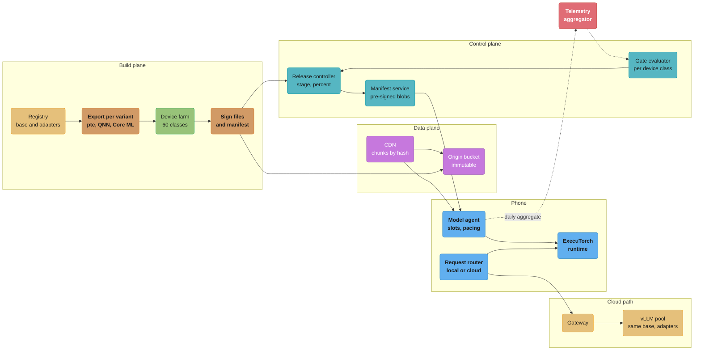
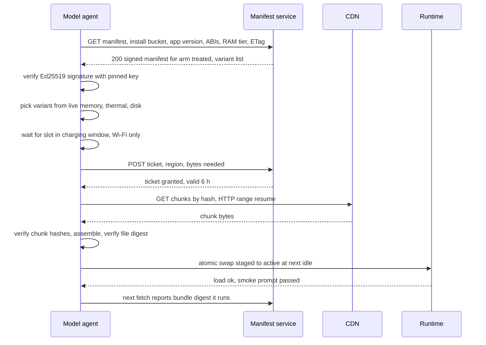
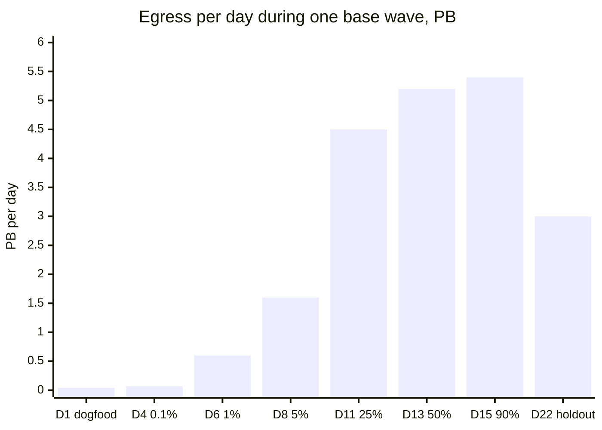

# Case Study: Design an On-Device Model Delivery System

> **Version anchor (2026-10-18).** **ExecuTorch v1.5.1** (2026-09-23); the v1.5.0 notes add
> schema-version checks for `.pte` and `.ptd` files and multi-method export. **llama.cpp**
> stable **v0.7.0** (2026-10-15) and rolling build **b11719** (2026-10-18, pre-release).
> **model-transparency v1.1.1** (OpenSSF Model Signing, 2025-10-10); v1.1.0 added PKCS#11 signing,
> private Sigstore instances and BLAKE3 hashing. **vLLM v0.32.0** for the cloud fallback pool.
> Facts read from primary docs on 2026-10-18: Google Play for On-device AI (beta; AI packs up to
> 1.5 GB compressed, 4 GB cumulative per app version, device targeting by SoC, RAM, device model
> and system features); Apple Foundation Models adapter toolkit (one adapter per system model
> version, about 160 MB each, toolkit 26.0.0 not compatible with OS 27); Microsoft Phi Silica
> page (updated 2026-10-12). Core ML, LiteRT and Qualcomm QNN are named without versions.

## Intuition

> **Design intuition.** A server model release changes one environment that runs many replicas.
> A phone model release changes 36 million environments that run one replica each, on hardware
> you do not own, over networks you do not control, and some of those phones will not check in
> for a week. The model is the easy part. The system around it decides which bytes go to which
> phone, when, how the phone proves the bytes are yours, how you learn the model is bad without
> reading anyone's text, and how you turn it off on a phone that is offline.

**Mental model.** Treat the fleet as a CDN-fed, eventually consistent database of model slots.
The control plane writes the desired state (a signed manifest per cohort and device class), the
CDN moves immutable chunks, and each phone converges toward the desired state when it is on
Wi-Fi and charging. Rollout, rollback and kill switch are all writes to desired state. None of
them is instant, so every design choice is about bounding how long the fleet can disagree with
the control plane.

**Key insight for this design.** The bill is bytes, not tokens. A 1.7 GB base downloaded by 24M
phones is 41 PB before one prompt runs. Freeze the base for months, ship behavior changes as
adapters of tens of megabytes, pace downloads into charging windows, and keep a cloud path sized
for the day you switch the local model off.

---

## 1. Requirements Clarification

### Context

Quill is a mail and notes app with 50M monthly active phones (65% Android, 35% iOS) and 30M
daily active users. It ships four language features: summarize a thread, suggest replies,
rewrite tone, and extract action items. Today every request goes to a cloud model. Product
wants the features on-device for privacy and offline use, and finance wants the cloud bill
cut. The ML team has a 3B base with one LoRA adapter per feature, and a 1B base with three
adapters for mid-range phones.

### Functional Requirements

- Deliver a 3B base (about 1.7 GB at 4-bit) and per-feature adapters (about 49 MB each) to
  eligible phones, and a 1B base (about 0.6 GB) with adapters (about 22 MB each) to the next tier.
- Ship a feature change as an adapter-only update without an app release.
- Stage every release by cohort: dogfood, 0.1%, 1%, 5%, 25%, 50%, 90%, with a 10% holdout.
- Choose the variant per phone from static facts on the server (RAM tier, SoC, app version,
  runtime ABI) and live facts on the phone (available memory, thermal state, low-power mode).
- Fall back to a cloud path per request when the phone is not eligible, the model is not ready,
  or the local run fails, with the same prompt template and adapter version on both paths.
- Roll back an adapter or a base by manifest change, and disable a variant per device class
  or fleet-wide, including on phones that are offline when the decision is made.
- Report aggregate, content-free telemetry that is good enough to gate each stage.
- Run a base upgrade campaign about twice a year: new base, every adapter retrained against it.

### Non-Functional Requirements

| Requirement | Target |
|---|---|
| Adapter fix reaches online eligible phones | 90% within 72 hours of the full stage |
| Rollback of an adapter on phones that fetch the manifest | Next fetch, no download (previous slot kept) |
| Exposure bound for an offline phone after a kill | 72 hours (manifest TTL) |
| Peak CDN egress during a base wave | Under 1 Tbit/s per region, agreed with the CDN |
| Manifest service availability | 99.95%; a manifest outage must not stop local inference |
| Crash-free sessions | No drop larger than 0.05 percentage points per device class per stage |
| Local share of requests at steady state | At least 60% of all feature requests |
| Cloud fallback p95 latency | Under 1.5 s for a 700-token prompt and 150-token answer |
| Telemetry | No prompt, output or user text leaves the phone; cells under 1,000 devices hidden |
| Integrity | Phone verifies manifest signature and every chunk hash before the runtime opens a file |

### Out of Scope

- Training, distillation and quantization of the 3B and 1B models. Model selection, quant types,
  NPU hardware and memory arithmetic are in
  [Small Language Models and Edge AI](../../llm/small_language_models_and_edge_ai/small_language_models_and_edge_ai.md).
- Runtime-by-runtime mechanics, the eligibility code, the chunk install code and the
  randomized-response formula. They are in
  [Edge and On-Device Deployment](../edge_and_on_device_deployment/edge_and_on_device_deployment.md);
  this study uses them and does not repeat them.
- Weight distribution to GPU nodes in a datacenter, which is
  [Design a Model Weight Distribution System](design_a_model_weight_distribution_system.md), and
  server-side canary mechanics for the cloud twin, which are in
  [Progressive Delivery for Model Servers](../progressive_delivery_for_model_servers/progressive_delivery_for_model_servers.md).

---

## 2. Scale Estimation

### Fleet tiers

The capability matrix splits the 50M monthly active phones into four tiers. The split comes from
the app's existing device telemetry (RAM, SoC, OS version) joined with the device farm results.

| Tier | Rule (server side) | Phones | Variant | Base size |
|---|---|---|---|---|
| T1 | Android with 12 GB or more and a supported NPU (two Snapdragon generations), or iPhone with 8 GB and a supported Apple chip | 10M | 3B, QNN context binary or Core ML delegate | 1.80 GB |
| T2 | 8 GB or more, other SoCs | 14M | 3B 4-bit, XNNPACK CPU and GPU | 1.70 GB |
| T3 | 6 GB to under 8 GB | 12M | 1B 4-bit | 0.60 GB |
| T4 | Under 6 GB, old OS, or app below the runtime ABI floor | 14M | Cloud only | 0 |

T4 is 28% of the fleet. That number does not shrink fast: phones are replaced every three to four
years, so the cloud path is permanent, not a migration aid.

### Bytes per release

```
Base wave (first install of the local feature set)
  T1: 10M x 1.80 GB           = 18.0 PB
  T2: 14M x 1.70 GB           = 23.8 PB
  T3: 12M x 0.60 GB           =  7.2 PB
  subtotal                    = 49.0 PB
  retries and partial chunks  = +8% with resumable 64 MB chunks
  base wave total             = about 53 PB

Adapter set (first install)
  3B: 24M x 4 adapters x 48.6 MB = 4.67 PB
  1B: 12M x 3 adapters x 22.5 MB = 0.81 PB
  total                          = about 5.5 PB

One adapter update (one feature, all eligible phones)
  24M x 48.6 MB + 12M x 22.5 MB  = 1.17 + 0.27 = about 1.44 PB

Same change shipped as a merged, re-quantized full model
  about 49 PB, 34x the adapter update
```

Egress cost is `bytes x P`, where `P` is the negotiated CDN price per GB. Each $0.001 per GB of
`P` costs $53,000 for one base wave and $1,440 for one adapter update. The design target is
therefore one base wave per base generation and nothing larger than an adapter in between.

```
Download per phone: 1.7 GB at 50 Mbit/s = 272 s, at 10 Mbit/s = 1,360 s (23 min)
                    48.6 MB adapter at 10 Mbit/s = 39 s
```

A 23-minute download on a slow link is interrupted often. Chunks of 64 MB resume by HTTP range,
so an interrupt costs at most one partial chunk.

### Control-plane load

```
Manifest fetches: background every 6 h (4/day) + app foreground, at most 1/h (~6/day)
  50M x 10 / 86,400                = 5,800 QPS average, about 17,000 QPS peak
  ETag hit (304, no body)          = about 95% of fetches
  body 3 KB x 5% x 500M/day        = 75 GB/day
Download tickets (base downloads only)
  32M phones in the broad stages x about 3 requests each (grant, deferral, renewal)
  over 10 nights, packed into 5-hour windows: 96M / (10 x 18,000 s) = about 530 QPS,
  about 1,500 QPS at the start of each window
```

### Cloud fallback load

```
Requests:   30M DAU x 12 feature requests/day           = 360M/day = 4,170 QPS average
Local share: 72% of requests come from T1-T3 phones;
             12% of those miss live eligibility (thermal, memory, model not ready)
             local = 0.72 x 0.88                         = 63%
Cloud:      37% x 360M                                   = 133M/day = 1,540 QPS average
Peak:       2.5 x average                                = 3,850 QPS
```

Section 10 turns this into GPUs and sizes the extra load of a fleet-wide kill.

### Telemetry volume

```
30M active phones x one 3 KB daily aggregate          = 90 GB/day
60 device classes x 2 variants x 4 features x 2 arms  = 960 cells per release
```

---

## 3. High-Level Architecture



The control plane writes desired state and never pushes bytes. The CDN only serves immutable
chunks named by hash, so rollback is a manifest change and never a cache purge. The phone owns
convergence: it decides when to download, verifies, swaps slots, and routes each request.

### Update flow on one phone



### Device bundle

Every variant maps to a release bundle as defined in
[AI Release Bundle and Lineage](cross_cutting/ai_release_bundle_and_lineage.md). The phone
reports the bundle digest it runs, so cohort analysis, crash reports and cloud traces all join
on one key.

```yaml
apiVersion: bundle.quill.io/v1
kind: DeviceBundle
feature_set: quill-language
release: quill-r42
variant: q3b-q4-xnnpack
model:
  runtime: executorch
  runtime_abi: pte-v1.5
  program: sha256:3c1e...07          # .pte program
  weights: sha256:9f2c...a1          # .ptd base weights, 1.70 GB, 27 chunks
adapters:
  - {feature: summarize, digest: sha256:71ab...e2, base: sha256:9f2c...a1}
  - {feature: reply,     digest: sha256:0b44...19, base: sha256:9f2c...a1}
  - {feature: tone,      digest: sha256:c9d0...5a, base: sha256:9f2c...a1}
  - {feature: actions,   digest: sha256:5e17...c3, base: sha256:9f2c...a1}
tokenizer: sha256:b8a4...90
prompts: {summarize: summarize@9, reply: reply@14, tone: tone@6, actions: actions@3}
decoding: {temperature: 0.3, top_p: 0.9, max_new_tokens: 160}
safety_classifier: sha256:44e0...7b  # on-device output filter, same digest in the cloud path
eval_set: quill-device-eval/11
requires: {ram_gb_min: 8, avail_mem_mb: 2600, free_disk_mb: 4400, app_min: "9.0.0"}
cloud_twin: quill-cloud/r42          # cloud bundle with the same base, adapters and prompts
```

`cloud_twin` is how the two paths stay comparable: the cloud pool runs the same adapter digests
on the BF16 base, so a quality gap between local and cloud is quantization and kernels, not a
different model.

---

## 4. Component Deep Dives

### 4.1 Variant build and the device matrix

One entry in the [model registry](../model_registry_and_packaging/model_registry_and_packaging.md)
becomes four phone variants plus the cloud twin. The export job runs `torch.export`, lowers to
each ExecuTorch delegate, and writes the base weights to a separate `.ptd` file so the program
and weights are versioned apart. The QNN variant compiles a context binary per NPU generation,
which is why T1 is limited to two Snapdragon generations. CI also converts the base to GGUF and
runs it with llama.cpp b11719 on CPU, the quick golden-output reference before the farm is free.

The device matrix is data, not code. The server uses it to filter variants; the phone still runs
the live check from
[Edge and On-Device Deployment](../edge_and_on_device_deployment/edge_and_on_device_deployment.md)
before every load.

```yaml
# device_matrix.yaml, owned by the release controller, reviewed like code
classes:
  - id: android-12g-sm8750
    match: {os: android, ram_gb_min: 12, soc: [SM8750]}
    variants: [q3b-qnn-v79, q3b-q4-xnnpack, q1b-q4-xnnpack]
    farm_phones: 3
  - id: android-6g-generic
    match: {os: android, ram_gb_min: 6, ram_gb_max: 8}
    variants: [q1b-q4-xnnpack]
    farm_phones: 3
  - id: ios-8g-ane
    match: {os: ios, ram_gb_min: 8, chip_min: A17}
    variants: [q3b-coreml, q1b-coreml]
    farm_phones: 3
default: []                        # no match means cloud
```

Each farm run, per class and variant: 1,200 eval prompts per feature on three phones, a
10-minute sustained generation run with the screen on, cold load time, peak resident memory,
and battery drain per active minute. Four features at about 3 s per prompt is 4 hours per phone
set, so a full matrix run is an overnight job. The farm result is attached to the bundle digest
as gate evidence.

Device output is not bit-identical to the cloud twin. 4-bit weights, NPU kernels and different
accumulation order change logits, and greedy decoding turns a small logit change into a
different token. The gate compares task metrics (summary faithfulness score, reply acceptance
proxy, extraction F1) against the cloud twin within a tolerance, never exact text. Why GPU and
NPU arithmetic legitimately differs from a reference is in
[Numerical Precision and Determinism](../../cuda/case_studies/cross_cutting/numerical_precision_and_determinism.md).

### 4.2 Cohort assignment: broken, then fixed

The cohort decides who gets the release and who is the comparison group. It must be stable
across launches, across stages, and computable on the server and the phone from the install id.

```python
import hashlib

def bucket(install_id: str, salt: str) -> int:
    h = hashlib.sha256(f"{salt}:{install_id}".encode()).digest()
    return int.from_bytes(h[:8], "big") % 10_000

# BROKEN: a new salt per stage draws a new random cohort at every step.
def treated_broken(install_id: str, release: str, stage: str, percent: float) -> bool:
    return bucket(install_id, f"{release}:{stage}") < percent * 100

# FIXED: one salt per release; raising percent only adds devices.
HOLDOUT_FROM = 9_000            # buckets 9000-9999 stay on the previous release

def arm(install_id: str, release: str, percent: float) -> str:
    b = bucket(install_id, release)
    if b >= HOLDOUT_FROM:
        return "holdout"
    return "treated" if b < percent * 100 else "waiting"

if __name__ == "__main__":
    ids = [f"install-{i}" for i in range(200_000)]
    rel = "quill-3b-r42"
    s1 = {i for i in ids if treated_broken(i, rel, "s1", 1)}
    s5 = {i for i in ids if treated_broken(i, rel, "s5", 5)}
    print("broken: 1% cohort", len(s1), "still treated at 5%:", len(s1 & s5))
    f1 = {i for i in ids if arm(i, rel, 1) == "treated"}
    f5 = {i for i in ids if arm(i, rel, 5) == "treated"}
    hold = sum(arm(i, rel, 5) == "holdout" for i in ids)
    print("fixed: 1% cohort", len(f1), "still treated at 5%:", len(f1 & f5), "holdout", hold)
    assert f1 <= f5 and len(s1 & s5) < len(s1) * 0.1
```

Output on 200,000 synthetic installs:

```
broken: 1% cohort 2094 still treated at 5%: 90
fixed: 1% cohort 2016 still treated at 5%: 2016 holdout 19963
```

The broken version moves 96% of the 1% cohort back to the old release at the 5% stage. On a
server that is a routing change. On phones it is a swap back to the previous slot for 96% of
the early cohort and a fresh download for the rest, the two days of data from the first stage
describe devices that are no longer treated, and a crash that needs two days of exposure never
accumulates on anyone. The fixed version nests every stage inside the next one and keeps a
fixed 10% holdout that the gates compare against. The holdout is released last, after the 90%
stage has held for seven days.

The salt changes per release, not per stage. Reusing one salt across releases would put the
same unlucky 1% of users first in line for every release, which concentrates risk on them and
biases the early read toward whatever is special about that slice.

### 4.3 Manifest resolver

The server knows static facts and filters variants on them. It never decides on live memory or
thermal state, because those change by the minute and the phone reads them at load time.

```python
from dataclasses import dataclass
from cohort import arm          # section 4.2

@dataclass(frozen=True)
class Device:
    install_id: str
    ram_gb: int
    soc: str
    app_version: tuple
    abis: frozenset

@dataclass(frozen=True)
class Variant:
    id: str
    bundle_digest: str
    size_mb: int
    min_ram_gb: int
    socs: frozenset            # empty means any SoC
    app_min: tuple
    abi: str

@dataclass(frozen=True)
class Release:
    name: str
    percent: float
    killed: bool
    variants: tuple            # ordered best first

def resolve(dev: Device, candidate: Release, stable: Release) -> list:
    """Return the variants a device may try, best first. Empty list means cloud."""
    rel = candidate if arm(dev.install_id, candidate.name, candidate.percent) == "treated" else stable
    if rel.killed:
        rel = stable
    if rel.killed:
        return []
    return [v for v in rel.variants
            if dev.ram_gb >= v.min_ram_gb
            and (not v.socs or dev.soc in v.socs)
            and dev.app_version >= v.app_min
            and v.abi in dev.abis]

if __name__ == "__main__":
    v3_npu = Variant("q3b-qnn-v79", "sha256:aa01", 1800, 12, frozenset({"SM8750"}), (9, 2, 0), "qnn-v79")
    v3 = Variant("q3b-q4-xnnpack", "sha256:aa02", 1700, 8, frozenset(), (9, 0, 0), "pte-v1.5")
    v1 = Variant("q1b-q4-xnnpack", "sha256:aa03", 600, 6, frozenset(), (8, 14, 0), "pte-v1.5")
    cand = Release("quill-r42", percent=100, killed=False, variants=(v3_npu, v3, v1))
    stable = Release("quill-r41", percent=100, killed=False, variants=(v3, v1))
    flagship = Device("a", 12, "SM8750", (9, 3, 1), frozenset({"pte-v1.5", "qnn-v79"}))
    mid6 = Device("b", 6, "MT6897", (9, 3, 1), frozenset({"pte-v1.5"}))
    low4 = Device("c", 4, "SM6375", (9, 3, 1), frozenset({"pte-v1.5"}))
    old_app = Device("d", 8, "SM8650", (8, 9, 0), frozenset({"pte-v1.4"}))
    for d in (flagship, mid6, low4, old_app):
        print(d.install_id, [v.id for v in resolve(d, cand, stable)] or "cloud")
    killed = Release("quill-r42", 100, True, cand.variants)
    assert [v.id for v in resolve(mid6, killed, stable)] == ["q1b-q4-xnnpack"]
```

```
a ['q3b-qnn-v79', 'q3b-q4-xnnpack', 'q1b-q4-xnnpack']
b ['q1b-q4-xnnpack']
c cloud
d cloud
```

The phone gets the list, not one variant. If the 3B fails the live check at 9 pm in low-power
mode, the phone may still use the 1B it already holds instead of going to the cloud. A killed
candidate falls back to the stable release, not to cloud, so a bad release costs one slot swap
and no cloud surge.

The service does not compute and sign a manifest per request. Per release there are at most
2 arms x 6 variant sets x 4 ABI ranges = 48 distinct manifests. The release controller renders
and signs all of them when a stage changes; the service resolves the key and returns the
pre-signed blob with an ETag. Signing stays in the HSM-backed release step, the hot path holds
no private key, and every phone in the same cell gets byte-identical bytes, which makes "which
manifest did this phone see" a lookup.

### 4.4 Download pacing and CDN egress: broken, then fixed

**Broken.** The release controller flips the stage at 00:00 UTC. Phones fetch the manifest on
their next background cycle and start the download immediately. In one region of 2M eligible
phones, most of them on home Wi-Fi at night, the fetches land within about 10 minutes.

**Fixed.** Each phone gets a stable start slot inside a 5-hour local charging window, spread
over three nights, and asks for a ticket before it starts. The ticket service holds a token
bucket per region sized to the CDN commitment.

```python
import hashlib

NIGHT_S, DAY_S = 5 * 3600, 86_400

def start_at(install_id: str, release: str, nights: int) -> int:
    """Seconds after the first window opens: a stable slot inside one of `nights` 5-hour windows."""
    h = int.from_bytes(hashlib.sha256(f"pace:{release}:{install_id}".encode()).digest()[:4], "big")
    slot = h % (nights * NIGHT_S)
    return (slot // NIGHT_S) * DAY_S + slot % NIGHT_S

def peak_gbps(starts, size_gb, device_mbps, scale):
    dur = size_gb * 8e3 / device_mbps                    # seconds per download
    events = sorted([(s, 1) for s in starts] + [(s + dur, -1) for s in starts])
    live = peak = 0
    for _, d in events:
        live += d
        peak = max(peak, live)
    return peak * scale * device_mbps / 1e3

if __name__ == "__main__":
    sample, region = 200_000, 2_000_000                  # simulate 10% of one region
    ids = [f"dev-{i}" for i in range(sample)]
    # BROKEN: download starts on manifest fetch, which the release flip packs into 10 minutes.
    broken = [int.from_bytes(hashlib.sha256(i.encode()).digest()[:4], "big") % 600 for i in ids]
    # FIXED: stable slot spread over three nightly charging windows.
    fixed = [start_at(i, "quill-r42", nights=3) for i in ids]
    b = peak_gbps(broken, 1.7, 50, region / sample)
    f = peak_gbps(fixed, 1.7, 50, region / sample)
    print(f"broken peak {b:,.0f} Gbit/s, fixed peak {f:,.0f} Gbit/s")
    assert f < b / 50
```

```
broken peak 45,420 Gbit/s, fixed peak 556 Gbit/s
```

The broken flip asks one region for about 45 Tbit/s, 80 times the fixed peak. No CDN contract
covers that; the edge returns 429 and 503, phones retry, and the retries land in the same
minutes. The fixed schedule averages `2M x 272 s / (3 x 18,000 s) = 10,070` concurrent
downloads, about 500 Gbit/s, with a sampled peak of 556 Gbit/s.

The slot is a default, not a promise. The ticket bucket is the hard limit: when a region is
over budget the service answers "retry after N minutes" and the phone keeps its slot order.
Tickets are only required for base downloads. Adapter updates (49 MB) and manifests skip the
ticket step, because 1.44 PB spread over a normal fetch cycle never threatens the budget.
Adapter downloads still wait for unmetered network unless the user opts in.

### 4.5 Signing and verification chain

Two signatures cover two different questions. A file signature answers "are these the files the
release pipeline produced". A manifest signature answers "did Quill's release controller tell
this phone to run them". The phone can check the second one offline with a pinned key; it does
not run Sigstore verification.

```bash
# In the release pipeline, after export (model-transparency v1.1.1, keyless Sigstore)
model_signing sign out/q3b-q4-xnnpack --signature out/q3b-q4-xnnpack.sig

# In the release controller, before any manifest names the variant
model_signing verify out/q3b-q4-xnnpack --signature out/q3b-q4-xnnpack.sig \
  --identity "release-pipeline@quill.iam" --identity-provider "https://accounts.google.com"
```

The signature file is a Sigstore bundle wrapping an in-toto statement whose subjects are file
paths and digests. The release controller verifies it, takes the per-file SHA-256 values from
the verified statement, writes them into the device manifest as chunk and file digests, and
signs the manifest with an Ed25519 key that never leaves the HSM. The phone verifies:

1. The manifest signature against one of two public keys compiled into the app.
2. `issued_at` is newer than the last accepted manifest, so a replayed old manifest cannot roll
   a phone back to a known-bad release.
3. Every chunk hash on download, and the assembled file digest before the swap.
4. `adapter.base` equals the digest of the base in the active slot.

Two pinned keys exist for rotation. Key B ships in the app a full release cycle before the
controller starts signing with it; key A is then removed in a later app version. A compromise
of key A is handled by signing with B at once and shipping an expedited app release that drops
A. Until a phone installs it, that phone still trusts A, because `issued_at` is chosen by whoever
holds the key. Attestation of the build itself (SLSA
provenance, SBOM, admission policy) follows
[Supply Chain Security Pipeline](../../devops/case_studies/cross_cutting/supply_chain_security_pipeline.md),
and the model-specific signing choices are in
[ML Supply Chain Security](../ml_supply_chain_security/ml_supply_chain_security.md).

### 4.6 Request router and cloud fallback

The router runs per request on the phone. Its order:

| Step | Check | Result if it fails | Reason code |
|---|---|---|---|
| 1 | Manifest younger than 72 hours | Cloud | `ttl_expired` |
| 2 | Feature enabled for this variant in the manifest | Cloud | `feature_off` |
| 3 | Active slot holds a verified base and the feature adapter | Cloud | `not_ready` |
| 4 | Live check: available memory, thermal below severe, not low-power | Next variant held, else cloud | `live_ineligible` |
| 5 | Prompt fits the local context budget (2,048 tokens) | Cloud | `too_long` |
| 6 | Local run completes within 6 s and passes output validation | Cloud retry once | `local_fail` |
| 7 | No network on a cloud step | Queue the request, show a pending state | `offline_queued` |

Every request records exactly one reason code. "Not ready" is a normal state during a base wave,
not an error.

The cloud twin runs the same base and adapter digests on vLLM v0.32.0 with multi-LoRA, at
BF16. Using a larger cloud model would raise quality on old phones and hide local regressions in
the blended metric. Quality is reported per path, per device class, never blended.

### 4.7 Rollout gates on private telemetry

The phone aggregates locally and sends one report a day: counts, histograms and reason codes,
keyed by bundle digest, device class and arm. The aggregator drops any cell under 1,000 devices.
The gate compares treated against holdout per device class, using assigned arm (intention to
treat), not "phones that finished the download".

```python
import math
from dataclasses import dataclass

MIN_DEVICES = 1_000            # no cell is shown or judged below this

@dataclass
class Cell:
    devices: int
    sessions: int
    crashes: int

def gate(device_class: str, treated: Cell, holdout: Cell, max_delta_pp=0.05, z_crit=2.58) -> str:
    if min(treated.devices, holdout.devices) < MIN_DEVICES:
        return f"{device_class}: WAIT (cell below {MIN_DEVICES} devices)"
    p1 = treated.crashes / treated.sessions
    p0 = holdout.crashes / holdout.sessions
    se = math.sqrt(p1 * (1 - p1) / treated.sessions + p0 * (1 - p0) / holdout.sessions)
    delta_pp = (p1 - p0) * 100
    z = (p1 - p0) / se if se else 0.0
    if delta_pp > max_delta_pp and z > z_crit:
        return f"{device_class}: FAIL crash +{delta_pp:.3f} pp (z={z:.1f})"
    return f"{device_class}: PASS crash {delta_pp:+.3f} pp (z={z:.1f})"

if __name__ == "__main__":
    print(gate("8GB-SM8650", Cell(41_000, 412_000, 820), Cell(40_500, 405_000, 790)))
    print(gate("6GB-MT6897", Cell(12_300, 118_000, 472), Cell(12_100, 117_000, 222)))
    print(gate("4GB-SM6375", Cell(640, 5_100, 40), Cell(610, 4_900, 9)))
```

```
8GB-SM8650: PASS crash +0.004 pp (z=0.4)
6GB-MT6897: FAIL crash +0.210 pp (z=9.4)
4GB-SM6375: WAIT (cell below 1000 devices)
```

A fail in one class kills that class, not the release. The 6 GB class goes back to the stable
release while the 8 GB classes continue. A WAIT is not a pass: the stage holds until the cell
fills or the class is excluded from the variant by a matrix change.

The gate set per stage: crash-free sessions, OOM and watchdog kills, fallback rate by reason,
time to first token p50 and p95, cold load time, battery drain per active minute, and the
feature quality signal. Thresholds are in section 8. Crash, OOM and latency use the
two-proportion or quantile comparison above. Peeking every hour at a sequential readout
inflates false fails; the stage readout runs once at the end of the hold, with sequential
methods only for the safety metrics, as covered in
[Experimentation and Online Evaluation](../../ml/case_studies/cross_cutting/experimentation_and_online_evaluation.md).

Quality without content uses randomized response for "the user rejected or edited the output".
The estimator variance is `lambda x (1 - lambda) / (n x p^2)`. With `p = 0.5` and an observed
rate near 0.40, a 95% interval of plus or minus 1 point needs
`n = 0.96 x 196^2 = 36,900` reporting devices per cell. That is the real minimum cohort for
quality gates per device class, 37 times the 1,000-device privacy floor, and it is why quality
is gated at the 5% stage, not at 1%. The formula and its privacy accounting are in
[Edge and On-Device Deployment](../edge_and_on_device_deployment/edge_and_on_device_deployment.md)
and [Privacy-Preserving ML](../../ml/privacy_preserving_ml/privacy_preserving_ml.md).

### 4.8 Kill switch and rollback

| Action | Mechanism | Online phones | Offline phones | Download |
|---|---|---|---|---|
| Roll back an adapter | Manifest points the feature to the previous adapter digest | Next fetch, within 6 h for 80% | On reconnect | None, previous adapter slot kept 7 days |
| Kill a variant in one device class | `killed` for that class; resolver returns stable release | Next fetch | On reconnect, or TTL | None if stable base on disk |
| Disable a feature fleet-wide | `feature_off` in every manifest | Next fetch | TTL 72 h | None |
| Kill all local inference | Every manifest empty | Next fetch | TTL 72 h | None |
| Roll back a base | Manifest points to previous base | Next fetch | On reconnect | None for 7 days, then 1.7 GB |

The TTL is the bound for offline phones. A phone uses the local model only while its last
verified manifest is younger than 72 hours. From the fetch distribution (80% within 6 hours,
93% within 24 hours, 98.5% within 72 hours), a kill at hour 0 leaves 1.5% of treated phones
running the old state until their TTL runs out. A shorter TTL turns the local feature off for
travellers and rural users, so the TTL is a product decision with a number on it.

The kill switch moves load to the cloud. A full local kill takes the cloud share from 37% to
100% of requests, 2.7 times the normal cloud load. Section 10 sizes that and section 8 has the
shed order.

---

## 5. Design Decisions & Tradeoffs

| Decision | Choice | Alternative | Why |
|---|---|---|---|
| Delivery channel | Self-hosted OTA with signed manifest | Play AI packs and Apple Background Assets | Per-cohort rollout with holdout, per-class kill and one manifest across both OSes; store packs are used only as a fallback channel for the 1B install |
| Update unit | Frozen base, adapters per feature | Merged and re-quantized full model per change | 1.44 PB against 49 PB per change, rollback slot of 49 MB |
| Runtime | ExecuTorch v1.5.1 on both OSes, delegates per tier | llama.cpp in the app | One export path from PyTorch, Core ML and QNN delegates, schema-version checks on load |
| Cohort | One salt per release, nested stages, 10% holdout | Per-stage random draw | Stable treatment, valid comparison, no re-downloads between stages |
| Variant choice | Server filters static facts, phone picks on live facts | Allowlist of phone models | RAM variants and thermal state are invisible to a model-name list |
| Manifest | Pre-signed per (arm, variant set, ABI range) | Sign per request | No private key on the hot path, cacheable, reproducible |
| Pacing | Stable slot in charging windows plus regional tickets | Download on fetch | 556 Gbit/s against 45 Tbit/s peak per region |
| Cloud path | Same base and adapters at BF16 | Larger cloud model | Comparable quality per path, small GPU pool |
| Kill switch | Per class and per feature, 72 h TTL | Fleet-wide flag only | Most failures are one device class; a fleet kill is a 2.7x cloud surge |
| Telemetry | Daily on-device aggregate, 1,000-device floor, randomized response for feedback | Raw event stream | No content leaves the phone; cell sizes are set by the gate math |

---

## 6. Real-World Implementations

**Apple.** Apple's June 2024 description of its on-device foundation model gives the shape this
study copies: a base of about 3B parameters at a mix of 2-bit and 4-bit weights averaging 3.7
bits per weight, specialized by rank-16 adapters in 16-bit that take tens of megabytes and are
swapped at runtime, about 30 tokens per second on an iPhone 15 Pro. The developer-facing
adapter toolkit shows the cost of the other side of that design: Apple's page states that each
adapter is compatible with a single specific system model version, that apps must train a
different adapter for every system model version, that each adapter takes about 160 MB, and
that adapters should be hosted on a server and downloaded with the Background Assets framework
rather than bundled. Toolkit 26.0.0 is not compatible with OS 27 and later. That is a base
upgrade campaign imposed by the platform.

**Google.** Gemini Nano runs in the AICore system service on Android; apps reach it through ML
Kit GenAI and never ship weights. For custom models, Play for On-device AI (beta) packages models
in AI packs inside the app bundle: install-time, fast-follow or on-demand delivery, up to 1.5 GB
per pack and 4 GB cumulative per app version, with device targeting by SoC, device model, RAM and
system features (up to 5 device selectors per group, first matching group wins). Unchanged packs
are not re-downloaded on an app update. Play staged rollouts apply, but the pack updates with
the app release, which is why Quill keeps self-hosted OTA for per-cohort control.

**Meta.** Meta's engineering blog of 2025-07-28, cited in the PyTorch ExecuTorch 1.0 post of
2025-10-24, describes on-device features in Instagram, WhatsApp, Messenger and Facebook running
on ExecuTorch, and Reality Labs runs ExecuTorch on its wearables. ExecuTorch 1.0 promoted
XNNPACK, Core ML, the Qualcomm delegate and Arm Ethos-U to production status, which covers the
delegate set Quill's T1 and T2 variants use.

**Microsoft.** Phi Silica is pre-installed on Copilot+ PCs and runs on the NPU; on supported
GPUs the model is downloaded on demand through Windows Update the first time an app calls
`LanguageModel.EnsureReadyAsync`, and the app is told to ask for consent first because the
download is several gigabytes. The page (updated 2026-10-12) states that Phi Silica is being
replaced by Aion Instruct and tells developers to re-train their LoRAs, with Windows Controlled
Feature Rollout choosing the active model during the transition. Every adapter owner pays for a
base change, even when the platform ships the base.

| Company | Base delivery | Adapter delivery | Who owns rollout |
|---|---|---|---|
| Apple (OS model) | OS update | App-hosted, Background Assets, one per system model version | Apple for base, app for adapter |
| Google (Gemini Nano) | AICore system service | Not exposed to apps in this form | Google |
| Google Play (custom) | AI packs with the app bundle | AI packs | App, through Play release tracks |
| Microsoft (Phi Silica) | Pre-installed on NPU PCs, Windows Update on GPU | LoRA trained in the cloud, retrain per base | Microsoft, controlled feature rollout |
| Quill (this design) | Self-hosted OTA | Self-hosted OTA | Quill release controller |

---

## 7. Technologies & Tools

| Tool | Role in this design | Notes |
|---|---|---|
| ExecuTorch | Phone runtime | v1.5.1; `.pte` program and `.ptd` weights; XNNPACK, Core ML, QNN delegates; schema-version checks on load |
| llama.cpp | CI reference runner for golden outputs | v0.7.0 stable, b11719 rolling; GGUF on CPU |
| Core ML | iOS delegate target | Compiled per OS version |
| Qualcomm QNN | NPU context binaries for T1 Android | One binary per NPU generation |
| model-transparency | File signing in the release pipeline | v1.1.1; Sigstore bundle with an in-toto statement of file digests |
| Ed25519 in an HSM | Manifest signing | Two public keys pinned in the app |
| CDN plus object storage origin | Immutable chunks named by SHA-256 | Regional egress budget, HTTP range |
| vLLM | Cloud twin with multi-LoRA | v0.32.0; same base and adapter digests at BF16 |
| Play for On-device AI | Secondary channel for the 1B base on Android | Beta; 1.5 GB per AI pack |
| Apple Background Assets | Secondary channel on iOS | Managed asset packs |
| Device farm (own lab plus cloud farms) | Per-class eval and sustained thermal runs | 60 classes, 180 phones |
| Release controller | Stage, percent, kill flags, manifest rendering | Audited single writer |

---

## 8. Operational Playbook

### Release stages

| Stage | Percent | Phones (eligible) | Minimum hold | Gate added at this stage |
|---|---|---|---|---|
| Dogfood | Employees | 20,000 | 3 days | Load, crash, OOM, smoke eval on every class present |
| Canary | 0.1% | 36,000 | 48 h | Crash, OOM, load time on classes above 1,000 devices |
| Early | 1% | 360,000 | 48 h | Latency per class, fallback reasons, battery |
| Quality | 5% | 1.8M | 72 h | Randomized-response quality for classes with 36,900 treated devices; smaller classes read it at 25% |
| Broad | 25%, then 50% | 9M, 18M | 48 h each | All gates, egress within budget |
| Full | 90% | 32.4M | 7 days | All gates; then holdout released |

A base wave takes about 4 weeks from dogfood to holdout release. An adapter update runs the same
stages in about 3 weeks, because the hold times are set by how often phones download, not by how
fast the control plane can move. An urgent fix is a rollback, not a release.

### Gate thresholds

| Metric | Fail if, per device class, treated against holdout |
|---|---|
| Crash-free sessions | Drop larger than 0.05 pp with z above 2.58 |
| OOM and watchdog kills | Increase above 10% relative |
| Fallback rate, `local_fail` reason | Above 2% of local attempts |
| Time to first token p95 | Worse by more than 20% |
| Cold load time p50 | Above 3 s |
| Battery drain per active minute | Increase above 10% relative |
| Rejected-or-edited rate (randomized response) | Worse by more than 1.5 points |
| Task metric against cloud twin in the farm | Worse by more than 1.5 points |

### Dashboards

Fleet convergence per bundle digest, class and region; path split by reason code; egress against
the ticket budget; phones whose last manifest is older than 24 h and 72 h; cloud QPS, p95 and
headroom against the kill-switch load.

Fleet SLOs and error budgets for crash-free sessions and cloud p95 use the method in
[SLO Error Budget Math](../../devops/case_studies/cross_cutting/slo_error_budget_math.md).
Cloud-path traces carry the bundle digest as a span attribute, following
[OpenTelemetry for LLM Apps](../../llm/case_studies/cross_cutting/opentelemetry_for_llm_apps.md),
so a cloud trace and a phone report for the same release join on one key.

### Runbook: gate fails in one device class

1. To stop exposure, set `killed` for that class in the release controller. The resolver sends
   the stable release.
2. Confirm the cloud pool can absorb the class's local traffic (T3 is 12M phones, about a third
   of local requests).
3. Pull farm results for the class and reproduce on the farm phones with the failing variant.
4. Decide: fix the variant, move the class to the 1B variant in the matrix, or exclude it.
5. Resume the rollout for the other classes; the failing class re-enters at the 1% stage.

### Runbook: fleet-wide quality or safety problem in one feature

1. Set `feature_off` for the feature in every manifest. Online phones stop within one fetch.
2. Shed cloud load in this order until p95 recovers: suggest replies (lowest value, highest
   volume), rewrite tone, extract action items. Summarize stays on.
3. Roll back the adapter digest for the feature; previous adapters are on the phones for 7 days.
4. Turn the feature back on by class once the farm and a 0.1% canary pass.

### Runbook: CDN region degraded during a base wave

1. Lower the ticket budget for the region to the degraded capacity. Phones defer, keep their
   slot order, and do not retry in a loop.
2. Do not move the stage forward while the region's convergence lags; gate readouts would
   compare a region with partial exposure.

### Base upgrade campaign

A new base invalidates every adapter. The campaign runs as one release with a dual-slot period:

1. Retrain all adapters against the new base; each adapter's `base` field names the new digest.
2. Farm-run every class with the new base and its adapters; publish the new release at dogfood.
3. Phones download the new base into the staging slot (needs 2 x 1.7 GB + 1 GB free) while the
   old base and adapters keep serving.
4. Swap base and all adapters together at next idle; the old base stays 7 days as rollback.
5. Release the holdout; evict old bases fleet-wide after the 7-day window.

Quarterly drill: kill one feature for the 0.1% canary cohort and measure time to 80%, 93% and
98.5% compliance against the fetch model.

---

## 9. Common Pitfalls & War Stories

**Re-salted cohorts between stages.** A team used a stage name in the salt. At the 1% to 5% step,
96% of the first cohort left treatment and 4.9 times as many new phones joined. The two days of
1% data described phones that were no longer treated, a slow memory leak that needed three days
of exposure never showed in any cohort, and the leak reached the 25% stage. Crash rate in the
affected class rose 0.3 pp across 4.5M phones before the fix. Fix: one salt per release, nested
stages, fixed holdout (section 4.2).

**Midnight UTC release flip.** A base wave started at 00:00 UTC with download on fetch. One
region's demand passed 40 Tbit/s within 10 minutes; the CDN returned 429 to 61% of chunk
requests. Phones retried with a fixed 30 s delay, which re-created the spike every 30 s for two
hours. Retries and abandoned partial chunks added 6.1 PB of egress across the wave, 12% over
plan. Fix: stable slots in local charging windows, regional tickets, and exponential backoff
with jitter on 429 (section 4.4).

**Kill switch that overloaded the cloud.** A tone-rewrite adapter produced off-tone answers on
one SoC family. On-call killed all local inference fleet-wide. Cloud QPS went from 1,500 to
4,100 in 40 minutes, the pool needed 25 minutes to add GPUs, p95 rose from 1.2 s to 9 s and 22%
of cloud requests failed for 35 minutes, for all four features, to fix one feature on one
SoC family. Fix: kill by feature and by class first, a written shed order, and 30% reserved
burst in the cloud pool (section 10).

**Exposed-only analysis.** An analyst compared "phones that finished the download" against the
holdout and reported a 4.1-point rise in accepted replies. Phones that finish a 1.7 GB download
in the first 48 hours are newer, on fast Wi-Fi and charged at night: a different population.
The intention-to-treat comparison on assigned arms showed a 0.6-point rise. The product review
nearly approved a cloud spend cut sized on the larger number. Fix: gates read assigned arms only;
exposure rate is a separate metric.

**Adapter on the wrong base.** During a base upgrade, a summarize adapter trained on the new
base was published to the old-base manifest because both shared a feature name. Phones on the
old base loaded it; the output was fluent and wrong. 8% of treated phones produced bad summaries
for 19 hours until the rejected-or-edited rate moved. Fix: `adapter.base` must equal the active
base digest on the phone, and the release controller refuses a manifest whose adapter `base`
field does not match the variant's base.

**4 GB in Settings.** The first base wave kept the old base, the new base and an assembly copy
on disk for 9 days. T3 phones on 64 GB storage showed the app at 4.2 GB, and uninstall rate in
T3 rose 0.4 pp in two weeks. Fix: delete each chunk once it is appended to the assembled file,
evict the previous base after 7 days or below 4 GB free, and show the model size in the app's
own settings with a delete button.

---

## 10. Capacity Planning

### Egress per year

| Item | Count per year | Bytes |
|---|---|---|
| Base waves (two base generations) | 2 x 53 PB | 106 PB |
| Adapter updates (one feature per week) | 52 x 1.44 PB | 75 PB |
| New installs and reinstalls reaching T1 to T3 | about 0.7M per month x 2.0 GB | 17 PB |
| Retries and partial chunks beyond the 8% already counted | | about 4 PB |
| Total | | about 200 PB |

At `P` dollars per GB, the year costs `200,000,000 x P`, which is $200,000 for each $0.001 of
`P`. Moving the weekly change from adapter to merged full model would add about 2,500 PB.



Days 11 to 18 carry most of the bytes. The ticket budget, not the stage, sets the peak. 5.4 PB
per day across six regions is 0.9 PB per region, about 0.08 Tbit/s averaged over 24 hours and
about 0.4 Tbit/s packed into the 5-hour window, under the 1 Tbit/s budget.

### Cloud fallback pool

```
Steady peak:       3,850 QPS x (700 prompt + 150 output tokens)
Output tokens/s:   3,850 x 150                   = 577,500 tok/s
Prefill tokens/s:  3,850 x 700                   = 2.7M tok/s
Decode capacity:   3B at BF16, large batch, about 8,000 output tok/s per H100 (measured in the
                   team's benchmark, not a vendor number)
                   577,500 / 8,000               = 72 GPUs
Prefill compute:   2 x 3e9 FLOP x 2.7M tok/s     = 16 PFLOP/s
                   at 400 TFLOP/s effective per H100 = 40 GPU-equivalents, shared with decode
Planned pool:      (72 + 40) x 1.15 headroom     = about 130 H100 at peak
```

Kill-switch load:

| Event | Cloud share of requests | Peak QPS | GPUs needed |
|---|---|---|---|
| Steady state | 37% | 3,850 | 130 |
| Kill T3 (1B) only | 37% + 0.33 x 63% = 58% | 6,040 | 204 |
| Kill one feature fleet-wide (summarize, 30% of requests) | 37% + 0.30 x 63% = 56% | 5,830 | 197 |
| Kill all local inference | 100% | 10,400 | 351 |

The pool is sized for "kill one class or one feature" with a 30% burst reserve: 130 x 1.3 = 170
GPUs warm, plus spot capacity requested in under 10 minutes for the next 40. A full local kill is
handled by shedding (section 8), not by holding 350 GPUs for an event planned to happen less
than once a year. Holding the extra 140 GPUs all year is 140 x 8,760 h = about 1.2M GPU-hours
for an event that may never happen.

### Cloud savings that justify the system

Before: 360M requests a day in the cloud. After: 133M. With a cloud cost per request of `c`, the
daily saving is `227M x c`. The system pays for itself when `227M x c x 365` exceeds the yearly
egress bill (`200,000,000 x P`) plus the device farm and the team. That inequality is the go or
no-go number for adding a feature to the on-device set.

### Manifest and ticket services

```
Manifest: 17,000 QPS peak, 95% ETag hits, pre-signed blobs in memory
          48 manifests x 3 KB per release = 144 KB of state
          4 stateless replicas per region, each sized for 10,000 QPS
Tickets:  about 1,500 QPS peak during a base wave, token bucket per region in a replicated store
Log:      every manifest served is logged as (install bucket, manifest digest, time)
          500M rows/day, 30-day retention, 15B rows
```

### Phone budgets

| Budget | 3B variant | 1B variant |
|---|---|---|
| Disk at steady state (base + 4 or 3 adapters + previous adapters) | 1.70 + 0.20 + 0.20 = 2.1 GB | 0.60 + 0.07 + 0.07 = 0.74 GB |
| Free disk required for a base upgrade | 2 x 1.70 + 1 GB headroom = 4.4 GB | 2 x 0.60 + 1 GB = 2.2 GB |
| Runtime memory (weights mmap, KV for 2,048 + 160 tokens at 112 KB per token, runtime) | 1.70 + 0.25 + 0.20 = 2.15 GB; manifest asks 2.6 GB available | about 1.1 GB |
| Download per base wave on 10 Mbit/s | 23 minutes | 8 minutes |

The 3B KV cost is 28 layers x 2 (K and V) x 1,024 KV width x 2 bytes = 114,688 bytes per token.
At 4,096 tokens that is 470 MB, which is why the local context budget is 2,048 prompt tokens and
long threads go to the cloud.

---

## 11. Interview Discussion Points

**Q: Why can a server model be rolled back in minutes while an on-device model cannot, and what bounds the exposure?**
**Short:** Rollback is a write to desired state that phones read only when they fetch; a manifest TTL bounds how long an offline phone keeps using a killed model.

A server rollback changes the replicas you run. A device rollback changes a manifest, and each
phone acts on it at its next fetch: in this design 80% within 6 hours, 93% within 24 hours. Phones
that never fetch keep the old state, so the phone uses the local model only while its last
verified manifest is younger than a TTL (72 hours here). Keeping the previous adapter and base in
a slot for 7 days makes the rollback a swap, not a download. The TTL is a product decision:
shorter bounds exposure tighter and turns the feature off for travellers sooner.

**Q: Why must cohort assignment use one salt per release with nested stages?**
**Short:** A per-stage salt re-draws the cohort, so early phones leave treatment, data from the last stage describes phones no longer treated, and slow failures never accumulate exposure.

With a new salt at each stage, about 96% of the 1% cohort leaves treatment at the 5% stage
(section 4.2). On phones that also means slot swaps and fresh downloads. One salt per release
makes each stage a superset of the last, keeps a fixed holdout for comparison, and lets a
three-day leak show up in the same phones. Change the salt per release, so the same users are not
first in line for every release.

**Q: An analyst reports a 4-point lift from phones that finished the download. What is wrong?**
**Short:** Finishing a 1.7 GB download selects newer phones on fast Wi-Fi, so compare assigned arms (intention to treat) and report exposure rate separately.

Download completion is not random. Phones that finish in 48 hours are newer, charged at night,
and on fast home networks, which also predicts higher engagement. Comparing them with the whole
holdout measures the population, not the model. The intention-to-treat comparison on assigned
arms is unbiased; divide by the exposure rate if you want an estimate of the effect on exposed
phones. Also check for sample ratio mismatch between arms, since a broken bucket function shows
up there first.

**Q: How do you size the cloud fallback, and what happens when you kill the local model?**
**Short:** Size for steady fallback plus the largest planned partial kill (one class or one feature) with a burst reserve, and handle a full local kill by shedding features, not by idle GPUs.

Steady state here is 37% of requests in the cloud, about 130 H100 at peak. Killing local
inference fleet-wide makes it 100%, a 2.7x surge needing about 350 GPUs. Most failures are one
device class or one feature, which needs about 200. The design keeps 170 warm plus fast spot
capacity for 40 more, kills by class and feature first, and has a written shed order for the rare fleet-wide
kill. A fleet-wide flag as the only kill switch turns a local bug into a cloud outage.

**Q: Why ship adapters instead of merged full models, and what does that decision cost later?**
**Short:** An adapter update is about 49 MB per phone against 1.7 GB for a re-quantized model, but every adapter is tied to one base digest, so each base change is a campaign that retrains them all.

Re-quantizing after a merged fine-tune changes almost every chunk, so delta updates save little;
an adapter leaves the base untouched. Across 36M phones that is 1.44 PB against 49 PB per change.
The cost is coupling: an adapter only works on the base it was trained on. Apple's adapter
toolkit states one adapter per system model version, and Microsoft tells Phi Silica users to
re-train LoRAs for its replacement. Plan base generations as campaigns with dual slots, and put
the base digest in every adapter record so the phone refuses a mismatch.

**Q: How do you stop a base wave from overloading the CDN?**
**Short:** Give each phone a stable start slot inside local charging windows over several nights and require a regional download ticket, so the egress peak follows a budget, not the release flip.

If phones download on fetch, the stage flip packs millions of starts into minutes: about 45
Tbit/s for 2M phones in one region. Spreading starts over three 5-hour night windows brings it to
about 0.5 Tbit/s, and a token bucket per region caps it at the CDN commitment. Phones that are
deferred keep their slot order and back off with jitter. Adapter downloads skip the ticket; they
are small enough.

**Q: The phone checks every chunk's SHA-256. Why does it also need a manifest signature?**
**Short:** A hash proves the bytes match the manifest; only a signature with a pinned key proves the manifest came from your release controller and is not a replayed old one.

Anyone who can alter the manifest can alter the hashes in it. The phone verifies an Ed25519
signature against keys compiled into the app, and refuses a manifest older than the last one it
accepted, which blocks replay of a known-bad release. File signing with model-transparency in
the pipeline covers the other link: the controller only names files whose Sigstore signature
verifies against the pipeline identity. Ship two public keys so rotation does not need an
emergency app release.

**Q: How would you define the device matrix, and why not use an allowlist of phone models?**
**Short:** Classes are rules over RAM tier, SoC, OS and runtime ABI, filtered on the server, and the phone still checks live memory and thermal state before each load.

A model name hides RAM variants: the 6 GB and 8 GB versions of one phone behave differently
under a 2.2 GB resident model. The server filters on static facts it can trust; the phone decides
on live facts that change by the minute. The farm covers the classes with the most installs (60
classes, 92% of eligible phones here), and classes below the 1,000-device floor stay on the
stable release or the cloud until they can be measured.

**Q: How do you gate quality when no prompt or output leaves the phone?**
**Short:** Use content-free aggregates and randomized response for feedback bits, and size each cell from the estimator variance, which here needs about 37,000 devices per class.

The phone reports counts, histograms and reason codes daily, and the aggregator hides cells under
1,000 devices. Feedback such as "rejected or edited" goes through randomized response. With
p = 0.5 and an observed rate near 0.40, a plus or minus 1-point interval needs about 36,900
devices per cell, so quality gates read at the 5% stage, while crash and latency gates read
earlier. The device farm compares task metrics against the cloud twin before any phone sees the
release.

**Q: Device outputs differ from the cloud model on the same prompt. Is that a bug, and how do you gate it?**
**Short:** Usually not: 4-bit weights and NPU kernels change logits and decoding amplifies it, so gate on task metrics within a tolerance against a cloud twin running the same adapters.

Exact text match fails by design across quantization levels and accumulation orders. The cloud
twin runs the same base and adapter digests at BF16, so the remaining gap is numeric, not a
different model. Gate each class on task metrics (faithfulness, extraction F1) within 1.5 points
of the twin and on a divergence rate tracked over releases. A sudden jump in divergence on one
delegate is the signal worth chasing.

**Q: When would you use Play AI packs, Background Assets or an OS-provided model instead of this system?**
**Short:** When per-cohort holdouts and per-class kill are not needed, or when the OS model covers the task, because those channels remove the CDN, signing and pacing work.

Play for On-device AI handles hosting, patching and targeting by SoC and RAM, but pack updates
ride app releases and staged rollouts are per app track. An OS model removes the download
entirely but removes version control and ties adapters to each OS model version. Self-hosted OTA
pays for its control plane only when the release cadence, holdout analysis and fast per-class
kill are worth it. Many teams start with store packs and move when the first bad model takes a
two-week app release to roll back.

**Q: How do you run a base upgrade across 36M phones without breaking adapters?**
**Short:** Ship the new base and all retrained adapters as one release into a staging slot, swap them together, keep the old base for 7 days, and require free disk for both.

Retrain every adapter on the new base, farm-test each class, and roll out with the normal stages
and ticket pacing. The phone downloads into the staging slot while the old base serves, so it
needs about 4.4 GB free for the 3B. Swap base and adapters in one step so an adapter never runs
on the wrong base; the phone also refuses any adapter whose base digest does not match. Evict
the old base after the healthy window, and expect the campaign to take about four weeks.
