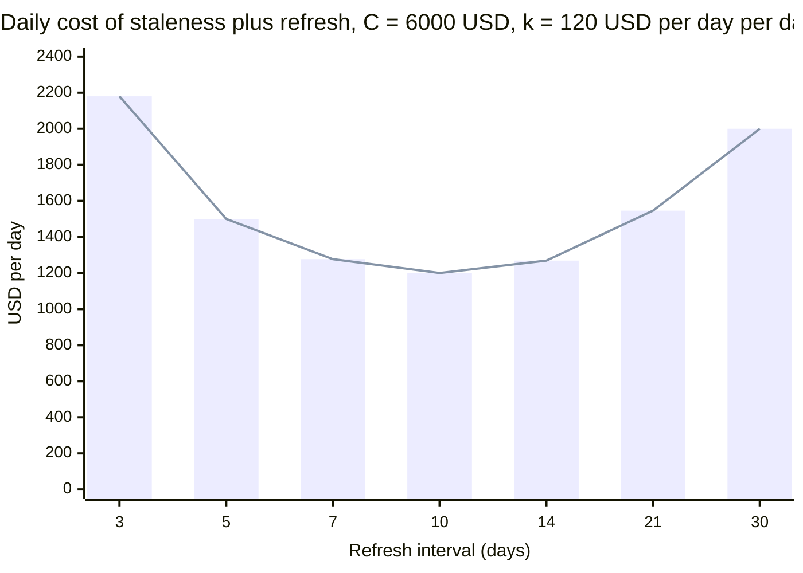

# Continuous Training and Refresh Policy

> **Version anchor (2026-10-18).** This page is about policy; tools appear only as examples, at
> the mlops pin-table versions: MLflow 3.17.1 (2026-10-13) for registry aliases (`@champion`,
> `@challenger`), Kubeflow Pipelines 2.17.2 (2026-09-04) for scheduled training runs, Ray 2.59.0
> (2026-10-02) for Ray Data batch re-embedding, lakeFS v1.88.0 (2026-10-01) and DVC 3.67.1
> (2026-03-31) for training-data snapshots, and Kubeflow Trainer v2.3.0 (2026-08-07) for
> fine-tune jobs.
>
> **On prices.** Every dollar figure on this page is a stated assumption (GPU-hour rate, per-token
> embedding rate, cost of a reviewer hour), not a quoted list price. Replace each with what your
> account pays; the formulas do not change.

## 1. Concept Overview

Every artifact an AI feature ships goes stale at its own rate. A fraud model loses recall as
attackers adapt. A ranking model loses lift as the catalog turns over. A fine-tuned classifier
loses accuracy when the product taxonomy changes. A vector index loses recall when documents
change and the index does not. A prompt loses quality when the provider retires the model it
was tuned on. A LoRA adapter stops working entirely the day its base model is upgraded.

A **refresh policy** is the written answer, per artifact, to five questions:

- **When** does it refresh: a calendar cadence, a measured signal, an upstream event (base
  model upgrade, provider retirement), or never without a person deciding.
- **How** is the new version built: warm start, full retrain from scratch, incremental
  fine-tune with replay, or a rebuild of a derived artifact.
- **What gate** must the candidate pass, against which champion and which label set.
- **Who approves** promotion: the pipeline alone, the pipeline with a veto window, or a person.
- **What budget** caps it: GPU-hours, API spend and reviewer hours per refresh and per month.

Continuous training (CT) is the machinery that executes the first three answers on a
schedule. The policy is the part that decides whether running it is worth the money, and
whether a candidate that passed can reach traffic without a person looking at it.

This page is the policy layer for every artifact type the section covers. Gate design lives in
[Evaluation Gates and Eval Sets](../evaluation_gates_and_eval_sets/evaluation_gates_and_eval_sets.md),
prompt re-qualification mechanics in
[Prompt Lifecycle and Versioning](../prompt_lifecycle_and_versioning/prompt_lifecycle_and_versioning.md),
dual-index cutover in
[RAG and Vector Index Lifecycle](../rag_and_vector_index_lifecycle/rag_and_vector_index_lifecycle.md),
adapter hot-loading in
[LoRA Adapter Serving and Lifecycle](../lora_adapter_serving_and_lifecycle/lora_adapter_serving_and_lifecycle.md),
online signals in
[Production Quality Monitoring and Drift](../production_quality_monitoring_and_drift/production_quality_monitoring_and_drift.md),
and refresh budgets in
[AI Cost Engineering and Unit Economics](../ai_cost_engineering_and_unit_economics/ai_cost_engineering_and_unit_economics.md).

**Not here.** The list of retraining triggers (scheduled, performance-based, data drift, label
drift, event) lives in [MLOps and CI/CD](../../ml/mlops_and_ci_cd/mlops_and_ci_cd.md) §4
"Retraining Triggers" and §5 "Retraining Trigger Sources". Drift statistics (PSI, KS,
chi-squared, proxy metrics under delayed labels) live in
[Monitoring and Drift Detection](../../ml/monitoring_and_drift_detection/monitoring_and_drift_detection.md).
Flywheel design (feedback collection, active learning, curation, RLHF from production) lives in
[Data Flywheels and Continuous Learning](../../llm/data_flywheels_and_continuous_learning/data_flywheels_and_continuous_learning.md).
The PSI-triggered retraining loop for a single classic model is worked through in
[Drift Monitoring and Retraining](../../ml/case_studies/cross_cutting/drift_monitoring_and_retraining.md),
and fine-tuning methods themselves in [Fine-Tuning](../../llm/fine_tuning/fine_tuning.md).

---

## 2. Intuition

**One-line analogy:** a refresh policy is an aircraft maintenance schedule. Some parts are
replaced every N flight hours, some every N landings, some only on inspection, and an engine
swap forces a set of other parts to be re-certified at the same time.

**Mental model:** every artifact sits on two curves. The **value-of-freshness curve** says how
much quality (and money) the artifact loses per day of age. The **refresh-cost curve** says how
much one refresh costs in compute, labels and review time. The best cadence is where the
marginal loss from waiting one more day equals the amortized cost of refreshing one day
sooner. For most classic models that point is broad and flat, so the exact cadence matters
less than having measured both curves.

**Why it matters:** without a policy, either a model runs 14 months untouched while its recall
decays, or a CT pipeline retrains nightly, auto-promotes on a noisy gate, and spends $40,000 a
month on compute that buys nothing, each promotion a fresh chance of an unreviewed regression.

**Key insight:** refresh cadence is bounded below by **label delay**, not by how often new data
arrives. A fraud model whose chargebacks keep landing for up to 90 days cannot be validated on last
week's data, however much last week's data there is. And for derived artifacts (adapters,
students, thresholds, judges), the trigger is usually an **upstream change**, not time.

---

## 3. Core Principles

- **Policy per artifact, not per team.** A ranking model, its threshold, its embedding index
  and the LLM that writes its explanations each get their own cadence, gate and approver.
- **Measure decay before choosing a cadence.** Train at cutoff t, evaluate on weeks t+1 to
  t+8; the slope is the value-of-freshness curve. Without it, a cadence is a guess.
- **Train only on matured labels.** The window ends where label completeness reaches the
  policy level (for example 97% of eventual positives). Unlabeled recent rows are not negatives.
- **Promote against the champion on the same rows.** Shadow-score both on identical traffic
  and compare paired outcomes, not two different weeks.
- **Bound cumulative regression.** A 0.5-point margin per promotion permits a 6-point slide
  over 12 promotions. Keep a fixed anchor model and cap total drift against it.
- **Derived artifacts refresh when their parent changes.** Adapters, students, thresholds and
  LLM judges built on a base become invalid when it changes; the dependency graph sets the order.
- **The model must not write its own labels unchecked.** A loop where outputs pick which rows
  get labels, or become training data, needs an exploration holdout or a provenance filter.
- **Auto-promotion needs a measured gate.** Bounded blast radius, rollback under 5 minutes, a
  known false-pass rate. Everything else needs a named approver.

---

## 4. Types / Architectures / Strategies

### 4.1 Refresh modes

The trigger list itself is in `ml/mlops_and_ci_cd` §4. The policy question is which mode an
artifact runs in.

| Mode | What starts a refresh | Typical artifacts | Main risk |
|---|---|---|---|
| Calendar | Fixed cadence (daily, weekly, quarterly) | Ad and ranking models, demand forecasts | Refreshing when nothing changed; missing a sudden shift between runs |
| Signal | A monitored metric crosses a band with hysteresis | Fraud, churn, any model with proxy metrics | Trigger flapping; signal blind to concept drift |
| Upstream event | Parent artifact changes (base model, teacher, embedding model, provider snapshot) | Adapters, students, thresholds, prompts, judges | Missing an edge in the dependency graph |
| Continuous (online) | Every batch or example updates weights | Linear and bandit layers on top of a frozen model | Unvalidated drift; poisoning; no rollback point |
| On request | A person files a refresh with a reason | High-risk regulated models, foundation fine-tunes | Staleness when no one files |

### 4.2 Build modes

| Build mode | What it does | Cost per refresh | When it fits |
|---|---|---|---|
| Warm start | Initialize from current weights, train on the new window | 10-30% of full | Frequent refresh of NNs and GBDTs where the window shifts a little |
| From scratch | Re-initialize, train on the full window | 100% | Periodic reset (quarterly) and any feature or architecture change |
| Incremental fine-tune with replay | Train on new data plus a replay sample of old data | 5-20% of original fine-tune | LLM and encoder fine-tunes where forgetting is the risk |
| Re-derive | Rebuild from a changed parent: retrain adapter, relabel with teacher, recalibrate | Varies | Adapters, students, thresholds, judges |
| Rebuild derived data | Re-embed corpus, rebuild index | Linear in corpus size | Embedding-model change |

### 4.3 Refresh policy by artifact type

Promotion runs in one of four modes: auto (gates only), auto with a 24-72 hour veto window,
human-approved by a named role, or committee (model risk review signs). §5 maps them to risk tiers.


| Artifact | Usual mode | Build mode | Gate compares against | Typical approver |
|---|---|---|---|---|
| Classic scoring model | Calendar or signal, bounded by label delay | Warm start, scratch quarterly | Champion on paired shadow traffic, matured labels | Auto with veto, or human for credit and fraud |
| Decision threshold | Upstream event: every model change | Recalibrate on recent scores | Target approval rate or precision at policy | Same as its model, never separately auto |
| Fine-tuned LLM | Calendar (monthly) or data-volume | Incremental with replay | Champion plus capability regression suite | Human |
| LoRA adapter | Upstream event (base upgrade), plus data refresh | Retrain on new base from stored data | Old adapter on old base, per adapter | Auto for low-tier tenants, human for top tier |
| Embedding model | Rare, value-driven | Re-embed corpus, dual index | Recall@k on retrieval eval set | Human |
| Index content | Continuous (CDC) | Incremental upsert, periodic compaction | Freshness SLA, recall@k sample | Auto |
| Prompt | Upstream event (provider change) | Re-tune on new snapshot | Champion on old snapshot, per slice | Human |
| Distilled student | Upstream event (teacher change) or data drift | Relabel set with teacher, retrain | Teacher agreement plus task metric | Auto with veto |
| LLM judge | Upstream event (judge model change) | Recalibrate against human labels | Agreement with human labels | Human, and before anything it gates |

---

## 5. Architecture Diagrams

### Continuous training loop with champion-challenger promotion

```mermaid
flowchart LR
    classDef io      fill:#61afef,stroke:#2e86c1,color:#1a1a1a,font-weight:bold
    classDef frozen  fill:#c678dd,stroke:#9b59b6,color:#fff
    classDef train   fill:#98c379,stroke:#27ae60,color:#1a1a1a
    classDef mathOp  fill:#d19a66,stroke:#e67e22,color:#1a1a1a,font-weight:bold
    classDef lossN   fill:#e06c75,stroke:#c0392b,color:#fff,font-weight:bold
    classDef req     fill:#56b6c2,stroke:#0097a7,color:#1a1a1a
    classDef base    fill:#e5c07b,stroke:#f39c12,color:#1a1a1a

    trig(["Trigger<br/>calendar, signal,<br/>upstream event"]) --> snap("Data snapshot<br/>matured labels only")
    snap --> k8s@{ icon: "logos:kubernetes", form: "square", label: "Training job<br/>warm or scratch", pos: "b", h: 44 }
    k8s --> off("Offline gate<br/>vs champion,<br/>vs anchor")
    off -->|fail| rej("Rejected<br/>logged, no alias")
    off -->|pass| shadow("Shadow scoring<br/>paired traffic")
    shadow --> wait("Wait for labels<br/>to mature")
    wait --> dec("Promotion rule<br/>non-inferiority,<br/>drift budget")
    dec -->|low tier| auto("Auto promote<br/>veto window")
    dec -->|high tier| human("Named approver")
    auto --> reg[("Registry<br/>alias champion")]
    human --> reg
    reg --> serve("Serving<br/>threshold v-pinned")
    serve -.-> mon("Monitoring<br/>proxy metrics")
    mon -.-> trig

    class trig req
    class snap,wait io
    class k8s train
    class off,shadow,dec mathOp
    class rej lossN
    class auto,human frozen
    class reg base
    class serve io
    class mon frozen
```



The gate runs twice: offline before any traffic, and on shadow traffic after labels mature.
Waiting for labels is the step teams try to skip; a fraud challenger spends most of its life
there, and promoting straight from shadow means promoting on score agreement, not outcomes.
The approval branch is chosen by risk tier, not by how confident the pipeline is. The threshold
ships pinned to the model version, so a promotion moves both together.

### Label maturity sets the training window

```
 fraud model, chargeback labels, policy: train only where label completeness >= 97%

 day       -150       -120        -90        -60        -30          0 (today)
            |----------|----------|----------|----------|-----------|
 events     #########################################################
 complete   100%      100%       99.6%      97.1%      81.0%      0%
                                            ^ 97% line
 training   [================================]
            day -150 .. day -60 (next challenger)
 shadow                                  [==========================]
 scoring                                 day -70 .. today (current challenger)
 gate uses                               [===]
 labels of                               day -70 .. day -60 (97% complete today)
```

Rows from the last 60 days look partly legitimate only because their chargebacks have not
arrived yet. The next challenger's training window stops at the 97% line. The current
challenger is judged only on its oldest shadow-scored slice, the 10 days whose labels are now 97%
complete, which is about the matured-fraud count the paired test in §6.3 needs. The shortest cycle
the labels allow here is about 70 days from shadow start to promotion, whatever the compute budget.

### Cost per day against refresh cadence



Total cost is `C/T + k*T/2`, minimized at `T* = sqrt(2C/k)` = 10 days. The curve is flat near
the optimum: a weekly cadence costs 6% more than 10 days, a 14-day cadence 6% more. Monthly
costs 67% more and every 3 days costs 82% more. The §6.1 code computes `k` from a backtest.

### Base-model upgrade cascade

```
 base upgrade: base-v3 -> base-v4 (digest change)        order  action
 ├─ LLM judge (built on base-v3)                           1    recalibrate vs human labels
 │                                                              before it gates anything
 ├─ LoRA adapters bound to base-v3 (1,200)                 2    retrain all, gate per adapter
 │   └─ adapter eval sets                                       rerun with recalibrated judge
 ├─ prompts pinned to base-v3 (38)                         2    re-qualify per slice
 ├─ distilled student (teacher = base-v3 + adapter)        3    relabel set with new teacher,
 │                                                              retrain student
 ├─ decision thresholds on model scores                    4    recalibrate on new scores
 └─ embedding model (separate encoder)                     -    no change, no re-embed
```

The judge goes first because every later gate uses it. A stale judge scoring base-v4 outputs
with base-v3 preferences passes or fails adapters for the wrong reasons. The embedding model is
listed to show that not every artifact in the bundle is downstream of the base.

### Approval matrix by artifact and risk tier

```
                          risk tier ->   low         medium       high (regulated)
 artifact
 ---------------------------------------------------------------------------------
 index content (CDC)                    A           A            A + audit log
 ranking / ads model                    A           V 24h        H
 fraud / credit model                   V 24h       H            H x2 + MRM
 decision threshold                     same as its model, never looser
 fine-tuned LLM                         V 72h       H            H x2
 LoRA adapter (tenant)                  A           V 24h        H
 distilled student                      A           V 24h        H
 embedding model + re-embed             H           H            H
 prompt after provider change           V 24h       H            H
 LLM judge                              H           H            H
 ---------------------------------------------------------------------------------
 A = auto   V = auto with veto window   H = named approver   MRM = model risk review
```

Read across a row to see how one artifact tightens with risk. Read down a column to see that
judges and embedding models never auto-promote: a bad judge corrupts every gate it runs, and a
re-embed changes retrieval for every feature on the index at once.

---

## 6. How It Works - Detailed Mechanics

### 6.1 Measuring the value-of-freshness curve

The decay rate comes from a backtest, not from intuition. Train models at several past cutoffs,
evaluate each on the weeks that followed, and regress the metric on model age.

```python
import numpy as np

def decay_per_day(backtest):
    """backtest: list of (age_days, metric) from models evaluated on weeks after their cutoff."""
    age = np.array([a for a, _ in backtest], dtype=float)
    metric = np.array([m for _, m in backtest], dtype=float)
    slope, _ = np.polyfit(age, metric, 1)
    return -slope                      # metric points lost per day of age

def optimal_interval_days(refresh_cost_usd, decay_pts_per_day, usd_per_pt_per_day):
    """Minimize C/T + k*T/2 with k = decay * value. Returns T* in days."""
    k = decay_pts_per_day * usd_per_pt_per_day
    return float(np.sqrt(2 * refresh_cost_usd / k))

# Ranking model, recall@50 in points, mean by model age across 8 cutoffs
backtest = [(0, 41.2), (7, 40.6), (14, 40.1), (21, 39.5), (28, 39.0), (42, 38.0), (56, 37.1)]
d = decay_per_day(backtest)            # about 0.073 points per day
# 1 point of recall@50 is worth about 1,640 USD per day in attributed revenue (assumed)
print(round(optimal_interval_days(6_000, d, 1_640), 1))   # about 10 days
```

The refresh cost `C` includes more than GPU time. For this ranking model: 40 GPU-hours at an
assumed $2.50 ($100), the offline eval run ($150), shadow infrastructure for a week ($750), and
6 hours of an engineer reviewing the promotion packet at an assumed $150 an hour ($900),
plus the expected cost of a bad promotion (a 2% chance of a regression that costs $200,000
before rollback, $4,000): about $5,900, rounded to $6,000. Teams that count only GPU time compute a cadence that is 5 to 8 times
too frequent.

Two refinements matter in practice. Decay is rarely linear for long: fit only the range of ages
you would actually run. And the curve moves: rerun the backtest quarterly, because a holiday
season or a new attacker cohort steepens it.

### 6.2 Label delay: training and gating on matured labels only

Broken: the training job takes everything up to yesterday and treats any transaction without a
chargeback as legitimate.

```python
# BROKEN: rows from the last 60 days look legitimate because their labels have not arrived
df = load_transactions(start=today - days(180), end=today - days(1))
df["label"] = df["chargeback_at"].notna().astype(int)
train(df)
```

The newest 60 days of the window hold about two thirds of their eventual chargebacks (the
completeness curve in §5), so they read a fraud rate near 0.14% against a true 0.21%, and the
newest week reads far lower. The model learns that recent patterns, which are exactly the new attacks, are safe. Offline AUC
looks better, because the eval split has the same bias.

Fixed: compute label completeness by event age from history, and cut the window where it
crosses the policy level.

```python
def maturity_cutoff_days(history, completeness=0.97):
    """history: delays in days from event to chargeback, for transactions old enough
    that all labels have arrived (for example, older than 180 days)."""
    return int(np.quantile(history, completeness))     # 61 days for this portfolio

cutoff = maturity_cutoff_days(chargeback_delays)
df = load_transactions(start=today - days(cutoff + 90), end=today - days(cutoff))
df["label"] = df["chargeback_at"].notna().astype(int)
train(df)
```

When 60 days of staleness costs too much, there are two honest options: train a fast model on a
label that arrives sooner (an investigations-team fraud flag within 7 days) and accept it as a
proxy, or weight recent rows with a survival estimate of eventual label probability. Both are
recorded in the refresh policy, not hidden inside the training job.

### 6.3 Champion-challenger promotion rule

The challenger is shadow-scored on the same transactions as the champion. When labels mature,
the comparison is paired: only transactions where the two models disagree carry information.

Matured frauds needed to detect a 0.5-point change in a recall near 80%, at 5% two-sided
significance and 80% power:

- Unpaired (two independent samples): `n = (1.96 + 0.84)^2 x 2 x 0.8 x 0.2 / 0.005^2`, about
  100,000 confirmed frauds per arm.
- Paired with a 4% discordance rate: `n = (1.96 + 0.84)^2 x 0.04 / 0.005^2`, about 12,500
  confirmed frauds.

At 1,500 matured frauds a day, paired shadowing needs about 9 days of matured labels; unpaired
would need more than two months. Paired shadow scoring is the main reason champion-challenger
works at all under label delay.

```python
import math
from mlflow import MlflowClient

def paired_delta(champ_hit, chall_hit):
    """Lists of 0/1 per labeled positive. Returns (delta, 95% CI half-width) in points."""
    n = len(champ_hit)
    b = sum(1 for c, h in zip(champ_hit, chall_hit) if c == 0 and h == 1)   # challenger wins
    c_ = sum(1 for c, h in zip(champ_hit, chall_hit) if c == 1 and h == 0)  # champion wins
    delta = (b - c_) / n
    se = math.sqrt(b + c_ - (b - c_) ** 2 / n) / n
    return 100 * delta, 100 * 1.96 * se

def promote(name, chall_version, champ_hit, chall_hit, anchor_gap_pts,
            margin_pts=0.3, drift_budget_pts=1.0):
    delta, half = paired_delta(champ_hit, chall_hit)
    if delta - half < -margin_pts:
        return f"reject: lower bound {delta - half:.2f} below -{margin_pts}"
    if anchor_gap_pts + delta < -drift_budget_pts:
        return f"reject: cumulative drift vs anchor {anchor_gap_pts + delta:.2f}"
    MlflowClient().set_registered_model_alias(name, "champion", chall_version)
    return f"promoted v{chall_version}: delta {delta:+.2f} +/- {half:.2f}"
```

The second check is the one most pipelines lack. `anchor_gap_pts` is the champion's recall minus
a frozen anchor model's recall on the same matured rows. Each promotion may lose up to 0.3 points
inside noise, but the sum over promotions may not exceed 1.0 point against the anchor. Without
it, twelve promotions each "within noise" can walk recall down 3 to 4 points over a year.
Serving loads `models:/fraud-scorer@champion`, and the threshold is a field of the same model
version (§6.11), so one alias move changes both.

### 6.4 Warm start vs from scratch

| Property | Warm start every refresh | From scratch every refresh | Warm weekly, scratch quarterly |
|---|---|---|---|
| Compute per refresh (GBDT, 200M rows) | 1.5 GPU-h equivalent | 9 GPU-h | 1.5 weekly, 9 quarterly |
| Reproducibility | Depends on the chain of all past refreshes | One snapshot, one config | Chain resets each quarter |
| GBDT model size | Grows: each refresh appends trees | Fixed | Bounded |
| NN generalization | Ash and Adams (NeurIPS 2020) found warm-started nets generalize worse than fresh ones on the same data | Baseline | Recovered each quarter |
| Feature or architecture change | Not possible | Required | Done at the quarterly reset |

The failure mode of warm start forever is path dependence: model v57 is a function of every
window since v1, including a bot-traffic week in March that no one remembers. A from-scratch
model on a pinned snapshot is reproducible from the registry entry alone. The quarterly reset
also serves as the anchor for §6.3.

For GBDTs, LightGBM's `init_model` and XGBoost's `xgb_model` parameter continue boosting from
an existing model, adding trees. After 20 weekly refreshes of 50 trees each, a 400-tree model has
1,400 trees, and p99 scoring latency has grown with it.

### 6.5 Fine-tune refresh and catastrophic forgetting

A fine-tuned LLM refreshed on only the newest month of data loses capabilities that the new data
does not exercise. The refresh policy defends with three controls.

**Replay.** Every refresh trains on new data plus a fixed-ratio sample of earlier training data.
A common starting ratio is 20-30% replay, tuned by the regression suite below.

**Capability regression suite.** A held-out set per capability the model must keep: each task
type it was trained on, plus a general instruction-following set. The gate is per capability,
against the champion, with a forgetting budget.

```
 support-classifier refresh r14 vs champion r13, replay ratio 0.0 then 0.25

 capability            n    r13     r14 (0.0)  delta    r14 (0.25)  delta   budget -1.0
 intent (new data)   1200   88.4      91.9     +3.5       91.2      +2.8        ✓
 billing routing      600   93.0      90.1     -2.9       92.6      -0.4        ✓
 language: de         400   86.5      79.8     -6.7       85.9      -0.6        ✓
 refusal policy       300   99.0      97.3     -1.7       98.7      -0.3        ✓
 JSON schema valid   2000   99.7      99.6     -0.1       99.7       0.0        ✓
```

With no replay, the new-data slice gains 3.5 points and German drops 6.7, because the month's
data was 96% English. With 25% replay, the gain shrinks to 2.8 and every slice is inside the
1-point budget. The aggregate score hid this: it rose in both runs.

**Adapter-based refresh.** Training a new LoRA adapter on a frozen base instead of updating full
weights reduces forgetting. Biderman et al., "LoRA Learns Less and Forgets Less" (TMLR 2024),
found LoRA learned less of the target domain than full fine-tuning and kept more source-domain
performance, the right trade when retention matters more than peak gain.

### 6.6 Adapter retrain on a base-model upgrade

A LoRA adapter is a low-rank delta on specific base weights. On a different base, even a minor
version, the delta adds to weights it was not trained against, and output quality ranges from
slightly worse to unusable. The policy treats a base upgrade as a mandatory retrain campaign
for every adapter bound to that base digest:

1. **Inventory** every adapter by `base_digest` in the registry. Adapters with no stored
   training-data snapshot and config cannot be retrained; they are listed for owner action.
2. **Recalibrate the judge** if any gate uses an LLM judge built on the old base.
3. **Retrain** each adapter on the new base from its stored snapshot and hyperparameters.
4. **Gate** each new pair (new base + new adapter) against the old pair on that adapter's eval
   set, with a per-adapter non-inferiority margin.
5. **Dual-serve** both bases until every adapter has moved or been retired; serving mechanics
   are in [LoRA Adapter Serving and Lifecycle](../lora_adapter_serving_and_lifecycle/lora_adapter_serving_and_lifecycle.md).

Cost for 1,200 tenant adapters at 0.6 GPU-hours each plus 0.1 GPU-hours of eval: 840 GPU-hours,
$2,100 at an assumed $2.50. The expensive part is the dual-serving period: two base models
resident for six weeks. Policy sets a deadline, after which adapters that failed their gate
twice are served on the new base with the tenant notified, or retired.

### 6.7 Embedding and index refresh economics

Two refreshes share the word "re-index" and differ by three orders of magnitude in cost.

**Content refresh** keeps the index in step with the corpus: changed and new documents are
re-chunked and embedded through CDC. At 0.5% daily churn on 2 billion chunks of 300 tokens, that
is 10 million chunks, 3 billion tokens a day; at an assumed $0.02 per million tokens, $60 a day.
Policy: continuous, auto-promoted, with a freshness SLA (for example 95% of changes searchable
within 15 minutes).

**Embedding-model refresh** changes the vector space. Every chunk must be re-embedded and a
second index built and served side by side until cutover:

| Item | Quantity | Cost (assumed rates) |
|---|---|---|
| Re-embed tokens | 2B chunks x 300 tokens = 600B tokens | $12,000 at $0.02 per 1M, or about 4,170 GPU-h at 40,000 tokens/s per GPU = about $10,400 |
| Second index during dual run | 2B x 1,024 dims x 4 bytes = 8.2 TB raw, plus graph overhead | Storage and memory for 2-4 weeks |
| Shadow retrieval eval | Retrieval eval set, judge runs | Small |
| Engineering and cutover | 2-3 engineer-weeks | Usually the largest line |

The decision rule: re-embed when the measured recall gain on the retrieval eval set, converted
to task success and then to money over the expected life of the new model, exceeds total cost
by a margin. A 3-point recall@10 gain that moves answer success by 1 point on a feature worth
$5,000 a day per point pays back a $60,000 migration in 12 days. A 0.4-point gain does not.
Cutover mechanics are in RAG and Vector Index Lifecycle §6.5.

### 6.8 Prompt re-tuning policy after a provider model change

Provider model changes fall into three classes, and the policy differs by class:

| Class | Example | Policy |
|---|---|---|
| Retirement of a pinned snapshot | Provider announces the retirement date of the snapshot id the prompt pins | Mandatory campaign; deadline is the retirement date minus a buffer (for example 3 weeks); owner and approver named on day one |
| Moving alias | Prompt references an alias the provider updates in place | Not allowed in production; CI rejects unpinned model ids |
| New model available, old one stays | A better or cheaper snapshot ships | Optional, value-driven: run the eval on the new snapshot, migrate only if gain or cost saving clears the bar |

The campaign steps (inventory, baseline, per-slice diff, re-tune, re-gate, dual-run) are in
[Prompt Lifecycle and Versioning](../prompt_lifecycle_and_versioning/prompt_lifecycle_and_versioning.md)
§6.6. The policy adds the time budget: a mid-size team re-qualifies about 4 to 6 high-traffic
prompts a week, so 40 pinned prompts need 7 to 10 weeks before the internal deadline.

### 6.9 Distillation refresh

A distilled student is two artifacts deep: its quality depends on the teacher and on the input
distribution the distillation set covers. It refreshes when either changes.

- **Teacher changed.** Relabel the distillation set with the new teacher, retrain the student,
  gate on task metric and on teacher-student agreement. For 2 million examples at 500 input and
  200 output tokens, relabeling is 1.4 billion teacher tokens per refresh; that cost is the
  reason most teams refresh students only on teacher change, not on a calendar.
- **Inputs drifted.** Sample fresh production inputs (with consent and PII handling), label them
  with the current teacher, and add them to the set. Agreement between student and teacher on a
  daily sample of live traffic is the trigger signal: a drop from 94% to 89% on a slice means
  the student is out of its training distribution there.

When the teacher is a fine-tune on a base that just upgraded, the student refresh waits for the
teacher's promotion; distilling from an unpromoted teacher ships its regressions in the student.

### 6.10 Feedback-loop hazards

Sculley et al., "Hidden Technical Debt in Machine Learning Systems" (NeurIPS 2015), named direct
feedback loops (a model influencing its own future training data) and hidden ones (two systems
influencing each other through the world). CT makes both faster.

**Selective labels.** A fraud model declines a transaction; declined transactions never produce
a chargeback, so they are never labeled fraud. Retraining on approved transactions only teaches
the model about the traffic its predecessor let through. Lakkaraju et al. (KDD 2017) formalized
this as the selective labels problem.

**Exposure bias.** A recommender trained on clicks learns from items it chose to show. Items it
never shows never get clicks, and each refresh narrows the catalog further.

**Model collapse.** Shumailov et al. (Nature, 2024) showed that models trained recursively on
generated data lose the tails of the original distribution over generations. Which outputs may
re-enter training is flywheel design, covered in
[Data Flywheels and Continuous Learning](../../llm/data_flywheels_and_continuous_learning/data_flywheels_and_continuous_learning.md).

The fix for the first two is an exploration holdout: a small random slice of traffic where the
model's decision is not applied (or randomized), recorded with its propensity.

```python
import hashlib

def in_holdout(entity_id: str, rate: float = 0.01, salt: str = "fraud-explore-2026q4") -> bool:
    h = int(hashlib.sha256(f"{salt}:{entity_id}".encode()).hexdigest()[:8], 16)
    return h / 0xFFFFFFFF < rate

# Holdout transactions are approved up to a loss cap and labeled like any other.
# Training weights them by 1 / propensity, so 1% of traffic stands in for the unseen region.
```

The holdout has a real cost: 1% of transactions approved without the model, capped by amount.
That cost goes in the refresh policy as a line item. For generated data, the fix is provenance:
every training row carries a source tag, and the policy caps the share of model-generated rows.

### 6.11 Auto vs human-approved promotion, as policy-as-code

The refresh policy lives in a versioned file that the CT pipeline reads. Approver changes go
through code review like any other config.

```yaml
artifact: fraud-scorer
risk_tier: high
refresh:
  mode: calendar
  cadence_days: 14
  label_completeness: 0.97          # training window ends where completeness crosses this
  build: warm_start
  scratch_every_days: 90
gate:
  offline: {metric: recall_at_policy_fpr, margin_pts: 0.3}
  shadow: {paired: true, min_matured_positives: 12500}
  anchor: {model: fraud-scorer-anchor-2026q4, drift_budget_pts: 1.0}
  threshold: {pinned_with_model: true, target_fpr: 0.002}
promotion:
  mode: human
  approvers: [fraud-risk-lead, model-risk]
  rollback: {alias_revert: true, max_minutes: 5}
budget:
  gpu_hours_per_refresh: 40
  monthly_usd_cap: 8000
cooldown_days: 7                    # minimum gap between promotions, signal triggers included
```

Auto-promotion is allowed when four conditions hold, and the policy file states which:

- The gate's false-pass rate has been measured (replay past promotions that were later rolled
  back; count how many the gate passed).
- Blast radius is bounded (one tenant's adapter, one market, or a canary step).
- Rollback is an alias move under 5 minutes, tested in the last quarter.
- The artifact is not on the list that never auto-promotes: judges, embedding models,
  regulated models, and any threshold separate from its model.

Thresholds need their own rule. A retrained model with the same AUC can shift its score
distribution: at an unchanged threshold of 0.7, the decline rate can move from 2.0% to 3.1%.
The threshold is recalibrated on the challenger's shadow scores to hit the policy target (a
false-positive rate or a decline rate), stored as a field of the model version, and promoted in
the same alias move.

---

## 7. Real-World Examples

**Facebook ads click prediction, 2014.** He et al., "Practical Lessons from Predicting Clicks on
Ads at Facebook" (ADKDD 2014), measured prediction quality against the delay between training
data and test day and found normalized entropy worsening as the delay grew. Their design split
refresh by component: boosted-tree feature transforms retrained on a daily-to-weekly cadence,
and the linear model on top trained online. That is a refresh policy per component.

**Instacart, 2020.** Fortune reported on June 9, 2020 that the accuracy of a metric Instacart
uses for item availability fell from 93% to 61% as pandemic buying changed demand, and that the
team cut its training data from several weeks to up to ten days. A window and cadence tuned on
stable years were too slow for a regime change; the policy needed a signal trigger and a
shorter-window option. The drift side of this incident is in
[Drift Monitoring and Retraining](../../ml/case_studies/cross_cutting/drift_monitoring_and_retraining.md).

**Zillow Offers, 2021.** Zillow announced on November 2, 2021 that it would wind down its
home-buying business, with an inventory write-down of about $304 million in Q3 2021 and a plan to
cut about 25% of staff; its pricing models had bought homes at prices the cooling market did not
support. Faster retraining does not fix a decision with months of exposure: high-stakes actions
need human-approved decision-policy changes and an exposure cap while the model is uncertain.

**Microsoft Tay, 2016.** Tay launched on Twitter on March 23, 2016 and learned from user
interactions; Microsoft took it offline about 16 hours later after coordinated users taught it
offensive output: continuous learning from unfiltered input with no promotion gate.

**OpenAI text-embedding-3, 2024.** OpenAI released `text-embedding-3-small` and
`text-embedding-3-large` on January 25, 2024. `text-embedding-3-small` returns 1,536 dimensions
by default, the same as `text-embedding-ada-002`, but the vector spaces are unrelated. A query
encoder switched without re-embedding the corpus returns no error and wrong neighbors.
Moving between them is a full re-embed with a dual index, priced by §6.7.

---

## 8. Tradeoffs

### Cadence

| Cadence | Staleness loss | Refresh cost | Regression risk per month | Fits |
|---|---|---|---|---|
| Online (per batch) | Lowest | Low compute, high validation cost | Highest; no clean rollback point | Linear or bandit layers on a frozen base |
| Daily | Low | High | High unless gate is strong | Ads, feed ranking with fast labels |
| Weekly to biweekly | Medium | Medium | Medium | Most ranking and fraud models |
| Monthly to quarterly | Higher | Low | Low | Credit, forecasting, fine-tuned LLMs |
| On upstream event only | Depends on parent | Paid when parent changes | Concentrated in campaigns | Adapters, students, thresholds, prompts |

### Promotion approval

| Factor | Auto | Auto with veto | Human-approved |
|---|---|---|---|
| Time to traffic after gate | Minutes | 1-3 days | Days to weeks |
| Reviewer cost | None | Low | 2-8 hours per promotion |
| Catches gate blind spots | No | Sometimes | More often, if the packet shows slices |
| Regulatory evidence | Logs only | Logs plus notice | Signed approval |
| Failure mode | Silent ratchet down | Notices ignored | Rubber-stamping under volume |

---

## 9. When to Use / When NOT to Use

**Use scheduled CT with champion-challenger when:**

- A backtest shows measurable decay within the label delay plus one cycle (for example, more
  than 0.5 points per month), and labels arrive in volume, even if late.
- Rollback is an alias move and has been tested.

**Use upstream-event refresh when** the artifact is derived (adapter, student, threshold, judge,
prompt pinned to a snapshot) and the registry records its parent (base digest, teacher version,
judge version).

**Allow auto-promotion when** blast radius is bounded, the gate's false-pass rate is measured, a
drift budget against an anchor exists, and the artifact is not on the never-auto list.

**Do NOT run CT when:**

- The backtest shows no decay over the label delay. A credit model whose metric is flat across
  a year of ages needs a scheduled review, not a pipeline.
- Labels never arrive for the decisions the model makes (selective labels with no exploration
  holdout). Retraining makes the bias worse.
- The gate cannot detect the regressions you care about. A CT pipeline that promotes on
  aggregate AUC while the business loses one segment is automation of the wrong decision.

**Do NOT run online learning when:**

- The model is a generative LLM. Per-example weight updates on user input are Tay's design.
- You need a reproducible rollback point for audit.

---

## 10. Common Pitfalls

**Immature labels as negatives.** A payments team retrained weekly on all transactions to
yesterday. Each new model scored the newest attack pattern as safe, because its chargebacks had
not arrived. Recall on matured data fell 9 points over two months while offline AUC on the same
biased split rose. Fix: training and gate windows end at the label-completeness cutoff, computed
from history (§6.2).

**Threshold left behind.** A retrained risk model kept the same AUC and shipped with the old
0.7 threshold. Its scores ran higher, and the decline rate went from 2.0% to 3.1% overnight,
which the business saw as lost revenue before anyone saw it as a model change. Fix: the threshold
is a field of the model version, recalibrated on shadow scores to a policy target, and moved by
the same alias write.

**Ratchet down under auto-promotion.** A recommendation team auto-promoted any challenger
within 0.5 points of the champion. Over 11 months and 23 promotions, CTR against a frozen anchor
fell 4.1 points. Fix: a cumulative drift budget against an anchor reset quarterly (§6.3).

**Adapter served on the wrong base.** A platform upgraded a pool's base model and let existing
adapters load because the shapes matched; two tenants got mostly unusable text. Fix: the adapter
manifest carries the base digest, the loader refuses a mismatch, and an upgrade starts a retrain
campaign (§6.6).

**Student distilled from an unpromoted teacher.** The distillation job read the teacher by a
"latest" tag, and a candidate that later failed its gate had already relabeled the set. Fix:
students read teachers only by champion alias or pinned version.

**Refresh storm.** A PSI trigger fired, the retrain shifted the score distribution, which moved
PSI and fired it again: 31 models in 9 days for $14,000, 4 promoted. Fix: hysteresis on the
band, a 7-day promotion cooldown, and a monthly budget cap in the policy file (§6.11).

**Training on the incident.** A weekly CT run included three days of bot traffic later blocked
at the edge, and the model learned the bot pattern as normal. Fix: tag incident windows, exclude
them at snapshot time, and put a training-window data diff in the promotion packet.

**Judge changed under the campaign.** A base upgrade also moved the judge, recalibrated last;
adapter gates passed 18% more candidates than a human spot check supported. Fix: judge first.

---

## 11. Technologies & Tools

| Tool | Role | Notes |
|---|---|---|
| MLflow | Model registry with aliases for champion, challenger and anchor | 3.17.1. `set_registered_model_alias`, `get_model_version_by_alias`, load by `models:/name@champion`; version tags hold base digest and threshold |
| Kubeflow Pipelines | Scheduled and event-triggered CT runs | 2.17.2. Recurring runs on a cron; pipeline definition in `ml/mlops_and_ci_cd` §6 |
| Kubeflow Trainer | Fine-tune and adapter retrain jobs on Kubernetes | v2.3.0. Used for the base-upgrade adapter campaign |
| Ray | Batch re-embedding and teacher relabeling | 2.59.0. Ray Data batch inference over the corpus or distillation set |
| lakeFS | Training-data snapshots with commit ids | v1.88.0. The snapshot id goes in the model version tags |
| DVC | Dataset versioning in git workflows | 3.67.1. Repo lives under the `treeverse` org |
| LightGBM | Warm-start boosting via `init_model` | Appends trees on each warm refresh |
| XGBoost | Warm-start boosting via `xgb_model` | Same tree growth caveat |

Orchestrators are compared in
[ML Pipelines and Orchestration](../ml_pipelines_and_orchestration/ml_pipelines_and_orchestration.md);
the release bundle that records which version of each artifact is live is defined in
[Artifact Versioning and Lineage](../artifact_versioning_and_lineage/artifact_versioning_and_lineage.md).

---

## 12. Interview Questions with Answers

**Q: Does retraining more often always make a model better in production?**
**Short:** No; total cost is refresh cost over interval plus staleness loss, which has an optimum, and each extra promotion adds regression risk.

No. The daily cost of a cadence is `C/T + k*T/2`, where `C` is the full cost of one refresh
(compute, eval, shadow, review, expected cost of a bad promotion) and `k` is the value lost per
day per day of model age. The optimum is `T* = sqrt(2C/k)`. With `C` = $6,000 and `k` = $120,
that is 10 days, and the curve is flat: weekly costs 6% more, every 3 days costs 82% more. Each
extra promotion is also another draw on the gate's false-pass rate. Measure `k` with a backtest
of aged models before setting a cadence, and count review time in `C`.

**Q: Why can you not gate a fraud challenger on last week's transactions?**
**Short:** Their chargebacks have not arrived, so recent rows look legitimate; the gate must use the oldest shadow-scored slice whose labels have matured.

Most of last week's fraud is still unlabeled. Chargebacks keep landing for up to 90 days after
the transaction, so a recent window shows a fraud rate several times below the true rate, and a
challenger that misses new attacks looks as good as one that catches them. Compute label
completeness by event age from history, end training where it crosses the policy level (for
example 97%), and judge the challenger on shadow scores of rows whose labels have matured. If 60
days is too slow, train on a faster proxy label and record that as a policy decision.

**Q: A retrained model has the same AUC as the champion. Why did the decline rate jump after promotion?**
**Short:** AUC ignores the score scale; the new model's scores shifted, so the old fixed threshold now cuts at a different rate. Recalibrate and version the threshold with the model.

AUC is rank-only. Two models with identical AUC can put a given transaction at 0.62 and 0.74.
At an unchanged threshold of 0.7, the share above the line moves, for example from 2.0% to 3.1%
declines. The threshold must be recalibrated on the challenger's shadow scores to the policy
target (a decline rate or a false-positive rate), stored as a field of that model version, and
moved by the same alias write. A threshold managed separately from its model is the most common
cause of a "model change" that looks like a business incident.

**Q: Can a LoRA adapter trained on base v3 be loaded onto base v4 if the shapes match?**
**Short:** No; an adapter is a delta on specific base weights, so on a new base it adds to weights it never saw, and quality ranges from degraded to unusable.

Shape compatibility says nothing about behavior. LoRA learns `W + BA` for the base `W` it was
trained against; on a different `W`, the same `BA` is an untrained perturbation. Treat a base
upgrade as a mandatory retrain for every adapter bound to that base digest: inventory by digest,
retrain from the stored snapshot and config, gate each new pair against the old pair, dual-serve
until migration finishes. The loader should refuse an adapter whose manifest digest does not
match the base.

**Q: Your new embedding model outputs the same 1,536 dimensions as the old one. Can old and new vectors share one index?**
**Short:** No; equal dimension does not mean a shared vector space, so mixing them returns wrong neighbors silently. Re-embed everything and cut over with a dual index.

Dimension is a shape, not a coordinate system. OpenAI's `text-embedding-3-small` defaults to
1,536 dimensions like `text-embedding-ada-002`, yet the spaces are unrelated: a query from one
compared with documents from the other returns near-random neighbors with no error. Pin the
embedding model version in the index manifest, have the query path refuse a mismatched encoder,
and do the migration as a full re-embed into a second index with a shadow recall check before
the alias flips.

**Q: Why can auto-promotion with a "within noise of champion" gate slowly degrade a model?**
**Short:** Each promotion may lose a little inside the noise margin and losses compound; cap cumulative drift against a frozen anchor model, not just per-step change.

A non-inferiority gate of 0.5 points allows a loss of up to 0.5 points per promotion with no
alarm. Twenty promotions can lose several points in total, each step individually acceptable.
Keep a frozen anchor (the last from-scratch model, reset quarterly), score it on the same matured
rows, and reject a challenger when champion-minus-anchor plus the new delta falls below a drift
budget such as 1 point. The anchor check catches a slide the per-step gate cannot see by design.

**Q: How does a fraud model that declines transactions corrupt its own retraining data?**
**Short:** Declined transactions never get chargebacks, so they are never labeled fraud; retraining learns only from traffic the old model approved.

This is the selective labels problem. The model's decisions decide which rows get outcomes. Each
refresh learns less about the region it blocks, and a pattern blocked last quarter can look
safe this quarter because no labeled examples of it remain. Add an exploration holdout: about 1%
of traffic, chosen by a salted hash, where the model's decision is not applied (up to a loss
cap), logged with its propensity, and used in training with inverse-propensity weights. Budget
the holdout's loss in the refresh policy.

**Q: How do you measure how fast a model goes stale?**
**Short:** Backtest aged models: train at several past cutoffs, score each on the weeks after it, and fit metric against model age to get points lost per day.

Pick 6 to 10 past cutoffs, train a model at each with the production recipe, and evaluate each
on every later week that has matured labels. Plot metric against age and fit only the range of
ages you would actually run. The slope, converted to money per metric point, is `k` in the
cadence formula. Rerun it quarterly, because seasons and attacker cohorts change the slope, and
keep the per-segment curves: a model can be stable overall and decay fast in one market.

**Q: When should a model be warm-started and when retrained from scratch?**
**Short:** Warm-start for cheap frequent refreshes, but reset from scratch on a fixed schedule and on any feature change, to stay reproducible and avoid path dependence.

Warm start reuses current weights and costs a fraction of a full run, which makes weekly refresh
affordable. Its costs accumulate: the model depends on every past window, GBDTs grow by the trees
each refresh appends (400 trees becomes 1,400 after 20 refreshes of 50), and Ash and Adams
(NeurIPS 2020) found warm-started neural networks generalize worse than fresh ones on the same
data. A quarterly from-scratch model on a pinned snapshot resets the chain, is reproducible from
the registry entry, and doubles as the drift anchor.

**Q: How do you refresh a fine-tuned LLM on new data without losing what it already did well?**
**Short:** Mix a replay sample of earlier training data into each refresh and gate per capability against the champion with a forgetting budget.

Training only on new data overwrites capabilities that data does not exercise. A monthly refresh
on 96% English data can drop German accuracy by several points while the aggregate rises. Mix in
20-30% replay of earlier data, keep a held-out set per capability, and gate each capability
against the champion with a budget such as -1 point. When retention matters more than peak gain,
train a fresh adapter on the frozen base instead of updating full weights; LoRA forgets less.

**Q: When is re-embedding a corpus with a better embedding model worth it?**
**Short:** When the measured recall gain, converted to task success and money over the new model's life, clearly exceeds re-embed, dual-index and engineering cost.

Content refresh (re-embedding changed documents) is cheap and continuous; a model change means
re-embedding everything. For 2 billion chunks of 300 tokens, that is 600 billion tokens, roughly
$10,000 to $12,000 in compute at assumed rates, plus a second index of about 8 TB raw during the
dual run and two to three engineer-weeks. Measure recall@k on the retrieval eval set, convert to
answer success, then to money. A 3-point recall gain worth $5,000 a day pays back in under two
weeks; a 0.4-point gain is not worth the risk of the cutover.

**Q: Who should approve a prompt re-tune after a provider retires the pinned model?**
**Short:** A named owner and approver set on the day of the notice, because the change is mandatory, deadline-bound, and changes behavior across every slice.

The retirement date makes this a campaign, not an optional improvement. The policy names an owner
for each pinned prompt, sets the internal deadline at the retirement date minus a buffer (for
example 3 weeks), and requires human approval for production because the new snapshot changes
behavior in ways one aggregate score hides. A different class, a new model that is merely better
or cheaper, is optional and value-driven. A prompt that references a moving provider alias is
rejected in CI, since its refresh happens without anyone deciding.

**Q: When does a distilled student need a refresh?**
**Short:** When its teacher changes, and when live student-teacher agreement drops on a slice, which shows inputs have drifted out of the distillation set.

The student copies the teacher on the inputs it was distilled on. A new teacher means relabeling
the set and retraining, at 1.4 billion teacher tokens for 2 million examples of 700 tokens, which
is why calendar refreshes of students are rare. Between teacher changes, sample live traffic
daily, score it with both, and watch agreement per slice; a drop from 94% to 89% on one slice is
the trigger to add fresh inputs there. Only distill from a promoted teacher, read by alias or
pinned version.

**Q: Should a generative LLM learn online from user conversations?**
**Short:** No; per-example weight updates on unfiltered user input have no gate, no rollback point and no poisoning defense. Batch curated feedback into gated refreshes.

Online updates mean every user can change the weights everyone else is served, with no
evaluation in between. Microsoft's Tay was taken offline about 16 hours after launch in 2016 once
coordinated users taught it offensive output. Collect feedback, curate it with provenance tags,
and train in batch refreshes that pass the same capability regression suite and approval as any
other promotion. Online learning stays useful for small linear or bandit layers on top of a frozen
model, where an update cannot rewrite the model's language.

**Q: A drift trigger started a retrain every day for a week. What is wrong with the policy?**
**Short:** The trigger has no hysteresis or cooldown, so each new model shifts the monitored distribution and fires the trigger again; add a band, a cooldown and a budget cap.

A PSI trigger on the score distribution measures the model as well as the data. Each retrained
model moves its own scores, which moves PSI on the next check. One team trained 31 models in 9
days this way. Put hysteresis on the band (fire at 0.25, re-arm below 0.15), monitor input
features rather than the model's own scores for the trigger, enforce a minimum gap between
promotions (for example 7 days), and give the policy a monthly compute cap that pages the owner
when hit.

---

## 13. Best Practices

- Write one refresh policy file per artifact: mode, cadence, build mode, gate, approvers,
  cooldown and budget. The CT pipeline reads it; changes go through review.
- Measure decay with a backtest of aged models, rerun quarterly, and count review hours and
  expected bad-promotion cost in the refresh cost.
- End training and gate windows at the label-completeness cutoff computed from history.
- Shadow champion and challenger on the same rows, test paired outcomes, and cap cumulative
  drift against a frozen anchor.
- Version the decision threshold as a field of the model version and move both in one alias write.
- Reset warm-started models from scratch on a fixed schedule and on any feature change.
- Record parent links (base digest, teacher version, judge version, embedding model) on every
  derived artifact, and refresh in dependency order with the judge first.
- Run 20-30% replay and a per-capability forgetting budget for LLM refreshes.
- Keep an exploration holdout wherever the model decides which rows get labels; tag the source
  of every training row and cap model-generated data.
- Keep judges, embedding models, regulated models and standalone thresholds off auto-promotion.

---

## 14. Case Study

### Refresh policy for a marketplace search and listing stack

**Context.** A second-hand marketplace (30 million searches and 400,000 new listings a day) runs
four artifacts: a GBDT ranking model whose purchase labels complete within 7 days; a fine-tuned
8B LLM with 40 per-category LoRA adapters that turns seller photos and text into a structured
listing; an embedding index of 900 million listing chunks; and a 1B distilled student of the
listing model that serves the 12 categories with the fewest attributes (70% of listings).
Before the policy, ranking retrained nightly with auto-promotion on offline NDCG, the LLM and
adapters refreshed "when someone had time", and the index embedded only new listings.

**Ranking.** A backtest at 8 cutoffs showed purchase-NDCG@20 falling 0.06 points a day for the
first month, valued at about $1,560 a day per point. Full refresh cost, counting a 5% historical chance that the nightly gate passed a
bad model, came to about $3,800, and the formula gave about 9 days. The team moved to weekly
warm start with a from-scratch reset each quarter. Challengers shadow-score 10% of searches for
7 days, labels mature 7 days later, and the gate is paired NDCG with a 0.2-point margin and a
1-point budget against the quarterly anchor, auto-promoted with a 24-hour veto for the search
lead. In the first quarter, 13 challengers trained, 9 promoted, 3 failed the paired gate, and 1
was blocked by the anchor budget after three small losses in a row.

**Listing LLM and adapters.** Refresh became monthly with 25% replay, gated per category and on
German, French and Spanish slices. A trial run without replay gained 2.4 points on new categories
and lost 5.1 on French attribute extraction; with replay the loss was 0.5. Promotion is
human-approved by the listings lead. When the platform team upgraded the 8B base in the second
quarter, the cascade ran in the §5 order: the listing judge was recalibrated against 1,500
human-labeled listings (agreement 0.81 to 0.86), then the 40 adapters were retrained in two days
on 24 GPU-hours, gated per adapter, and dual-served for 10 days. Three adapters failed twice and
ran without an adapter for a week while owners fixed their training data.

**Student and index.** The base upgrade changed the teacher, so the student refresh queued behind
the teacher's promotion: 1.2 million listings relabeled with 0.84 billion teacher tokens over a
weekend, live agreement 95% before and 96% after. A later drop to 88% on one category, caused by
a new product type, triggered a targeted relabel of 40,000 listings. A newer embedding model
gained 2.1 points of recall@50, about 0.3% more purchases; re-embedding 180 billion tokens plus
the dual index and three engineer-weeks came to about $45,000 against about $9,000 a day of value.
The search and platform leads approved it, and cutover followed
[RAG and Vector Index Lifecycle](../rag_and_vector_index_lifecycle/rag_and_vector_index_lifecycle.md).

**Results after two quarters.**

| Measure | Before policy | After |
|---|---|---|
| Ranking promotions per quarter | about 90 | 9 |
| Ranking refresh compute per month | $31,000 | $6,500 |
| Ranking regressions reaching 100% traffic | 4 per quarter | 0 in two quarters |
| Listing model refreshes | 1 in the prior 9 months | 6 |
| Adapters on a mismatched base | 7 found at audit | 0, loader refuses |
| Purchase-NDCG@20 vs anchor | not tracked | within 0.4 points |

**Open risk.** Exposure bias on the ranker: items it never shows get no purchases. The team added
a 1% randomized slot in search results and listed its revenue cost in the ranking refresh budget.

The governance view of who may approve which promotion is in
[AI Governance and Model Risk Operations](../ai_governance_and_model_risk_operations/ai_governance_and_model_risk_operations.md),
and the release mechanics that carry a promoted version to traffic are in
[AI Release Engineering](../ai_release_engineering/ai_release_engineering.md).
