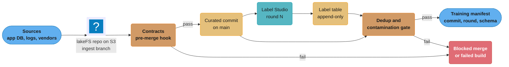
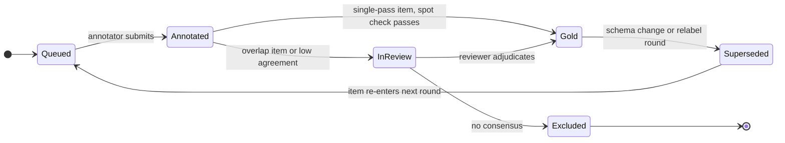
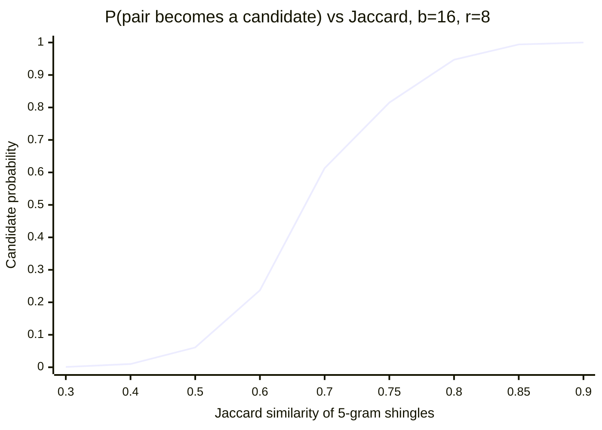
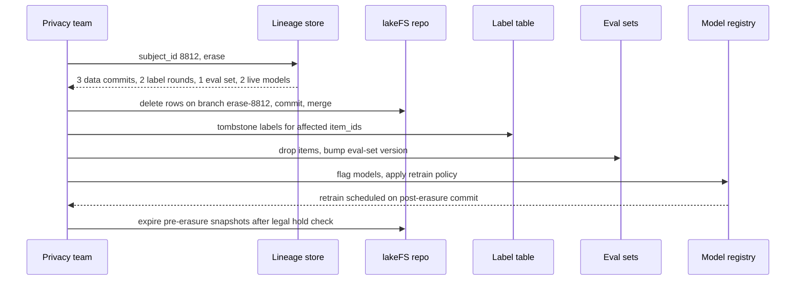
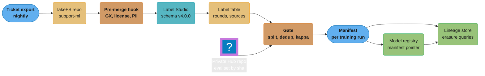

# Dataset and Label Versioning

> **Version anchor** (checked 2026-10-18). lakeFS v1.88.0, released 2026-10-01. DVC 3.67.1,
> released 2026-03-31; the repo is `treeverse/dvc` and `iterative/dvc` redirects to it, so DVC
> and lakeFS sit in the same GitHub org. Label Studio 1.23.2, released 2026-09-29. Every other
> tool on this page is either named without a version or carries its release, with the same
> check date, in the §11 table.

A model is a function of its code, its data, its labels, and the feature definitions that turned raw records into inputs. Code is versioned in git. The other three usually have an S3 prefix, a spreadsheet of annotation guidelines, and a table that someone overwrites every night. This page treats each of them as a release input: something with an immutable id, a contract that is checked before it is used, and provenance that survives an audit or an erasure request.

Cross-links: the id scheme and the lineage graph that ties these inputs to a model are in [artifact_versioning_and_lineage](../artifact_versioning_and_lineage/artifact_versioning_and_lineage.md); the eval sets that the contamination gate protects are in [evaluation_gates_and_eval_sets](../evaluation_gates_and_eval_sets/evaluation_gates_and_eval_sets.md); the corpus snapshot behind a vector index is in [rag_and_vector_index_lifecycle](../rag_and_vector_index_lifecycle/rag_and_vector_index_lifecycle.md).

---

## 1. Concept Overview

Dataset and label versioning gives every data input of a training or evaluation run a reference that resolves to the same bytes forever, or until a documented retention or erasure rule removes them. The run records that reference, not a path.

Five objects need their own versions, because each changes on its own schedule:

| Object | Changes when | Id that pins it |
|---|---|---|
| Data snapshot | new records land, old ones are corrected or erased | lakeFS commit id, Iceberg snapshot id or tag, Delta table version, DVC `.dvc` hash, Hugging Face dataset commit sha |
| Label set | annotators label, reviewers adjudicate, a relabel campaign runs | label-table snapshot plus `label_round` |
| Annotation schema and guideline | the class list or the definition of a class changes | `schema_version` (semver, stored on every label row) |
| Feature definitions | a feature's SQL, window, or source table changes | feature-view name plus version, pinned in the training manifest |
| Data contract and dataset card | a column, range, or license rule changes | contract file at a git sha, card at the same commit as the data |

Data differs from code in four ways that make plain git a poor fit. Size: a training set of 4 TB of Parquet does not belong in a git object store. Mutation in place: warehouse tables are updated, not appended, so "the table" means something different every night. Meaning drift: a label `refund` written under guideline v3 and one written under v4 can mean different things while the string stays the same. Legal obligations: a GDPR Article 17 erasure request can force you to delete rows that a past model was trained on, which a code repo never has to do.

The output of this module is a training manifest: one file that lists the data commit, label round, schema version, feature-view versions, contract versions, and the dedup and contamination reports, all by immutable id. The release bundle in [mlops_foundations_and_the_ai_lifecycle](../mlops_foundations_and_the_ai_lifecycle/mlops_foundations_and_the_ai_lifecycle.md) carries a pointer to that manifest.

**Not here.** Pipeline mechanics, medallion layers, and DVC pipeline basics (`dvc repro`) are in [data_pipelines_and_processing](../../ml/data_pipelines_and_processing/data_pipelines_and_processing.md). Choosing which items to label and writing labeling functions are in [active_learning_and_weak_supervision](../../ml/active_learning_and_weak_supervision/active_learning_and_weak_supervision.md). Generating synthetic data is in [synthetic_data_generation](../../llm/synthetic_data_generation/synthetic_data_generation.md); this page only covers how synthetic rows are tagged. Feature-store design and the point-in-time join are in [feature_store_design](../../ml/ml_system_design/feature_store_design.md) and [feature_store_and_point_in_time_correctness](../../ml/case_studies/cross_cutting/feature_store_and_point_in_time_correctness.md); this page treats feature definitions only as pinned release inputs.

---

## 2. Intuition

> **One-line analogy**: a training manifest is a lockfile for data: `package-lock.json` pins every transitive dependency by hash, and the manifest pins every row source, label round, and feature definition by commit id.

**Mental model**: picture four clocks that tick independently. The data clock ticks every time an ingestion job commits. The label clock ticks each time a labeling round closes. The schema clock ticks when the product team redefines a class. The feature clock ticks when someone edits a feature view. A model is trained at one reading of all four clocks. If you record only the data clock, you cannot say which labels or which feature logic the model saw.

**Why it matters**: every hard question in production ML lands on this record. "Why did recall on `chargeback` drop 9 points between v41 and v42?" needs a diff of the label rounds. "Did user 8812's data train the live model?" needs a lineage query from a row to a manifest to a model. "Is the eval score real?" needs proof that no eval item has a near-duplicate in the training set.

**Key insight**: the versioning tool matters less than the rule that nothing downstream may read a mutable reference. A team that pins Delta table versions by number has better reproducibility than a team with lakeFS that trains from `lakefs://repo/main/`.

---

## 3. Core Principles

- **Pin by immutable id, never by name.** `main`, `latest`, an S3 prefix, and a timestamp are all names that resolve to different bytes over time. A commit id, a snapshot id, or a content hash does not.
- **Retention outlives the model.** An id is only useful while the bytes behind it exist. Snapshot expiry, `VACUUM`, and garbage collection must keep every snapshot that a live or auditable model was trained on.
- **Labels are rows, not a column.** Store each label as its own row keyed by item, annotator, round, and schema version. A `label` column in the data table loses history the first time someone corrects it.
- **The schema version travels with the label.** A label without its schema version cannot be compared with another label.
- **Contracts run at the boundary.** Validate data when it enters the curated layer and again when a training job reads it. A failing contract blocks the commit or the job; it does not log a warning.
- **Contamination is a gate, not a report.** Exact and near-duplicate overlap between training and eval data is measured on every build and fails the build above a threshold.
- **Provenance is per row.** Source, license, consent basis, and a synthetic flag sit on each row, because erasure and license takedowns arrive per row or per source.
- **Erasure is a lineage query plus a policy.** You find every dataset, label, eval set, and model that a subject's data reached, then apply a written policy: retrain, unlearn, or delete.

---

## 4. Types / Architectures / Strategies

### 4.1 Versioning mechanisms

| Mechanism | How it versions | Unit | Typical fit |
|---|---|---|---|
| Lakehouse time travel (Iceberg, Delta) | every write produces a new snapshot or table version; reads can target an old one | table | warehouse tables, tabular features, event logs |
| Object-store branching (lakeFS) | git-like commits, branches, merges, and tags over an object-store prefix; branches are metadata only | repository of objects | mixed files (Parquet, images, audio, JSONL) across many tables |
| Pointer files in git (DVC) | a small `.dvc` file in git holds the content hash; bytes live in a remote | file or directory | a project that wants data pinned next to the code that uses it |
| Hub revisions (Hugging Face Datasets) | the dataset is a git repo on the Hub; every push is a commit | dataset repo | public or shared datasets, eval sets |
| Copy snapshots | `aws s3 sync` to `s3://bucket/snap/2026-10-01/` | prefix | none at scale; included because it is the default teams start with |

Iceberg also has branches and tags on a single table, so "branching" is not unique to lakeFS. The difference is scope: an Iceberg tag pins one table; a lakeFS commit pins every object under the repository at once, which matters when a training set joins six tables and a folder of images.

### 4.2 Label storage strategies

| Strategy | Shape | Problem |
|---|---|---|
| Label column on the data row | `tickets(id, text, label)` | correction overwrites; no annotator, round, or schema version |
| Label file per round | `labels_round3.csv` | rounds drift apart; no single query for "current gold" |
| Label table plus gold view | `labels(item_id, annotator_id, round, schema_version, value, created_at)` plus an adjudicated `gold` view | needs a join, which is the point |

The label table is append-only. Corrections are new rows in a later round. The `gold` view selects one value per item and schema version, by adjudication rule (reviewer wins, else majority, else excluded).

### 4.3 Contract placement

- **Producer-side contracts** run in the job that writes the curated table. They catch a broken upstream before it lands. Great Expectations suites and dbt tests usually live here.
- **Consumer-side contracts** run in the training job before it reads. They catch the case where the producer's contract was weaker than the model needs. Pandera schemas on the DataFrame are the common form.
- Both are versioned in git, and the training manifest records the sha of the contract that passed.

### 4.4 Erasure strategies for trained models

| Strategy | What happens to the model | Time to compliance | Cost |
|---|---|---|---|
| Retrain on schedule | erased rows drop out at the next scheduled retrain | up to one retrain period | none extra |
| Retrain now | full retrain on the post-erasure snapshot | hours to days | one training run |
| Sharded retrain (SISA) | only the shard that held the row is retrained | shard training time | k shards, some accuracy loss from sharding |
| Approximate unlearning | gradient-based removal of the row's influence | minutes to hours | no formal guarantee; must be verified |
| Model deletion | the model and its descendants are deleted | immediate | everything built on it |

Why approximate unlearning rarely survives an audit, and how SISA works, is in [privacy_and_data_governance](../../llm/llm_security/privacy_and_data_governance.md); this table is only the policy choice. Model deletion is not hypothetical: the US FTC's 2021 order against Everalbum required it to delete models and algorithms built from photos of users who had not consented, and its 2022 order against WW International (Kurbo) required deletion of algorithms built from children's data.

---

## 5. Architecture Diagrams

### Data path from source to training manifest



Nothing reaches the manifest without passing two gates: the contract hook on the merge into `main`, and the dedup and contamination gate on the joined data and labels. The manifest stores ids, never paths.

### Version clocks per model: data, labels, schema, features

```
  model        data commit (lakeFS)   label round   schema   feature views
  ---------------------------------------------------------------------------
  intent-v40   c7e1a90                round 5       v3.2     tickets_7d@4
  intent-v41   c7e1a90                round 6       v3.2     tickets_7d@4
  intent-v42   d41f0b2                round 6       v4.0     tickets_7d@5
  ---------------------------------------------------------------------------
  v40 -> v41   same                   MOVED         same     same
  v41 -> v42   MOVED                  same          MOVED    MOVED
```

v40 to v41 is a clean label experiment: one clock moved. v41 to v42 moved three clocks at once, so a 9-point recall drop on `chargeback` cannot be attributed to any one of them without re-running with two clocks held still.

### Zero-copy branch for a relabel experiment

```
  main      o-----------o-----------------o----------------o  (merge, tag train-2026-10-14)
            c7e1a90     |                 ^
                        |                 |  pre-merge hook: contracts + dedup report
                        v                 |
  relabel               o------o----------o
                        branch  commit     commit
                        (0 B    labels r7  gold view rebuilt
                        copied)
```

Creating the `relabel` branch copies no objects; lakeFS writes only metadata. Objects written on the branch are new; unchanged objects are shared with `main`. The merge goes through the same hook as any ingest.

### Label lifecycle



A label never changes state in place. `Superseded` is a new row in a later round that points to the old one, so the label table can answer "what did round 5 say about item 81233" forever.

### MinHash LSH candidate probability, 16 bands of 8 rows



With 128 hash functions split into 16 bands of 8, a pair is a candidate if any band matches exactly: `1 - (1 - s^8)^16`. The curve crosses 0.5 near the threshold `(1/16)^(1/8) = 0.707`, catches 94.7% of pairs at Jaccard 0.8, and lets through 6.1% of pairs at 0.5. Candidates are then verified with the full-signature Jaccard estimate or exact Jaccard on the shingle sets.

### Erasure propagation



The lineage store answers the first question in one query only if every manifest recorded ids. The final step matters: until old snapshots are expired and garbage-collected, the erased bytes still exist and time travel can read them.

---

## 6. How It Works - Detailed Mechanics

### 6.1 Pinning a snapshot

Broken: the training job reads a name.

```python
# Reads whatever "main" points to at job start. A rerun next week trains on different data.
df = spark.read.parquet("s3a://ml-data/main/tickets/curated/")
```

Fixed with lakeFS: resolve the branch to a commit once, record it, read by commit.

```bash
lakectl branch create lakefs://ml-data/train-intent-v42 --source lakefs://ml-data/main
lakectl log lakefs://ml-data/train-intent-v42 --amount 1     # prints commit d41f0b2...
lakectl tag create lakefs://ml-data/train-intent-v42-data lakefs://ml-data/d41f0b2
```

```python
COMMIT = "d41f0b2"   # lakeFS accepts a unique prefix; the manifest stores the full id
df = spark.read.parquet(f"s3a://ml-data/{COMMIT}/tickets/curated/")   # lakeFS S3 gateway
```

The lakeFS S3 gateway accepts a branch, a tag, or a commit id in the ref position of the path, so the same reader code works for all three. Only the commit id is immutable; a tag can be deleted and recreated. lakeFS garbage collection is driven by per-branch retention and never removes objects on the HEAD of a branch; a tag does not hold objects back, so keep the `train-intent-v42` branch for as long as the model must stay reproducible.

Fixed with Iceberg: read a snapshot id, and tag it so expiry keeps it.

```sql
ALTER TABLE prod.ml.tickets CREATE TAG `intent-v42` AS OF VERSION 8744736658442914487 RETAIN 400 DAYS;
SELECT * FROM prod.ml.tickets VERSION AS OF 'intent-v42';
```

Fixed with Delta: read a table version.

```sql
SELECT * FROM ml.tickets VERSION AS OF 1182;
```

Fixed with DVC: the `.dvc` file in git carries the hash; checking out the code commit pins the data.

```yaml
# data/tickets.dvc, committed next to train.py
outs:
- md5: 5f3c1d0f2a9b7e14c6d8a2e0b4f17c93.dir
  size: 4123886120
  nfiles: 212
  hash: md5
  path: tickets
```

Fixed with the Hugging Face Hub: pass a commit sha, not a branch.

```python
from datasets import load_dataset
ds = load_dataset("acme/support-tickets-eval", revision="3b9e7c2a41f0d5e8b6c1a7f2e9d03c4b5a6e7f81")
```

### 6.2 Snapshot retention and expiry

Every table format cleans up old versions, and the defaults are short:

| Format | Default | What it breaks |
|---|---|---|
| Iceberg | `history.expire.max-snapshot-age-ms` = 432000000 (5 days) when `expire_snapshots` runs; `main` is never expired, but snapshots on it are | time travel to an untagged snapshot older than 5 days |
| Iceberg refs | `history.expire.max-ref-age-ms` = forever for tags and non-main branches | nothing, if you tag; this is the escape hatch |
| Delta | `delta.logRetentionDuration` = 30 days, `delta.deletedFileRetentionDuration` = 7 days | `VERSION AS OF` older than 30 days; any version whose files `VACUUM` removed after 7 days |
| lakeFS | garbage-collection rules per branch, in days, plus a repository default; objects on any branch HEAD are kept, tags give no protection | commits whose objects GC removed; the commit metadata survives, the reads fail |

Arithmetic for a team that retrains monthly and must reproduce any model for 13 months (a regulator's look-back window): it needs at most 13 tagged snapshots per training table, not 13 months of daily snapshots. With Iceberg tags at `RETAIN 400 DAYS`, the cost is the data files those 13 snapshots reference and nothing else. Storing 395 untagged daily snapshots of a 4 TB table with 2% daily churn would hold roughly 4 + 395 x 0.08 = 35.6 TB; 13 tagged snapshots hold about 4 + 12 x 2.4 = 32.8 TB in the worst case (each tag 30 days of churn apart) and far less when tables are append-heavy. The win is not storage; it is that expiry stays on for everything else.

### 6.3 Annotation schema and the label table

The schema is a versioned file in git, not a setting in the labeling tool.

```yaml
# label_schemas/support_intent.yaml
name: support_intent
version: 4.0.0          # major: a class split or merge; minor: guideline wording; patch: typo
classes:
  - id: refund_request   # v4 split of v3 "refund"
    guideline: Customer asks for money back for a specific charge.
  - id: refund_status    # v4 split of v3 "refund"
    guideline: Customer asks where a refund already promised is.
  - id: chargeback
    guideline: Customer says they disputed or will dispute with their bank.
migrations:
  from: 3.2.0
  map: { refund: [refund_request, refund_status] }   # one-to-many: needs relabel, not a rename
```

```sql
CREATE TABLE labels (
  item_id        BIGINT,
  schema_name    STRING,
  schema_version STRING,      -- '4.0.0'
  label_round    INT,
  annotator_id   STRING,      -- pseudonymous id, never an email
  value          STRING,
  confidence     FLOAT,
  source         STRING,      -- 'human', 'llm_judge:<model>@<prompt_version>', 'labeling_fn:<name>'
  supersedes     BIGINT,      -- label_id this row replaces, NULL for first label
  created_at     TIMESTAMP
);
```

A one-to-one map (rename `cancel` to `cancellation`) is a migration you can apply with SQL. A one-to-many map (split `refund`) is not: every v3 `refund` row has to be relabeled or dropped. The `migrations` block makes that visible in code review.

LLM-produced labels are rows like any other, with `source` naming the model snapshot and prompt version. Mixing them with human labels without that field is how a team later discovers that 40% of its "gold" set was written by the model it is evaluating.

### 6.4 Inter-annotator agreement

Percent agreement overstates quality when one class dominates. Cohen's kappa corrects for chance: `kappa = (p_o - p_e) / (1 - p_e)`.

Worked example: two annotators label 1,000 tickets as `chargeback` or not. Annotator A marks 30% positive, B marks 25%. They agree on 900 items, so `p_o = 0.90`. Chance agreement is `p_e = 0.30 x 0.25 + 0.70 x 0.75 = 0.075 + 0.525 = 0.60`. Kappa is `(0.90 - 0.60) / 0.40 = 0.75`.

After a guideline edit, agreement on the same overlap sample falls to `p_o = 0.82` with `p_e = 0.58`, and kappa drops to `0.24 / 0.42 = 0.57`. That drop is the signal that the guideline change confused annotators, and it shows up a week before model metrics move.

The per-class number comes straight from the label table, one-vs-rest per class, so it is a query, not a spreadsheet:

```python
from sklearn.metrics import cohen_kappa_score

pairs = labels_df[labels_df.item_id.isin(overlap_ids) & (labels_df.schema_version == "4.0.0")]
wide = pairs.pivot_table(index="item_id", columns="annotator_slot", values="value", aggfunc="first")
for cls in schema_classes:
    a = (wide["a"] == cls).astype(int)
    b = (wide["b"] == cls).astype(int)
    k = cohen_kappa_score(a, b)
    if k < floors.get(cls, 0.6):
        alert(f"kappa {k:.2f} for {cls} under schema 4.0.0, round {current_round}")
```

`annotator_slot` assigns the first and second annotator of each overlap item to `a` and `b`, so the pair is defined per item rather than per person. Filtering on `schema_version` keeps v3 and v4 labels from being scored against each other.

Which coefficient fits which rater design (Fleiss' kappa, Krippendorff's alpha) is covered in [error_analysis_and_eval_design](../../llm/error_analysis_and_eval_design/error_analysis_and_eval_design.md). Monitor per class and per annotator on a fixed overlap slice (5 to 10% of items labeled by two or more people), and alert when a class falls below its floor (0.6 is a common floor for subjective classes, 0.8 for factual ones).

### 6.5 Data contracts

Broken: the training job trusts the table.

```python
df = read_snapshot(COMMIT)
model.fit(df[FEATURES], df["label"])   # a vendor sent amount in cents; 100x values train fine and serve wrong
```

Fixed: a consumer-side Pandera schema that fails the job.

```python
import pandera.pandas as pa

class TicketTrainRow(pa.DataFrameModel):
    item_id: int = pa.Field(unique=True)
    amount_usd: float = pa.Field(ge=0, le=50_000)
    locale: str = pa.Field(isin=["en-US", "en-GB", "de-DE", "fr-FR"])
    license: str = pa.Field(isin=["first_party", "cc-by-4.0", "vendor_acme_2026"])
    consent_basis: str = pa.Field(isin=["contract", "consent", "legitimate_interest"])
    is_synthetic: bool

    class Config:
        strict = True        # an unexpected column fails the job

TicketTrainRow.validate(df, lazy=True)   # lazy: report every failure, not the first
```

The producer side uses a Great Expectations suite run as a lakeFS pre-merge hook, so a bad ingest never reaches `main`:

```yaml
# _lakefs_actions/pre_merge_contracts.yaml
name: curated contracts
on:
  pre-merge:
    branches: [main]
hooks:
  - id: gx_tickets
    type: webhook
    properties:
      url: "http://contracts.ml.svc/run?suite=tickets_curated"
      timeout: 10m
```

A hook that returns a non-2xx status fails the merge. The contract file's git sha goes into the manifest, so a later reader knows which rules the data passed.

### 6.6 Dedup and train/eval contamination

Three layers, cheapest first:

1. **Exact dedup.** Hash a normalized form (lowercase, collapse whitespace, strip boilerplate) with SHA-256. Drop duplicates within the training set and remove any training row whose hash appears in an eval set.
2. **Near-duplicate dedup with MinHash LSH.** Shingle each document into word 5-grams, compute a 128-value MinHash signature, band it 16 x 8, and compare candidates. The §5 curve shows the band choice sets the threshold near Jaccard 0.71.
3. **N-gram overlap against eval sets.** For LLM work, flag any eval item that shares a long n-gram with training text. The GPT-3 paper used 13-gram overlap for its contamination study.

```python
from datasketch import MinHash, MinHashLSH

def sig(text: str, k: int = 5, perms: int = 128) -> MinHash:
    toks = text.lower().split()
    m = MinHash(num_perm=perms)
    for i in range(len(toks) - k + 1):
        m.update(" ".join(toks[i:i + k]).encode())
    return m

lsh = MinHashLSH(num_perm=128, params=(16, 8))   # explicit bands x rows; threshold= lets datasketch pick
for eid, text in eval_items:
    lsh.insert(f"eval:{eid}", sig(text))

leaked_eval = {hit for _, t in train_items for hit in lsh.query(sig(t))}
rate = len(leaked_eval) / len(eval_items)
assert rate < 0.001, f"{len(leaked_eval)} eval items have a training near-duplicate"
```

Corpus-scale dedup for pre-training is in [pre_training](../../llm/pre_training/pre_training.md); this page covers the train-versus-eval gate. Splitting matters as much as dedup. A support ticket thread, a user's sessions, or the pages of one document are near-duplicates of each other by construction. Split by the group key, not by row:

```
  row split (leaks)                       group split by thread_id (clean)
  thread 17: msg1 msg2 msg3 msg4          thread 17: msg1 msg2 msg3 msg4
             TR   EV   TR   TR                       TR   TR   TR   TR
  thread 52: msg1 msg2 msg3               thread 52: msg1 msg2 msg3
             EV   TR   EV                            EV   EV   EV
  eval msg2 of 17: 3 siblings in train   no eval thread has any row in train
```

Group-aware splitters (`GroupKFold`, `StratifiedGroupKFold`) are covered in [imbalanced_data_and_leakage_traps](../../ml/imbalanced_data_and_leakage_traps/imbalanced_data_and_leakage_traps.md). The split itself is versioned: store `split = hash(thread_id) mod 100 < 10 ? 'eval' : 'train'` with the salt in the manifest, so new data for an existing thread lands on the same side.

### 6.7 Provenance, consent, and license lineage

Each row carries five provenance fields: `source_id`, `license`, `consent_basis`, `collected_at`, and `is_synthetic` (plus `generator` for synthetic rows). License rules are a contract like any other:

| Model use | Allowed licenses | Blocked |
|---|---|---|
| Internal analytics model | first_party, cc-by-4.0, cc-by-sa-4.0, vendor_acme_2026 | cc-by-nc-4.0 for a revenue-generating feature, depending on legal review |
| Customer-facing generative model | first_party, cc-by-4.0, vendor contracts with a model-training clause | any source whose contract is silent on training |

The training job filters on these fields and records the counts per license in the manifest. When a source is withdrawn (a vendor contract ends, a takedown notice arrives), the lineage query is "every manifest whose license counts include this source", not a grep through notebooks.

Erasure timing: GDPR Article 12(3) gives one month to act on a request, extendable by two further months for complex cases. A monthly retrain cadence fits inside that only if the erasure lands in the data before the next training run reads its snapshot. Erasure in lakeFS is a commit that deletes rows on a branch, merged to `main`; the pre-erasure commits still hold the bytes until their retention ends and GC runs, so the erasure is complete only when those snapshots expire or are rewritten. Teams under a legal hold for audit reasons record the conflict and the legal basis rather than silently keeping the bytes.

### 6.8 Synthetic data provenance

Synthetic rows get a tag on the row, not a folder name:

```json
{"item_id": 99120344, "is_synthetic": true,
 "generator": {"model": "paraphraser-8b@sha256:9c1e04", "prompt_version": "ticket-paraphrase@7",
               "seed": 4411, "parent_item_id": 81233, "created_at": "2026-10-02T11:04:00Z"}}
```

Three rules follow. Synthetic rows never enter an eval set unless the eval set is declared synthetic. `parent_item_id` means an erasure of the parent removes the child. The manifest records the synthetic fraction per class, because a class that is 70% synthetic behaves differently from one that is 5% synthetic, and a reviewer should see that number.

### 6.9 Feature definitions as release inputs

A feature view is code that runs against data, so its version is a release input like a data commit. The manifest pins each view by name and version:

```json
"features": [
  {"view": "tickets_7d", "version": 5, "definition_sha": "a91c0e4", "pit_join": "event_time"},
  {"view": "account_risk", "version": 12, "definition_sha": "77b2d10", "pit_join": "event_time"}
]
```

Two checks run at the release gate. First, point-in-time correctness is a contract: for a sample of 10,000 training rows, recompute each feature as of the label's `event_time` and assert equality with the stored value; a mismatch means a feature leaked future data. Second, training-serving skew: compare each feature's distribution in the training snapshot against the last 7 days of serving logs with the population stability index, and block the release when PSI exceeds 0.25 on any feature (0.1 to 0.25 is a warning). A version bump on `tickets_7d` from 4 to 5 that changes the window from 7 calendar days to 7 business days shows up here as PSI 0.4 on that one feature.

### 6.10 The training manifest and the dataset card

```json
{
  "manifest_version": 3,
  "data": {"repo": "lakefs://ml-data", "commit": "d41f0b2", "tables": ["tickets/curated", "accounts/curated"]},
  "labels": {"schema": "support_intent", "schema_version": "4.0.0", "round": 6, "gold_rule": "reviewer>majority"},
  "split": {"key": "thread_id", "salt": "s-2026-10", "eval_pct": 10},
  "features": [{"view": "tickets_7d", "version": 5}],
  "contracts": {"producer": "gx/tickets_curated@3e1f9a2", "consumer": "pandera/ticket_train_row@3e1f9a2"},
  "reports": {"exact_dup_removed": 18233, "near_dup_removed": 4120, "eval_leak_rate": 0.0003,
              "kappa_overlap": {"chargeback": 0.75, "refund_request": 0.81}},
  "provenance": {"license_counts": {"first_party": 2391022, "cc-by-4.0": 8211},
                 "synthetic_fraction": 0.06}
}
```

The dataset card is the human-readable view of the same facts: intended use, sources and licenses, collection period, known gaps per class, the label schema and its agreement numbers, and the erasure policy. It lives in the same commit as the data, so it cannot describe a different version. Hugging Face dataset cards put license, task, and size in YAML front matter, which makes them queryable.

---

## 7. Real-World Examples

**Label errors in benchmark test sets.** Northcutt, Athalye, and Mueller (NeurIPS 2021 Datasets and Benchmarks) estimated an average of at least 3.3% label errors across the test sets of 10 common datasets, including at least 6% of the ImageNet validation set. On ImageNet with corrected labels, ResNet-18 outperforms ResNet-50 once the share of originally mislabeled test examples rises by 6%. The lesson for versioning: the eval set's labels need rounds and adjudication like the training labels, and a corrected eval set is a new eval-set version.

**GPT-3 contamination bug.** The GPT-3 paper (Brown et al., 2020) measured 13-gram overlap between training data and benchmarks and reported that a bug in the filtering left some overlaps in the training set; retraining was too expensive, so the paper analyzed the impact instead. A contamination check that runs after training is a report. One that runs before training is a gate.

**GSM1k.** Scale AI built GSM1k, a fresh set of grade-school math problems written to match GSM8K, and reported accuracy drops of up to 8% relative to GSM8K, with several model families showing systematic overfitting (arXiv 2405.00332, v4). A held-out set that no public crawl has seen is the strongest contamination control for LLM evals.

**LAION-5B withdrawal.** LAION took LAION-5B offline in December 2023 after a Stanford Internet Observatory report found links to child sexual abuse material, and released Re-LAION-5B in August 2024 with the flagged links removed. Every team that had trained on a local copy had to answer which of its models used which snapshot. Teams that had stored only "LAION-5B" in their configs could not.

**Books3 takedown.** The Books3 subset of The Pile was removed from public hosting in 2023 after a DMCA takedown requested by the Danish Rights Alliance. Per-source license fields turn "did we train on Books3" into a query.

**Hugging Face `datasets` 4.0.0 removed loading scripts** (released 2025-07-09; `trust_remote_code` is no longer supported). Pipelines that loaded script-based dataset repos broke on upgrade. Pinning both the library version and the dataset commit sha, and preferring Parquet-backed dataset repos, keeps a reproduction job from depending on code that the library no longer runs.

**FTC model-deletion orders.** Everalbum (2021) and WW International's Kurbo (2022) were ordered to delete models and algorithms built from improperly collected data. Without lineage from data to model, a company cannot prove which models fall under such an order, so it has to delete more than the order requires.

---

## 8. Tradeoffs

### Versioning mechanism

| Concern | Iceberg / Delta time travel | lakeFS | DVC | HF Hub revisions |
|---|---|---|---|---|
| Atomic version across many tables and files | no (per table) | yes (per repo commit) | yes (per git commit) | per dataset repo |
| Works with unstructured files (images, audio) | poorly | yes | yes | yes |
| Branch, test, merge workflow | Iceberg branches per table | native, with pre-merge hooks | via git branches | via PRs on the Hub |
| Query engines read it directly | yes | yes, through the S3 gateway | no, `dvc pull` first | through `datasets` or the Parquet export |
| Extra service to run | no (catalog only) | yes (lakeFS server and metadata store) | no | no (hosted) |
| Retention control | snapshot expiry, tags | GC rules per branch | remote cache cleanup (`dvc gc`) | repo history |

### Label storage

| Option | Reproducible rounds | Query cost | Fit |
|---|---|---|---|
| Label column | no | lowest | throwaway prototypes |
| File per round | partly | medium; manual joins | small teams, one task |
| Append-only label table plus gold view | yes | a join and a window function | any model that is retrained |

### Near-duplicate detection

| Method | Catches | Cost at 100M docs | Miss |
|---|---|---|---|
| Exact hash on normalized text | identical after normalization | one pass, minutes | any edit |
| MinHash LSH on 5-gram shingles | lexical near-duplicates above about Jaccard 0.7 | 128 hashes per doc plus banded index | paraphrases |
| Embedding similarity (ANN) | paraphrases and translations | an embedding pass plus an ANN index | false positives on topic-similar items |
| Long n-gram overlap vs eval | verbatim eval leakage | index of eval n-grams, scan of train | paraphrased leakage |

### Erasure policy

| Policy | Compliance window | Guarantee | Operational cost |
|---|---|---|---|
| Next scheduled retrain | one retrain period | exact, once retrained | none beyond cadence |
| Immediate retrain | days | exact | a full run per batch of requests |
| SISA shards | shard retrain time | exact for the shard | accuracy cost of k sub-models |
| Approximate unlearning | hours | none formal; verify with membership-inference tests | research-grade tooling |

---

## 9. When to Use / When NOT to Use

**Use lakeFS** when a training set joins several tables and object folders, when you want ingest to land on a branch and merge only after contracts pass, or when many teams share one data lake and need isolated experiments without copies.

**Use table time travel alone** when the training data is one or two lakehouse tables, the team already runs Iceberg or Delta, and tags with retention cover the reproduction window.

**Use DVC** when a project's data is a few hundred GB or less, the people who change the data are the people who change the code, and you want `git checkout` to pin both.

**Use Hugging Face Hub revisions** for eval sets and datasets shared across teams or published, always pinned by commit sha.

**Use an append-only label table** for any labeled data that will be relabeled, audited, or used to train more than once.

**Do not** build a versioning layer for a one-off analysis notebook, a model that is trained once and never retrained, or a dataset that is fully regenerated from a pinned source by deterministic code (pin the source and the code instead). **Do not** use copy snapshots past a few hundred GB; at 4 TB per day they cost about 360 TB after 90 days. **Do not** treat a labeling tool's internal project history as your label store; export each closed round to the label table.

---

## 10. Common Pitfalls

**Training on `main`.** A fraud team retrained weekly from `s3://lake/main/transactions/`. A backfill job rewrote three months of history with a corrected currency conversion on a Tuesday; Wednesday's model and the previous Wednesday's were trained on different pasts. Recall on the cross-border slice moved 6 points and nobody could reproduce either number. Fix: the job resolves the ref to a commit id at start and writes it to the manifest; CI rejects a training config that contains a branch name.

**Snapshot expiry ate the audit.** A lending team ran Iceberg with the default 5-day snapshot expiry. A regulator asked for the exact training data of a model trained 11 weeks earlier. The snapshot id was in the manifest; the snapshot was gone. Fix: every training run creates an Iceberg tag with `RETAIN` set to the audit window, and a weekly job asserts that every model in the registry has a resolvable tag.

**Guideline change without a schema bump.** A trust-and-safety team clarified that sarcastic threats count as `threat`. The guideline doc changed; the schema version did not. Kappa on `threat` fell from 0.78 to 0.55 over two weeks as annotators split on old and new readings, and the next model's precision on `threat` dropped 11 points. Fix: guideline wording is part of the schema file; any edit bumps at least the minor version; the dashboard shows kappa per schema version.

**Random row split on threaded data.** A support-intent model scored 0.94 macro-F1 offline and 0.81 in production. Eval messages had sibling messages from the same thread in training. Fix: split by `thread_id` with a salted hash and record the salt.

**Eval set on the Hub pinned to `main`.** A shared eval set gained 300 items in a PR. Two teams comparing models a week apart compared different eval sets and argued about a 2-point gap that did not exist. Fix: eval-set references are commit shas; the eval-gate config in [evaluation_gates_and_eval_sets](../evaluation_gates_and_eval_sets/evaluation_gates_and_eval_sets.md) rejects a branch name.

**LLM labels mixed into gold.** A team used a model to pre-label 60,000 items and let annotators accept or edit. Accept rates were 92%. The `source` field recorded `human` for accepted items. When the same model family was evaluated against that gold set, it scored 6 points higher than an independent human-only set showed. Fix: an accepted pre-label is `source = 'llm_prelabel_accepted:<model>@<prompt>'`, and eval sets exclude it or report it as a separate slice.

**Erasure that missed the eval set.** An erasure job removed a user's tickets from the curated table and the label table. The user's tickets were also in a frozen eval set on the Hub, which was copied into three teams' CI. Fix: eval sets are datasets in the lineage graph, with the same erasure fan-out as training data.

**Erased rows came back from a backfill.** An erasure job deleted a user's rows from the curated table on `main`. Six weeks later an engineer re-ran the curation job from the raw export bucket to fix a parsing bug, and the raw bucket still held the user's tickets. The erased rows re-entered `main` and the next model trained on them. Fix: erasure writes the subject id to a suppression list that every curation job joins against, the raw landing zone gets the same deletion, and the contract hook fails any merge that contains a suppressed id.

**Dedup ran inside each split, not across them.** A team deduplicated the training set and the eval set separately and reported both as clean. 3.8% of eval items had an exact duplicate in training, because nobody compared one set against the other. Fix: the cross-set check is its own gate step with its own number in the manifest (`eval_leak_rate`), separate from the within-set dedup counts.

**Feature view edited in place.** Someone changed `tickets_7d` from calendar days to business days without bumping its version. Training used the new logic on historical data; serving used it from deploy time; the offline replay used the old cached values. PSI between training and serving on that feature was 0.4. Fix: the definition sha is pinned in the manifest and the gate recomputes it.

---

## 11. Technologies & Tools

Releases below were read from each project's GitHub releases on 2026-10-18.

| Tool | Category | Release | Notes |
|---|---|---|---|
| lakeFS | object-store version control | v1.88.0 (2026-10-01) | branches, commits, merges, tags, pre-commit and pre-merge hooks, S3 gateway |
| DVC | data versioning in git | 3.67.1 (2026-03-31) | repo `treeverse/dvc`; `.dvc` pointer files, remotes, `dvc import` from other repos |
| Apache Iceberg | table format | 1.12.0 (2026-09-30) | snapshots, branches, tags with `RETAIN`; see [apache_iceberg](../../technologies/apache_iceberg/apache_iceberg.md) |
| Delta Lake | table format | v4.4.1 (2026-10-05) | `VERSION AS OF`, `TIMESTAMP AS OF`, `RESTORE`; see [lakehouse_and_table_formats](../../database/lakehouse_and_table_formats/lakehouse_and_table_formats.md) |
| Hugging Face | Hub dataset repos and the `datasets` library | `datasets` 5.1.0 (2026-10-05) | `revision=` pins a Hub commit; loading scripts removed in `datasets` 4.0.0 |
| Label Studio | annotation | 1.23.2 (2026-09-29) | XML labeling configs, JSON export with annotator and timing fields |
| Argilla | annotation and feedback | v2.8.0 (2025-03-11), no later release | Python-defined datasets with fields, questions, and guidelines; Hub export |
| Snorkel | weak supervision, open-source library | v0.10.0 (2024-02-27), no later release | labeling functions and a label model; see the active-learning page |
| Great Expectations | data contracts (GX Core) | 1.24.0 (2026-10-07) | repo `fivetran/great_expectations`; `great-expectations/great_expectations` redirects to it |
| Pandera | DataFrame contracts | v0.34.1 (2026-10-06) | `DataFrameModel` schemas, `import pandera.pandas as pa` |
| OpenLineage | lineage events | 1.54.0 (2026-10-13) | run-level lineage; graph design is in [artifact_versioning_and_lineage](../artifact_versioning_and_lineage/artifact_versioning_and_lineage.md) |

Privacy mechanics that sit beside erasure (differential privacy, federated learning) are in [privacy_preserving_ml](../../ml/privacy_preserving_ml/privacy_preserving_ml.md) and, for LLM data, [privacy_and_data_governance](../../llm/llm_security/privacy_and_data_governance.md).

---

## 12. Interview Questions with Answers

**Q: Why is a training run that reads `s3://lake/main/tickets/` not reproducible even if the bucket has versioning turned on?**
**Short:** The path names a moving ref, and S3 object versioning tracks single objects, not a consistent set; only a recorded commit or snapshot id pins the whole input.

`main` and a prefix are names; a backfill, compaction, or late-arriving partition changes what they return. S3 object versioning keeps old versions of each key, but there is no record of which version of each of 212 files the job read at 09:14, and deleted keys or new keys in the prefix change the set. A lakeFS commit, an Iceberg snapshot, a Delta version, or a DVC hash names the whole set at once. Resolve the ref to an id at job start, write it to the manifest, and make CI reject configs that contain branch names.

**Q: The manifest has the Iceberg snapshot id of a model trained 60 days ago, but time travel to it fails. What happened and how do you prevent it?**
**Short:** Snapshot expiry removed it; Iceberg's default max snapshot age is 5 days when expiry runs, so pin training snapshots with a tag that has a RETAIN period.

`expire_snapshots` removes snapshots older than `history.expire.max-snapshot-age-ms` (432000000 ms, 5 days, by default) and then the orphaned data files. The id survives in your manifest; the bytes do not. Tags and non-main branches default to a max ref age of forever, so `CREATE TAG ... AS OF VERSION <id> RETAIN 400 DAYS` keeps exactly the snapshots you need while expiry keeps running for the rest. Delta has the same trap with a 30-day log retention and 7-day deleted-file retention before `VACUUM`. Add a scheduled check that every registered model's data reference still resolves.

**Q: Product splits the class `refund` into `refund_request` and `refund_status`. Why can you not migrate the old labels with an UPDATE?**
**Short:** A one-to-many split has no deterministic mapping, so every old `refund` label must be relabeled or dropped, and the schema version must go to a new major.

A rename is a one-to-one map and SQL can apply it. A split needs information the old annotator never recorded. Bump the schema to a new major version, keep the v3 rows untouched, queue the affected items for a relabel round under v4, and make the gold view filter by schema version so nothing mixes v3 and v4 labels. Estimate the scope first: double-label a 2,000-item sample to measure how the split divides, then decide between a full relabel and a model-assisted targeted one.

**Q: Your offline macro-F1 is 0.94 and production is 0.81 on a support-ticket classifier. What data-split mistake do you check first?**
**Short:** A row-level random split on grouped data: messages from the same thread land in both train and eval, so eval measures memorization of siblings.

Threads, user sessions, and pages of one document are near-duplicates by construction. A random row split puts siblings on both sides and inflates eval. Split by the group key with a salted hash (`hash(salt + thread_id) mod 100 < 10`), store the salt in the manifest so new messages in an old thread land on the same side, and add a check that no group id appears in both splits. Run the near-duplicate gate on top, since different threads can still contain pasted templates.

**Q: Why track inter-annotator kappa per class and per schema version instead of one overall agreement number?**
**Short:** One pooled number hides the single class a guideline edit confused, and pooling schema versions scores old and new class definitions against each other.

Kappa is `(p_o - p_e) / (1 - p_e)`, which removes the chance matches that make raw percent agreement look good on skewed classes: with annotators marking 30% and 25% positive, chance agreement is already 0.60, so 90% observed agreement is kappa 0.75. Pooled over 40 classes, one class falling from 0.75 to 0.57 after a guideline edit barely moves the average. Compute kappa one-vs-rest per class on a fixed overlap slice of 5 to 10% of items, filter to one schema version so v3 and v4 labels are never scored against each other, and alert when a class drops below its floor. The drop appears before model metrics move and points at the guideline, not the model.

**Q: How do you detect train/eval contamination for an LLM fine-tune whose eval set is free-form text?**
**Short:** Layer exact hashes, MinHash LSH near-duplicate checks, and long n-gram overlap against the eval set, and fail the build above a leak-rate threshold before training starts.

Normalize and SHA-256 every document for exact matches. Use MinHash on word 5-gram shingles with LSH banding to find lexical near-duplicates. Index the eval set's long n-grams (13-grams follow the GPT-3 contamination study) and scan training text for hits. Paraphrased leakage needs an embedding-similarity pass with manual review of hits. The GPT-3 paper shows the cost of running this after training: a filtering bug left overlaps, and the model could not be retrained. Record the leak rate in the manifest and make it a gate, for example under 0.1% of eval items.

**Q: You use 128 MinHash permutations. How do you choose bands and rows, and what does 16 x 8 give you?**
**Short:** b bands of r rows give candidate probability 1-(1-s^r)^b with a threshold near (1/b)^(1/r); 16 x 8 puts it near Jaccard 0.71.

At 16 bands of 8 rows, a pair at Jaccard 0.8 becomes a candidate with probability 0.947 and a pair at 0.5 with probability 0.061. More rows per band sharpen the curve and raise the threshold; more bands lower it and raise recall at the cost of more candidates to verify. Pick the threshold from the duplicate definition you want (0.7 to 0.8 is common for web text), then verify every candidate with the full signature estimate so false candidates cost compute, not correctness.

**Q: A GDPR erasure request arrives for a user whose data trained two live models. What must happen across the data platform?**
**Short:** Run a lineage query from the subject to every dataset, label, eval set, and model, delete in the data layer, then apply the written retrain or unlearning policy.

First the lineage store returns every data commit, label round, eval set, and manifest that included the subject's rows. Delete the rows on a branch and merge; tombstone the labels; remove items from eval sets and bump their versions. Old snapshots still hold the bytes until they expire and GC runs, so the erasure is complete only then. For the models, apply the policy: retrain on the post-erasure commit within the deadline (Article 12(3) allows one month, extendable by two), use SISA shards if retrain cost is the blocker, or document why the model is out of scope. Record each step against the request id.

**Q: When is approximate machine unlearning acceptable instead of retraining?**
**Short:** When the deadline is shorter than a retrain and the policy accepts a verified, not proven, removal; otherwise retrain or use sharded training so a retrain is cheap.

Approximate methods (gradient ascent on the forget set, influence-based updates) remove most of a row's measurable influence but carry no formal guarantee. Verify with a membership-inference test that the forget set now looks like held-out data. Exact options are a full retrain or SISA, which trains k models on disjoint shards so only one shard retrains, at the cost of some accuracy. Regulators have also ordered full model deletion (FTC v. Everalbum, 2021), so the policy must say which models qualify for which path before a request arrives.

**Q: lakeFS, DVC, or Iceberg time travel: how do you choose for a training data platform?**
**Short:** Iceberg or Delta time travel for one or two lakehouse tables; lakeFS for atomic versions across many tables and files with merge gates; DVC when data is small and lives with the code.

Time travel pins one table at a time and needs tags for retention. lakeFS commits a whole repository of objects atomically, gives zero-copy branches for experiments, and runs pre-merge hooks, at the cost of operating a lakeFS server and its metadata store. DVC keeps hashes in git and suits a few hundred GB that the code owners change. Many platforms combine them: Iceberg tables inside a lakeFS repository, or DVC importing a pinned lakeFS path.

**Q: How does a lakeFS branch avoid copying data, and what should a pre-merge hook on `main` check?**
**Short:** A branch is a metadata pointer to a commit; objects are shared until overwritten. The pre-merge hook runs contracts, dedup, and license checks so bad data never reaches main.

lakeFS stores a commit as a metadata tree mapping paths to physical object addresses. A new branch points at the same tree, so creation is constant time and 0 bytes are copied; writes on the branch add new objects and new tree entries. A pre-merge hook, defined in a YAML file under `_lakefs_actions/` as a webhook, Lua, or Airflow hook, fails the merge on a non-2xx response. Check the producer contracts, row counts against expected ranges, license and consent fields, and the dedup report, and write the contract sha into the commit metadata.

**Q: Where should data contracts run, and what is the difference between a Great Expectations suite and a Pandera schema in that design?**
**Short:** Run producer-side contracts on write to the curated layer and consumer-side contracts in the training job; GX suites usually guard the table, Pandera schemas guard the DataFrame a job reads.

Producer contracts stop a broken upstream from landing for every consumer; a GX suite as a lakeFS pre-merge hook or a pipeline step is the usual form. Consumer contracts encode what this model needs, which can be stricter: allowed licenses, value ranges, no unexpected columns. A Pandera `DataFrameModel` with `strict = True` and `lazy=True` validation fails the job with every violation listed. Both live in git, and the manifest records the sha of each contract that passed.

**Q: What belongs in a training manifest, and how is it different from a dataset card?**
**Short:** The manifest is the machine record of ids (data commit, label round, schema, split salt, feature versions, contracts, reports); the card is the human summary of the same facts.

The manifest is what a reproduction job and a lineage query read: data commit, label schema version and round, gold rule, split key and salt, feature-view versions and definition shas, contract shas, dedup and leak counts, kappa per class, license counts, and synthetic fraction. The dataset card states intended use, sources, licenses, collection period, known gaps, and the erasure policy. Keep the card in the same commit as the data so it cannot describe another version, and link the manifest from the model's registry entry.

**Q: How do you treat feature definitions as release inputs without redesigning the feature store?**
**Short:** Pin each feature view by name, version, and definition sha in the manifest, and gate the release on a point-in-time recomputation check and a training-serving PSI check.

A feature view's logic changes model inputs as much as new data does. Record the version and the sha of its definition per training run. At the gate, recompute a sample of features as of each label's event time and assert they match stored values, which catches future leakage. Then compare training and recent serving distributions per feature with PSI: under 0.1 is fine, 0.1 to 0.25 is a warning, above 0.25 blocks. An in-place edit to a view shows up as a sha mismatch or a PSI spike.

**Q: What provenance must synthetic training rows carry, and why does erasure care?**
**Short:** A per-row synthetic flag plus generator model snapshot, prompt version, seed, and parent item id, so you can filter, measure, and cascade erasure from parent to child.

The flag lets eval sets exclude synthetic rows and lets the manifest report the synthetic fraction per class. The generator fields make a batch reproducible and let you drop all rows from a model or prompt later found to be faulty. `parent_item_id` matters for privacy: a paraphrase of a user's ticket still carries their content, so erasing the parent must erase the children. Folder names or file prefixes lose all of this the first time rows are shuffled into a mixed table.

**Q: A relabel campaign is needed after a schema change that affects 120,000 items. How do you plan it?**
**Short:** Measure the flip rate on a double-labeled sample, then relabel only items a model or rule flags as likely affected, in a new round on a branch, gated by agreement.

Double-label 2,000 items under the new schema to measure how often old labels change, say 7%. A full relabel with two annotators at $0.12 per label costs 120,000 x 2 x 0.12 = $28,800. A targeted pass on the 25,000 items where a model trained on v4 disagrees with the v3 label costs $6,000 and, if it captures 80% of flips, leaves about 1,700 errors. Run the round on a lakeFS branch, track kappa on an overlap slice, and merge only when the gold view passes the contract and agreement floors.

**Q: Two sources in your corpus have different licenses. How do you make sure a customer-facing model never trains on the restricted one?**
**Short:** Store license per row, encode allowed licenses per model use as a consumer contract, and record license counts in the manifest so a takedown is a query.

A row-level `license` field survives joins and shuffles; a folder convention does not. The training job's contract lists allowed licenses for that model's use and fails on any other value. The manifest's per-license counts let you answer "did model X train on source Y" for a takedown or audit, as with the Books3 removal from The Pile. Contract and license-list changes go through review like code, because they change which data a model may see.

**Q: Why pin a Hugging Face dataset by commit sha and pin the `datasets` library version too?**
**Short:** A Hub branch moves with every push, and library releases change loading behavior; `datasets` 4.0.0 removed loading scripts, which broke pipelines that relied on them.

`revision="main"` returns whatever was pushed last, so eval comparisons a week apart can use different items. A commit sha fixes the content. The library version matters because it decides how the repo is read: version 4.0.0 (2025-07-09) dropped script-based loading and `trust_remote_code`. Pin both in the manifest, prefer Parquet-backed dataset repos, and mirror critical eval sets into your own storage under a tagged commit so an upstream deletion does not end reproduction.

---

## 13. Best Practices

- Resolve every data ref to an immutable id at job start; store it in the manifest; reject branch names and prefixes in training configs.
- Keep every training snapshot past the model's audit window (an Iceberg tag with `RETAIN`, a lakeFS branch whose HEAD is the training commit), and test weekly that each registered model's data still resolves.
- Keep labels in an append-only table with annotator, round, source, and schema version; build gold as a view.
- Version the annotation schema and guidelines in git; a guideline edit is at least a minor bump, a class split or merge is a major bump.
- Track kappa per class and per schema version on a fixed overlap slice; alert on drops.
- Tag LLM-produced and LLM-assisted labels by source and keep them out of eval gold.
- Run producer contracts as lakeFS pre-merge hooks and consumer contracts in the training job; record contract shas.
- Split by group key with a recorded salt; run exact, MinHash, and n-gram contamination checks as a gate before training.
- Store source, license, consent basis, and synthetic provenance on every row.
- Treat eval sets as datasets in the lineage graph, with the same versioning, erasure, and contamination rules.
- Write the erasure policy (retrain window, unlearning, deletion) before the first request, and finish erasure by expiring old snapshots, not only by deleting from `main`.
- Pin feature views by version and definition sha; gate on point-in-time recomputation and PSI.
- Hand the manifest to [model_registry_and_packaging](../model_registry_and_packaging/model_registry_and_packaging.md) as required metadata, and let [ai_governance_and_model_risk_operations](../ai_governance_and_model_risk_operations/ai_governance_and_model_risk_operations.md) query it for audits.

---

## 14. Case Study

### Support-intent classifier and fine-tune data at a payments company (illustrative)

**Context.** A payments company routes 2.4M support tickets per year with an intent classifier (40 classes) and fine-tunes a small LLM on the same tickets to draft replies. Data comes from the ticketing system, the payments ledger, and a vendor that provides 8,000 Creative Commons phrasebook examples. Labels come from an in-house team of 12 annotators in Label Studio plus LLM pre-labels. The company is subject to GDPR and receives about 150 erasure requests per month that touch ticket text. The classifier retrains monthly; the fine-tune retrains quarterly; an internal audit can ask for any model's training data within 13 months.

**Problems found in the first review.** Training read `s3://support-ml/curated/` directly. Labels were a column on the ticket table, overwritten by corrections. The eval set was a random 10% of rows. Pre-labels accepted by annotators were stored as human labels. Erasure deleted rows from the ticket table but not from two eval copies in CI or from the fine-tune's JSONL export.

**Design.**



1. **Data.** Nightly exports land on an `ingest-YYYYMMDD` branch in the lakeFS repo `support-ml`. A pre-merge hook runs a GX suite (row counts within 20% of the 28-day median, no null `ticket_id`, `amount_usd` between 0 and 50,000), checks that every row has `license` and `consent_basis`, and runs a PII scanner on free text. Passing branches merge to `main`. Each training run keeps a `train-<run_id>` branch whose HEAD is its training commit, so GC never collects those objects; a cleanup job deletes the branch after 400 days. The repository default GC retention is 14 days.
2. **Labels.** The schema lives in git at `label_schemas/support_intent.yaml`. Label Studio projects are created per round from that file by a script, so the tool's XML config is generated, never edited by hand. Closed rounds export to the append-only label table. LLM pre-labels carry `source = 'llm_prelabel:<model>@<prompt_version>'`; accepted pre-labels keep that source with an `accepted_by` annotator id. 10% of items are double-labeled.
3. **Split and gate.** Split by `thread_id` with a salt rotated only on a schema major bump. The gate removes exact duplicates (about 18,000 per run, mostly macro replies), runs MinHash LSH at 16 x 8 against the eval set, and fails the run if more than 0.1% of eval items have a training near-duplicate or any class's kappa on the overlap slice is below 0.6.
4. **Eval set.** 6,000 human-only, adjudicated tickets in a private Hub dataset repo, referenced by commit sha. A separate 1,500-item slice is regenerated quarterly from tickets created after the last training cutoff, as the freshness control.
5. **Manifest and registry.** Each run writes the manifest of §6.10. The registry rejects a model version without a manifest whose data commit resolves.
6. **Erasure.** A request resolves `subject_id` to ticket ids, queries the lineage store, deletes on an `erase-<request_id>` branch (tickets, labels, synthetic children by `parent_item_id`), bumps the eval set if hit, and merges. The classifier picks it up at the next monthly retrain, inside the one-month window. The quarterly fine-tune is the gap: requests that hit its training set trigger an out-of-cycle retrain if more than 30 days remain before the scheduled one. Pre-erasure training branches are not retained for audit beyond 30 days after a request; the audit retention policy names this exception and the legal basis.

**Numbers after two quarters.**

| Metric | Before | After |
|---|---|---|
| Offline vs production macro-F1 gap | 0.13 | 0.02 |
| Time to answer "what data trained model X" | 2 to 5 days of notebook archaeology | one lineage query |
| Erasure requests completed across all copies inside one month | unknown | 100% for the classifier, 96% for the fine-tune (out-of-cycle retrains covered the rest within two months) |
| Eval items with a training near-duplicate | 4.1% | under 0.1% (gate) |
| Storage for 13 months of reproducible snapshots | not possible (no snapshots) | 31 TB for 13 retained training commits |

**Schema v3 to v4 migration.** The `refund` split hit 120,000 historical labels. A 2,000-item double-labeled sample showed 7% of v3 `refund` labels would not map cleanly onto the obvious v4 class by keyword. The team relabeled the 25,000 items where a v4-trained model disagreed with a keyword mapping ($6,000 at two labels per item), mapped the rest by keyword with a `source = 'migration_rule:v3_to_v4'` tag, and kept v3 labels untouched for reproducing older models. Kappa on the new classes started at 0.66 and reached 0.81 after one guideline revision (v4.1.0).

**Discussion points for a review.**

- Why the gate fails on kappa, not only on model metrics: low agreement on a class means its gold labels are noisy, and a metric computed on noisy gold is not trustworthy either.
- Why the fine-tune's erasure path differs from the classifier's: the retrain cadence decides whether "next scheduled retrain" fits the legal window. Where it does not, the options are out-of-cycle retrains or a shorter cadence, and the cost of each is a budget line, not an engineering preference.
- What changes when the vendor contract ends: the license field makes the 8,000 vendor rows a filter, and the lineage store lists every model that must retrain without them. The full release bundle that ties this manifest to the model, prompt, and eval versions is worked through in [ai_release_bundle_and_lineage](../case_studies/cross_cutting/ai_release_bundle_and_lineage.md); the retrain cadence decision itself belongs to [continuous_training_and_refresh_policy](../continuous_training_and_refresh_policy/continuous_training_and_refresh_policy.md).
