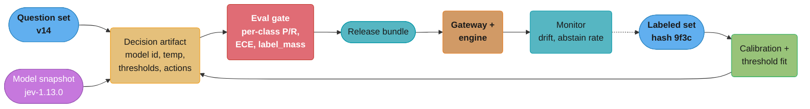
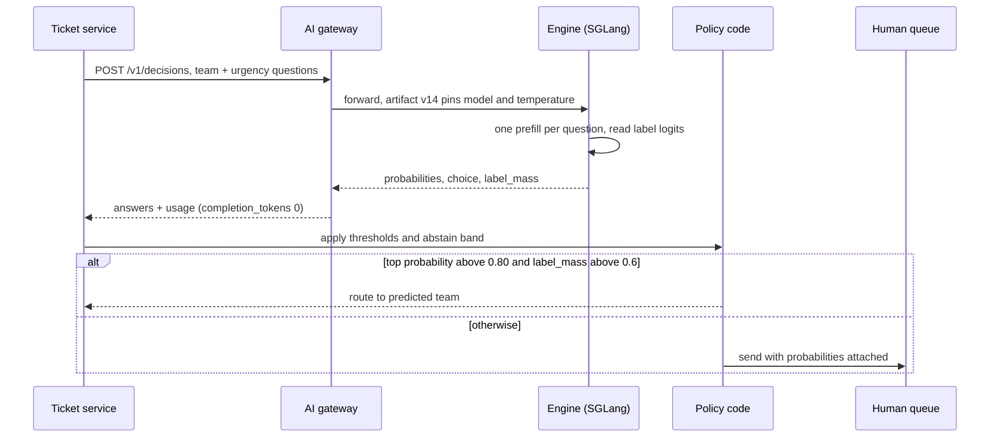

# Decision Models

> **Version anchor (2026-10-18).** **OpenAI Decisions API** (checked 2026-10-18): public beta,
> `POST /v1/decisions`, model `gpt-6-luna`, input $0.10 per 1M tokens, no output charge; the guide
> says OpenAI expects GA "in the coming weeks". **TypeSafe System One API** (checked 2026-10-18):
> `POST /v1/systemone`, model family Jev; the Models page maps alias `jev-latest` to `jev-1.13.0`
> and `jev-preview` to `jev-1.14.0` (available 2026-10-14), and lists $42 per billion input tokens
> ($0.042 per 1M) with output tokens free. **SGLang v0.5.21**
> (2026-10-02) serves `/v1/decisions` and `/v1/systemone` (PR #41208); its decision-model docs
> (checked 2026-10-18) were validated on Qwen3.8-27B and Qwen3.5-35B-A3B, one H200, BF16.
> **vLLM v0.32.0** (2026-10-18) added `POST /v1/systemone`. **Ollama v0.40.6** (2026-10-16) serves
> decision models on `/v1/systemone` since v0.35.0 (2026-09-28), Clef models since v0.35.1
> (2026-09-29), CLI and MLX support since v0.40.4 (2026-10-12). **llama.cpp** rolling build b11719
> (2026-10-18, pre-release; stable v0.7.0 is 2026-10-15); the llama-server README (checked
> 2026-10-18) marks native decision models with a `decisions` output modality and serves them on
> `/v1/systemone`. **MLflow 3.17.1** (2026-10-13) adds OpenAI's Decision API to `make_judge()`;
> 3.17.0 (2026-10-07) added TypeSafe judges. **Langfuse v4.63.0** (2026-10-16); OpenAI decision-model
> evaluators in v4.55.0 (2026-10-08), graduated in v4.57.0 (2026-10-12). **vLLM Semantic Router
> v0.4.0** (2026-09-27): its routing "decision" is a namesake, not a decision model.
>
> **On prices.** The two decision-model prices above carry their check date. Every generative-model
> price and every GPU-hour price on this page is a stated assumption, written as a variable or marked
> "assumed". Multiply by what your account pays.

---

## 1. Concept Overview

A decision model is a model served behind a typed-decision endpoint. The caller sends an input and
a set of questions. The endpoint returns a label, a probability distribution over the allowed
answers and, on some routes, a score and a confidence value. It returns no generated text. SGLang,
Ollama, llama.cpp and Langfuse use the name "decision model". OpenAI calls the endpoint the
Decisions API (`POST /v1/decisions`). TypeSafe calls the model class "System One Models" and the
endpoint the System One API (`POST /v1/systemone`).

The same artifact has an older, classic form: a classifier produces a score, a threshold turns the
score into a class, and an action mapping turns the class into what the system does (approve,
refer, decline). A credit scorecard plus a cut-off policy is a decision model in this sense. The
LLM-backed form changes how the score is produced. It does not change what has to be versioned,
evaluated and monitored.

This module treats a decision as a release artifact. The question wording, options, model snapshot,
temperature, threshold, abstain band and action mapping are all behavior, and a change to any of
them is a release. It covers when a decision model fits, the artifact, how engines produce the
numbers, calibration, cost-weighted thresholds, evaluation, serving and monitoring.

Decision schemas reach production through the gates in
[Evaluation Gates and Eval Sets](../evaluation_gates_and_eval_sets/evaluation_gates_and_eval_sets.md)
and the rollout ladder in [AI Release Engineering](../ai_release_engineering/ai_release_engineering.md).
Question wording is versioned like any prompt, see
[Prompt Lifecycle and Versioning](../prompt_lifecycle_and_versioning/prompt_lifecycle_and_versioning.md).
Engines that expose the routes are covered in
[Model Serving Platforms](../model_serving_platforms/model_serving_platforms.md), and the gateway
that routes `/v1/decisions` and `/v1/systemone` traffic in
[AI Gateway Operations](../ai_gateway_operations/ai_gateway_operations.md). Live decision metrics
feed [Production Quality Monitoring and Drift](../production_quality_monitoring_and_drift/production_quality_monitoring_and_drift.md),
and cost per decision rolls up in
[AI Cost Engineering and Unit Economics](../ai_cost_engineering_and_unit_economics/ai_cost_engineering_and_unit_economics.md).

**Not here.** Logit processors, grammar-constrained decoding and how engines restrict output tokens
are in [Constrained Decoding and Structured Outputs](../../llm/inference_and_decoding/constrained_decoding_and_structured_outputs.md).
Calibration theory (why models are miscalibrated, temperature scaling derivations, threshold
selection in general) is in
[Model Calibration and Thresholding](../../ml/case_studies/cross_cutting/model_calibration_and_thresholding.md)
and [Uncertainty Quantification and Conformal Prediction](../../ml/uncertainty_quantification_and_conformal_prediction/uncertainty_quantification_and_conformal_prediction.md).
How to design a judge rubric and align it with human raters is in
[Error Analysis and Eval Design](../../llm/error_analysis_and_eval_design/error_analysis_and_eval_design.md).
Which model a request should go to is in
[LLM Routing and Model Selection](../../llm/llm_routing_and_model_selection/llm_routing_and_model_selection.md).
Guardrail policy design is in
[Guardrails and Content Safety](../../llm/guardrails_and_content_safety/guardrails_and_content_safety.md),
and classifier metrics in general in
[Model Evaluation and Selection](../../ml/model_evaluation_and_selection/model_evaluation_and_selection.md).
This page is about operating a decision as a versioned, gated, monitored artifact.

---

## 2. Intuition

> **One-line analogy**: A generative model writes an essay and you grade it. A decision model fills
> in a multiple-choice sheet and tells you how hard it leaned on each box. The sheet is fast and
> cheap to mark, but "leaned hard" is not the same as "right", and the pass mark is yours to set.

**Mental model**: Think of a decision as three layers. The model layer turns an input and a
question into numbers. The policy layer turns numbers into a class: a threshold, an abstain band,
maybe a per-slice override. The action layer turns a class into a side effect: route to a team,
block a message, send to a human. Vendors own only the first layer. The second and third are your
code and your data, and they are where most production failures live.

**Why it matters**: Classification inside LLM systems used to be a generative call with a prompt
that said "answer with one word", followed by string parsing. That costs output tokens, adds decode
latency, fails on "Billing." vs "billing", and gives no probability to threshold on. A decision
endpoint reads the model's probability over the allowed answers in one prefill pass. The cost drops
to input tokens only, latency drops to prefill time, and the output is a number you can calibrate,
threshold and monitor.

**Key insight**: The returned probability is a model score, not the chance the decision is correct.
Calibrate it on your labels, set thresholds from error costs, and re-check both after any change to
the model, the wording or the traffic.

---

## 3. Core Principles

1. **The decision is the artifact, not the model.** A decision artifact pins the question set,
   model snapshot id, temperature, threshold per question, abstain band and action mapping in one
   versioned file. Any field change goes through an eval gate.
2. **Pin a versioned model id.** `jev-latest` moves when TypeSafe ships a new Jev release, and the
   TypeSafe quickstart warns that values can change between releases. TypeSafe's Models page
   tells users who tuned thresholds to send the versioned id instead of the alias. The artifact
   names `jev-1.13.0` or the equivalent snapshot id for the vendor you use.
3. **A probability is a score until you measure it.** TypeSafe claims calibrated probabilities from
   a training method it calls RLCD. SGLang and OpenAI make no calibration claim. Your reliability
   diagram on your labels is the only number that counts.
4. **Thresholds come from costs.** OpenAI's guide tells users to set thresholds from labeled
   examples and the cost of false positives and false negatives. With calibrated probability `p`,
   acting is worth it when `p > C_FP / (C_FP + C_FN)`. A threshold of 0.5 is correct only when both
   errors cost the same.
5. **Leave room to say "not sure".** An abstain band around the threshold sends borderline items
   to a human or a generative judge. It is cheaper than the errors it prevents when it is sized from
   data.
6. **Check that the model is answering the question.** `label_mass` (SGLang `/v1/decisions`) and
   `x_label_mass` (SGLang `/v1/systemone`) report how much probability sits on the offered labels.
   A drop means the model wants to say something you did not offer.

---

## 4. Types / Architectures / Strategies

### 4.1 Question types by route

| Route | Boolean question | Pick one of N | Ordered level | Returned per answer |
|---|---|---|---|---|
| OpenAI `POST /v1/decisions` | `predicate` | `choice` (`choices`: `value`, `description`) | `score` (`levels`: `label`, `description`, lowest first) | `predicate`: `probability`. `choice` and `score`: `probabilities`, `confidence`, plus `choice` or `score`. Any answer can be type `refusal` |
| SGLang `/v1/decisions` (SGLang extension, not in the OpenAI SDK) | `yes_no` | `choice` (`options`: `name`, `description`), 2 to 26 options | `score` (`levels`, lowest first), 2 to 10 levels | `type`, `probabilities`, `choice` or `score`, `label_mass` |
| System One `POST /v1/systemone` (TypeSafe, SGLang, vLLM, Ollama, llama.cpp) | `noul` | `choice` (`criteria` mapping), up to 255 options depending on engine and model | `score` (`criteria` list), up to 10 levels | `noul`: one `noul` value (0 to 1). `choice` and `score`: `probabilities`, `confidence`, plus `choice` or `score`; `legend` on score. `x_label_mass` on SGLang for label-token models |

A `score` answer is a probability-weighted average of level indices, not the most likely level.
On SGLang's System One route, `confidence` is documented as not calibrated and can read 0 for a
score split between distant levels.

### 4.2 Deployment options

| Option | What you run | Model choice | Notes |
|---|---|---|---|
| OpenAI Decisions API | Nothing | `gpt-6-luna` only (2026-10-18) | Public beta. Input billed at $0.10 per 1M tokens, no output, cache-read or cache-write charge; regional processing premiums and long-context multipliers apply. OpenAI states about 10x faster than the Responses API. ZDR and HIPAA for eligible customers; US and EEA plus Switzerland residency |
| TypeSafe System One API | Nothing | Jev; pin the versioned id (`jev-1.13.0` behind `jev-latest`, `jev-1.14.0` behind `jev-preview`) | Vendor claims calibrated probabilities (RLCD). $42 per billion input tokens, output tokens free. 64k tokens per request, 32k per question by default |
| SGLang v0.5.21 | GPU servers | Validated on Qwen3.8-27B and Qwen3.5-35B-A3B; decision checkpoints (PPLX-Decider-v1-27B, Clef) answer on `/v1/systemone` only | Both routes. Refuses decisions with `--enable-mis`, `--dllm-algorithm`, `--skip-tokenizer-init` or a built-in conversation template; a LoRA `base:adapter` model name returns 400 |
| vLLM v0.32.0 | GPU servers | Decision-capable checkpoints | `POST /v1/systemone` with `choice`, `noul`, `score` |
| Ollama v0.40.6 | Laptop, workstation, small server | Nimble (Bespoke Labs), Tev1 (Together AI), Clef 27B and Clef Flash 9B (Cloudflare, multimodal) | `ollama show` reports only the `decision` capability, so chat clients do not offer these models |
| llama.cpp b11719 | CPU or GPU, GGUF | Native decision models only (for example Clef, Granite Switch); option limit set per model, 52 to 255 | `/v1/models` marks them with a `decisions` output modality; served on `/v1/systemone`, which returns 501 for a model that is not a decision model |

### 4.3 Classic decision models

| Element | Credit scorecard | LLM decision artifact |
|---|---|---|
| Score | Points from a logistic model, mapped to a range | `probabilities` from the decision endpoint |
| Threshold | Cut-off per product | Threshold per question |
| Abstain | "Refer" band sent to an underwriter | Abstain band sent to a human or a generative judge |
| Action mapping | Approve, refer, decline | Route, flag, block, escalate |

The shape is the same, so the same controls apply: champion and challenger, threshold versioning,
per-segment monitoring and an audit trail of which version made each decision.

### 4.4 Namesakes that are not decision models

A **vLLM Semantic Router "decision"** (v0.4.0) is a routing rule: boolean conditions over request
signals that select candidate models, an algorithm and plugins. It lives in
[AI Gateway Operations](../ai_gateway_operations/ai_gateway_operations.md). The same project also
publishes decision-model checkpoints (Decision 1.0, announced 2026-09-22, and later releases), and
llama.cpp serves some of them on `/v1/systemone`; those are decision models in this page's sense.
A "decision engine" in fraud and credit products is usually the policy and action layers of section 4.3 without the model.

---

## 5. Architecture Diagrams

### 5.1 The decision artifact through its lifecycle



The model snapshot is an input to the artifact, not the artifact. Calibration and thresholds are
fitted per snapshot, so a snapshot change re-enters the loop at "Calibration + threshold fit".

### 5.2 One decision request



The engine never decodes. Everything after the response is policy code that the decision artifact
versions, and the human queue branch is where a reviewer takes over.

### 5.3 Reading label logits in one prefill pass

```
prompt: [system][instructions][options A..D][input ticket] "Answer:" -> next-token position

full vocabulary at the answer position (logits, illustrative)
  token :  "A"    "B"    "C"    "D"    " The"   "I"    "Billing"  ...150k others
  logit :  4.0    2.5    1.0    -1.0    1.8     0.9     2.2        (low)
           \______ label tokens _____/  \__________ off-label mass _________/

label_mass = P(A)+P(B)+P(C)+P(D) under the full-vocabulary softmax
probabilities = softmax over label logits only, divided by temperature
  T=1.0 :  A 0.781   B 0.174   C 0.039   D 0.005
```

The engine renormalizes over the four label tokens only, so the returned probabilities always sum
to 1 even when most of the full-vocabulary probability sits on " The" or "Billing". `label_mass`
is the number that exposes that.

### 5.4 Threshold, abstain band and actions on one axis

```
question "is this a chargeback dispute", calibrated on 6,000 labeled tickets
C_FP = C_FN = $12 of analyst time, so the cost threshold is 12 / 24 = 0.50

0.0                      0.35         0.50         0.65                       1.0
 |------------------------|============|============|--------------------------|
   general billing queue     ABSTAIN BAND: a human     disputes queue
                             reads it, probabilities
                             attached (9% of tickets,
                             61% of model errors)
```

The threshold comes from the cost table. The band sends the region where the model is least
accurate to a paid human reviewer. The band is 0.15 wide on each side, more than the 0.07
cache-state jitter in section 6.8. If a missed dispute cost more than a misrouted one, the threshold
and the band would both move left.

### 5.5 Same mean score, different decisions

```
score question, levels 0..4, both answers return score = 2.0 (rounded)

answer X (unimodal)                      answer Y (bimodal)
level 0 | ##                    0.05     level 0 | ##################   0.45
level 1 | ######                0.15     level 1 | ##                   0.05
level 2 | ##################    0.55     level 2 |                      0.00
level 3 | ######                0.15     level 3 | ##                   0.05
level 4 | ####                  0.10     level 4 | ##################   0.45
score = 2.10                             score = 2.00, confidence near 0
```

A `score` is an expected level index. Y says "either calm or furious", which no single level 2
action handles well. Read `probabilities` (or `confidence`) before acting on a score.

---

## 6. How It Works - Detailed Mechanics

### 6.1 One prefill pass and the label logits

SGLang's docs describe the mechanism. The engine builds a prompt from the input, the question and
the offered answers, labeled with single tokens: letters `A` to `Z` for `choice`, digits `0` to `9`
for `score`, and lowercase `yes` and `no` for `yes_no`. It runs one prefill pass per question,
reads the next-token log-probabilities of the label tokens over the full vocabulary, and applies a
softmax over the label logits divided by `temperature`. No token is decoded. The option limits on
SGLang's `/v1/decisions` (2 to 26 options, 2 to 10 levels) match those label alphabets.

```python
import math

def decide(label_logits: dict[str, float], vocab_logsumexp: float, temperature: float = 1.0):
    """label_logits: logit per label token at the answer position.
    vocab_logsumexp: log of the full-vocabulary softmax denominator."""
    if temperature <= 0:
        raise ValueError("temperature must be above 0")
    scaled = {k: v / temperature for k, v in label_logits.items()}
    m = max(scaled.values())
    z = sum(math.exp(v - m) for v in scaled.values())
    probs = {k: math.exp(v - m) / z for k, v in scaled.items()}
    label_mass = sum(math.exp(v - vocab_logsumexp) for v in label_logits.values())
    return probs, label_mass

probs, mass = decide({"A": 4.0, "B": 2.5, "C": 1.0}, vocab_logsumexp=4.6)
# T=1.0 -> A 0.786, B 0.175, C 0.039
# T=2.0 -> A 0.590, B 0.279, C 0.132   (flatter)
# T=0.5 -> A 0.950, B 0.047, C 0.002   (sharper)
```

Three consequences follow:

- **Temperature changes calibration, not ranking.** From 1.0 to 2.0 the top probability moves from
  0.786 to 0.590. Every threshold fitted at 1.0 is wrong at 2.0, so temperature belongs in the
  artifact. SGLang requires it to be above 0.
- **The probabilities always sum to 1 over the labels**, even if the model would rather say
  something else. `label_mass` is the check.
- **Each label must be one distinct token at the answer position.** SGLang checks this per request.
  A tokenizer change between snapshots can make a valid request fail.

Latency is prefill time only. SGLang reports `completion_tokens` 0 on `/v1/decisions` and
`output_tokens` 0 on its `/v1/systemone`. TypeSafe's hosted API reports a nonzero
`output_tokens` count but bills input tokens only. On SGLang, each question is its own prefill, and
`/v1/systemone` usage counts the state once per question, so cost grows with the question count.
Joint schema checkpoints such as Clef share one prefill and count the state once. TypeSafe documents
that Jev evaluates every question in parallel against the same state in one request.

### 6.2 What `label_mass` tells you

`label_mass` is the share of full-vocabulary probability that lands on the offered labels. SGLang's
docs: "A low value means the model puts most of its probability outside the offered answers."
Typical causes:

| Cause | Symptom | Fix |
|---|---|---|
| Missing option | `label_mass` drops on one slice, for example tickets about a product launched last week | Add the option, re-run the gate |
| Instructions that do not match the input | Low across all traffic after an instructions edit | Revert, fix wording, gate |
| Input in an unexpected language or format | Low on one locale | Per-locale eval slice |
| `yes_no` question | Lower than `choice` and `score` even on clear cases | Documented: it counts only lowercase `yes` and `no`. Set a separate floor per question type |

On `/v1/systemone`, SGLang returns `x_label_mass` for models scored with label tokens. The TypeSafe
Python SDK drops the field, so read it from `result.raw_http_response.json()`. A monitoring pipeline that
reads only SDK objects has no `label_mass` signal at all.

### 6.3 The decision artifact

Broken first. This config shipped and produced the incident in section 10.1:

```yaml
# decision/ticket_triage.yaml  (broken)
model: jev-latest              # moves with every Jev release
questions:
  team:
    type: choice
    instructions: Which team should handle this ticket
    criteria: {billing: ..., disputes: ..., onboarding: ..., tech: ...}
# no temperature, no thresholds, no abstain band, no eval set reference
# policy code does: team = answer.choice  (top label, whatever its probability)
```

Fixed. Every field that changes behavior is in the file, the file has a version, and the release
bundle pins the file by digest:

```yaml
# decision/ticket_triage.yaml
schema_version: 14
route: systemone                # systemone | openai_decisions | sglang_decisions
model: jev-1.13.0               # versioned id, never an alias
temperature: null               # /v1/systemone requires null on SGLang; set it on /v1/decisions
eval_set: evalsets/ticket_triage@sha256:9f3c1e...
calibration:
  method: isotonic
  fitted_on: labels/tickets_2026_09@sha256:41aa07...
  ece_after: 0.019
questions:
  team:
    type: choice
    instructions: Which team should handle this ticket
    criteria:
      billing: Charges, refunds, invoices, payment methods
      disputes: Chargebacks and card network disputes
      onboarding: Account opening, KYC documents, verification
      tech: API errors, webhooks, integrations
    policy:
      act_if_top_prob_at_least: 0.80
      min_label_mass: 0.60          # only enforced where the route returns it
      else: human_queue
  urgency:
    type: score
    instructions: How urgent is this ticket for the customer
    criteria: [Routine, Soon, Today, Within the hour, Money is moving now]
    policy:
      escalate_if:                  # act on probability mass, never on the mean score
        levels_at_least: 3
        prob_at_least: 0.07         # C_FP $3, C_FN $40
      flag_if_confidence_below: 0.30
actions:
  route: queue.assign(team)
  escalate: pager.notify("support-oncall")
  human_queue: queue.assign("triage-humans")
```

Rules the gate enforces on this file:

- `model` matches a versioned id pattern. Aliases (`-latest`) fail.
- A change to `instructions`, `criteria`, option order, `model` or `temperature` invalidates
  `calibration` and requires a refit and a full gate run.
- A change to a `policy` threshold alone re-applies the policy to the stored probabilities of the
  last scored eval set, with no model calls.

The bundle pins this file as its "decision schema version", next to the prompt version from
[Prompt Lifecycle and Versioning](../prompt_lifecycle_and_versioning/prompt_lifecycle_and_versioning.md).

### 6.4 Wire shapes and a portability layer

The three routes ask the same question with different field names. OpenAI `POST /v1/decisions`:

```json
{
  "model": "gpt-6-luna",
  "input": "Card charged twice for order 88123, refund please",
  "questions": [
    {"type": "choice", "name": "team", "instructions": "Which team should handle this ticket",
     "choices": [{"value": "billing", "description": "Charges, refunds, invoices"},
                 {"value": "disputes", "description": "Chargebacks and card network disputes"}]},
    {"type": "predicate", "name": "urgent", "instructions": "Money is moving now"}
  ]
}
```

A thin adapter between the artifact and the wire maps the names and checks limits before sending:

| Artifact field | OpenAI `/v1/decisions` | SGLang `/v1/decisions` | `/v1/systemone` |
|---|---|---|---|
| question key | `name` | `id` | key of the `questions` map |
| question text | `instructions` | `question` | `instructions` |
| boolean type | `predicate` | `yes_no` | `noul` |
| options | `choices`: `value`, `description` | `options`: `name`, `description` (2 to 26) | `criteria` mapping (up to 255) |
| levels | `levels`: `label`, `description` | `levels`, lowest first (2 to 10) | `criteria` list (up to 10) |
| answers | array with `name` | map keyed by id | map keyed by id |

The one piece of reading code every route needs is a refusal check:

```python
class RefusalError(Exception):
    pass

def read_answers(resp: dict) -> dict:
    raw = resp["answers"]
    items = {a["name"]: a for a in raw} if isinstance(raw, list) else raw
    for qid, a in items.items():
        if a.get("type") == "refusal":
            raise RefusalError(qid)        # never coerce a refusal into a low probability
    return items
```

Porting traps the adapter does not hide:

- **Thresholds and floors do not transfer.** OpenAI's `predicate` returns one `probability`;
  SGLang's `yes_no` returns `probabilities` and a `label_mass` that reads low by design.
- **Errors differ.** OpenAI can return an answer of type `refusal`. SGLang has no refusal answer:
  it rejects a bad request with 400 on `/v1/decisions`, and with 422 (invalid request) or 400
  (other refusals) on `/v1/systemone`. llama.cpp returns 501 when the model is not a decision
  model. The TypeSafe Python SDK times out after 10 seconds by default and retries, so raise the
  timeout for large inputs.
- **Images.** OpenAI takes `input_image` parts as inline base64 data URLs only. SGLang refuses image
  requests under `--allow-auto-truncate`.

### 6.5 Calibration on your own labels

Measure, then decide whether to recalibrate: a reliability diagram, ECE and the Brier score on your
own labels. Their definitions, the ECE code and the Platt vs isotonic choice are in
[Model Calibration and Thresholding](../../ml/case_studies/cross_cutting/model_calibration_and_thresholding.md).
ECE is the item-weighted mean of `|mean predicted - observed|` across bins.

Reliability on 10,000 labeled tickets, before recalibration:

| Bin | Items | Mean predicted | Observed | Gap | Weighted gap |
|---|---|---|---|---|---|
| 0.0 to 0.2 | 4,000 | 0.08 | 0.05 | 0.03 | 0.0120 |
| 0.2 to 0.4 | 1,200 | 0.30 | 0.18 | 0.12 | 0.0144 |
| 0.4 to 0.6 | 900 | 0.50 | 0.31 | 0.19 | 0.0171 |
| 0.6 to 0.8 | 1,100 | 0.71 | 0.52 | 0.19 | 0.0209 |
| 0.8 to 1.0 | 2,800 | 0.93 | 0.86 | 0.07 | 0.0196 |
| Total | 10,000 | | | | ECE 0.084 |

Choices that matter for a decision artifact:

- **Fit and report on different splits.** Platt needs a few hundred labels, isotonic a few thousand.
  Fit on one split and report ECE on another.
- **Per slice.** A decision model can be calibrated overall and off by 0.15 on one locale or one
  product line. Compute ECE per slice with at least a few hundred labels each, and fit per-slice
  thresholds where a slice is off (section 6.6).
- **Per snapshot.** The calibrator is fitted to one model id, one temperature and one question
  wording. Store it with the artifact and refit when any of the three changes.

Conformal prediction sets, an alternative to a fixed abstain band, are in
[Uncertainty Quantification and Conformal Prediction](../../ml/uncertainty_quantification_and_conformal_prediction/uncertainty_quantification_and_conformal_prediction.md).

### 6.6 Thresholds from the cost of errors

The cost-minimizing threshold `C_FP / (C_FP + C_FN)` and its derivation are in
[Model Calibration and Thresholding](../../ml/case_studies/cross_cutting/model_calibration_and_thresholding.md).
Applied to decision questions:

| Decision | C_FP | C_FN | Cost threshold |
|---|---|---|---|
| Escalate an urgent ticket to on-call | $3 of agent time | $40 SLA credit and churn risk | 3 / 43 = 0.07 |
| Block a payment as fraud | $8 lost sale and support contact | $200 chargeback | 8 / 208 = 0.038 |
| Remove a post as policy-violating | $15 appeal handling and creator trust | $5 exposure cost | 15 / 20 = 0.75 |

The formula is only valid on calibrated probabilities. On the uncalibrated scores of section 6.5,
an item at 0.50 is positive 31% of the time, so a threshold derived from costs lands in the wrong
place. Calibrate first, then apply the formula, or skip it and sweep thresholds on labeled data,
picking the one with the lowest `(C_FP * FP + C_FN * FN) / N`. The sweep works on raw scores
because it measures cost directly, but it has to be re-run per model snapshot and per slice.

**Sizing the abstain band.** Start from the band where per-bin accuracy on labeled data falls below
the accuracy a human reviewer delivers, then check the review budget. For the
dispute question in section 5.4, the band 0.35 to 0.65 caught 9% of tickets and 61% of the model's
errors on the eval set.

### 6.7 Evaluating a decision artifact

A decision gate reports, per question and per slice:

- Precision and recall at the artifact's threshold, not at 0.5 and not as AUC alone.
- ECE and Brier on the calibrated output.
- Abstain rate and accuracy outside the band.
- `label_mass` distribution (p5, median) against a floor per question type.
- Refusal rate.
- Agreement with human raters on a sampled set (Cohen's kappa for `choice`, weighted kappa for
  `score`).
- Expected cost per 1,000 decisions from the confusion matrix and the cost table.

```
confusion at threshold 0.07 on 6,000 labeled tickets, question "urgent"

                     actual urgent    actual not urgent
predicted urgent      TP   412          FP   1,083         -> 1,083 x $3  = $3,249
predicted not         FN    21          TN   4,484         ->    21 x $40 = $  840
                                                               expected cost $4,089
same set at threshold 0.50:  FP 190 ($570), FN 118 ($4,720)    expected cost $5,290
```

The lower threshold flags almost 6 times as many false positives and still costs 23% less, because a miss
costs 13 times as much as a false alarm. A gate that reports only accuracy would pick 0.50.

**Decision models as judges.** MLflow 3.17.0 runs TypeSafe judges through `make_judge()`: with
`feedback_value_type=bool` the judge asks a `noul` question and returns True at probability 0.5 or
above; with a `Literal[...]` type it asks a `choice` question. There is no generated rationale.
3.17.1 adds the OpenAI Decision API as a `make_judge()` backend through
`model_api=ModelAPI.DECISIONS`. The 0.5 cut-off is a threshold like any other: when your labels
show the judge is lenient, read the stored probability (`typesafe.probability` in the assessment
metadata) and apply your own. Langfuse decision-model evaluators take a TypeSafe or an OpenAI
connection; the OpenAI path (v4.55.0) goes through the AI SDK `experimental_decide`, which posts
to `/v1/decisions`, and the feature graduated in v4.57.0. On that path a refusal fails the whole
evaluator run with no scores written. Gate code must treat that run as `INVALID`, never as a zero
score or a pass. Judge design itself is in
[Error Analysis and Eval Design](../../llm/error_analysis_and_eval_design/error_analysis_and_eval_design.md),
and the gate mechanics in
[Evaluation Gates and Eval Sets](../evaluation_gates_and_eval_sets/evaluation_gates_and_eval_sets.md).

### 6.8 Serving: hosted and self-hosted

Self-hosted SGLang needs no extra flag. The docs' launch command:

```bash
python -m sglang.launch_server --model-path Qwen/Qwen3.8-27B --host 127.0.0.1 --port 30000
```

Server flags that turn decisions off or break them on SGLang v0.5.21:

| Flag or request | Effect |
|---|---|
| `--enable-mis`, `--dllm-algorithm` | Decisions refused |
| `--skip-tokenizer-init` | Decisions refused (the label-token check needs the tokenizer) |
| A built-in conversation template instead of the tokenizer's Jinja template | Decisions refused |
| `model` naming a LoRA adapter (`base:adapter`) | 400 |
| `--allow-auto-truncate` | Image requests refused |
| Chat history as input | Not accepted; a decision takes a single `input` |
| `--preferred-sampling-params` with a default temperature | Leave it unset for decisions |

A platform that pins a vLLM older than v0.32.0 has no `/v1/systemone` route, see
[Model Serving Platforms](../model_serving_platforms/model_serving_platforms.md). Use the Ollama
`decision` capability and the llama.cpp `decisions` modality in the gateway model catalog so chat
clients never pick a decision model.

**Reproducibility under prefix caching.** SGLang's docs report that on the two validated Qwen models,
which mix full and linear attention, answer probabilities can move by up to several hundredths
(0.07 in their checks) and `label_mass` by up to about 0.14 between cold and prefix-cached requests
and across batch compositions, while the chosen option stayed the same. On Qwen3.5-35B-A3B,
`--disable-radix-cache` gave identical values across repeats, at the cost of prefix reuse. Two
consequences:

- An item scored 0.47 cold can score 0.54 warm and cross a 0.50 threshold. Regression tests that
  compare two runs item by item need a tolerance band of at least 0.07, or must run with the cache
  in the same state (or with the radix cache off).
- A `label_mass` floor set at the exact p5 of a cold eval run alerts on warm production traffic.
  Fit floors on production-like traffic.

**Capacity.** Size servers on prefill tokens per second, not requests (method in
[Inference Engine Operations and Benchmarking](../inference_engine_operations_and_benchmarking/inference_engine_operations_and_benchmarking.md)).
Keep shared instructions and options first so they are prefix-cached, and the variable input last.

**Cost per decision.**

| Option | Input per decision | Cost per decision | Per 1M decisions |
|---|---|---|---|
| OpenAI `gpt-6-luna` | 1,500 tokens | 1,500 x $0.10 / 1M = $0.00015 | $150 |
| TypeSafe Jev | 1,500 tokens | 1,500 x $0.042 / 1M = $0.000063 | $63 |
| Generative call, assumed $1.00 per 1M in and $4.00 per 1M out, 150 output tokens | 1,500 in, 150 out | $0.0015 + $0.0006 = $0.0021 | $2,100 |
| Self-hosted H200 at an assumed $3.00 per hour and an assumed 25,000 prefill tokens per second (16 decisions per second) | 1,500 tokens | $3.00 / 57,600 = $0.000052 at 100% load | $52 at 100% load, $208 at 25% |

The self-hosted line is cheaper only at high, steady utilization. Beta prices are not fixed, so
the cost model reads prices from config. Cost attribution is in
[AI Cost Engineering and Unit Economics](../ai_cost_engineering_and_unit_economics/ai_cost_engineering_and_unit_economics.md).

### 6.9 Monitoring a decision in production

| Signal | How | Alert when |
|---|---|---|
| Probability distribution per question | Histogram of top probability per hour; PSI against the eval-time baseline | PSI above 0.2 for 3 hours |
| Abstain-band rate | Share of decisions inside the band | 50% above the 7-day baseline |
| Threshold-crossing rate by slice | Share acted on, per locale, product, channel | A slice moves 2x while others are flat |
| `label_mass` | p5 per question type, read from the raw response | p5 below the floor for 1 hour |
| Refusal rate | Count of `refusal` answers and 400s | Above 0.5% |
| Human agreement | Weekly sample of 200 decisions labeled by reviewers | Kappa drops 0.1 from the gate value |
| Cost per decision | `usage` input tokens times price, per question set | 20% above plan |

Label every metric with the artifact version, so a release and a drift event are distinguishable
on one dashboard. Drift statistics are in
[Production Quality Monitoring and Drift](../production_quality_monitoring_and_drift/production_quality_monitoring_and_drift.md).

---

## 7. Real-World Examples

**OpenAI Decisions API.** Public beta (checked 2026-10-18) with one model, `gpt-6-luna`, input-only
billing and a stated speed of about 10x the Responses API. The guide tells users to set thresholds
for routing, filtering or review from labeled examples and the cost of false positives and false
negatives, which is section 6.6 in the vendor's words.

**TypeSafe Jev.** TypeSafe positions Jev as its first public System One Model and claims calibrated
probabilities from a training method it calls RLCD (Reinforcement Learning for Calibrated
Decisions). The quickstart uses `jev-latest` in requests and shows `jev-1.13.0` in the response.
Every response names the versioned id that answered, which is the id to log and pin. `jev-preview`
points to `jev-1.14.0`. The homepage shows a workflow chart at 0.114 s
against 8.566 s for an LLM under a "193.6x Faster" headline; the chart's own numbers give about
75x. The same chart shows $0.000081 against $0.013880, about 171x, under "444.6x Cheaper". Vendor
multipliers come from vendor workloads. Benchmark on yours.

**SGLang.** The decision-model docs (checked 2026-10-18) document the mechanism, the limits and the
refusing flags: Qwen3.8-27B (with and without NEXTN speculative decoding) and Qwen3.5-35B-A3B validated
on one H200 in BF16, no calibration claim, and the published cold-vs-cached shifts. Dedicated
decision checkpoints such as `PPLX-Decider-v1-27B` and Clef answer only through `/v1/systemone`.

**Ollama.** Decision models arrived in v0.35.0 with Nimble (Bespoke Labs) and Tev1 (Together AI).
v0.35.1 added Clef 27B and Clef Flash 9B (Cloudflare, multimodal) and made `ollama show` report
only the `decision` capability for these models, which keeps them out of chat model pickers.

**Stripe Radar (classic form).** Radar scores each payment and assigns a risk level, and merchants
write rules that allow, block, review or request 3D Secure, for example on `:risk_level:`. Custom
rules need a Radar plan that supports them. That is the score, threshold, abstain ("review") and action shape
of section 4.3, operated by merchants who tune thresholds against their own chargeback costs.

---

## 8. Tradeoffs

| Approach | Setup cost | Cost per call | Latency | Probability output | Label set change | Explanation |
|---|---|---|---|---|---|---|
| Decision model | Write questions, label 1,000 to 6,000 items for calibration | Input tokens only | Prefill only | Yes, needs calibration | Edit config, re-gate | None |
| Generative call with parsing | Prompt only | Input plus output tokens | Prefill plus decode | No (or from logprobs, if exposed) | Edit prompt | Rationale text |
| Fine-tuned classifier | 10,000+ labels, training pipeline | Lowest at scale | Lowest | Yes, needs calibration | Retrain | None |
| Rule or regex | Engineer time | Near zero | Near zero | No | Code change | The rule itself |

---

## 9. When to Use / When NOT to Use

**Use a decision model when:**

- The output is a label, a yes or no, or a level on a fixed scale, and a downstream system acts on
  it: ticket triage, request routing, content classification, guardrail checks, LLM-as-judge and
  screening.
- You need a probability to threshold, route on or abstain on.
- The label set changes faster than you could retrain a classifier, or you have too few labels to
  train one but enough (a few thousand) to calibrate and gate.
- Volume makes output tokens a real cost: judges over every eval item, triage over every ticket,
  guardrail checks on every message.
- Latency matters and decode time is the bottleneck.

**Do not use one when:**

- You need the reason. Decision endpoints return no rationale. Keep a generative judge for blocked
  items and audits that require an explanation.
- You need extraction or generation: field values, summaries, rewritten text.
- A deterministic rule is correct. "Amount over $10,000" does not need a model.
- The input is a multi-turn conversation that must be read as turns. A decision takes a single
  `input`; flatten the history into it deliberately or use a generative call.
- Volume is very high and labels are stable for months. Distil into a fine-tuned classifier using
  the decision model's calibrated outputs plus human labels, and keep the decision model for new
  labels.
- You cannot label at least a few hundred items per slice. Without labels there is no basis for a
  threshold.

---

## 10. Common Pitfalls

### 10.1 The alias moved and the thresholds stayed

A team triaged 40,000 tickets a day on `jev-latest` with a top-label policy. A new Jev release
shipped under the alias and the top-label probability distribution shifted down: the share of
tickets with a top probability above 0.8 dropped from 71% to 54%. Nothing failed. The policy still
picked the top label, but disputes tickets, now split between `billing` and `disputes`, went to
billing at twice the previous rate, and chargeback response deadlines were missed for 9 days before
a dispute analyst noticed. Fix: pin the versioned id, alert on the top-probability histogram (PSI),
and treat a snapshot change as a release with refit calibration.

### 10.2 Default 0.5 on an expensive miss

A fraud screen used a `predicate` question at 0.5 because that was the example in the docs. Missed
fraud cost $200 a case and a false block $8. The cost threshold was 0.038. Over a month the team
missed about 1,900 cases the model had scored between 0.04 and 0.5. Fix: derive thresholds from the
cost table on calibrated scores, and put the cost table in the artifact review.

### 10.3 One threshold for every locale

A content classifier was calibrated on mostly English data and used one threshold. On Portuguese
traffic the model was overconfident by 0.15 in the 0.6 to 0.8 bin, and wrongful removals for
Brazilian creators ran at 3 times the English rate. Fix: per-slice ECE in the gate, per-slice
thresholds where a slice has enough labels, and a slice floor that blocks release when a slice
lacks labels.

---

## 11. Technologies & Tools

| Tool | Role | Notes |
|---|---|---|
| OpenAI Decisions API | Hosted decision endpoint, `POST /v1/decisions` | Public beta, `gpt-6-luna`, $0.10 per 1M input tokens, no output charge (checked 2026-10-18) |
| TypeSafe | Hosted System One API, `POST /v1/systemone`, Jev models | Pin a versioned id such as `jev-1.13.0`; claims calibrated probabilities (RLCD) |
| SGLang | Self-hosted engine serving `/v1/decisions` and `/v1/systemone` | v0.5.21; validated on Qwen3.8-27B and Qwen3.5-35B-A3B on one H200 |
| vLLM | Self-hosted engine | v0.32.0 added `POST /v1/systemone` |
| Ollama | Local model server with decision models | v0.40.6; Nimble, Tev1, Clef 27B, Clef Flash 9B |
| llama.cpp | GGUF engine with native decision models | b11719; `decisions` output modality in `/v1/models` |
| MLflow | Decision-model judges through `make_judge()` | 3.17.1; TypeSafe judges since 3.17.0 |
| Langfuse | Decision-model evaluators | v4.63.0; a refusal fails the whole run |
| scikit-learn | Isotonic and Platt recalibration, Brier score | `IsotonicRegression`, `LogisticRegression`, `brier_score_loss` |

---

## 12. Interview Questions with Answers

**Q: Is the probability a decision endpoint returns the probability that the decision is correct?**
**Short:** No; it is a softmax over label logits, a model score that becomes a correctness probability only after you measure calibration on your own labels.

No. The engine reads the label-token logits at the answer position and renormalizes them with a
softmax, so the numbers sum to 1 over the offered answers whatever the model "believes". SGLang's
docs state that none of the values is a calibrated probability that the decision is correct.
TypeSafe claims calibration for Jev, but on its own data and label definitions. Build a reliability
diagram on a few thousand of your labeled items, compute ECE per slice, and recalibrate with
isotonic or Platt scaling before any cost-based threshold.

**Q: Why should the decision artifact name `jev-1.13.0` instead of `jev-latest`?**
**Short:** The alias moves to new releases and probabilities shift with them, which silently invalidates thresholds and calibration fitted to the old snapshot.

Thresholds, the abstain band and the calibrator are all fitted to one model's score distribution.
TypeSafe's quickstart warns that values can change between Jev releases, and the alias follows the
release. When it moves, every decision still returns a valid answer, so nothing errors; the
distribution shifts and the error rates move with it. Pin the versioned id the response reports,
and handle a snapshot change as a release: refit calibration, re-run the gate, roll out with a
canary.

**Q: A teammate sets every decision threshold to 0.5. What is wrong with that?**
**Short:** 0.5 is optimal only when a false positive and a false negative cost the same; on calibrated scores the right threshold is C_FP / (C_FP + C_FN).

Acting costs `(1 - p) * C_FP` in expectation and not acting costs `p * C_FN`, so act when
`p > C_FP / (C_FP + C_FN)`. For an urgent-ticket escalation with a $3 false alarm and a $40 miss,
that is 0.07; for a post removal with a $15 wrong removal and a $5 miss, it is 0.75. OpenAI's guide
gives the same advice: thresholds from labeled examples and error costs. The formula needs
calibrated probabilities; otherwise sweep thresholds on labeled data and pick the lowest expected
cost.

**Q: A `score` answer of 2.0 on a 0 to 4 scale came back. Can you route it to the level 2 queue?**
**Short:** Not safely; a score is a probability-weighted average of level indices, and a bimodal answer split between 0 and 4 also averages to 2.

The score is an expected level, not the most likely one. An answer with 0.45 on level 0 and 0.45
on level 4 averages to 2.0 and means "calm or furious, not sure which". Read the `probabilities`
array or the `confidence` field, which on SGLang's System One route can read 0 for a split between
distant levels. Act on the probability mass you care about, such as `P(level >= 3)`, and abstain on
low confidence.

**Q: The same input scores 0.47 on one request and 0.54 on the next, with no change. Is that a bug?**
**Short:** Not necessarily; SGLang documents shifts of up to about 0.07 in probabilities between cold and prefix-cached requests, so tests need a tolerance band.

SGLang's docs report that on the validated Qwen models, which mix full and linear attention, answer
probabilities move by several hundredths (0.07 in their checks) and `label_mass` by up to about
0.14 between cold and prefix-cached requests and across batch compositions. Items near a threshold
flip. `--disable-radix-cache` removed the drift on Qwen3.5-35B-A3B, at the cost of prefix reuse.
In CI, compare score distributions or use a tolerance of at least 0.07 around the threshold when
comparing items across runs. In production, size the abstain band wider than this jitter so
that cache state does not decide the action.

**Q: A Langfuse decision-evaluator run finished with no scores at all. How should the gate treat it?**
**Short:** As an invalid run, not a zero; with an OpenAI connection, one refusal fails the whole Langfuse evaluator run and writes no scores, so find the refusing input.

With an OpenAI connection, Langfuse's decision-model evaluators fail the entire evaluator run on a
refusal and write none of its scores. A dashboard that reads
missing scores as 0 shows a total regression, and an engineer who overrides that learns to override
the gate. Map the state to `INVALID`, alert on it separately from a quality block, find the input
that triggered the refusal, and quarantine it or route it to a generative judge. The same rule
applies to OpenAI answers of type `refusal`: never coerce them to a low probability.

**Q: Product wants to reword a question's instructions for clarity. Does that need an eval gate?**
**Short:** Yes; instructions and option descriptions are the prompt, so any edit changes the score distribution and invalidates the fitted calibration and thresholds.

The decision endpoint conditions on the instructions and option descriptions exactly as a
generative model conditions on a prompt. A grammar fix that drops one word from an option
description can collapse `label_mass` for that option's traffic. Store the question set in the
versioned artifact, run the full gate on any edit, refit calibration, and compare per-class
precision and recall against the current version. Threshold-only edits can re-use stored
probabilities from the last eval run.

**Q: What does `label_mass` measure, and why does a `yes_no` question read lower than a `choice` question?**
**Short:** It is the share of full-vocabulary probability on the offered labels; yes_no counts only lowercase yes and no tokens, so it reads low even on clear cases.

The returned probabilities are renormalized over the labels, so they cannot show that the model
wanted to answer something else. `label_mass` can: a low value means most probability sits outside
the offered answers, usually because an option is missing or the instructions do not match the
input. SGLang notes `yes_no` mass reads lower by design because only lowercase `yes` and `no` are
counted. Set floors per question type, and read `x_label_mass` from the raw HTTP response on
SGLang's `/v1/systemone`, since the TypeSafe Python SDK drops it.

**Q: Why does SGLang's `/v1/decisions` accept at most 26 options and 10 score levels?**
**Short:** Options are presented as single-token letter labels A to Z and levels as digits 0 to 9, and the engine reads one token's probability per label.

The mechanism reads the next-token probability of each label at one position, so each label must
be one distinct token. Letters A to Z and digits 0 to 9 are the label alphabets, which is where 26
and 10 come from. SGLang's System One route accepts up to 255 options with two-letter labels (`AA`,
`AB`) past 26, but only when the Hugging Face tokenizer reports its added tokens and the chat
template fits; otherwise its limit is also 26. Labels are checked per request, so a tokenizer
change can make a valid request fail. A 40-option taxonomy becomes a two-level question (category,
then subcategory), or moves to `/v1/systemone` after a check that the served tokenizer qualifies.

**Q: You are porting a triage flow from the OpenAI Decisions API to self-hosted SGLang. What breaks?**
**Short:** Field names, boolean type, answer shape and limits all differ, and every threshold must be refitted because the model and its score distribution change.

OpenAI uses `name`, `instructions`, `choices` with `value`, `predicate`, and an `answers` array;
SGLang `/v1/decisions` uses `id`, `question`, `options` with `name`, `yes_no`, and answers keyed by
id. SGLang caps options at 26, and its `yes_no` returns `probabilities` plus a low-reading
`label_mass` instead of one `probability`. OpenAI can answer with type `refusal`; SGLang has no
refusal answer and rejects invalid requests with HTTP 400. Put an adapter between the artifact and
the wire, then treat the port as a model change: new calibration, new thresholds, a full gate.

**Q: Why is a decision call faster and cheaper than a generative classification call?**
**Short:** It reads label probabilities after prefill instead of decoding text, so latency is mostly prefill and OpenAI and TypeSafe bill input tokens only.

A generative classifier pays prefill plus decode for every output token, and parsing on top. A
decision call stops after prefill and reads label probabilities; SGLang reports
`completion_tokens` 0, and TypeSafe reports some `output_tokens` but does not bill them. OpenAI
bills `gpt-6-luna` at $0.10 per 1M input tokens with no output charge (checked 2026-10-18), so a 1,500-token ticket costs $0.00015. OpenAI states about 10x faster than
the Responses API. Measure both on your inputs before quoting a ratio.

**Q: When is a decision model the wrong tool?**
**Short:** When you need a rationale, extracted values or generated text, when a rule is exact, or when stable labels at very high volume justify a fine-tuned classifier.

Decision endpoints return no text, so audits that require an explanation need a generative judge
alongside. Extraction and summarization are generative tasks. A deterministic rule beats any model
when the condition is exact. At very high volume with labels stable for months, distil into a small
fine-tuned classifier and keep the decision model for new labels and the abstain band. Without a few
hundred labels per slice, you cannot set a threshold, so any decision model is unmeasured.

**Q: What would you monitor for a decision model in production?**
**Short:** Top-probability drift, abstain rate, action rate by slice, label_mass floors, refusals, sampled human agreement and cost per decision, all labeled by artifact version.

Probability drift (PSI on the top-probability histogram) catches snapshot and traffic changes before
labels arrive. Abstain rate and per-slice threshold-crossing rates catch shifts that the aggregate
hides. `label_mass` catches missing options. Refusals catch inputs the model will not answer. A
weekly sample of 200 human-labeled decisions gives the only direct accuracy signal. Label every
series with the artifact version so a release and a drift event look different.

**Q: How do you size an abstain band?**
**Short:** From labeled data: widen the band until model accuracy outside it meets the target and the share inside fits the human review budget.

Plot accuracy per probability bin on labeled data. The band covers the bins where the model is less
accurate than the human reviewer or the fallback judge. Check the share of traffic inside against
review capacity, and make the band at least as wide as the cache-state jitter (about 0.07 on
SGLang). For the dispute question on this page, 0.35 to 0.65 took 9% of tickets and 61% of model
errors.
Re-size after every calibration refit.

**Q: Your self-hosted decision requests return 400 after a platform change. What do you check first?**
**Short:** Whether requests now name a LoRA adapter or the server gained a flag such as skip-tokenizer-init, enable-mis or dllm-algorithm, which SGLang refuses for decisions.

On SGLang v0.5.21 a `model` of the form `base:adapter` returns 400, and servers launched with
`--skip-tokenizer-init`, `--enable-mis` or `--dllm-algorithm`, or with a built-in conversation
template, refuse decisions. A shared engine
config that added one of these for chat traffic breaks the decision route. Image requests are also
refused under `--allow-auto-truncate`. Run decision traffic against a server profile pinned for
it, and have the gateway reject adapter names on decision routes instead of retrying.

**Q: How is a credit scorecard with a cut-off policy the same artifact as an LLM decision model?**
**Short:** Both are a score, a threshold, an abstain band and an action mapping, versioned separately from the scoring model and monitored per segment.

A scorecard produces a score, the cut-off policy maps it to approve, refer or decline, and the
refer band goes to underwriters. A decision artifact maps endpoint probabilities to actions with a
threshold and an abstain band sent to a human. Model risk practice for scorecards (separate model
and policy versions, champion and challenger, per-segment monitoring, an audit trail of which
version made each decision) applies unchanged to the LLM form.

---

## 13. Best Practices

- Keep one versioned decision artifact per use case: question set, model id, temperature,
  thresholds, abstain band, action mapping, eval set hash and calibrator. Reject model aliases.
- Label a few thousand items per use case and a few hundred per slice that gets its own threshold.
- Measure calibration per slice, then derive thresholds from the cost of each error; record the cost
  table in the artifact review.
- Make the abstain band wider than the cache-state jitter and route it to a human or a generative
  judge.
- Act on probability mass for `score` questions, not on the mean.
- Check `label_mass` in the gate and in production with floors per question type, read from raw
  responses.
- Treat refusals and failed judge runs as their own state, never as a score.
- Put a route adapter between the artifact and the wire and check option limits before sending.
- Run decision traffic on an engine profile without refusing flags, and name the base model.
- Label every metric with the artifact version and alert on probability drift before labels arrive.
- Re-run the whole loop on any model snapshot change: refit, gate, canary.

---

## 14. Case Study

### Ticket triage moved from a generative classifier to a self-hosted decision model

**Context.** A payments company handled 600,000 support events a day (tickets, chat messages and
emails), 7 per second on average and 21 per second at peak. A generative call classified each event
into one of 12 teams and an urgency level, and parsed the answer from text. Problems: 2.3% of
answers failed to parse ("Billing team.", "Disputes/Chargebacks"), there was no probability to
threshold on, and p95 latency was 1.9 s because of decode. Company policy kept raw ticket text
inside its own VPC, so hosted APIs were out.

**Design.**

1. Engine: SGLang v0.5.21 serving Qwen3.8-27B in BF16 on H200s, using `/v1/decisions` (12 options
   fit inside the 26 limit). Decision traffic got its own server profile with none of the refusing
   flags in section 6.8, behind the gateway route described in
   [AI Gateway Operations](../ai_gateway_operations/ai_gateway_operations.md).
2. Artifact: questions `team` (`choice`, 12 options), `urgency` (`score`, 5 levels) and `fraud_hint`
   (`yes_no`), temperature 1.0, stored as `decision/triage.yaml` and pinned in the release bundle.
3. Labels: 12,000 historical tickets with team labels from the resolution record, and 6,000 with
   urgency labels from a two-week reviewer exercise.
4. Calibration: isotonic per question, fitted on 70%, checked on 30%. `team` top-probability ECE
   went from 0.084 to 0.019. Portuguese and Spanish tickets got their own thresholds.
5. Policy: route if top team probability is at least 0.80 and `label_mass` at least 0.60, else human
   queue; escalate to on-call if `P(urgency >= 3)` is above 0.07, the cost threshold for a $3 false
   alarm and a $40 miss.
6. Capacity: assumed 25,000 prefill tokens per second per H200 at 1,500 tokens per event gives about
   16 events per second per GPU; 21 per second at peak plus 30% headroom meant 2 H200s per region.

**Rollout.** Shadow for two weeks against the generative classifier with both outputs logged, then a
10% canary by queue, then full traffic, following the ladder in
[AI Release Engineering](../ai_release_engineering/ai_release_engineering.md). The gate compared
per-team precision and recall at the artifact thresholds and blocked on any team losing more than 2
points of recall.

**Results after 30 days.**

| Metric | Generative classifier | Decision model |
|---|---|---|
| Parse failures | 2.3% | 0 (typed answers) |
| p95 latency | 1.9 s | 140 ms |
| Auto-routed share | 100% (no abstain) | 88% |
| Misroute rate on auto-routed tickets | 11.4% | 4.1% |
| Escalations missed (urgency) | 118 per 6,000 sampled | 21 per 6,000 sampled |
| GPUs per region | 6 H200 (decode-bound) | 2 H200 |

The abstain queue took 12% of events. Reviewers cleared it with the probabilities shown next to the
ticket, and their labels fed the next calibration refit.

**Incident.** Six weeks in, the team switched to Qwen3.5-35B-A3B to cut prefill cost, treating it as
an infrastructure change. The gate was skipped because "same questions". The new model was
overconfident in a different region: `team` ECE rose to 0.11, and the 0.80 threshold now
auto-routed tickets that were right only 68% of the time. The top-probability PSI alert fired 4
hours after the switch, and the per-slice action-rate alert fired with it: the auto-routed share of
Portuguese tickets jumped from 81% to 95%. Rollback to the previous bundle digest took 6 minutes.

**Fix.** The model id moved into the artifact so the change could not bypass the gate. The second
attempt refitted calibration on the same 12,000 labels, re-derived thresholds, and passed the gate
with misroute rate 4.3% at a lower GPU count.

**Lessons.**

- A model swap under the same questions is a decision release. The gate keys on the artifact digest,
  and the model id is in the artifact.
- Probability drift alerts caught the regression in hours, weeks before resolution labels would
  have.
- The human queue produced the next round of calibration labels as a side effect of review.
