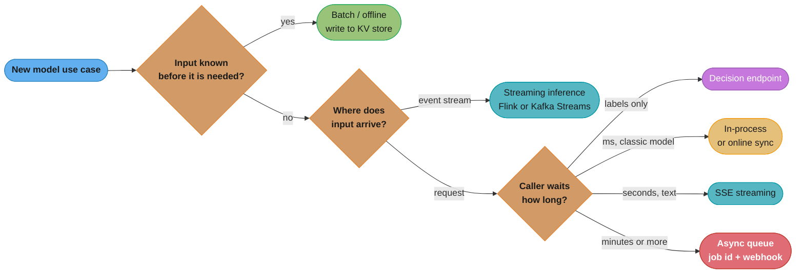
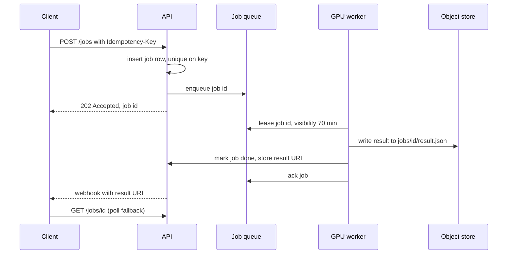
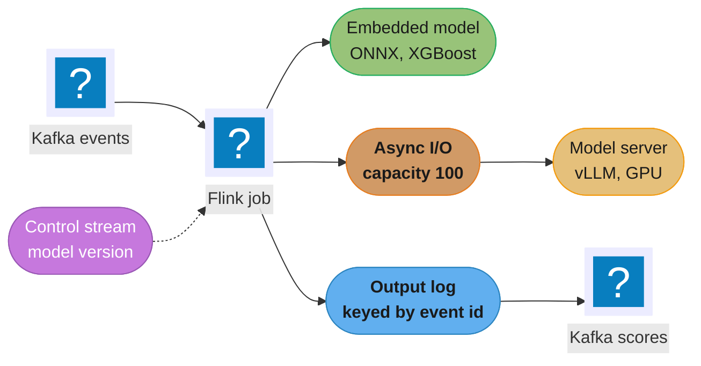
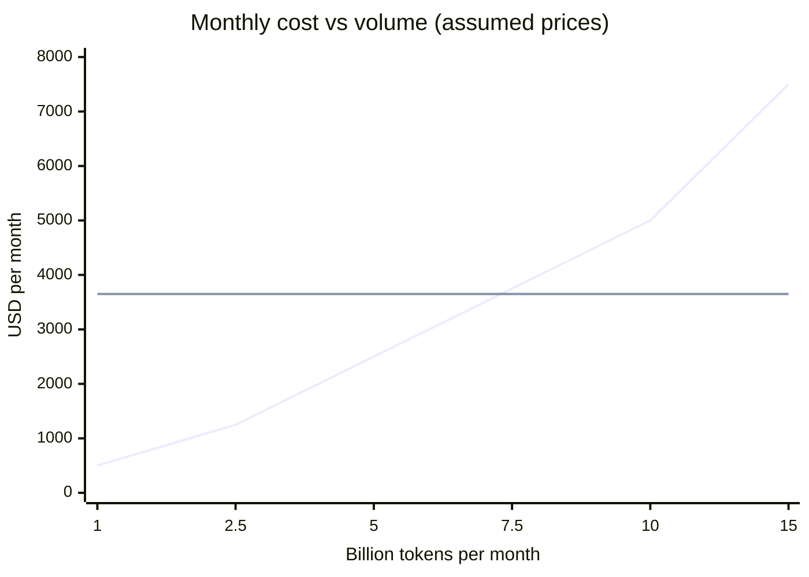

# Deployment Targets and Serving Patterns

> **Version anchor (2026-10-18).** **vLLM v0.32.0** (2026-10-18) serves the OpenAI-compatible and
> `POST /v1/systemone` routes used on this page. **Ray 2.59.0** (2026-10-02) runs the Ray Data LLM
> batch examples. **llama.cpp** stable **v0.7.0** (2026-10-15) and rolling build **b11719**
> (2026-10-18): `llama-server` defaults to auto slots (`-np -1`), continuous batching on, one
> unified KV buffer when slots are auto, `/metrics` only with `--metrics`, and port 9931 (8080
> before v0.7.0). **Ollama v0.40.6** (2026-10-16). Facts read from primary docs on 2026-10-18:
> OpenAI Batch API (50% discount, 24-hour window, up to 50,000 requests and 200 MB per batch);
> SageMaker Asynchronous Inference (payloads up to 1 GB, processing up to one hour, scale to
> zero); Cloud Run GPUs (NVIDIA L4 with 24 GB and RTX PRO 6000 Blackwell with 96 GB, scale to
> zero); Ollama FAQ defaults (`OLLAMA_NUM_PARALLEL` 1, `OLLAMA_MAX_QUEUE` 512, 5-minute
> keep-alive, port 11434); Flink async I/O timeout and capacity semantics. Modal, Baseten and
> RunPod are named without versions or prices.

## 1. Concept Overview

Every model in production answers two questions before any engine flag matters. **Where does it
run** (the deployment target) and **who waits for the answer, and how** (the serving pattern).
A fraud score inside a payment authorization, a product description written overnight for 4
million SKUs and a support chat reply are three different patterns even when the same model
produces all three. Picking the wrong pattern costs more than picking the wrong engine: an
overnight job served through a synchronous endpoint pays for idle GPUs at noon and retries at
midnight, and a chat reply pushed through a batch queue is useless.

This module owns the choice as a decision matrix:

- **Serving patterns.** Online synchronous (REST, gRPC, OpenAI-compatible), server-sent events
  (SSE) streaming, async queue with a job id, batch and offline scoring, streaming inference
  inside a Flink or Kafka Streams job, decision endpoints, and in-process models.
- **Deployment targets.** Managed APIs, serverless GPU (Modal, Baseten, RunPod, Cloud Run GPUs,
  SageMaker Asynchronous Inference), a dedicated GPU cluster, a self-hosted CPU, Apple silicon or
  consumer-GPU box running `llama-server` or Ollama, a stream processor, and the edge.
- **The batch scoring contract.** Idempotent output partitions, backfills, and the model version
  stamped on every output row.
- **The streaming inference contract.** Call versus embed, version hot-swap inside a running
  job, replay against a non-deterministic model, and backpressure.
- **Dedicated versus shared endpoints**, and self-host break-even as one input to the choice.

How the platforms (KServe, Ray Serve, BentoML, Triton) host a model once the target is chosen is
in [Model Serving Platforms](../model_serving_platforms/model_serving_platforms.md). How many
replicas a pattern needs, and which signal scales them, is in
[Inference Autoscaling and Capacity Planning](../inference_autoscaling_and_capacity_planning/inference_autoscaling_and_capacity_planning.md).
Phones, browsers and edge boxes as a target get their own module,
[Edge and On-Device Deployment](../edge_and_on_device_deployment/edge_and_on_device_deployment.md).
The typed-decision endpoint as an artifact (questions, thresholds, calibration) is in
[Decision Models](../decision_models/decision_models.md). DAG scheduling for batch jobs is in
[ML Pipelines and Orchestration](../ml_pipelines_and_orchestration/ml_pipelines_and_orchestration.md).
The cross-region and per-tenant layer on top of every target is in the principal sub-page
[Multi-Region and Multi-Tenant Serving](multi_region_and_multi_tenant_serving.md).

**Not here.** The request path of an AI endpoint (SSE transport, admission queues, `429` with
`Retry-After`, cancellation on disconnect) is in
[Serving AI Workloads](../../backend/serving_ai_workloads/serving_ai_workloads.md). The
application edge in front of a model (timeout ladder, token-aware limiter, provider failover in
FastAPI) is in
[Serving LLM and AI Workloads](../../fastapi/serving_llm_and_ai_workloads/serving_llm_and_ai_workloads.md).
Engine tuning, benchmarking and `llama-server` slot operations in depth are in
[Inference Engine Operations and Benchmarking](../inference_engine_operations_and_benchmarking/inference_engine_operations_and_benchmarking.md).
Classic REST, gRPC and ONNX serving code is in
[Model Serving and Inference](../../ml/model_serving_and_inference/model_serving_and_inference.md).
The self-host break-even arithmetic is in
[AI Cost Engineering and Unit Economics](../ai_cost_engineering_and_unit_economics/ai_cost_engineering_and_unit_economics.md).

---

## 2. Intuition

**Analogy.** A kitchen can cook to order, cater a banquet from a schedule, or keep a tray of
sandwiches ready. The food is the same. The staffing, the waste and the failure modes are not.

**Mental model.** Draw a line from the event that creates the input to the moment someone needs
the output. If the input exists hours before anyone reads the output (every SKU, every customer,
every document), the work is batch, even when the reader expects a millisecond lookup. If the
input arrives with the reader waiting, the work is online, and the only questions left are how
long they wait and whether they see tokens as they arrive. If the input arrives on an event
stream and the reader is another system, the work is streaming inference. Everything else on
this page follows from where that line falls.

**Why it matters.** GPU cost follows the pattern, not the model. A batch job runs a GPU at
80-95% busy for a few hours and releases it. An online endpoint holds GPUs for the peak and runs
them at whatever the traffic curve allows, often 20-40% averaged over a day. The same token
volume can cost 3x more online than in batch before any engine tuning.

**Key insight.** "Real-time" describes when the answer is read, not when it must be computed.
Precompute everything whose input is known ahead of time. Serve online only what depends on an
input the system sees for the first time at request time.

---

## 3. Core Principles

1. **Choose the pattern from the caller's wait, then the target from volume shape and
   constraints.** Wait tolerance (milliseconds, seconds, minutes, a day) picks the pattern.
   Volume shape (flat, spiky, scheduled), data constraints (residency, air gap) and team capacity
   pick the target.
2. **Batch beats online whenever the input is known in advance.** Precomputed results are read
   from a key-value store in single-digit milliseconds, and the GPU work runs at high utilization.
3. **Every output carries the version that produced it.** Model digest, prompt version and run id
   go on every row, event and response. Without them a backfill or rollback cannot tell which
   outputs to recompute.
4. **Outputs are idempotent.** A rerun of the same partition or event overwrites the same output,
   never appends a second copy.
5. **Every queue is bounded, and backpressure reaches the producer.** An unbounded queue in front
   of a GPU turns a slow model into an out-of-memory crash or a 40-minute latency tail.
6. **A dedicated endpoint is a utilization bet.** It pays when the reserved capacity stays busy
   or when isolation is a contract. Otherwise the shared pool or the managed API wins.
7. **Self-hosting is a staffing decision as well as a cost decision.** Upgrades, on-call, GPU
   drivers and security patches move from the provider's team to yours.

---

## 4. Types / Architectures / Strategies

### 4.1 Serving patterns

| Pattern | Who waits | Typical latency target | Transport | Characteristic failure | Depth |
|---|---|---|---|---|---|
| Online sync | A user or service, blocking | p95 under 100 ms (classic) to a few seconds (LLM, non-streamed) | REST, gRPC, OpenAI-compatible JSON | Retry storm when the server is slow | this page, backend |
| SSE streaming | A user watching tokens | TTFT under 1 s, then steady inter-token latency | SSE over HTTP/1.1 or HTTP/2 | Stream cut mid-answer, retried from the start | backend, fastapi |
| Async queue | A client that polls or gets a webhook | Seconds to an hour | Submit returns `202` plus job id | Duplicate jobs from retried submits | this page |
| Batch / offline | Nobody, a table is read later | Hours, a scheduled window | Files and tables, provider Batch APIs | Duplicate or mixed-version rows after a rerun | this page, pipelines |
| Streaming inference | Another system downstream of a stream | Milliseconds to seconds per event | Kafka, Flink, Kafka Streams | Job restart loops, replay changes answers | this page |
| Decision endpoint | A service that needs a label and a probability | Prefill time only, tens of ms | `/v1/decisions`, `/v1/systemone` | Threshold drift after a model snapshot change | decision_models |
| In-process | The calling code | Microseconds to milliseconds | Function call | Model update needs an application redeploy | this page |

### 4.2 Deployment targets

| Target | What it is | Fits | Does not fit |
|---|---|---|---|
| Managed API | OpenAI, Anthropic, Google, Bedrock, Azure: pay per token | Variable load, frontier quality, small team | Residency limits, custom weights, steady high volume |
| Serverless GPU | Modal, Baseten, RunPod, Cloud Run GPUs, SageMaker async: pay per second of GPU, scale to zero | Spiky or low volume, custom weights | Tight TTFT with cold starts, 70B+ weights |
| Dedicated GPU cluster | Kubernetes or VMs with reserved GPUs, vLLM or SGLang behind a platform | Steady high volume, custom models, isolation contracts | Low or unpredictable volume |
| Self-hosted small box | One CPU, Apple silicon or consumer-GPU machine running `llama-server` or Ollama with GGUF weights | Internal tools, air-gapped sites, dev loops | Hundreds of concurrent users, 70B+ models at speed |
| Stream processor | Model embedded in, or called from, a Flink or Kafka Streams job | Per-event scoring on a stream | Large generative models embedded in the job |
| In-process | ONNX, XGBoost or a small PyTorch model inside the service | Classic models under 1 GB, sub-ms budgets | Models that need a GPU or independent rollout |
| Edge | Phone, browser, laptop, store box | Offline use, privacy, zero marginal cost | Large models, fast iteration |

### 4.3 Decision matrix

The matrix below is the module in one picture. Rows are patterns, columns are targets. A check
means a common, well-supported pairing. A tilde means it works with a named caveat. A cross means
the pairing fights the target.

```
                     Managed  Serverless  Dedicated  Small box   Stream     In-      Edge
                     API      GPU         cluster    (llama.cpp) processor  process
Online sync          ✓        ~ cold      ✓          ~ ceiling   ✗          ✓        ✓
SSE streaming        ✓        ~ cold      ✓          ✓           ✗          ✗        ✓
Async queue          ~ build  ✓           ✓          ✓           ✗          ✗        ✗
Batch / offline      ✓ Batch  ✓           ✓          ~ slow      ✗          ✓        ✗
Streaming inference  ~ quota  ~ cold      ✓ call     ✗           ✓ embed    ✓        ✗
Decision endpoint    ✓        ✓           ✓          ✓           ~ call     ✗        ~
In-process           ✗        ✗           ✗          ✗           ✓          ✓        ✓

cold    = cold start on scale-from-zero (seconds to minutes)
ceiling = one box caps throughput (see 6.6)
build   = the queue and job table are yours, the provider only answers sync calls
quota   = provider rate limits throttle a hot stream partition
```

Read across a row to see the target options for a pattern. Read down a column to see what a
target is good at. The dedicated cluster column is all checks or calls, which is why platform
teams default to it, and why it is the most expensive column when its utilization is low.

### 4.4 Dedicated versus shared endpoints

A **shared endpoint** serves many callers from one pool of replicas; peaks rarely line up, so
utilization is high, but one caller's long prompts raise every caller's TTFT. A **dedicated
endpoint** gives one caller its own replicas: predictable latency, custom weights, idle hours
paid. A replica sustaining 2,000 output tokens/s serves 172.8M tokens a day. A tenant sending 20M
a day uses 11.6% of it; ten such tenants share two replicas at about 58%, while ten dedicated
replicas run near 12% and cost 5x more.

| Choose dedicated when | Choose shared when |
|---|---|
| A contract names capacity or latency (p95 TTFT under 500 ms at 50 requests/s) | Callers tolerate shared tail latency |
| The model is custom weights nobody else uses | Callers use the same base model, maybe with adapters |
| Residency or a regulator requires physical separation | Logical separation (keys, logs, quotas) is enough |
| One caller's load alone keeps a replica above 60% busy | Each caller alone would leave replicas mostly idle |

Isolation tiers between these two (per-tenant adapters on a shared base, dedicated deployments in
a shared cluster) are covered in
[Multi-Region and Multi-Tenant Serving](multi_region_and_multi_tenant_serving.md).

### 4.5 Decision endpoints as a pattern

A decision model returns probabilities over fixed labels instead of generated text. Self-hosted
routes: SGLang v0.5.21 `/v1/decisions` and `/v1/systemone`, vLLM v0.32.0 `POST /v1/systemone`,
Ollama `/v1/systemone` since v0.35.0. Hosted: the OpenAI Decisions API (`POST /v1/decisions`,
public beta) and TypeSafe's System One API. A decision call is one prefill pass with no decode,
so latency follows input length, and the artifact that ships is a question set plus thresholds,
not a prompt. Mechanics are in 6.7, the artifact in
[Decision Models](../decision_models/decision_models.md).

### 4.6 Self-hosted small box

`llama-server` (llama.cpp) and Ollama serve GGUF weights pulled from Hugging Face
(`llama-server -hf <user>/<model>[:quant]`, default quant Q4_K_M) or the Ollama registry
(`ollama pull`). Both expose OpenAI-compatible routes. This target fits three cases:

- **Internal tools** with tens of users: a code-review bot, a document classifier, a meeting
  summarizer on a Mac Studio or a workstation with one consumer GPU.
- **Air-gapped sites**: factories, ships, defense and hospital networks where nothing leaves the
  building. The box and its GGUF files are copied in through the site's import process.
- **Dev loops**: engineers run the same OpenAI-compatible API on a laptop that production serves
  from vLLM, so client code does not change between the two.

The ceiling is one box: decode on a memory-bound machine is capped by memory bandwidth (6.6), and
no autoscaler adds a second box. Beyond about 20-50 concurrent active streams, move to a
dedicated cluster.

---

## 5. Architecture Diagrams

### 5.1 Choosing the pattern



The first branch is the one teams skip. Recommendations, embeddings for a known catalog, and
nightly document enrichment all take the batch branch even though their results are read online.

### 5.2 Async queue pattern



The worker acks only after the result is durable. Acking first loses the job when the worker dies
between ack and write. The `Idempotency-Key` stops a retried submit from creating a second job.

### 5.3 Streaming inference: call versus embed



The embedded path is fast and replayable because the model is deterministic and versioned with
the job. The call path shares GPUs with other consumers but needs bounded async capacity, a
timeout policy and an output log so replay does not call the model twice.

### 5.4 `llama-server` slots and the unified KV buffer

```
llama-server -m model.gguf -c 32768 -np 4 --kv-unified     (continuous batching on by default)

KV buffer: 32,768 tokens, one pool shared by every slot
+--------------------------------------------------------------------------------+
| slot 0: 9,100 tok    | slot 1: 2,400 | slot 2: 14,000 tokens          | free   |
+--------------------------------------------------------------------------------+
                                                                         ^ 7,268

One decode step = one forward pass over all active slots (batch of 3 here)
step t   : [s0 tok] [s1 tok] [s2 tok]
step t+1 : [s0 tok] [s1 tok] [s2 tok] [s3 prefill chunk]   <- new request joins
```

A request that needs more tokens than the free part of the pool waits even when a slot is idle.
Long prompts from one user shrink what is left for everyone else, the same noisy-neighbor effect
as on a large cluster. The pool is unified only because `--kv-unified` is passed: with an explicit
`-np 4` and no flag, each slot gets a fixed quarter of `-c` (8,192 tokens), and the 14,000-token
request in slot 2 would not fit.

### 5.5 Break-even as an input, with assumed prices



The rising line is a managed API at an assumed blended $0.50 per 1M tokens. The flat line is two
dedicated GPUs at an assumed $2.50 per GPU-hour (2 x 2.50 x 730 hours). They cross near 7.3
billion tokens a month, and that is before engineer time, which moves the crossing right. The
full model with utilization, commitments and quality gap is in
[AI Cost Engineering and Unit Economics](../ai_cost_engineering_and_unit_economics/ai_cost_engineering_and_unit_economics.md).

---

## 6. How It Works - Detailed Mechanics

### 6.1 Online sync: the minimum contract

An online endpoint for an LLM or a classic model has five parts. The engine provides none of them
by default.

1. **A bounded request.** `max_tokens` (or `max_completion_tokens`) is always set. A missing cap
   lets one request decode 32,000 tokens and hold a slot for minutes.
2. **A server-side deadline shorter than the caller's.** If the caller times out at 30 s, the
   server cancels at 25 s and frees the KV cache. Otherwise the GPU finishes work nobody reads.
3. **A bounded admission queue** that returns `429` with `Retry-After` when full. Mechanics are in
   [Serving AI Workloads](../../backend/serving_ai_workloads/serving_ai_workloads.md).
4. **Retries with jitter and a budget** on the client: at most 10% of requests may be retries.
   Unbudgeted retries triple load exactly when the server is slowest.
5. **The model version in the response**, as a header or a field, so logs and traces join to the
   release bundle.

A vLLM OpenAI-compatible server with an explicit length cap and served-model name:

```bash
vllm serve Qwen/Qwen3-8B \
  --served-model-name support-8b-2026-10-14 \
  --max-model-len 16384 \
  --port 8000
```

The `--served-model-name` carries a dated id so clients and logs see which build answered. Flag
semantics are in [vLLM Deep Dive](../../llm/vllm_deep_dive/vllm_deep_dive.md).

### 6.2 Async queue: submit, lease, write, ack

The async pattern trades latency for reliability and cost. It fits document extraction on
100-page PDFs, video transcription, long agent runs and any call that can take longer than a load
balancer's idle timeout (often 60 s).

SageMaker Asynchronous Inference is the managed form: the payload goes to S3,
`InvokeEndpointAsync` returns an output location, payloads can be up to 1 GB and processing up to
one hour, and the instance count can scale to zero when the queue is empty.

A broken worker, found in a document-extraction service:

```python
# BROKEN: ack before the result is durable
def handle(msg):
    queue.ack(msg)                      # message gone
    result = model.extract(msg.payload) # worker OOM-killed here: job lost forever
    store.put(f"jobs/{msg.job_id}/result.json", result)
```

Under a burst, 2-3% of jobs disappeared each day. The workers were being OOM-killed on large
PDFs after the ack and before the write. The fix moves the ack after the durable write and makes
the write idempotent, so a second delivery overwrites the same key:

```python
# FIXED: lease, compute, durable write, then ack
def handle(msg):
    key = f"jobs/{msg.job_id}/result.json"
    if store.exists(key):               # redelivery after a crash post-write
        queue.ack(msg)
        return
    result = model.extract(msg.payload)
    store.put(key, result)              # same key on retry: idempotent
    jobs.mark_done(msg.job_id, uri=key, model_version=MODEL_VERSION)
    queue.ack(msg)
```

Set the queue's visibility timeout above the longest allowed processing time: with a one-hour
processing cap, 15 minutes is too short and 70 minutes covers it. Cap redeliveries at 3 before a
dead-letter queue.

On the submit side, require an `Idempotency-Key` header and store it with a unique constraint. A
client whose `POST` times out retries with the same key and gets the same job id back.

### 6.3 Batch and offline scoring

Batch scoring runs a model over a dataset that already exists: every customer, every SKU, every
support ticket from last quarter. Three executors cover most cases.

**Ray Data LLM** runs vLLM or SGLang engines as actors over a Ray Dataset:

```python
import ray
from ray.data.llm import vLLMEngineProcessorConfig, build_processor

MODEL_VERSION = "qwen3-8b-desc-2026-10-14"

config = vLLMEngineProcessorConfig(
    model_source="/models/qwen3-8b-desc",       # registry path pinned by digest upstream
    engine_kwargs={"max_model_len": 4096},
    concurrency=8,                               # 8 engine replicas, one per GPU
    batch_size=64,
)

processor = build_processor(
    config,
    preprocess=lambda row: dict(
        messages=[{"role": "user", "content": row["prompt"]}],
        sampling_params=dict(temperature=0.0, max_tokens=256),
    ),
    postprocess=lambda row: dict(
        sku=row["sku"],
        description=row["generated_text"],
        model_version=MODEL_VERSION,
        run_id=RUN_ID,
    ),
)

ds = ray.data.read_parquet(f"s3://catalog/prompts/dt={DT}/")
processor(ds).write_parquet(f"s3://catalog/descriptions/_staging/{RUN_ID}/")
```

**Spark or a plain vLLM offline job** (`from vllm import LLM, SamplingParams`, then
`llm.generate()` over shards) fits teams whose data already lives in Spark. **Provider Batch
APIs** take a JSONL file and return results within a window. OpenAI's Batch API charges 50% of
the synchronous price, completes within 24 hours, and accepts up to 50,000 requests and 200 MB per
batch file. Azure offers Global Batch and Data Zone Batch at the same 50% discount with a 24-hour
target.

**The output contract.** Every batch job, whatever the executor, writes outputs the same way:

1. Write to a staging path keyed by `run_id`.
2. Validate row counts and null rates against the input.
3. Swap the staging output into the partition (`dt=2026-10-18/`) with an overwrite, never an
   append.
4. Stamp `model_version`, `prompt_version` and `run_id` on every row.

A broken backfill shows why:

```sql
-- BROKEN: append-mode backfill after a model fix
INSERT INTO catalog.descriptions
SELECT * FROM staging_run_7f3a;            -- partition dt=2026-10-01 now has two rows per SKU
```

A retail team re-ran 30 days of descriptions after fixing a prompt. Append mode left two rows per
SKU in each partition, the serving loader picked one at random, and about half the product pages
showed the old text for a week. No row carried a model or prompt version, so finding the bad rows
took a manual diff against the job logs. The fix:

```sql
-- FIXED: overwrite the partition, version on every row
INSERT OVERWRITE TABLE catalog.descriptions PARTITION (dt = '2026-10-01')
SELECT sku, description, model_version, prompt_version, run_id
FROM staging_run_7f3a
WHERE dt = '2026-10-01';
```

With versions on rows, a later rollback is a query: select the partitions where
`model_version = 'qwen3-8b-desc-2026-10-14'` and re-run them with the previous version.
Scheduling, retries and dependency order for these jobs belong to
[ML Pipelines and Orchestration](../ml_pipelines_and_orchestration/ml_pipelines_and_orchestration.md).

### 6.4 Streaming inference

A model on an event stream scores each event as it arrives: card transactions for fraud, clicks
for session intent, log lines for anomaly flags. Two placements exist.

**Embedded.** The model runs inside the Flink or Kafka Streams task: an ONNX Runtime session, an
XGBoost booster, a small PyTorch model on CPU. Latency is microseconds to a few milliseconds,
nothing crosses the network, and the model version is part of the job state. It fails for GPU
models and for models other services also call.

**Called.** The task sends an async request to a model server (vLLM, Triton, a decision endpoint)
and continues with other events while it waits. In Flink this is async I/O:

```java
DataStream<Scored> scored = AsyncDataStream.unorderedWaitWithRetry(
    events,
    new ModelCall(endpoint),            // AsyncFunction<Event, Scored>
    2000, TimeUnit.MILLISECONDS,        // timeout covers every retry
    100,                                // capacity: in-flight requests per parallel instance
    new AsyncRetryStrategies.FixedDelayRetryStrategyBuilder<Scored>(3, 100L)
        .ifException(RetryPredicates.HAS_EXCEPTION_PREDICATE)
        .build());
```

`capacity` bounds in-flight requests per parallel task. When it is reached, the operator applies
backpressure upstream instead of growing a backlog, so a slow model server slows the Kafka
consumer, and consumer lag becomes the alert. **The default timeout behavior is the trap:** when
a request times out, Flink throws, fails the job and restarts it from the last checkpoint. A model
server that slows from 300 ms to 2.5 s p99 therefore produces a restart loop, and each restart
replays every event since the checkpoint. Override `timeout()` in the `AsyncFunction` to emit a
fallback (a rule-based score, a `null` with a reason code) or route the event to a side output for
later scoring:

```java
@Override
public void timeout(Event e, ResultFuture<Scored> out) {
    out.complete(List.of(Scored.fallback(e, "model_timeout", RULES_VERSION)));
}
```

**Version hot-swap inside a running job.** Restarting a Flink job to change the model costs a
savepoint, a redeploy and minutes of lag. Instead, publish the new model version id on a control
topic, connect it as broadcast state, and have each task load the new artifact and switch at a
defined point. Three rules: load before switching (never block the event path on a download),
switch at an event-time boundary so one window is never scored by two models, and stamp every
output with the version that produced it.

**Replay and exactly-once against a non-deterministic model.** Flink's exactly-once covers state
and sink writes. It does not make a model call repeatable. After a restart, events since the last
checkpoint are processed again, and an LLM or a GPU model under different batch composition can
return a different answer for the same input. Downstream consumers then see a fraud flag that
flips on replay. The fix is to treat the model output as data:

1. Key each output by event id and write it to an output log (a Kafka topic or a key-value store)
   before acting on it.
2. On processing, look up the event id first. If an output exists, use it. Call the model only on
   a miss.
3. Keep the log for longer than the longest replay window you support.

This also makes backfills honest: a backfill with a new model writes under a new version, and the
old outputs stay for comparison.

### 6.5 Serverless GPU

Serverless GPU platforms bill for GPU time while a container runs and scale to zero between
bursts. Modal and RunPod run your container on demand. Baseten packages a model and serves it
behind an autoscaled endpoint. Cloud Run GPUs offer NVIDIA L4 (24 GB) and RTX PRO 6000 Blackwell
(96 GB), scale to zero, and start instances with preinstalled drivers in about 5 seconds per the
Cloud Run docs. SageMaker Asynchronous Inference scales to zero behind a queue.

The deciding number is the cold-start budget: node or container start, image pull, weight load
and engine warmup. Container start is seconds. Weights dominate: 16 GB for an 8B model in BF16 at
1 GB/s from object storage is 16 s, and 140 GB for a 70B model at 2 GB/s is 70 s, before CUDA
graph capture. A chat product cannot hide 70 s. An async job can. Cold-start layers and how to
shrink them are in
[Model Storage, Loading and Cold Start](../model_storage_loading_and_cold_start/model_storage_loading_and_cold_start.md).

It fits when idle hours dominate (a tool used 2 hours a day, a nightly job) and stops fitting
when a warm replica must run all day to hide cold starts.

### 6.6 Self-hosted small box: `llama-server` and Ollama

A `llama-server` launch for an internal tool:

```bash
llama-server -hf Qwen/Qwen3-8B-GGUF:Q4_K_M \
  --host 0.0.0.0 \
  --port 9931 \
  -c 32768 \
  -np 4 --kv-unified \
  -ngl all \
  --metrics \
  --api-key "$LLAMA_API_KEY"
```

Points that bite:

- `--host` defaults to `127.0.0.1`. In a container, the server is unreachable from outside until
  `--host 0.0.0.0` is set.
- `--port` defaults to 9931 from v0.7.0. Health checks and reverse proxies written for 8080 fail
  after an upgrade. Pin the port explicitly.
- `-np` defaults to `-1` (auto), and with auto slots the KV buffer is one unified pool. An
  explicit `-np 4` turns unification off unless `--kv-unified` is passed; each slot then gets a
  fixed quarter of `-c`. With `--kv-unified`, `-c` is the shared pool for all concurrent requests
  (5.4). Continuous batching is on by default, so slots share decode steps.
- `/metrics` is off unless `--metrics` is passed. `/health` returns 503 while the model loads and
  200 when ready, which is the readiness probe.
- `/slots` (on by default) shows per-slot state. Disable it with `--no-slots` on a box exposed
  beyond the team.

Ollama is easier to install and manage models with, and its defaults favor one user:

| Setting | Default | Effect on a shared box |
|---|---|---|
| `OLLAMA_NUM_PARALLEL` | 1 | One request per model at a time; others queue |
| `OLLAMA_MAX_QUEUE` | 512 | Requests beyond 512 are rejected |
| `OLLAMA_MAX_LOADED_MODELS` | 3 x GPU count, or 3 on CPU | A fourth model evicts one |
| keep-alive | 5 minutes | Idle models unload; the next request pays the load |
| Listen address | `127.0.0.1:11434` | Unreachable from other hosts until changed |

Parallel requests multiply the context: the FAQ's example is a 2K context with 4 parallel
requests becoming 8K, which can push a model off the GPU.

**The throughput ceiling.** Single-stream decode on these boxes is memory-bandwidth bound: each
token reads roughly every weight once. An upper bound is bandwidth divided by model bytes:

```
8B model, Q4_K_M  ~ 4.9 GB of weights
  400 GB/s unified memory  ->  400 / 4.9  ~  80 tokens/s per stream, upper bound
  1,000 GB/s consumer GPU  -> 1000 / 4.9  ~ 200 tokens/s per stream, upper bound
70B model, Q4_K_M ~ 42 GB
  400 GB/s                 ->  400 / 42   ~ 9.5 tokens/s per stream, upper bound
```

Continuous batching raises total throughput because one weight read serves several slots, until
compute or KV memory runs out. Measured numbers sit below these bounds. How to measure them
(`llama-bench`, slot tuning, `--cache-reuse`) is in
[Inference Engine Operations and Benchmarking](../inference_engine_operations_and_benchmarking/inference_engine_operations_and_benchmarking.md).

### 6.7 Decision endpoints in a service

A decision call replaces a generative classification prompt. A thin client hides the vendor's
wire format, whose field names differ (`predicate`, `yes_no`, `noul`):

```python
probs = decisions.choice(                  # thin client over /v1/systemone
    model="triage-decider-2026-10-01",     # pinned snapshot, never an alias
    input=ticket_text,
    options=["billing", "outage", "account", "other"],
    timeout_s=0.5,
)
queue = route(probs, thresholds=THRESHOLDS_V7, abstain_to="human_triage")
```

The call is prefill-only, so p95 latency scales with input length; batch many short inputs per
GPU; and log probabilities, not only the chosen label, so threshold changes can be replayed.

---

## 7. Real-World Examples

- **Netflix** described three computation modes for personalization in its 2013 engineering post
  "System Architectures for Personalization and Recommendation": offline (batch over large data,
  no latency limit), nearline (event-driven, results stored for later), and online (in-request,
  tight latency). The split is the batch, streaming and online rows of the matrix in 4.3.
- **Uber Michelangelo** (2017 engineering post) offered offline deployment, where a Spark job
  writes batch predictions back to Hive, and online deployment to a prediction service cluster.
  At serving time a model is identified by its UUID and an optional tag set at deployment.
- **DoorDash Sibyl** (2020 engineering post) is a prediction service that serves many models
  behind one API and supports shadow predictions for candidate models: a shared-endpoint design.
- **OpenAI Batch API and Azure Global Batch** both price batch at 50% of the synchronous rate with
  a 24-hour window (checked 2026-10-18). For any workload whose input is known a day ahead, that
  halves the API bill before any engineering.
- **Cloud Run GPUs** document scale-to-zero with L4 and RTX PRO 6000 Blackwell GPUs, which makes
  a container-based serverless GPU target available on Google Cloud without managing nodes.
- **Air-gapped internal assistants** in regulated plants and ships run `llama-server` or Ollama on
  one workstation-class machine, copying GGUF files in through the site's media import process.
  The small-box target exists because nothing else is allowed on that network.

---

## 8. Tradeoffs

### 8.1 Pattern tradeoffs

| Pattern | GPU utilization | Latency seen by user | Failure blast radius | Cost per 1M tokens (relative) | Operational load |
|---|---|---|---|---|---|
| Online sync | 20-40% averaged | Full model latency | Every in-flight user | 1.0 | High: on-call, autoscaling |
| SSE streaming | 20-40% | TTFT only | Every open stream | 1.0 | High, plus stream resume |
| Async queue | 50-80% | Minutes, not seen live | Queue grows, nobody blocks | 0.5-0.7 | Medium: queue and job table |
| Batch | 80-95% | None, read from store | A late table | 0.3-0.5, or 0.5 on provider Batch APIs | Low: scheduled |
| Streaming inference | Depends on stream rate | Pipeline latency | Consumer lag, replays | 0.6-1.0 | High: stream ops plus model ops |

The relative cost column is a planning heuristic from utilization, not a quote.

### 8.2 Target tradeoffs

| Target | Time to first deploy | Control over model | Cold start | Residency control | Who is on call |
|---|---|---|---|---|---|
| Managed API | Hours | None, provider snapshots | None | Region or data-zone options | Provider plus your client code |
| Serverless GPU | Days | Full weights | Seconds to minutes | Region choice | Shared |
| Dedicated cluster | Weeks | Full | Warm by design | Full | You |
| Small box | Hours | Full | Load once | Full, physical | You, informally |
| In-process | Days | Full, classic models | Application start | Full | Service owner |

---

## 9. When to Use / When NOT to Use

| Option | Use when | Do not use when |
|---|---|---|
| Batch | Input set known ahead, results can be hours old: recommendations, catalog enrichment, corpus embeddings | Input is the user's live text or a fresh event |
| Async queue | A request outlasts a load balancer timeout or a user's patience: long documents, media, agent runs | The user watches the answer form; use SSE |
| Streaming inference | Another system acts on each event within seconds and the stream exists | A GPU model would be embedded in the task, or there is no timeout override and output log |
| Decision endpoint | The answer is a label and a probability: triage, routing, guardrails, judges | The output is free text |
| Managed API | Variable volume, frontier quality, small team | Residency or custom weights rule it out, or steady volume is well past break-even |
| Serverless GPU | Spiky or low-volume custom models | A warm replica must run all day to hide cold starts |
| Small box | Internal tools, air-gapped sites, dev loops | Customer traffic beyond a few dozen concurrent streams |
| In-process | Classic models with sub-millisecond budgets | The model updates on a different cadence from the service |

---

## 10. Common Pitfalls

**The timeout restart loop.** A fintech team called a GPU-hosted fraud model from Flink async I/O
with a 1 s timeout and the default `timeout()` behavior. A model-server deploy raised p99 to 1.4
s for 20 minutes. Every timeout failed the job, every restart replayed 90 seconds of events, the
replays added load, and consumer lag reached 25 minutes. Fix: override `timeout()` to emit a
rules-based score tagged `model_timeout`, alert on the fallback rate, and size capacity for p99
latency times event rate.

**Port 8080 to 9931.** An internal assistant's `llama-server` image was rebuilt on llama.cpp v0.7.0.
The default port moved from 8080 to 9931, the Kubernetes readiness probe still checked 8080, and
the pod never became ready. Fix: set `--port` explicitly and treat engine defaults as part of the
pinned configuration.

**Ollama unloading between meetings.** A meeting-summary tool on Ollama answered the first request
of each hour in 40 s and the rest in 3 s. The default 5-minute keep-alive unloaded the 27B model
between meetings. Fix: set `keep_alive` per request or the server default to cover working hours,
and raise `OLLAMA_NUM_PARALLEL` from 1 once the context budget allows.

**Online endpoint for a known input set.** A marketplace generated listing summaries on page view
through a synchronous LLM endpoint. Ninety percent of views hit the top 5% of listings, the same
summary was generated thousands of times, and the endpoint was sized for peak traffic. Moving to
nightly batch over changed listings plus a key-value lookup cut GPU hours by about 85% and dropped
p95 page latency from 1.8 s to 40 ms.

**Replay flips decisions.** A content-moderation stream job called an LLM classifier. After a
checkpoint restore, 3% of replayed events got a different label, and users saw posts hidden, then
shown, then hidden. Fix: output log keyed by event id, read before calling the model.

---

## 11. Technologies & Tools

| Tool | Role | Notes |
|---|---|---|
| vLLM | OpenAI-compatible GPU serving and offline `LLM` class | v0.32.0. `POST /v1/systemone` for decision models |
| SGLang | GPU serving engine with decision routes | v0.5.21. `/v1/decisions` and `/v1/systemone` |
| Ray Data | Batch inference over datasets with `build_processor` | Ray 2.59.0. vLLM and SGLang processor configs |
| llama.cpp | `llama-server` for GGUF on CPU, Apple silicon and consumer GPUs | v0.7.0 stable, b11719 rolling. Default port 9931 |
| Ollama | Model manager and server for GGUF models | v0.40.6. Decision models via `/v1/systemone` |
| Apache Flink | Stream processor with async I/O for model calls | Default async timeout fails the job |
| Apache Kafka | Event log for streaming inference inputs, outputs and output logs | Consumer lag is the backpressure signal |
| Apache Spark | Batch scoring over existing tables | Partition overwrite for idempotent outputs |
| Amazon SageMaker | Asynchronous Inference endpoints | 1 GB payloads, one-hour processing, scale to zero |
| Google Cloud Run | Serverless containers with GPUs | L4 and RTX PRO 6000 Blackwell, scale to zero |
| Modal | Serverless GPU containers | No version pinned in this section |
| Baseten | Managed model deployment on autoscaled GPUs | No version pinned in this section |
| RunPod | Serverless and on-demand GPU containers | No version pinned in this section |
| OpenAI Batch API | Provider batch execution | 50% discount, 24-hour window, 50,000 requests per batch |
| ONNX Runtime | In-process and embedded model execution | Fits stream tasks and services for classic models |

Engine families compared side by side are in
[Inference Engines](../../llm/inference_engines/inference_engines.md). Function-as-a-service
mechanics for the serverless target are in
[Serverless and FaaS](../../devops/serverless_and_faas/serverless_and_faas.md). Flink internals
(checkpoints, state backends, exactly-once sinks) are in
[Apache Flink](../../technologies/apache_flink/apache_flink.md).

---

## 12. Interview Questions with Answers

**Q: Why is "does it need to be real-time?" the wrong first question when choosing a serving pattern?**
**Short:** The deciding fact is whether the input is known before the answer is needed; known inputs belong in batch even when results are read in milliseconds.

"Real-time" mixes up when an answer is read with when it must be computed. Recommendations for
every user, descriptions for every SKU and embeddings for an existing corpus all have inputs that
exist hours before anyone reads the output. Precompute them in batch at 80-95% GPU utilization and
serve them from a key-value store in single-digit milliseconds. Only inputs the system first sees
at request time (the user's message, a new transaction) need online inference. Ask "when does the
input exist?" first.

**Q: Why must every batch-scored row carry the model version?**
**Short:** Without it, a backfill, a partial rerun or a rollback leaves rows from two models in one table and nobody can tell which rows to recompute.

Batch tables outlive the run that wrote them. A fixed prompt re-run on 30 days, a job that died
halfway, or a rollback all leave some partitions from one model and some from another. With
`model_version`, `prompt_version` and `run_id` on each row, finding affected rows is a query and
a rollback is a re-run of exactly those partitions. Without them it is a manual diff against job
logs. Stamp versions on every row and overwrite partitions instead of appending.

**Q: What happens when a Flink async I/O call to a model server times out under default settings?**
**Short:** The timeout throws, the job fails and restarts from the last checkpoint, so a slow model server turns into a restart loop that replays events and adds load.

Flink's async I/O raises an exception on timeout by default, which restarts the job. Each restart
reprocesses everything since the checkpoint, which sends more calls to the same slow server and
lengthens the outage. Override `AsyncFunction.timeout()` to complete with a fallback result (rules
score, null with a reason code) or route to a side output for later scoring. Alert on the
fallback rate, and size `capacity` from p99 latency times the per-task event rate.

**Q: How do you get exactly-once results from a streaming job that calls a non-deterministic model?**
**Short:** Record each model output keyed by event id and, on replay, read the recorded output instead of calling the model again; Flink exactly-once covers state, not the model's answer.

Exactly-once processing guarantees that state updates and sink writes happen once. A replayed
event still triggers the model call again, and an LLM or a GPU model under different batching can
answer differently, so a fraud flag or moderation label flips on replay. Write each output to a
log keyed by event id before acting on it, check the log before calling, and keep it longer than
the longest replay window. Backfills with a new model write under a new version.

**Q: Why does an async inference API need idempotency keys when the client already gets a job id?**
**Short:** The client can retry a submit before it receives the job id, so without a client-supplied key a timeout or dropped response creates duplicate jobs and duplicate GPU spend.

The job id comes back in the response to the submit. If that response is lost (mobile network,
load balancer timeout), the client cannot know whether the job exists and retries. A
client-generated `Idempotency-Key` stored with a unique constraint makes the retry return the
original job id. Pair it with workers that ack only after a durable result write, so redeliveries
overwrite the same key instead of losing or duplicating results.

**Q: When does a single `llama-server` or Ollama box fit as a production target?**
**Short:** For internal tools, air-gapped sites and dev loops with tens of concurrent users, where data cannot leave the site and one box's throughput ceiling is acceptable.

The small box gives an OpenAI-compatible API on hardware the team already controls, with GGUF
weights copied in once. It fits a code-review bot, a document classifier inside a hospital
network, or engineers developing against the same API production uses. It does not autoscale, and
decode is capped by memory bandwidth, so beyond roughly 20-50 concurrent active streams move to a
dedicated cluster. Pin `--port`, `--host` and slot settings, and turn on `--metrics`.

**Q: Why does an Ollama server that answers one user quickly stall with ten users?**
**Short:** `OLLAMA_NUM_PARALLEL` defaults to 1, so each model serves one request at a time and the rest wait in a queue of up to 512.

Ollama's defaults suit a single user on a laptop. With ten users, nine wait for the first to
finish, and a 30 s answer becomes a 5-minute wait at the back of the queue. Raising
`OLLAMA_NUM_PARALLEL` lets requests share decode steps, but parallel requests multiply the
context (2K with 4 parallel becomes 8K), which can push layers off the GPU. Also check the
5-minute keep-alive, which unloads idle models and makes the next request pay the load.

**Q: What caps single-stream decode speed on a memory-bound box, and how do you estimate it?**
**Short:** Memory bandwidth divided by bytes read per token, roughly the quantized model size; 400 GB/s over a 4.9 GB model gives at most about 80 tokens/s per stream.

Each decoded token reads nearly every weight once, so at batch size 1 the GPU or unified memory
bus is the limit, not compute. Divide bandwidth by model bytes for an upper bound: a 70B Q4 model
(about 42 GB) on 400 GB/s gives at most about 9.5 tokens/s. Measured speeds sit below the bound.
Continuous batching raises total throughput because one weight read serves several streams, until
compute or KV memory runs out.

**Q: How do you choose between a dedicated endpoint and a shared one?**
**Short:** Shared pools win on utilization; pay for dedicated only when a tenant needs latency isolation, custom weights, residency separation or contracted capacity, or keeps a replica busy alone.

A replica serving 172.8M tokens a day at full load is 11.6% busy for a tenant sending 20M a day.
Ten such tenants share two replicas at about 58%; ten dedicated replicas run at 12% and cost 5x
more. Dedicated endpoints buy predictable TTFT and freedom from other tenants' long prompts. Make
the choice per tenant with the tenant's own load and contract terms, and offer middle tiers such as
per-tenant adapters on a shared base.

**Q: When is serverless GPU the right deployment target?**
**Short:** For spiky or low-volume custom models where idle hours dominate, with a cold-start budget the product can absorb or hide behind an async pattern.

Serverless GPU bills only while containers run and scales to zero between bursts. The cost is
cold start: weights dominate (140 GB at 2 GB/s is 70 s before warmup). An internal tool used 2
hours a day or a nightly job fits. A chat product with strict TTFT does not, unless a warm replica
runs during business hours, and once that replica runs all day you pay dedicated prices without
dedicated control.

**Q: How should a provider Batch API fit into a batch scoring pipeline?**
**Short:** As one executor: split input into files within provider limits, submit, poll, write results to an idempotent staging partition, stamp the model id, and budget for the 24-hour window.

OpenAI's Batch API takes up to 50,000 requests and 200 MB per file at 50% of the synchronous
price and completes within 24 hours. The pipeline still owns the contract: request ids that map
back to input rows, retries for failed lines, partition overwrite and version stamps. Pin a dated
model snapshot, not an alias, so a backfill a month later uses the same model or knowingly a new
one. Do not put anything with a deadline under 24 hours on it.

**Q: Why is a decision endpoint a separate serving pattern rather than another chat call?**
**Short:** It runs one prefill pass and returns probabilities over fixed labels, and its artifact is the question set plus thresholds, so latency, cost and release gating all differ from generation.

A decision call has no decode phase, so latency follows input length and many short inputs batch
well. On the OpenAI Decisions API only input tokens are billed ($0.10 per 1M for `gpt-6-luna`,
checked 2026-10-18). The release unit is the question set, model snapshot, thresholds and action
mapping, and a change to any of them goes through an eval gate. Log probabilities, not only the
chosen label, so threshold changes can be replayed.

**Q: Should a stream job embed the model or call a model server?**
**Short:** Embed small classic models for speed and deterministic replay; call a model server for GPU models, shared capacity and independent rollout, and pay with network latency and backpressure.

Embedding an ONNX or XGBoost model in the task keeps scoring in microseconds, makes replay
deterministic, and versions the model with job state. It fails for GPU models and for models other
services also need. Calling a server shares GPUs and lets the model roll out on its own canary, but
needs bounded async capacity, a timeout override and an output log. Choose by model size and by
who else uses the model.

**Q: How do you change the model version inside a running Flink job without a restart?**
**Short:** Publish the new version id on a control stream as broadcast state, load the artifact in each task off the hot path, switch at an event-time boundary and stamp every output with its version.

A restart costs a savepoint, a redeploy and minutes of lag. Broadcast state delivers the new
version id to every parallel task. Each task downloads and loads the new model before switching,
so the event path never blocks on a download. Switching at a window or watermark boundary keeps one
window from being scored by two models. Version stamps on outputs let downstream consumers and
backfills tell the two apart.

**Q: How does self-host break-even enter the deployment target decision?**
**Short:** As one input among several: sustained utilization, committed capacity, engineer time, model churn and quality gap decide it, and below steady utilization the managed API usually wins.

A flat GPU cost against a per-token API price crosses at some monthly volume; with assumed prices
of $0.50 per 1M tokens and two GPUs at $2.50 an hour it is about 7.3 billion tokens a month. Engineer
time, on-call and upgrades move the crossing right, and a quality gap between the open model and
the frontier API can rule self-hosting out at any volume. The full arithmetic lives in the cost
module; the target decision takes its result plus residency and control needs.

**Q: What is the minimum contract for an online synchronous inference endpoint?**
**Short:** An explicit max-tokens cap, a server deadline shorter than the caller's, a bounded queue returning 429 with Retry-After, budgeted client retries, and the model version in every response.

Engines accept unbounded requests and keep working after the caller has gone. A cap stops one
request from holding a slot for minutes. A shorter server deadline frees KV cache before the
client gives up. A bounded queue sheds load instead of building a minutes-long tail, and a retry
budget (for example 10% of requests) stops retries from tripling load during a slowdown. The
version field joins logs and traces to the release bundle.

---

## 13. Best Practices

1. Record the pattern and target for each model in its registry entry, next to the version, so
   the owner and on-call path follow from it.
2. Default to batch for any input known ahead of time, and review online endpoints for
   known-input traffic each quarter.
3. Stamp `model_version`, `prompt_version` and `run_id` on every output, and overwrite
   partitions instead of appending.
4. Bound every queue and in-flight count: admission queues, Flink async `capacity`,
   `OLLAMA_MAX_QUEUE`, `llama-server` slots.
5. Override Flink async timeouts with a fallback, alert on the fallback rate, and keep an output
   log keyed by event id for any stream job that calls a model.
6. Require `Idempotency-Key` on async submits and ack after the durable write.
7. Pin engine defaults that change between releases (`--port`, `--host`, slots, keep-alive) and
   dated model snapshots, never aliases.
8. Measure cold start end to end before putting serverless GPU on an interactive path.
9. Decide dedicated versus shared per tenant from its own load and contract.

---

## 14. Case Study

**An insurance carrier with three AI workloads on one model family.**

The carrier ran three features on fine-tuned 8B and 32B open models:

1. **Claim-document extraction.** About 60,000 claims a day, each with 5-40 pages of PDFs.
   Adjusters open a claim hours after submission.
2. **Adjuster chat assistant.** 1,200 adjusters, peak 300 concurrent sessions, answers grounded
   in the claim file.
3. **First-notice-of-loss triage.** Every new claim event on Kafka gets a severity and a routing
   queue within 2 seconds, so urgent claims reach a senior adjuster the same hour.

**Before.** All three ran on one shared synchronous vLLM endpoint of 16 H100s, sized for the chat
peak. Extraction was called synchronously from the upload service; large PDFs exceeded the 60 s
load balancer timeout, clients retried, and about 4% of extraction calls ran two or three times.
Triage called the same endpoint from a Flink job with default async timeouts; during chat peaks
the job restarted 6-10 times a day and triage latency reached 15 minutes. GPU utilization averaged
31%.

**Decisions.**

| Workload | Pattern | Target | Why |
|---|---|---|---|
| Extraction | Async queue, then nightly batch for re-extraction | Dedicated pool of 4 GPUs at night, 2 by day | Input known at upload, result read hours later |
| Chat | SSE streaming | Shared pool of 8 GPUs, autoscaled on queue depth | User waits and watches tokens |
| Triage | Streaming inference calling a decision endpoint | 2 GPUs serving an 8B decision model through `/v1/systemone` | Label and probability per event, prefill-only |

Extraction moved behind `POST /extractions` with an `Idempotency-Key`, a job table and workers
that ack after writing results to object storage. Re-extraction after a model update runs as a Ray
Data job overnight, writing to staging, then overwriting partitions with `model_version` on every
row. Triage replaced a generative classification prompt with a decision question set (severity
levels 0-9, routing choice among 6 queues), called from Flink async I/O with `capacity` 50, a 1.5
s timeout overridden to a rules-based fallback, and an output log keyed by claim event id.

**After eight weeks.**

- GPUs: 16 to 12 at peak, 8 at night. Average utilization rose from 31% to 64%.
- Duplicate extraction work: 4% to under 0.1% (only true resubmits).
- Triage p99: 15 minutes during peaks to 1.1 s; zero job restarts from model timeouts. The
  fallback fired on 0.3% of events, all during one model-server deploy.
- Chat p95 TTFT: 2.4 s to 0.7 s once extraction and triage stopped sharing its queue.
- A prompt fix for extraction was backfilled over 45 days of claims in one night, selecting
  partitions by `model_version`.

Weights and engine flags did not change. The gains came from matching each workload to who waits
for it. The EU expansion that followed used
[Multi-Region and Multi-Tenant Serving](multi_region_and_multi_tenant_serving.md).
