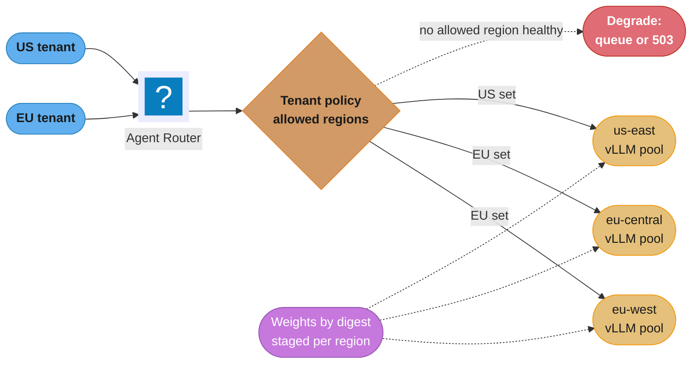
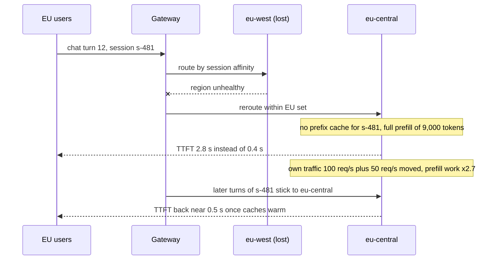
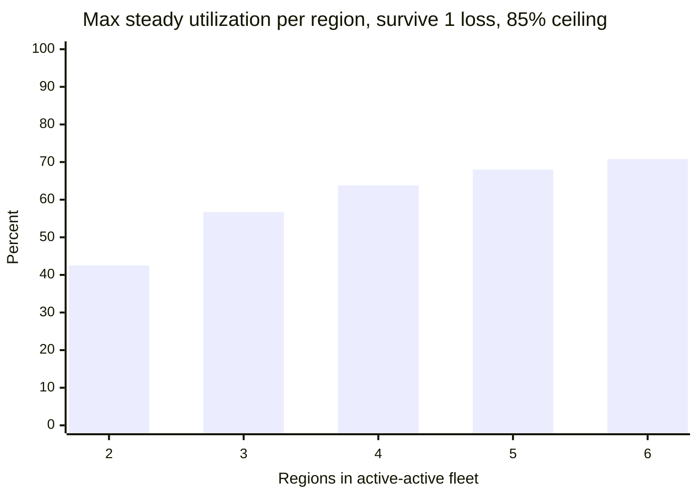

# Multi-Region and Multi-Tenant Serving

> **Version anchor (2026-10-18).** **vLLM v0.32.0** (2026-10-18) serves the per-tenant LoRA
> examples. **llm-d v0.10.0** (2026-09-29) and **Gateway API Inference Extension v1.6.2**
> (2026-09-17; EPP, BBR, InferenceObjective and InferenceModelRewrite moved to llm-d in v1.6.0)
> route requests inside a region. **KServe v0.21.0** (2026-09-25), **Kueue v0.20.2**
> (2026-10-15) and **Kubernetes 1.37** host dedicated tenant deployments and their quotas.
> **Agent Router v1.2.0** (envoyproxy/ai-gateway, 2026-10-07) and **LiteLLM v1.106.0**
> (2026-10-18) are the gateway options in the examples. Provider facts read from primary docs on
> 2026-10-18: Amazon Bedrock cross-Region inference (geographic profiles route within a geography
> such as US or EU at standard pricing; global profiles route to any supported commercial Region
> at about 10% lower cost; CloudTrail records the processing Region in
> `additionalEventData.inferenceRegion`); Microsoft Foundry deployment types (Global, Data Zone
> for US, EU or APAC, and geography-based Standard and Regional Provisioned).

## 1. Concept Overview

A model served from one region to one customer is the easy case. Production AI platforms serve
many tenants from several regions, and two forces shape the design that a web service never
meets in the same form:

- **GPU capacity is scarce and uneven across regions.** A region can have users and no free H100s.
  A failover target that has the weights but not the GPUs is not a failover target. Capacity, not
  routing, decides the topology.
- **Tenants differ in what they are owed.** A free-tier user, an enterprise customer with a
  latency clause, a bank that requires its prompts to stay in Frankfurt and a defense customer
  with no internet connection all call "the same model", and each needs a different isolation
  tier.

This page is the principal-level layer on top of
[Deployment Targets and Serving Patterns](deployment_targets_and_serving_patterns.md). It owns:

1. **GPU-scarce multi-region topologies**: active-active, active-passive and follow-the-capacity,
   with the headroom arithmetic each one needs.
2. **Residency** as a routing constraint enforced at the gateway, including during failover.
3. **Failover onto cold KV caches** and why TTFT spikes after a region moves.
4. **Weight replication** across regions.
5. **Tenant isolation tiers**: shared pool, per-tenant adapters, dedicated deployment, dedicated
   cluster.
6. **Noisy neighbors and fairness** on shared GPU pools.
7. **Sovereign and air-gapped deployments.**

Per-tenant adapters as an artifact (hot-load, cache tiers, base-model upgrades) are in
[LoRA Adapter Serving and Lifecycle](../lora_adapter_serving_and_lifecycle/lora_adapter_serving_and_lifecycle.md).
GPU quotas, preemption and fair-share between teams on one cluster are in
[GPU Cluster Scheduling and Quotas](../gpu_cluster_scheduling_and_quotas/gpu_cluster_scheduling_and_quotas.md).
Per-tenant rate limits, virtual keys and provider fallback at the gateway are in
[AI Gateway Operations](../ai_gateway_operations/ai_gateway_operations.md). Data-layer tenant
isolation for retrieval (metadata filters, per-tenant collections) is in
[Tenant Isolation Patterns](../../llm/case_studies/cross_cutting/tenant_isolation_patterns.md),
and the general multi-tenancy patterns for services are in
[Multi-Tenancy and Isolation](../../backend/multi_tenancy_and_isolation/multi_tenancy_and_isolation.md).

**Not here.** Generic multi-region architecture and data residency (replication, consistency,
DNS and anycast, GDPR transfer rules) are in
[Multi-Region and Data Residency](../../hld/multi_region_and_data_residency/multi_region_and_data_residency.md).
The LLM-specific topology walkthrough (anycast versus DNS failover, Envoy session affinity, a
`RegionRouter`, mid-stream resume) is in
[Multi-Region LLM Topology](../../llm/case_studies/cross_cutting/multi_region_llm_topology.md).
This page takes those as given and covers the capacity, tenancy and residency decisions on top.

---

## 2. Intuition

**Analogy.** A hospital network with three hospitals can promise any patient a bed only if each
hospital keeps empty beds for the others' overflow, and a patient whose records must stay in one
country can only be moved to hospitals in that country.

**Mental model.** Treat each region as a box of GPUs with a utilization number, and each tenant
as a set of constraints: allowed regions, isolation tier, latency contract, budget. Routing is
then a constrained assignment problem. Failover is the same assignment with one box removed. If
the assignment has no solution with one box removed, the design does not survive a region loss,
whatever the runbook says.

**Why it matters.** GPU headroom is the most expensive idle resource in the platform. A
three-region active-active fleet that must survive one region loss runs each region at no more
than about two-thirds of its safe utilization. That reserve is the price of the availability
claim. Leaders who sign the claim need to see the price.

**Key insight.** Multi-region for LLMs is not mainly a routing problem. Routing is solved by the
pages under "Not here". It is a capacity problem (where are the GPUs and how full), a state
problem (KV caches and sessions do not move), and a policy problem (which tenant may go where).

---

## 3. Core Principles

1. **Capacity decides topology.** Choose active-active, active-passive or follow-the-capacity
   from where GPUs can be obtained and at what commitment, then design routing around it.
2. **Every failover target must already hold weights and reachable capacity.** Weights staged by
   digest, GPUs reserved or provably obtainable within the recovery time objective (RTO).
3. **Residency is enforced at the gateway and fails closed.** No fallback path, retry or
   overflow rule may send a request outside the tenant's allowed regions. When no allowed region
   is healthy, degrade or reject.
4. **KV caches and sessions are regional.** Plan for their loss on failover. Do not plan to move
   them.
5. **Isolation is a tier, chosen per tenant from blast radius and contract.** Most tenants
   share. A few pay for separation. The platform offers a small, fixed menu.
6. **Fairness counts tokens, not requests.** GPU cost scales with prompt and output tokens, so
   admission control and budgets count tokens in flight.
7. **Logs, traces and caches follow the residency of the prompt.** A prompt kept in the EU and a
   trace exported to a US observability store is a residency breach.

---

## 4. Types / Architectures / Strategies

### 4.1 Multi-region topologies under GPU scarcity

| Topology | How traffic flows | Capacity cost | Recovery | Fits |
|---|---|---|---|---|
| Active-active | Every region serves its own users; on loss, survivors absorb the share | Headroom of 1/N of the fleet in every region (N regions) | Seconds, capacity already running | Large interactive products with users in several geographies |
| Active-passive (warm) | One region serves; the passive region holds weights and a small warm footprint | Passive footprint plus reserved or contracted burst capacity | Minutes, while the passive region scales | Mid-size products, regulated tenants with a secondary region in the same jurisdiction |
| Active-passive (cold) | Passive region has weights only | Storage only | Hours, or never if GPUs are unavailable | Disaster recovery for batch and internal tools only |
| Follow-the-capacity | Batch and latency-tolerant traffic goes wherever GPUs are free | None beyond the work itself | Not a failover design | Batch scoring, evals, embeddings, async jobs without residency limits |

Real fleets mix these: interactive traffic active-active within a jurisdiction, batch
follow-the-capacity across all regions the data may enter.

### 4.2 Residency models

| Model | Rule | Enforcement point |
|---|---|---|
| Global | Any region | None beyond provider choice |
| Geography or data zone | Processing inside a named zone (EU, US, APAC) | Gateway region set per tenant |
| Single region | One named region, or one region plus a named secondary | Gateway, plus storage of logs and traces in that region |
| Sovereign | Operator, staff and support also inside the jurisdiction | Separate deployment run by an entity in that jurisdiction |
| Air-gapped | No network path to the outside | Physical separation; imports through a controlled media path |

Managed providers expose the same ladder. Amazon Bedrock's geographic cross-Region inference
profiles route within a geography such as US or EU, while global profiles route to any supported
commercial Region. Microsoft Foundry offers Global, Data Zone (US, EU or APAC) and
geography-based deployment types. A self-hosted platform needs the same menu, enforced in its own
gateway.

### 4.3 Tenant isolation tiers

| Tier | What the tenant gets alone | What is shared | Typical buyer | Relative cost |
|---|---|---|---|---|
| Shared pool | Quota, keys, logs | GPUs, weights, KV cache, failure domain | Self-serve and small business | 1x |
| Per-tenant adapters | A LoRA adapter on the shared base | GPUs, base weights, KV cache, failure domain | Customers with custom behavior | 1.1-1.3x |
| Dedicated deployment | Replicas in a shared cluster, own autoscaling | Cluster control plane, nodes' network, region | Enterprise with latency or capacity clauses | 3-10x, set by its own utilization |
| Dedicated cluster | Cluster, nodes, region choice, sometimes operator | Nothing but the vendor's code | Regulated, sovereign, large strategic accounts | 10x and up |

The cost column assumes the shared pool runs well utilized and a dedicated deployment is sized for
one tenant's peak.

### 4.4 Sovereign and air-gapped deployments

A sovereign deployment adds who operates it: staff, support and key custody inside the
jurisdiction. An air-gapped one removes the network. Both change the serving stack in the same
direction: open weights served by vLLM, SGLang or `llama-server` inside the perimeter; an internal
model registry and container registry fed by an import pipeline; no telemetry or license call
leaving the site; and an update cadence measured in quarters, not weeks.

---

## 5. Architecture Diagrams

### 5.1 Residency-aware routing across regions



The policy node sits before any health-based choice. A failure in both EU regions ends at the
degrade node, never at `us-east`.

### 5.2 Isolation tiers: what each tier separates

```
                       Shared   Per-tenant   Dedicated    Dedicated
                       pool     adapter      deployment   cluster
GPU compute            shared   shared       ALONE        ALONE
Base weights           shared   shared       ALONE        ALONE
Model behavior         shared   ALONE        ALONE        ALONE
KV cache memory        shared   shared       ALONE        ALONE
Queue and TTFT tail    shared   shared       ALONE        ALONE
Failure domain         shared   shared       partial      ALONE
Region choice          policy   policy       policy       ALONE
Logs and traces        tagged   tagged       tagged       ALONE
Relative cost          1x       1.1-1.3x     3-10x        10x+
```

Reading down the adapter column shows the common misunderstanding: an adapter isolates behavior
and nothing else. A tenant who bought adapters for latency isolation bought the wrong tier.

### 5.3 Failover onto cold KV caches



Request count on `eu-central` rose 1.5x, but prefill work rose about 2.7x because the moved
sessions arrived with no cached prefixes. Sizing failover headroom on request counts alone
underestimates the load.

### 5.4 Maximum steady utilization that survives one region loss



With a safe ceiling of 85% (where the TTFT SLO still holds), a region may run at most
0.85 x (N-1)/N in steady state. Two regions leave each at 42.5%. Six regions allow 70.8%, which is
why large providers spread across many regions and small platforms often choose active-passive.

---

## 6. How It Works - Detailed Mechanics

### 6.1 Headroom arithmetic for active-active

Let N regions each run at steady utilization U, and let C be the safe ceiling where the latency
SLO still holds (measured, often 80-90% of goodput capacity). After one region is lost, the
survivors carry its load:

```
U_after = U x N / (N - 1)        must be <= C
U_max   = C x (N - 1) / N

C = 0.85:  N=2 -> 42.5%   N=3 -> 56.7%   N=4 -> 63.8%
```

Converted to GPUs: a workload that needs 120 GPUs at the 85% ceiling needs 120 / 0.567 x 0.85 =
180 GPUs across three regions to survive one loss, 60 more than a single region would need. Those
60 GPUs are the price of the availability claim. Three ways to lower it:

1. **Shed instead of reserve.** On failover, lower-priority traffic (free tier, batch, evals) is
   rejected or queued, so survivors need headroom only for the protected share.
2. **Borrow from batch.** Run batch on the headroom in steady state, and preempt it on failover.
   The GPUs stay busy; the cost is batch delay during an incident.
3. **Burst to a managed API.** Route overflow to a provider in the same jurisdiction during
   failover. This needs an equivalent model and an eval that shows the quality gap is acceptable.

### 6.2 KV cache and session state on failover

Prefix caching makes long conversations and shared system prompts cheap: with a 70% prefix hit
rate, only 30% of prompt tokens are computed. Caches live in GPU memory and host memory of one
region. On failover they are gone for the moved sessions.

```
eu-central before:  100 req/s x 9,000 prompt tokens x (1 - 0.70) = 270k prefill tok/s
moved from eu-west:  50 req/s x 9,000 prompt tokens x (1 - 0.00) = 450k prefill tok/s
eu-central after:   720k prefill tok/s  ->  2.7x prefill work for 1.5x the requests
```

Consequences and responses:

- **TTFT spikes for every user in the target region**, not only the moved ones, because prefill
  competes for the same GPUs. Chunked prefill limits how much one long prompt delays decode
  steps for others, but total work still rises.
- **Do not try to replicate KV caches across regions.** A 9,000-token context for a 70B model is
  gigabytes of KV state, and it changes every turn. Replicating it costs more than recomputing.
- **Keep session state small and portable.** The conversation history (text) is replicated with
  the application database; the KV cache is rebuilt from it.
- **Stick sessions to their new region** after failover. Moving them back the moment the old
  region recovers pays the cold-cache cost a second time. Fail back gradually, for new sessions
  first.

### 6.3 Weight replication

Weights are large, immutable and addressed by digest. Replicate them before they are needed.
Copy timing and S3 Cross-Region Replication for base weights and adapters are in
[Multi-Region LLM Topology](../../llm/case_studies/cross_cutting/multi_region_llm_topology.md).
This page adds the rules that tie replication to rollout and failover:

1. A release is not "available" in a region until its weights are present there and the digest
   is verified. The rollout controller checks this before it shifts traffic.
2. Each region's nodes pull from a regional cache or registry, never cross-region at scale-up.
3. Weights for the previous release stay in every region until the rollback window closes.
4. Residency can apply to weights too. A fine-tuned adapter trained on EU customer data may itself
   be EU-resident; replicate it only inside the allowed set.

The layers that move weights onto a node (object store, OCI artifacts, streaming loaders, local
NVMe) are in
[Model Storage, Loading and Cold Start](../model_storage_loading_and_cold_start/model_storage_loading_and_cold_start.md).

### 6.4 Residency routing at the gateway

The most common residency breach is not a missing policy. It is a fallback path written for
availability that ignores the policy. A gateway router found in a SaaS assistant:

```python
# BROKEN: availability fallback ignores residency
def pick_region(tenant, regions):
    for r in tenant.preferred_regions:          # ["eu-west", "eu-central"]
        if regions[r].healthy:
            return r
    return max(regions, key=lambda r: regions[r].free_capacity)   # may be us-east
```

During a two-hour incident affecting both EU regions, 31% of EU tenants' requests were served
from `us-east`. Nothing alerted, because availability looked fine. The breach surfaced weeks later
in an audit of the processing-region field. The fix makes the allowed set a hard filter and makes
the empty case explicit:

```python
# FIXED: residency is a filter; availability chooses only inside it
class NoAllowedRegion(Exception):
    pass

def pick_region(tenant, regions):
    allowed = [r for r in tenant.allowed_regions if r in regions]
    healthy = [r for r in allowed if regions[r].healthy]
    if not healthy:
        metrics.inc("residency_blocked", tenant=tenant.id)
        raise NoAllowedRegion(tenant.id)        # caller queues or returns 503
    preferred = [r for r in tenant.preferred_regions if r in healthy]
    pool = preferred or healthy
    return max(pool, key=lambda r: regions[r].free_capacity)
```

Three supporting controls: record the processing region on every request log (Bedrock's
`additionalEventData.inferenceRegion` in CloudTrail is the managed equivalent); alert on any
request whose processing region is outside the tenant's allowed set; and test the both-regions-down
case in a game day.

### 6.5 Noisy neighbors and fairness on a shared pool

A shared pool with request-rate limits still has noisy neighbors, because cost is in tokens:

```
Tenant A: 20 req/s x   1,500 prompt tokens =    30k prompt tok/s
Tenant B:  2 req/s x 100,000 prompt tokens =   200k prompt tok/s
```

Tenant B sends a tenth of the requests and nearly seven times the prefill work. Its long prompts
fill the KV cache, which forces preemption of other sequences, and raise everyone's TTFT. Fair
sharing needs four controls:

1. **Token budgets per tenant**, counting prompt tokens plus `max_tokens` at admission and
   reconciling with actual usage after the response.
2. **Weighted fair queuing at admission.** Each tenant has its own queue; the dispatcher takes
   from queues in proportion to weights, so one tenant's burst waits behind its own requests.
3. **Priority classes.** Interactive traffic outranks batch and evals; on saturation, lower
   classes are queued or shed first.
4. **Per-tenant caps on concurrent sequences and context length**, so one tenant cannot hold most
   of the KV cache.

A minimal admission check:

```python
def admit(tenant, prompt_tokens, max_tokens):
    cost = prompt_tokens + max_tokens
    if inflight_tokens[tenant.id] + cost > tenant.inflight_token_cap:
        return Reject(429, retry_after=2)
    if not buckets[tenant.id].take(cost):         # tokens per minute budget
        return Reject(429, retry_after=buckets[tenant.id].seconds_until(cost))
    inflight_tokens[tenant.id] += cost
    return queues[tenant.id].push(priority=tenant.priority_class)
```

Gateway-level limits, virtual keys and budget enforcement are in
[AI Gateway Operations](../ai_gateway_operations/ai_gateway_operations.md). Quota and fair-share
between teams for GPU capacity itself is in
[GPU Cluster Scheduling and Quotas](../gpu_cluster_scheduling_and_quotas/gpu_cluster_scheduling_and_quotas.md).

### 6.6 Isolation tiers in practice

**Shared pool.** One deployment per base model per region. Tenancy lives in the gateway: keys,
budgets, logs tagged with tenant id. Cheapest; every tenant shares the tail.

**Per-tenant adapters.** One base model serves many LoRA adapters. In vLLM:

```bash
vllm serve meta-llama/Llama-3.1-8B-Instruct \
  --enable-lora --max-loras 32 --max-lora-rank 16 \
  --lora-modules acme=/adapters/acme@sha256-3f2a globex=/adapters/globex@sha256-91c0
```

A request names the adapter as its `model`. Up to 32 adapters can be on the GPU and in one batch
here; a registered adapter that is not loaded swaps in when a request names it. Behavior is per tenant; GPUs, KV cache and failure domain are shared. Routing
that keeps a tenant's requests on replicas where its adapter is already loaded, adapter cache
tiers and base-upgrade campaigns are in
[LoRA Adapter Serving and Lifecycle](../lora_adapter_serving_and_lifecycle/lora_adapter_serving_and_lifecycle.md).

**Dedicated deployment.** The tenant gets its own replicas (a KServe InferenceService or a
Deployment in a tenant namespace) with its own autoscaling floor, admitted against a Kueue quota so
it cannot take capacity from the shared pool. Its latency is its own. It still shares the cluster
control plane, the region and any node-level failure.

**Dedicated cluster.** A separate cluster, sometimes in a region or cloud account the tenant
chooses, sometimes operated by a local entity. This is the tier for sovereign requirements and for
tenants whose contracts or regulators require physical separation.

Offer exactly these four, with prices. A platform that negotiates a bespoke isolation design per
customer ends up running a dozen one-off stacks.

### 6.7 Sovereign and air-gapped operations

What changes when the network goes away:

| Concern | Connected platform | Air-gapped site |
|---|---|---|
| Weights | Pulled from registry by digest | Imported on media, signature and digest verified at import |
| Container images | Pulled from registry | Mirrored into an internal registry |
| Engine choice | Any | Open-weight engines: vLLM, SGLang, `llama-server` |
| Telemetry | Exported to central observability | Stays on site; aggregated reports exported by hand, if at all |
| License and activation | Online checks | Offline licenses or none; reject software that phones home |
| Updates | Weekly | Quarterly batches, each re-qualified on site |
| Eval sets | Central | A copy on site, refreshed with each import |

The operational risk is drift: an air-gapped site runs a six-month-old engine and model while the
connected fleet moves on. Keep a release bundle per site, and re-run the same eval gate on site
after every import.

---

## 7. Real-World Examples

- **Amazon Bedrock cross-Region inference** (docs read 2026-10-18) offers geographic profiles that
  route within a geography such as US or EU, and global profiles that route to any supported
  commercial Region at about 10% lower cost. There is no extra routing charge, data stays on the
  AWS network, and CloudTrail records the processing Region in
  `additionalEventData.inferenceRegion`. The docs advise bounded retries and multi-Region or
  multi-model fallback in the application to meet an availability target.
- **Microsoft Foundry deployment types** (docs read 2026-10-18) separate Global (any Azure
  region), Data Zone (processing within the US, EU or APAC zone; the EU zone follows the EU Data
  Boundary) and geography-based Standard and Regional Provisioned deployments. The docs note that
  with Global Standard and Data Zone Standard, an interruption in the primary region affects all
  traffic initially routed to it, and that geography-based types arrive last for each new model.
- **Both providers expose the same trade** this page describes: wider routing buys capacity and
  lower price, narrower routing buys residency. A self-hosted platform offering an EU-only tier is
  making the same promise and needs the same enforcement and audit field.
- **Air-gapped serving** in defense, energy and healthcare networks runs open-weight models on
  in-perimeter GPUs with imported weights, the pattern in 6.7.

---

## 8. Tradeoffs

### 8.1 Topology tradeoffs

| Dimension | Active-active | Active-passive warm | Follow-the-capacity |
|---|---|---|---|
| GPU cost over single region | +1/(N-1) of load as headroom, 50% at N=3 | Warm footprint plus contracted burst | None |
| RTO | Seconds | Minutes, bounded by scale-up and weight load | Not applicable |
| User latency | Lowest, users served near home | Higher for users far from the active region | Not for interactive traffic |
| Residency | Within each jurisdiction's region set | Passive must be in the same jurisdiction | Only for data without residency limits |
| Operational load | Highest: N regions in rotation | Medium: failover rarely exercised, so test it | Low |

### 8.2 Isolation tradeoffs

| Dimension | Shared pool | Per-tenant adapters | Dedicated deployment | Dedicated cluster |
|---|---|---|---|---|
| Latency isolation | None | None | Yes | Yes |
| Behavior customization | Prompt only | Adapter | Any weights | Any weights |
| Utilization | High | High | Tenant's own | Tenant's own |
| Blast radius of a bad release | All tenants | All tenants on that base | One tenant | One tenant |
| Upgrade effort | One rollout | One base rollout plus adapter re-eval | Per tenant | Per tenant |

### 8.3 Residency strictness

| Strictness | Capacity available | Price | Failover options |
|---|---|---|---|
| Global | All regions | Lowest | Any healthy region |
| Data zone | Regions in the zone | Standard | Other regions in the zone |
| Single region | One region | Highest per unit | Degrade, or a named secondary |
| Air-gapped | One site | Highest, plus operations | None outside the site |

---

## 9. When to Use / When NOT to Use

| Choice | Use when | Do not use when |
|---|---|---|
| Active-active | Interactive users in several geographies, availability target above 99.9%, enough regions to keep headroom affordable | Two regions only and GPU budget is tight; the 42.5% ceiling makes it expensive |
| Active-passive warm | One main market, a regulator-approved secondary region, minutes of RTO acceptable | Users are spread worldwide and latency matters |
| Follow-the-capacity | Batch, evals and embeddings without residency limits | Interactive traffic or residency-bound data |
| Per-tenant adapters | Tenants need custom behavior on a shared base | The tenant's real need is latency isolation |
| Dedicated deployment | Contracted latency or capacity, custom weights | The tenant's load would leave replicas mostly idle and no contract requires it |
| Dedicated cluster | Sovereign, regulator-mandated separation, very large accounts | As a default enterprise tier; it multiplies operations |

---

## 10. Common Pitfalls

**Availability fallback that breaches residency.** Described in 6.4: a "most free capacity"
fallback served 31% of EU traffic from the US during a two-hour EU incident, found weeks later in
an audit. Fix: allowed regions as a hard filter, a `residency_blocked` metric, and an alert on any
out-of-set processing region.

**Headroom planned on request counts.** A platform sized `eu-central` to absorb 50% more requests
on failover. Prefill work rose 2.7x because moved sessions arrived with cold prefix caches. TTFT
p95 went from 0.6 s to 6 s for all EU users, including those never moved. Fix: size failover
headroom on prefill tokens per second at a 0% hit rate for the moved share.

**Passive region with weights and no GPUs.** A team's active-passive plan assumed on-demand H100s
in the passive region. During a failover drill the cloud returned insufficient-capacity errors for
40 minutes. Fix: a capacity reservation or a contracted minimum in the passive region, and drills
that request the real GPU count.

**Traces exported across the boundary.** An EU-only tier kept prompts in Frankfurt but exported
full traces, prompts included, to a US observability backend. Fix: regional trace stores, and
only aggregated, prompt-free metrics exported globally.

**Adapters sold as isolation.** An enterprise tenant on per-tenant adapters complained of TTFT
spikes caused by another tenant's 100k-token prompts. The adapter isolated behavior, not
capacity. Fix: token-based admission with per-tenant in-flight caps on the shared pool, and a
dedicated-deployment tier for tenants who need a latency clause.

**Fail-back storm.** After `eu-west` recovered, the gateway moved all sessions back at once. Every
moved session paid a second cold prefill and `eu-west` TTFT spiked for 15 minutes. Fix: fail back
new sessions first, and let existing sessions finish where they are.

**Weights pulled cross-region at scale-up.** Nodes in `eu-central` pulled 140 GB from `eu-west`
object storage. When `eu-west` failed, scale-up in `eu-central` failed with it. Fix: regional
copies verified by digest before a release is marked available in a region.

**Air-gapped drift.** A site ran an engine nine months older than the connected fleet. A security
patch could not be applied without re-qualifying a new model build. Fix: quarterly import bundles
with the eval gate run on site, and a support window on how old a site may fall behind.

---

## 11. Technologies & Tools

| Tool | Role | Notes |
|---|---|---|
| Agent Router | Envoy-based AI gateway for per-tenant routing and limits | v1.2.0, renamed from Envoy AI Gateway |
| LiteLLM | Gateway with virtual keys, budgets and provider routing | v1.106.0 |
| llm-d | In-region inference scheduling and routing | v0.10.0. CNCF Sandbox project |
| Gateway API Inference Extension | InferencePool and conformance for model-aware routing | v1.6.2 |
| vLLM | Engine with multi-LoRA serving for per-tenant adapters | v0.32.0. `--enable-lora`, `--max-loras` |
| KServe | Per-tenant InferenceService deployments | v0.21.0. CNCF incubating project |
| Kueue | Quotas that keep dedicated deployments from taking shared capacity | v0.20.2 |
| Amazon Bedrock | Managed models with geographic and global cross-Region inference | Processing Region in CloudTrail |
| Microsoft Foundry | Managed models with Global, Data Zone and geography deployment types | EU Data Zone follows the EU Data Boundary |
| llama.cpp | `llama-server` for small air-gapped sites | v0.7.0 stable |

The general gateway features (virtual keys, budgets, provider fallback) are compared in
[AI Gateway Operations](../ai_gateway_operations/ai_gateway_operations.md). Legal requirements for
AI processing location are in
[AI Regulations and Compliance](../../llm/ai_regulations_and_compliance/ai_regulations_and_compliance.md).

---

## 12. Interview Questions with Answers

**Q: Why does active-active across three regions not give you failover capacity for free?**
**Short:** Survivors must absorb a lost region's load, so each region can run at most (N-1)/N of its safe ceiling; three regions at an 85% ceiling cap steady use near 57%.

After one of N regions fails, each survivor carries N/(N-1) times its previous load. With a safe
ceiling of 85%, three regions can run at most 56.7% each in steady state, and two regions only
42.5%. A workload needing 120 GPUs at the ceiling needs about 180 across three regions to survive
a loss. Lower the bill by shedding low-priority traffic on failover, running batch on the headroom,
or bursting to a managed API inside the same jurisdiction.

**Q: Why must a residency-constrained fallback fail closed instead of picking any healthy region?**
**Short:** An "any healthy region" fallback silently sends residency-bound prompts out of their jurisdiction during an outage; allowed regions must filter first, with degradation when none is healthy.

Availability code is written for the common case and residency breaches happen in the rare one.
When both EU regions are unhealthy, a fallback ranked by free capacity picks a US region, and
nothing alerts because requests succeed. Filter by the tenant's allowed set before any health or
capacity choice, raise a distinct error when the set is empty, and queue or return 503. Record the
processing region on every request and alert when it falls outside the set.

**Q: What happens to TTFT right after an LLM service fails over to another region?**
**Short:** It spikes for every user in the target region, because moved sessions arrive with no prefix cache and their full prefill competes for the same GPUs.

With a 70% prefix hit rate, a region computes only 30% of prompt tokens. Moved sessions compute
100%, so absorbing 50% more requests can mean 2.7x the prefill work. Users who were never moved
see their TTFT rise too. Size failover headroom on prefill tokens at a 0% hit rate for the moved
share, use chunked prefill to protect decode steps, and fail back gradually.

**Q: Should you replicate KV caches across regions to avoid cold failover?**
**Short:** No; KV state is gigabytes per long session and changes every turn, so replicating it costs more than recomputing it from the replicated conversation text.

A 9,000-token context on a 70B model holds gigabytes of KV state, updated on every token. Shipping
that across regions continuously would use more bandwidth than the prefill it saves, and it would
still lag. Replicate the small portable state, the conversation history in the application
database, and rebuild the cache with one prefill after a move. Then keep the session in its new
region.

**Q: How do you choose a tenant's isolation tier?**
**Short:** By blast radius and contract: shared pool by default, adapters for custom behavior, a dedicated deployment for latency or capacity clauses, a dedicated cluster for sovereign or regulator-mandated separation.

Each tier adds one kind of separation at a price. Adapters change behavior but share GPUs, KV
cache and failure domain. A dedicated deployment separates capacity and tail latency but shares
the cluster and region. A dedicated cluster separates everything but operations multiply. Offer a
fixed menu of these four with prices, and map each contract clause to the cheapest tier that
satisfies it.

**Q: How can one tenant be a noisy neighbor when request-rate limits are in place?**
**Short:** Rate limits count requests while GPU cost scales with tokens, so a tenant sending a few 100k-token prompts can take most of the prefill compute and KV cache.

Two requests a second at 100,000 prompt tokens is 200k prefill tokens a second, nearly seven times
a tenant sending 20 requests at 1,500 tokens. Those long prompts fill KV memory, force preemption
of other sequences and raise everyone's TTFT. Count tokens at admission (prompt plus `max_tokens`),
cap tokens in flight and concurrent sequences per tenant, and use per-tenant queues with weighted
fair dequeueing.

**Q: How do you make a shared GPU pool fair across tenants?**
**Short:** Token budgets per tenant, weighted fair queuing at admission, priority classes so batch yields to interactive, and per-tenant caps on concurrent sequences and context.

Fairness has to act before the engine, because the engine's scheduler sees sequences, not
tenants. Per-tenant queues stop one burst from filling the shared queue. Weights express what each
tier paid for. Priority classes decide who is shed first on saturation. Reconcile token budgets
with actual usage after each response so `max_tokens` estimates do not drift from real spend.

**Q: Do per-tenant LoRA adapters give a tenant performance isolation?**
**Short:** No; an adapter isolates behavior only, while GPUs, KV cache, queue and failure domain stay shared with every other tenant on that base model.

Adapters are the cheapest way to give a tenant custom behavior, and many adapters can be active
in one batch on one base model. Every one of those tenants still shares the queue and the TTFT
tail, and a bad base-model release hits them all. A tenant whose contract names latency or
capacity needs a dedicated deployment, possibly still running its adapter.

**Q: How are model weights replicated across regions safely?**
**Short:** Push the immutable digest to a registry or object store in each region before rollout, verify it there, and never let a region pull weights cross-region during scale-up.

A release is available in a region only once its weights are present and verified by digest.
Cross-region pulls at scale-up compete with every other node's pull and fail outright when the
source region is the one that went down. Keep the previous release's weights in every region
until the rollback window closes, and respect residency for adapters trained on regional data.

**Q: Is Amazon Bedrock's global cross-Region inference compatible with an EU residency commitment?**
**Short:** No; global profiles may route to any supported commercial Region, while geographic profiles keep routing inside a geography such as the EU, at standard pricing.

The global profile buys capacity and about 10% lower cost by widening the routing set to the
whole world. A geographic profile restricts processing to the Regions in that geography. CloudTrail
records where each request ran in `additionalEventData.inferenceRegion`, which is the audit field
to alert on. The same trade appears in Microsoft Foundry's Global versus Data Zone deployment
types.

**Q: What does the passive region need in an active-passive LLM deployment?**
**Short:** Weights staged and verified, a warm minimum of replicas, and reserved or contracted GPU capacity; on-demand GPUs alone may not exist when the failover happens.

A passive region with weights and no GPUs reaches its RTO only if the cloud has GPUs to give at
that moment, and failovers happen when demand is unusual. Reserve capacity or contract a minimum,
keep a few warm replicas so the engine, caches and health checks are proven, and drill by
requesting the full GPU count. It must also sit in the same jurisdiction as the active region for
residency-bound tenants.

**Q: When is follow-the-capacity routing the right topology?**
**Short:** For batch, evals, embeddings and async jobs without residency limits, where the bottleneck is GPU supply rather than user latency.

Follow-the-capacity sends work to whichever region has free GPUs now, including spot or
preemptible capacity. It suits workloads whose results are read later and whose data may be
processed anywhere. It is not a failover design for interactive traffic, and it must not touch
residency-bound data unless the routing set is restricted to the allowed regions.

**Q: How do you handle session affinity across regions?**
**Short:** Pin each session to one region for its prefix cache and state, move it only on failure, keep it in the new region afterwards, and fail back with new sessions first.

Long conversations get cheap because their prefix stays cached where they started. Rebalancing
sessions across regions for load pays a full prefill each time. On failure, move the session and
accept one cold turn. When the original region returns, send new sessions there and let existing
ones finish, so the recovery does not cause a second cold-cache spike.

**Q: How do you keep logs and traces compliant when inference is regional?**
**Short:** Write prompts, outputs and traces to stores in the tenant's region, export only aggregated metrics without content, and scrub before any cross-region transfer.

Residency covers everything that contains the prompt, not only the GPU that processed it. Traces,
eval samples, cached responses and support tickets with pasted conversations all carry content.
Run regional observability backends, tag every record with tenant and processing region, and make
the global dashboards read from aggregates that hold no prompt or output text.

**Q: What changes when a model must be served in an air-gapped site?**
**Short:** Every dependency that calls out (weights, images, registry, telemetry, licenses, updates) moves to a controlled import path, and updates become quarterly bundles re-qualified on site.

Open-weight engines such as vLLM, SGLang and `llama-server` run inside the perimeter with an
internal registry fed from verified media imports. Telemetry stays on site, and software that
requires online activation is excluded. The main risk is drift from the connected fleet, so each
site carries its own release bundle and runs the same eval gate after every import.

**Q: How do you test that a multi-region LLM service survives a region loss?**
**Short:** Run a game day that drains a real region under production traffic and checks survivor TTFT, error rate, GPU acquisition within RTO, and residency of every rerouted request.

Tabletop exercises miss the two failures that matter: cold prefix caches and missing GPU
capacity. Drain one region during a normal-traffic window, request the full failover GPU count
from the cloud, watch TTFT and error rate in survivors, and query the processing-region field for
any out-of-set request. Include the case where every allowed region for a tenant is down and check
that it degrades instead of crossing the boundary.

---

## 13. Best Practices

1. Write the capacity plan as "survive one region loss at the safe ceiling" and show leadership
   the headroom GPUs that claim costs.
2. Enforce residency in one place, the gateway, as a filter before health and capacity choices,
   with an explicit empty-set path.
3. Record tenant id and processing region on every request, trace and log line; alert on any
   out-of-set region.
4. Size failover on prefill tokens at a 0% prefix hit rate for moved traffic.
5. Stage weights by digest in every region before a release is marked available there.
6. Offer four isolation tiers with prices and map contract clauses to them.
7. Count tokens, not requests, for admission, budgets and fairness.
8. Run batch on failover headroom and preempt it during incidents.
9. Fail back gradually, new sessions first.
10. Give each air-gapped or sovereign site its own release bundle and on-site eval gate.

---

## 14. Case Study

**A B2B writing assistant with 400 tenants in the EU and US.**

**Starting point.** One shared vLLM pool per region, `eu-west` with 72 H100s and `us-east` with 48,
serving a 70B model plus about 300 tenant adapters. Steady utilization was 70% in each region.
EU tenants were routed to `eu-west` by account setting; the gateway's fallback chose the region
with the most free capacity. Three problems surfaced in one quarter:

1. An `eu-west` incident lasting 90 minutes sent EU traffic to `us-east`, which ran at 100%,
   queued for minutes, and served 28% of EU requests from the US. Two banks in the tenant list
   had EU-only processing in their contracts.
2. A legal-tech tenant's 120k-token document prompts raised p95 TTFT for all tenants from 0.8 s
   to 3.5 s during their working hours.
3. A defense-sector prospect required an on-premises deployment with no outside connection.

**Decisions.**

| Problem | Decision | Mechanism |
|---|---|---|
| Residency breach and no failover capacity | Add `eu-central`; EU tenants active-active across `eu-west` and `eu-central` only | Allowed-region filter at the gateway, `residency_blocked` metric, processing region on every log |
| EU headroom | Two EU regions at a 42.5% ceiling was too costly, so shed on failover | Free-tier and batch traffic queued during failover; protected share sized at 85% ceiling |
| Noisy neighbor | Token-based admission plus a dedicated tier | Per-tenant in-flight token caps, weighted fair queues; legal-tech tenant moved to a dedicated deployment of 8 GPUs under a Kueue quota |
| Air-gapped prospect | Dedicated-cluster tier with quarterly import bundles | vLLM on 8 on-site GPUs, internal registry, eval gate run on site |

The EU capacity plan: EU interactive load needed 60 GPUs at the 85% ceiling, of which 40% was
free tier and batch. With free tier and batch shed on failover, one surviving region had to carry
only the paid load, 36 GPUs at the ceiling, so each EU region got 40 GPUs (80 total) instead of
the 120 that full active-active headroom would require at two regions. Batch scoring ran on the spare capacity in steady state and
was preempted in failover.

**Results after two quarters.**

- One unplanned EU region failure (55 minutes): zero requests processed outside the EU, paid-tier
  p95 TTFT peaked at 2.1 s and recovered within 12 minutes as caches warmed, free-tier requests
  were queued with a status message.
- Shared-pool p95 TTFT during the legal-tech tenant's hours: 3.5 s to 0.9 s.
- GPU count: 120 to 128 across three regions plus 8 dedicated. The pre-existing load fills about 66%
  of the 128 shared GPUs in steady state (84 GPUs' worth), and extra batch work runs on the rest.
- The air-gapped deployment shipped on the dedicated-cluster tier, running a release bundle one
  quarter behind the connected fleet by design.

The serving pattern for each workload stayed as chosen in
[Deployment Targets and Serving Patterns](deployment_targets_and_serving_patterns.md). The changes
were capacity, policy and isolation, the three concerns this page owns.
