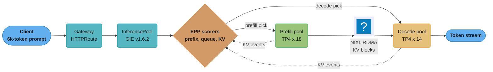
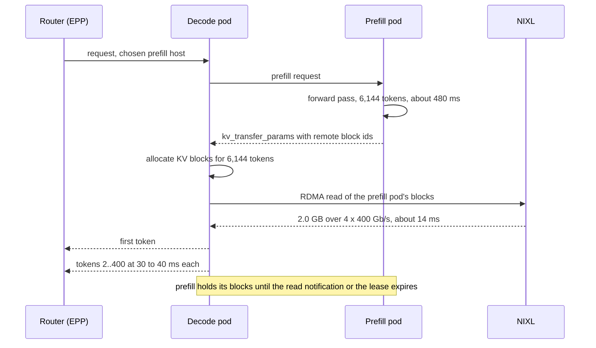
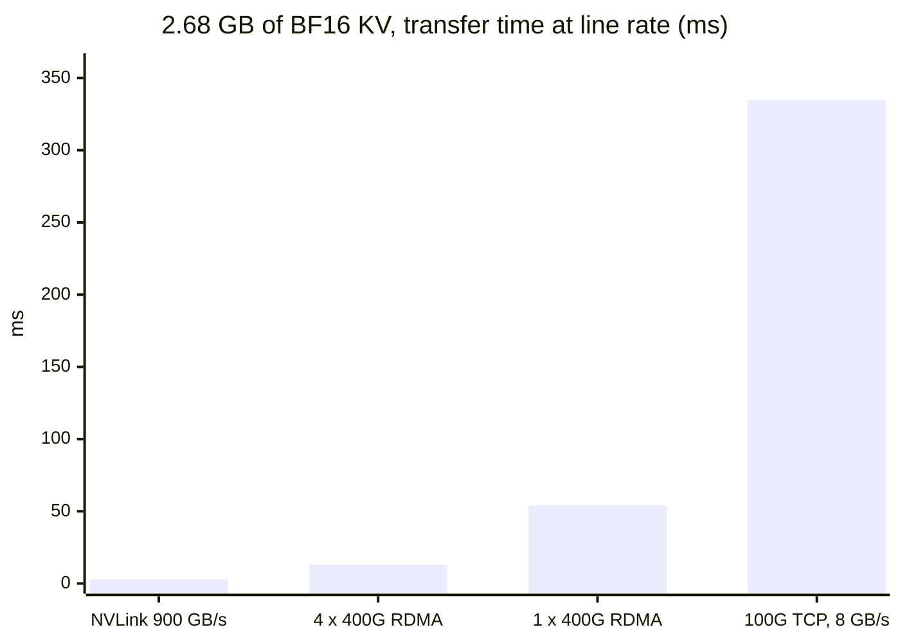
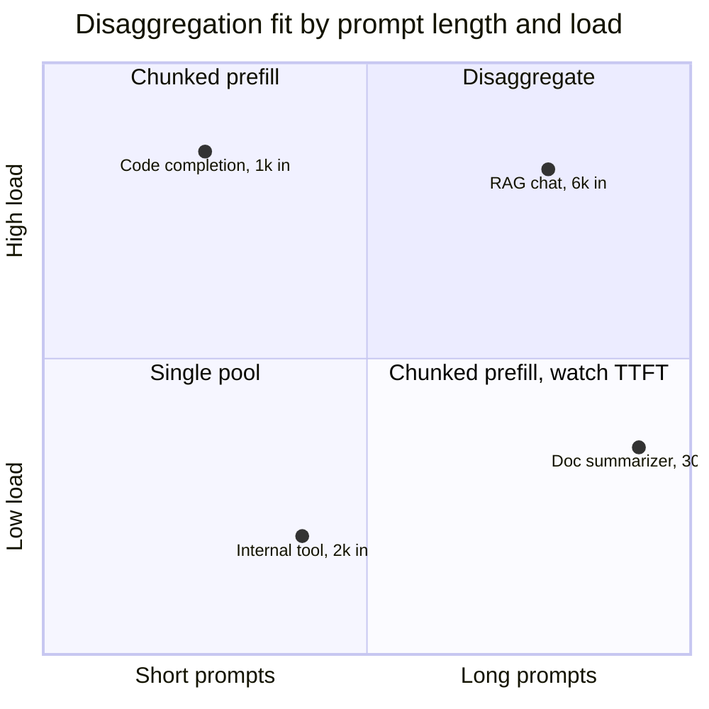

# Distributed Inference and Disaggregation

> **Version anchor (2026-10-18).** vLLM v0.32.0 (2026-10-18). SGLang v0.5.21 (2026-10-02).
> LeaderWorkerSet v1.0.0 (2026-10-16), which reworks DisaggregatedSet rollouts and adds
> independently scaled sub-roles. Gateway API Inference Extension (GIE) v1.6.2 (2026-09-17); in
> v1.6.0 the Endpoint Picker (EPP), Body-Based Routing (BBR), `InferenceObjective` and
> `InferenceModelRewrite` moved to llm-d, and `InferencePool` plus the conformance suite stayed.
> llm-d v0.10.0 (2026-09-29), CNCF Sandbox since 2026-03-12. NVIDIA Dynamo v1.5.1 (2026-10-07);
> the v1.5.0 notes deprecate KVBM with removal targeted for v1.7.0. AIBrix v0.8.0 (2026-10-13).
> NIXL v1.5.0 (2026-09-30). Mooncake v0.3.13.post1 (2026-08-31). LMCache publishes only nightly
> pre-releases, so it is named without a version. Every version claim below is checked against
> this anchor.

A model that does not fit on one GPU, or a fleet that cannot meet a first-token SLO and a
per-token SLO at the same time, needs inference spread over many GPUs. This page covers the
operating side of that: which parallelism goes on which link, how multi-node replicas are
deployed and restarted as one unit on Kubernetes, when splitting prefill from decode pays and
when it costs more than it saves, how KV cache moves between GPUs, and how a router uses
prefix-cache state to pick a replica.

---

## 1. Concept Overview

LLM inference has two phases with opposite resource profiles. **Prefill** runs the whole prompt
through the model in one forward pass. It is compute-bound: a 70B dense model spends about
2 x 70e9 = 1.4e11 FLOPs per prompt token, so an 8,192-token prompt is about 1.15e15 FLOPs.
**Decode** produces one token per step for every sequence in the batch. It is memory-bandwidth
bound: each step reads all 140 GB of BF16 weights plus every live sequence's KV cache, to
produce one token per sequence.

Two problems push inference past one GPU.

| Problem | Example | Answer |
|---|---|---|
| The weights do not fit | 405B in BF16 is 810 GB; 8 x H100 80 GB is 640 GB | Model parallelism: tensor (TP), pipeline (PP), expert (EP) |
| The weights fit, but the SLOs fight | Long prefills stall decode steps, so inter-token latency (ITL) spikes | Prefill/decode (PD) disaggregation, or chunked prefill |
| One replica is not enough throughput | 40 requests/s of 6k-token prompts | Data parallelism (DP): more replicas behind a router |

These compose. DeepSeek's published V3/R1 serving layout (2025-03-01) runs prefill units of
4 nodes with EP32 and decode units of 18 nodes with EP144, on H800s, with attention in data
parallel. Each decode GPU holds 2 routed experts and 1 shared expert. That is TP, EP, DP and PD
disaggregation in one fleet.

The serving stack has four layers, and the products in this area each own one or two of them.

| Layer | Job | Products (versions in the anchor) |
|---|---|---|
| Engine | Runs the model sharded over GPUs, owns the KV cache | vLLM, SGLang, TensorRT-LLM |
| KV transport | Moves KV blocks between GPUs, hosts and storage | NIXL, Mooncake Transfer Engine, LMCache, vLLM KV connectors |
| Workload controller | Starts, scales and restarts a multi-pod replica as one unit | LeaderWorkerSet, DisaggregatedSet, AIBrix StormService, Dynamo Grove |
| Router | Picks a replica per request from cache and load state | GIE `InferencePool` with an EPP (llm-d router), Dynamo KV router, AIBrix gateway, `sglang_router` |

**Not here.** The KV memory formula, GQA and MLA savings, eviction (H2O, SnapKV,
StreamingLLM) and the theory of offload tiers live in
[KV Cache Optimization](../../llm/inference_and_decoding/kv_cache_optimization.md). Dynamo's
product internals (KV router, planner, Grove, `trtllm-serve`) live in
[Dynamo and the NVIDIA Serving Stack](../../technologies/nvidia_triton_inference_server/dynamo_and_the_nvidia_serving_stack.md).
MoE routing math lives in [Mixture of Experts](../../llm/mixture_of_experts/mixture_of_experts.md).
Engine flags, the vLLM scheduler, and the chunked-prefill versus PD concept with the DistServe,
Splitwise and Mooncake background live in
[vLLM Deep Dive](../../llm/vllm_deep_dive/vllm_deep_dive.md). The `InferencePool` fields,
`failureMode`, the Endpoint Picker Protocol and the GIE v1.6.0 split are in
[Gateway API and the Inference Extension](../../technologies/envoy_proxy/gateway_api_and_inference_extension.md).
The platform layer above the
engines (KServe, Ray Serve, AIBrix as a platform) is
[Model Serving Platforms](../model_serving_platforms/model_serving_platforms.md); how to
benchmark TTFT, ITL and goodput is
[Inference Engine Operations and Benchmarking](../inference_engine_operations_and_benchmarking/inference_engine_operations_and_benchmarking.md);
scaling prefill and decode pools on load signals is
[Inference Autoscaling and Capacity Planning](../inference_autoscaling_and_capacity_planning/inference_autoscaling_and_capacity_planning.md);
the RDMA fabric under KV transfer is
[AI Networking and Storage Fabric](../ai_networking_and_storage_fabric/ai_networking_and_storage_fabric.md);
the API layer in front of a model server is [Serving AI Workloads](../../backend/serving_ai_workloads/serving_ai_workloads.md).

---

## 2. Intuition

**One-line analogy.** A restaurant where one cook both preps a 40-plate banquet and plates
single orders makes every single order wait behind the banquet; disaggregation gives the
banquet its own prep kitchen and walks the finished trays across to the line.

**Mental model.** Treat each parallelism as a bet about which link is fast enough.

- TP sends two all-reduces per layer. Put it only where NVLink is: inside one node, or inside
  one NVL72 rack.
- PP sends one activation tensor per stage boundary. It tolerates InfiniBand or RoCE between
  nodes.
- EP sends tokens to experts and back (all-to-all) twice per MoE layer. It needs RDMA and
  kernels built for it (DeepEP and the engines' all-to-all backends).
- DP sends nothing between replicas at inference time. It needs a router.
- PD disaggregation sends the whole prompt's KV cache once per request, from a prefill GPU to a
  decode GPU. For a 70B model that is 320 KiB per token.

**Why it matters.** A wrong placement does not fail; it serves correct tokens at a fraction of
the speed. TP16 across two nodes, PD over TCP and round-robin over prefix caches all do this.

**Key insight.** Disaggregation is a latency-SLO tool, not a throughput tool. Its gain is
goodput: the request rate a fleet serves while holding both TTFT and ITL targets. On a workload
with short prompts, or with no RDMA path between pools, it adds a transfer and a second queue
and loses.

---

## 3. Core Principles

1. **Match the parallelism to the link.** TP inside the NVLink domain, PP or EP across nodes,
   DP everywhere. The bandwidth gap is about 18x: 900 GB/s NVLink per H100 against 50 GB/s for
   one 400 Gb/s NIC.
2. **A multi-pod replica is one failure unit.** If one rank of an 8 x 2 TP/PP group dies, the
   other 15 ranks hang in a collective. The controller must restart the group, not the pod.
3. **Prefill and decode scale on different signals.** Prefill load is prompt tokens per second
   and queue time to first token. Decode load is concurrent sequences and KV utilization. One
   HPA on GPU utilization fits neither.
4. **KV cache is state that the router must see.** A request routed to a replica that holds its
   prefix skips that part of prefill. Routing that ignores cache state divides the hit rate by
   the replica count.
5. **Prefill and decode must agree on everything that shapes the KV cache:** model revision,
   KV dtype, block size and attention backend. A skew during a rollout gives wrong tokens.

---

## 4. Types / Architectures / Strategies

### 4.1 Parallelism for inference

| Strategy | What is split | Traffic per forward pass | Link it needs | Latency effect |
|---|---|---|---|---|
| Tensor parallel (TP) | Each weight matrix, by column or row | 2 all-reduces per layer | NVLink or NVSwitch | Lowers per-token latency, up to the all-reduce cost |
| Pipeline parallel (PP) | Layers into stages | 1 activation send per stage boundary | IB or RoCE is enough | No per-token gain; adds a hop per stage |
| Expert parallel (EP) | MoE experts across GPUs | 2 all-to-alls per MoE layer | RDMA, DeepEP-class kernels | Frees memory for KV; batches per expert grow |
| Data parallel (DP) | Whole replicas | None between replicas | Router only | None; adds throughput |
| DP attention | Attention by request, MoE by expert | All-to-all at the MoE boundary | RDMA | Avoids duplicating MLA's single latent KV head |
| Context parallel (CP) | One long sequence across GPUs | Ring or all-gather of KV | NVLink | Cuts TTFT for very long prompts |

**Wide EP** is EP spread across many nodes, so each GPU holds a few experts and has most of its
memory left for KV cache. DeepSeek's decode units run EP144: 256 routed experts plus 32
redundant copies over 144 GPUs, 2 routed experts per GPU. The SGLang team reproduced the
design on 12 H100 nodes in May 2025 (section 7).

### 4.2 Deployment shapes

| Shape | When | Controller |
|---|---|---|
| Single-GPU replicas, DP only | Model fits one GPU with room for KV | Deployment |
| Single-node TP replicas | 70B BF16 on 4 or 8 GPUs | Deployment, one pod with 4 or 8 GPUs |
| Multi-node replica (TP x PP, or wide EP) | 405B BF16, DeepSeek-class MoE | LeaderWorkerSet, one group per replica |
| Aggregated with chunked prefill | Mixed traffic, moderate prompts | Any of the above |
| Disaggregated xPyD | Long prompts, strict TTFT and ITL | DisaggregatedSet, StormService, Dynamo graph, llm-d guide charts |

`xPyD` names the pool ratio: 1P3D is one prefill instance per three decode instances.

### 4.3 Disaggregation stacks

| Stack | Pool controller | KV transport | Router |
|---|---|---|---|
| llm-d | LWS and DisaggregatedSet, Helm guides | vLLM `NixlConnector`; Mooncake PD guide | llm-d router EPP behind a GIE `InferencePool`, plus a disagg sidecar on decode pods |
| NVIDIA Dynamo | Grove, Dynamo operator | NIXL | Dynamo KV router with pluggable worker selection (v1.5.0) |
| AIBrix | StormService (RoleSets) | Engine connectors | AIBrix gateway, PD score policy "conductor" added in v0.8.0 |
| SGLang native | Any | Mooncake or NIXL (`--disaggregation-transfer-backend`) | `sglang_router --pd-disaggregation` |
| vLLM native | Any | `NixlConnector`, `MooncakeConnector`, `LMCacheConnectorV1`, `MultiConnector` | A proxy you run, or one of the routers above |

---

## 5. Architecture Diagrams

### Parallelism placement on two 8-GPU nodes

```
            node A (NVSwitch, 900 GB/s per GPU)       node B (NVSwitch, 900 GB/s per GPU)
            +---+---+---+---+---+---+---+---+          +---+---+---+---+---+---+---+---+
GPU         | 0 | 1 | 2 | 3 | 4 | 5 | 6 | 7 |          | 0 | 1 | 2 | 3 | 4 | 5 | 6 | 7 |
            +---+---+---+---+---+---+---+---+          +---+---+---+---+---+---+---+---+
TP16        |       <-- all-reduce x 2 per layer, 126 layers, 252 x over IB -->        |  ✗
TP8 x PP2   |  <- TP8 all-reduce, NVLink -> |-- act -> |  <- TP8 all-reduce, NVLink -> |  ✓
            |      layers 0-62, stage 0     |  1 send  |     layers 63-125, stage 1    |
EP16 + DP   |   experts 0-127, 16 per GPU   |<- a2a -> |    experts 128-255, 16/GPU    |  ✓ MoE
                                     inter-node link: 8 x 400 Gb/s = 400 GB/s per node
```

Llama 3.1 405B has 126 layers. TP16 puts 252 all-reduces per forward pass on the 50 GB/s
per-GPU IB path instead of the 900 GB/s NVLink path. TP8 x PP2 keeps every all-reduce inside a
node and sends one activation tensor across the link per stage boundary.

### Disaggregated request path



The EPP picks a decode pod and a prefill pod per request; the decode pod reads the prompt's KV
from the prefill pod's GPU memory over RDMA through NIXL. KV events from both pools keep the
router's prefix scores current.

### Handoff sequence



This is the vLLM `NixlConnector` flow that llm-d runs: prefill computes first and returns its
block ids, and decode pulls the KV. Prefill holds the blocks for `kv_lease_duration` (default
30 s, extended by heartbeats while decode has the request queued). A 14 ms transfer is a 3% tax
on a 480 ms prefill.

### Colocated vs disaggregated inter-token latency

```
Colocated, one TP4 replica, 2,048-token prefill chunks
step:    1    2    3    4    5    6    7    8    9   10
ms:     30   30  190   30   30  190  190   30   30  190     p95 ITL 190 ms   ✗ SLO 60 ms
                 ^P             ^P   ^P                ^P    P = step carries a prefill chunk

Colocated, 512-token chunks
ms:     30   30   70   30   70   30   70   30   30   70     p95 ITL 70 ms    ✗ and TTFT x4

Disaggregated, decode pool never runs prefill
ms:     32   32   33   32   32   33   32   32   33   32     p95 ITL 33 ms    ✓
```

A 2,048-token chunk on a 70B TP4 replica costs about 160 ms of compute and lands inside a
30 ms decode step. Smaller chunks cut the spike but stretch each prompt over 4x more steps,
which moves the pain to TTFT. Disaggregation removes prefill from the decode GPUs entirely.

### KV transfer time for one 8,192-token prompt on Llama 3.1 70B



At 320 KiB per token, 8,192 tokens is 2.68 GB. Over one TCP path the transfer costs 335 ms,
more than half the 645 ms prefill it was meant to isolate. Over four RDMA rails it costs 13 ms
at line rate, or about 19 ms at the 70% efficiency used in section 6.5.

### When disaggregation pays



High load with long prompts is where prefill interference breaks the ITL SLO and where a
separate pool stays busy. Short prompts at any load are served well by chunked prefill.

---

## 6. How It Works - Detailed Mechanics

### 6.1 Memory arithmetic that picks the parallelism

KV bytes per token for the models used on this page (the formula and its GQA and MLA variants
are in [KV Cache Optimization](../../llm/inference_and_decoding/kv_cache_optimization.md)):

| Model | Layers | KV heads x dim | KV per token (BF16) | Weights (BF16) |
|---|---|---|---|---|
| Llama 3.1 8B | 32 | 8 x 128 | 128 KiB | 16 GB |
| Llama 3.1 70B | 80 | 8 x 128 | 320 KiB | 140 GB |
| Llama 3.1 405B | 126 | 8 x 128 | 504 KiB | 810 GB |
| DeepSeek-V3 (MLA) | 61 | 1 latent, 512 + 64 | about 69 KiB | 671B params, FP8 about 700 GB |

Placement for 70B on H100 80 GB:

- TP2: 160 GB of HBM, 140 GB of weights, under 20 GB for KV after activations and CUDA graphs.
  At 320 KiB per token that is about 50k tokens of cache: eight 6k-token requests. Too few.
- TP4: 320 GB, about 160 GB for KV, about 500k tokens. This is the usual unit.

For 405B BF16 the weights exceed one 8 x H100 node, so the choices are FP8 on one node
(405 GB of weights, about 200 GB for KV), BF16 on one 8 x H200 node (1,128 GB of HBM), or BF16
on two H100 nodes with TP8 x PP2. Pick FP8 or H200 before PP2 when the quality evals allow it:
one node has no inter-node failure modes.

For MLA models (DeepSeek-V3, Kimi K2) the KV cache has one latent head. TP over attention
cannot split one head, so every TP rank stores the same latent cache. That is why these models
run attention in DP (each rank owns different requests) and MoE in EP. SGLang calls this DP
attention; in vLLM, set `--data-parallel-size` with `--enable-expert-parallel`.

### 6.2 Multi-node replicas with LeaderWorkerSet

A 405B BF16 replica on two nodes is one leader pod and one worker pod that must start, stay up
and restart together.

Broken. A team deployed the two ranks as a StatefulSet with two replicas. When node B's pod was
evicted for a kernel upgrade, the StatefulSet recreated only that pod. The leader on node A sat
in an NCCL collective waiting for the old rank, its readiness probe on `/health` still passed
(the HTTP server was alive), and the Service kept sending traffic to a replica that answered
nothing for 41 minutes until the NCCL timeout fired.

Fixed with an LWS group, group restart and a readiness probe that runs a real generation:

```yaml
apiVersion: leaderworkerset.x-k8s.io/v1
kind: LeaderWorkerSet
metadata:
  name: llama-405b
spec:
  replicas: 2                       # two independent 16-GPU replicas
  startupPolicy: LeaderCreated
  leaderWorkerTemplate:
    size: 2                         # pods per group: 1 leader + 1 worker
    restartPolicy: RecreateGroupOnPodRestart
    leaderTemplate:
      spec:
        containers:
          - name: vllm
            image: registry.example.com/vllm@sha256:3f9a...
            command: ["sh", "-c"]
            args:
              - ray start --head --port=6379 &&
                vllm serve /models/llama-3.1-405b
                  --tensor-parallel-size 8
                  --pipeline-parallel-size 2
                  --distributed-executor-backend ray
            resources:
              limits: {nvidia.com/gpu: 8}
            readinessProbe:
              exec:
                command: ["/bin/probe-generate", "--max-tokens", "1"]
              periodSeconds: 15
              timeoutSeconds: 10
    workerTemplate:
      spec:
        containers:
          - name: vllm
            image: registry.example.com/vllm@sha256:3f9a...
            command: ["sh", "-c"]
            args:
              - ray start --address=$(LWS_LEADER_ADDRESS):6379 --block
            resources:
              limits: {nvidia.com/gpu: 8}
```

`RecreateGroupOnPodRestart` deletes and recreates every pod in the group when any one restarts,
so no surviving rank waits on a dead peer. LWS injects `LWS_LEADER_ADDRESS`, `LWS_GROUP_SIZE`
and `LWS_WORKER_INDEX` into each pod. Pair the group with exclusive topology placement (both
pods in one rack or one IB leaf) so PP traffic stays on one switch tier; the device and
topology side is in
[GPU Scheduling and Inference Ops](../../devops/ml_platform_and_gpu_infrastructure/gpu_scheduling_and_inference_ops.md).

### 6.3 DisaggregatedSet in LWS v1.0.0

A disaggregated deployment has at least two roles, prefill and decode, each of which may itself
be a multi-pod LWS group. DisaggregatedSet predates v1.0.0: it generates one child
LeaderWorkerSet per role and rolls the roles together. From the v1.0.0 release notes:

- A role can be split into sub-roles that share one LeaderWorkerSet and have their own
  rollout budget, routing labels, scaler and status.
- `spec.scalingPolicy.duringRollout: AdvanceRollout` opts in to scaling while a rollout runs.
- A role with no `rollingUpdateConfiguration` now rolls with `maxSurge: 0` and
  `maxUnavailable: 1`, as LeaderWorkerSet does. Set `maxSurge: 1` and `maxUnavailable: 0` to
  bring the new revision up before the old one drains.
- Status reports `desiredReplicas` per role and sub-role, and the controller reports an error
  when two owned LeaderWorkerSets claim the same slice, revision and role.
- v1.0.0 drops slice-less LeaderWorkerSets from DisaggregatedSets created on v0.9.x; such an
  object must complete one rollout on v0.10.x or v0.11.x before the upgrade.

The point of the object is the rollout: two Deployments roll on two clocks, which is how version
skew between the pools happens (section 10). Read the API reference before writing one.

### 6.4 Prefill/decode disaggregation in vLLM and SGLang

vLLM moves KV through a connector named in `--kv-transfer-config`. The vLLM docs list
`NixlConnector`, `MooncakeConnector`, `LMCacheConnectorV1`, `LMCacheMPConnector`,
`OffloadingConnector`, `MultiConnector`, `FlexKVConnectorV1`, the ROCm-only `MoRIIOConnector`
and an `ExampleConnector`.

```bash
# prefill pods
vllm serve /models/llama-3.3-70b --tensor-parallel-size 4 \
  --kv-transfer-config '{"kv_connector":"NixlConnector","kv_role":"kv_producer"}'

# decode pods, same image digest
vllm serve /models/llama-3.3-70b --tensor-parallel-size 4 \
  --kv-transfer-config '{"kv_connector":"NixlConnector","kv_role":"kv_consumer"}'
```

`kv_both` is deprecated for `NixlConnector`; set the role per pool. llm-d's disagg sidecar on
decode pods sends the prefill leg to the pod the EPP chose, then hands the returned block ids
to the local decode engine.

SGLang starts each pool with a mode flag and puts its own router in front:

```bash
python -m sglang.launch_server --model-path /models/llama-3.3-70b --tp 4 \
  --disaggregation-mode prefill --disaggregation-transfer-backend nixl --port 30000

python -m sglang.launch_server --model-path /models/llama-3.3-70b --tp 4 \
  --disaggregation-mode decode --disaggregation-transfer-backend nixl --port 30001

python -m sglang_router.launch_router --pd-disaggregation \
  --prefill http://prefill-0:30000 --decode http://decode-0:30001 --port 8000
```

With the Mooncake backend, `--disaggregation-ib-device mlx5_0,mlx5_1` names the RDMA NICs, or
takes a per-GPU JSON map so each GPU sends over the NIC on its own PCIe switch. With NIXL,
`SGLANG_DISAGGREGATION_NIXL_BACKEND` selects UCX (default), LIBFABRIC or another installed NIXL
plugin. For AWS EFA, the SGLang docs describe an EFA build of Mooncake.

### 6.5 KV transfer budget

```python
def kv_bytes_per_token(layers: int, kv_heads: int, head_dim: int, elem_bytes: int = 2) -> int:
    return 2 * layers * kv_heads * head_dim * elem_bytes


def transfer_ms(prompt_tokens: int, per_token: int, link_gbps: float, efficiency: float = 0.7) -> float:
    gb = prompt_tokens * per_token / 1e9
    return gb / (link_gbps / 8 * efficiency) * 1000


def disaggregation_pays(prefill_ms: float, xfer_ms: float, max_tax: float = 0.10) -> bool:
    return xfer_ms <= prefill_ms * max_tax


per_tok = kv_bytes_per_token(80, 8, 128)                  # Llama 3.1 70B: 327,680 bytes
assert per_tok == 327_680
rdma = transfer_ms(6_144, per_tok, 4 * 400)               # 4 rails of 400 Gb/s
tcp = transfer_ms(6_144, per_tok, 100)
assert round(rdma) == 14 and round(tcp) == 230
assert disaggregation_pays(prefill_ms=480, xfer_ms=rdma)
assert not disaggregation_pays(prefill_ms=480, xfer_ms=tcp)
assert not disaggregation_pays(prefill_ms=40, xfer_ms=transfer_ms(512, per_tok, 400))
```

The last line is the short-prompt case: 512 tokens prefill in about 40 ms, and even a 5 ms
transfer plus a second queue hop is a poor trade. Dynamo v1.5.0 added a conditional
disaggregation bypass that sends short requests straight to decode for this reason.

Aggregate bandwidth is the second check: request rate x KV per request against NIC capacity.
Section 14 works it for 40 requests/s.

### 6.6 Choosing the P:D ratio

Size each pool from its own bottleneck, then check the ratio against traffic mix.

```
prefill instances = prompt tokens/s x (1 - prefix hit rate)
                    / prefill tokens/s per instance / target util
decode instances  = concurrent sequences
                    / max batch per instance at the ITL SLO / target util
```

For 40 requests/s, 6,144-token prompts, a 35% prefix hit rate, 12.7k prefill tokens/s per
70B TP4 instance and a 0.7 utilization target: 40 x 6,144 x 0.65 / 12,700 / 0.7 = 18 prefill
instances. With 400 output tokens at 35 ms each, a request lives 14 s in decode, so 40 x 14 =
560 concurrent sequences; at 64 sequences per instance under a 60 ms ITL target and 0.7
utilization that is 12.5, so 13, plus one spare for a failed group: 14. The ratio is about 9P7D in units of
TP4.

The ratio drifts with traffic: doubling average output length doubles decode demand and leaves
prefill unchanged. Scale the pools on separate signals (prefill queue time, decode KV utilization) as covered in
[Inference Autoscaling and Capacity Planning](../inference_autoscaling_and_capacity_planning/inference_autoscaling_and_capacity_planning.md).

### 6.7 Prefix-aware routing with GIE and the llm-d router

GIE keeps the `InferencePool` API and the conformance suite. Since v1.6.0 the EPP that does the
scoring is released by llm-d. The pool object and the EPP protocol are covered in
[Gateway API and the Inference Extension](../../technologies/envoy_proxy/gateway_api_and_inference_extension.md);
this section covers what the scorer needs to know about the KV cache.

The EPP scores every candidate pod and returns one to the gateway through Envoy ext_proc. Two
ways to know what each pod has cached:

| Mode | Source of truth | Error | Cost |
|---|---|---|---|
| Approximate | The router's own table of block hashes it sent to each pod | Wrong after evictions and restarts | No engine changes |
| Precise | Pods publish KV events (block stored, block removed, all blocks cleared) | Lag of one event batch | Engine flag (`--kv-events-config` in vLLM), an event bus, an index |

A minimal scorer shows the shape:

```python
import hashlib

BLOCK = 16


def block_hashes(tokens: list[int]) -> list[str]:
    out, parent = [], ""
    for i in range(0, len(tokens) - len(tokens) % BLOCK, BLOCK):
        parent = hashlib.sha256((parent + str(tokens[i:i + BLOCK])).encode()).hexdigest()
        out.append(parent)
    return out


def pick(tokens: list[int], pods: dict[str, dict], w_prefix=2.0, w_queue=1.0, w_kv=1.0) -> str:
    hashes = block_hashes(tokens)

    def prefix_hit(cached: set[str]) -> float:
        n = 0
        for h in hashes:
            if h not in cached:
                break
            n += 1
        return n / max(len(hashes), 1)

    def score(p: dict) -> float:
        return (w_prefix * prefix_hit(p["cached"])
                - w_queue * p["queue"] / 32
                - w_kv * p["kv_util"])

    return max(pods, key=lambda name: score(pods[name]))


toks = list(range(64))
pods = {
    "a": {"cached": set(block_hashes(toks)), "queue": 30, "kv_util": 0.95},
    "b": {"cached": set(block_hashes(toks[:32])), "queue": 2, "kv_util": 0.40},
    "c": {"cached": set(), "queue": 0, "kv_util": 0.10},
}
assert pick(toks, pods) == "b"
```

Pod `a` holds the whole prefix but is near full; pod `b` holds half of it with an empty queue
and wins. Hashes chain on the parent block, so a match must be a prefix, which is how engine
prefix caches key their blocks. The block size must equal the engine's KV block size or every
hash misses.

### 6.8 Wide EP for MoE decode

```bash
# node 1 of 2, 16-way DP attention with EP across both nodes
vllm serve deepseek-ai/DeepSeek-V3-0324 \
  --all2all-backend deepep_low_latency \
  --tensor-parallel-size 1 --enable-expert-parallel \
  --data-parallel-size 16 --data-parallel-size-local 8 \
  --data-parallel-address 10.0.0.10 --data-parallel-rpc-port 13345 \
  --api-server-count 8 \
  --enable-eplb --eplb-config '{"num_redundant_experts":32}'
# node 2 adds --data-parallel-start-rank 8 --headless
```

The vLLM docs pair `deepep_high_throughput` with multi-node prefill and `deepep_low_latency`
(CUDA-graph compatible) with multi-node decode. EP size is TP x DP, here 16. The expert
parallel load balancer (EPLB) watches per-expert token counts and places redundant copies of
hot experts; without it, the GPU holding the busiest expert sets the step time for all 16.

### 6.9 Tiered KV offload

The vLLM `OffloadingConnector` spills evicted GPU blocks to host memory and reloads them on a
prefix hit:

```bash
vllm serve /models/llama-3.3-70b --tensor-parallel-size 4 \
  --kv-transfer-config '{"kv_connector":"OffloadingConnector","kv_role":"kv_both",
    "kv_connector_extra_config":{"block_size":64,"cpu_bytes_to_use":400000000000}}'
```

`MultiConnector` chains connectors, so one pod can offload to host DRAM and also take part in
NIXL transfers. llm-d v0.10.0 deprecated its own file-system connector because the function was
merged upstream into `OffloadingConnector`. Offload pays when the same prefixes return after
they would have been evicted: multi-turn chat with long histories, agent loops that resend a
growing transcript, and shared RAG documents. It does not pay for one-shot prompts with no
reuse; the PCIe write is pure overhead there.

Reload cost check: a 4,096-token prefix on 70B is 1.34 GB. Host to GPU over PCIe Gen5 x16 at
about 50 GB/s effective, split over 4 TP ranks, is about 7 ms against about 320 ms to
recompute. DeepSeek's on-disk KV cache (section 7) rests on the same reload-versus-recompute
ratio.

---

## 7. Real-World Examples

- **DeepSeek V3/R1 serving (published 2025-03-01).** Prefill units: 4 nodes, EP32 for routed experts,
  DP32 for MLA and shared experts, 9 routed experts and 1 shared expert per GPU. Decode units:
  18 nodes, EP144, 2 routed experts per GPU. 32 redundant routed experts in both. About 73.7k
  input tokens/s per H800 node in prefill (including cache hits) and 14.8k output tokens/s per
  node in decode. Over the 24 hours to 2025-02-28 12:00 (UTC+8): peak of 278 nodes for both
  models, average 226.75. 56.3% of input tokens came from the on-disk KV cache.
- **Moonshot AI, Mooncake.** Mooncake started as Kimi's serving platform: a KV-cache-centric
  disaggregated design with a Transfer Engine and a distributed KV store over DRAM and SSD. The
  project reports that the design let Kimi handle 75% more requests within SLOs, and that Kimi
  K2 ran PD-disaggregated on 128 H200s at 224k prefill tokens/s and 288k decode tokens/s
  (July 2025). The integrations listed in its README include vLLM, SGLang, TensorRT-LLM,
  LMCache, Dynamo and llm-d.
- **SGLang large-scale EP (2025-05-05).** DeepSeek-V3 with PD disaggregation on 12 H100 nodes
  (96 GPUs): 52.3k input and 22.3k output tokens/s per node at 2,000-token inputs. Separate
  evaluations ran prefill on EP32 (4 nodes), at 57.7k, 54.5k and 50.3k tokens/s per node for
  1K, 2K and 4K prompts, and decode on EP72 (9 nodes). The team put the cost at about $0.20 per
  million output tokens.
- **Character.AI.** Its 2024 inference write-up reported a 95% cache rate for conversation
  prefixes by pinning sessions to the servers that held their KV cache, on top of MQA and
  cross-layer KV sharing that shrank the cache itself.

---

## 8. Tradeoffs

### Aggregated vs disaggregated

| Concern | Aggregated with chunked prefill | Disaggregated xPyD |
|---|---|---|
| ITL under long prompts | Spikes unless chunks are small | Flat |
| TTFT | Grows as chunks shrink | Prefill time plus transfer |
| Fabric | None between replicas | RDMA between pools; TCP usually loses |
| Pools to size and scale | One | Two, on different signals |
| Rollout | One Deployment | Coordinated (DisaggregatedSet, StormService, Dynamo graph) |
| Failure modes | Pod crash | Pod crash, transfer timeout, version skew, ratio drift |
| Fits | Prompts under about 2k tokens, moderate load | Long prompts, high load, strict SLOs |

---

## 9. When to Use / When NOT to Use

**Use model parallelism when:**
- The weights plus about 40% headroom for KV do not fit one GPU: TP inside NVLink first.
- The model does not fit one node even after FP8, or it is a large MoE where EP frees HBM for
  KV, and the team can treat a node loss as a replica loss: PP or wide EP across nodes.

**Use PD disaggregation when:**
- Median prompts exceed about 2k tokens and load is high enough to keep a prefill pool busy.
- Both a TTFT and an ITL SLO apply and chunked prefill cannot meet both at an acceptable GPU
  count.
- RDMA (IB, RoCE or EFA) connects the pools, and the KV transfer is under about 10% of prefill
  time.

**Do NOT disaggregate when:**
- Prompts are short, or the prefix hit rate is so high that little prefill remains.
- The fleet is a handful of replicas; two pools of two make each pool's failure a 50% capacity
  loss.
- Pools would talk over TCP or across availability zones.
- Nobody owns the ratio. A stale ratio leaves one pool idle while the other queues.

---

## 10. Common Pitfalls

**TP16 across two nodes.** A team serving 405B BF16 set `--tensor-parallel-size 16` over two
H100 nodes because "TP is the low-latency option". Decode ITL was 95 ms against 38 ms for the
same model in FP8 on one node with TP8. The all-reduces crossed IB 252 times per token. Fix:
TP8 x PP2, or FP8 on one node after an eval check.

**Disaggregation over the pod network.** A platform enabled PD on a 70B chat model with the KV
transfer running over the default CNI at 25 Gb/s per pod. TTFT p95 rose from 1.1 s to 1.9 s
while ITL improved, and the change was rolled back as "disaggregation does not work". The KV
path never used RDMA. Fix: RDMA NICs exposed to the pods (SR-IOV or host networking through the
network operator), pools placed in one rack, and a transfer-time panel. Pod networking options
are in [Kubernetes Networking](../../devops/kubernetes_networking/kubernetes_networking.md).

**Version skew between prefill and decode.** A rolling update moved the decode Deployment to an
FP8-KV image while the prefill Deployment still wrote BF16 KV. For 12 minutes every request
that crossed versions decoded from a cache it read as the wrong dtype. Output was fluent and
wrong; no request failed. Fix: roll both roles as one object (DisaggregatedSet or
StormService), put the model digest and KV dtype in routing labels so the EPP pairs only
matching pods, and add a canary probe that compares a fixed prompt's output across P/D pairs.

**Round-robin over prefix caches.** A support bot with a 3,000-token system prompt and four
replicas behind a ClusterIP Service saw a 26% prefix hit rate, near 1/4. Moving to an
`InferencePool` with a prefix scorer took it to 93% and cut TTFT p50 from 620 ms to 140 ms on
the same GPUs.

**Prefix scorer as the only scorer.** Later, one tenant's 8,000-token template took 70% of
traffic, all of it sent to the pod holding the template; its queue reached 200 as three idled. Fix: weight the queue and KV
utilization scorers so a full pod loses to a half-warm idle one.

**Fixed P:D ratio.** A 2P6D layout chosen at launch for 300-token answers went stale when a
reasoning model raised mean output to 2,400 tokens. Decode KV utilization sat at 98% and
preempted sequences, while prefill pods idled at 15%. Fix: scale the pools on separate signals
and alert on the ratio of prefill queue time to decode KV utilization.

---

## 11. Technologies & Tools

| Tool | Role | Notes |
|---|---|---|
| vLLM | Inference engine | v0.32.0; TP, PP, DP, EP flags; KV connectors via `--kv-transfer-config` |
| SGLang | Inference engine | v0.5.21; `--disaggregation-mode`, DP attention, `sglang_router` |
| TensorRT-LLM | NVIDIA inference engine | Stable v1.2.1; disaggregated serving in `trtllm-serve` and through Dynamo |
| LeaderWorkerSet | Kubernetes API for multi-pod replicas | v1.0.0; group restart, DisaggregatedSet with sub-roles |
| Gateway API Inference Extension | `InferencePool` API and conformance | v1.6.2; EPP and BBR released by llm-d since v1.6.0 |
| llm-d | Kubernetes-native distributed inference | v0.10.0; router EPP, disagg sidecar, wide-EP guides; CNCF Sandbox |
| NVIDIA Dynamo | Distributed serving framework | v1.5.1; KV router, Grove, NIXL; KVBM deprecated in v1.5.0 |
| AIBrix | vLLM control plane | v0.8.0; StormService, gateway with PD score policy |
| NIXL | KV and tensor transfer library | v1.5.0; UCX, LIBFABRIC, POSIX, GDS, object-store and Mooncake backends |
| Mooncake | Transfer Engine and KV store | v0.3.13.post1; DRAM and SSD tiers, used by SGLang PD and HiCache |
| LMCache | KV cache layer for vLLM | Nightly pre-releases only; CPU, disk and remote tiers |
| DeepEP | MoE all-to-all kernels | Backs vLLM `deepep_high_throughput` and `deepep_low_latency` |
| NCCL | Collectives for TP and PP | All-reduce and send/recv between ranks |
| Ray | Multi-node executor | 2.59.0; vLLM `--distributed-executor-backend ray` |
| KServe | Platform API | `LLMInferenceService` composes with llm-d |

---

## 12. Interview Questions with Answers

**Q: Why is TP16 across two 8-GPU nodes slower than TP8 x PP2 for the same model?**
**Short:** TP does two all-reduces per layer, so TP16 pushes hundreds of collectives per token over 50 GB/s IB instead of 900 GB/s NVLink.

Tensor parallelism splits every weight matrix and reduces the partial results after the
attention and MLP blocks, two all-reduces per layer. For Llama 3.1 405B that is 252 per forward
pass. Within a node they ride NVSwitch at 900 GB/s per GPU; across nodes each one waits on a
400 Gb/s NIC and its latency. PP2 sends one activation tensor across the link per stage, once
per forward pass. Keep TP inside the NVLink domain and use PP or EP to cross nodes.

**Q: A team enabled prefill/decode disaggregation and TTFT got worse. What are the likely causes?**
**Short:** The KV transfer runs over a slow path such as TCP, the prompts are too short to amortize it, or the extra hop adds queueing that prefill time cannot hide.

TTFT under disaggregation is prefill time plus KV transfer plus a decode step plus two queue
waits. On a 70B model, 6,144 tokens of KV is 2 GB: about 14 ms over four 400 Gb/s RDMA rails
and over 200 ms over a 100 Gb/s TCP path. For 512-token prompts the prefill itself is about
40 ms, so any transfer and second queue is a large share. Check the transfer path first, then
the prompt-length distribution. Disaggregate only when transfer stays under about 10% of
prefill time.

**Q: Does PD disaggregation increase throughput?**
**Short:** Not by itself; it raises goodput, the rate served while meeting both TTFT and ITL SLOs, by keeping prefill from stalling decode steps.

A colocated replica with large prefill chunks can reach high raw tokens per second, but its ITL
spikes whenever a chunk lands in a decode step. To hold an ITL SLO, operators shrink chunks or
run the fleet at low utilization, which costs GPUs. Disaggregation removes that interference, so
each pool runs near its own limit. DistServe framed the metric as goodput for this reason.
Measure goodput under both SLOs, not tokens per second, when you compare the two designs.

**Q: After a rolling update, a disaggregated deployment returned fluent but wrong answers with no errors. What happened?**
**Short:** Prefill and decode pods ran different versions, so decode read KV produced by a different model revision, dtype or layout.

The KV cache is only valid for the exact weights, KV dtype, block size and attention backend
that produced it. Two Deployments rolling on their own clocks create a window where a new
decode pod receives KV from an old prefill pod. Nothing checks compatibility at the byte level,
so the request completes. Roll both roles as one object (an LWS DisaggregatedSet, AIBrix
StormService, a Dynamo graph), label pods with model digest and KV dtype so the router pairs only
matching pods, and run a fixed-prompt canary across pairs.

**Q: Why does round-robin load balancing hurt an LLM fleet with prefix caching?**
**Short:** Each request lands on the replica that holds its prefix only 1 in N times, so the hit rate falls to about 1/N and the rest of the prefill is recomputed.

Engine prefix caches are per replica. A multi-turn chat or a shared system prompt is warm only
on the pods that served it before. With four replicas behind a ClusterIP Service, about 25% of
requests hit. A prefix-aware router (an EPP behind a GIE `InferencePool`, the Dynamo KV router,
`sglang_router` in cache-aware mode) sends the request to the pod with the longest cached
prefix. In the support-bot example the hit rate went from 26% to 93% and TTFT p50 from 620 ms
to 140 ms on the same GPUs.

**Q: What goes wrong when the prefix-cache score is the only routing signal?**
**Short:** A popular prefix pulls all its traffic onto the one pod that has it cached, which queues while other pods sit idle.

The scorer rewards the longest match, and a hot template matches best on one pod. That pod's
queue grows until its TTFT is worse than a cold miss elsewhere. Production routers combine a
prefix scorer with queue-depth and KV-utilization scorers and weight them so a loaded pod loses
to a half-warm idle one. Watch per-pod queue depth next to hit rate; a high hit rate with a
skewed queue means the weights are wrong.

**Q: One worker pod in a two-node vLLM replica restarts. What happens without group restart, and what is the fix?**
**Short:** The surviving ranks hang in an NCCL collective while health checks still pass; LWS `RecreateGroupOnPodRestart` restarts the whole group together.

A multi-node replica is one process group. A new pod cannot rejoin an NCCL communicator built
with the old rank, so the leader waits until the NCCL timeout, often many minutes. The HTTP
server on the leader stays up, so a plain readiness probe keeps the replica in the Service.
Deploy each replica as an LWS group with `restartPolicy: RecreateGroupOnPodRestart`, use a
readiness probe that generates a token, and set the NCCL timeout below the probe's failure
budget.

**Q: When does pipeline parallelism help inference latency, and when does it only add throughput?**
**Short:** PP never lowers per-token latency; it lets a model span nodes over slower links, and throughput holds only with enough concurrent batches to fill the stages.

Each token still passes every layer in order, now with one extra send per stage boundary, so
per-token latency is the same as one big GPU plus the hops. TP shortens per-token time by
splitting each layer's math. With PP, stage 2 idles until stage 1 sends its first micro-batch,
so the engine needs several batches in flight. Use PP to cross nodes when the model will not
fit one, and TP within each stage.

**Q: Why do DeepSeek-style MLA models run attention in data parallel instead of tensor parallel?**
**Short:** MLA caches one latent KV head per layer, which TP cannot split, so every TP rank would store a duplicate copy of the cache.

With GQA, TP4 over 8 KV heads gives each rank 2 heads, and the KV cache splits 4 ways. MLA
compresses K and V into a single 512-dimensional latent plus a 64-dimensional RoPE key, about
69 KiB per token over 61 layers. Under TP every rank needs the whole latent, so KV capacity does
not grow with GPU count. DP attention gives each rank its own requests and their caches, and the
MoE layers use EP across the same ranks. In vLLM that is `--data-parallel-size` with
`--enable-expert-parallel`.

**Q: What is wide EP, and why does DeepSeek decode on EP144 when EP32 would hold the experts?**
**Short:** Wide EP spreads experts over many GPUs so each holds few, leaving most HBM for KV and giving each expert a large batch per step.

With 256 routed experts plus 32 redundant copies over 144 GPUs, each decode GPU holds 2 routed
experts and 1 shared expert. The freed memory holds KV for many more concurrent sequences, and
decode is memory-bound, so batch size drives throughput. Each expert also sees tokens from the
whole 144-GPU batch, which makes its GEMMs efficient. The cost is an all-to-all twice per MoE
layer, which needs RDMA and DeepEP-class kernels. Prefill, which is compute-bound, ran on EP32.

**Q: What does EPLB fix in expert-parallel serving?**
**Short:** Uneven expert popularity makes the GPU with the hottest experts set every step's time; EPLB adds redundant copies of hot experts and rebalances placement.

Tokens route to experts by content, so a tenant's language or domain can send a large share to
a few experts. In EP the step finishes when the slowest GPU finishes. The expert parallel load
balancer tracks per-expert load and places redundant replicas, as in DeepSeek's 32 redundant
experts. In vLLM, `--enable-eplb` with `--eplb-config '{"num_redundant_experts":32}'`. Track
per-GPU SM use; a single hot GPU in an EP group is the signal.

**Q: How do you estimate whether the network can carry KV transfer for a disaggregated deployment?**
**Short:** Multiply KV bytes per token by prompt tokens for per-request transfer time, then by request rate for aggregate bandwidth, and compare both with the RDMA links.

KV bytes per token is 2 x layers x KV heads x head dim x element size: 327,680 bytes for Llama
3.1 70B in BF16. A 6,144-token prompt is 2.0 GB, about 14 ms over four 400 Gb/s rails at 70%
efficiency. At 40 requests/s the prefill pool sends 80 GB/s in total, 4.4 GB/s per instance
across 18 instances. Check per-request time against prefill time (under about 10%) and
aggregate rate against NIC capacity with headroom for bursts.

**Q: How do you choose the prefill-to-decode ratio?**
**Short:** Size prefill from uncached prompt tokens per second and decode from concurrent sequences at the ITL target, then scale each pool on its own signal.

Prefill instances = prompt tokens/s x (1 - prefix hit rate) / per-instance prefill rate / target
utilization. Decode instances = request rate x decode lifetime / sequences per instance at the
ITL SLO / target utilization. The worked example in this module gives 18 prefill and 14 decode
TP4 instances for 40 requests/s. Output length moves the decode side alone, so a ratio fixed at
launch drifts. Autoscale prefill on queue time to first token and decode on KV utilization.

**Q: What changed in Gateway API Inference Extension v1.6.0, and what should a platform team pin?**
**Short:** The EPP, BBR, InferenceObjective and InferenceModelRewrite moved to llm-d; GIE keeps InferencePool and conformance, so pin the GIE CRDs and the llm-d router image as one pair.

From v1.6.0, GIE describes its scope as the core Gateway API inference specifications, CRDs and
conformance. `InferencePool` stays and its `endpointPickerRef` became optional, and a
lightweight EPP (`lwepp`) exists only for conformance tests. The production scorer and the
alpha objective and rewrite APIs are released by llm-d. An upgrade that bumps only GIE can leave
the gateway without the scorer it had. Test and pin both together, and read both changelogs.

**Q: How would you choose between llm-d, NVIDIA Dynamo, AIBrix and SGLang's native PD for a new fleet?**
**Short:** Pick by what the team already runs: llm-d for Gateway API and vLLM on Kubernetes, Dynamo for TensorRT-LLM and NVIDIA's stack, AIBrix for a vLLM control plane, SGLang PD for SGLang fleets.

llm-d builds on GIE `InferencePool`, LWS and vLLM, and is a CNCF Sandbox project, so it fits
teams that want Kubernetes-native APIs. Dynamo brings its own runtime, KV router and Grove
operator and is the path for TensorRT-LLM; it changes quickly (KVBM deprecated in v1.5.0).
AIBrix adds StormService and a gateway on top of vLLM. SGLang's router and Mooncake or NIXL
backends need no extra control plane. Run the same goodput benchmark on each shortlisted stack,
since components in all four move between releases.

**Q: Approximate or precise prefix routing: what is the difference and when do you need precise?**
**Short:** Approximate routing guesses cache contents from what the router sent; precise routing reads KV events from the engines, which stays correct after evictions and restarts.

An approximate router keeps a table of block hashes per pod built from its own decisions. It
needs no engine changes, but it is wrong once a pod evicts blocks, restarts, or receives traffic
from another router replica. Precise routing subscribes to engine events for stored, removed and
cleared blocks (vLLM `--kv-events-config`) and builds an index. Use precise when KV utilization
runs high, so evictions are frequent, or when several gateway replicas route to one pool.

**Q: When does tiered KV offload to host memory or disk pay off?**
**Short:** When prefixes return after they would have left GPU memory, as in multi-turn chat, agent loops and shared documents, and reload is far cheaper than recompute.

Reloading a 4,096-token 70B prefix from host DRAM is about 1.34 GB over PCIe Gen5, roughly 7 ms
spread across 4 TP ranks, against about 320 ms to recompute. DeepSeek served 56.3% of input
tokens from an on-disk KV cache. For one-shot prompts with no reuse the offload writes are pure
overhead. In vLLM, `OffloadingConnector` handles the host tier and `MultiConnector` combines it
with NIXL transfer. Measure reuse distance before buying DRAM for it.

**Q: When is chunked prefill enough, and when do you need disaggregation?**
**Short:** Chunked prefill is enough while prompts are short or the ITL SLO is loose; disaggregate when long prompts at high load force a choice between ITL spikes and TTFT growth.

Chunked prefill splits a prompt into token-budget chunks that share decode steps. A 2,048-token
chunk on 70B TP4 adds about 160 ms to a 30 ms step; a 512-token chunk adds about 40 ms but
spreads the prompt over four times as many steps. When both a 60 ms ITL and a 1.5 s TTFT must
hold for 6k-token prompts at high load, no chunk size satisfies both without extra GPUs. Try
chunked prefill first and move to disaggregation when the chunk-size sweep shows no setting that
meets both SLOs.

**Q: A decode pod dies mid-stream in a disaggregated deployment. What does the client see and how should the system recover?**
**Short:** The stream breaks and the KV for that request is lost, so the gateway must retry from scratch or resume from the tokens already sent, and the router must drop the pod at once.

The decode pod held the only copy of that request's KV after transfer, and prefill already freed
its blocks. A gateway retry re-runs prefill on another pair; if the client has received tokens,
the retry must append them to the prompt and continue, or the reply restarts. Remove the dead
pod from the EPP's candidate set on the first failed connection rather than waiting for probes.
With a KV store tier (Mooncake Store, LMCache) the retry can reload the prefix instead of
recomputing it.

---

## 13. Best Practices

- Run the memory arithmetic before choosing a layout: weights, KV per token, target concurrency.
  Prefer FP8 or a bigger GPU over crossing a node when the quality evals allow it.
- Deploy every multi-pod replica as an LWS group with `RecreateGroupOnPodRestart` and a
  readiness probe that generates a token.
- Benchmark goodput under both TTFT and ITL SLOs for aggregated with chunked prefill and for
  disaggregated before choosing; use the method in
  [Inference Engine Operations and Benchmarking](../inference_engine_operations_and_benchmarking/inference_engine_operations_and_benchmarking.md).
- Put KV transfer on RDMA and keep each P/D pair in one rack or IB leaf. Graph transfer time per
  request next to TTFT.
- Roll prefill and decode as one object and label pods with model digest and KV dtype so the
  router pairs only compatible pods.
- Route with prefix, queue and KV scorers together; scale prefill and decode on their own
  signals and alert on ratio drift.
- Pin the GIE CRDs, the llm-d router image and the engine image as one tested set; read every
  project's release notes on upgrade.
- For MoE, run EPLB with redundant experts and track per-expert and per-GPU load.
- For multi-tenant adapters on disaggregated pools, route on adapter as well as prefix; see
  [LoRA Adapter Serving and Lifecycle](../lora_adapter_serving_and_lifecycle/lora_adapter_serving_and_lifecycle.md).

---

## 14. Case Study

### 70B RAG assistant: colocated TP4 fleet to 18P14D with prefix routing

**Context.** An insurance company runs a claims assistant on Llama 3.3 70B in BF16 on H100
80 GB nodes, 8 GPUs and 8 x 400 Gb/s InfiniBand NICs per node. Peak load is 40 requests/s.
Each prompt carries a 2,000-token system prompt and about 4,100 tokens of retrieved policy text,
6,144 tokens on average; answers average 400 tokens. SLOs: TTFT p95 under 1.5 s, ITL p95 under
60 ms.

**Before.** 48 colocated TP4 replicas (192 GPUs) behind a ClusterIP Service, with chunked
prefill at 2,048 tokens. At 60% of peak load the fleet already broke the ITL SLO: p95 ITL was
190 ms, from prefill chunks landing in decode steps. Shrinking chunks to 512 tokens brought ITL
p95 to 70 ms and pushed TTFT p95 to 2.4 s. The team held the SLOs only by keeping replicas below
40% utilization, hence 48 of them. Prefix hit rate was 22%.

**Design.** 18 prefill and 14 decode TP4 instances under one DisaggregatedSet, an llm-d router
EPP behind a GIE `InferencePool` with prefix, queue and KV scorers, NIXL over four rails, and a
400 GB host DRAM KV tier per prefill pod through `OffloadingConnector`.

**Sizing.** With prefix routing, the shared 2,000-token system prompt and repeated policy
documents raised the hit rate to 35% of prompt tokens. Prefill: 40 x 6,144 x 0.65 =
160k uncached tokens/s; at 12.7k tokens/s per TP4 instance and 70% target utilization,
18 instances. Decode: 40 requests/s x 14 s lifetime = 560 sequences; at 64 per instance and
70% utilization, 14 instances. Total 32 TP4 instances, 128 GPUs.

**KV path.** Each request moves 2.0 GB of KV, about 14 ms over four rails. The pools sit on two
IB leaves of one rack row; aggregate traffic is 80 GB/s, against 200 GB/s of rails per prefill
instance.

**Rollout incident.** During the first upgrade, the team still ran prefill and decode as two
Deployments. Decode rolled to an image with FP8 KV cache enabled while prefill wrote BF16. For
12 minutes, about 30% of answers were fluent and wrong, caught by an answer-faithfulness monitor,
not by error rates. Fixes: both roles moved under one DisaggregatedSet; pods carry
`model-digest` and `kv-dtype` labels, and the EPP filters candidates on them; a canary sends a
fixed prompt through every new P/D pair and compares the answer hash with the previous release.

**Results.**

| Metric | Before (48 colocated) | After (18P14D) |
|---|---|---|
| GPUs at peak | 192 | 128 |
| Prefix hit rate | 22% | 35% of prompt tokens |
| TTFT p95 | 2.4 s at 512-token chunks | 0.9 s |
| ITL p95 | 70 ms at 512-token chunks | 36 ms |
| Goodput at both SLOs | 24 requests/s | 44 requests/s |

**Lessons.** Most of the saving came from utilization: disaggregation let each pool run at 70%
instead of 40%. Prefix routing added a smaller cut, from 78% to 65% of prompt tokens prefilled,
a sixth less prefill compute. The one incident came from rolling two roles on two clocks, so the
rollout object is part of the design. Cost tracking for the two
pools is in [AI Cost Engineering and Unit Economics](../ai_cost_engineering_and_unit_economics/ai_cost_engineering_and_unit_economics.md),
and a larger version of this design is
[Design a GPU Inference Platform](../../llm/case_studies/design_gpu_inference_platform.md).
