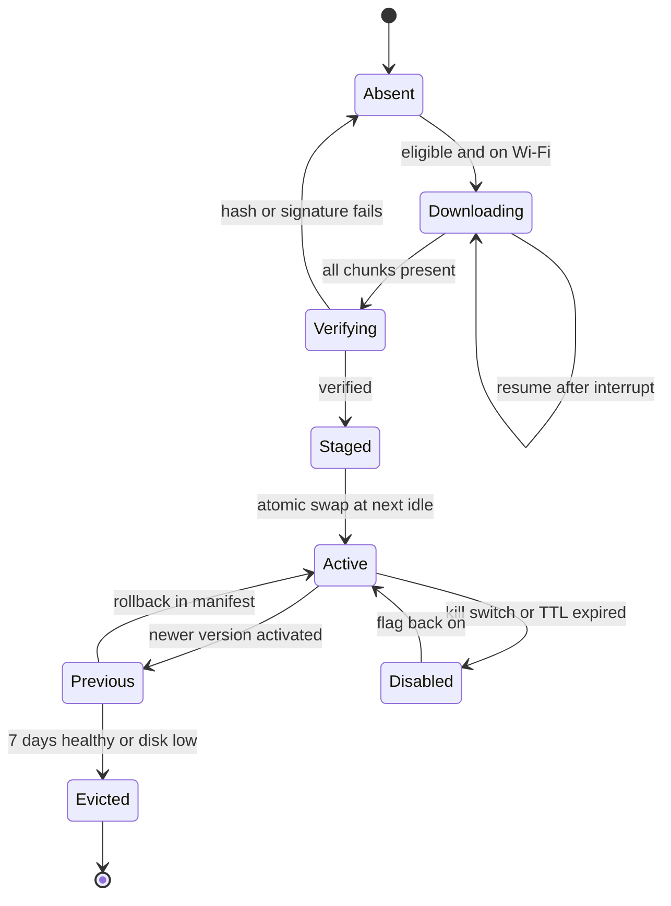

# Edge and On-Device Deployment

> **Version anchor (2026-10-18).** **llama.cpp** stable **v0.7.0** (2026-10-15) and rolling
> build **b11719** (2026-10-18, pre-release): `llama-server` defaults to auto slots (`-np -1`),
> continuous batching on, `/metrics` only with `--metrics`, and port 9931 (8080 before v0.7.0).
> **Ollama v0.40.6** (2026-10-16), with the MLX runner for Apple silicon in the v0.40.4 notes
> (2026-10-12). **ExecuTorch v1.5.1** (2026-09-23); its release page lists a C++ SDK inside the
> Python wheels, multi-method export, and schema-version checks for `.pte` and `.ptd` files. Facts
> read from primary docs on 2026-10-18: Google Play size limits (base module 500 MB, one asset
> pack 1.5 GB, install-time total 4 GB, fast-follow plus on-demand total 30 GB, all compressed);
> Apple Background Assets (managed asset packs, Apple-hosted or self-hosted); Apple Foundation
> Models `SystemLanguageModel.availability` (iOS 26.0 and macOS 26.0); ML Kit GenAI Prompt API
> `FeatureStatus` (beta, Android API 26+, unsupported on an unlocked bootloader); Firebase AI Logic
> hybrid inference (Experimental); Chrome built-in
> AI requirements (22 GB free, more than 4 GB VRAM or 16 GB RAM with 4 cores, model removed below
> 10 GB free); WebLLM cache backends. LiteRT, Core ML, ONNX Runtime GenAI, MLC LLM, MLX and
> Qualcomm QNN are named without versions.

## 1. Concept Overview

Edge and on-device deployment ships a model to hardware the platform team does not own: phones,
browsers, laptops, and boxes in stores, factories and vehicles. The model then runs there with no
pod to restart, no SSH, no `kubectl rollout undo`, and a user's battery and disk paying for every
inference. A server release changes one environment that runs N replicas. A device release
changes N environments that run one replica each, and some of them will not come online again
for three weeks.

This module owns the operational half of that problem:

- **Runtime per platform.** llama.cpp with GGUF, Ollama, MLX, ExecuTorch (`.pte`), LiteRT,
  Core ML, ONNX Runtime GenAI, MLC LLM and WebLLM, OpenVINO, and Qualcomm QNN. Which one runs
  where, and what artifact each one loads.
- **Delivery.** Bundled in the app, install-time packs, on-demand download, self-hosted CDN,
  or an OS-provided model you do not ship at all. Over-the-air (OTA) updates, delta and
  adapter-only updates, resumable chunked downloads, verification and atomic swap.
- **Storage budgets.** How much disk a model may take, where it lives so the OS does not purge
  it, and when the previous version is evicted.
- **Device capability matrix.** Which device classes get which model variant, decided at
  runtime from free memory, accelerator, thermal state and disk, not from a model-name list.
- **Hybrid cloud fallback.** When the device cannot or should not run the model, which cloud
  path takes the request, and how both paths stay comparable.
- **Cohort rollout and kill switch** for a fleet that is mostly offline, **privacy-preserving
  telemetry**, **model-to-app-version compatibility**, and **extraction risk**.
- **Edge boxes** that serve several users on a LAN with `llama-server`.

The registry entry and package format this module ships from are in
[Model Registry and Packaging](../model_registry_and_packaging/model_registry_and_packaging.md).
The traffic-split mechanics for server-side canaries are in
[Progressive Delivery for Model Servers](../progressive_delivery_for_model_servers/progressive_delivery_for_model_servers.md);
this page adapts them to cohorts of devices. Signing and provenance of the artifacts a device
downloads are in [ML Supply Chain Security](../ml_supply_chain_security/ml_supply_chain_security.md).
Where the edge sits among all deployment targets is in
[Deployment Targets and Serving Patterns](../deployment_targets_and_serving_patterns/deployment_targets_and_serving_patterns.md),
and `llama-server` slot tuning and benchmarks are in
[Inference Engine Operations and Benchmarking](../inference_engine_operations_and_benchmarking/inference_engine_operations_and_benchmarking.md).
Adapter versioning against a base digest is in
[LoRA Adapter Serving and Lifecycle](../lora_adapter_serving_and_lifecycle/lora_adapter_serving_and_lifecycle.md).
The end-to-end design for 50M phones is the case study
[Design an On-Device Model Delivery System](../case_studies/design_an_on_device_model_delivery_system.md).

**Not here.** Small-model selection, distillation, GGUF quant types, NPU hardware, memory
footprint arithmetic and thermal physics are in
[Small Language Models and Edge AI](../../llm/small_language_models_and_edge_ai/small_language_models_and_edge_ai.md).
Quantization, pruning and distillation as techniques are in
[Model Compression and Efficiency](../../ml/model_compression_and_efficiency/model_compression_and_efficiency.md).
OpenVINO internals are in [Intel OpenVINO](../../technologies/intel_openvino/intel_openvino.md).
Federated learning and differential privacy theory are in
[Privacy-Preserving ML](../../ml/privacy_preserving_ml/privacy_preserving_ml.md). This page
assumes the model is already small enough and asks how it gets to the device and stays healthy
there.

---

## 2. Intuition

**One-line analogy.** Shipping a model to devices is shipping firmware to a fleet of cars you do
not own: each car has a different engine, some are parked in garages with no signal, and a bad
update cannot be undone by restarting a server.

**Mental model.** A server release has one axis, the model version. A device release has four:
the model version, the app version that hosts the runtime, the runtime ABI inside that app, and
the device class. The release is a point in that four-dimensional space, and most on-device
incidents are a cell in the matrix nobody tested: a new `.pte` on an old runtime, a 3B model on
the 6 GB variant of a phone whose 8 GB variant passed QA, a model file the OS deleted to free
space.

**Why it matters.** The cost model flips. Cloud inference costs money per token and nothing per
install. On-device inference costs nothing per token and real money per install: download
bandwidth, disk the user can see in Settings, battery, and support tickets when the phone gets
hot. A 1.7 GB model downloaded by 10M devices is 17 PB of egress before a single prompt runs, and
a full re-download on every model update repeats that bill.

**Key insight.** Decouple the model from the app binary, describe every artifact with a signed
manifest that states what it needs, and let the device decide at runtime whether it can run it.
Everything else on this page (deltas, cohorts, kill switches, fallback, telemetry) hangs off
that manifest.

---

## 3. Core Principles

1. **The model ships separately from the app.** App store review takes hours to days and a
   binary update reaches most users over weeks. A model downloaded as an asset can be updated,
   rolled back or disabled the same day.
2. **Every artifact is content-addressed and signed.** The device verifies the SHA-256 of every
   chunk and the signature of the manifest before the runtime opens the file. A hash proves the
   bytes match the manifest; only the signature proves the manifest came from you.
3. **Compatibility is declared, not assumed.** The manifest names the runtime ABI, the minimum
   and maximum app version, and the device requirements. The server resolves the right variant
   per request; the device refuses anything that does not match.
4. **The device decides capability at load time.** Free memory, thermal state, low-power mode
   and free disk change by the minute. A static allowlist of phone models is a starting point,
   not a gate.
5. **Every on-device feature has a fallback.** Cloud inference, a smaller model, or the feature
   switched off with a clear UI state. "Model not ready" is a normal state, not an error.
6. **Rollouts are staged by cohort, and the kill switch assumes the device is offline.** A
   remote flag only works when the device fetches it, so on-device enablement carries a TTL.
7. **Telemetry is aggregate and content-free.** Counters, latency histograms, device class,
   model digest and fallback reason leave the device. Prompts, outputs and user text do not.
8. **Assume the weights are public.** Anything shipped to a device can be copied off a rooted
   one. Put nothing in the weights or the prompt that must stay secret.

---

## 4. Types / Architectures / Strategies

### 4.1 Target classes

| Target | Typical hardware | Runtime candidates | Main constraint |
|---|---|---|---|
| Phone (iOS) | Apple A-series SoC, Neural Engine, 6 to 12 GB RAM | Core ML, MLX, ExecuTorch (Core ML or MPS backend), llama.cpp (Metal), OS-provided model | Memory pressure kills the app; thermal throttling |
| Phone (Android) | Qualcomm, MediaTek, Google Tensor, Samsung Exynos; 4 to 16 GB RAM | LiteRT, ExecuTorch (XNNPACK, Vulkan, QNN backends), ONNX Runtime GenAI, llama.cpp, MLC LLM, OS-provided model | Thousands of device models, uneven NPU drivers |
| Browser | Whatever GPU the laptop has, through WebGPU; CPU through WebAssembly | WebLLM (MLC), ONNX Runtime Web, browser built-in AI | Storage quota and eviction, no control over GPU driver |
| Laptop and desktop | Apple silicon unified memory, discrete NVIDIA or AMD GPU, Windows NPU | llama.cpp, Ollama, MLX, ONNX Runtime GenAI, OpenVINO | Users run other apps; model competes for RAM |
| Edge box | Mini PC, Jetson-class module, store server with one consumer GPU | `llama-server`, Ollama, OpenVINO, TensorRT on Jetson | Remote fleet management, flaky WAN, physical access |
| Microcontroller | Arm Cortex-M, kilobytes to a few MB of RAM | ExecuTorch (Cortex-M lowering), LiteRT for Microcontrollers | No OS updater; firmware image is the delivery unit |

### 4.2 Runtimes and the artifact each one loads

| Runtime | Artifact | Platforms | Where it fits |
|---|---|---|---|
| llama.cpp | `.gguf` (one file: weights, tokenizer, chat template, metadata) | macOS, Linux, Windows, iOS, Android | LLMs on CPU, Metal, CUDA, Vulkan; same file across platforms |
| Ollama | GGUF blobs plus a Modelfile, pulled by digest | macOS, Linux, Windows | Developer laptops and small boxes; ships an MLX runner next to its GGUF engine |
| MLX | safetensors weights loaded by `mlx-lm` | Apple silicon | Mac apps and research; unified memory |
| ExecuTorch | `.pte` program, optional `.ptd` data file | iOS, Android, embedded, desktop | PyTorch models exported with `torch.export`, lowered to a backend delegate |
| LiteRT | `.tflite` flatbuffer | Android, iOS, web, microcontrollers | Classic vision, audio and text models; GPU and NPU delegates |
| Core ML | `.mlpackage`, compiled to `.mlmodelc` (a downloaded model with `MLModel.compileModel(at:)`) | Apple platforms | Neural Engine access; the model's spec version sets the minimum OS |
| ONNX Runtime GenAI | ONNX graph plus `genai_config.json` | Windows, Linux, macOS, Android, iOS | Generation loop around ONNX Runtime; DirectML, CUDA, QNN execution providers |
| MLC LLM, WebLLM | compiled model library plus sharded weights | iOS, Android, browser (WebGPU) | One compiler path for phone GPUs and the browser |
| OpenVINO | IR (`.xml` plus `.bin`) | Intel CPU, GPU, NPU | Intel edge boxes and laptops |
| Qualcomm QNN | context binary compiled for one Hexagon NPU generation | Snapdragon Android and Windows on Arm | Direct Hexagon NPU access; one binary per SoC family |

The trap in the right-hand column is **per-target compilation**. A GGUF file runs on every
llama.cpp build that knows its tensor types. A QNN context binary runs on one NPU generation, a
Core ML model loads only on an OS that supports its spec version, and a `.pte` is tied to the
ExecuTorch runtime version and the delegate set linked into the app. The more hardware-specific
the artifact, the more variants the manifest must carry.

### 4.3 Delivery strategies

| Strategy | Mechanism | Model update needs an app release? | Fits |
|---|---|---|---|
| Bundled in the app binary | File inside the IPA or APK | Yes | Models under about 50 MB that change with the code |
| Install-time asset pack | Google Play install-time pack; Apple managed asset pack with the `essential` download policy | Yes on Play; Apple-hosted packs upload to App Store Connect independent of app builds | Required model that must be present at first launch |
| On-demand or fast-follow pack | Play Asset Delivery fast-follow or on-demand; Apple Background Assets `prefetch` or `onDemand` policy | Yes on Play, where pack updates ride app updates; no for Apple-hosted packs | Optional features, large models |
| Self-hosted OTA | App fetches a signed manifest and chunks from your CDN | No | Frequent model updates, cohort rollout, kill switch |
| OS-provided model | Apple Foundation Models (`SystemLanguageModel`), Android AICore with Gemini Nano through ML Kit GenAI, Chrome built-in AI | Not applicable: you ship no weights | Generic tasks the OS model covers; zero download |

Google Play caps compressed download size: 500 MB for the base module, 1.5 GB for one asset
pack, 4 GB for the base plus all install-time packs, and 30 GB for fast-follow and on-demand
packs. A 1.7 GB 4-bit 3B model therefore cannot be a single asset pack on Play and must be split
or self-hosted.

### 4.4 Hybrid fallback patterns

| Pattern | Rule | Risk |
|---|---|---|
| Device first, cloud fallback | Run locally when eligible and ready; else call cloud | Two quality levels for one feature; users on old phones get the better model |
| Cloud first, device offline | Call cloud; use local model only with no network | Local path is rarely exercised, so it rots |
| Router on device | Small local classifier picks local or cloud per request | Router is a model too; it needs its own eval and version |
| Cascade | Local answer, escalate to cloud on low confidence or failed validation | Doubles latency on escalated requests; confidence must be calibrated |
| Split pipeline | Local model redacts or extracts; cloud model reasons on the redacted text | Redaction quality becomes a privacy control |

---

## 5. Architecture Diagrams

### OTA delivery path from registry to device

```mermaid
flowchart LR
    classDef io      fill:#61afef,stroke:#2e86c1,color:#1a1a1a,font-weight:bold
    classDef frozen  fill:#c678dd,stroke:#9b59b6,color:#fff
    classDef train   fill:#98c379,stroke:#27ae60,color:#1a1a1a
    classDef mathOp  fill:#d19a66,stroke:#e67e22,color:#1a1a1a,font-weight:bold
    classDef lossN   fill:#e06c75,stroke:#c0392b,color:#fff,font-weight:bold
    classDef req     fill:#56b6c2,stroke:#0097a7,color:#1a1a1a
    classDef base    fill:#e5c07b,stroke:#f39c12,color:#1a1a1a

    reg("Registry entry<br/>base digest") --> conv("Convert per runtime<br/>gguf, pte, tflite")
    conv --> evalD("Device eval farm<br/>per device class")
    evalD --> sign("Sign manifest<br/>and chunks")
    sign --> cdn("CDN<br/>chunks by hash")
    sign --> man("Manifest service<br/>cohort, variant")
    man --> dev("Device<br/>eligibility check")
    cdn --> dev
    dev --> stage("Verify, stage,<br/>atomic swap")
    stage --> run("Runtime loads<br/>active slot")
    run -.->|"counters only"| tel("Aggregate<br/>telemetry")
    tel -.->|"gates"| man

    class reg base
    class conv,stage mathOp
    class evalD train
    class man req
    class sign lossN
    class cdn base
    class dev,run io
    class tel frozen
```



The manifest service is the control point: it picks the variant per device and app version and
holds the cohort percentage. The CDN only serves immutable chunks named by hash, so a rollback
is a manifest change and never a cache purge.

### Device capability matrix

```
                       Variant A        Variant B        Variant C        Cloud
                       3B 4-bit         1B 4-bit         3B 4-bit QNN     fallback
                       GGUF, GPU        GGUF, CPU        NPU binary
Device class           1.7 GB           0.6 GB           1.8 GB
-------------------------------------------------------------------------------------
Flagship 12 GB, NPU       ✓                ✓                ✓ preferred       ✓
Flagship 8 GB             ✓                ✓                ✗ other SoC       ✓
Mid-range 8 GB            ~ hot >2 min     ✓ preferred      ✗                 ✓
Mid-range 6 GB            ✗ OOM risk       ✓ preferred      ✗                 ✓
Low-end 4 GB              ✗                ~ if 1.5 GB free ✗                 ✓ preferred
Low-power mode on         ✗                ✗                ✗                 ✓
Disk free below 2.2 GB    ✗ no download    ✗ no download    ✗                 ✓
```

Rows are evaluated on the device at load time, not looked up from a model-name list. A device
moves between rows within one day: the same 8 GB phone is in row two at breakfast and in the
low-power row at 9 pm.

### Bytes on the wire for one model update

```
3B model, 4-bit, 1.7 GB, cut into 64 MB content-addressed chunks (27 chunks)

Full fine-tune, re-quantized          Adapter-only update            Tokenizer fix only
[x][x][x][x][x][x][x][x][x]           [.][.][.][.][.][.][.][.][.]    [x][.][.][.][.][.][.][.][.]
[x][x][x][x][x][x][x][x][x]           [.][.][.][.][.][.][.][.][.]    [.][.][.][.][.][.][.][.][.]
[x][x][x][x][x][x][x][x][x]           [.][.][.][.][.][.][.][.][.]    [.][.][.][.][.][.][.][.][.]
+ nothing else                        + adapter file 49 MB [A]       (header chunk only)

changed chunks: 27 of 27              changed chunks: 0 of 27        changed chunks: 1 of 27
download: 1.7 GB                      download: 49 MB                download: 64 MB

[x] chunk hash changed     [.] chunk hash unchanged, already on device
```

Re-quantizing after a full fine-tune changes nearly every weight, so nearly every chunk hash
changes and a binary delta saves little. Freezing the base and shipping adapters turns a 1.7 GB
update into a 49 MB one. The tokenizer case assumes tensor-aligned chunks (section 6.4); with
fixed 64 MB offsets, a header that grows by a few bytes changes every chunk after it.

### Model slot lifecycle on the device



Two slots, active and previous, let a rollback happen without a download. The previous slot is
evicted after a healthy window or when disk runs low, whichever comes first.

---

## 6. How It Works - Detailed Mechanics

### 6.1 The model manifest

The manifest is the release unit for a device. It is small, signed, cached on the device, and
fetched on app start and every few hours.

```json
{
  "feature": "note_summary",
  "manifest_version": 412,
  "issued_at": "2026-10-18T09:00:00Z",
  "enable_ttl_hours": 72,
  "rollout": {"cohort_salt": "ns-2026-10", "percent": 5},
  "variants": [
    {
      "id": "ns-3b-q4-gguf-v7",
      "runtime": "llama.cpp",
      "runtime_abi_min": "gguf-v3",
      "app_version_min": "8.14.0",
      "requires": {"avail_mem_mb": 2600, "free_disk_mb": 4400, "accel": ["gpu"]},
      "base": {"digest": "sha256:9f2c...", "size": 1703936000, "chunk_mb": 64},
      "adapter": {"digest": "sha256:71ab...", "size": 48627712, "base_digest": "sha256:9f2c..."},
      "prompt_template": "ns-template@5",
      "eval": {"suite": "ns-device-v3", "pass": true}
    }
  ],
  "fallback": {"endpoint": "cloud/note_summary", "prompt_template": "ns-template@5"},
  "signature": "ed25519:..."
}
```

`enable_ttl_hours` is the offline kill switch: a device that has not fetched a fresh manifest in
72 hours stops using the local model and falls back. `adapter.base_digest` refuses an adapter on
the wrong base. `prompt_template` keeps the local and cloud paths on the same template version.
The manifest is one more pinned input of the release bundle described in
[AI Release Engineering](../ai_release_engineering/ai_release_engineering.md).

### 6.2 Eligibility on the device: broken, then fixed

**Broken.** An allowlist of device model names, checked once at install.

```kotlin
// Broken: passes QA on the 8 GB variant, OOM-killed on the 6 GB variant of the same model name.
val eligible = Build.MODEL in setOf("SM-S921B", "Pixel 9", "Pixel 9 Pro")
```

**Fixed.** Read the live state before each load, and pick the largest variant that fits.

```kotlin
fun pickVariant(ctx: Context, variants: List<Variant>): Variant? {
    val am = ctx.getSystemService(ActivityManager::class.java)
    val mem = ActivityManager.MemoryInfo().also { am.getMemoryInfo(it) }
    val pm = ctx.getSystemService(PowerManager::class.java)
    val freeDiskMb = StatFs(ctx.filesDir.path).availableBytes / (1024 * 1024)

    if (mem.lowMemory || pm.isPowerSaveMode) return null
    if (pm.currentThermalStatus >= PowerManager.THERMAL_STATUS_SEVERE) return null

    val availMb = mem.availMem / (1024 * 1024)
    return variants
        .filter { it.appVersionMin <= BuildConfig.VERSION_NAME.toSemver() }
        .filter { it.runtimeAbiMin in Runtime.supportedAbis() }
        .filter { availMb >= it.requires.availMemMb && freeDiskMb >= it.requires.freeDiskMb }
        .filter { it.requires.accel.all { a -> Accel.present(a) } }
        .maxByOrNull { it.base.size }
}
```

The iOS equivalents are `os_proc_available_memory()` for the bytes the process may still
allocate, `ProcessInfo.processInfo.thermalState` (`.serious` and `.critical` mean back off) and
`ProcessInfo.processInfo.isLowPowerModeEnabled`. `availMem` on Android and
`os_proc_available_memory()` on iOS are the numbers that predict an out-of-memory kill; total RAM
does not.

### 6.3 Chunked download, verify, atomic swap: broken, then fixed

**Broken.** Stream the file to its final path and load it on the next launch.

```python
# Broken: a killed app leaves a truncated file at the live path.
# Next launch the runtime mmaps it and crashes; the crash repeats every launch.
with open(f"{models}/active.gguf", "wb") as f:
    for block in http_get(url).iter_content(1 << 20):
        f.write(block)
```

**Fixed.** Chunks by hash into a staging directory, verify every chunk and the signed manifest,
assemble, then rename into place. A rename on one filesystem is atomic.

```python
import hashlib, os
from cryptography.hazmat.primitives.asymmetric.ed25519 import Ed25519PublicKey

def install(manifest_bytes, sig, pubkey: Ed25519PublicKey, variant, store):
    pubkey.verify(sig, manifest_bytes)             # raises on a forged manifest
    staging = os.path.join(store, "staging", variant["id"])
    os.makedirs(staging, exist_ok=True)
    for chunk in variant["base"]["chunks"]:        # [{"sha256": ..., "url": ...}]
        path = os.path.join(store, "chunks", chunk["sha256"])
        if os.path.exists(path):                   # dedupe: kept from the previous version
            continue
        tmp = path + ".part"
        resume_download(chunk["url"], tmp)         # HTTP Range from len(tmp)
        if sha256_file(tmp) != chunk["sha256"]:
            os.remove(tmp)
            raise ValueError("chunk hash mismatch")
        os.replace(tmp, path)
    out = os.path.join(staging, "model.gguf.part")
    with open(out, "wb") as f:
        for chunk in variant["base"]["chunks"]:
            with open(os.path.join(store, "chunks", chunk["sha256"]), "rb") as c:
                f.write(c.read())
    if sha256_file(out) != variant["base"]["digest"].removeprefix("sha256:"):
        raise ValueError("assembled digest mismatch")
    os.replace(out, os.path.join(store, "slots", "staged.gguf"))

def sha256_file(path):
    h = hashlib.sha256()
    with open(path, "rb") as f:
        for block in iter(lambda: f.read(1 << 20), b""):
            h.update(block)
    return h.hexdigest()
```

Activation is a second rename from `staged` to `active`, done when no session holds the old
file open, after the old `active` has been renamed to `previous`. The app reads only `active`.
Assembling doubles peak disk use for the duration, which is why the manifest asks for free disk
of twice the model size plus 1 GB. A runtime that can mmap a list of chunk files skips the assembly
step.

### 6.4 Delta updates and adapter-only updates

A byte-level binary diff (bsdiff, zstd with `--patch-from`) works when most bytes are equal. Three
cases on a quantized model:

| Change | Bytes changed | Practical delta |
|---|---|---|
| Tokenizer, chat template or metadata in a GGUF header | One header chunk | About one chunk |
| LoRA fine-tune merged into the base, then re-quantized | Nearly every block | Close to full size |
| LoRA fine-tune shipped as a separate adapter | None in the base | Adapter size only |

Adapter size for rank `r` on a projection of shape `d_in x d_out` is `r x (d_in + d_out)`
parameters. For a 3B model with hidden size 3,072, grouped-query KV width 1,024, MLP width 8,192
and 28 layers, rank 16 on all seven projections:

```
q, o:            2 x 16 x (3072 + 3072) = 196,608
k, v:            2 x 16 x (3072 + 1024) = 131,072
gate, up, down:  3 x 16 x (3072 + 8192) = 540,672
per layer                                 868,352
x 28 layers                            24,313,856 params
x 2 bytes (16-bit)                         48.6 MB
```

Apple's June 2024 description of its on-device model gives the same order: a rank-16 adapter in
16-bit "typically require 10s of megabytes", against a base of about 3B parameters. The operating
rule follows: freeze the device base for months, ship behavior changes as adapters, and accept a
full base download only for a real base upgrade, scheduled on Wi-Fi and charging.

Chunk-level dedupe is the cheap general form of a delta. Content-defined or tensor-aligned
chunks named by hash let a device fetch only chunks it does not hold. Tensor-aligned chunking
matters for GGUF: a header that grows by a few bytes shifts every fixed-offset 64 MB chunk after
it and changes every hash, while tensor-aligned boundaries keep the weights chunks stable.

### 6.5 Storage location and eviction

Where the file lives decides whether the OS deletes it:

| Platform | Location | Behavior |
|---|---|---|
| iOS | `Library/Application Support`, `isExcludedFromBackup` set | Kept; not in iCloud backup |
| iOS | `Library/Caches` | The system may purge it under low storage; triggers a re-download loop |
| Android | `Context.getFilesDir()` or `getNoBackupFilesDir()` | Kept until uninstall or Clear storage |
| Android | `Context.getCacheDir()` | The system may delete it when space is low |
| Browser | Cache API, IndexedDB or OPFS (WebLLM `cacheBackend`) | Best-effort storage, evictable unless `navigator.storage.persist()` is granted |
| Managed asset packs | Play Asset Delivery, Apple Background Assets | The store or OS manages the files and updates |

Budget rule used by most teams: download only when free disk is at least two times the model
plus 1 GB, keep at most one previous version, and evict it after 7 healthy days or when free disk
drops below a floor. Show the model size in the app's own settings with a delete button; users who
find 3.8 GB in Settings with no explanation uninstall the app.

### 6.6 Cohort rollout and the offline kill switch

Cohort assignment is a stable hash so a device stays in its cohort across launches:

```python
def in_rollout(install_id: str, salt: str, percent: float) -> bool:
    h = int(hashlib.sha256(f"{salt}:{install_id}".encode()).hexdigest()[:8], 16)
    return (h % 10_000) < percent * 100
```

Stages for a model that changes behavior: internal dogfood, then 1%, 5%, 25%, 50%, 100%, each
held for at least 48 hours, because most devices only fetch the manifest and download on Wi-Fi
and charging overnight. Gates compare treated and control cohorts on the same device classes:

| Gate | Typical threshold |
|---|---|
| Crash-free sessions | No drop larger than 0.1 percentage points |
| Out-of-memory and watchdog terminations | No increase above 10% relative |
| Fallback rate by reason | Below 15% of eligible requests |
| Time to first token, p50 and p95, per device class | Within 20% of the previous version |
| Model load time, cold | Under 3 s on the median eligible device |
| Feature-level quality signal (accept, edit, undo) | No drop beyond the agreed margin |
| Battery drain per active minute | No increase above 10% relative |

The kill switch has two layers. The manifest sets `percent` to 0 or points the variant back to
the previous digest; online devices act on their next fetch. Devices that cannot fetch keep
running the model until `enable_ttl_hours` since the last fresh manifest passes, then fall back.
A TTL of 72 hours bounds the exposure of a bad model to three days for the worst-connected
device. A shorter TTL disables the feature for users on planes and in rural areas, so the value
is a product decision written down with the rollout plan. The server-side counterpart of these
stages is in
[Progressive Delivery for Model Servers](../progressive_delivery_for_model_servers/progressive_delivery_for_model_servers.md).

### 6.7 Model-to-app-version compatibility

The runtime is compiled into the app; the model arrives later. Three couplings break:

- **Format version.** A newer exporter writes a file an older runtime cannot read. The ExecuTorch
  v1.5.1 release page lists schema-version checks for `.pte` and `.ptd` files, so the failure
  becomes a clear load error instead of undefined behavior, but the device still cannot run the
  model.
- **Operator set.** A model that uses an operator or quant type added in a later runtime build
  loads on the new app and fails on the old one. GGUF quant types and ExecuTorch delegates both
  have this shape.
- **Pre- and post-processing in app code.** Tokenizer code, prompt assembly, output parsing. A
  model that emits a new JSON field breaks an app version whose parser rejects unknown fields.

The server resolves a variant per request from what the app reports:

```python
def resolve(variants, app_version, runtime_abis):
    ok = [v for v in variants
          if semver(v["app_version_min"]) <= semver(app_version)
          and v["runtime_abi_min"] in runtime_abis]
    return ok[0] if ok else None    # variants ordered newest first; None means cloud
```

Keep one variant per supported app range alive until that range drops under an agreed share of
active installs, typically 1%. Apps on the long tail get the cloud path, not a broken load.

### 6.8 Privacy-preserving telemetry

What leaves the device: feature id, model variant id and digest, app version, device class
bucket (RAM tier, SoC family, not the exact model when the population is small), path taken
(local or cloud), fallback reason code, latency buckets, load time bucket, crash and OOM counts.
What stays: prompts, outputs, user documents, and anything typed.

Quality on device needs a signal without content. Two common mechanisms:

- **Aggregate with a minimum cohort.** The backend shows a metric only when at least 1,000
  devices contribute to the cell, which stops a dashboard from singling out one user on a rare
  device.
- **Randomized response** for a sensitive bit such as "user rejected the summary". Each device
  reports the true bit with probability `p` and a fair coin otherwise. The observed rate
  `lambda = p x pi + (1 - p) / 2`, so `pi = (lambda - (1 - p) / 2) / p`. With `p = 0.5` and an
  observed rate of 0.40, the estimated true rate is `(0.40 - 0.25) / 0.5 = 0.30`. Lower `p` means
  more privacy and a wider confidence interval, so the cohort must be larger for the same
  precision.

The theory, including the epsilon accounting behind these choices, is in
[Privacy-Preserving ML](../../ml/privacy_preserving_ml/privacy_preserving_ml.md). The drift and
quality dashboards these counters feed are in
[Production Quality Monitoring and Drift](../production_quality_monitoring_and_drift/production_quality_monitoring_and_drift.md).

### 6.9 OS-provided models

An OS-provided model removes the download, the storage budget and the runtime from your app, and
removes your control of the model version.

- **Apple Foundation Models** exposes `SystemLanguageModel` from iOS 26.0 and macOS 26.0. Its
  `availability` is `.available` or `.unavailable` with a reason: `deviceNotEligible`,
  `appleIntelligenceNotEnabled` or `modelNotReady`.
- **Android ML Kit GenAI** runs Gemini Nano in the AICore system service. `checkStatus()` returns
  `UNAVAILABLE`, `DOWNLOADABLE`, `DOWNLOADING` or `AVAILABLE`; `download()` streams
  `DownloadStarted`, `DownloadProgress`, `DownloadCompleted` or `DownloadFailed`. The Prompt API
  is beta, needs API level 26 or higher, and does not run on devices with an unlocked
  bootloader.
- **Chrome built-in AI** needs 22 GB free on the profile volume, a GPU with more than 4 GB VRAM
  or 16 GB RAM with 4 CPU cores, and an unmetered connection for the first download. If free
  space falls below 10 GB after download, Chrome removes the model.

All three map onto the slot lifecycle in section 5: unavailable, downloading, available. The app
code is the same eligibility-and-fallback code; only the version pin is gone. Pin what you can
instead: the prompt template, the output schema validation, and an eval suite run against each
OS release in a device lab.

### 6.10 Edge boxes serving a site

A store or clinic box serves several users on a LAN. One process, one model, a slot per
concurrent request:

```bash
llama-server -m /models/active.gguf --host 0.0.0.0 \
  -c 16384 -np 4 --metrics
# port 9931 by default from llama.cpp v0.7.0; set --port 8080 if clients expect the old port
```

The OTA rules above apply with fleet tooling instead of an app store: a signed manifest per site,
model files pulled by digest into `/models/slots/`, a systemd unit or a k3s pod that restarts
the server onto the new `active` file, and a health probe that sends one fixed prompt and checks
the answer before the old file is removed. A site WAN link of 20 Mbit/s takes about 11 minutes to
fetch a 1.7 GB model, so updates are scheduled after closing time and staged by region. Slot
sizing, `-np` against context, and benchmark method are in
[Inference Engine Operations and Benchmarking](../inference_engine_operations_and_benchmarking/inference_engine_operations_and_benchmarking.md).
Ollama works for the same job when the operators want `ollama pull` by name; it listens on port
11434 and ships an MLX runner next to its GGUF engine.

### 6.11 Browser delivery

WebLLM runs MLC-compiled models on WebGPU and exposes an OpenAI-style
`engine.chat.completions` API. Weights cache through `AppConfig.cacheBackend`: `"cache"` (Cache
API, the default), `"indexeddb"`, `"opfs"` or `"cross-origin"`. Run the engine in a Web Worker
(`CreateWebWorkerMLCEngine`) so model compilation does not freeze the page; the browser may
terminate a Service Worker engine at any time. Field failures (no WebGPU adapter, quota errors,
cache eviction) are covered in the interview answer below.

### 6.12 Extraction risk

Anything on a device can be read off a rooted or jailbroken one. Weights, adapters, the system
prompt and any few-shot examples bundled with them are public in practice. Controls, in order of
how much they help:

1. **Do not ship secrets.** No API keys, no confidential prompt text, no customer data in the
   weights or the adapters. If a prompt is an asset, keep that feature server-side.
2. **Ship the smaller model.** The valuable model stays in the cloud; the device gets the model
   whose leak you can accept.
3. **Gate premium output server-side.** The device model drafts; the server model finalizes the
   part worth protecting.
4. **Attestation for API access** (Play Integrity API on Android, App Attest on iOS), so a copied
   model plus a scripted client cannot call your cloud fallback at scale.
5. **Encryption at rest, license and fingerprint.** The key must be on the device, so encryption
   only raises the effort; a per-build fingerprint shows which build leaked after the fact.

Signature verification protects the device from a tampered model; it does nothing against a user
copying one. The signing chain is in
[ML Supply Chain Security](../ml_supply_chain_security/ml_supply_chain_security.md).

---

## 7. Real-World Examples

**Apple Intelligence (June 2024 description).** Apple described a roughly 3B-parameter on-device
model quantized to a mix of 2-bit and 4-bit weights averaging 3.7 bits per weight, specialized
per feature by rank-16 adapters in 16-bit precision that take tens of megabytes each and are
loaded, cached and swapped at runtime. On an iPhone 15 Pro it reported about 0.6 ms of
time-to-first-token per prompt token and about 30 tokens per second. The pattern is the one in
section 6.4: one frozen base, many small adapters, adapter updates instead of base downloads.

**Apple Foundation Models framework.** From iOS 26.0, apps call the system model through
`SystemLanguageModel` and must branch on `availability`. An app that treats `modelNotReady` as an
error instead of a "try later or fall back" state shows a broken feature to every new device in
its first hours, while the OS model is still downloading.

**Android AICore and ML Kit GenAI.** Gemini Nano runs in the AICore system service, which manages
download and updates; apps never ship the weights. Firebase AI Logic hybrid inference
(Experimental) wraps it: in `PREFER_ON_DEVICE` mode it runs Gemini Nano through the ML Kit Prompt
API and falls back to a cloud Gemini model the app names when the device cannot run it. That is
the device-first, cloud-fallback pattern from section 4.4, built by the platform.

---

## 8. Tradeoffs

### Where the model comes from

| | Ship your own model | OS-provided model | Cloud only |
|---|---|---|---|
| Download cost to you | Full model per install, CDN egress | None | None |
| Version control | Full: digest pinned | None: OS updates it | Full |
| Device coverage | Every device that passes eligibility | Only devices the OS enables | Every device online |
| Offline | Yes | Yes | No |
| Marginal cost per request | Zero | Zero | Per token |
| Quality ceiling | Limited by device memory | Fixed by OS model | Largest models |
| Privacy story | Data stays on device | Data stays on device | Data leaves device |

### How updates travel

| | Full download | Chunk dedupe or binary delta | Adapter-only |
|---|---|---|---|
| Bytes per update, 3B 4-bit | 1.7 GB | 64 MB to 1.7 GB depending on change | About 49 MB |
| Works after re-quantization | Yes | Poorly | Not applicable |
| Base upgrade possible | Yes | Yes | No |
| Rollback slot size | 1.7 GB | 1.7 GB | 49 MB |
| Complexity | Low | Medium: chunking, patch apply | Medium: base pinning, adapter registry |

---

## 9. When to Use / When NOT to Use

**Use on-device or edge deployment when:**

- The feature must work offline: field service, aircraft, vehicles, rural clinics.
- The input should not leave the device: health notes, keyboard text, photos, documents.
- Latency must be under about 100 ms per interaction and the network round trip is the bottleneck.
- Request volume is high and per-token cloud cost dominates, with a model small enough to fit.
- A site serves several users on a LAN with a poor WAN: a store box with `llama-server`.

**Do NOT use it when:**

- The task needs a model larger than the median user device can hold with headroom. Check the
  capability matrix against your install base, not against the flagship on the team's desks.
- The model or prompt is a trade secret. It will be extracted.
- The feature changes weekly in ways that need a new base. Every base change is a full download
  for every device.
- You have no device lab and no telemetry pipeline. Rolling out blind to devices with no rollback
  is worse than paying for cloud tokens.
- The answer must be identical for every user for audit or compliance. Device and cloud paths
  diverge, and so do runtime builds on different hardware.

---

## 10. Common Pitfalls

**Model bundled in the app binary.** A messaging app put a 410 MB model in its APK. The base
module still fit Play's 500 MB cap, but install size grew 4x, store conversion on slow networks
fell, and every model fix waited for the next app release train two weeks out. Moving the model
to an on-demand pack and then to self-hosted OTA cut the APK back to 95 MB and let model fixes ship
the same day.

**Partial file at the live path.** An app streamed the model to `active.gguf`. Users who swiped
the app away during download got a truncated file; the next launch mmapped it and crashed, on
every launch, until they reinstalled. Crash rate on the affected cohort hit 6%. The fix was
staging plus hash verification plus atomic rename (section 6.3), and a startup guard that deletes
an `active` file whose digest does not match the manifest.

**New export, old runtime.** A team re-exported their model with a newer exporter and shipped it
to all app versions. The 31% of installs still on app versions with the older runtime failed to
load it, the feature showed an error banner, and the cloud fallback never ran because the error
path was not wired to it. Fix: `runtime_abi_min` and `app_version_min` in the manifest, server-side
variant resolution, and every load error mapped to the fallback path.

**Allowlist by device name.** QA passed the 3B variant on the 8 GB version of a phone. The same
model name shipped with 6 GB in two markets, and the OS killed the app in the background whenever
the model was resident. The OOM rate there was 9x the rest of the fleet. Eligibility moved to
`availMem` at load time, and the 6 GB variant got the 1B model.

**Kill switch that needs a network.** A model update produced repetitive outputs on one SoC
family. The team set the rollout to 0%, and online devices stopped within hours, but 18% of the
treated cohort did not fetch the manifest for over a week. The fix was `enable_ttl_hours`: the
local model is used only while the last fresh manifest is younger than the TTL.

**Benchmarking cold, not sustained.** Tokens per second measured over a 20-second test looked
fine. After 3 minutes of continuous use the phone throttled and throughput halved, which in a
chat feature meant 9-second replies. Rollout gates now include a 10-minute sustained run per
device class in the lab and p95 latency per device class in the field.

**Prompts in crash reports.** A crash reporter attached the last 4 KB of app memory, which held
user prompts. The privacy review found user text in a third-party crash backend. Fix: scrub
buffers before the crash handler runs, keep prompts out of log statements by lint rule, and review
every telemetry field against the "content stays on device" principle.

**Model in a purgeable directory.** An iOS app stored its 1.2 GB model in `Library/Caches`. Under
low storage the system purged it, the app re-downloaded it on cellular, the system purged it
again. Users on 64 GB phones saw gigabytes of cellular use in a week. The model moved to
`Application Support` with backup exclusion, and downloads require Wi-Fi unless the user opts in.

**Two quality levels nobody measured.** A device-first feature fell back to a larger cloud model
on low-end phones. User satisfaction was higher on low-end phones than on flagships, which hid a
local-model regression in the aggregate for a month. Fix: report every quality metric split by
path (local or cloud) and evaluate both paths on the same eval suite before each release.

---

## 11. Technologies & Tools

| Tool | Role | Notes |
|---|---|---|
| llama.cpp | LLM runtime and `llama-server` | v0.7.0 stable, b11719 rolling; GGUF single-file models; Metal, CUDA, Vulkan, CPU |
| Ollama | Local model manager and server | v0.40.6; pulls models by digest; MLX runner next to the GGUF engine; port 11434 |
| MLX | Array framework for Apple silicon | `mlx-lm` for LLMs; unified memory |
| ExecuTorch | PyTorch on-device runtime | v1.5.1; `.pte` and `.ptd`; XNNPACK, Core ML, MLX, Vulkan, QNN, Arm delegates |
| LiteRT | On-device runtime for `.tflite` models | GPU and NPU delegates; microcontroller build |
| Core ML | Apple model runtime | `.mlpackage` compiled to `.mlmodelc`; Neural Engine |
| ONNX Runtime GenAI | Generation loop on ONNX Runtime | `genai_config.json`; DirectML, CUDA, QNN execution providers |
| MLC LLM | Compiler and runtime for phone and desktop GPUs | Same compiled model path as WebLLM |
| WebLLM | In-browser LLM runtime | WebGPU; `cacheBackend` Cache API, IndexedDB, OPFS or cross-origin; worker engines |
| OpenVINO | Intel runtime | IR format; CPU, GPU, NPU; see the Intel OpenVINO page |
| Qualcomm QNN | Hexagon NPU SDK | Context binary per NPU generation |
| Play Asset Delivery | Google Play asset packs | Install-time, fast-follow, on-demand; 1.5 GB per pack |
| Apple Background Assets | Asset packs on Apple platforms | Managed packs, Apple-hosted or self-hosted |
| Apple Foundation Models | OS-provided language model API | `SystemLanguageModel`, iOS 26.0 |
| ML Kit GenAI | Gemini Nano through Android AICore | `checkStatus()`, `download()`; beta |
| Firebase AI Logic | Hybrid on-device and cloud API | Experimental; `PREFER_ON_DEVICE` falls back to a named cloud Gemini model |
| Chrome built-in AI | Browser-provided model | `availability()`; 22 GB free disk requirement |
| model-transparency | OpenSSF model signing | v1.1.1; signs model files for verification before load |

---

## 12. Interview Questions with Answers

**Q: Why should an on-device model not ship inside the app binary?**
**Short:** Bundling ties every model fix to an app release and store review, inflates install size, and removes cohort rollout and same-day rollback.

An app update takes store review plus weeks to reach most users, so a bad model stays live that
long. A model in the APK or IPA also counts against install size for users who never use the
feature. Ship the model as an asset: a store-managed pack (Play Asset Delivery, Apple Background
Assets) or a self-hosted download described by a signed manifest. Bundle only tiny models that
change with the code, under about 50 MB.

**Q: A new model export works on the latest app but fails to load on a third of the fleet. What happened?**
**Short:** The export needs a newer runtime ABI than older app versions link, and the manifest did not gate the variant by runtime and app version.

The runtime is compiled into the app; the model arrives later. A newer exporter, a new GGUF quant
type, or a new ExecuTorch delegate op can produce a file older runtimes reject. ExecuTorch v1.5.1
checks `.pte` and `.ptd` schema versions so the failure is a clear error, but it is still a failure. Put
`runtime_abi_min` and `app_version_min` in the manifest, resolve the variant server-side from what
the app reports, keep the old variant alive for old app ranges, and map every load error to the
cloud fallback.

**Q: Why is a kill switch for an on-device model harder than for a server model?**
**Short:** The device only sees the flag when it fetches config, so offline devices keep running a bad model unless local use expires after a TTL.

Setting a rollout to 0% reaches online devices on their next manifest fetch. A device on a plane or
with background refresh disabled can go days without fetching. Give local enablement a TTL, such
as 72 hours since the last fresh signed manifest, after which the app falls back to cloud or
disables the feature. The TTL bounds exposure for the worst-connected device; choose it with
product, since a short TTL hurts genuinely offline users.

**Q: Why does a binary delta of a fine-tuned, re-quantized model save almost nothing?**
**Short:** Fine-tuning shifts nearly every weight, so after re-quantization almost every block's bytes change and the diff is close to the full file.

A diff tool needs long runs of equal bytes. Merging a LoRA into the base and re-quantizing changes
values in nearly every quantization block, so chunk hashes change across the whole file. Deltas
pay off for header or tokenizer changes, and for nothing else on a quantized model. The fix is
architectural: freeze the base on the device and ship behavior changes as adapters, about 49 MB
for rank 16 on a 3B model against a 1.7 GB base.

**Q: The 3B model passed QA on a phone model, yet the same phone model gets OOM-killed in the field. Why?**
**Short:** Eligibility was a device-name allowlist; the same name ships with less RAM in some markets, and only available memory at load time predicts an OOM kill.

Device names hide RAM variants, and even on one variant the available memory depends on what else
is running. Read `ActivityManager.MemoryInfo.availMem` and `lowMemory` on Android, or
`os_proc_available_memory()` on iOS, before each load, and pick the largest variant whose
requirement fits with headroom. Also check thermal status, low-power mode and free disk. Keep
the allowlist only as a coarse filter.

**Q: What does privacy-preserving telemetry for an on-device model collect?**
**Short:** Content-free aggregates: variant digest, device class bucket, path taken, fallback reason, latency and crash counts; never prompts or outputs.

The device reports what the rollout gates need: which model ran, on which device tier, whether it
fell back and why, load time and latency buckets, OOM and crash counts, and coarse quality
signals such as accept or undo. User text, outputs and documents never leave. Show a metric only
for cells with enough devices, for example 1,000, and use randomized response for sensitive bits.
Audit crash reporters and logs too; they are where prompts leak.

**Q: Can you prevent users from extracting model weights shipped to their device?**
**Short:** No; anything the runtime can read can be copied from a rooted device, so ship nothing secret and keep valuable models server-side.

Encryption at rest needs the key on the device, so it only raises the effort. Treat weights,
adapters and bundled prompts as public. Ship the smaller model whose leak is acceptable, keep the
valuable model and confidential prompts in the cloud, gate premium output server-side, and use
attestation so a copied model cannot call your fallback API at scale. Per-build fingerprints
identify a leak after the fact.

**Q: The device checks the SHA-256 of the downloaded model. Why is that not enough?**
**Short:** A hash only proves the file matches the manifest; without a signature on the manifest, whoever controls the manifest controls the model.

If an attacker can alter the manifest, through a compromised CDN, a proxy or a misconfigured
bucket, they publish a new hash with their file and the check passes. Sign the manifest with a key
whose public half is compiled into the app, verify the signature before trusting any hash in it,
and then verify each chunk and the assembled file. Model signing with OpenSSF model-transparency
covers the files themselves; see the supply-chain module for the full chain.

**Q: How do you stage an on-device model rollout?**
**Short:** Stable-hash cohorts at 1%, 5%, 25%, 50%, 100%, each held about 48 hours, gated on crashes, OOMs, fallback rate, latency per device class and quality signals.

Hash `salt:install_id` so a device stays in its cohort. Hold each stage long enough for devices to
fetch and download on Wi-Fi, usually overnight, so 48 hours is a common floor. Compare treated
against control on the same device classes: crash-free sessions, OOM terminations, fallback rate
by reason, time to first token per class, cold load time, battery drain and accept or undo rates.
Roll back by pointing the manifest at the previous digest, which the previous slot still holds.

**Q: What does a model manifest for devices contain?**
**Short:** Per-variant digest, size and chunks, runtime ABI and app version range, device requirements, prompt template version, rollout percent, enable TTL and a signature.

The manifest is the release unit on devices. Each variant lists its base digest and chunk hashes,
any adapter with the base digest it requires, `runtime_abi_min`, `app_version_min`, required
available memory, free disk and accelerators, and the prompt template version shared with the
cloud path. Top-level fields carry cohort salt and percent, `enable_ttl_hours`, the fallback
endpoint and the signature. Rollback and kill are manifest edits; chunks on the CDN are immutable.

**Q: How should the app decide between on-device and cloud for one request, and what is the trap?**
**Short:** Run local when the slot is active and the device is eligible right now, else cloud with a reason code; the trap is never measuring the two paths separately.

Check slot state, enable TTL, available memory, thermal state and low-power mode, run with a
latency budget, validate the output, and fall back with a reason on any failure. Both paths use the
same prompt template version. The trap: aggregate quality mixes a local model and a stronger cloud
model, so a local regression hides behind low-end phones that use the cloud. Report every quality
metric split by path and evaluate both paths on the same suite.

**Q: When is an OS-provided model a better choice than shipping your own?**
**Short:** When the task is generic, zero download matters, and you can live without pinning the model version or covering devices the OS excludes.

Apple Foundation Models, ML Kit GenAI with Gemini Nano, and Chrome built-in AI cost no download or
storage for you. In exchange the OS chooses the model and updates it, eligibility follows the OS
rules (for example `deviceNotEligible`, an unlocked bootloader, or 22 GB free for Chrome), and
behavior can change with an OS update. Pin what you control: prompt template, output validation,
and an eval suite run against each OS release. Keep a cloud fallback for ineligible devices.

**Q: Why do on-device teams prefer one frozen base plus adapters over frequent base updates?**
**Short:** Adapters are tens of MB instead of gigabytes, so updates and rollback slots are cheap, while a base change forces a full download on every device.

A rank-16 adapter on a 3B model is about 49 MB at 16 bits; Apple described its rank-16 adapters as
tens of megabytes on a roughly 3B base. Shipping per-feature adapters keeps one base resident and
swaps behavior, and the previous slot holds a 49 MB adapter instead of a 1.7 GB model. Every
adapter records the base digest it was trained on; the device refuses a mismatch. Schedule a base
upgrade as a separate campaign on Wi-Fi and charging.

**Q: Where should a downloaded model file be stored on iOS, Android and in a browser?**
**Short:** In non-purgeable app storage excluded from backup: Application Support on iOS, filesDir or noBackupFilesDir on Android, and persisted storage in the browser.

On iOS, `Library/Caches` can be purged under low storage, which produces re-download loops; use
`Application Support` and set `isExcludedFromBackup` so gigabytes do not go to iCloud. On Android,
`getCacheDir()` is deletable by the system; use `getFilesDir()` or `getNoBackupFilesDir()`. In a
browser, Cache API, IndexedDB and OPFS are best-effort; call `navigator.storage.persist()` and
`estimate()` first, and handle missing weights as a normal path.

**Q: How do you benchmark an on-device model for a rollout gate?**
**Short:** Measure cold load, time to first token and sustained throughput over 10 minutes per device class in a lab, then confirm p50 and p95 per class in the field.

Short benchmarks run before thermal throttling and overstate throughput; phones often halve
tokens per second after a few minutes. Measure cold load from disk, first-token latency at the
real prompt length, sustained decode over 10 minutes, peak resident memory, and battery drain per
active minute, on each device class in the capability matrix. Field telemetry then confirms the
lab numbers by class. Hardware and thermal physics are in the small-language-models page.

**Q: How do you update the model on a fleet of store edge boxes running llama-server?**
**Short:** Pull the new GGUF by digest into a staging slot after hours, verify it, restart the server on it, probe with a fixed prompt, and keep the old file for rollback.

Each site gets a signed manifest and pulls chunks over a WAN that may be 20 Mbit/s, about 11 minutes
for 1.7 GB, so updates run after closing and roll out by region. A systemd unit or k3s pod
restarts `llama-server` onto the new `active` file, and a health probe checks a known answer
before the previous file is removed. Note the default port changed to 9931 in llama.cpp v0.7.0;
pin `--port` when clients expect 8080.

**Q: What breaks when you ship an LLM to the browser with WebLLM?**
**Short:** Missing WebGPU, storage quota errors on gigabyte writes, and silent cache eviction; each must route to re-download or cloud fallback.

WebLLM needs a WebGPU adapter, which older browsers and blocklisted GPU drivers lack. A 1.7 GB
write can exceed the origin's quota; check `navigator.storage.estimate()` first. Cache API,
IndexedDB and OPFS storage can be evicted under pressure unless `persist()` is granted. Run the
engine in a Web Worker so compilation does not freeze the page, and remember a Service Worker
engine can be terminated by the browser at any time.

**Q: With randomized response at p = 0.5, devices report "rejected" at a rate of 0.40. What is the true rate?**
**Short:** 0.30, from pi = (lambda - (1 - p) / 2) / p = (0.40 - 0.25) / 0.5.

Each device reports the true bit with probability `p` and a fair coin otherwise, so the observed
rate is `lambda = p x pi + (1 - p) / 2`. Solving gives `pi = (0.40 - 0.25) / 0.5 = 0.30`. No single
report reveals the user's real answer, yet the population rate is recoverable. Lower `p` gives
more privacy and a wider confidence interval, so the cohort must grow to keep the same precision.

---

## 13. Best Practices

- Ship models as assets, not inside the app binary. Describe every release with a signed manifest: variant digests, chunk hashes, runtime ABI, app
  version range, device requirements, prompt template version, rollout percent and enable TTL.
- Verify the manifest signature, then every chunk, then the assembled file; install by atomic
  rename into a slot; keep one previous slot for rollback.
- Decide eligibility at load time from available memory, thermal state, low-power mode, free disk
  and accelerator presence; use device lists only as a coarse filter.
- Freeze the on-device base; ship behavior changes as adapters pinned to the base digest.
- Name chunks by hash on tensor boundaries, so unchanged chunks never download twice.
- Store models in non-purgeable, backup-excluded locations and show model size with a delete
  button in the app.
- Download on Wi-Fi and charging by default; require free disk of twice the model plus headroom.
- Roll out by stable-hash cohort with 48-hour holds and gates per device class; roll back by
  manifest.
- Give local enablement a TTL so offline devices stop using a recalled model.
- Map every load error to the fallback path with a reason code; report quality split by path.
- Keep telemetry content-free, aggregate with a minimum cohort, and scrub crash reports.
- Treat shipped weights and prompts as public; keep secrets and the valuable model server-side.
- Run a device lab covering each row of the capability matrix, with 10-minute sustained runs.

---

## 14. Case Study

### Offline extraction for 30,000 field-service tablets and 1,800 store boxes

**Context.** A home-appliance repair company equips 30,000 technicians with Android tablets
(three models, 6 GB and 8 GB RAM) and 1,800 retail stores with a mini PC (32 GB RAM, one 16 GB
consumer GPU). Technicians dictate notes in basements with no signal; a model must turn notes into
a structured work order (part numbers, fault code, labor time). Stores run a parts-lookup
assistant for counter staff. Before the redesign, a 1B model was bundled in the APK, the store boxes
ran a manually copied GGUF, and nobody could say which store ran which version.

**Incident that started the redesign.** A retrained extractor was merged, re-quantized and shipped
in an app release. On the 6 GB tablets it raised peak memory by 300 MB; the OS killed the app
during dictation, losing the note. Rollback needed another app release, which took 9 days to reach
80% of tablets, and 2,100 work orders were re-typed by hand.

**Decisions.**

| Decision | Choice | Reason |
|---|---|---|
| Tablet runtime | ExecuTorch `.pte` with XNNPACK, 1B 4-bit, about 0.6 GB | One export path from the PyTorch training code; schema checks give clean failures |
| Behavior updates | Rank-16 adapters, about 22 MB for the 1B base, pinned to base digest | Weekly fixes without a base download |
| Delivery | Self-hosted OTA with signed manifest, MDM-enforced Wi-Fi download at the depot | Cohort control and same-day rollback; Play packs could not do per-cohort rollback |
| Eligibility | `availMem` of at least 1.1 GB and no severe thermal status | 6 GB tablets with the camera app open fall under the bar and queue the note |
| Fallback | Queue the raw note, extract in the cloud on reconnect | No signal is the normal case; the cloud model re-checks low-confidence fields |
| Kill switch | `enable_ttl_hours: 120` | Technicians are often 3 to 4 days between depot visits |
| Store boxes | `llama-server` with a 3B GGUF, `-np 4`, `--metrics`, port pinned to 8080 | Existing clients; updates after closing, staged by region |
| Telemetry | Variant digest, path, reason, latency bucket, field-level correction counts | No note text leaves the tablet except through the work-order sync the business already has |

**Rollout.** Depot-level cohorts: 2 depots (about 400 tablets), then 10%, 50%, 100% of depots,
each held one week because tablets update at depot Wi-Fi. Gates: zero increase in OOM
terminations, field correction rate within 1 point of the previous adapter, p95 extraction latency
under 4 s on the 6 GB tablets in a 10-minute sustained lab run.

**Results after two quarters.** Model fixes reached 90% of tablets in 4 days instead of 21. A bad
adapter in month four was rolled back through the manifest in 6 hours for online tablets and
within the 120-hour TTL for the rest; no notes were lost because the eligibility check queued
them. OOM terminations during dictation fell from 1.8% of sessions to 0.2%. The store boxes report
a single digest per region after each update window, and the version question has a one-query
answer.

**What the team would do differently.** Ship the adapter split from day one. The first two months
of re-quantized full-model updates cost 0.6 GB per tablet per update over depot Wi-Fi, 18 TB per
release across the fleet, for changes an adapter would have carried in 22 MB.
