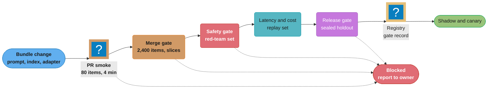
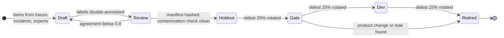

# Evaluation Gates and Eval Sets

> **Version anchor (2026-10-18).** **MLflow 3.17.1** (2026-10-13) ships `mlflow.genai.evaluate()`
> and `make_judge()`, and 3.17.1 adds Decision API support to `make_judge()`; **MLflow 3.17.0**
> (2026-10-07) added TypeSafe judges. **Langfuse v4.63.0** (2026-10-16) ships datasets, dataset
> runs and LLM-as-judge evaluators; OpenAI decision-model evaluators arrived in v4.55.0
> (2026-10-08) and decision-model evaluators graduated in v4.57.0 (2026-10-12). Langfuse is part
> of ClickHouse since the acquisition announced 2026-01-16. **OpenAI Decisions API** (checked
> 2026-10-18): public beta, `POST /v1/decisions`, model `gpt-6-luna`, input $0.10 per 1M tokens,
> no output charge. promptfoo is MIT-licensed; OpenAI agreed to acquire it, announced 2026-03-09.
> DeepEval, Ragas, Inspect AI, lm-evaluation-harness and Braintrust are named without a version.
>
> **On prices.** Generative-judge prices on this page are stated assumptions, written as
> variables or marked "assumed". Multiply by what your account pays.

---

## 1. Concept Overview

An eval set is a versioned artifact: a fixed list of inputs, expected behaviors or labels,
slice tags and a scoring config, identified by a content hash. An evaluation gate is code that
runs a candidate release against one or more eval sets and returns pass or block. The gate sits
between "the pipeline built a candidate" and "the candidate may enter shadow or canary". If it
blocks, nothing downstream runs.

Both halves fail in quiet ways. An eval set goes stale as traffic shifts, leaks into training
data, or gets tuned against until it stops measuring anything. A gate passes a regression
because it compares one noisy number against another noisy number, averages a broken slice
into a healthy aggregate, or trusts a judge model that changed under it. The output of a bad
gate looks the same as the output of a good one: a green check.

This module covers:

- Eval sets as release artifacts: golden sets, slice coverage, contamination checks, refresh
  and holdout rotation, private sets, manifests pinned by content hash.
- Gate types: absolute thresholds, regression against the champion, non-inferiority margins,
  per-slice gates, safety and red-team gates, latency and cost gates, format and contract gates.
- LLM-as-judge inside CI: judge pinning, calibration against human labels, judge drift, and
  decision models as judge backends.
- Which gates each artifact type needs: classic models, RAG, agents, prompts, decision schemas.
- Flaky evals, tiered gating and eval cost budgets.

The statistics behind a gate (confidence intervals, sample size, paired tests, multiple
slices, sequential stopping) are in the sub-page
[Statistics of Release Gates](statistics_of_release_gates.md). The gate is one stage of the
release ladder owned by [AI Release Engineering](../ai_release_engineering/ai_release_engineering.md);
prompt versions arrive from [Prompt Lifecycle and Versioning](../prompt_lifecycle_and_versioning/prompt_lifecycle_and_versioning.md),
index versions from [RAG and Vector Index Lifecycle](../rag_and_vector_index_lifecycle/rag_and_vector_index_lifecycle.md),
and tool-server versions from
[Agent, Tool and MCP Server Lifecycle](../agent_tool_and_mcp_server_lifecycle/agent_tool_and_mcp_server_lifecycle.md).
Decision-model judges are specified in [Decision Models](../decision_models/decision_models.md).
After release, the same metrics run on sampled live traffic in
[Production Quality Monitoring and Drift](../production_quality_monitoring_and_drift/production_quality_monitoring_and_drift.md),
and the money spent on evals is tracked in
[AI Cost Engineering and Unit Economics](../ai_cost_engineering_and_unit_economics/ai_cost_engineering_and_unit_economics.md).

**Not here.** Benchmark families, metric definitions and leaderboard methodology are in
[Evaluation and Benchmarks](../../llm/evaluation_and_benchmarks/evaluation_and_benchmarks.md).
Error analysis, open and axial coding, and how to design and align a judge prompt are in
[Error Analysis and Eval Design](../../llm/error_analysis_and_eval_design/error_analysis_and_eval_design.md).
Unit, property and snapshot tests for LLM code are in
[LLM Testing Strategies](../../llm/llm_testing_strategies/llm_testing_strategies.md).
The classic model performance gate code (accuracy and latency checks before registry
promotion) is in [MLOps and CI/CD](../../ml/mlops_and_ci_cd/mlops_and_ci_cd.md) §6 "Model
Performance Gate". This page is about operating eval sets and gates as release machinery.

---

## 2. Intuition

> **One-line analogy**: An eval set is an exam paper and the gate is the pass mark. Publish the
> paper and students learn the answers, not the subject. Grade with a marker who changes every
> term and the pass mark means something different each year. Average all subjects together and
> a student who failed chemistry still graduates.

**Mental model**: A gate is a classifier whose input is a candidate release and whose output
is pass or block. Like any classifier it has two error rates. A false pass ships a regression.
A false block stalls a good change and teaches the team to rerun or override the gate. The eval
set is the feature vector the classifier sees, the judge is the sensor that produces it, and the
threshold rule is the decision boundary. Each of the three can be wrong independently.

**Why it matters**: Offline gates are the cheapest place to catch a regression. A failure found
in CI costs a rerun. The same failure found in canary costs user traffic, and found in GA it
costs an incident, a rollback and a postmortem. Gates also carry the release decision when the
change is not a code change at all: a prompt edit, a provider snapshot bump, a reindex, a new
adapter. Those changes skip code review, so the gate is the only review they get.

**Key insight**: A gate measures the candidate through an instrument that wears out. Every time
a team reads item-level failures from the gate set and fixes them, the set measures the team's
memory a bit more and the product a bit less. A gate design needs a set the team can study, a
set the gate uses, and a set nobody studies, with rotation between them.

---

## 3. Core Principles

1. **Pin everything the score depends on.** Eval-set version by content hash, judge model by
   snapshot id, judge prompt by version, decoding parameters, scorer code by commit. A gate
   result without these pins cannot be reproduced and cannot be compared with another result.
2. **Compare like with like.** Score the champion and the challenger on the same eval-set
   version, with the same judge, in the same run. A stored champion score from last month's set
   is a different measurement.
3. **Gate on slices, not only the aggregate.** A 2-point aggregate gain can hide a 9-point loss
   on a slice that is 5% of traffic. Every slice with an owner and a business cost gets its own
   rule.
4. **Gate on a margin with an interval, not on a point comparison.** "Challenger score is at
   least champion score" passes coin flips. State the largest regression you accept and the
   confidence you need that the candidate is inside it.
5. **Separate the instrument from the target.** Dev set for iteration, gate set for CI, sealed
   holdout for release decisions. Item-level gate failures go to the release owner, not to the
   prompt author.
6. **Calibrate the judge before it blocks anything.** A judge earns blocking power after its
   agreement with human labels is measured per slice, and loses it when that agreement drops.
7. **Classify errors before scoring them.** A timeout, a 429 or a tool-server crash is an
   infrastructure error, not a model failure. Mixing them makes the gate flaky and teaches the
   team to rerun it.
8. **Budget the eval like any other workload.** Judge calls, GPU minutes and wall-clock time per
   gate tier have limits. A gate nobody can afford to run on every change gets run on none.

---

## 4. Types / Architectures / Strategies

### 4.1 Eval set types

| Set | Contents | Who sees item-level results | Refresh |
|---|---|---|---|
| Golden set | Curated inputs with reference answers or rubrics, labeled by domain experts | Gate owner | Quarterly review, items retired when the product changes |
| Slice set | Golden items tagged by language, tenant tier, intent, input length, modality | Gate owner | When a new slice gets an owner |
| Regression set | One or more items per past incident or escaped bug, never deleted | Everyone | Append on every postmortem |
| Adversarial and red-team set | Jailbreaks, prompt injection, PII extraction, harmful-content probes | Safety team only | Monthly, plus after each new attack class |
| Contract set | Inputs that exercise output schemas, tool-call formats, length limits | Everyone | When a schema changes |
| Sealed holdout | Items drawn from the same distribution as the gate set, never shown to authors | Release owner only | Rotated: 25% replaced each quarter |
| Canary items | Items carrying a unique canary string, used to detect training-data leakage | Data team | Fixed |
| Synthetic set | Generated cases for slices with too few real examples | Gate owner | Regenerated with the generator version pinned |

### 4.2 Gate types

| Gate | Rule shape | Good for | Fails when |
|---|---|---|---|
| Absolute threshold | metric at least T | Contracts, safety floors, first release with no champion | T is set from one lucky run |
| Regression vs champion | challenger minus champion at least 0 | Nothing; listed because it is common | Noise passes regressions and blocks gains |
| Non-inferiority margin | lower bound of the paired delta interval above minus m | Quality metrics with a champion | Margin chosen after seeing the result |
| Superiority | lower bound above 0 | Claims that a change is an improvement | Used as a release gate; blocks neutral refactors |
| Per-slice | one of the above per slice, with a floor per slice | Multilingual, multi-tenant, multi-intent products | Slices too small for the margin |
| Zero-tolerance safety | 0 critical failures on the red-team set | Jailbreak, PII leakage, self-harm categories | Set too small to bound the rate |
| Latency and cost | p95 latency and cost per successful task within budget on a replay set | Every release | Measured on different hardware than production |
| Format and contract | 100% schema-valid, 100% valid tool-call JSON | Structured outputs, agents | Retries hide the failure rate |

### 4.3 Gates per artifact type

| Artifact | Quality gate | Other gates | Owner of the artifact |
|---|---|---|---|
| Classic model (scoring, ranking) | AUC or PR-AUC per slice, calibration (ECE, Brier), fairness gap per protected group | Latency on reference hardware, feature contract | [Model Registry and Packaging](../model_registry_and_packaging/model_registry_and_packaging.md) |
| Prompt version | Task success by judge, rubric scores per slice | Format, cost per call, refusal rate | [Prompt Lifecycle and Versioning](../prompt_lifecycle_and_versioning/prompt_lifecycle_and_versioning.md) |
| RAG change (chunker, embedder, index, reranker) | Context recall, context precision, faithfulness, answer correctness | ANN recall@k vs exact kNN, freshness | [RAG and Vector Index Lifecycle](../rag_and_vector_index_lifecycle/rag_and_vector_index_lifecycle.md) |
| Agent or tool server | Task success, tool-call accuracy, trajectory match | Step count, cost per task, forbidden-call count | [Agent, Tool and MCP Server Lifecycle](../agent_tool_and_mcp_server_lifecycle/agent_tool_and_mcp_server_lifecycle.md) |
| Decision schema | Per-class precision and recall at the chosen threshold, calibration | Abstain-band rate, `label_mass` floor | [Decision Models](../decision_models/decision_models.md) |
| Fine-tuned weights or adapter | Task metrics plus a general-capability set to catch forgetting | Safety set, throughput | [Model Registry and Packaging](../model_registry_and_packaging/model_registry_and_packaging.md) |
| Provider snapshot bump | Full gate set, both snapshots in the same run | Cost and latency deltas | [AI Release Engineering](../ai_release_engineering/ai_release_engineering.md) |

### 4.4 Judge backends

| Backend | Output | Cost per judgment | Determinism | Use for |
|---|---|---|---|---|
| Deterministic check | Exact match, regex, JSON Schema, AST compare | Near zero | Full | Contracts, extraction, tool args |
| Generative judge | Label plus rationale text | Input plus output tokens | Low, even at temperature 0 | Open rubrics, pairwise preference, debugging |
| Decision-model judge | Label plus probabilities (one `probability` for an OpenAI `predicate`), no rationale | Input tokens only on the OpenAI Decisions API | Higher: one prefill, no sampling | Binary and few-class rubrics at volume |
| Fine-tuned classifier | Score | GPU time | Full | High-volume single criteria with labeled data |
| Human review | Label plus notes | Minutes per item | Varies by rater | Calibration sets, sealed holdout spot checks, disputes |

---

## 5. Architecture Diagrams

### Tiered gates from pull request to release



Each tier is a stricter and more expensive version of the one before. The PR tier catches broken
formats and obvious regressions in minutes; the sealed holdout runs only on release candidates,
and its result is written to the registry next to the bundle digest.

### Aggregate passes, slice fails

```
Slice            share   champion   challenger   delta    gate (margin -2.0 pp)
---------------  -----   --------   ----------   ------   ---------------------
en / billing      38%     0.91        0.93       +2.0      pass
en / technical    27%     0.86        0.87       +1.0      pass
en / account      15%     0.89        0.90       +1.0      pass
de / all           9%     0.84        0.85       +1.0      pass
es / refunds       6%     0.87        0.78       -9.0      BLOCK  ✗
fr / all           5%     0.85        0.86       +1.0      pass
---------------  -----   --------   ----------   ------
weighted total   100%     0.882       0.890      +0.8      aggregate gate: pass ✓
```

The weighted aggregate rises by 0.8 points while Spanish refund requests lose 9 points. A gate
that reads only the bottom line ships this release. This is the shape of the case study in §14.

### Eval set lifecycle



An item moves only forward through review, and every change creates a new set version. A leak
found by the contamination check retires the item; it does not get relabeled and reused.

### Holdout rotation across quarters

```
              Q1           Q2           Q3           Q4
          ┌─────────┐  ┌─────────┐  ┌─────────┐  ┌─────────┐
 dev      │ A B C D │  │ B C D E │  │ C D E F │  │ D E F G │   team iterates here
          └─────────┘  └─────────┘  └─────────┘  └─────────┘
          ┌─────────┐  ┌─────────┐  ┌─────────┐  ┌─────────┐
 gate     │ E F G H │  │ F G H I │  │ G H I J │  │ H I J K │   CI; aggregate + slice only
          └─────────┘  └─────────┘  └─────────┘  └─────────┘
          ┌─────────┐  ┌─────────┐  ┌─────────┐  ┌─────────┐
 holdout  │ I J K L │  │ J K L M │  │ K L M N │  │ L M N O │   release owner only
          └─────────┘  └─────────┘  └─────────┘  └─────────┘
  each letter = 25% of a set; each quarter the oldest block of each set moves one step:
  holdout -> gate -> dev -> retired, and a new block enters the holdout
```

A block enters as sealed holdout, moves to the gate set, then to the dev set where the team can
read it, then retires. Nobody tunes against an item until it has already done its job as a
holdout measurement.

### Judge calibration against human labels

```
                         human label
                      pass        fail
                   ┌──────────┬──────────┐
  judge     pass   │   412    │    31    │   precision of "pass" = 412 / 443 = 0.93
  label            ├──────────┼──────────┤
            fail   │    18    │    139   │
                   └──────────┴──────────┘
                     TPR = 412/430 = 0.958     TNR = 139/170 = 0.818

  600 items, observed agreement 0.918, Cohen's kappa 0.79
  judge misses 31 of 170 real failures (18%): a gate on this judge undercounts failures
```

The judge agrees with humans on 92% of items but misses 18% of real failures. A gate that blocks
on judged failure rate needs the TNR per slice, not the overall agreement.

---

## 6. How It Works: Detailed Mechanics

### 6.1 The eval-set manifest

An eval set is referenced by content hash, never by a branch or a mutable name. The manifest is
the thing the gate config points at and the thing the registry records with each gate result.

```yaml
eval_set: support-assistant-golden
version: sha256:9f1c4e0b2a77d3c5e8f6a1b9d0c2e4f7a3b5c6d8e9f0a1b2c3d4e5f6a7b8c9d0
parent_version: sha256:41aa07c3e9b2f8d1c6a5b4e3d2c1f0a9b8c7d6e5f4a3b2c1d0e9f8a7b6c5d4e3
items: 2400
slices:
  lang:    {en: 1680, de: 240, es: 240, fr: 240}
  intent:  {billing: 720, technical: 840, account: 480, refunds: 360}
min_items_per_gated_slice: 200
labels:
  source: two annotators per item, disagreements adjudicated
  agreement_cohen_kappa: 0.84
provenance:
  production_traces: 1900        # sampled, PII-scrubbed
  incident_regressions: 140
  expert_written: 360
contamination:
  checked_against: [train-2026-10-02, adapter-ft-2026-09-28]
  ngram_13_overlap_items: 0
  embedding_near_dup_items: 3     # removed before hashing
canary_string_present: true
storage: s3://evals/support-assistant-golden/9f1c4e0b/items.jsonl
owner: support-ai-quality
review_by: 2027-01-15
```

The gate config rejects any reference that is not a content hash. Two teams comparing models a
week apart on "the golden set" on a branch compare different sets; the parent-version pointer
lets a reviewer diff exactly which items changed.

### 6.2 The gate config and evaluator

The broken version is a common starting point: one aggregate, one point comparison against a
stored champion score.

```python
# BROKEN: aggregate-only, point comparison, stale champion score
def gate(challenger_scores: list[float], champion_score_from_registry: float) -> bool:
    challenger = sum(challenger_scores) / len(challenger_scores)
    return challenger >= champion_score_from_registry
```

Four defects. The champion score was measured on an older set version and an older judge. The
comparison has no margin and no interval, so noise of plus or minus 1.5 points decides it. Slices
are invisible. Infrastructure errors scored as 0 drag the mean down at random, so the team learns
to rerun until green.

The fixed version scores both arms in the same run, separates errors from failures, and applies
a paired non-inferiority rule per gated slice. The interval math is derived in
[Statistics of Release Gates](statistics_of_release_gates.md) §6.

```yaml
gate: support-assistant-release
eval_set: sha256:9f1c4e0b2a77d3c5e8f6a1b9d0c2e4f7a3b5c6d8e9f0a1b2c3d4e5f6a7b8c9d0
judge:
  backend: decision-model
  model: <versioned snapshot id, never an alias>
  rubric_version: resolve-rubric@v7
  calibration_report: sha256:2b7e...   # must be younger than 30 days
rules:
  - metric: task_success
    scope: aggregate
    non_inferiority_margin_pp: 1.0
    confidence: 0.95
  - metric: task_success
    scope: per_slice
    slices: [lang, intent]
    non_inferiority_margin_pp: 3.0
    confidence: 0.90
    min_items: 200
  - metric: schema_valid
    scope: aggregate
    absolute_min: 1.0
  - metric: critical_safety_failures
    eval_set: sha256:c03d...           # red-team set
    absolute_max: 0
  - metric: cost_per_success_usd
    max_relative_increase: 0.10
max_infra_error_rate: 0.02             # above this the run is invalid, not failed
```

```python
import math
from dataclasses import dataclass

Z = {0.90: 1.2816, 0.95: 1.6449}  # one-sided

@dataclass
class Item:
    slice: str
    champion: int | None   # 1 pass, 0 fail, None infra error
    challenger: int | None

def paired_lower_bound(items: list[Item], conf: float) -> tuple[float, int]:
    pairs = [(i.champion, i.challenger) for i in items
             if i.champion is not None and i.challenger is not None]
    n = len(pairs)
    if n == 0:
        return float("-inf"), 0
    b = sum(1 for c, x in pairs if c == 1 and x == 0)   # challenger lost
    c = sum(1 for c_, x in pairs if c_ == 0 and x == 1) # challenger gained
    delta = (c - b) / n
    se = math.sqrt(max(b + c - (c - b) ** 2 / n, 0)) / n
    return delta - Z[conf] * se, n

def run_gate(items: list[Item], rule: dict) -> str:
    errors = sum(1 for i in items if i.champion is None or i.challenger is None)
    if errors / len(items) > 0.02:
        return "INVALID"          # rerun infra, do not count as a model failure
    groups = {"all": items} if rule["scope"] == "aggregate" else group_by_slice(items)
    for name, group in groups.items():
        lb, n = paired_lower_bound(group, rule["confidence"])
        if n < rule.get("min_items", 0):
            return f"INVALID: slice {name} has {n} scored items"
        if lb < -rule["non_inferiority_margin_pp"] / 100:
            return f"BLOCK: {name} lower bound {lb:+.3f}"
    return "PASS"

def group_by_slice(items: list[Item]) -> dict[str, list[Item]]:
    groups: dict[str, list[Item]] = {}
    for i in items:
        groups.setdefault(i.slice, []).append(i)
    return groups
```

Three outcomes, not two. `INVALID` means the instrument failed, so the result says nothing about
the candidate. Counting it as `BLOCK` trains reruns; counting it as `PASS` ships untested changes.

### 6.3 Contamination checks

A contaminated eval set reports memorization. Three checks run before an eval-set version is
hashed and again whenever a new training snapshot or fine-tuning set is registered:

1. **N-gram overlap.** Tokenise eval items and training documents, and flag any eval item that
   shares a 13-gram with the training corpus. GPT-3's contamination analysis used 13-grams. Use a
   Bloom filter over training n-grams; a 2B-token corpus fits in a few GB of filter.
2. **Embedding near-duplicates.** Embed eval inputs and training inputs, and flag pairs above a
   cosine threshold tuned on known paraphrases. This catches reworded leaks that n-grams miss.
3. **Canary strings.** Put a unique GUID-style string in every private eval file. If a model can
   complete the string from its prefix, the file was probably in its training data. BIG-bench
   popularized this practice with its benchmark canary.

```python
def ngram_hits(item_text: str, train_bloom, n: int = 13) -> int:
    toks = item_text.lower().split()
    return sum(1 for i in range(len(toks) - n + 1)
               if " ".join(toks[i:i + n]) in train_bloom)

leaked = [it["id"] for it in eval_items if ngram_hits(it["input"], bloom) > 0]
assert not leaked, f"{len(leaked)} eval items overlap training data: {leaked[:5]}"
```

For a hosted provider model, you cannot check the training data. The defenses are private sets
that never leave your storage, canary strings, rotation, and watching for a gap between public
benchmark gains and your private-set gains. Benchmark contamination in general is covered in
[Evaluation and Benchmarks](../../llm/evaluation_and_benchmarks/evaluation_and_benchmarks.md).

### 6.4 Refresh, rotation and the regression set

Production traffic moves. A support assistant launched for billing questions sees refund and
account-takeover questions six months later. The gate set must follow:

- **Weekly**: sample failing and low-confidence production traces into a review queue (the
  queue design is in [Production Quality Monitoring and Drift](../production_quality_monitoring_and_drift/production_quality_monitoring_and_drift.md)).
- **Per incident**: add the triggering inputs to the regression set. Never delete them.
- **Quarterly**: compare slice shares in the gate set with slice shares in the last 30 days of
  traffic. Rebalance slices that drift by more than 5 points, and rotate one 25% block through
  the holdout, gate and dev sets as in §5.
- **Every set change**: re-score the champion on the new version in the same run as the next
  challenger. A score from version N is never compared with a score from version N+1.

Items sourced from production traces carry the same erasure obligations as the traces. Record the
trace id in the item so an erasure request can find and remove it, then publish a new version.

### 6.5 LLM-as-judge in CI

A judge is part of the gate, so a change to the judge is a change to the gate.

**Pin it.** Use a versioned model snapshot id, never an alias such as a `-latest` name. Pin the
rubric prompt by version, the decoding parameters, and the output parser. Record all four in the
gate result.

**Calibrate it.** Before a judge can block, run it on a calibration set of at least 200 human-
labeled items per gated slice and report TPR, TNR and Cohen's kappa per slice (the confusion
matrix in §5). The judge-design method, including how to iterate the rubric, is in
[Error Analysis and Eval Design](../../llm/error_analysis_and_eval_design/error_analysis_and_eval_design.md)
§6.8. The operating rule here: a judge with TNR below 0.8 on a slice cannot block on that slice;
it reports and a human decides.

**Watch it drift.** Keep a frozen anchor set of 150 to 300 items with fixed human labels. Run
the judge on it daily and on every judge change. Alert when agreement moves by more than 3 points
or kappa drops by more than 0.05. A provider snapshot retirement forces a judge change; treat it
like a model release, with both judges scored on the anchor set before the switch.

```python
from mlflow.genai.judges import ModelAPI, make_judge

resolves_issue = make_judge(
    name="resolves_issue",
    instructions=(
        "Read the customer request in {{ inputs }} and the reply in {{ outputs }}. "
        "Does the reply resolve the request without inventing policy?"
    ),
    model="openai:/<pinned decision-model id>",
    model_api=ModelAPI.DECISIONS,
    feedback_value_type=bool,
)
```

In MLflow 3.17.1, `model_api=ModelAPI.DECISIONS` sends a `bool` judge to the OpenAI Decisions
API as a `predicate` question; without it, an `openai:/` model uses the chat route. A
`typesafe:/` model (3.17.0) takes the decision route by default and asks a `noul` question. Both
return True when the probability is 0.5 or above, store the probability in the assessment
metadata, and write no rationale; a refusal raises an error. The 0.5 cut-off is fixed in the
judge, so if calibration shows the judge is lenient on a slice, read the stored probability and
apply a per-slice threshold yourself.

### 6.6 Decision models as judge backends

A decision model answers a typed question (`predicate`, `choice`, `score` on the OpenAI Decisions
API; `choice`, `noul`, `score` on `/v1/systemone`) with probabilities from one prefill pass instead
of sampled text. For a gate this changes three things:

- **Cost.** At $0.10 per 1M input tokens and no output charge (checked 2026-10-18), 2,400 items
  times 3 criteria times 1,500 tokens is 10.8M tokens, or $1.08 per full gate run.
- **Noise.** No sampling, so run-to-run variance from the judge mostly disappears. The remaining
  risk is the threshold: a probability is not a calibrated chance of being right unless you have
  measured it, and the SGLang docs say its values are not calibrated probabilities of correctness.
- **Debuggability.** No rationale. Keep a generative judge for the items the decision judge
  scores between 0.35 and 0.65, and for human review of blocks.

Langfuse decision-model evaluators have one operational trap: a refusal fails the whole run and
writes no scores. Treat that run as `INVALID`, not as zero.

### 6.7 RAG gates

Score retrieval and generation separately, or a gain in one hides a loss in the other.

| Stage | Metric | Gate | Needs |
|---|---|---|---|
| Index | ANN recall@10 vs exact kNN | at least 0.95 | Query sample, brute-force run |
| Retrieval | Context recall@k | non-inferior by 2 pp | Labeled relevant chunks per query |
| Retrieval | Context precision@k | non-inferior by 3 pp | Same labels |
| Generation | Faithfulness (claims supported by context) | at least 0.97 absolute | Judge, calibrated |
| End to end | Answer correctness | non-inferior by 1 pp | Reference answers |
| Citations | Citation points at a retrieved chunk that supports it | at least 0.98 | Deterministic check plus judge |

An embedding-model change can raise ANN recall to 0.99 while context recall falls 6 points,
because the index finds the true nearest neighbors of vectors that are now near the wrong
documents. Index mechanics are in [RAG and Vector Index Lifecycle](../rag_and_vector_index_lifecycle/rag_and_vector_index_lifecycle.md).

### 6.8 Agent gates

An agent gate scores the path as well as the outcome, because two runs with the same final answer
can differ in cost by 5x and in risk by much more.

- **Task success** against a goal check (a database state, a file diff, a ticket status), not a
  judge reading the final message.
- **Tool-call accuracy**: right tool, right arguments, validated against a schema and against
  expected values where they are known.
- **Trajectory match**: exact, in-order subset, or any-order superset of a reference trajectory.
  Exact match is brittle; in-order subset is the usual default.
- **Forbidden calls**: zero calls to tools outside the allowed set for the task, and zero writes
  in read-only tasks. This is a zero-tolerance gate.
- **Step and cost budget**: p95 steps and p95 cost per successful task within 10% of champion.

Record tool responses once and replay them, so a gate run does not depend on the live state of
external systems. Benchmark families and trace judging are in
[Agent Evaluation and Benchmarking](../../llm/agents_and_tool_use/agent_evaluation_and_benchmarking.md).

### 6.9 Flaky evals

An item is flaky if its pass or fail result changes across repeated runs of the same candidate.
Measure it: run the champion 5 times on the gate set and compute per-item flip rate.

| Source | Symptom | Fix |
|---|---|---|
| Sampling at temperature above 0 | Items near the pass line flip between runs | k samples per item, score the mean, cluster the standard error by item |
| Temperature 0 on a hosted API | A few percent of items flip | Same as above; batching and hardware make output non-deterministic |
| Generative judge variance | Same output, different verdict | Decision-model judge or majority of 3 judge calls |
| Live tools and web search | Results change by day | Record and replay tool responses |
| Rate limits and timeouts | Failures cluster in time | Classify as infra error, retry with backoff, cap at 2% |
| Order effects in pairwise judges | Verdict follows position | Score both orders, count only consistent verdicts |

Items with a flip rate above 20% across 5 runs move to a quarantine list. They stay out of the
gate until fixed or rewritten, and the quarantine list is reviewed weekly so it does not become
a place where hard items go to be forgotten.

### 6.10 Eval cost budget

Gate cost is items times criteria times judge calls times tokens. For a 2,400-item set with
3 judged criteria and about 1,500 input tokens and 150 output tokens per judgment:

| Judge | Tokens per run | Cost per run | Runs per day (40 PRs, 6 merges, 1 release) | Cost per month |
|---|---|---|---|---|
| Decision model at $0.10 per 1M input | 10.8M in | $1.08 | 7 full + 40 smoke | about $270 |
| Generative judge at assumed $3 / $15 per 1M | 10.8M in, 1.08M out | $48.60 | 7 full + 40 smoke | about $12,000 |
| Generative judge, 3 votes per item | 3x | $145.80 | same | about $36,000 |

Smoke runs use 80 items, so they cost 80/2,400 of a full run. The candidate's own inference cost
comes on top. Tiering, decision-model judges for binary criteria, and generative judges only for
uncertain items keep the gate inside a budget. The budget itself and how it is charged back are
in [AI Cost Engineering and Unit Economics](../ai_cost_engineering_and_unit_economics/ai_cost_engineering_and_unit_economics.md).

### 6.11 Safety, latency and contract gates

**Safety.** A zero-tolerance gate on a red-team set of n items with zero failures bounds the
failure rate at about 3/n with 95% confidence (the rule of three). 400 items with zero successful
jailbreaks bounds the rate at 0.75%, not at zero. If the product needs a tighter bound, the set
needs more items, not a stricter rule. Guardrail evaluation methods are in
[Guardrail Evaluation and Operations](../../llm/guardrails_and_content_safety/guardrail_evaluation_and_operations.md).

**Latency and cost.** Replay a fixed set of 1,000 recorded requests against the candidate on the
same instance type, engine version and concurrency as production. Gate on p95 latency and on cost
per successful task, not cost per request: a prompt that halves tokens but fails twice as often
costs more per success.

**Contracts.** 100% schema validity on the contract set, measured before any retry or repair
step. A repair loop that fixes 3% of outputs hides a 3% failure rate that doubles latency for
those requests.

---

## 7. Real-World Examples

### OpenAI: GPT-4o sycophancy rollback (April 2025)

OpenAI rolled out a GPT-4o update on April 25, 2025 and began rolling it back on April 28 after
users reported flattering, agreeable responses. Its postmortem said offline evaluations and A/B
tests looked positive, some expert testers said the model felt off, and there was no deployment
evaluation that tracked sycophancy. OpenAI said it would treat behavior issues of this kind as
launch-blocking and add sycophancy evaluations to its process. The gate passed because it did
not measure the failure.

### Anthropic: three infrastructure bugs (August to September 2025)

Anthropic's September 2025 postmortem described three bugs (a context-window routing error, an
output corruption issue and a compiler bug in approximate top-k sampling) that degraded some
Claude responses. Anthropic wrote that its evaluations did not capture the degradation users
reported, in part because the model often recovers from isolated mistakes, and that it would run
more sensitive evaluations continuously against production systems. Offline gates on model
weights could not see serving-stack faults; the lesson for gate design is that the eval must run
through the same serving path as production.

### SWE-bench Verified (August 2024)

OpenAI and human annotators screened SWE-bench tasks and released SWE-bench Verified, a 500-task
subset, because many original tasks had underspecified issue descriptions or unit tests that
rejected valid fixes. An eval set with bad labels blocks correct candidates and rewards ones that
match the broken test. Label review is part of building a gate set, not a later clean-up.

### GSM1k contamination study (Scale AI, 2024)

Scale AI built GSM1k, 1,205 new grade-school maths problems matched to GSM8K in style and
difficulty, and found accuracy drops of up to 8 points against GSM8K, with several model families
showing systematic overfitting while many frontier models showed little. Public sets leak. A
private set drawn from the same distribution tells learning from memorizing.

### MT-Bench and Chatbot Arena judge study (2023)

Zheng et al. found GPT-4 as a judge agreed with human preferences over 80% of the time, about the
same as humans agree with each other, and documented position bias, verbosity bias and
self-enhancement bias. Those biases are why a pairwise judge scores both orders and why a judge
from the same model family as the candidate is a conflict of interest.

### Open LLM Leaderboard v2 (Hugging Face, June 2024)

The leaderboard, built on EleutherAI's lm-evaluation-harness, replaced its benchmark list in v2
(MMLU-Pro, GPQA, MuSR, MATH level 5, IFEval, BBH) because the earlier benchmarks had saturated
and showed contamination. A public leaderboard is a shared gate set with no holdout; it wears out
on a schedule measured in months.

---

## 8. Tradeoffs

### Gate rule

| Rule | False pass risk | False block risk | Items needed | Use |
|---|---|---|---|---|
| Point compare to champion | High | High | Any | Never as a blocker |
| Absolute threshold | Medium (drifts with set) | Low | Moderate | Contracts, safety, first release |
| Non-inferiority, aggregate | Low on aggregate, high on slices | Low | 700+ paired at 3 pp | Single-segment products |
| Non-inferiority, per slice | Low | Medium (many tests) | 200+ per slice | Multi-segment products |
| Superiority | Very low | High | Large | Claims of improvement, not release gates |

### Judge backend

| Backend | Cost | Noise | Rationale | Calibration effort |
|---|---|---|---|---|
| Deterministic | Lowest | None | Code | None |
| Decision model | Low | Low | None | Threshold per slice |
| Generative, 1 call | High | Medium | Yes | Rubric plus threshold |
| Generative, 3 votes | 3x high | Lower | Yes | Same |
| Human | Highest | Rater-dependent | Yes | Rater training and agreement |

### Eval set source

| Source | Representative | Labels | Leak risk | Cost |
|---|---|---|---|---|
| Sampled production traces | High | Need labeling | Low if private | Medium |
| Incident regressions | Low (tail only) | Known | Low | Low |
| Expert-written | Medium | High quality | Low | High |
| Synthetic | Low to medium | Generator-dependent | Medium (generator may share training data) | Low |
| Public benchmark | Low for your product | Fixed | High | None |

### Gate placement

| Tier | Items | Wall clock | Catches | Misses |
|---|---|---|---|---|
| PR smoke | 50 to 100 | under 5 min | Format breaks, gross regressions | Slice regressions under 5 pp |
| Merge | Full gate set | 20 to 40 min | Slice regressions at the margin | Overfitting to the gate set |
| Release | Gate set plus sealed holdout, safety, replay | 1 to 3 h | Overfitting, safety, cost | Serving-path faults, live drift |
| Online | Sampled live traffic | Continuous | Drift, serving faults | Rare slices |

---

## 9. When to Use / When NOT to Use

**Use a blocking gate when:**

- The change reaches users without a code review: prompt edits, provider snapshot bumps,
  reindexing, adapter swaps, judge or guardrail policy changes.
- The release has a champion to compare against and a set with at least 200 items per gated
  slice.
- A failure has a cost someone owns: refunds, compliance, safety, revenue.

**Use a reporting gate (no block) when:**

- The judge has not been calibrated on that slice, or its TNR is below 0.8.
- A slice has fewer items than the margin needs; report the interval and let a human decide.
- The metric is exploratory, such as a new rubric still being written.

**Do not build a custom gate when:**

- A deterministic check already covers the risk (schema validity, regex, exact match).
- The feature is behind a flag at 1% and online metrics will decide faster than a new eval set
  can be labeled; build the set from the first week of traces instead.
- The team would rerun until green. Fix the flakiness and the infra-error classification first,
  or the gate adds latency without adding information.

---

## 10. Common Pitfalls

**The gate that compared against last month's set.** A team stored the champion's score in the
registry at its release. Three weeks later the eval set gained 120 harder regression items. Every
challenger now scored 3 points below the stored champion number and was blocked; the team raised
the tolerance to 4 points, which let a real 3-point regression through two releases later. Fix:
re-score the champion on the current set version in every gate run.

**The judge that changed under the gate.** A gate used a provider alias for its judge. The
provider moved the alias to a newer snapshot that was stricter on tone. Pass rates fell 6 points
overnight across every candidate, including the unchanged champion. Fix: pin a snapshot id, and
run the champion in every gate so a judge shift shows up as a shift in both arms.

**Timeouts counted as failures.** A provider had a 40-minute rate-limit incident during a nightly
gate. 11% of items timed out and scored 0, the gate blocked, and the on-call engineer reran it
until it passed. Two weeks later a real regression was rerun three times and passed on the third.
Fix: a separate `INVALID` outcome for infra errors above 2%, and a rule that a `BLOCK` cannot be
rerun without a code or config change.

**Eval items in the fine-tuning data.** A team built a fine-tuning set from 90 days of production
traces. The golden set had been sampled from the same traces. The adapter gained 11 points on the
golden set and 1 point in the A/B test. The 13-gram check found 38% of golden items in the
training data. Fix: run the contamination check on every new training snapshot against every
active eval set, and exclude eval-sourced trace ids from training exports.

**Aggregate pass, slice regression.** See the grid in §5 and the case study in §14. A 6% slice
lost 9 points under a 0.8-point aggregate gain.

**Judge from the same family as the candidate.** A team judged a fine-tuned model with the base
model it was tuned from. The judge preferred the candidate's style and rated it 7 points above
human raters. Fix: judge with a different model family, and calibrate against human labels.

**Retry loop hiding contract failures.** A JSON repair step fixed 4% of outputs before the
contract gate checked them. A model change raised the raw failure rate to 9%; the repair step
fixed most of them, p95 latency rose 40%, and the gate saw 100% validity. Fix: gate the raw rate.

**A safety set nobody updated.** The red-team set passed 0 of 300 attacks for a year. A new
indirect prompt injection class appeared in a security blog, and the set had no items for it.
Fix: the safety team owns a monthly refresh and adds items for each new attack class within a
week of publication.

---

## 11. Technologies & Tools

| Tool | Role | Notes |
|---|---|---|
| MLflow | 3.17.1: `mlflow.genai.evaluate()` with built-in and custom scorers, `make_judge()` judges | 3.17.0 added TypeSafe judges; 3.17.1 added Decision API support in `make_judge()` |
| Langfuse | v4.63.0: datasets, dataset runs, LLM-as-judge and decision-model evaluators | Decision-model evaluators graduated in v4.57.0; a refusal fails the run with no scores. Part of ClickHouse since the acquisition announced 2026-01-16 |
| promptfoo | CLI eval harness with YAML test cases and assertions (`is-json`, `llm-rubric`, `cost`, `latency`) | MIT license; OpenAI agreed to acquire it, announced 2026-03-09 |
| DeepEval | pytest-style LLM tests (`assert_test`, `GEval`, RAG metrics) run with `deepeval test run` | Fits teams that want eval failures as test failures |
| Ragas | RAG metrics: faithfulness, context recall, context precision, answer relevancy | Metric definitions depend on a judge model; pin it |
| Inspect AI | Task, solver and scorer framework for capability and safety evals | From the UK AI Security Institute; strong on agent and sandboxed evals |
| lm-evaluation-harness | EleutherAI harness for standard benchmarks on open weights | Used by the Open LLM Leaderboard; good for forgetting checks after fine-tuning |
| Braintrust | Hosted eval platform with experiments, datasets and scorers | Commercial; experiment comparison UI |
| OpenAI Decisions API | Decision-model judge backend, `POST /v1/decisions` | Public beta, `gpt-6-luna`, $0.10 per 1M input tokens, no output charge (checked 2026-10-18) |
| GitHub Actions | Runs the tiered gates and posts results; any CI runner works | Store gate results with the bundle digest, not only in CI logs |

Benchmark suites and leaderboard methodology are in
[Evaluation and Benchmarks](../../llm/evaluation_and_benchmarks/evaluation_and_benchmarks.md); a
full harness with judges, regression detection and CI wiring is worked through in
[LLM Eval Harness in Production](../../llm/case_studies/cross_cutting/llm_eval_harness_in_production.md);
classic model selection metrics are in
[Model Evaluation and Selection](../../ml/model_evaluation_and_selection/model_evaluation_and_selection.md).

---

## 12. Interview Questions with Answers

**Q: Is "challenger score must be at least the champion score" a safe release gate?**
**Short:** No; a point comparison of two noisy scores passes small regressions about a quarter of the time and blocks real gains, so gate on a non-inferiority margin with an interval.

No. Each score carries sampling noise of about 1 to 1.5 points on a 1,000-item set, so the
comparison is close to a coin flip for any change smaller than that. A candidate that is truly
1 point worse passes about 27% of the time on one run, and more if the team reruns on failure,
so quality ratchets down across releases. The same rule blocks real gains for the same reason.
State a margin (the largest regression you accept), compute the paired lower confidence bound of
the delta, and pass only if it is above minus the margin. The numbers are in
[Statistics of Release Gates](statistics_of_release_gates.md).

**Q: The gate passed but the release regressed in production. What are the usual causes?**
**Short:** The set no longer matched traffic, the set leaked into training, a slice regression hid in the aggregate, or the gate never ran the production serving path.

Four causes cover most cases. The eval set's slice mix drifted from traffic, so the regressed
slice was small or absent. The set leaked into training data, so scores measured memorization.
The gate read only the aggregate, and a slice loss was averaged away. Or the gate exercised the
model but not the serving path (quantization, engine version, sampling settings, routing), so a
serving fault was invisible, as in Anthropic's 2025 postmortem. Check slice shares against the
last 30 days of traffic each quarter, run contamination checks on every training snapshot, gate
per slice, and run the gate through the production engine and config.

**Q: Why should a judge model never be referenced by a "latest" alias in a gate?**
**Short:** Because the judge is part of the instrument; an alias move changes every score overnight and makes results incomparable across runs.

A judge alias can move to a new snapshot without notice, and a new snapshot scores differently:
stricter on tone, more lenient on length, different refusal behavior. Every gate result before
and after the move is on a different scale. Pin a versioned snapshot id, version the rubric
prompt and decoding parameters, and treat a judge change as a gate change: score both judges on
a human-labeled anchor set and on the champion before switching. Running the champion in every
gate also turns a judge shift into a visible shift of both arms.

**Q: How do you decide whether an LLM judge is allowed to block a release?**
**Short:** Measure its TPR, TNR and kappa against human labels per gated slice, and let it block only where the miss rate on real failures is acceptably low.

Label a calibration set of at least 200 items per gated slice with two human annotators and
adjudicate disagreements. Run the judge and compute TPR, TNR and Cohen's kappa per slice. The
number that matters most for a blocking gate is TNR on failures: a judge that misses 20% of real
failures makes the gate undercount them by that much. A working rule is TNR of at least 0.8 and
kappa of at least 0.6 per slice; below that the judge reports and a human decides. Recheck on a
fixed anchor set daily and after any judge change.

**Q: Some gate items flip verdict between two runs of the same champion at temperature 0. What do you do with them?**
**Short:** Measure each item's flip rate over 5 champion runs, quarantine items that flip above 20%, and score sampled generation with k samples per item and an item-clustered standard error.

Batched inference changes the order of floating-point reductions, kernels differ across GPU
types and engine versions, and hosted APIs route across hardware, so the same prompt at
temperature 0 can produce different tokens. Expect a few percent of items to flip between runs.
Measure per-item flip rate over 5 runs of the champion, quarantine items above 20%, and for
sampled generation take k samples per item and compute a standard error clustered by item.

**Q: Why keep separate dev, gate and sealed holdout sets?**
**Short:** Each set the team studies stops measuring generalization, so keep a set for iteration, one for CI and one nobody sees, and rotate items through them.

When a team reads item-level failures and fixes them, the set starts measuring how well the team
remembers those items. The dev set is for that work. The gate set runs in CI and reports
aggregate and slice results only. The sealed holdout runs on release candidates and only the
release owner sees items. Rotate blocks of about 25% each quarter from holdout to gate to dev to
retired, so every item serves as an unseen measurement before anyone tunes against it.

**Q: How do you handle a flaky eval in a blocking gate?**
**Short:** Separate infra errors from model failures, measure per-item flip rates, quarantine flaky items, and never allow reruns of a block without a change.

First classify outcomes: an infra error (timeout, 429, tool crash) makes the run `INVALID` above a
2% threshold rather than failing it. Then run the champion 5 times and compute per-item flip
rates; items above 20% go to a reviewed quarantine list. Replace live tool calls with recorded
responses, use decision-model or majority-vote judges, and take repeated samples for sampled
generation. Finally, forbid rerunning a `BLOCK` without a code or config change, because "rerun
until green" turns a 27% false-pass rate into about 70% within four attempts.

**Q: When should a gate use an absolute threshold instead of a comparison with the champion?**
**Short:** Use absolute thresholds for contracts, safety floors and first releases; use champion comparison with a margin for quality metrics that move between releases.

Absolute thresholds fit properties with a fixed requirement: 100% schema validity, zero critical
safety failures, faithfulness of at least 0.97, p95 latency under the SLO. They also fit a first
release that has no champion. For task quality, absolute thresholds drift with the eval set: a
harder set version blocks everything and an easier one passes everything. Use a non-inferiority
margin against the champion for quality, plus an absolute floor per slice so the champion
comparison cannot ratchet below a level the business accepts.

**Q: What gates does a RAG release need?**
**Short:** Separate retrieval gates (ANN recall vs exact kNN, context recall and precision) from generation gates (faithfulness, answer correctness, citation validity).

Gate each stage. ANN recall@k against exact kNN checks the index build. Context recall and
precision against labeled relevant chunks check retrieval quality. Faithfulness checks that
answer claims are supported by retrieved context, answer correctness checks the end result, and
citation validity checks that each citation points at a chunk that supports the claim. Separate
gates matter because an embedding change can push ANN recall to 0.99 while context recall falls,
and a stronger generator can hide a retrieval loss by answering from parametric memory.

**Q: What gates does an agent release need beyond task success?**
**Short:** Tool-call accuracy, trajectory match, zero forbidden calls, and step and cost budgets per successful task, on recorded tool responses.

Task success alone misses how the agent got there. Add tool-call accuracy (right tool, schema-
valid and correct arguments), trajectory match against a reference (in-order subset is the usual
choice), a zero-tolerance forbidden-call gate (no tools outside the allowed set, no writes in
read-only tasks), and p95 steps and cost per successful task within about 10% of the champion.
Run on recorded tool responses so the result does not depend on the live state of external
systems, and check success against a state change, not a judge reading the final message.

**Q: A red-team set of 400 attacks produced zero successful jailbreaks. What can you claim?**
**Short:** Only that the true success rate is probably below about 0.75% (3/400 by the rule of three), not that it is zero.

With zero failures in n independent trials, the 95% upper bound on the failure rate is about 3/n.
400 items bound it at 0.75%; at 10M requests a month that still allows tens of thousands of
successful attacks if the set represents real attacks. A tighter bound needs more items, and the
set needs new attack classes as they appear. Report the bound with the result, and add items for
each new attack class within a week of its publication.

**Q: When is a decision model a better judge backend than a generative judge?**
**Short:** For binary or few-class rubrics at volume, where cost and run-to-run noise matter and a rationale is not needed for every item.

A decision model answers a typed question with probabilities from one prefill pass, so it costs
input tokens only on the OpenAI Decisions API ($0.10 per 1M, checked 2026-10-18) and has no
sampling noise. A 2,400-item, 3-criterion gate run costs about $1 instead of about $49 with an
assumed generative judge. It gives no rationale, and its probabilities are not calibrated chances
of being right until you measure them. Use it for the bulk, set thresholds per slice from human
labels, and route items between about 0.35 and 0.65 to a generative judge or a human.

**Q: Why does each gated slice need its own item count instead of sharing the aggregate's?**
**Short:** A slice gate is tested only on that slice's items, so a 150-item slice cannot detect a margin the 2,400-item aggregate can; slices get wider margins (3 to 5 points) or more items.

Size follows from the margin, the confidence and the discordance between champion and challenger.
With paired scoring, 8% discordant items, a 3-point margin, one-sided 97.5% confidence and 80%
power, about 700 items are needed; an unpaired comparison at an 85% pass rate needs about 2,200
per arm. Each gated slice needs
its own count, which is why slices usually get wider margins (3 to 5 points) than the aggregate.
The derivation is in [Statistics of Release Gates](statistics_of_release_gates.md) §6.2.

**Q: How do you keep eval cost under control as releases get more frequent?**
**Short:** Tier the gates, use deterministic checks and decision-model judges for the bulk, reserve generative judges for uncertain items, and budget cost per tier.

Compute cost as items times criteria times calls times tokens. Run an 80-item smoke tier on every
PR, the full set on merge, and the holdout, safety and replay sets only on release candidates.
Replace generative judges with deterministic checks where a check exists and with decision-model
judges for binary criteria, and send only uncertain items to a generative judge. Sequential
stopping can end a clearly passing or failing run early. Track judge spend per gate tier as a
budget line, like GPU spend.

**Q: Why gate on the raw contract failure rate instead of the rate after a repair step?**
**Short:** A repair or retry loop hides the true failure rate and its latency cost, so a model that breaks the schema twice as often still shows 100% validity.

Repair steps (JSON fixers, retry on parse error, constrained re-generation) turn failures into
extra latency and cost. If the gate measures after repair, a model change that doubles raw
failures shows the same 100% validity while p95 latency rises. Gate on the raw rate before repair,
gate separately on the repair rate, and include repaired requests in the latency gate.

**Q: Who may override a failed gate, and how?**
**Short:** A named release owner through a recorded break-glass path that stores the reason, the failing metrics and an expiry, never by rerunning or editing thresholds.

Overrides happen: a safety fix that slightly lowers helpfulness, a provider retirement deadline.
The override is a registry action by a named owner, with the failing metrics, the reason and an
expiry date, and it applies to one bundle digest. Editing a threshold in the gate config or
rerunning until green are overrides without a record. Count overrides per quarter; a rising
count means the gate is miscalibrated or the margins are wrong.

**Q: How should a classic scoring model be gated differently from an LLM feature?**
**Short:** Gate on ranking (AUC or PR-AUC), calibration (ECE or Brier) and fairness gaps per slice on a time-split holdout, with the champion scored on the same window.

A classic model has labels and a fixed output space, so metrics are cheap and deterministic. Gate
on AUC or PR-AUC per slice, on calibration (ECE, Brier) because downstream thresholds depend on
it, and on fairness gaps per protected group. Use a time-split holdout after the training window
to mimic production, and score the champion on the same window. Label delay means the latest
weeks have incomplete labels, so leave a gap. The gate code itself is in
[MLOps and CI/CD](../../ml/mlops_and_ci_cd/mlops_and_ci_cd.md) §6 "Model Performance Gate".

**Q: How do production failures get into the eval set without leaking or breaking privacy?**
**Short:** Sample failing traces into a review queue, scrub PII, label them, add them as a new set version with the trace id recorded, and exclude those trace ids from training exports.

Route low-score and user-flagged traces to a labeling queue weekly. Scrub PII, double-label,
and add accepted items to the regression or gate set as a new content-hashed version, recording
the source trace id. The trace id serves two jobs: an erasure request can find and remove the
item, and the training-data export can exclude it so the item never becomes training data. New
items enter the sealed holdout first when possible, so they serve as unseen measurements.

---

## 13. Best Practices

- Reference every eval set by content hash in gate configs; reject branch names and mutable
  tags.
- Run champion and challenger in the same gate run, on the same set version, with the same judge.
- Gate per slice with a minimum item count, and give slices their own margins and floors.
- Use non-inferiority margins with paired confidence bounds; never a point comparison.
- Return `PASS`, `BLOCK` or `INVALID`; infra errors above 2% make the run invalid.
- Pin judge snapshot, rubric version, decoding parameters and parser; record them in the result.
- Calibrate judges per slice against human labels before they block, and track drift on a fixed
  anchor set daily.
- Keep dev, gate and sealed holdout sets; rotate 25% blocks each quarter.
- Run contamination checks on each set version and on every new training snapshot.
- Add every incident's inputs to the regression set and never delete them.
- Gate raw contract failure rates, before any repair loop.
- Gate cost per successful task, not cost per request.
- Tier gates by cost and wall clock: PR smoke, merge, release.
- Record gate results with the bundle digest in the registry, not only in CI logs.
- Allow overrides only through a recorded break-glass path with an expiry.

---

## 14. Case Study

### Re-gating a multilingual support assistant after a slice regression

**Context.** A SaaS company runs a support assistant in English, German, Spanish and French over
four intents (billing, technical, account, refunds). The release bundle pins a provider model
snapshot, a prompt version, a RAG index snapshot and a refund-policy tool server. About 25 bundle
releases ship a month. The gate was a 1,000-item golden set, a generative judge on a provider
alias, and the rule "challenger mean at least the stored champion mean".

**Incident.** A prompt change that shortened answers passed the gate with a 0.8-point aggregate
gain. Eight days later the Spanish support lead reported a rise in refund escalations. The
Spanish refund slice had 41 items in the golden set; on a rebuilt slice of 240 items the change
had cost 9 points of task success (the grid in §5). Refund escalations in Spanish rose 31% in
that week, at an average handling cost of $14 per escalation.

**Diagnosis.**

| Finding | Effect |
|---|---|
| Aggregate-only rule | The 6% slice could move the aggregate by at most about 0.5 points |
| 41 items in the slice | 95% interval half-width about 10 points, so the slice could not be gated anyway |
| Stored champion score | Champion last scored 5 weeks earlier on a set version 140 items smaller |
| Judge on provider alias | Alias moved once in the quarter; pass rates shifted 4 points on unchanged bundles |
| Golden set sampled in January | Refunds were 3% of the set and 9% of October traffic |
| Reruns on block | 9 of 31 blocks in the quarter were rerun to green with no change |

**Broken first fix.** The team proposed raising the bar to "challenger at least champion plus
1 point". That blocks more neutral changes, does nothing for slices, and still compares against
a stale number. It was rejected in review.

**Executed fix.**

1. Rebuilt the gate set at 2,400 items, sampled from the last 30 days of traffic, with at least
   240 items per language and intent slice that has an owner. Two annotators per item, kappa 0.84.
2. Pinned the set by content hash and added a 600-item sealed holdout drawn from the same
   traffic window, visible only to the release owner.
3. Switched the bulk judge to a decision model pinned by snapshot id, calibrated per slice on 250
   human-labeled items (TNR 0.82 to 0.91 across slices), with a generative judge for items
   scored between 0.35 and 0.65.
4. Replaced the rule with paired non-inferiority: 1-point margin at 95% on the aggregate, 3-point
   margin at 90% per gated slice, plus absolute floors per slice set at the champion's level
   minus 5 points. Champion and challenger disagreed on about 2% of items on typical prompt
   changes. At that discordance a truly neutral change passes the full rule set about 90% of the
   time; at 4% it would pass less than half the time, so the gate reports discordance on every
   run. The operating curve is in [Statistics of Release Gates](statistics_of_release_gates.md) §6.6.
5. Added `INVALID` for infra error rates above 2% and removed the ability to rerun a `BLOCK`
   without a new commit.
6. Added a quarterly slice-share check against traffic and a 25% holdout rotation.

**Cost.**

| Item | Before | After |
|---|---|---|
| Items per full run | 1,000 | 2,400 plus 600 holdout on release |
| Judge cost per full run | about $20 (assumed generative pricing) | about $1.08 decision judge plus about $6 for uncertain items |
| Full runs per month | about 60 | about 60 |
| Judge spend per month | about $1,200 | about $430 |
| Gate wall clock | 12 min | 26 min merge, 70 min release |

**Outcome over the next quarter.** The gate blocked 7 of 78 candidates. Five blocks were slice
regressions that the old aggregate rule would have passed; the largest was a 6-point German
billing loss from a retriever change. Two blocks were overridden through the break-glass path for
a provider retirement deadline, each with a 14-day expiry and a follow-up fix. No rerun-to-green
was possible, and `INVALID` runs fell from 9 in the first month to 3 in the third after the team
added recorded tool responses.
Spanish refund escalations returned to their earlier level within two weeks of reverting the
prompt.

**What the team would do differently.** Build the slice table first, from traffic, and size the
set from it. The 1,000-item set had been sized from a budget, and its smallest slices could never
have been gated at any margin worth having. The statistics for that sizing are in
[Statistics of Release Gates](statistics_of_release_gates.md); the release ladder that consumes
the gate result is in [AI Release Engineering](../ai_release_engineering/ai_release_engineering.md).
