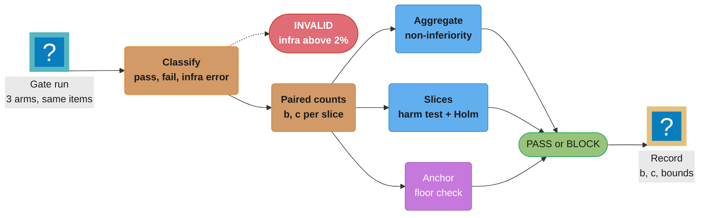
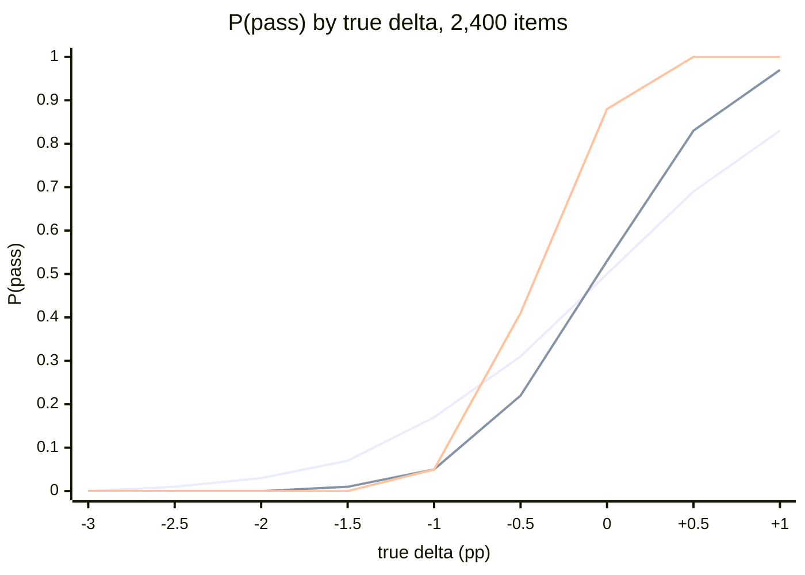
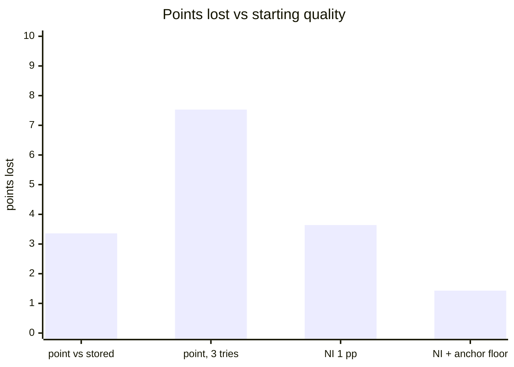

# Statistics of Release Gates

> **Version anchor (2026-10-18).** The methods on this page do not depend on a tool version.
> Code uses the Python standard library (`math`, `random`, `statistics.NormalDist`); statsmodels
> and SciPy are named without a version. Gate results are recorded with **MLflow 3.17.1**
> (2026-10-13) or **Langfuse v4.63.0** (2026-10-16), as on the parent page. Decision-model judge
> cost uses the **OpenAI Decisions API** row checked 2026-10-18: public beta, `POST /v1/decisions`,
> input $0.10 per 1M tokens, no output charge.
>
> **On simulated numbers.** Figures marked "simulated" come from Monte Carlo runs of 20,000
> trials under the assumptions stated next to them. They show a mechanism, not a vendor's data.

---

## 1. Concept Overview

A release gate is a statistical test with a deadline. It reads a finite sample of items, scored
by an imperfect judge, and must say pass or block for a candidate whose true quality nobody
knows. Every gate therefore has a false-pass rate (a regression ships) and a false-block rate (a
neutral or better change is stopped). Neither rate shows up in a green check unless someone
measures it.

This page is the arithmetic behind the gate rules on the parent page
[Evaluation Gates and Eval Sets](evaluation_gates_and_eval_sets.md):

- Confidence intervals for one pass rate, and why the textbook Wald interval fails on small
  slices with rates near 100%, which gates care about most.
- Sample size for a pass-rate delta, paired and unpaired, and how discordance drives it.
- Paired comparison with McNemar's test and the paired interval.
- Many slices at once: family-wise error, Holm, Benjamini-Hochberg, and the opposite problem
  for non-inferiority gates, where more slices mean more false blocks.
- Judge noise: how judge errors shrink real deltas and inflate the sample size.
- The operating curve of a gate, and why "challenger at least champion" ratchets quality down.
- Sequential testing: stopping a gate run early without inflating its error rates.
- Clustered standard errors for repeated samples, paired bootstrap for ratio metrics, and
  reweighting an oversampled gate set to the traffic mix.

The release decision that consumes the gate result is owned by
[AI Release Engineering](../ai_release_engineering/ai_release_engineering.md). Online experiments
on live traffic, where the randomization unit is a user or a conversation rather than an eval
item, are in
[Experimentation for Generative Features](../ai_release_engineering/experimentation_for_generative_features.md).
Decision-model judges, whose probabilities feed the thresholds discussed in §6.5, are in
[Decision Models](../decision_models/decision_models.md).

**Not here.** General hypothesis testing, distributions and the central limit theorem are in
[Probability and Statistics](../../ml/probability_and_statistics/probability_and_statistics.md).
Online A/B test statistics (CUPED, user-level randomization, SPRT for live traffic, Bonferroni
versus Benjamini-Hochberg for secondary metrics) are in
[A/B Testing for ML](../../ml/ml_system_design/ab_testing_for_ml.md). McNemar code for comparing two
classic classifiers is in
[Model Evaluation and Selection](../../ml/model_evaluation_and_selection/model_evaluation_and_selection.md).
This page applies those tools to offline release gates on a fixed eval set.

---

## 2. Intuition

> **One-line analogy**: A gate is a smoke detector. Set it too sensitive and it goes off every
> time someone makes toast, so people pull the battery. Set it too dull and it stays quiet in a
> fire. You cannot choose a setting without knowing how much smoke toast makes.

**Mental model**: Picture the true quality change of a candidate as a point on a number line,
and the gate's measurement as a blurred spot around it. The blur width is set by the number of
items, the fraction of items where the two arms disagree, and the judge's error rate. The gate
rule is a fence on that line. A good gate puts the fence where the blur rarely crosses it for
the changes you want to ship, and nearly always crosses it for the regressions you want to stop.

**Why it matters**: A gate that blocks 40% of neutral changes is not strict, it is broken. Teams
answer it with reruns, overrides and loosened thresholds, and each of those answers raises the
false-pass rate more than the original strictness lowered it. A gate that passes 27% of 1-point
regressions ships about one in four of them, and more when the team reruns it.

**Key insight**: The reference point moves. Each release becomes the next champion, so a gate
that compares only with the current champion lets small losses stack. The fix is not a stricter
rule against the champion; it is a second comparison against a frozen anchor.

---

## 3. Core Principles

1. **Pair whenever you can.** Score champion and challenger on the same items in the same run.
   The variance of a paired delta depends only on the items where the two arms disagree, which
   is usually 2 to 10% of the set, not on the full binomial variance.
2. **Fix the margin, confidence and sample size before the run.** A margin chosen after seeing
   the result is a p-value with extra steps.
3. **Use intervals that hold at the edges.** Gates live near 100% (schema validity, safety) and
   in small slices. Use Wilson or Clopper-Pearson there, never the Wald interval.
4. **Decide the burden of proof per rule.** "Prove you are not worse" (non-inferiority) and
   "prove it is worse" (harm detection) fail in opposite directions as slices are added.
5. **Correct for the number of decisions.** Ten slices at 5% each is a 40% family error rate.
6. **Put the judge in the error budget.** A judge with a Youden index of 0.78 shrinks every delta
   by 22% and needs 1.66 times the items for the same power.
7. **Measure the gate, not only the candidate.** Run champion against champion (an A/A run) to
   read the false-block rate directly, and publish the operating curve.
8. **Anchor against drift.** Compare with a frozen reference bundle as well as the current
   champion, so a sequence of small passes cannot add up to a large loss.

---

## 4. Types / Architectures / Strategies

### 4.1 Which statistic answers which gate question

| Gate question | Statistic | Inputs | Notes |
|---|---|---|---|
| Is this pass rate above a floor? | Wilson or Clopper-Pearson lower bound | passes, n | Wald fails near 0 or 1 and below about 100 items |
| Zero failures seen; how safe is it? | Rule of three, exact bound `1 - alpha^(1/n)` | n | 0 of 400 bounds the rate at 0.75% |
| Is the challenger not worse by more than m? | Paired lower bound of the delta | discordant counts b, c | Non-inferiority; the parent's default |
| Is the challenger worse at all? | McNemar exact test | b, c | Harm detection; one-sided |
| Which of 8 slices regressed? | Holm (block) or Benjamini-Hochberg (review) | slice p-values | Family-wise vs false-discovery control |
| Does a rubric mean or cost per success differ? | Paired bootstrap over items | per-item values | Resample items, never samples |
| Can the run stop early? | Group sequential boundaries or mSPRT | looks, alpha | Boundaries fixed before the run |
| Is the aggregate representative of traffic? | Post-stratified estimate | slice shares | Kish effective n for the interval |

### 4.2 Two burdens of proof

| Framing | Null hypothesis | Block when | More slices cause | Fix |
|---|---|---|---|---|
| Non-inferiority | Challenger worse by at least m | Lower bound not above minus m | More false blocks (power multiplies) | Size each slice for 95%+ power, or widen slice margins |
| Harm detection | No change | Significant decrease | More false blocks (alpha adds up) | Holm across slices |
| Harm detection, no correction | No change | Any slice p below 0.05 | 40% false blocks at 10 slices | Do not ship this |

Both framings block more neutral changes as slices are added, through different mechanisms.
Non-inferiority also blocks when the data are merely inconclusive, so a small slice blocks by
default; harm detection passes an inconclusive slice. Pick per rule: non-inferiority for the
aggregate and for large slices, harm detection with Holm plus absolute floors for small ones.

### 4.3 Gate references

| Reference | Compared on | Catches | Misses |
|---|---|---|---|
| Stored champion score | Old set version, old judge | Nothing reliably | Everything that changed since |
| Champion in the same run | Same set, same judge | Regressions against the last release | Slow drift across many releases |
| Frozen anchor in the same run | Same set, same judge | Cumulative drift since the anchor date | Nothing extra; costs one more arm |

---

## 5. Architecture Diagrams

### Gate statistics pipeline



The three arms are champion, challenger and a frozen anchor bundle, all scored on the same items
by the same pinned judge. Every rule reads the same paired counts, and the record stores the
counts, not only the verdict, so anyone can recompute the decision later.

### Non-inferiority on one axis

```
                         -m = -1.0 pp            0
  true delta (pp)   ----------|---------------------|---------------------->
                              |                     |
  A  lb above -m              |    [=======*=======]|               PASS  non-inferior
  B  lb below -m          [=======*=======]         |               BLOCK cannot rule out -m
  C  whole CI below -m [====*====]                  |               BLOCK inferior
  D  lb above 0               |                     | [=====*=====] PASS  also superior
                              |                     |
  [ ] = two-sided 90% interval of the paired delta, * = observed delta
```

Case B is the one teams argue about: the observed delta is only slightly negative, yet the gate
blocks because the interval is too wide to rule out a 1-point loss. The cure is more items or
less discordance, not a looser margin.

### Paired counts behind McNemar

```
                         challenger
                      pass        fail
                   ┌──────────┬──────────┐
  champion  pass   │   479    │  b = 31  │   510   champion pass rate 85.0%
                   ├──────────┼──────────┤
            fail   │  c = 14  │    76    │    90
                   └──────────┴──────────┘
                      493         107        600 items, challenger 82.2%

  unpaired 2-proportion test:  delta -2.8 pp, 95% CI [-7.0, +1.4], p = 0.19   no signal
  paired (McNemar, exact):     delta -2.8 pp, 95% CI [-5.0, -0.7], p = 0.016  regression
```

The 555 concordant items carry no information about the difference. The paired analysis uses
only the 45 discordant items and sees a regression that the unpaired test hides inside the full
binomial variance of both arms.

### Operating curves of two gate rules



The flat curve is "challenger at least stored champion" (unpaired, standard error 1.03 points at
an 85% pass rate): it passes 17% of 1-point regressions and blocks 50% of neutral changes. The two steep curves are the
paired 1-point non-inferiority rule at 8% and 3% discordance. Both pass a 1-point regression 5%
of the time by construction; they differ in how often a neutral change passes (53% against 88%).

### Quality lost after 20 releases of -0.6 point candidates (simulated)



Each of 20 candidates is truly 0.6 points worse. Every rule that compares only with the current
champion lets some through, and the losses add. Only the frozen-anchor floor (lower bound of
quality against the anchor above minus 2 points) stops the slide.

---

## 6. How It Works: Detailed Mechanics

### 6.1 Intervals for one pass rate

The Wald interval `p +/- z * sqrt(p(1-p)/n)` is the textbook formula. It collapses at the edges,
which is where gates operate. Brown, Cai and DasGupta (Statistical Science, 2001) showed its
coverage is erratic even at moderate n and recommended Wilson or Jeffreys for small n and
Agresti-Coull for larger n. The Wilson arithmetic is worked through in
[Evaluation and Benchmarks](../../llm/evaluation_and_benchmarks/evaluation_and_benchmarks.md).

| Passes / n | Wald 95% | Wilson 95% | Clopper-Pearson 95% |
|---|---|---|---|
| 41 / 41 | [1.000, 1.000] | [0.914, 1.000] | [0.914, 1.000] |
| 36 / 41 | [0.778, 0.978] | [0.745, 0.947] | [0.738, 0.959] |
| 196 / 200 | [0.961, 0.999] | [0.950, 0.992] | [0.950, 0.995] |
| 174 / 200 | [0.823, 0.917] | [0.816, 0.910] | [0.815, 0.913] |
| 2,088 / 2,400 | [0.857, 0.884] | [0.856, 0.883] | [0.856, 0.883] |
| 0 / 400 | [0, 0] | [0, 0.0095] | [0, 0.0092] |

At 41 of 41, Wald claims the true rate is exactly 100%. Wilson says it could be as low as 91.4%.
At 2,400 items the three agree to three decimals, so the choice matters only for small slices
and rates near 100%, which is where floors such as "schema valid at least 99%" live.

**Zero failures.** With 0 failures in n independent items, the one-sided 95% upper bound on the
failure rate is `1 - 0.05^(1/n)`, about `3/n` (the rule of three). 400 red-team items bound the
jailbreak rate at 0.75%. Bounding it at 0.1% needs 2,995 items with zero failures.

### 6.2 Sample size for a pass-rate delta

For a paired non-inferiority gate with margin m, one-sided level alpha and power 1 - beta, and
a true delta of 0:

```
n_paired   = (z_alpha + z_beta)^2 * psi / m^2          psi = discordance rate (b + c) / n
n_unpaired = (z_alpha + z_beta)^2 * 2 p (1 - p) / m^2  per arm, p = baseline pass rate
```

| Design | Margin | One-sided 97.5%, 80% power | One-sided 95%, 80% power |
|---|---|---|---|
| Paired, psi 8% | 5 pp | 251 | 198 |
| Paired, psi 8% | 3 pp | 698 | 550 |
| Paired, psi 12% | 3 pp | 1,047 | 824 |
| Paired, psi 8% | 2 pp | 1,570 | 1,237 |
| Paired, psi 8% | 1 pp | 6,279 | 4,946 |
| Unpaired, p 85% | 5 pp | 801 per arm | 631 per arm |
| Unpaired, p 85% | 3 pp | 2,224 per arm | 1,752 per arm |
| Unpaired, p 85% | 1 pp | 20,015 per arm | 15,766 per arm |

Three readings. Halving the margin quadruples the items. Pairing cuts the requirement by
`2p(1-p) / psi`, about 3.2 times at p 85% and psi 8%. And discordance is a property of the
change, not of the set: a one-line prompt edit might flip 2% of items and a model swap 15%, so
the same gate set is adequately powered for one and not the other. Measure psi on the first full
run of each change type and size from it.

```python
import math
from statistics import NormalDist

def paired_n(margin: float, psi: float, alpha: float = 0.025, power: float = 0.8) -> int:
    z = NormalDist().inv_cdf
    return math.ceil((z(1 - alpha) + z(power)) ** 2 * psi / margin ** 2)

assert paired_n(0.03, 0.08) == 698
```

### 6.3 Paired comparison: McNemar and the paired interval

Let b be the items the champion passed and the challenger failed, and c the reverse. Only b and
c matter. Under no change, each discordant item is a fair coin, so the exact McNemar test is a
binomial test of `min(b, c)` out of `b + c` at p 0.5. The paired delta is `(c - b) / n` with
standard error `sqrt(b + c - (c - b)^2 / n) / n`.

```python
def mcnemar_exact(b: int, c: int) -> float:
    k = b + c
    tail = sum(math.comb(k, i) for i in range(min(b, c) + 1)) / 2 ** k
    return min(1.0, 2 * tail)

def paired_delta_ci(b: int, c: int, n: int, conf: float = 0.95) -> tuple[float, float]:
    z = NormalDist().inv_cdf(0.5 + conf / 2)
    d = (c - b) / n
    se = math.sqrt(b + c - (c - b) ** 2 / n) / n
    return d - z * se, d + z * se

assert round(mcnemar_exact(31, 14), 3) == 0.016
```

With b 31 and c 14 on 600 items (the grid in §5), the unpaired interval is [-7.0, +1.4] points
and the paired one is [-5.0, -0.7]. The unpaired analysis is not wrong; it answers a question
about two independent samples that the gate never asked. Pairing breaks when the arms are not
scored on the same items: a stored champion score, a different set version, or a challenger run
that dropped 3% of items to timeouts. Pair on the intersection of items both arms scored, and
report how many were dropped.

### 6.4 Many slices

A gate with 10 slices, each tested for harm at one-sided 5%, blocks a truly neutral change with
probability `1 - 0.95^10 = 40%`. At 16 slices it is 56%.

**Holm** controls the family-wise error rate (the chance of any false block) at alpha and is
never less powerful than Bonferroni. Sort the k p-values ascending; compare the i-th smallest
with `alpha / (k - i + 1)`; stop at the first one that does not pass and block on all before it.
**Benjamini-Hochberg** controls the false discovery rate (the expected share of flagged slices
that are false): find the largest i with `p_(i) <= i * alpha / k` and flag all slices up to it.

| Slice | p (harm) | Holm threshold | Holm | BH threshold | BH |
|---|---|---|---|---|---|
| es / refunds | 0.0004 | 0.00625 | block | 0.00625 | flag |
| de / billing | 0.004 | 0.00714 | block | 0.0125 | flag |
| fr / account | 0.011 | 0.00833 | pass | 0.01875 | flag |
| en / technical | 0.019 | 0.0100 | pass | 0.025 | flag |
| es / billing | 0.032 | 0.0125 | pass | 0.03125 | pass |
| de / technical | 0.21 | 0.0167 | pass | 0.0375 | pass |
| fr / billing | 0.48 | 0.025 | pass | 0.04375 | pass |
| en / billing | 0.71 | 0.05 | pass | 0.05 | pass |

Use Holm for the block decision and BH for the review queue. A block costs a release; a flag
costs a reviewer's hour. Holm blocks on two slices; BH sends four to a human, accepting that
about one in twenty flags is noise.

```python
def holm(pvals: dict[str, float], alpha: float = 0.05) -> set[str]:
    ranked = sorted(pvals.items(), key=lambda kv: kv[1])
    k, rejected = len(ranked), set()
    for i, (name, p) in enumerate(ranked):
        if p > alpha / (k - i):
            break
        rejected.add(name)
    return rejected
```

**The non-inferiority version of the problem.** A per-slice non-inferiority rule passes only if
every slice proves itself. If each slice has 80% power at a true delta of 0, all 8 pass with
probability `0.8^8 = 17%`. At 95% power per slice it is 66%. So per-slice non-inferiority needs
each gated slice sized for 99% power or more, which in practice means a wide slice margin (3 to 5
points) and several hundred items per slice. The parent page's case study gates 8 overlapping
slices of 240 to 1,680 items with a 3-point margin at 90%; at 2% discordance a neutral change
passes all of them about 93% of the time, at 3% about 76%, at 4% about 57%.

### 6.5 Judge noise

A judge has a true-positive rate (Se, passes it calls passes) and a true-negative rate (Sp,
failures it calls failures). The observed pass rate is `Se * p + (1 - Sp) * (1 - p)`, so every
true delta reaches the gate multiplied by Youden's index `J = Se + Sp - 1`.

With the parent page's calibration matrix (Se 412/430 = 0.958, Sp 139/170 = 0.818):

- `J = 0.776`. A true 3-point regression shows up as 2.33 points.
- A margin written as "3 points" on the judged scale allows a 3.87-point true regression.
- Power for the same true delta needs `1 / J^2 = 1.66` times the items.
- An absolute rate can be corrected (Rogan-Gladen): `p = (p_obs + Sp - 1) / J`. An observed
  70% pass rate is a true 66.7%.

A stochastic judge adds a second cost. If two calls of the judge on identical input disagree on
a fraction r of items, then even identical outputs show discordance of about r, which adds
directly to psi in §6.2. A generative judge with r 5% turns a 3% discordance change into an 8%
one and multiplies the required items by 2.7. A decision-model judge with one prefill and no
sampling, or a majority of 3 generative calls, reduces r.

The attenuation model assumes judge errors do not depend on which arm produced the output. That
fails when the change targets something the judge has a bias about: a prompt that shortens
answers, judged by a model that prefers short answers, can show a gain the human labels do not.
Calibrate on outputs from both arms, not only from the champion.

### 6.6 The operating curve of a gate

The operating curve plots P(pass) against the true delta. It is the gate's specification, and
it can be computed before the gate ever runs:

```
P(pass | delta) = 1 - Phi((-m + z_alpha * se - delta) / se),   se = sqrt(psi / n)
```

For the parent page's aggregate rule (1-point margin, one-sided 95%, 2,400 items):

| Discordance psi | se (pp) | P(pass) at 0 | at -0.5 pp | at -1 pp | at -2 pp |
|---|---|---|---|---|---|
| 2% | 0.29 | 0.97 | 0.53 | 0.05 | 0.00 |
| 3% | 0.35 | 0.88 | 0.41 | 0.05 | 0.00 |
| 5% | 0.46 | 0.71 | 0.29 | 0.05 | 0.00 |
| 8% | 0.58 | 0.53 | 0.22 | 0.05 | 0.00 |

The false-pass rate at the margin is 5% by construction. Everything else, including how often
a neutral change gets through, depends on discordance. A gate configured once and then fed
changes with higher discordance turns into a blocker, and the team stops trusting it.

**A/A runs measure it directly.** Run the champion against itself (or against a candidate that
changes only a comment) through the full gate, 20 to 50 times over different seeds and days. The
fraction blocked is the gate's false-block rate at a delta of 0, with judge noise, infra errors
and slice multiplicity all included. Publish it next to the gate.

### 6.7 Why "at least the champion" ratchets quality down

Three mechanisms stack.

1. **Noise passes small losses.** With an unpaired standard error of 1.6 points (1,000 items at
   an 85% pass rate), a 1-point regression passes 27% of the time. Allowing reruns raises that to 46% after two attempts, 60%
   after three, 71% after four.
2. **The reference moves.** Every pass becomes the next champion. The next comparison starts
   from the lower level, so no single gate sees the cumulative loss.
3. **Margins compound.** A non-inferiority margin of 1 point permits a loss of up to 1 point per
   release by design. Clinical-trial statisticians call the pattern biocreep: a drug proved
   non-inferior to a drug that was proved non-inferior to a third.

Simulated, 20 releases each truly 0.6 points worse, 2,400 items, 3% discordance where paired:

| Rule | Mean points lost | Neutral changes blocked |
|---|---|---|
| Challenger at least stored champion | 3.36 | 50% |
| Same, up to 3 tries | 7.53 | 13% |
| Paired non-inferiority, 1 pp | 3.64 | 12% |
| Non-inferiority plus floor 2 pp against a frozen anchor | 1.43 | 12% plus anchor blocks |

Of these rules, only the anchor floor bounds total drift. The anchor is a bundle frozen at a
known-good point (for example the first release of the quarter), scored in every gate run on the
same items. Moving the anchor is a release-owner decision with its own record, not a side effect
of shipping.

### 6.8 Sequential testing

Running items in batches and stopping at the first significant look inflates the error rate.
Simulated under no change, with a nominal two-sided 5% test at each look: 14% with 5 looks, 19%
with 10. Group sequential designs fix boundaries in advance so the overall rate stays at 5%.

| Look (of 5) | Items so far | Naive z | Pocock z | O'Brien-Fleming z |
|---|---|---|---|---|
| 1 | 480 | 1.96 | 2.413 | 4.562 |
| 2 | 960 | 1.96 | 2.413 | 3.226 |
| 3 | 1,440 | 1.96 | 2.413 | 2.634 |
| 4 | 1,920 | 1.96 | 2.413 | 2.281 |
| 5 | 2,400 | 1.96 | 2.413 | 2.040 |
| Overall false-positive rate (simulated) | | 14.1% | 4.9% | 5.0% |

O'Brien-Fleming suits a gate: it stops early only for clear results and costs little at the
final look. Simulated with 5 looks over 2,400 items at 3% discordance, stopping to
block when the harm z-score crosses the boundary and to pass when the non-inferiority bound
(using the same boundary) clears minus 1 point:

| True delta | Blocked early | Passed | Inconclusive at end, blocks | Mean items scored |
|---|---|---|---|---|
| -3 pp | 100% | 0% | 0% | 871 |
| -1 pp | 79% | 2% | 19% | 1,919 |
| 0 | 2% | 79% | 19% | 1,901 |
| +1 pp | 0% | 100% | 0% | 1,134 |

A clear regression stops after about a third of the set, which saves judge spend and wall clock
on exactly the runs that will be blocked. A neutral change still reads most of the set.
Always-valid methods such as the mixture SPRT allow a look after every item, at the cost of
wider intervals at any fixed n; they suit streaming online evaluation more than a batch gate.

### 6.9 Repeated samples, clustering and the bootstrap

When a gate draws k samples per item at temperature above 0, the k results for one item are
correlated. Treating 2,400 items times 5 samples as 12,000 independent trials understates the
standard error by `sqrt(1 + (k - 1) * rho)`, where rho is the intra-item correlation. At k 5 and
rho 0.6 the design effect is 3.4 and the true standard error is 1.84 times the naive one. Compute
the per-item mean first, then treat items as the unit; or use clustered standard errors with
the item as the cluster. The same applies to items drawn from one conversation or one document.

Ratio metrics need the same care. Cost per successful task is total cost over total successes,
not a mean of per-item ratios, and its interval comes from a paired bootstrap over items:

```python
import random

def paired_bootstrap_ratio(cost_a, ok_a, cost_b, ok_b, reps=5000, seed=7):
    rng, n, deltas = random.Random(seed), len(cost_a), []
    for _ in range(reps):
        idx = [rng.randrange(n) for _ in range(n)]          # resample ITEMS, both arms together
        ra = sum(cost_a[i] for i in idx) / max(1, sum(ok_a[i] for i in idx))
        rb = sum(cost_b[i] for i in idx) / max(1, sum(ok_b[i] for i in idx))
        deltas.append(rb / ra - 1)
    deltas.sort()
    return deltas[int(0.025 * reps)], deltas[int(0.975 * reps)]
```

Resampling both arms with the same indices keeps the pairing. Resampling the arms independently
throws it away and widens the interval for no reason.

### 6.10 Weighting an oversampled gate set to traffic

Gate sets oversample small slices so each has enough items to gate. The aggregate must then be
reweighted to traffic shares, or it describes the set rather than the product. Weight each slice
by `traffic share / set share`. The cost is a smaller effective sample:
`n_eff = n / sum(t_i^2 / s_i)`.

| Slice | Traffic share t | Set share s | Weight |
|---|---|---|---|
| en / billing | 38% | 16.7% | 2.28 |
| en / technical | 27% | 16.7% | 1.62 |
| en / account | 15% | 16.7% | 0.90 |
| de / all | 9% | 16.7% | 0.54 |
| es / refunds | 6% | 16.7% | 0.36 |
| fr / all | 5% | 16.7% | 0.30 |

With 400 items per slice (2,400 total), `sum(t_i^2 / s_i) = 1.524`, so the weighted aggregate
has the precision of 1,575 traffic-proportional items. Size the aggregate rule against 1,575,
not 2,400.

---

## 7. Real-World Examples

### Anthropic: "Adding Error Bars to Evals" (November 2024)

Anthropic published a research paper by Evan Miller arguing that model evaluations should be
reported as experiments: with standard errors from the central limit theorem, clustered standard
errors when questions come in related groups, paired differences when two models answer the same
questions, and power analysis to choose the number of questions. Every one of those
recommendations is a rule on this page applied to public benchmarks.

### Optimizely Stats Engine and "Peeking at A/B Tests" (2015, KDD 2017)

Optimizely moved its experiment results to always-valid sequential inference because customers
watched dashboards continuously and stopped at the first significant result. Johari, Koomen,
Pekelis and Walsh described the method (a mixture sequential probability ratio test) at KDD 2017.
A CI gate that streams results to a dashboard has the same peeking problem.

### Brown, Cai and DasGupta on the binomial interval (2001)

Their paper in Statistical Science showed that the Wald interval's coverage oscillates and can
fall well below the nominal level even at large n for some true rates, and recommended Wilson or
Jeffreys for small n and Agresti-Coull for larger n. Gate floors on rates near 100% are the case where the difference is largest.

### Card et al., "With Little Power Comes Great Responsibility" (EMNLP 2020)

The authors estimated the statistical power of common NLP comparisons and found many were
underpowered: the improvements being reported were smaller than the test sets could reliably
detect. An eval set sized from a budget rather than from a margin has the same problem, as the
parent page's case study found with a 41-item slice.

### Non-inferiority trials and biocreep (clinical trials)

The US FDA's 2016 guidance on non-inferiority trials requires the margin to be set before the
trial from the known effect of the active control. Statisticians use the term biocreep for the
drift that follows when each new treatment is compared only with the last non-inferior one. ML
release gates reproduce both problems: margins picked after the run, and a moving champion.

---

## 8. Tradeoffs

### Interval method for one rate

| Method | Coverage near 0 or 1 | Small n | Width | Use |
|---|---|---|---|---|
| Wald | Poor; zero width at 0 or n | Poor | Narrowest, wrongly | Never in a gate |
| Wilson | Good | Good | Moderate | Default for floors |
| Clopper-Pearson | Conservative (at least nominal) | Good | Widest | Safety and compliance floors |
| Rule of three | Upper bound only, zero failures | Any | One-sided | Red-team sets |

### Multiplicity control

| Method | Controls | Power | Use in a gate |
|---|---|---|---|
| None | Nothing | Highest | Never with more than one slice |
| Bonferroni | Family-wise error | Lowest | Simple, acceptable for 2 to 3 slices |
| Holm | Family-wise error | At least Bonferroni | Block decisions across slices |
| Benjamini-Hochberg | False discovery rate | Higher | Review queue, exploratory slices |

### Sequential design

| Design | Early stop for clear results | Cost at final look | Looks | Use |
|---|---|---|---|---|
| Fixed sample | No | None | 1 | Short gates, cheap judges |
| O'Brien-Fleming | Late, only for clear results | Small (2.04 vs 1.96) | Fixed, few | Long merge and release gates |
| Pocock | Early | Large (2.413 every look) | Fixed, few | When early stops matter more than final power |
| mSPRT, always valid | Any time | Wider intervals at any fixed n | Unlimited | Streaming online evaluation |

---

## 9. When to Use / When NOT to Use

**Use the full paired machinery (McNemar, paired bounds, Holm, anchor) when:**

- The gate blocks releases and its decisions are audited.
- Slices have owners and business costs, and there are more than two of them.
- Releases are frequent enough (more than about one a week) that drift through a moving champion
  is plausible.

**Use simpler statistics when:**

- The rule is a contract with a 100% requirement: count failures and block on any. A Wilson bound
  adds nothing when the rule is "zero".
- The set is large and the margin wide (10,000 items, 5-point margin): the Wald and Wilson
  intervals agree and the choice does not matter.

**Do not add sequential stopping when:**

- A full run takes under 10 minutes and costs a few dollars, as with a decision-model judge at
  $0.10 per 1M input tokens. The added code and the reviewer's need to understand boundaries cost
  more than the saved run time.
- The team cannot commit to boundaries before the run. A sequential design changed after a look
  is peeking with paperwork.

---

## 10. Common Pitfalls

**The 100% slice that proved nothing.** A schema-validity floor of 99% used the Wald interval. A
new locale slice had 41 items, all valid, so the interval was [1.0, 1.0] and the gate passed. In
production the locale's validity was 96%: dates in a format the parser rejected. The Wilson
lower bound on 41 of 41 is 0.914, which would have reported the slice as unproven. Fix: Wilson
or Clopper-Pearson for every floor, and a minimum item count below which a floor reports instead
of passing.

**Ten slices at 5% each.** A team added harm tests per language and per intent, each at one-sided
5%, without a correction. An A/A run later measured 41% of champion-against-champion runs
blocked, close to the expected `1 - 0.95^10 = 40%`. Engineers had learned to rerun blocked gates,
which also reran past real regressions. Fix: Holm across slices for blocks, BH for the review
queue, and a monthly A/A run to measure the false-block rate.

**Five samples treated as five items.** A gate sampled 5 completions per item at temperature 0.7
and computed the standard error over 12,000 results. The reported interval was plus or minus 0.6
points; the item-clustered interval was plus or minus 1.1. Two "significant" gains that justified
a model switch were inside the noise. Fix: aggregate per item first, then compute intervals over
items.

**A margin defined on the old judge.** A team set a 2-point non-inferiority margin when its judge
had a Youden index of 0.9. A judge change brought J down to 0.7. The same 2 points on the judged
scale now allowed a 2.9-point true loss, and nobody changed the config. Fix: state margins on the
human-label scale, and convert them with the current judge's J at every judge change.

**Stopping at the first green.** A gate streamed results to a dashboard and an engineer merged as
soon as the running lower bound crossed the margin, typically after 30 to 40% of the items.
Simulated with a look every 240 of 2,400 items, that pattern passed a 1-point regression 17% of
the time, against 5% for the fixed rule.
Fix: either fixed-sample decisions only, or O'Brien-Fleming boundaries computed before the run.

**The ratchet nobody saw.** Over two quarters, 14 releases each passed "challenger at least
champion" on a 1,000-item set. A labeling project then scored the January bundle and the
current one side by side: the current bundle was 4.1 points worse. No single gate had failed.
Fix: a frozen anchor scored in every run, with a floor.

**Discordance assumed, not measured.** A gate was sized for a 3-point margin assuming 5%
discordance and hard-coded the matching standard error into the rule. A model-family switch on
700 items produced 14% discordance. The real one-sided half-width was 2.3 points, the hard-coded
one 1.4, so a candidate whose true loss could not be bounded inside the margin passed. Fix:
compute the standard error from the run's own b and c, and record psi with every result.

---

## 11. Technologies & Tools

| Tool | Role | Notes |
|---|---|---|
| statsmodels | `proportion_confint(method="wilson")`, `mcnemar(table, exact=True)`, `multipletests(method="holm")` | Covers sections 6.1, 6.3 and 6.4 in a few calls |
| SciPy | `scipy.stats.binomtest`, `scipy.stats.false_discovery_control`, `scipy.stats.bootstrap` with `paired=True` | `false_discovery_control` implements Benjamini-Hochberg |
| NumPy | Vectorised paired bootstrap and A/A simulation | Simulate the gate before trusting it |
| MLflow | 3.17.1: store b, c, n, psi, bounds and the decision with the gate run | Recompute decisions from stored counts |
| Langfuse | v4.63.0: dataset runs with per-item scores for both arms | Per-item scores are what pairing needs |
| OpenAI Decisions API | Decision-model judge with no sampling noise | Lowers judge-induced discordance; $0.10 per 1M input tokens (checked 2026-10-18) |

---

## 12. Interview Questions with Answers

**Q: Why does a "challenger at least champion" gate let quality fall over many releases?**
**Short:** Noise lets small regressions pass, each pass becomes the new reference, and the losses add up because no gate compares against a fixed point.

Three effects stack. With an unpaired standard error of about 1.6 points on 1,000 items, a truly
1-point-worse candidate passes about 27% of the time, more with reruns. Each pass becomes the next
champion, so the next gate starts from the lower level. And even a correct non-inferiority margin
permits up to the margin per release by design. Simulated over 20 releases of 0.6-point losses
on 2,400 items, the point rule loses 3.4 points (7.5 with up to 3 tries) and a 1-point
non-inferiority rule 3.6. Add a frozen anchor scored in every run, with a floor on the lower bound
against it; the same simulation then loses 1.4 points.

**Q: A slice passed 41 of 41 items. What is the 95% interval on its pass rate?**
**Short:** Wilson and Clopper-Pearson both give about [0.914, 1.0]; the Wald formula gives [1.0, 1.0], which is wrong and should never be used for a gate floor.

The Wald interval uses the observed rate to estimate its own variance, so at 0 or n successes the
variance is zero and the interval collapses to a point. Wilson inverts the score test and stays
sensible at the edges: [0.914, 1.0] here. Clopper-Pearson, the exact binomial interval, gives the
same lower bound and is conservative elsewhere. If the floor is 95%, this slice has not proved it
meets the floor. Use Wilson by default and Clopper-Pearson for safety or compliance floors, and
set a minimum item count below which a slice reports instead of passing.

**Q: The unpaired test shows no significant difference, but McNemar shows a regression. Which do you trust?**
**Short:** McNemar, because both arms were scored on the same items, so only the discordant items carry information and the unpaired test wastes the pairing.

On 600 shared items with b 31 (champion passed, challenger failed) and c 14, the unpaired
two-proportion test gives p 0.19 and an interval of [-7.0, +1.4] points. McNemar's exact test
gives p 0.016 and the paired interval is [-5.0, -0.7]. The 555 items where both arms agree add
variance to the unpaired test without adding information about the difference. Pairing is valid
only when both arms were scored on the same items in the same run with the same judge, so pair
on the intersection and report how many items were dropped.

**Q: Your gate tests 10 slices for harm at 5% each. How often does it block a neutral change?**
**Short:** About 40% of the time (1 minus 0.95 to the power 10), so apply Holm across slices for blocks and keep Benjamini-Hochberg for the review queue.

Each test has a 5% chance of a false alarm, and the chance that at least one of 10 independent
tests fires is `1 - 0.95^10`, about 40%. Overlapping slices are not independent, so the real rate
is a little lower, and an A/A run measures it directly. Holm keeps the family-wise rate at 5%
while blocking at least as much as Bonferroni. Benjamini-Hochberg controls the share of flagged
slices that are false and suits a human review queue, where a false flag costs an hour rather
than a release.

**Q: Why does adding slices to a per-slice non-inferiority gate make it block more neutral changes?**
**Short:** Every slice must prove non-inferiority, so the pass probability is the product of per-slice powers; 8 slices at 80% power each pass together only 17% of the time.

Non-inferiority puts the burden of proof on the candidate: a slice with an interval too wide to
rule out the margin blocks. If each slice has 80% power at a true delta of 0, all 8 pass with
probability `0.8^8`, about 17%; at 95% each, 66%. The fix is sizing each gated slice for 99%
power or more, which means wider slice margins (3 to 5 points) and several hundred items each,
or switching small slices to harm detection with Holm plus an absolute floor. Choose the burden
of proof per rule, not once for the whole gate.

**Q: How do you measure a gate's false-block rate?**
**Short:** Run A/A gates, champion against itself or against a no-op change, 20 to 50 times, and count how many block; that number includes judge noise, infra errors and multiplicity.

Analytic calculations miss correlated slices, judge stochasticity, flaky items and infra-error
handling. An A/A run has a true delta of exactly 0, so every block is a false block. Run it on
different days and seeds, at least monthly and after any change to the judge, the set or the
rules. Publish the rate next to the gate. A false-block rate above about 10% predicts reruns and
overrides; fix it with Holm, larger slices, a lower-noise judge, or quarantined flaky items.

**Q: An engineer stops the eval as soon as the running lower bound clears the margin. What is wrong?**
**Short:** Checking repeatedly and stopping at the first success inflates the error rate; with 5 looks at a nominal 5%, the real rate is about 14%, so fix boundaries in advance.

Each look is another chance for noise to cross the line. Simulated under no change, a nominal
two-sided 5% test checked at 5 equally spaced looks rejects 14% of the time, and at 10 looks 19%.
Group sequential boundaries fix this: O'Brien-Fleming critical z values of 4.56, 3.23, 2.63,
2.28 and 2.04 for 5 looks keep the overall rate at 5%. Commit to the boundaries before the run
and record them with the result. Otherwise decide only at the planned sample size.

**Q: How does an imperfect judge change the statistics of a gate?**
**Short:** It shrinks every true delta by Youden's index J, so margins on the judged scale are looser than they look and the sample size grows by 1 over J squared.

The observed pass rate is `Se * p + (1 - Sp) * (1 - p)`, so a true change in p appears multiplied
by `J = Se + Sp - 1`. With Se 0.958 and Sp 0.818, J is 0.776: a true 3-point regression appears
as 2.33 points, a 3-point margin on the judged scale allows 3.87 true points, and the gate needs
1.66 times the items for the same power. A stochastic judge also adds its own run-to-run
disagreement rate to the discordance. State margins on the human-label scale and recompute them
when the judge changes.

**Q: How many paired items do you need to gate a 3-point margin?**
**Short:** About (z_alpha + z_beta) squared times discordance over margin squared; at 8% discordance, one-sided 97.5% and 80% power, roughly 700 items.

For a paired non-inferiority test at a true delta of 0, `n = (z_alpha + z_beta)^2 * psi / m^2`.
With psi 0.08, m 0.03, z 1.96 and 0.84, n is 698; at one-sided 95% it is 550. An unpaired design
at an 85% pass rate needs about 2,224 per arm. Halving the margin quadruples n, and psi depends on
the change: a small prompt edit might flip 2% of items, a model swap 15%. Measure psi on the first
full run and resize. Each gated slice needs this count on its own.

**Q: A red-team set of 400 attacks had zero successes. How many attacks would bound the rate at 0.1%?**
**Short:** About 3,000; with zero failures the 95% upper bound is roughly 3 over n, so 400 items bound the rate at 0.75% and 2,995 items are needed for 0.1%.

The exact one-sided bound with zero failures in n trials is `1 - 0.05^(1/n)`. For 400 items it is
0.746%; solving for 0.1% gives 2,995 items. That assumes the items represent real attacks; a set
missing an attack class bounds nothing about that class. If 3,000 hand-written attacks are too
many, generate variants of each class with a pinned generator and keep a smaller hand-curated
set for new classes.

**Q: The gate samples 5 completions per item. How should the standard error be computed?**
**Short:** Treat the item as the unit: average per item first or use item-clustered standard errors, because samples of one item are correlated and the naive error is too small.

The k samples of one item share its difficulty, so they are not independent. The naive standard
error over all samples is too small by `sqrt(1 + (k - 1) * rho)`; with k 5 and an intra-item
correlation of 0.6, by a factor of 1.84. Average the k results per item and compute the interval
over items, or use clustered standard errors with the item as the cluster. Apply the same
rule to items that come from one conversation or one source document.

**Q: How do you put an interval on cost per successful task for a challenger versus the champion?**
**Short:** Use a paired bootstrap over items, resampling both arms with the same indices and computing the ratio of totals in each replicate.

Cost per success is total cost divided by total successes, a ratio of sums, so there is no
simple binomial formula and the mean of per-item ratios is the wrong quantity. Resample items with
replacement, apply the same indices to both arms to keep the pairing, compute each arm's ratio of
totals, and take percentiles of the relative difference. Resampling calls instead of items, or
the arms independently, gives intervals that are too narrow or too wide. Gate on the upper bound
of the relative increase, for example below 10%.

**Q: Why must the margin be fixed before the gate runs, and where should it come from?**
**Short:** A margin chosen after seeing the result can be fitted to pass anything; set it from the business cost of a regression and record it in the gate config before the run.

If the margin is chosen after the result, the rule is no longer a test, because the threshold
has been fitted to the data. Derive it from what a regression costs: if a 1-point drop in task
success costs about $40,000 a month in escalations, the margin is the largest loss the product
owner accepts for the change's benefit. Record the margin, confidence and minimum items in the
versioned gate config, and treat any change to them as a gate change with its own review.

**Q: The gate set oversamples small slices. How do you compute and size the aggregate rule?**
**Short:** Reweight each slice by traffic share over set share, and size the aggregate rule on the Kish effective sample size, which is smaller than the raw item count.

An unweighted aggregate describes the set's slice mix, not production's. Weight each slice by
`t_i / s_i`. The weighted estimate has variance as if it came from `n_eff = n / sum(t_i^2 / s_i)`
items. For 6 slices of 400 items each against traffic shares of 38, 27, 15, 9, 6 and 5%, the sum
is 1.524, so 2,400 items behave like 1,575. Use that number in the sample-size formula, and keep
per-slice rules on the raw slice counts.

**Q: What is the operating curve of a gate, and why publish it?**
**Short:** It is P(pass) as a function of the true delta, computed from the margin, confidence, items and discordance, and it states exactly which changes the gate passes and blocks.

For a paired non-inferiority rule, `P(pass | delta) = 1 - Phi((-m + z_alpha * se - delta) / se)`
with `se = sqrt(psi / n)`. At a 1-point margin, one-sided 95% and 2,400 items, a neutral change
passes 88% of the time at 3% discordance and 53% at 8%; a 1-point regression always passes 5%.
Publishing the curve tells teams which changes need a bigger set, explains blocks without
argument, and turns "the gate is too strict" into a measurable claim checked by A/A runs.

**Q: When would you choose O'Brien-Fleming boundaries over an always-valid test such as mSPRT for a gate?**
**Short:** For a batch gate with a few planned looks, O'Brien-Fleming costs little at the final look; mSPRT suits continuous monitoring, at the price of wider intervals at any fixed n.

A merge or release gate runs a known number of items and can look after each batch of a few
hundred. O'Brien-Fleming spends almost no error early, so it stops only for clear results and its
final critical value (2.04 at 5 looks) is close to the fixed-sample 1.96. Simulated at 3%
discordance, a 3-point regression stops after about 870 of 2,400 items. mSPRT allows a decision
after any item, which suits streaming online evaluation, but its intervals are wider for the same
items. Use it when the number of looks cannot be fixed.

---

## 13. Best Practices

- Pair every comparison: champion, challenger and anchor scored on the same items in one run.
- Fix margin, confidence, minimum items and any sequential boundaries in the gate config before
  the run.
- Use Wilson for floors, Clopper-Pearson for safety and compliance floors, never Wald.
- Report the zero-failure bound (`1 - 0.05^(1/n)`) with every red-team result.
- Size from the margin and the measured discordance; record psi with every result.
- Choose the burden of proof per rule: non-inferiority for large slices and the aggregate, harm
  detection with Holm for small slices.
- Use Holm for block decisions across slices and Benjamini-Hochberg for review queues.
- State margins on the human-label scale and convert with the judge's Youden index.
- Aggregate repeated samples per item before computing intervals.
- Bootstrap ratio metrics over items, with the same indices for both arms.
- Reweight oversampled slices to traffic and size the aggregate on the Kish effective n.
- Score a frozen anchor bundle in every run and gate on a floor against it.
- Run A/A gates monthly and after any judge, set or rule change; publish the false-block rate.
- Store b, c, n, bounds and the decision per slice with the bundle digest.

---

## 14. Case Study

### Repairing a gate that blocked 41% of neutral changes

**Context.** A document-extraction product (invoices, receipts, bank statements) in 5 languages
ships about 30 bundle releases a quarter: prompt versions, a fine-tuned adapter, and occasional
provider snapshot bumps. The gate scored 3,000 items with a generative judge, 5 samples per item
at temperature 0.7, and tested 10 slices (5 languages and 5 document types) for harm at one-sided
5% each, plus "aggregate challenger at least stored champion". Results streamed to a dashboard.

**Symptoms.**

| Observation | Value |
|---|---|
| A/A runs (champion against itself) blocked | 41% of 34 runs |
| Gate reruns per quarter | 46 |
| Overrides per quarter | 9 |
| Median gate wall clock | 38 minutes |
| Quality against the January bundle, scored side by side in June | -4.1 points |

**Diagnosis.**

| Finding | Effect |
|---|---|
| 10 uncorrected harm tests at 5% | Expected `1 - 0.95^10 = 40%` false blocks; A/A measured 41% |
| Standard error over 15,000 samples, not 3,000 items | Intervals 1.8 times too narrow; noise read as signal in both directions |
| Point comparison with a stored champion score | Small regressions passed on noise; reruns raised the pass rate |
| No anchor | Each release judged only against the last one; 14 passes added up to -4.1 points |
| Generative judge, two-call disagreement 6% | Discordance on small prompt changes rose from about 2% to about 8% |
| Merges at the first green on the dashboard | Unplanned peeking; effective false-pass rate unknown |

**Broken first fix.** The team proposed lowering each slice test to 1% to cut false blocks. That
brings the family rate to about 10% but leaves the ratchet, the clustering error, the stored
champion and the peeking untouched, and it cuts power on the slices that matter. Rejected.

**Executed fix.**

1. Aggregate the 5 samples per item into a per-item pass fraction for reporting, and use a
   decision-model judge for the binary criteria, which cut two-call disagreement to under 1%.
2. Score champion, challenger and a frozen anchor (the first release of the quarter) on the same
   items in every run; pair on the intersection of items all three scored.
3. Aggregate rule: paired non-inferiority, 1-point margin, one-sided 95%, on the Kish effective
   sample of the reweighted set.
4. Slice rules: harm detection with McNemar exact p-values and Holm at a family 5%; BH at 10% for
   the review queue; Wilson floors at the champion's level minus 5 points.
5. Anchor floor: lower bound against the anchor above minus 2 points. Moving the anchor requires
   a recorded release-owner decision.
6. Five-look O'Brien-Fleming boundaries for block and pass, fixed in the gate config; the
   dashboard shows the boundary, not a running p-value.
7. Monthly A/A runs, results published next to the gate.

**Cost.**

| Item | Before | After |
|---|---|---|
| Judge calls per full run | 15,000 samples x 2 criteria | 3,000 items x 2 criteria x 3 arms |
| Judge spend per full run | about $200 (assumed $3 / $15 per 1M, 1,500 in and 150 out per call) | about $2.70 (decision model) plus about $2.40 for the 2% of uncertain items |
| Mean items scored per run | 3,000 | about 2,100 (sequential stops) |
| Median wall clock | 38 minutes | 17 minutes |

**Outcome over the next two quarters.** A/A false blocks fell from 41% to 4% (2 of 50 runs).
Reruns fell from 46 to 3 a quarter, all after infra incidents classified as `INVALID`. Overrides
fell from 9 to 1. The gate blocked 6 of 61 candidates; 5 were confirmed as real regressions by a
larger relabeled slice, and 2 of those (the Arabic slice down 4.8 points and the
bank-statement slice down 3.1) would have passed the old aggregate rule. The anchor floor blocked
one candidate that was non-inferior to the champion but 2.3 points below the anchor; the team
investigated and found two earlier prompt changes had each cost about a point on long documents.

**What the team would do differently.** Run A/A gates before trusting any gate, from its first
week. The 41% false-block rate was visible from the first day to anyone who ran the champion
against itself, and it explained every rerun and override that followed. The gate design the
team moved to is on the parent page,
[Evaluation Gates and Eval Sets](evaluation_gates_and_eval_sets.md); the rollout ladder that reads
the gate result is in [AI Release Engineering](../ai_release_engineering/ai_release_engineering.md).
