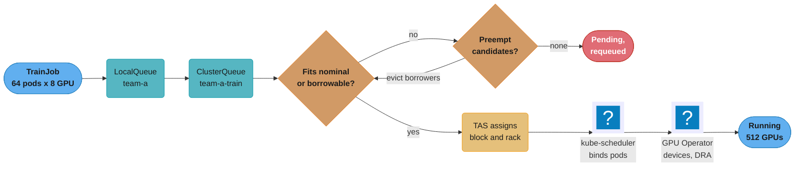
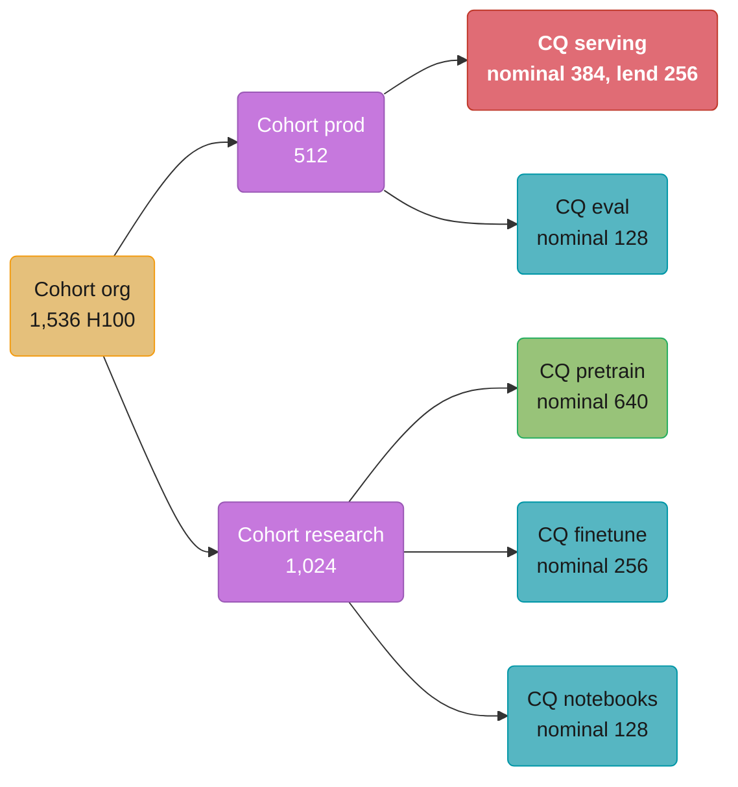
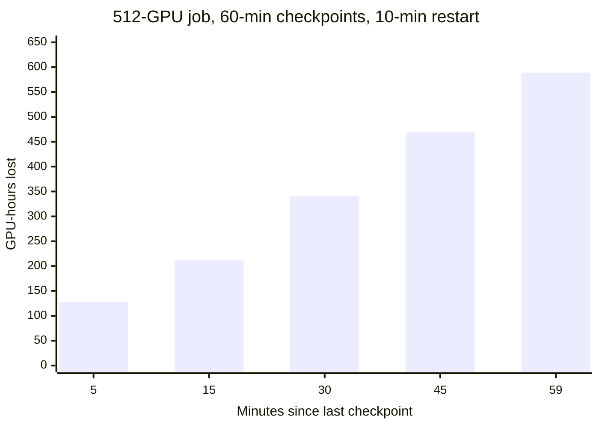

# GPU Cluster Scheduling and Quotas

> **Version anchor (2026-10-18).** Kubernetes 1.37 (1.37.0 2026-08-26, 1.37.1 2026-09-15).
> Kueue v0.20.2 (2026-10-15); `kueue.x-k8s.io/v1beta1` is no longer served, so manifests use
> `v1beta2`. Kueue is a Kubernetes SIG project, not a CNCF project. Volcano v1.16.0
> (2026-10-14). KAI Scheduler v0.18.6 (2026-10-15; v0.16.12 of 2026-10-18 is a backport line),
> CNCF Sandbox since 2025-12-21, Apache-2.0. LeaderWorkerSet v1.0.0 (2026-10-16). Slinky
> `slurm-operator` v1.2.3 (tag, 2026-09-30). NVIDIA GPU Operator v26.7.2 (2026-10-14), which
> manages the NVIDIA DRA Driver v0.5.1 through the `GPUCluster` custom resource. NVIDIA Network
> Operator v26.7.1 (2026-10-16). AMD GPU Operator v1.5.1 (2026-07-21; chart
> `gpu-operator-charts-v1.5.1`). Intel Device Plugins Operator v0.37.1 (2026-10-02; v0.37.0
> removed the DLB and FPGA plugins). Every version claim below is checked against this anchor.

A shared GPU fleet has fixed supply and three kinds of demand. Training jobs want hundreds of
GPUs at once for days, inference wants a guaranteed floor that grows at 9 a.m., and research
wants whatever is idle. This page covers who is entitled to what (quota), who may use idle
capacity (borrowing), who loses capacity when the owner returns (preemption), how a slice of
one GPU is shared and priced, and which scheduler enforces each rule.

---

## 1. Concept Overview

Placing work on a GPU fleet has three layers. Each is owned by different software, and most
outages in this area come from assuming one layer does another's job.

| Layer | Question it answers | Software | Owned by |
|---|---|---|---|
| Device allocation | Which physical GPU, MIG slice or DRA device does this pod get? | Device plugin, DRA driver, GPU Operator | devops |
| Admission and quota | May this workload start now, against whose quota, and who is evicted to make room? | Kueue, Volcano, KAI Scheduler, Run:ai, YuniKorn, Slurm | this page |
| Placement | Which nodes, in which NVLink domain or rack? | kube-scheduler with Kueue TAS, Volcano, KAI, Slurm | this page (policy), devops (mechanism) |

**Substrate recap.** A vendor device plugin advertises an integer count
(`nvidia.com/gpu: 8`) and the scheduler subtracts. Dynamic Resource Allocation (DRA) replaces
the count with a `ResourceClaim` that the scheduler matches against `ResourceSlice` objects
published by a driver. MIG cuts one GPU into up to 7 hardware-isolated instances. MPS lets
several processes share one GPU context with per-client memory and thread limits.
Time-slicing advertises one GPU as N replicas with no isolation at all. The mechanism of each
lives in devops; this page owns which one to buy with a given workload, and what it costs.

**GPU Operator 26.7 and DRA.** NVIDIA GPU Operator v26.7.2 deploys and manages the NVIDIA
DRA Driver v0.5.1 through its `GPUCluster` custom resource. Do not install a separate
`dra-driver-nvidia-gpu` Helm release next to it: two controllers would then own the same
`ResourceSlice` objects.

### GPU operators by vendor

| Vendor | Operator | What it installs | DRA path | Version |
|---|---|---|---|---|
| NVIDIA | NVIDIA GPU Operator | Driver, container toolkit, device plugin, GPU Feature Discovery, DCGM and dcgm-exporter, MIG manager, validator | DRA Driver v0.5.1, managed by the operator through the `GPUCluster` CR; no separate driver release | v26.7.2 |
| NVIDIA | NVIDIA Network Operator | DOCA/MOFED driver, RDMA shared and SR-IOV device plugins, Multus, IPAM for secondary networks | Not used for GPU quota; NICs are covered in [AI Networking and Storage Fabric](../ai_networking_and_storage_fabric/ai_networking_and_storage_fabric.md) | v26.7.1 |
| AMD | AMD GPU Operator | amdgpu driver, device plugin, node labeller, metrics exporter | AMD DRA driver v1.0.1 or newer is required from amdgpu 6.19.14 (release 31.40) | v1.5.1 |
| Intel | Intel Device Plugins Operator | GPU plugin plus the remaining accelerator plugins; DLB and FPGA plugins removed in v0.37.0 | Separate Intel resource drivers project, outside the operator | v0.37.1 |

A mixed-vendor fleet therefore exposes different resource names (`nvidia.com/gpu`,
`amd.com/gpu`, `gpu.intel.com/i915`, `gpu.intel.com/xe`) or different `DeviceClass` objects. The queue
layer must model each as a separate flavor with its own quota. A GPU-hour on an MI300X and a
GPU-hour on an H100 are not the same unit.

**Not here.** The device plugin API, DRA object kinds and API shapes, MIG, MPS and time-slicing
mechanics live in
[Device Scheduling and DRA](../../devops/kubernetes_scheduling_and_autoscaling/device_scheduling_and_dra.md)
and its companion note
[DRA and Device Plugins](../../devops/case_studies/cross_cutting/dra_and_device_plugins.md).
MIG versus time-slicing isolation and partial gang admission on Kubernetes are in
[GPU Scheduling and Inference Ops](../../devops/ml_platform_and_gpu_infrastructure/gpu_scheduling_and_inference_ops.md).
Fleet-level GPU operations, node pools and GPU node bring-up live in
[ML Platform and GPU Infrastructure](../../devops/ml_platform_and_gpu_infrastructure/ml_platform_and_gpu_infrastructure.md).
A worked cluster design with Kueue gang admission and DRA is
[Design a GPU Training and Inference Cluster](../../devops/case_studies/design_gpu_training_and_inference_cluster.md).
Generic tenant isolation patterns are in
[Multi-Tenancy and Isolation](../../backend/multi_tenancy_and_isolation/multi_tenancy_and_isolation.md).
Running the jobs that this page admits (checkpoints, NCCL failures, restarts) is
[Training Infrastructure Operations](../training_infrastructure_operations/training_infrastructure_operations.md).
Scaling inference replicas against load is
[Inference Autoscaling and Capacity Planning](../inference_autoscaling_and_capacity_planning/inference_autoscaling_and_capacity_planning.md).
Pricing a GPU-hour and showback reports are
[AI Cost Engineering and Unit Economics](../ai_cost_engineering_and_unit_economics/ai_cost_engineering_and_unit_economics.md).
Measuring whether allocated GPUs do work is
[GPU Observability and Fleet Health](../gpu_observability_and_fleet_health/gpu_observability_and_fleet_health.md).
Whether to build this layer or buy it is
[ML Platform Architecture and Build vs Buy](../ml_platform_architecture_and_build_vs_buy/ml_platform_architecture_and_build_vs_buy.md).

---

## 2. Intuition

**One-line analogy.** Quota is a reserved table at a restaurant: when you are not sitting at it,
others may eat there, but when you arrive they are asked to leave, and the cost of asking
depends on how far through their meal they are.

**Mental model.** Every GPU in the fleet is in exactly one of four states at any moment:
used by its owner, lent to a borrower, idle and reserved, or broken. Quota policy decides how
GPUs move between the first three. The goal is to keep "idle and reserved" near zero without
making "lent" so expensive to reclaim that owners refuse to lend.

**Why it matters.** At an assumed $2.50 per GPU-hour (prices vary by provider, region and
contract), a 1,024-GPU fleet idling at 30% wastes about 307 GPUs, or about $6.7M a year.
Allocation that looks full while utilization is low is a common state of a badly governed
fleet.

**Key insight.** The scheduler cannot make GPUs. It can only choose who waits. Every quota
design is a statement about whose waiting is cheapest: a research job that can requeue, a
pretraining run that loses an hour of progress, or an inference endpoint whose users see 503s.

---

## 3. Core Principles

1. **Admission is not placement.** Kueue reserves quota for a whole workload and then lets
   kube-scheduler place pods. A workload can be admitted and still not fit, because quota is a
   number and the fleet is fragmented. Pair admission with topology-aware placement and a
   ready-timeout.
2. **Gang or nothing for distributed training.** A 64-pod job that gets 60 pods holds 60 GPUs
   and produces nothing. Admission must be all-or-none per workload.
3. **Nominal quota is a promise, borrowed quota is a loan.** Nominal capacity is returned to its
   owner on demand by preemption. Borrowed capacity must be preemptible by design.
4. **Price preemption in GPU-hours lost, not in pods evicted.** Evicting a 512-GPU job 50
   minutes after its last checkpoint, with a 10-minute restart, loses about 512 GPU-hours. Evicting eight 1-GPU notebooks
   loses nothing that matters.
5. **Inference floors are not borrowable.** A serving endpoint's minimum replicas sit in a
   queue that never borrows for that floor and never has it reclaimed.
6. **Sharing mode is a capacity decision with a blast radius.** MIG buys isolation with fixed
   slice sizes, MPS buys density with shared fate, time-slicing buys convenience with no
   isolation. Choose per workload class, not per cluster.
7. **Quota tracks supply.** H100, H200, MI300X and each MIG profile get their own flavor, quota
   and price, and quota changes in the same change set as the hardware it counts.

---

## 4. Types / Architectures / Strategies

### 4.1 Scheduler and queue families

| Family | Model | Replaces kube-scheduler? | Strengths | Typical home |
|---|---|---|---|---|
| Kueue | Job queueing and quota admission; `ClusterQueue`, `LocalQueue`, `Cohort`, `ResourceFlavor` | No; it suspends and unsuspends workloads, kube-scheduler places pods | Cohort borrowing and lending, hierarchical cohorts, fair sharing, preemption policies, Topology Aware Scheduling (TAS), MultiKueue across clusters | GKE and upstream Kubernetes batch, Kubeflow Trainer, JobSet, RayJob |
| Volcano | Batch scheduler with `Queue` and `PodGroup` CRDs and plugins (gang, proportion, capacity, drf, binpack) | Yes, pods use `schedulerName: volcano` | Gang scheduling in the scheduler itself, hierarchical queues via `parent`, `guarantee`, `deserved`, `capability` | Spark, MPI and AI batch on Kubernetes |
| KAI Scheduler | Scheduler with hierarchical `Queue` CRD (`scheduling.run.ai/v2`) | Yes, `schedulerName: kai-scheduler` | Quota, over-quota weight and limit per queue, time-based fairshare with decay, minimum guaranteed runtime, fractional GPU, DRA, topology-aware and hierarchical PodGroups, consolidation | NVIDIA stacks, Dynamo and Grove workloads; the open-source core of NVIDIA Run:ai |
| NVIDIA Run:ai | Commercial platform on top of the KAI scheduler | Yes | Projects and departments, UI, policy, fractional GPU, reporting | Enterprises buying a managed GPU control plane |
| Apache YuniKorn | Scheduler with hierarchical queues and app-level placeholders for gang | Yes | Queue hierarchy with guaranteed and max resources, Spark heritage | Data platforms already on YuniKorn |
| Slurm (and Slinky) | HPC workload manager: partitions, QOS, accounts, Fair Tree fairshare, backfill | Not Kubernetes; Slinky `slurm-operator` runs Slurm daemons as Kubernetes pods | Mature fairshare and backfill, `sbatch` and `srun` that researchers already know | HPC centers, research labs, neoclouds offering Slurm |

### 4.2 Workload APIs the queue admits

Kueue, Volcano and KAI admit a workload as one unit whatever its API: a `batch/v1` Job, a
JobSet (several replicated Jobs, as in driver plus workers or multi-slice training), a Kubeflow
Trainer `TrainJob`, a LeaderWorkerSet group (leader plus workers per inference replica), or a
RayJob. A Slurm allocation is atomic by construction.

### 4.3 GPU sharing modes as a capacity policy

| Mode | Isolation | Granularity | Reconfiguration | Good fit | Bad fit |
|---|---|---|---|---|---|
| Whole GPU | Full | 1 GPU | None | Training, models over 40 GB, latency-critical large serving | Small models at low QPS |
| MIG | Hardware: memory, cache, SMs, fault | Fixed profiles (H100 80GB: `1g.10gb` to `7g.80gb`) | MIG manager relabel; GPUs on the node must be idle, so drain | Multi-tenant inference of small and mid models, notebooks | Models that need more than one slice of memory with low compute |
| MPS | Address space per client; memory and thread-percentage limits; a fatal fault reaches every client of the server | Any split, set per client | Config change, pod restart | Many small kernels from one team, embedding and reranker fleets | Different tenants who must not share failure |
| Time-slicing | None for memory or faults | N replicas per GPU | ConfigMap change | Dev, CI, notebooks | Anything with an SLO |
| Fractional (KAI `gpu-fraction`, `gpu-memory`) | Scheduler bookkeeping; memory enforced only in `HamiCore` or `NvFractions` modes | Fraction or MiB | None | Dense dev and inference on KAI or Run:ai | Default `NonMemoryEnforced` mode across tenants |
| DRA partitionable devices | Driver-defined, can include MIG | Allocated per claim without a fixed node layout | Per claim, no node-wide relabel | Mixed slice demand that changes hourly | Clusters whose queue layer cannot count claims |

### 4.4 Quota models

| Model | Rule | What it gets right | What it gets wrong |
|---|---|---|---|
| Static partition | Each team owns node pools | Simple, zero preemption | Idle GPUs in one pool while another queues |
| Nominal plus borrowing | Teams own nominal quota; idle quota is lent inside a cohort and reclaimed by preemption | Idle quota does work while nominal guarantees stay intact | Reclaim cost lands on borrowers; needs checkpointing |
| Fair share | Entitlement is a weight; usage history decays with a half-life | Long-run fairness among peers | No hard floor; bad for inference |
| Priority only | Higher priority preempts lower | Easy to explain | Starvation, priority inflation |
| Hybrid (common in production) | Nominal floors for production, fair share above the floor, priority inside a queue | Each class gets the rule it needs | More objects to keep in step with supply |

---

## 5. Architecture Diagrams

### Admission path for a training job



Kueue holds the job suspended until the whole gang's quota fits, preempting borrowers if the
policy allows. Only then does kube-scheduler see the pods, so it never places a partial gang.

### Cohort tree for a 1,536-GPU fleet



Serving keeps 128 of its 384 GPUs that are never lent; it lends at most 256 overnight.
Research cohorts borrow across the org only through the root, so a notebook surge cannot
reach serving's floor.

### Borrowing and reclaim in cohort research

```
cohort research, 1,024 H100, 8 GPUs per node        N = nominal  U = in use  B = borrowed

time      queue       N     U    B   state
02:00     pretrain   640    880  240  borrowing finetune's idle quota
          finetune   256     16    0  idle 240 lent
          notebooks  128    128    0  full
                                       total in use 1,024 of 1,024 (100%)

09:30     pretrain   640    880  240  still borrowing
          finetune   256    256    0  submits 30 jobs needing 240 GPUs
          notebooks  128    128    0
          → reclaimWithinCohort: Any. Kueue picks pretrain's borrowed workloads as victims.

09:31     pretrain   640    640    0  two 120-GPU jobs evicted, requeued from checkpoint
          finetune   256    256    0  admitted
          notebooks  128    128    0
                                       lost work: 240 GPUs x (time since checkpoint)
```

Borrowing took the cohort from 76% to 100% allocated overnight. The bill comes due at 09:30:
whatever the evicted jobs computed since their last checkpoint is lost.

### MIG layouts on one H100 80GB

```
memory slices  │ 1 │ 2 │ 3 │ 4 │ 5 │ 6 │ 7 │ 8 │     compute slices: 7

all-1g.10gb    │1g │1g │1g │1g │1g │1g │1g │ - │     7 x 10 GB  embeddings, rerankers
all-2g.20gb    │  2g   │  2g   │  2g   │   -   │     3 x 20 GB  7B to 8B at short context
2g+1g+1g+3g    │  2g   │1g │1g │    3g.40gb    │     mixed      small models + one 8B long-context
all-3g.40gb    │    3g.40gb    │    3g.40gb    │     2 x 40 GB  8B to 14B with KV headroom
4g+3g          │    4g.40gb    │    3g.40gb    │     4g gets more SMs, same 40 GB
all-7g.80gb    │            7g.80gb            │     1 x 80 GB  whole-GPU equivalent

changing a row → every MIG instance on that GPU must be free → drain the GPU's pods
```

A layout is fixed per GPU until it is reconfigured, so demand that shifts between slice sizes
strands memory. The `all-2g.20gb` row leaves two memory slices and one compute slice unused on every GPU.

### Lost GPU-hours when a 512-GPU job is preempted



Loss is (minutes since checkpoint + restart minutes) x GPUs / 60. The same eviction costs 128
or 589 GPU-hours depending only on when it happens, which is why victim selection should read
checkpoint age.

---

## 6. How It Works - Detailed Mechanics

### 6.1 Kueue objects for an H100 fleet

A `ResourceFlavor` names a kind of node. A `ClusterQueue` holds quota per flavor. A `Cohort`
groups ClusterQueues that may lend to each other, and cohorts nest through `parentName`. A
`LocalQueue` is the namespaced entry point that users point their jobs at.

```yaml
apiVersion: kueue.x-k8s.io/v1beta2
kind: ResourceFlavor
metadata:
  name: h100
spec:
  nodeLabels:
    nvidia.com/gpu.product: NVIDIA-H100-80GB-HBM3
  topologyName: gpu-topology          # enables TAS for this flavor
---
apiVersion: kueue.x-k8s.io/v1beta2
kind: Cohort
metadata:
  name: research
spec:
  parentName: org
---
apiVersion: kueue.x-k8s.io/v1beta2
kind: ClusterQueue
metadata:
  name: pretrain
spec:
  cohortName: research
  namespaceSelector:
    matchLabels:
      gpu-tenant: pretrain
  queueingStrategy: BestEffortFIFO
  resourceGroups:
  - coveredResources: ["cpu", "memory", "nvidia.com/gpu"]
    flavors:
    - name: h100
      resources:
      - name: cpu
        nominalQuota: 12288
      - name: memory
        nominalQuota: 150Ti
      - name: nvidia.com/gpu
        nominalQuota: 640
        borrowingLimit: 384
        lendingLimit: 384             # keeps 256 GPUs that are never lent
  preemption:
    withinClusterQueue: LowerPriority
    reclaimWithinCohort: Any
    borrowWithinCohort:
      policy: LowerPriority
      maxPriorityThreshold: 100
  fairSharing:
    weight: "3"
---
apiVersion: kueue.x-k8s.io/v1beta2
kind: LocalQueue
metadata:
  name: team-a
  namespace: pretrain-team-a
spec:
  clusterQueue: pretrain
```

A job joins the queue with one label, `kueue.x-k8s.io/queue-name: team-a`. Kueue creates the
job suspended, computes the quota of all its pod sets, and unsuspends it only when the full
amount fits.

**Broken, then fixed.** A platform team migrated GitOps manifests to Kueue v0.20.2 and the sync
failed on every queue object.

```yaml
# Broken: v1beta1 is no longer served by Kueue v0.20
apiVersion: kueue.x-k8s.io/v1beta1
kind: ClusterQueue
spec:
  cohort: research
```

```yaml
# Fixed: served version, renamed field
apiVersion: kueue.x-k8s.io/v1beta2
kind: ClusterQueue
spec:
  cohortName: research
```

Convert stored objects before the upgrade that drops the old version, and change the manifests
in Git in the same change set, or Argo CD or Flux will keep re-applying the dead version.

### 6.2 Borrowing and lending arithmetic

For a ClusterQueue with nominal quota `N`, borrowing limit `BL` and lending limit `LL`:

```
can lend          = min(LL, N - used_own)          if LL is set, else N - used_own
can use           = N + min(BL, cohort_unused)     if BL is set, else N + cohort_unused
always kept local = N - LL
```

For `pretrain` above: N = 640, LL = 384, BL = 384. It always keeps 256 GPUs that no other queue
can borrow, it can lend up to 384, and it can grow to 1,024 when the cohort is idle. Setting
`LL` protects the reclaim path, because GPUs that are never lent never need preempting to get
back. Setting `BL` caps blast radius: one team's sweep cannot absorb a whole cohort.

The cost of lending is a reclaim. Kueue's `reclaimWithinCohort: Any` lets the owner evict any
borrower regardless of priority; `LowerPriority` evicts only lower-priority borrowers;
`Never` turns borrowed capacity into a gift that the owner must wait to get back.

### 6.3 Preemption cost and victim selection

Expected work lost when a job of `G` GPUs that checkpoints every `C` minutes is preempted at a
random moment:

```
expected loss (GPU-hours) = G x (C / 2 + R) / 60
worst case               = G x (C + R) / 60
R = restart overhead: reschedule, image pull, checkpoint load, NCCL init
```

| Job | G | C | R | Expected loss | At $2.50 per GPU-hour |
|---|---|---|---|---|---|
| Pretraining shard | 512 | 60 min | 10 min | 341 GPU-h | $853 |
| Fine-tune | 64 | 20 min | 4 min | 15 GPU-h | $37 |
| Notebook | 1 | none | 1 min | about 0 | about $0 |
| Same pretraining, async checkpoint every 10 min | 512 | 10 min | 10 min | 128 GPU-h | $320 |

Two policies follow. First, put cheap-to-evict work on borrowed capacity and expensive work on
nominal capacity. Second, read checkpoint age before choosing a victim. Kueue picks victims by
priority and admission time, not checkpoint age, so platforms add one of these:

- A controller that lowers a job's priority for a few minutes after each checkpoint, so it
  becomes the preferred victim when eviction is cheapest.
- A drain signal: SIGTERM with a `terminationGracePeriodSeconds` long enough (60 to 300 s) to
  write an async checkpoint.
- KAI Scheduler's minimum guaranteed runtime: a period in which the scheduler does not
  preempt or reclaim a running workload, set long enough to cover its first checkpoint.

### 6.4 Fair sharing and usage decay

Fair share replaces a fixed entitlement with a weight plus memory of past use. Slurm, KAI
Scheduler and Kueue's admission fair sharing all decay old usage with a half-life:

```
effective_usage(t) = sum over past intervals i of  usage_i x 2^(-(t - t_i) / H)
```

With H = 7 days (Slurm's `PriorityDecayHalfLife` default), a team that burned 10,000 GPU-hours
last week carries 5,000 "effective" hours today and 2,500 next week. Short half-lives (hours)
make the queue feel fair within a day but let a team monopolize the fleet every night. Long
half-lives (weeks) punish a team for one big run long after it ended. Pick 3 to 14 days and pair
it with a nominal floor, so fair share decides only who gets the
capacity above the floors.

Kueue's preemption-based fair sharing weights each queue's borrowed share by
`fairSharing.weight` and preempts from the queue furthest above its share.

### 6.5 Topology Aware Scheduling

TAS reads node labels for topology levels (for example `cloud.provider.com/topology-block`,
`cloud.provider.com/topology-rack`, `kubernetes.io/hostname`) from a `Topology` object
referenced by the flavor's `topologyName`. A pod set then asks for a level:

```yaml
spec:
  template:
    metadata:
      annotations:
        kueue.x-k8s.io/podset-required-topology: cloud.provider.com/topology-block
```

`required` means admit only if the whole pod set fits inside one block, and wait otherwise.
`preferred` means try one block and fall back to spreading. Training with tensor or pipeline
parallelism across nodes uses `required` at the NVLink domain or leaf-switch level, because a
job spread across spine hops waits on its slowest link every step and burns GPU-hours while it
waits. Inference
replicas that fit in one node need only the hostname level, or no TAS at all.

A job pending on topology rather than quota means free GPUs are scattered: defragment by
consolidating small jobs or reserving whole blocks for large ones.

### 6.6 MultiKueue

MultiKueue keeps the queues and quota in one manager cluster and dispatches each admitted
workload to the worker cluster that admits it first. It fits GPUs split across regions or
clouds. The costs: two control planes upgraded in step, job status that lags the worker, and
datasets read across the WAN when a job lands in the wrong region.

### 6.7 KAI Scheduler queues and fractions

KAI uses a hierarchical `Queue` with quota, a limit and an over-quota weight per resource:

```yaml
apiVersion: scheduling.run.ai/v2
kind: Queue
metadata:
  name: research-nlp
spec:
  parentQueue: research
  priority: 100
  resources:
    gpu:
      quota: 64            # guaranteed
      overQuotaWeight: 2   # share of idle GPUs above quota
      limit: 128           # hard ceiling
```

Pods choose the queue with the label `kai.scheduler/queue: research-nlp` and set
`schedulerName: kai-scheduler`. A fractional request is an annotation:

```yaml
metadata:
  labels:
    kai.scheduler/queue: research-nlp
  annotations:
    gpu-fraction: "0.5"
spec:
  schedulerName: kai-scheduler
```

In the default `NonMemoryEnforced` mode two half-GPU pods share the card with no memory
limit: either one can allocate all 80 GB and crash the other with an out-of-memory error.
`HamiCore` and `NvFractions` modes enforce the memory split. Treat a fraction without
enforcement as a scheduling hint between cooperating workloads of one team.

### 6.8 Volcano queues

Volcano's `Queue` (`scheduling.volcano.sh/v1beta1`) has `weight` (soft, proportion plugin),
`capability` (hard ceiling), `deserved` (capacity plugin target), `guarantee` (reserved, never
lent), `reclaimable` and `parent` for a hierarchy. A `PodGroup` with `minMember: 64` makes the
scheduler bind all 64 pods or none, inside the scheduler rather than at an admission step.
That is the main architectural difference from Kueue: gang semantics live in placement, so
there is no admitted-but-unplaceable state, but every GPU pod must use Volcano's scheduler.

### 6.9 Slurm and Slinky

Slurm expresses the same policy with different nouns: partitions (node pools), accounts and
associations (teams), QOS limits such as `GrpTRES=gres/gpu=256` (a hard team ceiling),
Fair Tree fairshare with `PriorityDecayHalfLife`, and preemption with `PreemptMode=REQUEUE`.
Backfill starts small jobs in gaps that a large reservation has not yet claimed, which keeps
utilization high while a 512-GPU job waits for its start time.

Slinky's `slurm-operator` v1.2.3 runs `slurmctld` and `slurmd` (as NodeSets) in Kubernetes
pods, so researchers keep `sbatch` while nodes and the GPU Operator stay Kubernetes-managed.
Give each GPU pool one quota owner: Slurm or Kueue, never both.

### 6.10 GPU sharing as capacity: model size and KV headroom per slice

The question for an inference fleet is how many concurrent sequences a slice holds, not
whether the weights fit. KV cache per token is `2 x layers x kv_heads x head_dim x bytes`.

| Model (BF16) | Weights | KV per token | Slice | Free for KV after weights and about 2 GB runtime | Concurrent 4k-token sequences |
|---|---|---|---|---|---|
| Llama 3.1 8B (32 layers, 8 KV heads, dim 128) | 16 GB | 128 KiB | `2g.20gb` | about 1.5 GB | 3 |
| Llama 3.1 8B | 16 GB | 128 KiB | `3g.40gb` | about 21 GB | 42 |
| Llama 3.1 8B | 16 GB | 128 KiB | whole H100 80GB | about 60 GB | 120 |
| 8B in 4-bit AWQ | about 5 GB | 128 KiB | `1g.10gb` | about 2.5 GB | 5 |
| 0.6B embedding model | about 1.2 GB | not used | `1g.10gb` | ample | batch-limited |

An 8B model on `2g.20gb` technically fits and serves 3 users at 4k context. Three of those per
GPU serve 9; one `3g.40gb` pair serves 84; a whole GPU serves 120. The `2g` layout looks dense
and is the worst choice per GPU for this model. The rule: choose the slice by KV headroom at
the target context length and concurrency, then check that the slice's SM share meets the
token-latency target. Benchmark it, using the method in
[Inference Engine Operations and Benchmarking](../inference_engine_operations_and_benchmarking/inference_engine_operations_and_benchmarking.md).

### 6.11 MIG strategy and Kueue quota per MIG resource name

The NVIDIA device plugin exposes MIG in two strategies.

| Strategy | Node rule | Resource name | Quota consequence |
|---|---|---|---|
| `single` | Every GPU on the node uses the same profile | `nvidia.com/gpu` | A `1g.10gb` slice is counted as one "GPU". Quota and chargeback that price `nvidia.com/gpu` as an H100 charge seven times the hardware for a node of 1g slices |
| `mixed` | Profiles can differ per GPU | `nvidia.com/mig-1g.10gb`, `nvidia.com/mig-3g.40gb`, ... | Each profile is its own resource. The ClusterQueue must list each in `coveredResources` with its own `nominalQuota` and price |

For `single`, give MIG nodes their own `ResourceFlavor` keyed on the MIG config label
(`nvidia.com/mig.config: all-1g.10gb`) so the quota and the price of a "GPU" on that flavor are
both one slice. For `mixed`, the quota per profile must equal the supply per profile:

```
supply(mig-3g.40gb) = nodes with that layout x GPUs per node x 3g instances per GPU
                    = 4 nodes x 8 GPUs x 2 = 64
```

**Reconfiguration costs a drain.** The MIG manager applies a layout from the node label
`nvidia.com/mig.config`, and only to GPUs with no running process. Cordon, drain, relabel, wait
for the new resources, update the Kueue quota, uncordon. With 8 nodes at a time and 6 minutes each, a 64-node pool takes about 50 minutes.
DRA partitionable devices (Beta in Kubernetes 1.37) move partitioning to allocation time, so a
slice is created for a claim without a node-wide relabel, when the driver supports it. Adopt it
only after checking that the queue layer counts `ResourceClaim` devices; a quota system that
counts only extended resources does not see DRA claims at all.

### 6.12 Train vs inference reservations

Inference needs capacity on a clock it does not control; training needs capacity in large
blocks it can schedule. A workable split:

```
serving nominal   = peak replicas at p95 traffic x GPUs per replica x 1.2 headroom
serving lendable  = (daily peak replicas - overnight trough replicas) x GPUs per replica
never lent        = serving nominal - serving lendable   (set as lendingLimit = lendable)
training nominal  = fleet - serving nominal - eval and notebooks
```

With a peak of 40 replicas, a trough of 8 and 8 GPUs per replica: serving nominal =
40 x 8 x 1.2 = 384 GPUs, the lendable band is (40 - 8) x 8 = 256 GPUs, and the 128 GPUs that
are never lent cover the trough plus headroom. The band is lent to training from roughly 22:00
to 08:00 and reclaimed by the inference autoscaler's morning ramp. Training jobs that run in that band must be
labeled preemptible and checkpoint at least every 15 minutes, or the 08:00 reclaim costs
more than the band earns.

### 6.13 Chargeback hooks

Quota without a price turns into hoarding: a team that pays nothing for idle nominal quota
never lends it. Three numbers per queue per hour feed the bill:

| Metric | Source | Charged as |
|---|---|---|
| Nominal quota held | `kueue_cluster_queue_nominal_quota` | Reserved rate, charged whether used or not |
| Borrowed usage | `kueue_cluster_queue_resource_usage` minus nominal | Spot-like discounted rate |
| Useful work | DCGM `DCGM_FI_PROF_SM_ACTIVE` per pod | Reported, not billed; drives right-sizing |

Both Kueue quota metrics are optional. They are exported only when
`metrics.enableClusterQueueResources` is set in the Kueue manager configuration.

Charging nominal at full rate and borrowing at, for example, 40% of it, makes holding idle
reserved capacity expensive. The unit-cost model belongs in
[AI Cost Engineering and Unit Economics](../ai_cost_engineering_and_unit_economics/ai_cost_engineering_and_unit_economics.md);
the device metrics in
[GPU Observability and Fleet Health](../gpu_observability_and_fleet_health/gpu_observability_and_fleet_health.md).

---

## 7. Real-World Examples

- **Microsoft (Philly trace, USENIX ATC 2019).** "Analysis of Large-Scale Multi-Tenant GPU
  Clusters for DNN Training Workloads" studied a shared research cluster and found that gang
  and locality constraints drove long queueing delays and that low GPU utilization was
  common. It is the reference study for why locality-aware gang admission and fair sharing
  are needed on shared fleets.
- **Meta (MAST, OSDI 2024).** "MAST: Global Scheduling of ML Training across Geo-Distributed
  Datacenters at Hyperscale" describes a global scheduler that places training jobs across
  regions, separating where data and capacity live from where users submit. MultiKueue is a
  small-scale version of the same idea.
- **Alibaba (USENIX ATC 2023).** "Beware of Fragmentation: Scheduling GPU-Sharing Workloads
  with Fragmentation Gradient Descent" measured GPU fragmentation from fractional-GPU
  workloads in production traces and showed that fragmentation-aware placement leaves fewer
  GPUs unallocatable.
- **NVIDIA and Run:ai.** NVIDIA acquired Run:ai (completed December 2024) and released its
  scheduler as the open-source KAI Scheduler, accepted into the CNCF Sandbox on 2025-12-21.
  The commercial Run:ai platform keeps projects, departments and reporting on top.
- **Google Cloud.** GKE documents Kueue as the batch queueing layer for GPU and TPU jobs,
  including JobSet for multi-slice training.

---

## 8. Tradeoffs

### Queue and scheduler choice

| | Kueue | Volcano | KAI Scheduler / Run:ai | Slurm via Slinky |
|---|---|---|---|---|
| Replaces kube-scheduler | No | Yes | Yes | Yes, for its nodes |
| Gang semantics | At admission, plus ready-timeout | In placement (`minMember`) | In placement, hierarchical PodGroups | Native |
| Quota borrowing | Cohorts, lending and borrowing limits | `deserved`, `guarantee`, `capability` | Quota, over-quota weight, limit | QOS and partitions |
| Fair share with decay | Admission fair sharing | Proportion and drf plugins | Time-based fairshare | Fair Tree, half-life |
| Fractional GPU | Via device plugin or DRA only | Via device plugin or DRA | Native fractions | GRES sharding |
| Blast radius of the choice | Small: remove it and jobs still run | Large | Large | Separate stack |
| License and governance | Apache-2.0, Kubernetes SIG | Apache-2.0 | Apache-2.0 core, CNCF Sandbox; Run:ai commercial | GPL-2.0 Slurm, Apache-2.0 Slinky |

---

## 9. When to Use / When NOT to Use

**Use a queue with cohort borrowing (Kueue, KAI, Volcano) when**

- More than two teams share more than about 64 GPUs and their demand peaks at different times.
- Distributed training jobs need gang admission and topology placement.
- Finance wants per-team showback or chargeback of GPU-hours.
- Inference and training share hardware and inference needs a protected floor.

**Use static node pools when** a contract requires physical separation of a tenant's GPUs, or
the fleet is under about 32 GPUs and a queue layer costs more to run than the idle GPUs it
would recover.

**Use MIG when** small and mid models from different tenants share GPUs and need isolated
memory and faults. **Do not** use MIG when demand between slice sizes shifts hourly and drains
are not acceptable; evaluate DRA partitionable devices or whole GPUs instead.

**Use time-slicing when** the workload is notebooks, CI or demos. **Do not** use it for anything
with an SLO, or for two tenants who must not see each other's memory pressure.

**Do not** run two quota systems (Slurm QOS and Kueue, or Kueue and KAI queues) over the same
GPUs. Pick one ledger per pool.

---

## 10. Common Pitfalls

**Partial gang placement without a queue label.** The fleet read 100% allocated at 31% SM
activity. Three teams submitted multi-node jobs
without the queue label. The default scheduler placed each partially: 58 of 64 pods, 120 of 128,
200 of 256. Each job waited forever for GPUs held by the others. Allocation dashboards showed
the cluster full, so the response was a request for more GPUs. Fix: an admission webhook
rejects GPU pods in tenant namespaces without `kueue.x-k8s.io/queue-name`, and the capacity
review now reads SM activity next to allocation.

**MIG `single` strategy priced as whole GPUs.** A platform switched 16 inference nodes to
`all-1g.10gb` under the `single` strategy. Each node now advertised 56 `nvidia.com/gpu`. The
chargeback job priced `nvidia.com/gpu` at the H100 rate and billed one team seven times the
hardware cost for a month before finance noticed. Fix: a separate flavor and price for MIG
nodes, or the `mixed` strategy with per-profile resource names.

**Kueue quota not updated after a MIG reconfiguration.** Ops changed four of eight nodes from
`all-3g.40gb` to `all-1g.10gb`. The ClusterQueue still advertised 128 `mig-3g.40gb` of quota
against a supply of 64. Workloads were admitted against quota that did not exist and sat Pending; the queue
dashboard showed "capacity available". Fix: the quota objects live in the same GitOps change
as the MIG config label, and an alert fires when nominal quota per resource exceeds
allocatable supply for 15 minutes.

**Overnight band reclaim with hourly checkpoints.** Training borrowed 256 serving GPUs
every night. Jobs checkpointed hourly. The inference ramp at 08:00 reclaimed them at an
average of 40 minutes since checkpoint plus a 10-minute restart, losing about 213 GPU-hours
every weekday, 8% of the
2,560 GPU-hours the band provided. Fix: jobs in the lendable band must checkpoint every 10
minutes with async writes, and a pre-reclaim signal at 07:45 triggers a checkpoint.

---

## 11. Technologies & Tools

| Tool | Role | Notes |
|---|---|---|
| Kueue | Job queueing and quota admission | v0.20.2; `v1beta2` API; cohorts, fair sharing, TAS, MultiKueue; Kubernetes SIG project |
| Volcano | Batch scheduler with queues and gang | v1.16.0; `Queue` and `PodGroup`, hierarchical queues via `parent` |
| KAI Scheduler | Scheduler with hierarchical queues and GPU sharing | v0.18.6; CNCF Sandbox, Apache-2.0; fractions, DRA, time-based fairshare |
| NVIDIA Run:ai | Commercial GPU orchestration platform | Built on the KAI scheduler; projects, departments, reporting |
| Apache YuniKorn | Scheduler with hierarchical queues | Placeholder-based gang scheduling |
| Slurm | HPC workload manager | Fair Tree fairshare, QOS, backfill, preemption |
| Slinky slurm-operator | Runs Slurm on Kubernetes | v1.2.3 tag; NodeSets for `slurmd` |
| JobSet | Kubernetes API for groups of Jobs | Multi-slice and driver-worker training; admitted by Kueue |
| LeaderWorkerSet | Multi-pod replica API | v1.0.0; leader plus workers per inference replica |
| Kubeflow Trainer | Training job API (`TrainJob`) | v2.3.0; integrates with Kueue and Volcano |
| NVIDIA GPU Operator | GPU node software lifecycle | v26.7.2; manages DRA Driver v0.5.1 via `GPUCluster` |
| NVIDIA Network Operator | RDMA and secondary network stack | v26.7.1 |
| AMD GPU Operator | AMD GPU node software lifecycle | v1.5.1; DRA driver v1.0.1+ required from amdgpu 6.19.14 |
| Intel Device Plugins Operator | Intel accelerator device plugins | v0.37.1; DLB and FPGA plugins removed in v0.37.0 |
| Kubernetes DRA | Claim-based device allocation | Kubernetes 1.37; partitionable devices Beta |
| dcgm-exporter | GPU utilization metrics for chargeback | 4.8.4 / DCGM 4.6.1 |

---

## 12. Interview Questions with Answers

**Q: The GPU dashboard shows the cluster 100% allocated, jobs are waiting, and SM activity is 30%. What is going on?**
**Short:** Allocation counts GPUs bound to pods, not work done; partial gang placement, fragmentation or idle reservations can hold GPUs that compute nothing.

The usual causes, in order: distributed jobs placed partially without gang admission, each
holding GPUs while it waits for the rest; admitted jobs whose pods cannot fit because free GPUs
are scattered; notebooks and dev pods holding whole GPUs idle; and inference floors sized for a
peak that is not happening. Check for pending pods of running jobs, the per-node free-GPU
histogram, and SM activity per namespace. Do not buy GPUs until allocation and utilization
agree within about 20 points.

**Q: Why not just use a Kubernetes ResourceQuota on nvidia.com/gpu per namespace?**
**Short:** ResourceQuota rejects pods at creation with no queue, no borrowing of idle quota, no gang admission and no preemption, so it either wastes GPUs or fails jobs.

A namespace ResourceQuota is a hard cap checked when the pod is created. A job over the cap
fails instead of waiting. A team below its cap cannot lend the rest, so idle GPUs stay idle.
Nothing admits a 64-pod job as a unit, and nothing evicts a borrower when the owner returns.
A queue layer (Kueue, KAI, Volcano) adds all four. Keep ResourceQuota as a backstop against
pods that bypass the queue.

**Q: Kueue admitted a 64-pod training job, but only 60 pods are running. How can that happen and how do you prevent it?**
**Short:** Kueue admits on quota counts and leaves placement to kube-scheduler, so a fragmented fleet can admit a gang that cannot be placed; use waitForPodsReady and TAS.

Quota is a number per flavor; it does not know that the free GPUs are spread 1 to 3 per node.
The job holds its quota and 60 pods' GPUs while 4 pods wait, blocking jobs behind it. Enable
`waitForPodsReady` with a timeout (5 to 15 minutes) so Kueue evicts and requeues the workload
if not all pods are ready, and use Topology Aware Scheduling with a required level so admission
checks shape, not just count. Volcano and KAI avoid the state by binding the gang in the
scheduler.

**Q: A node pool was switched to MIG all-1g.10gb with the single strategy. What breaks in quota and chargeback?**
**Short:** Under the single strategy each slice is advertised as nvidia.com/gpu, so quota and billing count a 1g.10gb slice as a whole H100.

An 8-GPU node advertises 56 `nvidia.com/gpu`. A ClusterQueue with 64 GPUs of quota on that
pool now admits 64 slices, about 9 physical GPUs. A chargeback job that prices
`nvidia.com/gpu` at the H100 rate bills seven times the hardware. Put MIG nodes in their own
`ResourceFlavor` keyed on the MIG config label with its own quota and price, or use the
`mixed` strategy so each profile has its own resource name.

**Q: You must free 512 GPUs for a priority job. How do you choose which running jobs to preempt?**
**Short:** Pick victims by GPU-hours lost, which is GPUs times minutes since last checkpoint plus restart time, preferring borrowers and jobs that just checkpointed.

Expected loss is G x (minutes since checkpoint + restart minutes) / 60. With a 10-minute
restart, a 512-GPU job 50 minutes past its checkpoint loses about 512 GPU-hours; the same job
5 minutes past loses 128.
Prefer workloads on borrowed quota, then those with the youngest checkpoints. Kueue's victim
order is priority and admission time, so expose checkpoint age as a signal (a priority dip
after each checkpoint, or a drain signal with a grace period that triggers an async
checkpoint). KAI's minimum guaranteed runtime blocks preemption for a set period, which can
cover a job's first checkpoint.

**Q: What is the difference between nominalQuota, borrowingLimit and lendingLimit in Kueue?**
**Short:** nominalQuota is the queue's guaranteed share, borrowingLimit caps how much idle cohort quota it may take, and lendingLimit caps how much of its own idle quota others may take.

With nominal 640, lending limit 384 and borrowing limit 384, the queue always keeps 256 GPUs
nobody else can use, lends up to 384 when idle, and can grow to 1,024. The lending limit
protects reclaim latency, because quota never lent never needs preempting. The borrowing limit
caps blast radius, so one team's sweep cannot absorb the cohort. Leaving both unset gives the
best utilization and the worst surprises.

**Q: Should inference and training share one cohort?**
**Short:** Share hardware through a parent cohort, but give serving a floor that is never lent and lend only the daily trough band to preemptible, frequently checkpointing training.

Inference cannot tolerate preemption; training can if it checkpoints. Put serving in its own
cohort with a nominal floor sized at p95 peak plus headroom and a lending limit equal to the
peak-to-trough band. Training borrows that band overnight and is reclaimed in the morning ramp.
If the reclaim costs more GPU-hours than the band produced, shorten the checkpoint interval or
stop lending. Never let a notebook queue borrow from serving.

**Q: Kueue, Volcano or KAI Scheduler: how do you choose?**
**Short:** Kueue when you want quota and admission on top of the default scheduler; Volcano for gang and batch policy inside the scheduler; KAI for GPU sharing, hierarchical queues and the NVIDIA stack.

Kueue keeps kube-scheduler, so removing it leaves workloads runnable, and it brings cohorts,
TAS and MultiKueue. Volcano replaces the scheduler and places gangs atomically, which suits
MPI and Spark-heavy shops. KAI also replaces the scheduler and adds fractional GPUs, time-based
fairshare, minimum guaranteed runtime and hierarchical PodGroups, and it is the open core of
Run:ai. The choice that costs most is running two of them over the same GPUs; pick one ledger.

**Q: What half-life would you choose for fair-share usage decay, and why?**
**Short:** Usually 3 to 14 days, combined with nominal floors, so fair share arbitrates only the capacity above floors without punishing a team for months for one run.

Decayed usage is the sum of past usage times 2 to the power of minus age over half-life. With
7 days (the Slurm default), last week's 10,000 GPU-hours counts as 5,000 today. Hours-long
half-lives let a team grab the fleet every night; month-long ones keep a team at the back of
the queue long after its big run. Tune by checking whether queue wait per team tracks its
weight over a two-week window.

**Q: How do you change MIG layouts on a busy inference pool?**
**Short:** Treat it as rolling node maintenance: cordon, drain, relabel nvidia.com/mig.config, wait for the new resources, update quota, uncordon, a few nodes at a time.

A GPU's MIG layout can change only when no process uses it, so the MIG manager needs the GPU
empty. Drain 10 to 15% of the pool at a time so serving keeps capacity, update the Kueue quota
per MIG resource name in the same change, and watch allocatable resources before uncordoning.
A 64-node pool at 8 nodes per wave and 6 minutes per node takes about 50 minutes. If demand
shifts between slice sizes daily, evaluate DRA partitionable devices instead of draining.

**Q: Which MIG profile would you give a Llama 3.1 8B BF16 server that must handle 30 concurrent 4k-token requests?**
**Short:** A 3g.40gb slice: after 16 GB of weights it leaves about 21 GB for KV, roughly 42 sequences at 4k, while 2g.20gb fits only about 3.

KV per token for Llama 3.1 8B is 2 x 32 layers x 8 KV heads x 128 x 2 bytes, 128 KiB. A
4k-token sequence needs 512 MiB. `2g.20gb` leaves under 2 GB after weights and runtime, about
3 sequences. `3g.40gb` leaves about 21 GB, about 42 sequences, enough for 30 with room for longer
prompts. Then check that 3 of 7 compute slices meet the inter-token latency target under load.

**Q: The NVIDIA GPU Operator 26.7 is installed. Do you also install the NVIDIA DRA driver Helm chart?**
**Short:** No: GPU Operator v26.7.2 manages DRA Driver v0.5.1 through the GPUCluster custom resource, and a second install would fight it for the same objects.

Configure DRA through the operator's `GPUCluster` CR so driver, toolkit and DRA driver versions
move together on upgrade. A separately installed `dra-driver-nvidia-gpu` release would publish
`ResourceSlice` objects for the same devices from a second controller. Some older pages say the
DRA driver is outside the operator; for the 26.7 line, NVIDIA's documentation says otherwise.

**Q: How do you set quota for a fleet with H100, H200 and MI300X nodes?**
**Short:** Model each GPU type as its own ResourceFlavor or resource name with its own nominal quota and price, and let jobs list acceptable flavors in order.

A GPU-hour differs by memory, bandwidth and software maturity, so one pooled number hides real
cost and lets a team take the scarce type. Kueue tries the flavors in a resource group in order,
so a fine-tune can fall back from H200 to H100. AMD exposes `amd.com/gpu`, so it needs its own
covered resource. Price each flavor separately in chargeback.

**Q: When should a training job use TAS required versus preferred topology?**
**Short:** Required for jobs whose tensor or pipeline collectives cross nodes, where spine hops slow every step; preferred for data-parallel or small jobs that tolerate spread.

A multi-node job with collectives each step runs at the speed of its slowest link, so spreading
across spine switches slows every step while the job still holds all its GPUs. Required topology
makes the job wait for a block, which is cheaper than running slowly for days. Inference
replicas that fit in one node need only hostname-level placement. Watch for jobs pending on
topology; it signals fragmentation.

**Q: A research lab runs Slurm and the platform team wants Kubernetes. What do you recommend?**
**Short:** Keep Slurm's interface where researchers depend on it, run it on Kubernetes-managed nodes with Slinky, and give each GPU pool exactly one quota ledger.

Researchers rely on `sbatch`, fairshare, QOS and backfill, and rewriting their workflows is
expensive. Slinky's `slurm-operator` runs Slurm daemons as pods, so drivers, GPU Operator and
node health stay Kubernetes-managed. The trap is two schedulers claiming the same GPUs with
two quota systems. Partition the hardware between Slurm and Kueue, or move it all to one.

**Q: Should GPU chargeback bill allocation or utilization?**
**Short:** Bill allocation, because a held GPU is unavailable to others, and report utilization beside it so teams can see what they pay for and right-size.

Billing utilization rewards holding idle GPUs, since an idle GPU costs nothing. Bill nominal
quota at a reserved rate whether used or not, bill borrowed usage at a discount to make lending
attractive, and show SM activity per team next to the bill. Allocated-but-idle GPU-hours per
team is the number that changes behavior.

**Q: KAI Scheduler packs two models at gpu-fraction 0.5 on one GPU. What must you check?**
**Short:** The GPU-sharing mode: in the default NonMemoryEnforced mode either pod can take all GPU memory, so across teams use HamiCore or NvFractions enforcement, or MIG.

The fraction is scheduler bookkeeping unless a memory-enforcing mode is configured. A batch-size
change in one model can exhaust memory and crash the neighbor. Inside one team that may be
acceptable for dev and test. Across tenants or for SLO-bound services, enable an enforced mode
or use MIG so memory and faults are isolated.

**Q: How do you size the serving floor and the lendable band for a shared fleet?**
**Short:** Serving nominal is p95 peak replicas times GPUs per replica plus headroom; the lendable band is peak minus trough replicas times GPUs per replica, lent only to preemptible work.

With a peak of 40 replicas, a trough of 8 and 8 GPUs each, serving nominal is 384 GPUs
including 20% headroom, the band is 256 GPUs and 128 GPUs are never lent. Training borrows
the band overnight and is reclaimed by the morning autoscale. Check monthly that the band's reclaim losses stay well below
its output, and that the serving autoscaler never waits on a reclaim longer than its scale-up
budget.

---

## 13. Best Practices

- Route every GPU pod in tenant namespaces through the queue; reject pods without a queue label
  at admission.
- Give production inference a nominal floor that is never lent; lend only the measured
  peak-to-trough band.
- Set `lendingLimit` on every queue that owns latency-sensitive or long-running work, and a
  `borrowingLimit` on every queue that runs sweeps.
- Require checkpointing every 10 to 15 minutes for any workload allowed to run on borrowed
  quota, and send a drain signal before reclaim.
- Use `waitForPodsReady` and TAS `required` for multi-node training so admission matches shape.
- One `ResourceFlavor` per GPU type and per MIG layout family; one price per flavor.
- Keep MIG config labels and Kueue quota in the same Git change; alert when nominal quota
  exceeds allocatable supply.
- Use MIG or an enforced fractional mode across tenants; keep time-slicing for dev and CI.
- Bill nominal quota at the reserved rate and borrowed use at a discount; keep one quota
  ledger per GPU pool.

---

## 14. Case Study

### 1,536-GPU H100 fleet: static team pools to Kueue cohorts with a protected serving floor

**Starting point.** A company ran 192 H100 nodes (1,536 GPUs) for seven teams. Each team owned a
node pool: pretraining 768 GPUs, two fine-tuning teams 128 each, evaluation 64, notebooks 64,
and serving 384. Measured over 30 days:

| Metric | Before |
|---|---|
| Fleet allocation (GPUs bound to pods) | 62% |
| Mean SM activity on allocated GPUs | 54% |
| Median queue wait, fine-tuning jobs | 9.1 hours |
| Serving GPUs idle between 22:00 and 08:00 | about 240 |
| Partial-gang incidents | 3 per month |

**Design.**

1. Kueue v0.20.2 with a root cohort `org`, child cohorts `prod` and `research`, and one
   ClusterQueue per team. Manifests in `v1beta2`.
2. Serving: nominal 384, `lendingLimit: 256`. The other 128 GPUs are never lent.
   Measured peak 40 replicas and trough 8 replicas of 8 GPUs gave the 256 band.
3. Pretraining: nominal 640, `lendingLimit: 384`, `borrowingLimit: 512`. Fine-tuning: nominal
   192 each, `borrowingLimit: 256`. Evaluation: nominal 64. Notebooks: 64 GPUs of supply (see
   step 7), `borrowingLimit: 0`.
4. `reclaimWithinCohort: Any` everywhere; borrowed workloads run at a lower priority class.
5. Workloads on borrowed quota must checkpoint every 10 minutes with async writes; a reclaim
   sends SIGTERM with a 180-second grace period that triggers a final checkpoint.
6. TAS `required` at the NVLink-block level for pretraining, `preferred` for fine-tuning.
   `waitForPodsReady` with a 10-minute timeout.
7. Notebooks moved to their 8 nodes (64 GPUs) in `all-1g.10gb` MIG under the `mixed` strategy,
   so their quota became 448 `nvidia.com/mig-1g.10gb`, with their own flavor and slice price.
8. Chargeback: nominal at the reserved rate, borrowed at 40% of it, idle allocated GPU-hours
   reported per team.

**Rollout.** Two weeks in shadow: Kueue ran with every ClusterQueue's `stopPolicy` holding new
admissions while a script computed what it would have admitted against real submissions. The
shadow run found that the first fine-tuning borrowing limit (384) let one hyperparameter sweep
take the whole research cohort for 6 hours, so it was cut to 256. Then teams moved one by one,
notebooks first, pretraining last.

**What broke.** In week three the 08:00 serving ramp reclaimed 256 GPUs from two pretraining
jobs that had checkpointed hourly before they were moved onto borrowed quota; the reclaim lost
about 210 GPU-hours. The admission webhook now rejects workloads with the borrowed priority
class unless they carry a checkpoint-interval annotation of 15 minutes or less.

**After 60 days.**

| Metric | Before | After |
|---|---|---|
| Fleet allocation | 62% | 89% |
| Mean SM activity on allocated GPUs | 54% | 61% |
| Median queue wait, fine-tuning | 9.1 h | 1.4 h |
| GPU-hours lost to preemption per week | 0 | about 600 (1.2% of borrowed GPU-hours) |
| Partial-gang incidents | 3 per month | 0 |
| Serving p99 latency SLO breaches caused by capacity | 0 | 0 |

Effective capacity grew by about 415 GPUs worth of allocation without buying hardware. At $2.50
per GPU-hour that is roughly $9M a year of work that previously sat idle, against about 600
GPU-hours a week of preemption loss. The remaining gap between allocation and SM activity is a
utilization problem inside jobs (data loading and small batches), handed to
[Training Infrastructure Operations](../training_infrastructure_operations/training_infrastructure_operations.md)
and tracked in
[GPU Observability and Fleet Health](../gpu_observability_and_fleet_health/gpu_observability_and_fleet_health.md).
