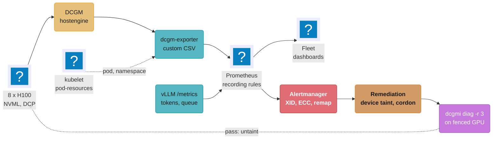
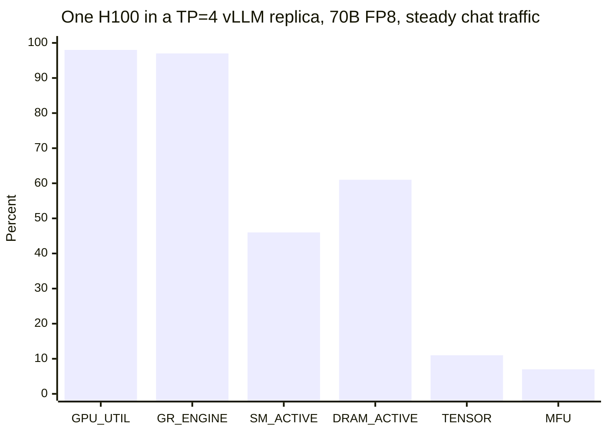
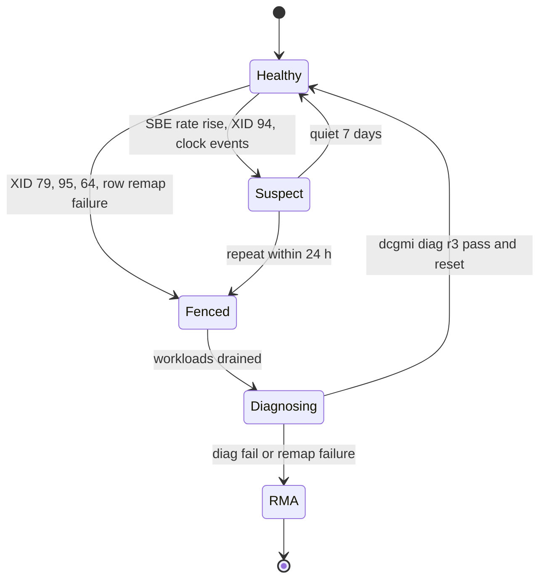

# GPU Observability and Fleet Health

> **Version anchor (2026-10-18).** **DCGM 4.6.1** with **dcgm-exporter 4.8.4** (2026-09-18): opt-in
> fabric health fields, compute-instance-scoped MIG fields under `GPU_CI_ID`, DRA MIG pod
> attribution with optional `pod_uid`, a restart required after a live Dynamic MIG change, and the
> retired PCIe throughput fields removed. 4.6.0-4.8.3 (2026-07-15) added DRA ResourceSlice v1
> support and cumulative XID and clock-event totals, and renamed `Hostname` to `hostname`.
> **NVIDIA GPU Operator v26.7.2** (2026-10-14) manages DRA Driver v0.5.1 through the `GPUCluster`
> CR; v26.7.1 ships device plugin v0.20.1 and MIG Manager v0.15.1. **AMD GPU Operator v1.5.1**
> (2026-07-21). **Intel Device Plugins Operator v0.37.1** (2026-10-02). AMD Device Metrics Exporter
> and Intel XPU Manager have no pin row; their metric names, the Xid Catalog actions and the
> `dcgmi diag` durations were read from vendor docs on 2026-10-18.

## 1. Concept Overview

A GPU fleet has three questions that ordinary node monitoring cannot answer: is each GPU doing
useful math, is each GPU healthy enough to trust with a job, and how much model work does the
fleet produce per GPU-hour it pays for. This module covers the telemetry and the operating
practice behind those three answers:

1. **Telemetry.** What each DCGM counter measures, which of them the default dcgm-exporter
   configuration leaves out, and why `nvidia-smi` utilization reports 100% on a GPU whose math
   units are 90% idle.
2. **Health.** Passive signals (XID errors, ECC counts, row remapping, clock events, fabric
   health) and active checks (`dcgmi diag` levels), mapped to an action: restart the app, reset
   the GPU, reboot the node, or send the card back.
3. **Fleet efficiency reporting.** MFU for training, tokens per GPU-second and memory bandwidth
   use for inference, and the gap between GPUs allocated and GPUs active.

It also owns **substrate triage** on the senior path: reading GPU Operator component health, a
node that advertises 0 allocatable GPUs, a MIG layout that drifted from its configured profile,
and a missing DRA `ResourceSlice`. The capacity policy behind MIG, MPS and time-slicing is in
[GPU Cluster Scheduling and Quotas](../gpu_cluster_scheduling_and_quotas/gpu_cluster_scheduling_and_quotas.md).

Training jobs consume the health signals here to decide when to restart and which node to drop,
described in [Training Infrastructure Operations](../training_infrastructure_operations/training_infrastructure_operations.md).
Engine-side metrics (`vllm:num_requests_waiting`, TTFT histograms) and how to benchmark them are
in [Inference Engine Operations and Benchmarking](../inference_engine_operations_and_benchmarking/inference_engine_operations_and_benchmarking.md);
this module joins them to GPU counters. The tokens-per-GPU-second figure feeds cost per token in
[AI Cost Engineering and Unit Economics](../ai_cost_engineering_and_unit_economics/ai_cost_engineering_and_unit_economics.md)
and replica sizing in
[Inference Autoscaling and Capacity Planning](../inference_autoscaling_and_capacity_planning/inference_autoscaling_and_capacity_planning.md).
NVLink and InfiniBand fabric design sits in
[AI Networking and Storage Fabric](../ai_networking_and_storage_fabric/ai_networking_and_storage_fabric.md).
A GPU fault that becomes a user-facing outage is handled in
[AI Incident Response and Reliability](../ai_incident_response_and_reliability/ai_incident_response_and_reliability.md).

**Not here.** Kernel-level profiling with Nsight Systems and Nsight Compute (roofline, warp stall
reasons, per-kernel occupancy) lives in
[Profiling and Performance Analysis](../../cuda/profiling_and_performance_analysis/profiling_and_performance_analysis.md).
GPU pricing, commitments, spot and chargeback mechanics live in
[GPU and AI FinOps](../../devops/cloud_cost_optimization_finops/gpu_and_ai_finops.md). The GPU
Operator bring-up sequence and the cordon, drain and replace loop live in
[GPU Node Lifecycle](../../devops/case_studies/cross_cutting/gpu_node_lifecycle.md), and DRA,
`ResourceSlice` and device taint mechanics live in
[Device Scheduling and DRA](../../devops/kubernetes_scheduling_and_autoscaling/device_scheduling_and_dra.md).

---

## 2. Intuition

**One-line analogy.** `nvidia-smi` utilization is a door sensor on a factory: it reports that
someone was inside during the last second, not how many of the 132 machines were running or
whether any of them were cutting metal.

**Mental model.** Read GPU busyness as a stack of four ratios, each one a subset of the one
above it:

| Layer | Question | Signal |
|---|---|---|
| Allocated | Is a pod holding the GPU? | `nvidia.com/gpu` requests, DRA claims |
| Kernel running | Was any kernel resident during the sample? | `DCGM_FI_DEV_GPU_UTIL`, `DCGM_FI_PROF_GR_ENGINE_ACTIVE` |
| SMs busy | What fraction of SM cycles had at least one warp? | `DCGM_FI_PROF_SM_ACTIVE` |
| Math busy | What fraction of cycles was the tensor pipe issuing? | `DCGM_FI_PROF_PIPE_TENSOR_ACTIVE`, MFU |

A fleet can sit at 100% on the first layer, 95% on the second, 40% on the third and 10% on the
fourth. Each drop has a different owner: the scheduler, the input pipeline, the batch size, the
kernel choice.

**Why it matters.** A team that reports
`nvidia-smi` utilization tells finance the fleet is full and asks for more GPUs when the real
fix is a batch-size flag. A team that cannot see row remap failures or XID 79 schedules a
16,384-GPU job onto a card that will kill it in four hours.

**Key insight.** Health and efficiency are the same data read two ways. A GPU running at 1,410
MHz because of a power-brake clock event is healthy by every error counter and still delivers
about 29% fewer tokens. Fleet health is "can I trust this GPU", fleet efficiency is "what did I get from
it", and both come from one exporter with the right fields turned on.

The one-kernel case below shows why the second layer lies about the third.

```
  H100 SXM, 132 SMs. One small kernel, 4 thread blocks, running for the whole 1 s sample.

  SM  0- 32  ####............................  4 of 132 SMs hold a warp
  SM 33- 65  ................................
  SM 66- 98  ................................
  SM 99-131  ................................

  nvidia-smi utilization        = time any kernel ran / sample  = 1.00 / 1.00  = 100%
  DCGM_FI_PROF_GR_ENGINE_ACTIVE = same idea, profiling counter  =               1.00
  DCGM_FI_PROF_SM_ACTIVE        = mean over SMs of busy cycles  = 4 / 132     = 0.03
```

Both "100%" readings are true. They answer "was the GPU in use", not "how much of it". Only
`SM_ACTIVE` and the pipe counters show that 128 SMs did nothing.

---

## 3. Core Principles

1. **Utilization is a stack, not a number.** Report allocated, kernel-active, SM-active and
   tensor-active separately. A single "GPU util" panel hides which layer lost the time.
2. **Turn on the fields you will alert on.** The dcgm-exporter `default-counters.csv` ships with
   `DCGM_FI_PROF_SM_ACTIVE`, `SM_OCCUPANCY` and every ECC volatile and aggregate counter commented
   out. A fleet with no ECC alerts may simply have no ECC series.
3. **Alert on counters, not on last-value gauges.** `DCGM_FI_DEV_XID_ERRORS` holds the value of the
   last XID seen. A later XID overwrites an earlier one between scrapes. Use the cumulative
   `DCGM_EXP_XID_ERRORS_TOTAL` with its `xid` label.
4. **Every health signal maps to an action.** NVIDIA's Xid Catalog gives one per code
   (`RESTART_APP`, `RESET_GPU`, `RESTART_BM`, `CONTACT_SUPPORT`). An alert without an action is a
   page that someone acknowledges and forgets.
5. **Fence the device, then the node.** One failing card in an 8-GPU node should cost one GPU, not
   eight. DRA device taints make that possible; with extended resources the unit of fencing is the
   node.
6. **Efficiency is per unit of model work.** Tokens per GPU-second at the SLO for inference, MFU
   for training. Both normalize across model sizes and GPU types; utilization does not.
7. **Join through the pod.** dcgm-exporter attaches `namespace`, `pod` and `container` from the
   kubelet pod-resources API. Engine metrics carry the same labels from the scrape. That shared
   key is the only link between "the GPU was hot" and "this model was slow".

---

## 4. Types / Architectures / Strategies

### 4.1 Telemetry signal families

| Family | NVIDIA DCGM fields | Default in `default-counters.csv` | Use |
|---|---|---|---|
| Coarse activity | `DEV_GPU_UTIL`, `DEV_MEM_COPY_UTIL` | On | Allocated vs idle only |
| Profiling (DCP) | `PROF_GR_ENGINE_ACTIVE`, `PROF_PIPE_TENSOR_ACTIVE`, `PROF_DRAM_ACTIVE` | On | Efficiency |
| Profiling (DCP) | `PROF_SM_ACTIVE`, `PROF_SM_OCCUPANCY`, `PROF_PIPE_FP16/FP32/FP64_ACTIVE` | Off | Efficiency, kernel shape |
| Memory | `DEV_FB_USED`, `DEV_FB_FREE`, `DEV_FB_RESERVED` | On | KV-cache headroom, leaks |
| Clocks and power | `DEV_SM_CLOCK`, `DEV_POWER_USAGE`, `DEV_CLOCKS_EVENT_REASONS` | Clocks and power on, reasons off | Throttling |
| Thermals | `DEV_GPU_TEMP`, `DEV_MEMORY_TEMP` | On | Cooling, HBM wear |
| ECC | `DEV_ECC_SBE_VOL_TOTAL`, `DEV_ECC_DBE_VOL_TOTAL`, `_AGG_` variants | Off | Memory health |
| Row remap | `DEV_CORRECTABLE_REMAPPED_ROWS`, `DEV_UNCORRECTABLE_REMAPPED_ROWS`, `DEV_ROW_REMAP_FAILURE` | On | RMA decision |
| XID | `DEV_XID_ERRORS` (last value) | On | Do not alert on it alone |
| Exporter totals | `DCGM_EXP_XID_ERRORS_TOTAL`, `DCGM_EXP_CLOCK_EVENTS_TOTAL`, `DCGM_EXP_GPU_HEALTH_STATUS` | Off | Alerting |
| Fabric | `DEV_FABRIC_HEALTH_SUMMARY`, `DEV_FABRIC_HEALTH_MASK`, NVLink error totals | Off | NVLink domains |
| PCIe | `DEV_PCIE_REPLAY_COUNTER`, `PROF_PCIE_TX_BYTES`, `PROF_PCIE_RX_BYTES` | On | Riser and slot faults, host-to-device stalls |

Field names drop the `DCGM_FI_` prefix in the table. The exporter's own derived metrics start with
`DCGM_EXP_`.

### 4.2 Health check tiers

| Tier | Mechanism | Cost | Catches |
|---|---|---|---|
| Passive, continuous | DCGM field watches, XID, ECC, row remap, clock events | None | Hard faults, degrading memory, throttling |
| DCGM health watches | `dcgmi health -s a`, then `-c` | Seconds | Aggregated PCIe, memory, NVLink, thermal, power state |
| Active, short | `dcgmi diag -r 1` | Under 2.5 s | Software stack: driver, libraries, permissions |
| Active, medium | `dcgmi diag -r 2` | Under 2.5 min on 4 GPUs, 10.5 min on 8 | Adds quick hardware tests |
| Active, long | `dcgmi diag -r 3` | Under 10 min on 4 GPUs, 35 min on 8 | Targeted stress, targeted power, NVBandwidth, NCCL tests |
| Active, extra long | `dcgmi diag -r 4` | Under 45 min on 4 GPUs, 2.25 h on 8 | Adds memtest and pulse test |
| Workload burn-in | A real training step or inference replay | Minutes | Numerics, NCCL topology, the things diag does not model |

Durations are NVIDIA's Hopper figures from the DCGM diagnostics guide. Higher levels include every
test below them.

### 4.3 Vendor telemetry stacks

| Vendor | Operator | Exporter | Utilization fields | Health path |
|---|---|---|---|---|
| NVIDIA | GPU Operator v26.7.2 (`ClusterPolicy` or `GPUCluster`) | dcgm-exporter 4.8.4 on DCGM 4.6.1 | `DCGM_FI_PROF_*` | XID, ECC, row remap, `dcgmi diag`, `DCGM_EXP_GPU_HEALTH_STATUS` |
| AMD | AMD GPU Operator v1.5.1 | Device Metrics Exporter | `GPU_GFX_ACTIVITY`, `GPU_UMC_ACTIVITY`; profiler `GPU_PROF_SM_ACTIVE`, `GPU_PROF_TENSOR_ACTIVE_PERCENT` (off by default) | `GPU_HEALTH`, `GPU_ECC_UNCORRECT_TOTAL`, test runner, NPD integration |
| Intel | Intel Device Plugins Operator v0.37.1 | Intel XPU Manager (`xpum_` prefix) | XPU Manager metrics | xpumd health domains, `-xpumd-unhealthy-severity` |

AMD profiler metrics are enabled through the exporter's `ProfilerMetrics` config, and AMD's docs
say to disable them during application profiling because only one profiler instance can run at a
time. Intel's GPU plugin exposes a shared `gpu.intel.com/monitoring` resource so the XPU Manager
DaemonSet can open every GPU device file on the node while other pods use the GPUs.

### 4.4 Efficiency metrics

| Metric | Formula | Good for | Misleads when |
|---|---|---|---|
| Allocation ratio | GPUs bound to pods / GPUs in fleet | Scheduler and quota health | Pods hold GPUs and idle |
| Active ratio | mean `GR_ENGINE_ACTIVE` over allocated GPUs | Idle-allocation hunting | One tiny kernel reads as 1.0 |
| SM active | mean `SM_ACTIVE` | Batch size, launch overhead | Memory-bound decode at full speed reads low |
| MFU | achieved model FLOP/s / peak FLOP/s | Training efficiency, cross-cluster comparison | Applied to decode-heavy inference |
| HFU | MFU plus recomputed FLOPs | Kernel efficiency | Compared with someone else's MFU |
| MBU | bytes moved per step / step time / peak bandwidth | Decode efficiency | Prefill-heavy traffic |
| Tokens per GPU-second | output tokens / (GPUs x seconds), at the SLO | Inference unit economics | Measured past the SLO knee |

---

## 5. Architecture Diagrams

### Telemetry and remediation path



The exporter learns which pod holds each GPU from the kubelet pod-resources socket, so GPU series
and engine series share `namespace` and `pod`. A failed health check taints one device, the
diagnostic runs while the other seven GPUs keep serving, and a pass lifts the taint.

### Four readings of one decode-heavy replica



`nvidia-smi` and `GR_ENGINE_ACTIVE` say the GPU is full. `DRAM_ACTIVE` at 61% says decode is
bound by HBM reads, which is expected. `TENSOR` at 11% and MFU at 7% are normal for decode and
are the wrong numbers to chase on this workload; MBU and tokens per GPU-second at the SLO are the
right ones (§6.6).

### GPU health states



`Suspect` keeps serving with a lower scheduling score; `Fenced` takes no new work. The thresholds
(24 hours, 7 days) are fleet policy, not NVIDIA guidance. Write them down and review them against
RMA outcomes each quarter.

---

## 6. How It Works - Detailed Mechanics

### 6.1 What `nvidia-smi` utilization measures

`nvidia-smi` "GPU-Util" and `DCGM_FI_DEV_GPU_UTIL` report the percentage of the sample period
during which one or more kernels were executing. The sample period depends on the product and is
between 1/6 s and 1 s. It does not look at how many SMs the kernel used or which pipes it issued
to.

Three workloads that all read 100%:

| Workload | GPU_UTIL | SM_ACTIVE | TENSOR_ACTIVE | What is wrong |
|---|---|---|---|---|
| Embedding model, batch 1, one request at a time | 100 | 0.06 | 0.01 | Batch too small to fill 132 SMs |
| Training step with a spin-waiting NCCL kernel during a straggler wait | 100 | 0.95 | 0.02 | SMs are busy polling, not computing |
| 70B training, well tuned | 100 | 0.92 | 0.55 | Nothing, this is the target |

The second row is the reason `SM_ACTIVE` alone is also not enough: NCCL kernels occupy SMs while
they wait on the network. Tensor-pipe activity and MFU separate waiting from working.

### 6.2 DCGM profiling fields

The DCP (data center profiling) fields read hardware performance counters, supported on data
center GPUs from Volta onward.

| Field | Definition | H100 reading for a healthy 70B training step |
|---|---|---|
| `DCGM_FI_PROF_GR_ENGINE_ACTIVE` | Ratio of time the graphics engine is active | 0.98 |
| `DCGM_FI_PROF_SM_ACTIVE` | Ratio of cycles an SM has at least one warp assigned, averaged over all SMs | 0.90 |
| `DCGM_FI_PROF_SM_OCCUPANCY` | Ratio of resident warps to the SM maximum, averaged over all SMs | 0.25 to 0.40 |
| `DCGM_FI_PROF_PIPE_TENSOR_ACTIVE` | Ratio of cycles the tensor (HMMA) pipe is active | 0.45 to 0.60 |
| `DCGM_FI_PROF_DRAM_ACTIVE` | Ratio of cycles the device memory interface is sending or receiving | 0.30 to 0.50 |
| `DCGM_FI_PROF_PCIE_TX_BYTES`, `_RX_BYTES` | PCIe bytes per second including protocol headers | Spikes at checkpoint and data load |

Low `SM_OCCUPANCY` is not a fault. Large GEMM kernels use many registers and much shared memory
per thread block and run with few resident warps on purpose. Use occupancy to compare two
builds of the same job, not as a target.

Two operating rules for DCP fields:

- **Profiling counters are a shared hardware resource.** Running Nsight Compute or a CUPTI-based
  profiler on a GPU while dcgm-exporter collects DCP fields fails or returns errors. Pause DCGM
  profiling first with `dcgmi profile --pause`, then `--resume` after the session.
- **Not every combination of DCP fields is read in one pass.** DCGM multiplexes some groups, so
  adding every `PIPE_*` field lowers the accuracy of each. Collect `GR_ENGINE_ACTIVE`,
  `SM_ACTIVE`, `PIPE_TENSOR_ACTIVE` and `DRAM_ACTIVE` fleet-wide, and turn on the rest per node
  during an investigation.

### 6.3 dcgm-exporter configuration: broken, then fixed

The Helm chart mounts the built-in `default-counters.csv` field list unless `customMetrics` is
set, and creates a `ServiceMonitor` with a 30 s interval, a 25 s timeout and `honorLabels: false`. A fleet installed with defaults has three gaps.

Broken: the default field list and default `ServiceMonitor`.

```yaml
# values.yaml as shipped (abridged)
arguments: []                 # built-in default-counters.csv
serviceMonitor:
  enabled: true
  interval: 30s
  honorLabels: false          # exporter's pod/namespace labels get renamed exported_pod
```

What this produces:

- No `DCGM_FI_PROF_SM_ACTIVE`, no ECC counters, no clock-event reasons. Alerts written against
  them evaluate against an empty vector and never fire.
- The exporter attaches `pod="vllm-70b-7c9f"` to each GPU series, and Prometheus adds its own
  target label `pod="nvidia-dcgm-exporter-x2k4p"`. With `honorLabels: false` the workload label is
  renamed `exported_pod`, and every join on `pod` silently matches the exporter, not the model.
- Alerts on `DCGM_FI_DEV_XID_ERRORS == 79` miss a fall-off-the-bus event if any other XID, or a
  reset to 0, lands before the next scrape.

Fixed: a custom field list and label handling that keeps the workload's identity.

```text
# gpu-fleet-counters.csv (DCGM FIELD, Prometheus type, help)
DCGM_FI_PROF_GR_ENGINE_ACTIVE,         gauge,   Graphics engine active ratio.
DCGM_FI_PROF_SM_ACTIVE,                gauge,   SM active ratio.
DCGM_FI_PROF_PIPE_TENSOR_ACTIVE,       gauge,   Tensor pipe active ratio.
DCGM_FI_PROF_DRAM_ACTIVE,              gauge,   DRAM interface active ratio.
DCGM_FI_DEV_FB_USED,                   gauge,   Framebuffer used (MiB).
DCGM_FI_DEV_SM_CLOCK,                  gauge,   SM clock (MHz).
DCGM_FI_DEV_POWER_USAGE,               gauge,   Power draw (W).
DCGM_FI_DEV_ENFORCED_POWER_LIMIT,      gauge,   Enforced power limit (W).
DCGM_FI_DEV_GPU_TEMP,                  gauge,   GPU temperature (C).
DCGM_FI_DEV_MEMORY_TEMP,               gauge,   HBM temperature (C).
DCGM_FI_DEV_ECC_SBE_VOL_TOTAL,         counter, Volatile single-bit ECC errors.
DCGM_FI_DEV_ECC_DBE_VOL_TOTAL,         counter, Volatile double-bit ECC errors.
DCGM_FI_DEV_CORRECTABLE_REMAPPED_ROWS, counter, Rows remapped for correctable errors.
DCGM_FI_DEV_UNCORRECTABLE_REMAPPED_ROWS, counter, Rows remapped for uncorrectable errors.
DCGM_FI_DEV_ROW_REMAP_FAILURE,         gauge,   Row remapping failed.
DCGM_FI_DEV_PCIE_REPLAY_COUNTER,       counter, PCIe retries.
DCGM_EXP_XID_ERRORS_TOTAL,             counter, XID errors since exporter start.
DCGM_EXP_CLOCK_EVENTS_TOTAL,           counter, Clock events since exporter start.
DCGM_EXP_GPU_HEALTH_STATUS,            gauge,   DCGM health status.
DCGM_FI_DRIVER_VERSION,                label,   Driver version.
```

```yaml
customMetrics: |              # replaces the default list, not additive
  DCGM_FI_PROF_GR_ENGINE_ACTIVE, gauge, Graphics engine active ratio.
  DCGM_FI_PROF_SM_ACTIVE,        gauge, SM active ratio.
  # every other row of gpu-fleet-counters.csv
serviceMonitor:
  honorLabels: true           # keep the workload's pod, namespace, container
```

```yaml
# Prometheus alert rules
- alert: GPUFellOffBus
  expr: increase(DCGM_EXP_XID_ERRORS_TOTAL{xid="79"}[10m]) > 0
  labels: {severity: page, action: RESTART_BM}
- alert: GPUUncontainedMemoryError
  expr: increase(DCGM_EXP_XID_ERRORS_TOTAL{xid="95"}[10m]) > 0
  labels: {severity: page, action: RESET_GPU}
- alert: GPUDoubleBitECC
  expr: increase(DCGM_EXP_XID_ERRORS_TOTAL{xid="48"}[10m]) > 0
  labels: {severity: page, action: WORKFLOW_XID_48}
- alert: GPURowRemapFailed
  expr: DCGM_FI_DEV_ROW_REMAP_FAILURE == 1
  labels: {severity: ticket, action: RMA}
- alert: GPUSeriesMissing
  expr: count by (hostname) (DCGM_FI_DEV_GPU_TEMP) < 8
  for: 10m
  labels: {severity: ticket}
```

The last rule catches a GPU that vanished from the exporter, which happens after XID 79 when NVML
can no longer see the card. Its series stops instead of reporting an error. `hostname` is the
label name from dcgm-exporter 4.8.3 on; dashboards built on `Hostname` went blank after that
upgrade.

### 6.4 XID triage

XID messages come from the NVIDIA kernel driver (`dmesg`, `NVRM: Xid`). NVIDIA's Xid Catalog
assigns each an immediate action. The ones a fleet sees most:

| XID | Catalog description | Immediate action | Usual owner |
|---|---|---|---|
| 13 | Graphics Engine Exception | `RESTART_APP` | Application, often an out-of-bounds access |
| 31 | GPU memory page fault | `RESTART_APP` | Application or framework bug |
| 43 | GPU stopped processing | `IGNORE` | Follows an app fault; investigate if alone |
| 45 | Preemptive cleanup, due to previous errors | Solo: restart Fabric Manager; else follow the other XID | Secondary |
| 48 | Double Bit ECC Error | Workflow | Hardware memory |
| 63 | GPU memory remapping event | `IGNORE` | Hardware, handled by remap |
| 64 | GPU memory remapping failure | `RESET_GPU`, then `CONTACT_SUPPORT` | Hardware, RMA candidate |
| 74 | NVLINK Error | NVLink workflow | Cable, switch, GPU |
| 79 | GPU has fallen off the bus | `RESTART_BM` | Hardware, PCIe, power |
| 92 | High single-bit ECC error rate | `IGNORE`, then `CONTACT_SUPPORT` | Hardware trend |
| 94 | Contained memory error | `RESTART_APP` | Hardware, contained to one app |
| 95 | Uncontained memory error | `RESET_GPU` | Hardware |
| 119 | GSP RPC Timeout | `RESET_GPU`, `INVESTIGATE_SW` | Driver or firmware |
| 120 | GSP Error | `RESET_GPU`, `INVESTIGATE_SW` | Driver or firmware |
| 154 | GPU Recovery Action Changed | Follow the action it reports | Informational, with another XID |

The routing rule for automation: XID 13, 31 and 43 go to the workload owner and never fence the
GPU on first occurrence. A fleet that fences on every XID turns one buggy model server into a
cluster-wide capacity loss as its pods crash and reschedule onto fresh GPUs, fencing each one.
Fence on the hardware XIDs (48, 64, 74, 79, 95) and on a repeat of 13 or 31 on one GPU across
different workloads, which points at the card.

### 6.5 ECC, row remapping, thermals and clock events

On A100, H100 and later, HBM uses row remapping instead of page retirement. A correctable or
uncorrectable error on a row marks it for remap; the remap takes effect at the next GPU reset.
Each memory bank has a small number of spare rows.

| Signal | Meaning | Action |
|---|---|---|
| `CORRECTABLE_REMAPPED_ROWS` rising slowly | Normal wear across a large fleet | Track per GPU, no page |
| `UNCORRECTABLE_REMAPPED_ROWS` > 0 | An uncorrectable error happened; a row was retired | Reset the GPU at the next drain |
| Remap pending (`nvidia-smi -q -d ROW_REMAPPER`) | Remap recorded, waiting for reset | Drain and reset |
| `ROW_REMAP_FAILURE` = 1 | No spare row was left in the bank | Take out of service, RMA |
| `ECC_DBE_VOL_TOTAL` increase | Double-bit error since last driver load | Treat with XID 48 workflow |
| `ECC_SBE_VOL_TOTAL` rate rising | Memory cells degrading | Mark Suspect; XID 92 may follow |

Clock events explain throughput loss without errors. The exporter's clock-event collectors label
each event with its reason: `power_cap`, `hw_slowdown`, `sw_thermal`, `hw_thermal`,
`hw_power_brake`, `sync_boost`, `clocks_setting`, `gpu_idle`. An H100 SXM boosts to 1,980 MHz SM
clock; a node held at 1,410 MHz by `hw_power_brake` runs every kernel about 29% slower.

```text
# Per-node throttle panel
sum by (hostname, clock_event) (increase(DCGM_EXP_CLOCK_EVENTS_TOTAL{clock_event!="gpu_idle"}[1h]))

# SM clock vs fleet median for the same GPU model
avg by (hostname) (DCGM_FI_DEV_SM_CLOCK)
  / scalar(quantile(0.5, avg by (hostname) (DCGM_FI_DEV_SM_CLOCK{modelName="NVIDIA H100 80GB HBM3"})))
```

`hw_power_brake` is an external signal, usually from the rack power system. It is a facilities
ticket, not a GPU fault. `hw_thermal` on one GPU out of eight in a node points at a fan, a blocked
airflow path or a failed cold plate. Meta's Llama 3 paper reports a 1 to 2% diurnal throughput
swing across its 16,384-GPU job from temperature-driven clock changes alone.

### 6.6 MFU and tokens per GPU-second

**Training MFU.** Model FLOPs per token for a dense transformer are about 6N (forward 2N,
backward 4N), plus an attention term. PaLM's definition adds 12 x L x H x Q x T per token for L
layers, H heads, head dimension Q and sequence length T.

```text
MFU = (tokens per second x FLOPs per token) / (GPU count x peak FLOP/s per GPU)

70B model, 1,024 x H100 SXM, BF16 dense peak 989 TFLOP/s
FLOPs per token (6N only)  = 6 x 70e9 = 4.2e11
Measured throughput         = 964,000 tokens/s across the job
MFU = 964,000 x 4.2e11 / (1,024 x 989e12) = 4.05e17 / 1.01e18 = 0.40
```

**Inference.** Decode reads every weight once per step for the whole batch, so it is bound by
memory bandwidth at normal batch sizes, and MFU of 5 to 15% is expected. Report two numbers:

```text
tokens per GPU-second = sum(rate(output tokens)) / GPUs held, measured at the SLO

MBU = (weight bytes + KV bytes read per step) / step time / peak HBM bandwidth
    70B FP8 on TP=4: 70 GB / 4 = 17.5 GB weights per GPU, plus 3.1 GB KV at batch 48
    step time 9.2 ms, H100 HBM3 3.35 TB/s
    MBU = 20.6e9 / 0.0092 / 3.35e12 = 0.67
```

Tokens per GPU-second is only meaningful at a stated SLO. The same replica can produce twice the
tokens past the latency knee while every user waits; take the figure at the knee measured in
[Inference Engine Operations and Benchmarking](../inference_engine_operations_and_benchmarking/inference_engine_operations_and_benchmarking.md).

### 6.7 Joining engine metrics to GPU metrics

With `honorLabels: true`, dcgm-exporter series carry the workload's `namespace` and `pod`. Engine
metrics scraped by a `PodMonitor` carry the same labels as target labels.

```yaml
groups:
- name: gpu-fleet
  rules:
  - record: pod:gpus:count
    expr: count by (namespace, pod) (DCGM_FI_PROF_GR_ENGINE_ACTIVE{namespace!="gpu-operator"})
  - record: pod:sm_active:avg
    expr: avg by (namespace, pod) (DCGM_FI_PROF_SM_ACTIVE{namespace!="gpu-operator"})
  - record: pod:output_tokens_per_gpu_second:rate5m
    expr: |
      sum by (namespace, pod) (rate(vllm:generation_tokens_total[5m]))
        / on (namespace, pod) pod:gpus:count
  - record: namespace:gpus_allocated_idle:count
    expr: |
      count by (namespace) (
        avg_over_time(DCGM_FI_PROF_GR_ENGINE_ACTIVE{namespace!="gpu-operator"}[1h]) < 0.05
      )
```

The last rule is the idle-allocation report: GPUs bound to a pod whose graphics engine was active
less than 5% of the last hour. Send it to team leads each week. Chargeback for the same idle
GPUs is in [GPU and AI FinOps](../../devops/cloud_cost_optimization_finops/gpu_and_ai_finops.md).

Join gotchas:

- A multi-node replica (LeaderWorkerSet, Ray) spreads one model over several pods. Aggregate by
  the replica's group label, not by `pod`, or each pod reports a fraction of the tokens over its
  share of GPUs.
- A GPU with no workload has no scraped `pod` or `namespace` label to keep, so with
  `honorLabels: true` it takes the exporter pod's own target labels. Filter the exporter's
  namespace (`gpu-operator` here) out of per-pod rules, and report fleet idle capacity as
  `count(DCGM_FI_DEV_GPU_TEMP{namespace="gpu-operator"})`.

### 6.8 Cardinality control

Series count for a 512-node, 4,096-GPU H100 fleet:

```text
series per GPU            40  (19 fields from §6.3, plus one series per xid,
                              clock_event and health_watch value)
GPUs                      4,096
base series               163,840
MIG 7-way on 25% of fleet + 1,024 GPUs x 6 extra instances x 15 instance-scoped series = 92,160
pod churn (inference rolls 4 times a day, 1 h staleness overlap)  ~ +17% active series
per-process metrics (opt-in) up to N processes per GPU
total active              (163,840 + 92,160) x 1.17 ~ 300,000 series from GPUs alone
```

Rules that keep it bounded:

- Keep raw per-GPU series at 30 s for 14 days locally; ship only recording-rule outputs.
- Drop `pci_bus_id`, `device` and the driver version label; keep `UUID`, which follows a card.
- Turn per-process metrics on for one node pool while debugging time-slicing, not fleet-wide.

The general Prometheus scaling patterns (sharding, remote write, recording-rule tiers) are in
[Prometheus Cardinality and Scale](../../devops/case_studies/cross_cutting/prometheus_cardinality_and_scale.md).

### 6.9 Substrate triage commands

A node that should serve GPU pods but does not. Walk the GPU Operator chain in order; each layer
needs the one before it.

```bash
# 1. What does the node advertise?
kubectl get node gpu-a17 -o jsonpath='{.status.allocatable.nvidia\.com/gpu}{"\n"}'

# 2. Which operator mode? ClusterPolicy and GPUCluster cannot coexist.
kubectl get clusterpolicy,gpucluster -A

# 3. Operand pods on this node
kubectl get pods -n gpu-operator -o wide --field-selector spec.nodeName=gpu-a17

# 4. The validator's init containers show which layer failed
kubectl logs -n gpu-operator nvidia-operator-validator-8wq2d -c driver-validation
kubectl logs -n gpu-operator nvidia-operator-validator-8wq2d -c plugin-validation

# 5. MIG: desired layout vs applied state
kubectl get node gpu-a17 -L nvidia.com/mig.config,nvidia.com/mig.config.state

# 6. DRA nodes: devices are published as ResourceSlices, not allocatable
kubectl get resourceslices --field-selector spec.nodeName=gpu-a17
```

| Symptom | Likely layer | Evidence |
|---|---|---|
| Allocatable 0, driver pod CrashLoopBackOff | Driver | Kernel headers mismatch, `ERROR_LIBRARY_NOT_FOUND` |
| Allocatable 0, validator stuck in `plugin-validation` | Device plugin | Plugin cannot reach the kubelet socket or NVML |
| Allocatable 0, `mig.config.state=failed` | MIG manager | Requested profile not valid for the GPU, or GPU in use during reconfiguration |
| Allocatable 0 on a `GPUCluster` node | None, by design | Check `ResourceSlice` instead |
| No `ResourceSlice` for the node | DRA kubelet plugin | Plugin pod not scheduled, wrong node selector, driver not ready |
| Slice present, claim Pending | Claim or taint | Device selector matches nothing, or a device taint without toleration |
| Allocatable 8, pods run, metrics missing | dcgm-exporter | Exporter pod not on the node, or DCP fields unsupported on the GPU model |

**MIG layout drift.** The MIG manager reads the desired layout from the `nvidia.com/mig.config`
node label and reports progress in `nvidia.com/mig.config.state`. Drift has two forms: the state
is `failed` and the GPU runs the old layout, or someone changed the layout by hand with
`nvidia-smi mig` and the label no longer describes reality. Detect both:

```text
# Desired vs applied, from kube-state-metrics (node labels must be allowlisted)
kube_node_labels{label_nvidia_com_mig_config_state!="success", label_nvidia_com_mig_config!=""}

# Actual instance count per GPU from dcgm-exporter vs the expected count for the profile
count by (hostname, gpu) (DCGM_FI_DEV_FB_USED{GPU_I_PROFILE="1g.10gb"}) != 7
```

kube-state-metrics exports no node labels unless they are listed in
`--metric-labels-allowlist=nodes=[nvidia.com/mig.config,nvidia.com/mig.config.state]`. Without
that flag the first query returns nothing and looks like a clean fleet.

---

## 7. Real-World Examples

- **Meta, Llama 3 405B pre-training.** The Llama 3 paper reports 466 job interruptions in a
  54-day snapshot on 16,384 H100 GPUs, 419 of them unexpected. GPU issues were the largest
  category at 58.7% of unexpected interruptions, led by faulty GPUs (30.1%) and HBM3 memory
  (17.2%). Meta still reached more than 90% effective training time. The same paper describes the
  1 to 2% diurnal throughput swing from temperature.
- **ByteDance, MegaScale.** The MegaScale paper reports 55.2% MFU training a 175B model on 12,288
  GPUs, 1.34x Megatron-LM on the same setup. A large part of the system is observability:
  per-rank timelines and heartbeat-based fault detection that find the one slow or failing GPU
  among thousands.
- **Google, PaLM.** The PaLM paper introduced MFU as the reported efficiency number, because HFU
  depends on implementation choices such as rematerialization. PaLM 540B trained at 46.2% MFU on
  6,144 TPU v4 chips.
- **NVIDIA GPU Operator v26.7.1 known issue.** On H100 nodes, after a driver upgrade from
  595.91.07 to 615.71.09 without a reboot or GPU reset, deleting a MIG GPU instance fails with NVML
  `ERROR_UNKNOWN` and the driver logs XID 119. The release notes give a reboot or a per-node GPU reset as the fix.
- **AMD GPU Operator v1.5.1 limitation.** Auto Node Remediation is not fully supported on MI350P
  and Radeon AI PRO in that release, and full ECC metrics do not apply to Radeon (RDNA) GPUs. A
  mixed AMD fleet needs per-platform health rules, not one rule set copied from the Instinct pool.

---

## 8. Tradeoffs

### Telemetry collection scope

| Option | Series cost | Accuracy | Fits |
|---|---|---|---|
| Default CSV | Lowest | No ECC, no `SM_ACTIVE` | Nothing beyond a demo |
| Core DCP fields plus health fields fleet-wide | About 40 per GPU | Good | Every production fleet |
| All DCP pipes and per-process metrics fleet-wide | Several times higher | Lower, from multiplexing | Never |
| Core fleet-wide, full set per node on demand | Core plus a short burst | Good | Investigations |

### Fencing granularity

| Option | Lost capacity per bad card | Requires | Risk |
|---|---|---|---|
| Cordon the node | 8 GPUs | Nothing extra | Seven healthy GPUs idle until repair |
| Device taint (DRA) | 1 GPU | DRA driver, `DRADeviceTaints` | Shared NVLink faults affect neighbors anyway |
| Device plugin marks device unhealthy | 1 GPU | Plugin health checks | Plugin health covers fewer signals than DCGM |
| Remove GPU from a job's rank list only | 1 GPU for that job | Training framework support | Other jobs still land on it |

---

## 9. When to Use / When NOT to Use

**Collect DCP fields fleet-wide when:**

- GPU spend is large enough that a 10% efficiency gain pays for an engineer.
- Teams share a fleet and you need idle-allocation reports per namespace.
- Inference SLO misses need to be split between "model is slow" and "GPU is throttled".

**Run `dcgmi diag -r 3` when:**

- A GPU was fenced for any hardware XID and is about to return to service.
- A driver or firmware upgrade completed on a canary node.
- A node joins a training pool for a run longer than a day.

**Do not:**

- Report `nvidia-smi` utilization to finance as fleet efficiency.
- Fence a GPU on its first XID 13 or 31; those are application faults.
- Turn on every DCP field and per-process metrics on the whole fleet; multiplexing lowers
  accuracy and the series count grows with every process.

---

## 10. Common Pitfalls

**The fleet that never had an ECC error.** A platform team ran 2,300 A100 GPUs for eight months
with an alert on `DCGM_FI_DEV_ECC_DBE_VOL_TOTAL`. It never fired. A training team then lost three
runs in a week to NaN losses on the same node. The ECC counters were commented out in the default
CSV, so the alert had evaluated an empty vector since day one. Fix: a custom CSV, and an
`absent()` rule for every field an alert depends on.

**XID 79 hidden by a later XID.** A GPU fell off the bus, logged XID 79, and the driver then
logged XID 45 for the cleanup. Within one 30 s scrape interval `DCGM_FI_DEV_XID_ERRORS` moved from
79 to 45, and the alert on `== 79` never saw it. The job hung in an NCCL all-reduce for 40
minutes before the training watchdog killed it. Fix: alert on
`increase(DCGM_EXP_XID_ERRORS_TOTAL{xid="79"}[10m]) > 0`, and on the GPU's series disappearing.

**`exported_pod` broke every join.** A cost dashboard divided engine tokens by GPU count per pod.
After a Prometheus Operator upgrade the `ServiceMonitor` used the chart default
`honorLabels: false`, workload labels became `exported_pod`, and every pod showed the exporter's
own name. The join returned nothing, the dashboard showed "no data", and the weekly efficiency
report went out with last week's numbers for a month. Fix: `honorLabels: true` on the exporter's
`ServiceMonitor` and a test query in CI that asserts the join returns rows.

**Fencing on application XIDs.** A remediation controller cordoned any node with an XID in the
last 10 minutes. A model server build with an out-of-bounds kernel access raised XID 13 on every
start. Its Deployment rescheduled pods across the pool, and in 50 minutes the controller cordoned
61 of 96 nodes. Fix: route XID 13, 31 and 43 to the workload owner; fence on hardware XIDs or on a
repeat on one GPU across different workloads.

**MIG drift after a driver upgrade.** A driver upgrade ran without a node reboot. The next MIG
reconfiguration on 14 H100 nodes failed with NVML `ERROR_UNKNOWN` and XID 119, leaving
`mig.config.state=failed` and the GPUs in their previous whole-GPU layout. The embedding service
that expected 7 slices per GPU scheduled 1 pod per GPU and ran at 6% SM active. Nobody noticed for
nine days because kube-state-metrics exported no node labels. Fix: allowlist the MIG labels, alert
on a non-`success` state for longer than 30 minutes, and reboot after driver upgrades.

**Allocation reported as utilization.** A quarterly review showed the fleet at 96% "GPU
utilization" from `nvidia.com/gpu` allocation. Finance approved 256 more H100s. The idle-allocation
rule in §6.7, written later, showed 22% of allocated GPUs below 5% graphics-engine activity for
the whole quarter: notebooks and dev pods holding GPUs over weekends. Fix: report the four-layer
stack, and idle-allocation by namespace every week. The cost side of this gap is in
[GPU and AI FinOps](../../devops/cloud_cost_optimization_finops/gpu_and_ai_finops.md).

---

## 11. Technologies & Tools

| Tool | Role | Notes |
|---|---|---|
| NVIDIA DCGM | GPU telemetry, health watches, diagnostics | 4.6.1. `dcgmi diag -r 1..4`, `dcgmi health`, `dcgmi profile --pause` |
| dcgm-exporter | Prometheus exporter for DCGM fields | 4.8.4. Custom CSV, `DCGM_EXP_*` totals, pod and DRA attribution |
| NVIDIA GPU Operator | Driver, toolkit, device plugin, DCGM, MIG manager, DRA driver | v26.7.2. `ClusterPolicy` or `GPUCluster`, not both |
| NVIDIA MIG Manager | Applies MIG layouts from node labels | v0.15.1 in GPU Operator v26.7.1. `nvidia.com/mig.config.state` |
| NVIDIA DRA Driver | Publishes GPUs as `ResourceSlice` objects | v0.5.1, managed by `GPUCluster` |
| AMD GPU Operator | AMD driver, device plugin, metrics exporter, test runner, DRA driver | v1.5.1 |
| AMD Device Metrics Exporter | Prometheus exporter for AMD Instinct and Radeon GPUs | `GPU_GFX_ACTIVITY`, `GPU_HEALTH`, `GPU_PROF_*` profiler fields |
| Intel Device Plugins Operator | Intel GPU device plugin and monitoring resource | v0.37.1. `gpu.intel.com/monitoring` |
| Intel XPU Manager | Intel GPU telemetry and health | `xpum_` metrics; xpumd health domains |
| Prometheus | Scrape, recording rules, alerting | Joins GPU and engine series on `namespace`, `pod` |
| kube-state-metrics | Kubernetes object metrics | Node labels only with `--metric-labels-allowlist` |
| Grafana | Fleet and on-call dashboards | Four-layer busyness, clock vs median |
| Nsight Compute | Kernel-level profiler | Conflicts with DCP collection on the same GPU |

Prometheus mechanics: [Observability Metrics with Prometheus](../../devops/observability_metrics_prometheus/observability_metrics_prometheus.md).
Alert routing: [Visualization and Alerting](../../devops/visualization_and_alerting/visualization_and_alerting.md).
GPU Operator install: [ML Platform and GPU Infrastructure](../../devops/ml_platform_and_gpu_infrastructure/ml_platform_and_gpu_infrastructure.md).
Training hardware tuning: [GPU and Hardware Optimization](../../ml/gpu_and_hardware_optimization/gpu_and_hardware_optimization.md).

---

## 12. Interview Questions with Answers

**Q: Why can `nvidia-smi` report 100% GPU utilization while the GPU does very little work?**
**Short:** It reports the fraction of time any kernel was running, not how many SMs or math units that kernel used, so one tiny kernel reads 100%.

`nvidia-smi` GPU-Util and `DCGM_FI_DEV_GPU_UTIL` measure the share of the sample period during
which one or more kernels executed. A kernel with 4 thread blocks on a 132-SM H100 keeps that at
100% while 128 SMs sit idle. NCCL kernels spin-waiting on a slow peer also count as busy. Use
`DCGM_FI_PROF_SM_ACTIVE` for how much of the chip was used and `PIPE_TENSOR_ACTIVE` or MFU for
how much math was done. Keep `nvidia-smi` utilization for one question only: is anything running
at all.

**Q: An alert on `DCGM_FI_DEV_XID_ERRORS == 79` never fired, but a GPU fell off the bus. Why?**
**Short:** `DCGM_FI_DEV_XID_ERRORS` holds only the last XID value, so a later XID or a reset overwrites 79 before the scrape; alert on the cumulative XID total counter with its xid label.

`DCGM_FI_DEV_XID_ERRORS` is a gauge with the code of the most recent XID. After XID 79 the driver
often logs XID 45 for cleanup, and the gauge moves to 45 inside one 30 s scrape interval. The
GPU's series can also disappear entirely when NVML loses the card. dcgm-exporter provides
`DCGM_EXP_XID_ERRORS_TOTAL` (opt-in) with an `xid` label; alert on
`increase(...{xid="79"}[10m]) > 0`. Add a rule on the GPU count per host dropping, which catches
the card that vanished without a clean error.

**Q: Your fleet has never recorded a double-bit ECC error in a year. Should you believe it?**
**Short:** Not until you check the exporter's field list; the default dcgm-exporter CSV ships ECC counters commented out, so the alert may be reading an empty vector.

In `default-counters.csv` every `DCGM_FI_DEV_ECC_*` line, `SM_ACTIVE`, `SM_OCCUPANCY` and the
clock-event reasons are commented out. An alert on a series that does not exist returns nothing,
which is indistinguishable from "no errors" on a dashboard. Check with
`count(DCGM_FI_DEV_ECC_DBE_VOL_TOTAL)`: it should equal the GPU count. Ship a custom CSV and add
an `absent()` rule for every field an alert depends on.

**Q: GPU series from dcgm-exporter show `exported_pod` instead of `pod`. What happened and why does it matter?**
**Short:** With honorLabels false, Prometheus keeps its own target label pod (the exporter pod) and renames the workload's pod label, which breaks every join to engine metrics.

dcgm-exporter attaches the pod that holds each GPU, read from the kubelet pod-resources API.
Prometheus also attaches target labels, including the exporter pod's own name. On a collision with
`honorLabels: false`, the chart default, the scraped label is renamed `exported_pod`. Queries that
join GPU series to `vllm:*` series on `pod` then match the exporter and return nothing. Set
`honorLabels: true` on the exporter's `ServiceMonitor`, and add a CI check that the join returns
rows.

**Q: Is 8% MFU on an LLM inference fleet a problem?**
**Short:** Usually not; decode is bound by memory bandwidth, so MFU of 5 to 15% is normal, and MBU plus tokens per GPU-second at the SLO are the numbers to track.

Each decode step reads every weight once for the whole batch and does about 2N FLOPs per token.
At normal batch sizes the GPU waits on HBM, not on tensor cores. A 70B FP8 replica on TP=4 that
reads 20.6 GB per GPU per 9.2 ms step runs at about 67% MBU on 3.35 TB/s HBM3. At batch 48 its MFU
is about 9% of the 1,979 TFLOP/s FP8 dense peak. Raising MFU means bigger batches, which raises latency. Track MBU for efficiency and tokens
per GPU-second at the SLO for cost.

**Q: Which GPU efficiency number should go to finance, and which should not?**
**Short:** Send tokens per GPU-second at the SLO for inference, MFU for training, and idle-allocated GPUs per team; never send allocation or nvidia-smi utilization.

Allocation shows how many GPUs are checked out, and `nvidia-smi` utilization shows that a kernel
ran. Both read above 90% on fleets that do half the work they could. Tokens per GPU-second and MFU
are per unit of model work and stay comparable across GPU types and model sizes. The
idle-allocation count (GPUs bound to a pod with graphics-engine activity below 5% for an hour)
turns waste into a per-team list. Report the four-layer stack so each loss has an owner.

**Q: A node shows `nvidia.com/gpu: 0` allocatable. How do you triage it?**
**Short:** Check whether the node runs ClusterPolicy or GPUCluster first, then walk driver, toolkit, device plugin and MIG manager through the operator validator's init containers.

Under `GPUCluster` the node publishes GPUs as DRA `ResourceSlice` objects, so 0 allocatable
extended resources is expected; check `kubectl get resourceslices --field-selector
spec.nodeName=<node>`. Under `ClusterPolicy`, list operand pods on the node and read the
`nvidia-operator-validator` init containers: `driver-validation` failing points at the driver
pod, `plugin-validation` at the device plugin. A `nvidia.com/mig.config.state=failed` label means
the MIG manager could not apply the layout. Confirm the fix with a test pod that runs a CUDA
operation, not by allocatable alone.

**Q: What do row remapping counters tell you, and when does a GPU go back to the vendor?**
**Short:** Remapped rows show HBM rows retired after errors; uncorrectable remaps need a GPU reset, and ROW_REMAP_FAILURE means no spare rows are left, so the card is an RMA.

On A100, H100 and later, a memory error on an HBM row schedules that row to be replaced by a spare
at the next GPU reset. Correctable remaps rise slowly across a large fleet and need tracking, not
paging. An uncorrectable remap means data was lost once; drain and reset the GPU so the remap
takes effect. XID 63 is the remap event and the catalog says ignore it. XID 64 and
`DCGM_FI_DEV_ROW_REMAP_FAILURE = 1` mean the bank ran out of spare rows: reset, then contact
support for replacement.

**Q: Which XIDs should fence a GPU and which should not?**
**Short:** Fence on hardware XIDs such as 48, 64, 74, 79 and 95; send 13, 31 and 43 to the workload owner because they are usually application faults.

NVIDIA's Xid Catalog gives `RESTART_APP` for 13 (Graphics Engine Exception) and 31 (GPU memory
page fault), and `IGNORE` for 43. These follow a bad kernel or a framework bug, and fencing on them
lets one broken build cordon a pool as its pods crash and reschedule. 79 (fallen off the bus) needs
a bare-metal restart, 95 (uncontained memory error) a GPU reset, 64 a reset and support. Treat a
repeat of 13 or 31 on one GPU across different workloads as a hardware sign.

**Q: Throughput dropped 20% on a few nodes with no errors in any counter. Where do you look?**
**Short:** At SM clocks and clock-event reasons: power cap, power brake or thermal slowdown cuts clocks without raising any error.

Compare each node's `DCGM_FI_DEV_SM_CLOCK` with the fleet median for the same GPU model. An H100
SXM boosts to 1,980 MHz; held at 1,410 MHz it runs kernels about 29% slower. Read the reason from
`DCGM_EXP_CLOCK_EVENTS_TOTAL` by `clock_event`. `hw_power_brake` is an external signal from rack
power and goes to facilities. `hw_thermal` on one GPU in a node points at a fan or cold plate.
`power_cap` with `DCGM_FI_DEV_ENFORCED_POWER_LIMIT` below the default means someone lowered the
limit.

**Q: What do `dcgmi diag` levels 1 to 4 test, and when do you run each?**
**Short:** Level 1 checks the software stack in seconds, 2 adds quick hardware tests, 3 adds stress, power, bandwidth and NCCL tests, and 4 adds memtest and pulse tests for up to 2.25 hours.

On an 8-GPU Hopper node NVIDIA gives up to 2.5 s for r1, 10.5 min for r2, 35 min for r3 and 2.25 h
for r4, and each level includes the ones below it. Run r1 at pod start or after a driver change on
every node. Run r3 before a fenced GPU returns to service and on the canary node of a driver
upgrade. Run r4 on new hardware and RMA returns, where 2 hours of burn-in costs less than one
failed training restart.

**Q: How do you compute MFU for a training job, and why prefer it to HFU?**
**Short:** Divide achieved model FLOP/s (about 6N per token times tokens per second) by GPUs times peak FLOP/s; MFU ignores recomputation, so it compares fairly across implementations.

For a 70B dense model, 6N is 4.2e11 FLOPs per token. At 964,000 tokens/s on 1,024 H100s at 989
TFLOP/s BF16 dense, MFU is 4.05e17 / 1.01e18 = 0.40. PaLM's definition adds an attention term of
12 x L x H x Q x T per token. HFU also counts FLOPs repeated by activation checkpointing, so a job
that recomputes everything reads a third higher on HFU while training no faster. Always state the
peak used (dense, not sparse) and whether attention FLOPs are included.

**Q: What is the difference between `SM_ACTIVE`, `SM_OCCUPANCY` and `PIPE_TENSOR_ACTIVE`?**
**Short:** SM_ACTIVE is the share of cycles an SM has any warp, SM_OCCUPANCY is how many warps are resident relative to the maximum, and PIPE_TENSOR_ACTIVE is how often the tensor pipe issues.

All three average over every SM on the GPU. `SM_ACTIVE` near 0.9 says the kernels fill the chip.
`SM_OCCUPANCY` of 0.25 to 0.40 is normal for large GEMMs that use many registers per block, so a
low value is not a fault by itself. `PIPE_TENSOR_ACTIVE` is the closest per-GPU proxy for matmul
work and tracks MFU in training. Read them together: high active, low tensor means the SMs are
waiting, often on NCCL or memory.

**Q: How do you join vLLM metrics with GPU metrics to report tokens per GPU-second?**
**Short:** Join on namespace and pod: count GPUs per pod from dcgm-exporter, then divide the pod's token rate by that count in a recording rule.

dcgm-exporter labels each GPU series with the pod that holds it, and a `PodMonitor` gives engine
metrics the same labels. `count by (namespace, pod) (DCGM_FI_PROF_GR_ENGINE_ACTIVE)` gives GPUs
per pod, and `rate(vllm:generation_tokens_total[5m])` divided by it on `(namespace, pod)` gives
tokens per GPU-second. For a multi-node replica, aggregate by the replica group label instead of
`pod`. The join needs `honorLabels: true`, or the workload label becomes `exported_pod`.

**Q: How do you keep GPU metric cardinality under control on a 4,096-GPU fleet?**
**Short:** Collect raw per-GPU series at 30 s with short local retention, ship only recording-rule aggregates to long-term storage, and drop labels no query uses.

40 series per GPU across 4,096 GPUs is 164k series; 7-way MIG on a quarter of the fleet adds
about 92k, and pod churn adds about 17%. Keep `UUID`, which follows a card through RMA. Drop `pci_bus_id`,
`device` and the driver version on every series. Leave per-process metrics and the full DCP field
set off fleet-wide and turn them on for one pool during an investigation. Aggregates by pod,
namespace, node and GPU model are what dashboards and finance read.

**Q: How do you detect that a node's MIG layout has drifted from its configured profile?**
**Short:** Alert when nvidia.com/mig.config.state is not success, and compare the MIG instance count per GPU in dcgm-exporter with the count the profile should produce.

The MIG manager applies the layout named in the `nvidia.com/mig.config` label and writes progress
to `nvidia.com/mig.config.state`. A failed apply leaves the old layout in place; a manual
`nvidia-smi mig` change leaves the label wrong. kube-state-metrics exports these labels only when
they are in `--metric-labels-allowlist`. dcgm-exporter series carry `GPU_I_PROFILE` and
`GPU_I_ID`, so `count by (hostname, gpu)` of a 1g.10gb series should equal 7 on an all-1g H100.
Restart the exporter after a live Dynamic MIG change, which 4.8.4 requires.

**Q: A DRA ResourceClaim stays Pending and the node has GPUs. What do you check?**
**Short:** Check that a ResourceSlice exists for the node, which needs the DRA kubelet plugin running, then check the claim's device selectors and any device taints.

With DRA the driver's kubelet plugin publishes each node's devices in `ResourceSlice` objects. No
slice for the node means the plugin pod is not running there: wrong node selector, driver not
ready, or the `GPUCluster` operand failed. A slice that exists but never matches means the claim's
selector asks for an attribute the devices do not have, or a device taint from a health controller
has no toleration. That last case is the fence working as designed. Mechanism detail is in the
devops DRA module.

**Q: What telemetry stack replaces DCGM on AMD and Intel GPUs?**
**Short:** AMD uses the GPU Operator's Device Metrics Exporter with GPU_GFX_ACTIVITY and GPU_HEALTH; Intel uses XPU Manager metrics behind the plugin's gpu.intel.com/monitoring resource.

AMD's exporter reports `GPU_GFX_ACTIVITY`, `GPU_UMC_ACTIVITY`, power, junction and memory
temperature, `GPU_ECC_UNCORRECT_TOTAL` and `GPU_HEALTH`. Its `GPU_PROF_*` profiler fields,
including `GPU_PROF_SM_ACTIVE`, are off by default, and only one profiler can run at a time.
Intel's device plugin exposes `gpu.intel.com/monitoring` so the XPU Manager DaemonSet can open all
GPUs; its metrics use the `xpum_` prefix and xpumd reports health domains by severity. Write
health rules per vendor and per platform.

---

## 13. Best Practices

- Ship a custom dcgm-exporter CSV and diff it against each exporter release's notes.
- Set `honorLabels: true` on the exporter's `ServiceMonitor`; test the GPU-to-engine join in CI.
- Add an `absent()` or count-mismatch rule for every series an alert depends on.
- Give every alert a Xid Catalog action and an owner: workload, platform, facilities or vendor.
- Fence devices, not nodes, where DRA is available; run `dcgmi diag -r 3` before un-fencing.
- Report the four-layer stack, idle-allocated GPUs per namespace, MFU and tokens per GPU-second.
- Put SM clock versus fleet median on the on-call dashboard next to latency.
- Reboot or reset GPUs after a driver upgrade, before the next MIG reconfiguration.

---

## 14. Case Study

### Recovering 120 GPUs from a 512-GPU inference fleet that read 93% utilized

**Context.** A company served a 70B chat model and an embedding model on 64 nodes of 8 x H100 SXM
(512 GPUs) with vLLM v0.32.0. The fleet dashboard showed `DCGM_FI_DEV_GPU_UTIL` at 93% averaged
over the week, and the platform team asked for 128 more GPUs ahead of a product launch. Finance
asked for one number: output tokens per GPU-second. Nobody had it.

**Step 1: turn on the missing fields.** The exporter ran the default CSV. The team shipped the
custom CSV from §6.3 and set `honorLabels: true`. Within a day the new series showed:

| Layer | Fleet value |
|---|---|
| Allocated | 100% |
| `GR_ENGINE_ACTIVE` | 0.92 |
| `SM_ACTIVE` | 0.38 |
| `PIPE_TENSOR_ACTIVE` | 0.09 |
| Output tokens per GPU-second (chat pool) | 410 |

The engine benchmark had put the chat pool's knee at 1,150 output tokens per GPU-second at the
SLO (p95 TTFT 800 ms). The fleet produced 36% of that.

**Step 2: split the gap by cause.**

```
  Output tokens per GPU-second, chat pool, from 410 measured to 1,150 benchmark knee

  measured                   410  |#########
  + power brake removed      +20  |#########
  + max-num-seqs 16 -> 64   +460  |###################
  after fixes                890  |###################
  benchmark knee           1,150  |#########################
  remaining gap              260   traffic below peak most of the day
```

- **Power brake.** 9 nodes in two racks showed `hw_power_brake` clock events and SM clocks at
  1,410 MHz since a maintenance window. Facilities restored the rack power limit. Those 72 GPUs
  went from 300 to 420 tokens per GPU-second, worth 20 across the 416-GPU chat pool.
- **Batch cap.** The chat deployment had `--max-num-seqs 16` from an early latency experiment.
  `DRAM_ACTIVE` sat at 0.31 and `vllm:num_requests_waiting` was nonzero at peak. Raising it to 64
  kept p95 TTFT at 610 ms and lifted decode MBU from 0.29 to 0.64.
- **MIG drift.** 12 nodes meant for 1g.10gb embedding slices had `mig.config.state=failed` after a
  driver upgrade without a reboot, with XID 119 in the logs. The embedding service ran one pod per
  whole H100 at 0.06 `SM_ACTIVE`. After a reboot and reapply, embeddings fit on 2 nodes of MIG
  slices and 80 GPUs left the embedding pool.

**Step 3: health.** The new ECC and row remap series found 3 GPUs with
`UNCORRECTABLE_REMAPPED_ROWS > 0` and pending remaps, and 1 with `ROW_REMAP_FAILURE = 1`. The
first three were reset during a drain; the fourth was fenced with a device taint and sent for RMA.
Before the change, that card had been the cause of a weekly "random" NaN in one replica.

**Outcome.** Chat throughput rose from 410 to 890 output tokens per GPU-second at the same SLO.
The launch forecast needed 376 chat GPUs at the new rate plus 16 for embeddings, 392 in all, so
the team released 120 GPUs to the training pool instead of buying 128. The weekly report now
carries four numbers: idle-allocated GPUs per namespace, tokens per GPU-second per model at the
SLO, GPUs fenced with their XID or remap cause, and nodes with clock events.

**What to take from it.** A 93% utilization figure hid a 2.2x throughput gain available at the same SLO. Every cause was
visible in DCGM fields the default configuration did not collect, and each had a different owner:
facilities, the platform team and the model team. Cost per token for the launch was then computed
in [AI Cost Engineering and Unit Economics](../ai_cost_engineering_and_unit_economics/ai_cost_engineering_and_unit_economics.md)
from the new tokens-per-GPU-second figure.
