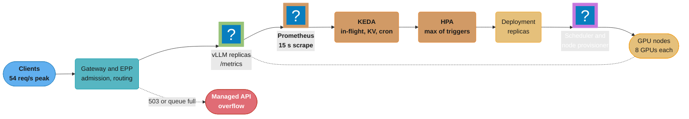
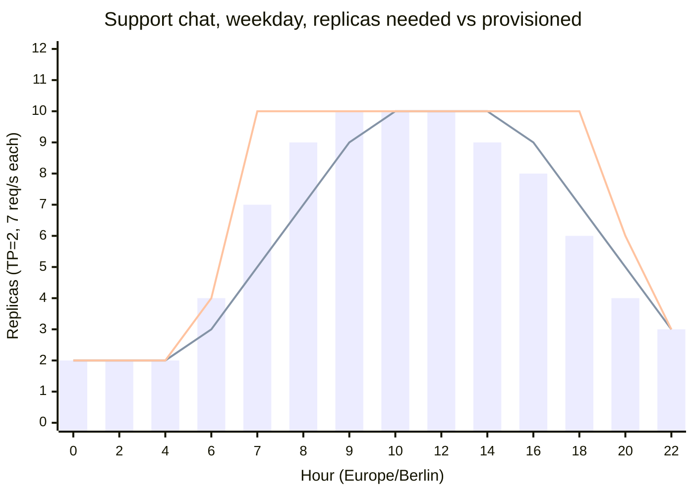
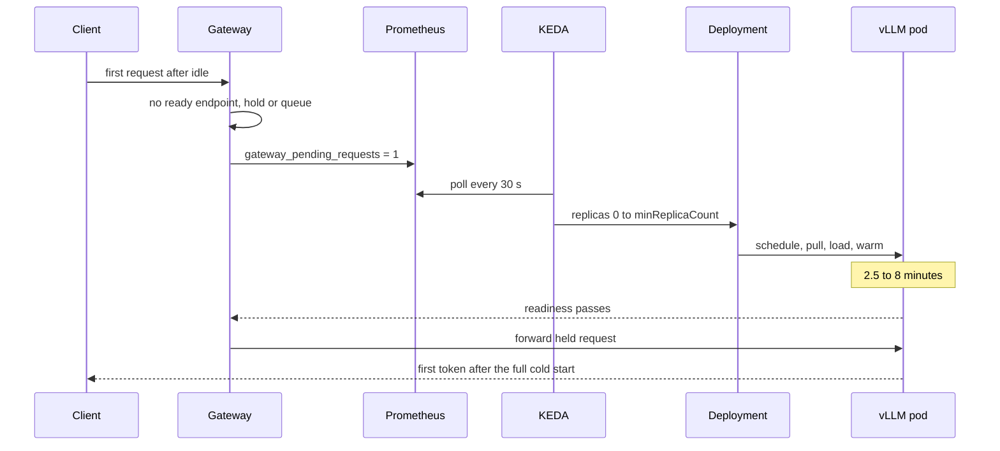

# Inference Autoscaling and Capacity Planning

> **Version anchor (2026-10-18).** vLLM v0.32.0 (2026-10-18); the metric names below were read
> from `vllm/v1/metrics/loggers.py` at the v0.32.0 tag, and the `--max-num-queued-reqs` and
> `--max-num-queued-tokens` semantics from `vllm/config/scheduler.py` at the same tag. KEDA v2.21.0
> (2026-09-23). KServe v0.21.0 (2026-09-25), which adds direct KEDA scaling to
> `LLMInferenceService` (`spec.scaling.keda`) and accepts `idleReplicaCount: 0`. Ray 2.59.0
> (2026-10-02); Ray Serve autoscaling defaults read from the Ray Serve docs on 2026-10-18. llm-d
> v0.10.0 (2026-09-29). `llm-d/llm-d-autoscaling` v1.0.0 (2026-10-13, read from its release page)
> made the repository KEDA-first and deprecated the Workload Variant Autoscaler (WVA); the last
> supported WVA release is v0.9.0. AIBrix v0.8.0 (2026-10-13) adds scheduled replica bounds
> (`spec.schedules`) and a predictive autoscaling API (`spec.predictive`) to `PodAutoscaler`; in
> v0.8.0 the predictive block validates but does not act, because the controller change (PR #2804)
> was still open on 2026-10-18. Kubernetes 1.37. Knative KPA defaults read from the Knative docs
> on 2026-10-18.

An LLM endpoint has a cost floor measured in whole GPUs and a cold start measured in minutes.
This page covers the arithmetic from traffic and benchmark to replica count, the signals that show
a model server is saturated, the autoscalers that act on them, and the strategies that cover the
minutes an autoscaler cannot: scheduled floors, warm pools, admission limits, burst to a managed
API and reserved capacity.

---

## 1. Concept Overview

Capacity planning for inference answers three questions, in this order.

| Question | Input | Output |
|---|---|---|
| How many replicas at peak? | Peak request rate, burst factor, goodput per replica under the SLO | A replica count and a GPU count |
| What signal says "add one"? | Engine metrics: queue depth, KV-cache usage, TTFT | Autoscaler triggers and thresholds |
| How fast can capacity arrive? | Cold-start budget: node, image, weights, compile, warmup | Headroom, scheduled floors, warm pools, burst routes |

The first question is arithmetic. Replicas at peak = peak req/s x burst factor / goodput per
replica, plus headroom for the scale-up lag and for a zone failure. Goodput is the request rate
one replica serves while meeting the latency SLO (for example p95 time to first token, TTFT, under
800 ms and p95 time per output token, TPOT, under 50 ms). It comes from an SLO benchmark sweep,
not from a peak-throughput number.

The second question is where most production incidents start. A vLLM replica at batch 4 and at
batch 120 both read close to 100% on `DCGM_FI_DEV_GPU_UTIL`, and its CPU sits near 10% while
requests queue. The signals that track load are the engine's own: in-flight requests (running
plus waiting), the waiting count, `vllm:kv_cache_usage_perc` and TTFT.

The third question decides whether reactive autoscaling works at all. A 70B replica starts in
about 2-3 minutes on a running node and 6-10 minutes on a new GPU node. A ramp of 30 req/s over
an hour is fine; the same ramp over 2 minutes needs a scheduled floor, a warm pool or an overflow
route.

**Not here.** HPA, VPA, Cluster Autoscaler, Karpenter and the generic KEDA mechanics, including
the `queueLength` replica formula, live in
[Kubernetes Scheduling and Autoscaling](../../devops/kubernetes_scheduling_and_autoscaling/kubernetes_scheduling_and_autoscaling.md).
The first broken-then-fixed KEDA config for vLLM (CPU HPA replaced by queue depth and KV usage),
gang admission and Capacity Blocks in a Karpenter NodePool live in
[GPU Scheduling and Inference Operations](../../devops/ml_platform_and_gpu_infrastructure/gpu_scheduling_and_inference_ops.md).
The cost of idle capacity, reserved-vs-on-demand break-even and cost per 1M tokens belong to
[AI Cost Engineering and Unit Economics](../ai_cost_engineering_and_unit_economics/ai_cost_engineering_and_unit_economics.md).
Queueing theory (utilization law, Kingman, M/M/c) is in
[Queueing Theory for Capacity](../../backend/queueing_theory_for_capacity/queueing_theory_for_capacity.md),
and SLO budget math is in
[Latency Budgets and SLO Math](../../backend/latency_budgets_and_slo_math/latency_budgets_and_slo_math.md).
How the goodput number is measured is
[Inference Engine Operations and Benchmarking](../inference_engine_operations_and_benchmarking/inference_engine_operations_and_benchmarking.md);
every layer of the cold-start budget is
[Model Storage, Loading and Cold Start](../model_storage_loading_and_cold_start/model_storage_loading_and_cold_start.md);
scaling prefill and decode pools as one replica group is
[Distributed Inference and Disaggregation](../distributed_inference_and_disaggregation/distributed_inference_and_disaggregation.md);
GPU quotas and fair share across teams are
[GPU Cluster Scheduling and Quotas](../gpu_cluster_scheduling_and_quotas/gpu_cluster_scheduling_and_quotas.md).

---

## 2. Intuition

**One-line analogy.** Staffing a call center: you plan seats from the forecast and the average
call length, you watch the hold queue (not how busy each agent's keyboard is), and because a new
hire takes ten minutes to log in, you schedule the morning shift before the phones start ringing.

**Mental model.** Three clocks run at once.

- The traffic clock: how fast demand changes. A diurnal ramp moves over hours, a launch or an
  agent retry storm over seconds.
- The control clock: scrape interval (15 s) + HPA sync (15 s) + metric windows and
  stabilization. About 1 minute before a decision. KEDA's 30 s `pollingInterval` sets the 0 to 1
  step; above 1 replica the HPA reads the metric on its own sync.
- The capacity clock: node provisioning + image pull + weight load + CUDA graph capture +
  warmup. 2-10 minutes before the new replica serves.

Reactive autoscaling works only when the traffic clock is slower than the other two combined.
Otherwise headroom, schedules, admission control or an overflow route cover the gap.

**Why it matters.** A replica of a 70B model on 2 H100s costs about the same per hour whether it
serves 0 or 7 req/s. Over-provisioning by 4 replicas wastes 8 GPUs around the clock.
Under-provisioning costs more than linear: in the §5 signal table, moving one replica from 8 to
10 req/s offered takes p95 TTFT from 720 ms to 1,900 ms, because a replica past its knee loses
goodput as load rises.

**Key insight.** The sizing signal must be proportional to load and unbounded. In-flight requests
(running plus waiting) are both: by Little's law they equal arrival rate x time in system, and past
saturation they keep rising as the queue grows. GPU utilization, CPU, KV usage and running count
alone have a ceiling. The waiting count alone has a floor problem: it is zero at steady state, so
it says nothing about how many replicas the current load needs.

---

## 3. Core Principles

1. **Plan from goodput, not throughput.** The provisioning number is the knee of the SLO goodput
   curve minus a margin. A closed-loop max-throughput number can overstate capacity by 30% or
   more (10.1 against a 7.4 req/s knee in §6.1), because it lets TTFT grow without limit.
2. **Requests are not equal.** A request with 8,000 prompt tokens and 600 output tokens costs
   10-20x one with 400 and 60. Plan and scale on tokens or on the engine's queue, never on raw
   req/s alone, unless the length mix is stable and measured.
3. **Size on in-flight requests, guard on KV, alert on TTFT.** In-flight per replica, with the
   target set to L at goodput, holds the steady-state count and grows with the queue. KV usage
   catches long-context saturation before the queue grows. TTFT is the SLO, but a histogram
   quantile over a window lags, so it suits an alert better than a trigger.
4. **Scale up fast, scale down slow.** Removing a replica that took 8 minutes to start, 2 minutes
   before the next burst, is an outage. Stabilize scale-down for 5-10 minutes.
5. **Headroom is the price of the cold start.** Headroom = ramp rate x total lag / goodput per
   replica, plus the 1-minute burst factor. Cut the lag (warm nodes, cached weights, free
   whole-replica slots on running nodes) and the headroom shrinks with it.
6. **A bounded queue beats an unbounded one.** An engine with no admission limit accepts every
   request and serves all of them late. A limit (`--max-num-queued-tokens`, a gateway 429) turns
   overload into a fast reject that a router can send elsewhere.

---

## 4. Types / Architectures / Strategies

### 4.1 Scale signals for an LLM server

| Signal | Source (vLLM v0.32.0 unless noted) | Bounded? | Leads or lags | Verdict |
|---|---|---|---|---|
| In-flight requests | `vllm:num_requests_running` + `vllm:num_requests_waiting` | No | Coincident, then leads | Primary sizing trigger, target = L at goodput |
| Waiting requests | `vllm:num_requests_waiting` | No | Leads | Saturation alert; zero at steady state, so not a sizing trigger alone |
| Waiting for capacity only | `vllm:num_requests_waiting_by_reason{reason="capacity"}` | No | Leads | Cleaner saturation signal when LoRA or KV-transfer waits are common |
| KV-cache usage | `vllm:kv_cache_usage_perc` (0 to 1) | Yes | Leads for long contexts | Guard trigger at 0.85-0.95 |
| Queue time | `vllm:request_queue_time_seconds` histogram | No | Lags by the window | Alert and second trigger |
| TTFT p95 | `vllm:time_to_first_token_seconds` histogram | No | Lags by the window | SLO alert, slow guard trigger |
| Prompt token rate | `rate(vllm:prompt_tokens_total[1m])` | No | Coincident | Capacity planning, prefill pool trigger |
| Admission rejections | `vllm:admission_rejections_total{reason=...}` | No | Leads | Overflow routing, alert |
| Running requests alone | `vllm:num_requests_running` | Yes, at `--max-num-seqs` | Coincident | Not a scale trigger |
| GPU utilization | `DCGM_FI_DEV_GPU_UTIL` from dcgm-exporter | Yes, at 100% | Coincident | Not a scale trigger |
| CPU utilization | cAdvisor | Yes | Misleading | Not a scale trigger |
| Requests per second | Gateway | No | Coincident | Valid only for fixed-cost classic models (a 30 ms XGBoost call) |

### 4.2 Autoscalers

| Autoscaler | Decision formula | Key settings | LLM-specific notes |
|---|---|---|---|
| HPA (`autoscaling/v2`) | `ceil(current x metric / target)`, 10% tolerance | `behavior.scaleUp`, `behavior.scaleDown` | Needs Prometheus Adapter for custom metrics; floor 1 |
| KEDA ScaledObject | HPA formula on KEDA-served metrics; KEDA owns 0 to 1 | `pollingInterval` 30 s, `cooldownPeriod` 300 s, `idleReplicaCount: 0`, `fallback` | Several triggers: HPA takes the maximum replica count |
| Knative KPA | In-flight requests per pod vs target | `autoscaling.knative.dev/window` 60 s, panic window 10%, panic threshold 200% | Activator holds requests while a pod starts; fits small models |
| KServe `InferenceService` | HPA or KEDA (`serving.kserve.io/autoscalerClass: "keda"`) | `minReplicas`, `maxReplicas`, `autoScaling.metrics` | KEDA only in Standard mode |
| KServe `LLMInferenceService` | `spec.scaling.keda.triggers` or `spec.scaling.wva` | `idleReplicaCount`, `fallback`, `advanced` | Prefill (`spec.prefill.scaling`) and decode scale separately |
| Ray Serve | Ongoing requests per replica vs `target_ongoing_requests` | `upscale_delay_s` 30, `downscale_delay_s` 600, `look_back_period_s` 30 | Custom policies (experimental) and application-level policies |
| llm-d | KEDA blueprints per role in `llm-d-autoscaling` | Waiting > 20, KV > 0.95, +1 pod per 180 s | WVA deprecated in `llm-d-autoscaling` v1.0.0 |
| AIBrix `PodAutoscaler` | KPA, APA or HPA strategy | `spec.schedules`, `spec.predictive` | StormService roles; `spec.predictive` is API only in v0.8.0 |

### 4.3 Capacity strategies

| Strategy | What it does | Covers | Costs |
|---|---|---|---|
| Static peak fleet | Runs the peak count all day | Everything except growth | Idle GPUs off-peak (40% of node-hours in §14) |
| Reactive autoscaling | Adds replicas when the queue grows | Ramps slower than the lag | Headroom; misses fast bursts |
| Scheduled floor | Raises `minReplicas` before a known ramp | Diurnal and weekly patterns, launches | Over-provisions on quiet days |
| Predictive floor | Raises the floor from a forecast horizon | Repeating patterns that drift | Forecast error; few products ship it |
| Warm pool | Keeps nodes or sleeping engines ready | Node provisioning and weight load | Node cost while idle |
| Admission limit | Rejects past a queue bound with 503 or 429 | Overload that capacity cannot catch | Some failed requests, retried elsewhere |
| Burst to a managed API | Sends overflow to a hosted model | Spikes beyond the fleet, zone loss | Per-token price, a different model, data terms |
| Reserved capacity | Buys guaranteed GPUs for a term | The floor of the demand curve | Paid whether used or not |
| Scale to zero | Removes every replica when idle | Dev, internal, batch endpoints | First request waits a full cold start |

---

## 5. Architecture Diagrams

### Control loop from engine metrics to GPU nodes



The control path (Prometheus, KEDA, HPA) decides in about a minute. The capacity path (scheduler,
node provisioner, GPU node, engine start) takes 2-10 minutes. The dotted overflow route carries
requests the fleet cannot serve while that capacity arrives.

### Which signal sees saturation

```
 one TP=2 replica of a 70B FP8 model, goodput knee near 7.4 req/s offered

 offered req/s            2       4       6       8      10      12
 --------------------------------------------------------------------
 GPU util (DCGM)         96%     99%    100%    100%    100%    100%   flat: no information
 CPU util (API server)    6%      8%      9%     10%     10%     10%   flat: no information
 running requests        19      38      57      74      96     128    capped at max-num-seqs
 KV-cache usage         0.11    0.22    0.33    0.43    0.55    0.74   bounded at 1.0
 waiting requests         0       0       0       2      21      88    zero until the knee
 in-flight (run + wait)  19      38      57      76     117     216    unbounded: sizes the fleet
 p95 TTFT (ms)          260     380     520     720    1900    5200   the SLO, read late
 --------------------------------------------------------------------
 SLO: p95 TTFT 800 ms   ok      ok      ok      ok     MISS    MISS
```

Only in-flight requests track load across the whole range: they rise with offered load below the
knee and jump with the queue above it. The waiting count says nothing until the knee, and p95 TTFT
needs a window of samples, so it confirms the miss after the queue has shown it. GPU and CPU
utilization never change shape.

### Cold-start budget for one replica

```
 70B FP8, TP=2, weights 70 GB, image 9 GB

 existing node with 2 free GPUs
 |pull|--weights--|graph|warm|                                      ~2.5 min
  60s     35s       40s   15s

 new GPU node
 |------node launch, driver, device plugin------|pull|--weights--|graph|warm|   ~8 min
                       330s                       60s     35s       40s   15s
 0         1         2         3         4         5         6         7         8 min
 |---------|---------|---------|---------|---------|---------|---------|---------|
```

Most of the new-node path is node bring-up, which no engine flag shortens. Weights at 2 GB/s are
35 s for 70 GB; at 140 GB (BF16) they would be 70 s. Keeping one spare node, or 2 free GPUs per
pool, turns an 8-minute scale-up into a 2.5-minute one. The HPA counts a replica from `Pending`,
so during either path the fleet serves below its target count.

### Diurnal demand, reactive fleet vs scheduled floor



Bars are replicas needed (demand x 1.25 burst factor / 7). The lower line is a reactive fleet that
runs 1-2 replicas below the need from 06:00 to about 10:00 and misses the SLO through the ramp. The
upper line adds the weekday cron floor of 10 replicas from 06:15 to 20:00 (§6.3). It removes the
morning miss, and in the afternoon and evening, when demand falls below the floor, it runs about 8
replica-hours more than the reactive fleet.

### Scale from zero with KEDA



With zero replicas, no engine exists to export `vllm:num_requests_waiting`. The activation
signal must come from something that is up while the model is not: the gateway's pending count, a
queue length, or a cron trigger. A trigger on a vLLM metric alone never wakes the deployment.

### Bin-packing TP=2 and TP=4 replicas on 8-GPU nodes

```
 node A   [r1 r1][r2 r2][r3 r3][ .  . ]   TP=2 replicas: 3, free GPUs: 2
 node B   [R1 R1 R1 R1][r4 r4][ .  . ]    TP=4 + TP=2, free GPUs: 2
 node C   [R2 R2 R2 R2][R3 R3 R3 R3]      full

 free GPUs in the pool: 4 (2 on A, 2 on B)
 new TP=2 replica  -> fits on A or B, starts in ~2.5 min
 new TP=4 replica  -> fits nowhere, needs a new node, starts in ~8 min
```

Four free GPUs split across two nodes cannot hold one TP=4 replica, which must sit on 4 GPUs in
one NVLink domain. Pools that mix replica sizes need a packing rule (one size per node pool, or a
scheduler that packs the largest shape first) or the free capacity is not usable.

---

## 6. How It Works - Detailed Mechanics

### 6.1 Capacity arithmetic

Start from four measured numbers:

| Input | Where it comes from | Example |
|---|---|---|
| Peak req/s | 15-minute peak from gateway logs, last 4 weeks | 54 req/s |
| Burst factor | 1-minute peak / 15-minute mean in the peak hour | 1.25 |
| Goodput per replica | SLO goodput sweep: knee minus a margin | 7 req/s (knee 7.4) |
| Ramp rate | Steepest sustained rise | 0.47 req/s per minute |

Then:

```
 base replicas      = peak x burst / goodput           = 54 x 1.25 / 7          = 9.64
 lag headroom       = ramp x lag / goodput             = 0.47 x 8 / 7           = 0.54
 replicas           = ceil(base + lag headroom)                                 = 11
 zone-loss safe     = ceil(replicas x zones / (zones - 1)) with 3 zones         = 17
```

**Little's law** checks that the replica can hold that load in memory. L = lambda x W: concurrent
requests = arrival rate x time in system. With p50 TTFT 0.4 s, mean output 260 tokens and TPOT
35 ms, W = 0.4 + 260 x 0.035 = 9.5 s. At 7 req/s per replica, L = 66.5 sequences in flight. With
a mean of 2,360 tokens per sequence (2,100 in, 260 out), that is about 157,000 tokens of KV cache.
Llama 3.x 70B with an FP8 KV cache uses 160 KiB per token (80 layers x 8 KV heads x 128 dims x 2
x 1 byte), and a TP=2 replica on H100 80 GB at `--gpu-memory-utilization 0.9` has room for about
410,000 tokens after weights and activation memory. KV fill is 0.38, so the replica is bound by compute, not
memory, and `--max-num-seqs` must be above 67 with room for bursts.

**Tokens, not requests.** If the length mix shifts (a new feature sends 8,000-token prompts),
the 7 req/s goodput is wrong the same day. Track prompt tokens/s and output tokens/s per replica
against the benchmark, and rerun the sweep when the p90 input length moves by more than 20%.

**Broken-then-fixed: planning from peak throughput.**

```python
# BROKEN: capacity from the engine's closed-loop peak throughput.
# `vllm bench serve` at max concurrency printed 10.1 req/s for one replica.
# 54 req/s / 10.1 = 5.3 -> 6 replicas. At 54 req/s offered the fleet runs each
# replica at 9 req/s, past the 7.4 req/s knee: p95 TTFT over 1 s, SLO missed all peak.
replicas = math.ceil(peak_rps / peak_throughput_rps)
```

```python
# FIX: capacity from SLO goodput, with burst, lag and zone headroom.
import math

def plan(peak_rps, burst, ramp_per_min, lag_min, goodput, gpus, zones=3,
         gpus_per_node=8, ttft_s=0.4, tpot_s=0.035, in_tok=2100, out_tok=260,
         kv_tokens=410_000):
    n = math.ceil((peak_rps * burst + ramp_per_min * lag_min) / goodput)
    n_zone = math.ceil(n * zones / (zones - 1))          # survive one zone loss
    nodes = math.ceil(n_zone / (gpus_per_node // gpus))
    conc = goodput * (ttft_s + out_tok * tpot_s)          # Little's law L per replica
    kv_fill = conc * (in_tok + out_tok) / kv_tokens
    return dict(replicas=n, zone_safe=n_zone, nodes=nodes,
                concurrency=round(conc, 1), kv_fill=round(kv_fill, 2))

print(plan(54, 1.25, 0.47, lag_min=8, goodput=7, gpus=2))
print(plan(54, 1.25, 0.47, lag_min=2.5, goodput=7, gpus=2))
```

```text
{'replicas': 11, 'zone_safe': 17, 'nodes': 5, 'concurrency': 66.5, 'kv_fill': 0.38}
{'replicas': 10, 'zone_safe': 15, 'nodes': 4, 'concurrency': 66.5, 'kv_fill': 0.38}
```

Cutting the lag from 8 to 2.5 minutes (a free replica slot on a running node) saves one replica
at peak. Zone safety costs 6 replicas, 12 GPUs. Many teams do not buy that: they hold the
11-replica fleet in two zones and send overflow to a managed API during a zone loss (§6.9).

### 6.2 How the HPA turns a metric into replicas

KEDA does not scale pods itself above 1. It serves metrics to an HPA it creates, and the HPA
computes:

```
 Value or per-pod average:       desired = ceil( current_replicas x current_metric / target )
 AverageValue, External metric:  desired = ceil( metric_total / target_per_replica )
 tolerance:                      no change if |current_metric / target - 1| <= 0.10
 several triggers:               HPA takes the largest desired count
```

Two consequences matter for LLM metrics.

**Ratio metrics cap the step.** `vllm:kv_cache_usage_perc` lives in 0 to 1. Feed its fleet mean
with "total" semantics into `ceil(metric / target)` and the result can never exceed
`ceil(1 / target)`: 2 replicas for a target of 0.5. AIBrix shipped exactly this. Its KPA used the
per-pod mean with the Knative formula, so 4 pods at 0.9 against 0.5 scaled down to 2, and the
sample `kpa.yaml` could never recommend more than 2 replicas. The fix (PR #2884, in v0.8.0)
multiplies the mean by the ready pod count for per-pod sources. The same cap hits any KEDA trigger
on a ratio with `metricType: AverageValue`: the llm-d blueprint's KV trigger (`max` KV usage
against 0.95) can ask for at most `ceil(1 / 0.95)` = 2 replicas by itself. For a ratio, use
`metricType: Value` on the fleet mean, so the HPA multiplies the current count by `mean / target`,
and let an unbounded metric (in-flight requests) size the fleet.

**Aggregate across pods in the query.** A Prometheus query that returns one series per pod gives
KEDA a vector, not a number. Write `sum(...)` for an AverageValue total, or `max(...)` when the
worst pod should drive a threshold. Label by model, since one Prometheus usually scrapes several
model servers.

**A queue-only trigger lets the fleet breathe.** `ceil(sum(waiting) / 4)` is 0 whenever the queue
is empty, which is the normal state of a healthy fleet. The HPA then shrinks to `minReplicas` at a
rate set only by the scale-down policy, a queue forms, the fleet grows, and the cycle repeats.
In-flight requests per replica do not have this problem, because running requests keep the value
near L while the fleet is healthy.

### 6.3 Broken-then-fixed: KEDA triggers on an `LLMInferenceService`

```yaml
# BROKEN: running requests track batch size, capped at --max-num-seqs. A replica
# serving 66 sequences inside its SLO "needs" 33 replicas, so the pool hits
# maxReplicas at moderate load. One series per pod, and no fallback if Prometheus fails.
apiVersion: serving.kserve.io/v1alpha2
kind: LLMInferenceService
metadata:
  name: support-chat
spec:
  model:
    uri: hf://meta-llama/Llama-3.3-70B-Instruct
  scaling:
    minReplicas: 2
    maxReplicas: 16
    keda:
      triggers:
        - type: prometheus
          metadata:
            serverAddress: http://prometheus.monitoring:9090
            query: vllm:num_requests_running
            threshold: "2"
```

```yaml
# FIX: in-flight requests size the fleet (target near L = 66.5 at goodput), mean KV
# usage guards long contexts, a weekday cron floor covers the ramp, fallback holds 10.
apiVersion: serving.kserve.io/v1alpha2
kind: LLMInferenceService
metadata:
  name: support-chat
spec:
  model:
    uri: hf://meta-llama/Llama-3.3-70B-Instruct
  scaling:
    minReplicas: 2
    maxReplicas: 16
    keda:
      pollingInterval: 15
      fallback:
        failureThreshold: 4
        replicas: 10
      advanced:
        horizontalPodAutoscalerConfig:
          behavior:
            scaleUp:
              stabilizationWindowSeconds: 0
              policies: [{type: Pods, value: 2, periodSeconds: 60}]
            scaleDown:
              stabilizationWindowSeconds: 600
              policies: [{type: Pods, value: 1, periodSeconds: 300}]
      triggers:
        - type: prometheus
          metricType: AverageValue        # desired = ceil(total / 60)
          metadata:
            serverAddress: http://prometheus.monitoring:9090
            ignoreNullValues: "false"     # empty result is an error, so fallback fires
            query: >-
              sum(vllm:num_requests_running{model_name="support-chat"}
                + vllm:num_requests_waiting{model_name="support-chat"})
            threshold: "60"
        - type: prometheus
          metricType: Value               # desired = ceil(current x mean / 0.85)
          metadata:
            serverAddress: http://prometheus.monitoring:9090
            ignoreNullValues: "false"
            query: avg(vllm:kv_cache_usage_perc{model_name="support-chat"})
            threshold: "0.85"
        - type: cron
          metadata:
            timezone: Europe/Berlin
            start: 15 6 * * 1-5
            end: 0 20 * * 1-5
            desiredReplicas: "10"
```

Three details are easy to miss. `initialCooldownPeriod`, which the KServe type also exposes, only
delays KEDA's first scale to zero after the ScaledObject is created; with `minReplicas: 2` and no
`idleReplicaCount` it does nothing, so a slow model load is covered by the scale-up rate limit
(2 pods per 60 s here), not by it. KEDA's fallback fires only on scaler errors, and the Prometheus scaler's `ignoreNullValues` defaults to `true`: a lost
target returns an empty result, which reads as 0, not as an error. Without `ignoreNullValues:
"false"`, a scrape outage scales the fleet down and the fallback never fires. AIBrix fixed the same
failure in its own controller in v0.8.0 (PR #2592, "stop KPA/APA scaling down on unknown
metrics"): a metrics outage must hold or raise replicas, never lower them.

### 6.4 Admission limits: the bound the autoscaler needs

vLLM v0.32.0 has two frontend admission limits. When either is hit, new requests get HTTP 503 and
`vllm:admission_rejections_total{reason=...}` counts them.

| Flag | Limits | Sizing rule from the vLLM docstring |
|---|---|---|
| `--max-num-queued-reqs` | Requests in flight (waiting + running) across the DP ranks behind one API server | `data_parallel_size x max_num_seqs` + the queue depth you accept |
| `--max-num-queued-tokens` | Total prompt tokens of requests in the prefill phase | `target_TTFT x prefill_throughput` |

The second one is a TTFT bound. A replica that prefills 12,000 tokens/s with a 0.8 s TTFT target
gets `--max-num-queued-tokens 9600`. A 10,000-token prompt arriving behind 9,000 queued tokens would
miss its TTFT anyway; rejecting it in 1 ms lets the gateway retry it on another replica or send it
to the overflow route. Without a bound, the queue grows during the scale-up lag and every request
in it is served late, which is worse than serving 95% on time and rejecting 5%.

### 6.5 Prefill and decode scale on different signals

In a disaggregated deployment, prefill pods are compute-bound and their load is prompt tokens per
second. Decode pods are memory-bound and their load is concurrent sequences and KV usage. The
`pd-disaggregation.yaml` blueprint in `llm-d-autoscaling` v1.0.0 gives each role its own
ScaledObject:

| Role | Triggers | Scale up | Scale down |
|---|---|---|---|
| Prefill | `max(vllm:num_requests_waiting{role="prefill"})` > 20, `max(vllm:kv_cache_usage_perc{role="prefill"})` > 0.95 | +1 pod per 180 s, no stabilization | -1 pod per 300 s after a 300 s window |
| Decode | Same queries with `role="decode"` | +1 pod per 180 s | -1 pod per 300 s |

The 180 s scale-up period stops the HPA adding a second pod before the first has loaded. Both
triggers are `AverageValue` on `max` values, so they ask for `ceil(max_waiting / 20)` and at most 2
replicas for KV; with empty queues they fall to `minReplicas`, and the slow scale-down policy is
what keeps the pools from breathing. For pools larger than a few pods, add an in-flight trigger per
role (§6.2). KServe `LLMInferenceService` takes the same split with `spec.scaling` (decode) and
`spec.prefill.scaling`, and requires both workloads to use the same scaling mode. The P:D ratio,
and why prefill and decode roll as one unit, are in
[Distributed Inference and Disaggregation](../distributed_inference_and_disaggregation/distributed_inference_and_disaggregation.md).

### 6.6 Ray Serve autoscaling

Ray Serve scales each deployment on ongoing requests per replica, which is the in-flight signal
of §6.2 measured at the proxy.

```python
from ray import serve

@serve.deployment(
    max_ongoing_requests=96,             # per replica; past it, the proxy queues
    autoscaling_config={
        "min_replicas": 2,
        "max_replicas": 16,
        "target_ongoing_requests": 64,   # about L at the SLO, from Little's law
        "upscale_delay_s": 30,
        "downscale_delay_s": 900,
        "look_back_period_s": 30,
    },
)
class Chat:
    ...
```

The defaults (`target_ongoing_requests` 2, `max_ongoing_requests` 5) fit short requests. For an
LLM replica batching 60-100 sequences, set the target near the Little's law concurrency at goodput
(66 in §6.1). Custom policies (experimental) can read engine metrics a deployment reports through
`record_autoscaling_stats()`.

### 6.7 Scheduled and predictive floors

A schedule raises the floor before a known ramp; the reactive triggers still handle what the
schedule did not predict.

**KEDA cron trigger.** Between `start` and `end`, the trigger asks for `desiredReplicas`. The HPA
takes the maximum across triggers, so the cron count acts as a floor, not a fixed size (example in
§6.3).

**AIBrix `PodAutoscaler.spec.schedules`** (v0.8.0). Each entry has `name`, optional `timezone`
(UTC default, one zone per autoscaler), optional `daysOfWeek` (`Mon` to `Sun`), `startTime` and
`endTime` in `HH:MM` as a half-open window, and `minReplicas` and `maxReplicas`. Windows must not
overlap and cannot cross midnight in one entry. An active window with `minReplicas` warms replicas
from zero.

**AIBrix `spec.predictive`** (v0.8.0). `mode` is `Preview` (default) or `Auto`;
`horizonSeconds` is 1 to 3600, default 120. The webhook rejects the block on the HPA strategy.
`status.predictive` is defined with `reactiveReplicas` and `wouldBeReplicas` side by side, so an
operator can see whether `Auto` would change anything. In v0.8.0 only the API is in: the
controller change (PR #2804) was open on 2026-10-18, so the block validates, nothing fills the
status, and nothing acts. Whatever the product, a horizon shorter than the cold start is no
use: set it to at least the scale-up lag.

### 6.8 Scale to zero and warm pools

Scale to zero fits internal tools, eval jobs, sparse per-tenant fine-tunes and batch endpoints. It
does not fit user-facing chat: an 8-minute first response is an outage for that user.

| Option | Idle cost | First-request latency | Notes |
|---|---|---|---|
| `minReplicas` 1, always on | 1 replica | Normal | Simplest; the cost floor |
| KEDA `idleReplicaCount: 0` | 0 | Full cold start, 2.5-8 min | Needs a non-engine activation signal (§5) |
| Spare node, no replica | 1 node | Image + weights + warmup, about 2.5 min | Removes the node-launch share |
| vLLM sleep level 1 | GPUs held, weights in CPU RAM | Weight copy back to GPU, no process start | `--enable-sleep-mode`; needs CPU RAM for the weights |
| Shared runtime, model swap | Shared GPUs | Swap time | AIBrix `ModelClaim` (experimental in v0.8.0) |

Sleep mode does not free the GPU for another pod: the pod still holds its GPU claim. It helps one
node run several models in turn, not a cluster give GPUs back. Serverless GPU platforms that sell
scale to zero as a product are compared in
[Deployment Targets and Serving Patterns](../deployment_targets_and_serving_patterns/deployment_targets_and_serving_patterns.md).

### 6.9 Burst to a managed API

When the queue is full or a zone is down, the gateway can send overflow to a hosted model.

```
 route request:
   if local fleet admits (no 503, queue below bound)       -> local replica
   elif tenant allows external processing and model maps    -> managed API, same prompt version
   else                                                     -> 429 with Retry-After
```

Four checks before turning it on. Quality: the hosted model is a different model and needs its own
pass on the release eval set. Data terms: the router reads a per-tenant flag before sending prompts
to a third party. Format: chat template and tool schemas map in the gateway, not in clients. Cost:
per-token overflow is cheap at 2% of traffic and expensive at 30%, so alert on the overflow share.
Gateway mechanics (fallback chains, retries, budgets) are in
[AI Gateway Operations](../ai_gateway_operations/ai_gateway_operations.md).

### 6.10 Reservations, quotas and bin-packing

Reserved capacity (cloud capacity reservations, Capacity Blocks, committed-use contracts, an owned
cluster) is the floor of the demand curve: the replica count needed at the quietest hour, plus the
count needed for the first minutes of any ramp. On-demand or spot capacity serves the rest. The
buy decision and break-even are in
[AI Cost Engineering and Unit Economics](../ai_cost_engineering_and_unit_economics/ai_cost_engineering_and_unit_economics.md);
purchase instruments are in
[GPU and AI FinOps](../../devops/cloud_cost_optimization_finops/gpu_and_ai_finops.md), and
spot and on-demand pool blending in
[GPU Pool Economics](../../llm/case_studies/cross_cutting/gpu_pool_economics.md).

Packing rules: one replica shape per node pool; headroom counted in free whole-replica slots, not
free GPUs (§5); and scale-down that removes the replica on the emptiest node, so whole nodes empty
out and can be released instead of half-full nodes that consolidation later evicts pods to fix.

An autoscaled inference pool runs on guaranteed GPU quota up to its peak count, not on borrowed
quota (Kueue cohorts, KAI Scheduler queues) that a training job can reclaim. See
[GPU Cluster Scheduling and Quotas](../gpu_cluster_scheduling_and_quotas/gpu_cluster_scheduling_and_quotas.md).

---

## 7. Real-World Examples

**DeepSeek, inference fleet size over a day (published 2025-03-01).** In the last post of its
open-source week, DeepSeek reported its V3/R1 inference service over 24 hours (2025-02-27 12:00
to 2025-02-28 12:00, UTC+8) on H800 nodes (8 GPUs each): a peak of 278 nodes and an average of
226.75 nodes occupied. Each node averaged about 73.7k input tokens/s in prefill (including cache
hits) or 14.8k output tokens/s in decode. In low-load hours DeepSeek reduces inference nodes and
gives them to research and training. That is the diurnal pattern in §5 at fleet scale: peak and
average differ by about 51 nodes, and the off-peak capacity goes to a second workload instead of
being released.

**llm-d moved to KEDA (2026).** `llm-d-autoscaling` started as a custom controller, the Workload
Variant Autoscaler, which computed a desired replica count and published `wva_desired_replicas`
for an HPA or KEDA to act on. Release v1.0.0 (2026-10-13) deprecated it: KEDA reads vLLM and EPP
metrics from Prometheus directly, and the repository keeps reviewed KEDA blueprints plus a test
bed that compares them. KServe v0.21.0 still offers both paths in `LLMInferenceService`
(`spec.scaling.wva` and `spec.scaling.keda`, mutually exclusive).

**AIBrix.** AIBrix is a Kubernetes control plane for vLLM, presented at KubeCon by ByteDance
engineers. Its `PodAutoscaler` offers HPA, KPA and APA strategies. The v0.8.0 fixes read like an incident list:
configurable metric windows, no scale-down on unknown metrics, a guard for pending replicas, and
KPA scaling on total load instead of the per-pod mean.

**Azure OpenAI provisioned deployments in Microsoft Foundry.** Provisioned throughput units (PTU)
reserve model capacity. With `spilloverDeploymentName` set, a request the provisioned deployment
answers with 429 (PTU used up), 500 or 503 goes to a standard deployment of the same model and
version, billed per token. That is the reserved-floor plus burst pattern of §4.3, sold as one
product.

---

## 8. Tradeoffs

| Strategy | GPU-hours | SLO risk | Operational load |
|---|---|---|---|
| Static peak fleet | Highest | Lowest, until growth | Lowest |
| Reactive only | Lowest | High on fast ramps | Medium |
| Reactive + scheduled floor | Low + a few replica-hours | Low on known patterns | Medium: schedules need upkeep |
| Reactive + warm node | Low + one node | Low | Medium |
| Reactive + burst to managed API | Lowest | Low, quality risk on overflow | High: two models to qualify |

---

## 9. When to Use / When NOT to Use

**Autoscale an inference fleet when:**

- Peak-to-trough demand is 2x or more over a day or week.
- The fleet has at least 4 replicas at peak, so a step of 1 replica is a 25% change or less.
- Cold start on a warm node is under about 5 minutes, or the ramp is slow enough to absorb it.
- Prometheus is run as a production dependency.

**Do not autoscale, or not yet, when:**

- The fleet is 1-3 replicas. Run it static with `minReplicas` at peak and revisit at 4.
- The model takes 15+ minutes to start (multi-node 400B+ on cold nodes). Use scheduled capacity.
- Traffic is batch. Use a queue and a job scaler; latency SLOs do not apply.

Scale to zero and burst to a managed API have their own conditions in §6.8 and §6.9.

---

## 10. Common Pitfalls

**The fleet that scaled down during an outage.** A Prometheus upgrade broke service discovery for
the model pods for 20 minutes. The trigger queries returned empty results, which the Prometheus
scaler reads as 0 by default, so the configured `fallback` never fired and the fleet stepped down
toward `minReplicas` 2 in the afternoon peak. Fix: `ignoreNullValues: "false"` on every trigger so
an empty result is an error, `fallback.replicas` at the peak count, and an alert on scaler errors.

**Scale-down that cut streams mid-answer.** Pods were removed with the default 30 s
`terminationGracePeriodSeconds`. Streams of 600 tokens at 35 ms per token run 21 s plus queue
time, and long ones were cut. Fix: a preStop hook that fails readiness first, then waits for
`vllm:num_requests_running` to reach 0, with a grace period of 120-300 s.

**Retry storms read as demand.** A client SDK retried 503s with no backoff. During a short
saturation the waiting count tripled, the autoscaler added 6 replicas, and the retry load vanished
before they were ready. Fix: `Retry-After` on 503 and 429, jittered client backoff, and a
scale-up rate limit of 1-2 pods per minute.

---

## 11. Technologies & Tools

| Tool | Role | Notes |
|---|---|---|
| KEDA | Event-driven autoscaler over the HPA | v2.21.0; Prometheus and cron scalers, `idleReplicaCount: 0`, `fallback` |
| Kubernetes HPA | Replica controller | `autoscaling/v2`; `behavior` for scale-up and scale-down rates |
| KServe | Model serving platform | v0.21.0; `LLMInferenceService` `spec.scaling.keda` and `spec.scaling.wva` |
| Knative Serving | Request-driven autoscaling | KPA: 60 s stable window, panic at 200% of target |
| Ray Serve | Python serving framework | Ray 2.59.0; `autoscaling_config`, custom policies |
| llm-d | Kubernetes-native distributed inference | v0.10.0; KEDA blueprints in `llm-d-autoscaling` v1.0.0 |
| AIBrix | vLLM control plane | v0.8.0; `PodAutoscaler` KPA, APA, HPA; `spec.schedules`, `spec.predictive` |
| vLLM | Inference engine | v0.32.0; queue, KV, TTFT metrics; `--max-num-queued-tokens` |
| Prometheus | Metrics store | Source for every KEDA trigger above |
| dcgm-exporter | GPU metrics exporter | Fleet health; not a scale signal |
| Karpenter | Node provisioner | GPU node pools, capacity reservations |

---

## 12. Interview Questions with Answers

**Q: Why is GPU utilization a bad autoscaling signal for an LLM server?**
**Short:** Continuous batching keeps a kernel running on every step, so a replica at batch 4 and one at batch 120 both read near 100%, and the metric cannot say how many replicas are missing.

`DCGM_FI_DEV_GPU_UTIL` measures whether a kernel was active during the sample period, not how
full the SMs were. Continuous batching keeps a decode kernel running on every step, so the metric
saturates long before the replica misses its SLO. Even past saturation it stays at 100% whether the
fleet is 10% or 300% short. Use it for fleet health. Size on in-flight requests per replica and
guard on KV-cache usage.

**Q: What is wrong with scaling a vLLM deployment on `vllm:num_requests_running` with a target of 2?**
**Short:** Running requests measure batch size, not saturation; a healthy replica runs 60+ sequences, so a target of 2 scales the pool to its maximum at moderate load.

vLLM batches many sequences per step and the running count rises with concurrency until it hits
`--max-num-seqs`. A replica serving 66 sequences inside its SLO looks 33x over target. The count is
also capped, so past saturation it stops growing. The KServe KEDA docs use this metric with a
target of 2 to demonstrate the wiring on `facebook/opt-125m`; on a 70B model it wastes most of the
GPUs. Scale on
running plus waiting requests per replica, with a target near L at goodput (about 60 here).

**Q: How do you compute the replica count for a new LLM endpoint?**
**Short:** Peak req/s times the burst factor divided by SLO goodput per replica, plus headroom for the scale-up lag and for a zone failure, then a Little's law check that KV memory holds the concurrency.

Goodput comes from an open-loop SLO sweep on the real length mix: the highest rate where p95 TTFT
and TPOT still meet target, minus a margin. Example: 54 req/s x 1.25 / 7 = 9.64; lag headroom
0.47 req/s per minute x 8 min / 7 = 0.54; ceil gives 11. Then L = lambda x W = 7 x 9.5 s = 66.5
sequences per replica, which needs about 157,000 KV tokens against 410,000 available. If KV fill
were above about 0.8, memory would bind before compute and the goodput number would be wrong.

**Q: Why do you need headroom at all if the autoscaler reacts to load?**
**Short:** New capacity takes 2-10 minutes to serve, so demand that rises during that lag must already fit in the running fleet.

The control loop decides in about a minute (scrape, HPA sync, stabilization), then the replica needs a
node, an image, weights, graph capture and warmup. Headroom = ramp rate x total lag / goodput per
replica. A 0.47 req/s per minute ramp with an 8-minute lag needs 3.8 req/s spare, about half a
replica. Cut the lag with a spare node or cached weights and the headroom shrinks; a launch that
ramps in seconds needs a scheduled floor instead.

**Q: Why is KV-cache usage a guard trigger and not the main trigger?**
**Short:** It is bounded at 1.0, so it can flag memory saturation but cannot tell the HPA how many replicas are missing.

KV usage catches the case where long prompts fill memory before the queue grows: the engine starts
preempting and latency degrades with a short queue. As a threshold at 0.9 it adds replicas in that
case. As a KEDA `AverageValue` trigger it fails, because `ceil(metric / target)` with a ratio
cannot exceed `ceil(1 / target)`; AIBrix's sample KPA config hit the same cap at 2 replicas until
PR #2884 in v0.8.0. Use `metricType: Value` on the mean, which scales the current count.

**Q: Why does a fleet scaled only on waiting requests oscillate?**
**Short:** A healthy fleet has an empty queue, so the trigger asks for zero replicas; the fleet shrinks until a queue forms, grows again, and repeats.

With `AverageValue`, desired = `ceil(sum(waiting) / target)`, which is 0 whenever the replicas keep
up. Only `minReplicas` and the scale-down rate limit hold the fleet, so it drifts down every
cooldown, misses TTFT while the queue rebuilds, and scales back up 8 minutes later. Size on running
plus waiting requests per replica instead: running requests keep the value near L while the fleet
is healthy, and waiting requests make it climb past saturation.

**Q: Your autoscaler uses a vLLM metric and `idleReplicaCount: 0`. Why does the deployment never wake up?**
**Short:** With zero replicas no engine exists to export the metric, so the trigger reads nothing and KEDA never activates.

Scale from zero needs an activation signal from a component that stays up: the gateway's pending
request count, a message queue length, or a cron trigger. Engine metrics then take over once a
replica runs. The gateway must also hold or queue the first requests for the cold start, which is
2.5-8 minutes for a 70B model, or return 503 with `Retry-After`. Use scale to zero only where the
first caller can wait that long.

**Q: What does `--max-num-queued-tokens` do, and why does it help autoscaling?**
**Short:** It rejects new requests with 503 once queued prefill tokens exceed a bound, which caps TTFT and turns overload into fast rejects a router can retry elsewhere.

The vLLM v0.32.0 docstring sizes it as target TTFT x prefill throughput: 0.8 s x 12,000 tokens/s
gives 9,600. Without a bound, every request admitted during the scale-up lag waits behind a growing
prefill backlog and all of them miss TTFT. With it, the replica serves admitted requests on time
and rejected ones go to another replica or the overflow route. `vllm:admission_rejections_total`
counts rejections by reason and is a good overflow alert.

**Q: How should scale-up and scale-down behave differently for a 70B model?**
**Short:** Scale up quickly with no stabilization but a pod-rate limit, and scale down slowly with a 5-10 minute window, because a removed replica takes minutes to replace.

Scale-up: stabilization 0, but limit to 1-2 pods per 60-180 s so the HPA does not add pods for
load the starting pods will absorb. The llm-d blueprint adds 1 pod per 180 s for this reason.
Scale-down: a 600 s window and 1 pod per 300 s, so a 2-minute lull before the next burst does not
remove capacity. Draining must also wait for in-flight streams, with a grace period of 120-300 s.

**Q: Why should prefill and decode pools have separate autoscalers?**
**Short:** Prefill load is prompt tokens and is compute-bound; decode load is concurrent sequences and KV memory, so one signal and one target cannot fit both.

A shift to longer prompts loads prefill and barely moves decode; longer answers do the opposite.
The `llm-d-autoscaling` v1.0.0 blueprint gives each role a ScaledObject on its own waiting count
and KV usage, filtered by `role`. KServe `LLMInferenceService` takes `spec.scaling` for decode and
`spec.prefill.scaling` for prefill, and requires both to use the same scaling mode. The ratio
between pools still needs a floor so one pool cannot shrink to a point that starves the other.

**Q: When is scale to zero the right choice for an inference endpoint?**
**Short:** When idle periods are long, the first request can wait a full cold start, and the activation signal comes from outside the engine.

Internal tools, nightly eval jobs, sparse per-tenant fine-tunes and batch endpoints fit. A
user-facing chat endpoint does not: the first caller waits 2.5-8 minutes. Middle paths are a warm
node with no replica (about 2.5 minutes) or vLLM sleep level 1, which keeps weights in CPU RAM but
still holds the GPU claim.

**Q: How do you handle a known daily ramp that is faster than the cold start?**
**Short:** Raise the replica floor on a schedule before the ramp, and let reactive triggers handle the rest above that floor.

A KEDA cron trigger with `desiredReplicas` acts as a floor because the HPA takes the maximum
across triggers. AIBrix v0.8.0 puts the same idea in `PodAutoscaler.spec.schedules` with weekday
and time-zone fields. Set the window to start one cold-start lag before the ramp, use an IANA
time zone so daylight-saving changes do not shift it.

**Q: What does a predictive autoscaler need to be useful for LLM serving?**
**Short:** A forecast horizon at least as long as the cold start, plus a way to compare its decision with the reactive one before it acts.

A 120-second forecast is no help when a new replica takes 8 minutes. AIBrix v0.8.0 defines
`spec.predictive` with `mode` `Preview` or `Auto` and a `horizonSeconds` of 1 to 3600, and defines
`status.predictive` with `reactiveReplicas` next to `wouldBeReplicas`. In v0.8.0 the block
validates, but no controller code fills the status or acts on it. Run any predictor in preview
for weeks against a simple schedule first.

**Q: What breaks when TP=2 and TP=4 replicas share 8-GPU nodes?**
**Short:** Free GPUs fragment across nodes, so a TP=4 replica cannot start even when the pool has 4 or more free GPUs, and the scale-up waits for a new node.

A tensor-parallel replica needs its GPUs on one node in one NVLink domain. Two nodes with 2 free
GPUs each hold no TP=4 replica. The scale-up then pays the full new-node lag, about 8 minutes
instead of 2.5. Keep one replica shape per node pool, track free replica slots rather than free
GPUs, and remove replicas from the emptiest node on scale-down.

**Q: When should an inference fleet burst to a managed API, and what must be in place first?**
**Short:** For spikes beyond the fleet or a zone loss, once the hosted model has passed the same eval gate, tenant data terms allow it, and an overflow budget alert exists.

The overflow model is a different model, so it gets its own eval pass on the release eval set. The
router checks a per-tenant flag before sending prompts to a third party, and the gateway maps chat
templates and tool schemas. Per-token pricing is cheap at 2% of traffic and expensive at 30%, so
alert on the overflow share. Holding a zone-safe fleet instead can cost 50% more GPUs with 3 zones.

**Q: How should `target_ongoing_requests` and `max_ongoing_requests` be set for a Ray Serve LLM deployment?**
**Short:** Set the target near the Little's law concurrency at goodput, often tens of sequences, and the maximum above it so the proxy never queues work the engine could batch.

Ray Serve scales on ongoing requests (queued plus running) per replica. With `max_ongoing_requests`
5 and `target_ongoing_requests` 2, an engine that could batch 66 sequences receives 5, the rest
queue, and the controller adds replicas until `max_replicas`, each running at a fraction of its
goodput. Set the target near the Little's law concurrency at goodput, and set
`max_ongoing_requests` above it so the proxy does not queue requests the engine could batch.

**Q: What should happen to replica count when the metrics pipeline fails?**
**Short:** It should hold or rise to a safe count, never fall; configure KEDA `fallback` with the peak replica count and alert on scaler errors.

KEDA's `fallback` sets `replicas` after `failureThreshold` consecutive scaler errors (not for CPU
and memory triggers). The trap: the Prometheus scaler's `ignoreNullValues` defaults to `true`, so a
lost scrape target or a renamed metric returns an empty result that reads as 0 load, not as an
error, and the fleet scales down. Set `ignoreNullValues: "false"` so the fallback fires. AIBrix
fixed the same behavior in its own controller in v0.8.0 (PR #2592).

**Q: How does Little's law help size `max_num_seqs` and the KV cache?**
**Short:** Concurrent sequences per replica equal arrival rate times time in system, so goodput times mean request duration gives the batch the replica must hold.

At 7 req/s and 9.5 s per request (0.4 s TTFT plus 260 tokens at 35 ms), L = 66.5. `--max-num-seqs`
must exceed that with burst room, and the KV cache must hold 66.5 x mean tokens per sequence. If
it cannot, the engine preempts and goodput falls below the benchmark. Recompute after any change
to the output length mix, since W scales with output tokens.

**Q: How do capacity reservations fit with autoscaling?**
**Short:** Reserve the floor of the demand curve, the replicas needed at the quietest hour plus the first minutes of a ramp, and autoscale the rest on on-demand or spot capacity.

Reserved GPUs are paid whether used or not, so they should run every hour. Above the floor,
on-demand capacity scales with demand but may not be available at peak in a scarce region, which is
why some teams reserve up to the median and burst to a managed API above it. Inference pools should
run on guaranteed quota, not borrowed quota a training job can reclaim. The break-even arithmetic is
in the cost engineering module.

---

## 13. Best Practices

1. Size every pool from an SLO goodput sweep on the replayed length mix; record the goodput number,
   the engine version and the date next to the replica count.
2. Size on running plus waiting requests per replica (target near L at goodput), guard on mean
   `vllm:kv_cache_usage_perc` with `metricType: Value`, and alert on the waiting count, p95 TTFT
   and `vllm:admission_rejections_total`.
3. Aggregate trigger queries (`sum` or `max`) and filter by model and role.
4. Set KEDA `fallback` to the peak count with `ignoreNullValues: "false"`, and alert on scaler
   errors.
5. Scale up with a pod-rate limit and scale down with a 600 s window and 1 pod per 300 s.
6. Bound the engine queue with `--max-num-queued-tokens` sized as target TTFT x prefill rate.
7. Put a scheduled floor in front of every known ramp, with an IANA time zone.
8. Keep one replica shape per node pool and one spare whole-replica slot per pool.
9. Drain with a preStop hook that fails readiness and waits for running requests to finish;
    activate scale-from-zero on a gateway or queue signal, never on an engine metric alone.
10. Qualify the overflow model on the release eval set, and recheck metric names against
    `/metrics` after every engine upgrade.

---

## 14. Case Study

### Support-chat fleet: static 9 replicas to an autoscaled 2-16 with a scheduled floor

**Context.** A software company runs its support assistant on Llama 3.3 70B Instruct in FP8 on
vLLM, TP=2, on H100 80 GB nodes with 8 GPUs each (4 replica slots per node). After the engine
migration in
[Inference Engine Operations and Benchmarking](../inference_engine_operations_and_benchmarking/inference_engine_operations_and_benchmarking.md),
the fleet ran a static 9 replicas on 3 nodes for a 54 req/s weekday peak. The SLO is p95 TTFT
800 ms and p95 TPOT 50 ms. Traffic follows European business hours: 6 req/s overnight, 54 req/s
at peak, about 18 req/s at weekends. Finance asked why 3 nodes ran all night for 6 req/s.

**Step 1: measure.** Four weeks of gateway logs gave a 15-minute peak of 54 req/s, a 1-minute
burst factor of 1.25 and a steepest ramp of 0.47 req/s per minute (06:30 to 08:00). The goodput
knee was 7.4 req/s per replica; the team provisions at 7. Cold start: 2.5 minutes into a free slot
on a running node, 8 minutes when a node must launch.

**Step 2: size the peak.** The §6.1 planner gave 11 replicas with the 8-minute lag. The static
fleet of 9 had been missing the SLO for a few minutes on most weekday mornings, hidden by a
dashboard that showed hourly p95. Zone-safe sizing over 3 zones was 17 replicas; the team chose 2
zones plus overflow.

**Step 3: pick the signals.** The first draft copied the KServe docs and scaled on
`vllm:num_requests_running` with a target of 2; in a load test it went to `maxReplicas` 16 at
20 req/s. A second draft scaled on waiting requests alone and swung between 4 and 11 replicas
every 20-30 minutes through the afternoon. The shipped config is the fixed one in §6.3: in-flight
requests at 60 per replica, mean KV usage at 0.85, `fallback` at 10 replicas, plus
`--max-num-queued-tokens 9600` so overload returns 503 instead of a long queue.

**Step 4: cover the ramp.** A KEDA cron trigger holds 10 replicas from 06:15 to 20:00
Europe/Berlin on weekdays. It starts one new-node cold start (8 minutes) plus margin before the
06:30 ramp, so the 3 nodes are up before it. At night 2 replicas run on one
node, and its 2 free slots act as a warm pool at no extra cost: night scale-ups to 4 replicas take
2.5 minutes. Scale-down runs 1 pod per 300 s after a 600 s window, and pods drain through a
preStop hook with a 240 s grace period.

**Step 5: overflow.** The gateway sends a request to a hosted model when the local fleet returns
503 and the tenant's data flag allows it. The hosted model scored 1.2 points lower on the refunds
slice of the release eval set, which the product owner accepted for overflow only. An alert fires
when overflow passes 3% of requests over 15 minutes.

**Results after 6 weeks.** Nodes are billed whole, so the table counts node-hours.

| Metric | Static fleet | Autoscaled fleet |
|---|---|---|
| Node-hours per week (8 GPUs each) | 504 | about 300 |
| Weekday mornings with p95 TTFT over 800 ms for 5+ minutes | 17 of 30 | 1 of 30 |
| Replicas at peak / at night | 9 / 9 | 11 / 2 |
| Requests served by overflow | 0 | 0.4% |
| Scale-downs that cut a stream | not measured | 0 |

Node-hours fell about 40%: 3 nodes for 13.75 weekday hours, 1 node otherwise. The fleet got larger
at peak and smaller at night. The one SLO miss came on a Monday after a public holiday, when
traffic ramped before the cron window; holidays now go into the schedule review.

**What went wrong on the way.** In week 2 a Prometheus upgrade broke scraping for 25 minutes at
14:00. Production held 10 replicas through `fallback` and the cron floor; staging, which has no
cron trigger and kept the default `ignoreNullValues: true`, read 0 load and dropped to 2. In week 3 a model rename left a trigger
filtering on `model_name="support-chat-v2"`. The query errored, fallback pinned the fleet at 10
through a night, about 80 extra replica-hours, until the scaler-error alert was routed to on-call.

**Lessons.**

- Sizing from goodput found an SLO miss that hourly p95 had hidden.
- The cron floor did more for the SLO than any trigger tuning, because the ramp was faster than a
  new-node cold start.
- Free slots on a running node are the cheapest warm pool there is.
- `ignoreNullValues: "false"` plus a paged scaler-error alert: by default a missing series reads
  as zero load.
