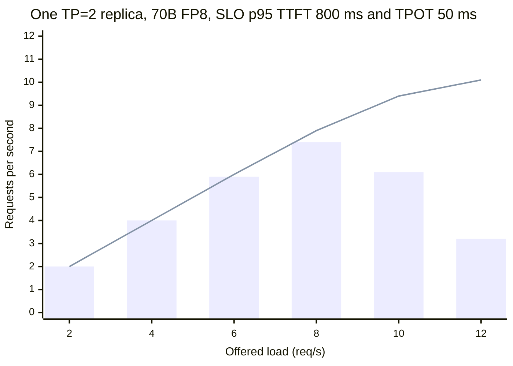
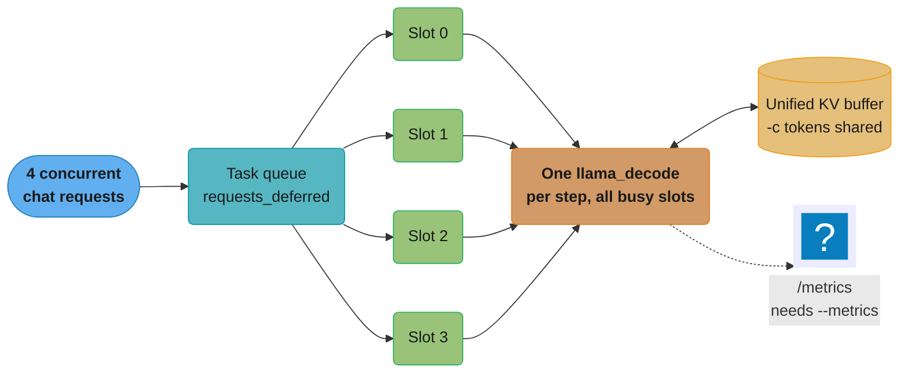

# Inference Engine Operations and Benchmarking

> **Version anchor (2026-10-18).** **vLLM v0.32.0** (2026-10-18) follows v0.31.0 (2026-10-05) and
> v0.30.0 (2026-09-22). **SGLang v0.5.21** (2026-10-02). **TensorRT-LLM** stable is v1.2.1
> (2026-04-20); v1.4.0rc0 (2026-10-14) is a pre-release, and v1.3.0 shipped only as rc builds.
> **llama.cpp** stable v0.7.0 (2026-10-15); rolling build b11719 (2026-10-18, pre-release).
> `llama-server` defaults checked 2026-10-18: `-np/--parallel` is -1 (auto), `-cb/--cont-batching` is
> enabled, `--kv-unified` is enabled when slots are auto, `/metrics` is served only with `--metrics`,
> and `--port` defaults to 9931 (was 8080, changed in PR #30159, listed in the v0.7.0 notes).
> **Ollama v0.40.6** (2026-10-16). **TGI** was archived on 2026-03-21; its README points to vLLM,
> SGLang, llama.cpp and MLX. GuideLLM, AIPerf, GenAI-Perf, LLMPerf and lm-evaluation-harness have no
> pin in this section; their CLI syntax was read from their READMEs on 2026-10-18. MLPerf Inference latency limits were read from the MLCommons
> `inference_rules.adoc` on 2026-10-18.

## 1. Concept Overview

An inference engine (vLLM, SGLang, TensorRT-LLM, `llama-server`) is a binary that a platform team
runs, upgrades and pays for. This module covers the three operating jobs around that binary:

1. **Benchmarking.** Produce a number you can provision on: requests per second per replica that
   meet the latency SLO, measured against your own length distribution and prefix-share ratio.
   That number is **goodput**, not peak throughput.
2. **Upgrade qualification.** Decide whether a new engine release (or a new kernel, quantization
   or flag set) may replace the current one. Qualification checks performance, task accuracy,
   numerics and production flags, and it runs for every minor release. vLLM shipped three minor
   releases in 26 days in September and October 2026.
3. **Day-two operations.** Export the engine's metrics, run `llama-server` with the right slot and
   KV settings, and migrate off an engine that stops being maintained, as TGI did on 2026-03-21.

The output of benchmarking feeds capacity planning in
[Inference Autoscaling and Capacity Planning](../inference_autoscaling_and_capacity_planning/inference_autoscaling_and_capacity_planning.md):
the goodput per replica is the denominator of every replica count. The platform that wraps the
engine (KServe, Ray Serve, AIBrix) is in
[Model Serving Platforms](../model_serving_platforms/model_serving_platforms.md). Multi-node and
prefill/decode split setups, which need their own benchmark shapes, are in
[Distributed Inference and Disaggregation](../distributed_inference_and_disaggregation/distributed_inference_and_disaggregation.md).
Where `llama-server` fits as a deployment target (internal tools, air-gapped sites) is in
[Deployment Targets and Serving Patterns](../deployment_targets_and_serving_patterns/deployment_targets_and_serving_patterns.md).
GPU-side counters (SM activity, HBM bandwidth, XID errors) that sit under the engine metrics are in
[GPU Observability and Fleet Health](../gpu_observability_and_fleet_health/gpu_observability_and_fleet_health.md).
A qualified engine release still goes through a canary, described in
[Progressive Delivery for Model Servers](../progressive_delivery_for_model_servers/progressive_delivery_for_model_servers.md).

**Not here.** What each engine is and how PagedAttention, RadixAttention and continuous batching
work live in [Inference Engines](../../llm/inference_engines/inference_engines.md). The meaning of
each vLLM flag (`--max-num-seqs`, `--max-num-batched-tokens`, `--gpu-memory-utilization`) and the
`vllm bench` subcommands live in [vLLM Deep Dive](../../llm/vllm_deep_dive/vllm_deep_dive.md);
this module names flags only to say which ones a qualification must diff. Generic benchmarking
method (warmup, variance, confidence intervals, coordinated omission) lives in
[Benchmarking Methodology](../../backend/benchmarking_methodology/benchmarking_methodology.md).
Speculative decoding theory lives in
[Speculative Decoding](../../llm/inference_and_decoding/speculative_decoding.md).

---

## 2. Intuition

**One-line analogy.** An engine benchmark is a dynamometer run: the horsepower figure means nothing
unless you know the gear, the fuel and the road it was measured for.

**Mental model.** An engine has one throughput curve per workload. The x-axis is offered load, the
y-axis is requests per second that met the SLO. The curve rises, flattens at a knee, then falls as
queueing pushes TTFT past the limit. A benchmark finds the knee for your workload. A qualification
checks that the new release did not move the knee left and did not change the answers.

**Why it matters.** Replica count is load divided by goodput per replica. A 20% error in goodput is
a 20% error in GPU spend, or a 20% shortfall in capacity at peak. On a fleet of 64 H100s running
all year (560,640 GPU-hours), 20% is about 112,000 GPU-hours, or 112,000 x R at a rate of R per
GPU-hour.

**Key insight.** Peak throughput, measured by firing every request at once, is the one number that
does not answer the provisioning question. The provisioning number comes from an open-loop sweep
with a goodput SLO, run on traffic that has your input lengths, your output lengths and your
prefix-share ratio.

---

## 3. Core Principles

1. **Benchmark against an SLO.** Report goodput: completed requests per second whose TTFT, TPOT
   and end-to-end latency all met their limits. The definition comes from DistServe (OSDI 2024),
   and `vllm bench serve --goodput` and `aiperf profile --goodput` implement it. SGLang's serving
   benchmark at v0.5.21 has no goodput flag.
2. **Open loop for latency, closed loop for capacity limits.** An open-loop client sends on a
   schedule (Poisson or gamma arrivals) whether or not responses come back. A closed-loop client
   keeps N requests in flight and stops sending when the server stalls, which hides the stall.
3. **The workload is part of the result.** Input length distribution, output length distribution
   and prefix-share ratio can change goodput by 2x or more on the same engine. A number without its
   workload spec is not a result.
4. **One client, one tokenizer, every engine.** Compare engines with the same load generator and the
   same token counting. Engine-native benchmarks count tokens their own way.
5. **Qualification covers four things.** Performance, task accuracy, numerics and production flags.
   A release that is 15% faster and changes 4% of greedy outputs on one slice is not qualified.
6. **Pin the whole stack.** Engine version, container digest, CUDA, driver, model revision and the
   full flag set. A benchmark against `vllm/vllm-openai:latest` cannot be reproduced next week.
7. **Results expire with the release.** Re-run the suite on every minor engine release, every
   driver change and every model or quantization change. Archive the raw per-request results.

---

## 4. Types / Architectures / Strategies

### 4.1 Benchmark types

| Type | Question it answers | Load shape | Typical duration |
|---|---|---|---|
| Offline throughput | Maximum tokens/s for a batch job | All requests submitted at once | Until queue drains |
| Online sweep | Where is the knee for this workload | Open loop, rate stepped up | 3-10 min per step |
| SLO goodput | How many req/s meet the SLO per replica | Open loop at fixed rates, `--goodput` set | 10 min per step |
| Soak | Does latency drift (fragmentation, leaks) | Open loop at 70% of the knee | 4-24 h |
| Replay | Does production traffic behave like the synthetic set | Recorded arrivals and prompts | One peak hour |
| Micro-benchmark | Kernel and hardware speed for one stream | One sequence, no server | Seconds |

MLPerf Inference encodes the same split. Its Offline scenario submits everything at once. Its
Server scenario sends Poisson arrivals for at least 600 s and requires 99% of queries to meet the
latency bound. For Llama 2 70B the bounds are TTFT 2,000 ms and TPOT 200 ms in the conversational
category and TTFT 450 ms and TPOT 40 ms in the interactive category, with accuracy at 99.9% of the
FP32 reference.

### 4.2 Load models

| Model | How it sends | What it measures well | What it hides |
|---|---|---|---|
| Closed loop, fixed concurrency | N in flight, next request on completion | Batch-size effects, saturation throughput | Queueing during stalls (coordinated omission) |
| Open loop, Poisson | Exponential gaps at rate λ | Latency at a target load | Burstier real traffic |
| Open loop, gamma (`--burstiness` below 1) | Bursty gaps, same mean rate | Burst tolerance, queue spikes | Correlated bursts and diurnal shape; gaps are still independent |
| Ramp | Rate rises linearly | Rough knee location in one run | Steady-state percentiles |
| Trace replay | Recorded timestamps | Real arrivals and lengths | Future traffic mix |

### 4.3 Tools

| Tool | Owner | Load models | Goodput | Use it for |
|---|---|---|---|---|
| GuideLLM | vLLM project | synchronous, concurrent, throughput, constant, poisson, sweep | No flag; reports TTFT and ITL distributions | Engine-neutral sweeps against any OpenAI-compatible server |
| AIPerf | NVIDIA (ai-dynamo) | concurrency, request rate, trace replay | `--goodput` | Successor to GenAI-Perf; works against vLLM, SGLang, TensorRT-LLM, Ollama |
| GenAI-Perf | NVIDIA | concurrency, request rate | Yes | Existing pipelines only; its README says it is being phased out for AIPerf |
| `vllm bench serve` | vLLM | rate, burstiness, max concurrency, ramp | `--goodput ttft:... tpot:... e2el:...` | vLLM regression runs; datasets `random`, `sharegpt`, `prefix_repetition`, `timed_trace` |
| SGLang `benchmark.serving` | SGLang | Poisson rate, max concurrency, trace replay | No | SGLang runs; `generated-shared-prefix` dataset models prefix sharing |
| LLMPerf | Ray project | concurrent clients | No | Cross-provider API comparisons; prompts are lines from Shakespeare sonnets |
| `llama-bench` | llama.cpp | single sequence | No | Prompt processing (`pp`) and generation (`tg`) tokens/s per build and backend |
| `trtllm-bench` | NVIDIA | `throughput` and `latency` subcommands | No | TensorRT-LLM runs without a server |

`python -m sglang.bench_serving` still runs at v0.5.21, but it is a deprecated import path that
warns and forwards to `python -m sglang.benchmark.serving`. Update CI scripts before the old path
is removed.

---

## 5. Architecture Diagrams

### Engine upgrade qualification pipeline

```mermaid
flowchart LR
    classDef io      fill:#61afef,stroke:#2e86c1,color:#1a1a1a,font-weight:bold
    classDef frozen  fill:#c678dd,stroke:#9b59b6,color:#fff
    classDef train   fill:#98c379,stroke:#27ae60,color:#1a1a1a
    classDef mathOp  fill:#d19a66,stroke:#e67e22,color:#1a1a1a,font-weight:bold
    classDef lossN   fill:#e06c75,stroke:#c0392b,color:#fff,font-weight:bold
    classDef req     fill:#56b6c2,stroke:#0097a7,color:#1a1a1a
    classDef base    fill:#e5c07b,stroke:#f39c12,color:#1a1a1a

    cand(["Candidate image<br/>vLLM v0.32.0 by digest"])
    flags("Flag and default diff<br/>vs champion")
    perf("Goodput sweep<br/>replayed length mix")
    acc("Task accuracy<br/>eval set, CI")
    num("Numerics<br/>A-vs-B vs A-vs-A")
    ops("Ops checks<br/>startup, metrics names")
    verdict{"All four<br/>within budget?"}
    canary("Canary<br/>progressive delivery")
    reject("Reject or<br/>pin flags")
    champ[("Champion<br/>vLLM v0.30.0")]

    cand --> flags --> perf --> acc --> num --> ops --> verdict
    champ -.->|baseline run| perf
    champ -.->|baseline outputs| num
    verdict -->|yes| canary
    verdict -->|no| reject

    class cand io
    class flags,ops req
    class perf,acc,num mathOp
    class verdict frozen
    class canary train
    class reject lossN
    class champ base
```



The champion runs the same suite on the same day and hardware. Every comparison is champion vs
candidate under identical conditions, never candidate vs a number from last month.

### TTFT, ITL, TPOT and end-to-end latency on one streamed request

```
  t=0 ms        request arrives at the server
  |
  |<---- queue ---->|<-- prefill -->|
  0                120             400   440   480   700   740  ...  4,580
  |                 |               |     |     |     |     |          |
  |                 |               T1    T2    T3    T4    T5   ...   T101
  |                                 |     |     |     |                  |
  |<------------- TTFT = 400 ms ---->|     |     |     |                  |
                                    |<-40->|<-40->|<-220->|  ITL gaps     |
  |<---------------------------- E2E = 4,580 ms -------------------------->|

  TPOT = (E2E - TTFT) / (tokens - 1) = (4,580 - 400) / 100 = 41.8 ms
  ITL  = every gap between consecutive tokens: 40, 40, 220, 40, ...
         the 220 ms gap is a decode step that waited behind another request's prefill chunk
```

TPOT averages one request's 100 gaps (99 of 40 ms, one of 220 ms), so the stall moves the mean from
40 to 41.8 ms and disappears. ITL keeps each
gap, so its p99 shows the stall. A chat SLO on smoothness needs ITL p99, not TPOT p99.

### Goodput vs offered load for one replica



Bars are goodput, the line is raw completed throughput. Raw throughput keeps rising to 10.1 req/s
while goodput peaks at 7.4 req/s near 8 req/s offered and then falls, because queueing pushes TTFT
past 800 ms. The provisioning number is the knee, minus headroom: 7 req/s per replica. These are the
case-study numbers from §14.

### llama-server slots and the KV buffer



With `-np` on auto the server opens 4 slots and one shared KV buffer, and continuous batching puts
every busy slot into the same decode step. Four requests run together; a fifth waits in the queue
and shows up as `llamacpp:requests_deferred`.

---

## 6. How It Works - Detailed Mechanics

### 6.1 Latency metrics, exactly as the tools compute them

| Metric | Definition | Aggregation in `vllm bench serve` and SGLang | SLO use |
|---|---|---|---|
| TTFT | Send time to first streamed token | Per request, then percentiles | Interactive responsiveness |
| TPOT | `(e2e - ttft) / (output_tokens - 1)` per request | Per request, then percentiles | Average decode speed per user |
| ITL | Each gap between consecutive streamed chunks | All gaps pooled, then percentiles | Stutter, prefill interference |
| E2EL | Send to last token | Per request | Batch and agent steps |
| Goodput | Requests per second meeting every SLO given | One number per run | Capacity per replica |

A one-token response has no gap. Both tools leave it out of the TPOT percentiles, and
`vllm bench serve` counts it as TPOT 0 when it computes goodput. A classification endpoint that
returns one token therefore always meets a TPOT goodput SLO; give it an E2EL SLO instead.

Two counting traps:

- **Streaming chunk vs token.** Some servers send several tokens per SSE chunk (speculative
  decoding, detokenizer batching). A client that times chunks reports ITL per chunk, which is
  larger and less frequent than per token. Compare engines only with the same client.
- **Tokenizer.** LLMPerf counts every provider's tokens with a Llama tokenizer, so "tokens/s"
  across providers is in Llama tokens. That keeps prompts consistent but makes per-token numbers
  wrong for any model with a different tokenizer. Report requests/s and characters/s beside it.

### 6.2 Workload spec: lengths and prefix share

A benchmark run starts from a written workload spec, derived from production logs:

```yaml
# workload/support-chat-2026-10.yaml
source: gateway logs 2026-09-28 to 2026-10-04, 1.9M requests
input_tokens:  {p10: 380, p50: 1450, p90: 6100, p99: 14800, max: 31000}
output_tokens: {p10: 40,  p50: 190,  p90: 610,  p99: 1400}
prefix_share_ratio: 0.62        # cached prompt tokens / prompt tokens in production
shared_prefix_tokens: 1100      # system prompt plus tool schemas
arrival: {mean_rps_peak: 54, burstiness_gamma_shape: 0.6}
slo: {ttft_p95_ms: 800, tpot_p95_ms: 50, itl_p99_ms: 250}
```

**Prefix-share ratio** is the fraction of prompt tokens the engine can serve from the prefix cache.
Measure it in production from the engine counters, not from a guess:

```promql
sum(rate(vllm:prefix_cache_hits_total[1h]))
  / sum(rate(vllm:prefix_cache_queries_total[1h]))
```

It matters because a cached prefix skips prefill. With 62% of prompt tokens cached, the engine
prefills 38% of the tokens a cold-cache run prefills. Two common errors move the ratio in opposite
directions:

| Error | Ratio in the benchmark | Effect on the result |
|---|---|---|
| `--dataset-name random` with no prefix | 0 | TTFT too high, goodput 30-50% too low for chat |
| 200 prompts repeated 10 times | 0.9 or more | TTFT too low, goodput too high |
| Replayed prompts in arrival order | Close to production | Correct, if the replay is long enough to warm the cache |

`vllm bench serve --dataset-name prefix_repetition` and SGLang's `generated-shared-prefix` dataset
build synthetic sets with a controlled shared prefix. A replay of one production hour is better
when the prompts can leave the production boundary.

### 6.3 Running the sweep: broken, then fixed

**Broken.** This run is copied from a blog post and pasted into a capacity review:

```bash
vllm bench serve --model llama-70b \
  --dataset-name random --random-input-len 1024 --random-output-len 128 \
  --num-prompts 1000
```

Four defects. `--request-rate` defaults to `inf`, so all 1,000 requests arrive at once and every
latency printed is queueing (the default itself is covered in
[vLLM Deep Dive](../../llm/vllm_deep_dive/vllm_deep_dive.md)). Fixed lengths remove the variance
continuous batching feeds on. The 1,024/128 shape drops the long tail of the §6.2 spec (input p90
6,100, output p90 610), which is what fills the KV cache. No goodput SLO is set, so the run reports
throughput nobody can provision on.

**Fixed.** One step of an open-loop sweep with the production shape and the SLO:

```bash
vllm bench serve \
  --backend openai-chat --endpoint /v1/chat/completions \
  --model llama-70b --tokenizer meta-llama/Llama-3.3-70B-Instruct \
  --dataset-name custom --dataset-path replay/support-chat-peak-hour.jsonl \
  --request-rate 8 --burstiness 0.6 \
  --num-prompts 4800 --num-warmups 200 \
  --goodput ttft:800 tpot:50 \
  --percentile-metrics ttft,tpot,itl,e2el --metric-percentiles 50,95,99 \
  --save-result --save-detailed --result-dir results/v0.32.0/rate-8 \
  --label "v0.32.0 tp2 fp8 rate8"
```

`--burstiness 0.6` draws gaps from a gamma distribution with shape 0.6, burstier than Poisson
(shape 1.0). 4,800 prompts at 8 req/s is a 10-minute step. The same step in the engine-neutral
tools:

```bash
guidellm run \
  --backend kind=openai_http,target=http://cand:8000 \
  --profile kind=sweep \
  --constraint kind=max_duration,seconds=600 \
  --data kind=json_file,path=replay/support-chat-peak-hour.json

aiperf profile --model llama-70b --endpoint-type chat --streaming \
  --url http://cand:8000 --request-rate 8 --request-count 4800 \
  --goodput "time_to_first_token:800 inter_token_latency:50"
```

Run the candidate and the champion with the same tool. GuideLLM's `sweep` profile finds the
synchronous and maximum rates first, then fills the range between them, which is a quick way to
locate the knee before the fixed-rate steps.

### 6.4 Reading a sweep

Fixed-rate steps for one TP=2 replica of Llama 3.3 70B in FP8 on two H100 80 GB, replayed
support-chat workload, SLO p95 TTFT 800 ms and p95 TPOT 50 ms:

| Offered req/s | Completed req/s | p95 TTFT ms | p95 TPOT ms | p99 ITL ms | Goodput req/s | KV usage p95 |
|---|---|---|---|---|---|---|
| 2 | 2.0 | 210 | 21 | 64 | 2.0 | 18% |
| 4 | 4.0 | 260 | 26 | 88 | 4.0 | 34% |
| 6 | 6.0 | 380 | 33 | 140 | 5.9 | 52% |
| 8 | 7.9 | 720 | 41 | 230 | 7.4 | 78% |
| 10 | 9.4 | 1,900 | 48 | 410 | 6.1 | 97% |
| 12 | 10.1 | 5,200 | 55 | 690 | 3.2 | 99% |

How to read it:

- The knee is between 8 and 10 req/s. At 10 req/s the KV cache is full, requests wait for blocks,
  and TTFT p95 jumps from 720 to 1,900 ms. TPOT barely moves. **TTFT breaks first** on chat
  workloads because the queue sits in front of prefill.
- Provision at 7 req/s per replica (the 8 req/s step minus about 10% headroom for variance
  between runs). Peak 54 req/s needs 8 replicas, 16 GPUs, before the autoscaling headroom in
  [Inference Autoscaling and Capacity Planning](../inference_autoscaling_and_capacity_planning/inference_autoscaling_and_capacity_planning.md).
- Peak throughput, 10.1 req/s, would have sized the fleet at 6 replicas. At peak those 6 replicas
  run at 9 req/s each, past the knee, with goodput near 6.7 req/s (between the 8 and 10 req/s
  rows): about a quarter of peak traffic misses the SLO.

### 6.5 Upgrade qualification checklist

Run on the same hardware, same day, champion and candidate both pinned by image digest:

| Area | Check | Budget (example) | Tool |
|---|---|---|---|
| Flags and defaults | Diff `--help` output and the resolved config logged at startup | Every changed default explained or pinned | `vllm serve --help`, startup log |
| Sampling defaults | `--generation-config` (default `auto`) applies the model's `generation_config.json`; confirm what temperature and top_p requests get when they send none | Same effective sampling as champion | One request with no sampling fields, compare |
| Goodput | Fixed-rate steps at 0.5x, 1x and 1.2x the champion knee | Knee not lower by more than 3% | `vllm bench serve`, GuideLLM, AIPerf |
| Tail | p99 ITL and p99 TTFT at the provisioning rate | Not higher by more than 10% | Same runs |
| Task accuracy | Release eval set from the evaluation gate, per slice | No slice below its gate | [Evaluation Gates and Eval Sets](../evaluation_gates_and_eval_sets/evaluation_gates_and_eval_sets.md) |
| Public accuracy | GSM8K or MMLU-Pro subset via lm-evaluation-harness against the OpenAI endpoint | Within 0.5 points | lm-evaluation-harness |
| Numerics | Greedy token agreement and logprob drift, A-vs-B against A-vs-A | A-vs-B within 1.5x of A-vs-A | §6.6 |
| Structured output | JSON schema validity on the tool-call set | No drop | Eval set |
| Memory | KV cache blocks at startup, max concurrent sequences | Not lower by more than 5% | Startup log, `vllm:kv_cache_usage_perc` |
| Startup | Cold start to ready, with CUDA graph capture | Within the cold-start budget | `vllm bench startup` |
| Metrics contract | Every metric name the dashboards and autoscaler query still exists | No missing series | Scrape diff |
| API contract | Streaming chunk format, usage fields, error codes, new or removed routes | No client breaks | Contract tests |
| Soak | 4 h at 0.7x knee | No growth in p99 or memory | Open-loop run |

New routes count as an API change. vLLM v0.32.0 added `POST /v1/systemone`; a gateway that
forwards every `/v1/*` path now exposes it, and the decision is in
[Decision Models](../decision_models/decision_models.md).

The metrics contract check is a two-line script. Scrape both servers after the soak and diff the
metric names:

```bash
curl -s champ:8000/metrics | grep -o '^vllm:[a-z_]*' | sort -u > champ.txt
curl -s cand:8000/metrics  | grep -o '^vllm:[a-z_]*' | sort -u > cand.txt
comm -23 champ.txt cand.txt    # names the dashboards lose on upgrade
```

### 6.6 Numerics after a kernel or quantization change

Greedy decoding on the same engine version does not give identical outputs across runs. Kernels
that are not batch-invariant produce slightly different floating-point results depending on how
many sequences share a step, and a different token at one position changes everything after it.
Thinking Machines Lab's 2025 write-up "Defeating Nondeterminism in LLM Inference" traced this to
batch-size-dependent reductions in matmul, attention and normalization kernels.

So a numerics check compares two disagreement rates:

```python
def agreement(run_a, run_b):
    """Fraction of prompts whose greedy outputs match token for token."""
    same = sum(a.tokens == b.tokens for a, b in zip(run_a, run_b))
    return same / len(run_a)

# 2,000 prompts, temperature 0, max_tokens 256, production batch load running beside them
a_vs_a = agreement(champ_run1, champ_run2)     # noise floor, e.g. 0.91
a_vs_b = agreement(champ_run1, cand_run1)      # e.g. 0.88
disagree_ratio = (1 - a_vs_b) / (1 - a_vs_a)   # 0.12 / 0.09 = 1.33, inside a 1.5 budget
```

Add two finer signals:

- **First divergence position.** Noise usually diverges late (token 120 of 256) on a near-tie. A
  kernel bug diverges early (token 3) on many prompts.
- **Top-k logprob drift.** Request `logprobs: 20` and compute the mean KL divergence between
  champion and candidate distributions at each position up to the first divergence. A quantization
  change (FP8 KV cache, a new INT4 kernel) shows up here before it shows up in task accuracy.

A disagreement ratio inside budget still goes through the task-accuracy gate. A ratio outside
budget with accuracy inside the gate is investigated, not waived: it usually points to one slice
(long context, non-English, code) that the eval set covers thinly.

### 6.7 llama-server operations

**The belief to correct.** "Edge engines serialize requests" is wrong for `llama-server`. With the
defaults at v0.7.0 and b11719, `-np/--parallel` is -1, which the server resolves to 4 slots with a unified KV
buffer, and continuous batching (`-cb`) is on. Four requests decode in the same step. It is true
for Ollama's defaults: `OLLAMA_NUM_PARALLEL` defaults to 1 per model, extra requests queue up to
`OLLAMA_MAX_QUEUE` (default 512), and beyond that Ollama returns 503.

**Context per slot.** The KV layout decides how much context each slot gets. `--kv-unified` is on
by default only when `-np` is auto; passing any explicit `-np` turns it off unless `--kv-unified` is
also passed:

| Flags | KV layout | Context per slot | Failure mode |
|---|---|---|---|
| `-c 32768` (np auto) | One unified buffer, 4 slots | Up to 32,768 each, shared pool | Four long chats compete for one pool |
| `-c 32768 -np 4` | 4 partitions | 8,192 each | Prompts over 8,192 tokens rejected |
| `-np 4 --kv-unified --kv-unified-per-slot 8192` (no `-c`) | Unified pool sized 4 x 8,192 = 32,768 | Capped at 8,192 | Predictable memory, explicit cap |
| `-c 32768 -np 16 --kv-unified` | Unified, 16 slots | Up to 32,768, shared | Average space per slot 2,048 tokens |

**Broken, then fixed.** A team runs an internal code assistant on one RTX 6000 Ada:

```bash
# broken: explicit -np partitions 16,384 into 4 x 4,096; 38% of requests carry more file context
llama-server -m qwen-coder-32b-q4_k_m.gguf -c 16384 -np 4 --port 8080
```

```bash
# fixed: unified pool of 4 x 12,288, explicit per-slot cap, prompt reuse, metrics on
llama-server -m qwen-coder-32b-q4_k_m.gguf \
  -np 4 --kv-unified --kv-unified-per-slot 12288 \
  --cache-reuse 256 \
  --metrics --port 8080
```

`--cache-reuse 256` lets a slot reuse cached KV chunks of at least 256 tokens by shifting them,
which helps when an editor resends the same file with a few lines changed. It needs prompt caching
on, and it defaults to 0 (off).

**Monitoring.** Two endpoints:

- `GET /slots` (on by default, `--no-slots` turns it off) returns per-slot state: `is_processing`,
  context size, tokens processed, sampling parameters. `GET /slots?fail_on_no_slot=1` returns 503
  when no slot is free, which makes it a usable readiness probe for a load balancer in front of
  several `llama-server` instances.
- `GET /metrics` exists only with `--metrics`. Without the flag the endpoint is absent, so a
  Prometheus job scraping it gets errors and every panel shows no data.

**Speculative decoding.** `--spec-type` takes a comma-separated list (`draft-simple`,
`draft-eagle3`, `draft-mtp`, `ngram-simple`, `ngram-cache` and others; default `none`). A draft
model is set with `--spec-draft-model` (`-md`), and `--spec-draft-n-max` (default 3) sets draft
length. The older `--draft-max` and `--draft-min` were removed. Measure acceptance from the
counters:

```promql
rate(llamacpp:spec_decode_num_accepted_tokens_total[5m])
  / rate(llamacpp:spec_decode_num_draft_tokens_total[5m])
```

A low acceptance rate means most draft compute is thrown away; the break-even arithmetic is in
[Speculative Decoding](../../llm/inference_and_decoding/speculative_decoding.md).

**Adapters.** `--lora a.gguf --lora b.gguf` loads adapters at startup; `--lora-init-without-apply`
loads them at scale 0. `GET /lora-adapters` lists them and `POST /lora-adapters` sets global
scales, but a request's own `lora` field overrides the global value. A team that set scales
globally and also sent per-request `lora` fields saw the global setting ignored for those calls.
Many-adapter serving at fleet scale is in
[LoRA Adapter Serving and Lifecycle](../lora_adapter_serving_and_lifecycle/lora_adapter_serving_and_lifecycle.md).

**Micro-benchmark.** `llama-bench` measures one sequence with no server: `-p` prompt tokens
(default 512), `-n` generated tokens (default 128), `-pg` a combined run and `-d` a context depth.
Use it to compare builds, backends (CUDA, Metal, Vulkan) and quantizations. It says nothing about
concurrency; a serving decision needs a sweep against `llama-server` with 4 or more streams.

### 6.8 Metrics export

Scrape the engine directly and keep the names in one recording-rule file, so an upgrade that
renames a metric breaks one file instead of every dashboard:

| Signal | vLLM | SGLang | llama-server (`--metrics`) |
|---|---|---|---|
| TTFT histogram | `vllm:time_to_first_token_seconds` | `sglang:time_to_first_token_seconds` | none; derive from client or gateway |
| Inter-token latency | `vllm:inter_token_latency_seconds` | `sglang:inter_token_latency_seconds` | none; `llamacpp:predicted_tokens_seconds` is an average tokens/s gauge |
| Waiting requests | `vllm:num_requests_waiting` | `sglang:num_queue_reqs` | `llamacpp:requests_deferred` |
| Running requests | `vllm:num_requests_running` | `sglang:num_running_reqs` | `llamacpp:requests_processing` |
| KV usage | `vllm:kv_cache_usage_perc` | `sglang:token_usage` | none |
| Prefix cache | `vllm:prefix_cache_hits` / `queries` | `sglang:cache_hit_rate` | none |
| Preemptions | `vllm:num_preemptions` | `sglang:num_retracted_reqs` | none |
| Speculative acceptance | `vllm:spec_decode_num_accepted_tokens` / `num_draft_tokens` | `sglang:spec_accept_rate` | `llamacpp:spec_decode_num_accepted_tokens_total` |

Counters gain a `_total` suffix on the wire (`vllm:num_preemptions_total`). Recording rules that
other teams consume:

```yaml
groups:
- name: engine-slo
  rules:
  - record: engine:ttft_seconds:p95_5m
    expr: histogram_quantile(0.95, sum by (le, model_name) (rate(vllm:time_to_first_token_seconds_bucket[5m])))
  - record: engine:queue_depth
    expr: sum by (model_name) (vllm:num_requests_waiting)
  - record: engine:preemptions_per_s
    expr: sum by (model_name) (rate(vllm:num_preemptions_total[5m]))
```

The autoscaler reads `engine:queue_depth`, not the raw name. GPU-level signals are added in
[GPU Observability and Fleet Health](../gpu_observability_and_fleet_health/gpu_observability_and_fleet_health.md).

### 6.9 Release cadence and pinning policy

| Engine | Recent releases | Cadence implication |
|---|---|---|
| vLLM | v0.30.0 2026-09-22, v0.31.0 2026-10-05, v0.32.0 2026-10-18 | A minor every 2 weeks; qualify every minor, deploy every second one |
| SGLang | v0.5.21 2026-10-02 | Patch-level numbering carries feature changes; qualify each |
| TensorRT-LLM | stable v1.2.1 2026-04-20; v1.4.0rc0 2026-10-14 | Production on the stable line; rc builds only in a staging lane |
| llama.cpp | stable v0.7.0 2026-10-15; rolling b11719 2026-10-18 | Rolling builds several times a day; production on a stable release or a pinned build |
| Ollama | v0.40.6 2026-10-16 | Bundles its own llama.cpp; pin the Ollama version, not the engine |

A policy that works for a team with one platform engineer on engines:

1. Pin by image digest in the release bundle, never by tag.
2. Run the offline qualification suite on every vLLM minor within 3 days of release. Store the
   results even when the release is skipped; the trend shows when a regression started.
3. Deploy a release only after it has been out 7 days with no regression reported for your model
   architecture, or sooner when it carries a fix or a model architecture you need. Of the ten vLLM
   minors from v0.23.0 to v0.32.0, only v0.25 and v0.27 got a patch release, so a rule that waits
   for the first patch blocks most of them.
4. Never fall more than 3 minors behind. Beyond that, the jump changes too many defaults at once
   and the qualification diff becomes unreadable.

### 6.10 Migrating off TGI

TGI 3.3.7 is the final release, and the repository accepts no commits, so no CVE fixes arrive.
Migration is a flag mapping, a client change and a full qualification:

| TGI | vLLM | SGLang | Note |
|---|---|---|---|
| `--model-id` | positional model, `--served-model-name` | `--model-path`, `--served-model-name` | Keep the served name the clients use |
| `--num-shard` | `--tensor-parallel-size` | `--tp-size` | |
| `--max-total-tokens` | `--max-model-len` | `--context-length` | Input plus output per request |
| `--max-input-tokens` | no direct flag | no direct flag | Enforce in the gateway |
| `--max-batch-prefill-tokens` | `--max-num-batched-tokens` | `--chunked-prefill-size` | Prefill chunk budget per step |
| `--max-concurrent-requests` | `--max-num-queued-reqs` | `--max-queued-requests` | TGI returned 429 above it; vLLM returns 503. `--max-num-seqs` only caps the running batch. Clients that retry on 429 need a change, or keep the limit in the gateway |
| `--quantize` | `--quantization` | `--quantization` | Re-check accuracy; kernels differ |
| `/generate`, `/generate_stream` | `/v1/completions` | `/v1/completions`, `/generate` | Port clients to the OpenAI routes |
| `tgi_*` metrics | `vllm:*` | `sglang:*` | Rewrite recording rules first |

The migration is an engine change, so it gets the whole §6.5 checklist, and the numerics budget is
wider: A-vs-B disagreement between two different engines can be several times the A-vs-A floor
(2.7x in the §14 case study), so the task-accuracy gate carries the decision.

---

## 7. Real-World Examples

- **Hugging Face archived TGI on 2026-03-21.** The README now recommends vLLM and SGLang, plus
  llama.cpp and MLX for local use. Teams that pinned the final 3.3.7 image kept running, but lost
  security fixes and new model architectures, which turned the archive into a migration deadline
  measured by the next CVE in a dependency.
- **NVIDIA moved from GenAI-Perf to AIPerf.** The GenAI-Perf README states that it is being phased
  out and points new work to AIPerf in the `ai-dynamo` organization. AIPerf keeps the `--goodput`
  model and adds `good_request_fraction` to the same run.
- **llama.cpp release lines.** Rolling builds are tagged `bNNNNN` and published as pre-releases
  several times a day; b11717 to b11721 all went out on 2026-10-18. v0.7.0 (2026-10-15)
  is a stable release, and its notes list the `llama-server` default port change from 8080 to 9931
  (PR #30159); the project's Docker images keep 8080 inside the container. A team that tracks
  `master` in an internal image can pick up a flag removal (`--draft-max`) or a default change
  without noticing.

---

## 8. Tradeoffs

### Load generator choice

| Tool | Engine-neutral | Goodput | Prefix control | Trace replay | Main limit |
|---|---|---|---|---|---|
| GuideLLM | Yes | No | Via dataset | JSON or HF dataset | No goodput number; SLO checks run on its exported distributions |
| AIPerf | Yes | Yes | Via dataset | Yes | Separate install from the engine |
| `vllm bench serve` | OpenAI-compatible backends | Yes | `prefix_repetition`, `--random-prefix-len` | `timed_trace`, `custom` | Ships with vLLM, so its version moves with the engine |
| SGLang `benchmark.serving` | OpenAI-compatible backends | No | `generated-shared-prefix` | `agentic-trace`, `mooncake`, `custom` | Poisson arrivals only; old `bench_serving` path is a shim |
| LLMPerf | Yes | No | No | No | Llama tokenizer for every provider |
| `llama-bench` | llama.cpp only | No | `-d` depth | No | Single stream only |

---

## 9. When to Use / When NOT to Use

**Run the full goodput sweep when:**

- Sizing a new deployment or a new model on existing hardware.
- A minor engine release, driver release or CUDA version change is a candidate.
- The workload shape changed: a new system prompt, a longer context, an agent that sends tool
  results back.

**Use `llama-server` when:**

- The target is CPU, Apple silicon or one consumer GPU, with tens of users, not thousands.
- A GGUF quantization is the only way the model fits the hardware.
- The site is air-gapped and one static binary is easier to approve than a Python stack.

**Do not:**

- Quote a vendor's tokens/s as capacity. Their workload, SLO and batch size are not yours.
- Compare engines with each engine's own benchmark script and tokenizer.
- Use Ollama with the default `OLLAMA_NUM_PARALLEL=1` behind a shared endpoint for many users.

---

## 10. Common Pitfalls

**Saturation p99 in the capacity plan.** A team sized a 70B chat deployment from a
`vllm bench serve` run with the default infinite request rate. The run reported 11.2 req/s per
replica and a p99 TTFT of 9 s, which they discarded as "warmup noise". They provisioned 6 replicas
for a 60 req/s peak. At the first peak, TTFT p95 went to 4.8 s and 31% of requests missed the SLO.
The fixed-rate sweep put the knee at 7.6 req/s; provisioning 10% under it (6.8 req/s) needed 9
replicas. Fix: capacity numbers
come only from open-loop steps with `--goodput`.

**Warm cache, cold production.** A RAG team benchmarked with 300 prompts cycled 20 times. Prefix
cache hit rate in the run was 94%, TTFT p95 was 180 ms. Production, where every request carries
different retrieved chunks after a 900-token system prompt, ran at a 31% hit rate and 640 ms p95.
Fix: measure `prefix_cache_hits / prefix_cache_queries` in production and reproduce that ratio in
the benchmark set.

**`--ignore-eos` length mismatch.** Benchmarks often force a fixed output length so runs are
comparable. One team set `--random-output-len 128 --ignore-eos` while production median output was
410 tokens. KV usage at the knee was 45% in the benchmark and 96% in production; the real knee was
40% lower. Fix: fit output lengths to logs.

**An upgrade that changed the answers.** A minor engine upgrade passed the throughput gate with
+14% goodput. Two days into the canary, the structured-extraction slice dropped from 97.8% to
93.1% JSON validity. The new release enabled an FP8 attention path by default for the model's
architecture, and the champion had never used it. The numerics check had not been run because "the
model did not change". Fix: numerics and task accuracy are part of every engine qualification, and
every changed default is either pinned or accepted in writing.

**Dashboards that went quiet.** After an engine upgrade one metric name was renamed. The HPA rule
that scaled on it read no data, held the replica count at its minimum, and the morning peak queued
for 22 minutes before anyone looked. Fix: the metrics contract diff in §6.5, and recording rules
that alert when a source series disappears (`absent(vllm:num_requests_waiting)`).

**A default port change.** A team builds its own `llama-server` image from source and moved it from
an older build to v0.7.0. The launch template never passed `--port`, so the server came up on 9931
instead of 8080. The project's own Docker images keep 8080 inside the container, so only images
built in-house hit this. The
Kubernetes Service and the readiness probe still pointed at 8080, every pod stayed unready, and the
rollout stalled with zero replicas serving on the new version. Fix: pass every port and path
explicitly, and add "defaults that changed" to the flag diff in qualification.

**No `--metrics`.** A fleet of 40 `llama-server` instances at branch offices was added to
Prometheus. Every panel showed no data, and the alert on `llamacpp:requests_deferred` never fired
because the series never existed. Fix: `--metrics` in the launch template, and an alert on
`up == 0` or `absent()` for each job.

**The client was the bottleneck.** A single-process Python load generator on a 2-vCPU pod tried to
drive 40 req/s of streaming responses. It parsed SSE chunks at 100% CPU, timestamps lagged, and
measured ITL p99 was 380 ms against 90 ms seen from the gateway logs. Fix: check client CPU during
the run, spread the client across processes or nodes, and compare one step against server-side
histograms.

---

## 11. Technologies & Tools

| Tool | Role | Notes |
|---|---|---|
| vLLM | Inference engine and `vllm bench` suite | v0.32.0. `bench serve`, `bench throughput`, `bench startup`, `bench sweep` |
| SGLang | Inference engine with serving benchmark | v0.5.21. `python -m sglang.benchmark.serving`; old `bench_serving` path is a shim |
| TensorRT-LLM | NVIDIA engine with `trtllm-bench` and `trtllm-serve` | Stable v1.2.1; v1.4.0rc0 pre-release |
| llama.cpp | GGUF engine; `llama-server` and `llama-bench` | Stable v0.7.0, rolling b11719. Slots, unified KV, `/slots`, `/metrics` with `--metrics` |
| Ollama | Local model runner over llama.cpp | v0.40.6. `OLLAMA_NUM_PARALLEL` default 1, `OLLAMA_MAX_QUEUE` default 512 |
| HuggingFace TGI | Archived inference server | Archived 2026-03-21; 3.3.7 is final |
| GuideLLM | Engine-neutral load generator | `guidellm run`, profiles synchronous to sweep |
| AIPerf | NVIDIA load generator, successor to GenAI-Perf | `aiperf profile`, `--goodput` |
| GenAI-Perf | NVIDIA load generator | Being phased out for AIPerf |
| LLMPerf | Ray load test for LLM APIs | Llama tokenizer for all providers |
| lm-evaluation-harness | Accuracy suites against an OpenAI-compatible endpoint | Public-benchmark half of qualification |
| Prometheus | Metrics scrape and recording rules | Engine metrics, absent-series alerts |
| Grafana | Dashboards over recording rules | Champion vs candidate panels during canary |

Engine internals and selection are in [Inference Engines](../../llm/inference_engines/inference_engines.md).
Load-testing tools for ordinary services (k6, Locust, Gatling) are in
[Load and Performance Testing](../../backend/load_and_performance_testing/load_and_performance_testing.md),
and statistical regression detection across benchmark runs is in
[Performance Regression Detection](../../backend/performance_regression_detection/performance_regression_detection.md).

---

## 12. Interview Questions with Answers

**Q: Why is peak throughput the wrong number to size an LLM serving fleet with?**
**Short:** Peak throughput is measured past the knee where TTFT has already blown the SLO, so it overstates usable capacity per replica; size with goodput at the SLO instead.

Peak throughput comes from submitting all requests at once or from a rate past saturation. The
engine is fully batched, so tokens per second are high, but every request waited in a queue first.
In the §6.4 sweep, completed throughput kept rising to 10.1 req/s while goodput at a p95 TTFT of
800 ms peaked at 7.4 req/s. Sizing a 54 req/s peak from 10.1 gives 6 replicas instead of 8, a
quarter too few, and puts peak traffic past the knee, where goodput falls. Size from the knee of a goodput sweep, minus headroom for run
variance.

**Q: Why does a one-token classification endpoint always pass a TPOT goodput SLO in `vllm bench serve`?**
**Short:** A one-token response has no inter-token gap, so vllm bench serve counts its TPOT as 0 for goodput; the endpoint needs an end-to-end latency SLO instead.

TPOT is `(e2e - ttft) / (output_tokens - 1)`, which is undefined for one output token. `vllm bench
serve` treats it as 0 when it checks `--goodput tpot:...`, and both vLLM and SGLang leave such
responses out of the reported TPOT percentiles. A classifier, a reranker behind a chat route, or a
yes/no guard model can be slow in prefill and still score 100% on TPOT. Give these endpoints a
`--goodput e2el:...` limit sized from the caller's timeout.

**Q: Why can the same engine on the same GPU give goodput numbers that differ by 2x between two teams?**
**Short:** Goodput depends on the workload: input and output length distributions and the prefix-share ratio change prefill work and KV usage, so two workloads give different knees.

A chat workload with a 1,100-token shared system prompt and 62% prefix-cache hits prefills well
under half the tokens of a RAG workload whose retrieved chunks differ on every request. Output
length sets how long each sequence holds KV blocks, so a 400-token median fills the cache twice as
fast as a 200-token median. Both teams are correct for their own traffic. Publish every result with
its workload spec: length percentiles, prefix-share ratio, arrival shape and SLO.

**Q: An engine upgrade is 12% faster in the sweep. What else must pass before it ships?**
**Short:** Task accuracy per slice, a numerics check against the noise floor, a diff of flags and defaults, the metrics and API contract, startup time and a soak run.

Speed is one of four areas. Accuracy runs the release eval set per slice, because a new default
kernel or FP8 path can drop one slice while the mean holds. Numerics compares greedy-output
disagreement between champion and candidate with the disagreement between two champion runs.
Flags and defaults are diffed from `--help` and the resolved startup config, including what
`--generation-config auto` applies. The metrics diff stops dashboards and autoscalers from losing
series, and the soak catches memory growth. Then the release goes to a canary.

**Q: Greedy decoding with temperature 0 gives different outputs on the same engine version. Is the engine broken?**
**Short:** No; kernels that are not batch-invariant give slightly different floating-point results with different batch sizes, and one flipped near-tie token changes the rest of the output.

Under load, a prompt shares a decode step with a varying number of other sequences. Matmul,
attention and normalization kernels can choose different reduction orders by batch shape, which
changes low-order bits of the logits. When two tokens are almost tied, the argmax flips, and every
later token follows the new prefix. Thinking Machines Lab described this in 2025. For
qualification, measure this A-vs-A disagreement first and judge the candidate by the ratio of its
A-vs-B disagreement to that floor, not against zero.

**Q: Is it true that llama.cpp serves one request at a time?**
**Short:** Not for llama-server: with defaults it opens 4 slots with a unified KV buffer and continuous batching, so 4 requests decode together; Ollama defaults to 1 parallel request per model.

At v0.7.0 `-np/--parallel` defaults to -1 (auto), which the server resolves to 4 slots, `-cb` is
on, and `--kv-unified` is on when slots are auto. Each `llama_decode` call processes every busy
slot. Raise `-np` for more concurrency, pass `--kv-unified` with it (an explicit `-np` turns the
unified buffer off), and size `-c` or `--kv-unified-per-slot` for the context those slots need. Ollama is the case where the belief holds: `OLLAMA_NUM_PARALLEL` defaults to 1,
so a shared Ollama endpoint queues users unless that variable is raised.

**Q: Why does a llama-server started with `-c 32768 -np 4` reject 10,000-token prompts?**
**Short:** An explicit -np turns the unified KV buffer off, so the 32,768-token context is split into 4 slots of 8,192 tokens each and longer prompts do not fit.

`--kv-unified` is on by default only when `-np` is auto. With `-np 4` and no `--kv-unified`, the
KV cache is partitioned and each slot gets `n_ctx / n_parallel` tokens. The fix depends on the
traffic. A
unified buffer lets any slot use up to the full context while the slots share the pool, which suits
traffic where few requests are long at once. `--kv-unified-per-slot N` caps each slot at N and,
without `-c`, sizes the pool to `n_parallel * N`, which gives predictable memory. Check the
request-length distribution before choosing, and watch `/slots` for slots stuck near their limit.

**Q: Your Prometheus dashboards for a llama-server fleet show no data. What is the first thing to check?**
**Short:** Whether the servers were started with `--metrics`; the `/metrics` endpoint exists only with that flag, so without it there is nothing to scrape.

`/slots` is on by default but `/metrics` is off by default. Without it, Prometheus records scrape
errors and every query returns empty, and an alert on a llama.cpp series such as
`llamacpp:requests_deferred` never fires because the series does not exist. Add `--metrics` to the
launch template, alert on `up == 0` for the job, and add `absent()` alerts for the series that
alerting depends on.

**Q: How do you measure the prefix-share ratio for a benchmark, and why does it matter?**
**Short:** Read it from production engine counters as prefix-cache hits over queries, then build the benchmark set to the same ratio, since cached prefixes skip prefill and move TTFT.

On vLLM the ratio is `rate(vllm:prefix_cache_hits_total)` divided by
`rate(vllm:prefix_cache_queries_total)` over a peak hour; SGLang exports `sglang:cache_hit_rate`.
A synthetic set with no shared prefix underestimates chat goodput, and a small prompt set cycled
many times overestimates it. Use `--dataset-name prefix_repetition` or SGLang's
`generated-shared-prefix` dataset to match the ratio, or replay a long enough slice of production
traffic for the cache to reach its steady state.

**Q: What is the difference between TPOT and ITL, and which one should a chat SLO use?**
**Short:** TPOT is one request's average gap between tokens, while ITL keeps each gap; a chat smoothness SLO should use ITL p99, because TPOT averages away stalls.

vLLM and SGLang compute TPOT as `(e2e - ttft) / (output_tokens - 1)` per request, then take
percentiles over requests. ITL pools every inter-token gap. A decode step that waits behind another
request's prefill chunk produces one 220 ms gap in a stream of 40 ms gaps: TPOT barely moves, ITL
p99 shows it. Use TPOT p95 for throughput-per-user targets and ITL p99 for stutter. One-token
responses drop out of the TPOT percentiles in both tools, so classification endpoints need an
end-to-end latency SLO.

**Q: How do you migrate a TGI deployment now that the project is archived?**
**Short:** Map TGI flags to vLLM or SGLang equivalents, move clients from `/generate` to the OpenAI routes, rewrite `tgi_*` metric rules, re-map the admission limit, then run full qualification.

`--num-shard` becomes `--tensor-parallel-size` or `--tp-size`, `--max-total-tokens` becomes
`--max-model-len` or `--context-length`, and `--max-batch-prefill-tokens` becomes
`--max-num-batched-tokens` or `--chunked-prefill-size`. TGI rejected requests above
`--max-concurrent-requests` with 429. The vLLM equivalent is `--max-num-queued-reqs`, which rejects
with 503, not `--max-num-seqs`, which only caps the running batch; clients that retry on 429 need a
change, or the gateway keeps the limit and its 429. Since the engine changes, expect greedy
disagreement well above the A-vs-A floor and let the task-accuracy gate decide.

**Q: Which load generator should a platform team standardize on for engine comparisons?**
**Short:** An engine-neutral one such as GuideLLM or AIPerf, run identically against every engine, with engine-native benchmarks kept for regression runs inside one engine.

Engine-native tools (`vllm bench serve`, SGLang's `benchmark.serving`) are convenient, but their
versions move with the engine, they can count tokens or chunks differently, and only the vLLM one
has a goodput flag.
A single external client with one tokenizer removes those differences. GenAI-Perf pipelines should
move to AIPerf, which NVIDIA names as its successor. LLMPerf counts every provider's tokens with a
Llama tokenizer, so its per-token numbers are only comparable for Llama-tokenized models.

**Q: How do you tell whether speculative decoding is paying off on llama-server?**
**Short:** Compute the draft acceptance rate from the spec-decode counters and compare TPOT and goodput with and without it at production concurrency.

`llamacpp:spec_decode_num_accepted_tokens_total` divided by
`llamacpp:spec_decode_num_draft_tokens_total` gives acceptance. With `--spec-draft-n-max` 3, low
acceptance means the draft model's compute is mostly wasted. Speculation also helps less as batch
size grows, because decode becomes less memory-bound. Benchmark at the concurrency you serve, not
single-stream, and try the n-gram `--spec-type` options for workloads that repeat input text, such
as code editing, before adding a draft model.

**Q: What does `llama-bench` tell you, and what does it not?**
**Short:** It measures single-sequence prompt processing and generation speed for a build, backend and quantization; it says nothing about concurrent serving or latency under load.

`llama-bench` runs without a server: `-p 512` prompt tokens and `-n 128` generated tokens by
default, `-pg` for a combined run, and `-d` to start at a context depth. It is the right tool to
compare a CUDA build with a Vulkan build, or Q4_K_M with Q5_K_M, on one machine. It cannot show
slot contention, KV sharing, queueing or prefix reuse. For a serving decision, run an open-loop
sweep against `llama-server` at 4 or more concurrent streams.

**Q: Which engine metrics should an autoscaler or alert depend on, and how do you protect them across upgrades?**
**Short:** Queue depth, KV usage and TTFT histograms, read through recording rules with stable names, plus absent-series alerts so a rename after an upgrade fails loudly.

The useful signals are waiting requests (`vllm:num_requests_waiting`, `sglang:num_queue_reqs`,
`llamacpp:requests_deferred`), KV usage and TTFT p95. Recording rules give them stable names, so an
engine rename changes one file. Every qualification diffs the metric names served by champion and
candidate. An `absent()` alert on each source series turns a silent rename into a page instead of
an autoscaler holding its minimum during a peak.

**Q: How do you check that a benchmark result is trustworthy before using it in a capacity review?**
**Short:** Confirm the client was not saturated, the step was repeated with under 5% spread, the cache was warm to production levels, and server-side histograms agree with client numbers.

Watch the load generator's CPU and its timestamp lag. Repeat each rate step at least three times
and reject results with more than 5% goodput spread. Compare the run's prefix-cache hit rate with
production. Compare client TTFT p95 with the engine's `time_to_first_token_seconds` histogram for
the same window; a large gap means the client or network added latency. Store the raw per-request
results with the engine digest and workload spec.

---

## 13. Best Practices

- Write a workload spec from production logs before the first run: length percentiles, prefix-share
  ratio, arrival burstiness and the SLO.
- Size from goodput at fixed open-loop rates; record the knee and provision 10% below it.
- Run champion and candidate on the same hardware on the same day; never compare to an old number.
- Use one engine-neutral load generator for cross-engine comparisons.
- Qualify performance, task accuracy, numerics and flags for every engine minor, kernel change or
  quantization change; diff `--help`, startup config and `/metrics` names against the champion.
- Judge numerics against the A-vs-A noise floor, and look at first-divergence position and logprob
  drift.
- Pin engines by image digest; record engine, CUDA, driver and model revision with every result.
- On `llama-server`, set `-np` and `--kv-unified-per-slot` from the request-length distribution,
  pass `--kv-unified` with any explicit `-np`, and always pass `--metrics` and `--port`.
- Put admission control in the gateway, not in engine batch limits.
- Keep engine metric names behind recording rules with `absent()` alerts.
- Plan the exit from any archived engine before the next dependency CVE.

---

## 14. Case Study

### Migrating a support-chat fleet from TGI 3.3.7 to vLLM v0.30.0

**Context.** A software company runs a support assistant on Llama 3.3 70B Instruct in FP8. The
fleet is 9 TGI 3.3.7 replicas, each `--num-shard 2` on H100 80 GB, 18 GPUs. Peak is 54 req/s. The
SLO is p95 TTFT 800 ms and p95 TPOT 50 ms. After TGI was archived on 2026-03-21, the security team
set a deadline: off TGI before the end of Q4 2026. The platform team picked vLLM because the rest
of the company already ran it for batch jobs, and SGLang was kept as the fallback if vLLM failed
qualification.

**Step 1: workload spec.** One week of gateway logs gave the spec in §6.2: input p50 1,450 and p90
6,100 tokens, output p50 190 and p90 610, and a prefix-share ratio of 0.62. The TGI fleet exported
no prefix-cache metric, so the team computed the share offline: hash the first 1,100 tokens of each
prompt (system prompt plus tool schemas) and count repeats. A peak hour of 190,000 requests
was redacted and frozen as the replay file.

**Step 2: flag mapping.** The §6.10 table applied directly: `--num-shard 2` became
`--tensor-parallel-size 2`, `--max-total-tokens 16384` became `--max-model-len 16384`, and
`--max-batch-prefill-tokens 8192` became `--max-num-batched-tokens 8192`. The 14,000-token input
limit and the 128-request admission limit per replica moved to the gateway, which returns 429 above
it. Two internal clients on `/generate_stream` moved to `/v1/chat/completions` with `stream: true`.

**Step 3: baseline and sweep.** The team ran the replay through AIPerf against one TGI replica and
one vLLM replica on the same node type, same day, three repeats per step:

| Offered req/s | TGI goodput | vLLM goodput | vLLM p95 TTFT ms | vLLM p99 ITL ms |
|---|---|---|---|---|
| 4 | 4.0 | 4.0 | 260 | 88 |
| 6 | 5.6 | 5.9 | 380 | 140 |
| 8 | 5.9 | 7.4 | 720 | 230 |
| 10 | 4.4 | 6.1 | 1,900 | 410 |

TGI's knee was near 6 req/s (6 x 9 = 54, which is why the fleet had 9 replicas). vLLM's was near
8 req/s. The difference came mostly from prefix caching: vLLM's hit rate during the replay reached
0.60, close to the computed 0.62. Run-to-run spread was 2.8%.

**Step 4: accuracy and numerics.** The release eval set has 2,400 items in 9 slices. Eight slices
were within the gate. The refunds slice, which requires a JSON tool call, dropped from 97.1% to
95.6% schema-valid, under its 96.5% gate. Greedy disagreement was 0.09 champion vs champion and
0.24 TGI vs vLLM, a ratio of 2.7, expected for an engine change. The first-divergence positions in
the refunds slice clustered at the first token of the tool-call JSON. The cause was sampling, not
kernels: vLLM's `--generation-config auto` applied the model's `generation_config.json` defaults to
requests that sent no sampling fields, while TGI had used its own defaults. Two internal clients
relied on server defaults. The team set explicit sampling in the gateway for every route, and the
refunds slice returned to 97.3%.

**Step 5: ops checks.** Cold start to ready was 3 min 40 s with CUDA graph capture, inside the
5-minute budget. The `tgi_*` recording rules were rewritten to the `engine:*` names, and the HPA
moved from `tgi_queue_size` to `engine:queue_depth`. A 6-hour soak at 5.5 req/s showed no growth in
p99 ITL or memory.

**Step 6: rollout.** Canary through the gateway at 5% for 48 hours, 25% for 24 hours, then 100%,
with the TGI replicas kept for 7 days. During the 25% step, one client that parsed TGI's
`details.tokens` field broke; it had been missed in the client inventory. It was ported to
`logprobs` in the OpenAI response and the ramp resumed the next day.

**Outcome.**

- Fleet from 9 TGI replicas (18 GPUs) to 7 vLLM replicas (14 GPUs) at the same 54 req/s peak and
  SLO: 7 x 7 req/s = 49 req/s at the provisioning rate, with the autoscaler adding an eighth
  replica at peak. Average GPU count fell from 18 to 14.6.
- TTFT p95 at peak from 690 ms to 540 ms.
- The qualification pipeline from this migration now runs on every vLLM minor. v0.31.0 passed and
  was not deployed; v0.32.0, released 13 days later, is the candidate in the §5 pipeline.

The capacity arithmetic behind the replica count is in
[Inference Autoscaling and Capacity Planning](../inference_autoscaling_and_capacity_planning/inference_autoscaling_and_capacity_planning.md),
the canary mechanics in
[Progressive Delivery for Model Servers](../progressive_delivery_for_model_servers/progressive_delivery_for_model_servers.md),
and the platform-level view of a GPU inference fleet in
[Design a GPU Inference Platform](../../llm/case_studies/design_gpu_inference_platform.md).
