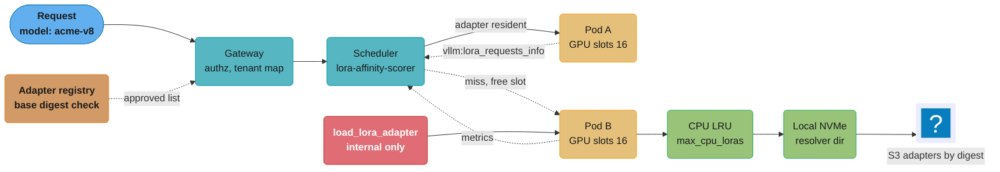
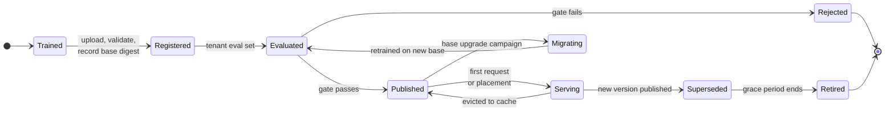
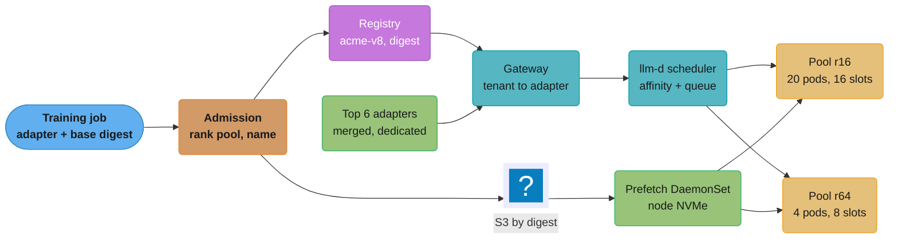

# LoRA Adapter Serving and Lifecycle

> **Version anchor (2026-10-18).** vLLM v0.32.0 (2026-10-18). SGLang v0.5.21 (2026-10-02).
> AIBrix v0.8.0 (2026-10-13), `ModelAdapter` CRD `model.aibrix.ai/v1alpha1`. llm-d v0.10.0
> (2026-09-29); its inference scheduler lives in repo `llm-d/llm-d-router` and ships the
> `lora-affinity-scorer` plugin. llama.cpp stable v0.7.0 (2026-10-15), rolling build b11719
> (2026-10-18). Ray 2.59.0 (2026-10-02, Serve LLM and model multiplexing). Triton Inference
> Server 2.73.0 / NGC 26.09 (2026-09-30). LoRAX (`predibase/lorax`) is an archived repo; its
> last release is lorax-0.4.0 (2025-01-13). The Punica and S-LoRA research repos are archived;
> vLLM and SGLang carry their kernel designs. The KServe ModelMesh repos (`kserve/modelmesh`,
> `kserve/modelmesh-serving`) are archived; the last ModelMesh Serving release is v0.12.0
> (2024-07-09). vLLM flag defaults below come from `vllm/config/lora.py` and the engine-args
> docs, checked 2026-10-18.

A LoRA adapter is a few tens of megabytes of low-rank weight deltas that only make sense on top
of one exact base model. Serving one adapter is easy: merge it and deploy a normal model.
Serving 500 or 5,000 of them, one per customer or per task, on a shared fleet is a different
system. It has GPU adapter slots, a CPU and disk cache behind them, a router that knows which
pod holds which adapter, a registry that ties every adapter to a base digest, and a campaign
process for the day the base model changes. This page covers that system and the adapter
lifecycle around it, plus the older pattern it generalizes: multiplexing many small classic
models onto shared replicas.

---

## 1. Concept Overview

Multi-LoRA serving keeps one copy of a base model in GPU memory and applies a different adapter
to each request in the same batch. The base forward pass is shared. Each adapted linear layer
adds two skinny matmuls per request, `x @ A` (shrink to rank `r`) and `(xA) @ B` (expand back),
computed for a whole mixed batch by gather-style kernels that index each token's adapter.

The system has five layers. Most incidents come from one layer making an assumption that
another layer broke.

| Layer | What it owns | Examples |
|---|---|---|
| Kernel | Batched LoRA math across adapters in one batch | Punica SGMV, S-LoRA kernels, vLLM `lora_shrink` / `lora_expand` Triton ops, SGLang `csgmv` |
| Engine | GPU adapter slots, CPU LRU cache, rank and module limits | vLLM `--max-loras`, `--max-cpu-loras`, `--max-lora-rank`; SGLang `--max-loras-per-batch`, `--max-loaded-loras` |
| Node cache | Adapter files on local disk, pulled from the store | vLLM filesystem resolver dir, AIBrix runtime sidecar, init containers |
| Router | Sends a request to a pod that already holds its adapter | llm-d `lora-affinity-scorer`, AIBrix gateway, Ray Serve LLM routing |
| Control plane and registry | Which adapters exist, on which base digest, approved for which tenant | Model registry entries, AIBrix `ModelAdapter`, SageMaker adapter inference components |

The **lifecycle** runs across all five: train on a pinned base, register with the base digest,
evaluate on the tenant's own eval set, publish, load on demand, serve, watch, retire. One event
cuts across every adapter at once: a base-model upgrade. Because an adapter's deltas are only
valid against the base weights it was trained on, a base upgrade turns every adapter on the
platform into a retrain, re-eval and re-rollout job. That campaign is the most expensive thing
in this area, and most teams find out about it after they have 2,000 adapters.

**Not here.** LoRA math, rank and alpha selection, target modules and the exact cost of an
unmerged forward pass live in [LoRA](../../llm/fine_tuning/lora.md). Basic vLLM multi-LoRA flags and
per-request adapter selection are in [vLLM Deep Dive](../../llm/vllm_deep_dive/vllm_deep_dive.md). Quantized-base training is
in [QLoRA](../../llm/fine_tuning/qlora.md). Merging methods across models (TIES, DARE, task
arithmetic) are in
[Knowledge Distillation and Model Merging](../../llm/knowledge_distillation_and_model_merging/knowledge_distillation_and_model_merging.md).
A full GPU inference platform design is in
[Design a GPU Inference Platform](../../llm/case_studies/design_gpu_inference_platform.md), and
the training side of adapters is in
[Design an LLM Fine-Tuning Platform](../../llm/case_studies/design_llm_fine_tuning_platform.md).
Registry semantics, aliases and digests are in
[Model Registry and Packaging](../model_registry_and_packaging/model_registry_and_packaging.md).
KV-aware routing and disaggregation are in
[Distributed Inference and Disaggregation](../distributed_inference_and_disaggregation/distributed_inference_and_disaggregation.md).
When to retrain an adapter is in
[Continuous Training and Refresh Policy](../continuous_training_and_refresh_policy/continuous_training_and_refresh_policy.md).
Tenant isolation tiers above the adapter level are in
[Multi-Region and Multi-Tenant Serving](../deployment_targets_and_serving_patterns/multi_region_and_multi_tenant_serving.md).

---

## 2. Intuition

**One-line analogy.** A multi-LoRA server is a print shop with one expensive press and a rack
of thin stencils. The press (base model) runs every job. Each customer brings a stencil
(adapter). The press can hold 16 stencils at once; the rest sit on a shelf (CPU), in the back
room (local disk) or at the warehouse (object store). The scheduler's job is to run jobs whose
stencils are already on the press, and the router's job is to send a customer to the shop that
already has their stencil out.

**Mental model.** Treat the adapter fleet as a cache hierarchy, not as a model catalog: GPU
slot (free), pinned CPU memory (milliseconds), local NVMe (tens of milliseconds), object store
(hundreds of milliseconds to seconds). Every design choice in this module moves hit rate on that hierarchy: how many slots, how big
each slot is, how traffic is routed, how adapters are placed.

**Why it matters.** A merged deployment per tenant needs at least one GPU even for two requests
a minute. A shared pool pays a throughput tax and needs a router, a cache and a registry, but
serves hundreds of tenants on the GPUs their combined traffic needs.

**Key insight.** The adapter is not an independent model. It is a diff against one base
digest. Everything that goes wrong in production, from silent quality loss after a base
re-quantization to a 2,000-adapter retrain campaign, follows from forgetting that.

---

## 3. Core Principles

- **An adapter is valid for exactly one base digest.** Store `base_model_digest` on every
  adapter version, check it at load, refuse on mismatch. A matching tensor shape proves nothing.
- **Adapter names are immutable.** A name served by the engine maps to one set of bytes for its
  whole life. New weights get a new name (`acme-support-v8`), never an overwrite in place.
- **Slots are sized by the largest adapter.** Engines pre-allocate GPU buffers at
  `max_lora_rank` for every slot, so one outlier rank sets the memory cost for all.
- **Route for adapter affinity, then load.** A request should land where its adapter is
  already resident. Random or round-robin routing turns a cache into a miss generator.
- **The load path is a privileged API.** Runtime load endpoints read arbitrary paths. They sit
  behind the control plane, never on the public listener.
- **Validate at upload, not at first request.** Rank, target modules, format, unsupported PEFT
  features and base digest are checked when the adapter enters the registry.
- **Each tenant's adapter has its own eval gate.** A global benchmark does not catch a
  regression on one customer's task.
- **A base upgrade is a campaign with a tracker**, not a deploy. Old and new base pools run side
  by side until every adapter has migrated, been exempted or been retired.
- **Merge only what earns dedicated capacity.** Hot adapters with enough steady traffic to fill
  replicas get merged deployments; the long tail stays on the shared pool.

---

## 4. Types / Architectures / Strategies

### Serving strategies

| Strategy | How it works | Fits | Breaks when |
|---|---|---|---|
| Merged, dedicated | `W' = W + (alpha/r) B A` baked in, one deployment per adapter | One adapter with high, steady traffic | Many tenants: one GPU floor per tenant, mostly idle |
| Unmerged, single shared pool | All pods load any adapter on demand, random routing | Under ~50 adapters that all fit in every pod's slots | Adapter count exceeds slots per pod; miss rate climbs |
| Unmerged, affinity-routed pool | Router scores pods by resident adapters; misses load on a pod with free slots | Hundreds to thousands of adapters, Zipf traffic | Router lacks engine metrics; hot adapter pinned to one pod |
| Rank-class pools | Separate pools for `r <= 16` and `r <= 64`, each with its own `max_lora_rank` | Mixed rank fleet with a few large adapters | Pools too small to absorb bursts |
| Hybrid | Top adapters merged and dedicated, tail on shared pool | Platforms where the top 1-2% of adapters carry most traffic | Promotion and demotion between tiers is manual |
| Dedicated per tenant (contract) | Tenant gets its own deployment, merged or not | Regulated tenants, contractual isolation | Priced as if dedicated; it is |

### Engines and control planes

| Product | LoRA serving model | Notes |
|---|---|---|
| vLLM | `--enable-lora`, GPU slots (`--max-loras`, default 1), CPU LRU (`--max-cpu-loras`, defaults to `max_loras`), `--max-lora-rank` default 16 | Runtime load and unload with `VLLM_ALLOW_RUNTIME_LORA_UPDATING`; resolver plugins load on first request |
| SGLang | `--max-loras-per-batch` default 8, `--max-loaded-loras` CPU cap, `--lora-backend` `csgmv` (default) or `triton` | `lru` or `fifo` eviction; pinned adapters, at most `max-loras-per-batch - 1` |
| llama-server | `--lora`, `--lora-scaled`, `GET/POST /lora-adapters`, per-request `lora` list of `{id, scale}` | Adapters given at startup; requests with different LoRA configs are not batched together |
| AIBrix | `ModelAdapter` CRD places adapters on vLLM or SGLang pods and creates a Service per adapter | `replicas` omitted loads on all matching pods; `replicas: 1` picks one pod |
| llm-d | Inference scheduler scores pods with `lora-affinity-scorer` from `vllm:lora_requests_info` | Routing layer above vLLM pods, driven by engine metrics |
| Ray Serve LLM | `lora_config.dynamic_lora_loading_path`, `max_num_adapters_per_replica` | Request names `base_model_id:adapter_name`; LRU per replica |
| SageMaker | Adapter inference components on a base inference component | Adapters from S3, served from GPU, CPU or local disk tiers |
| LoRAX | TGI fork with heterogeneous batching and adapter exchange scheduling | Repo archived; migrate to vLLM or SGLang |

### Multiplexing classic models

The same cache-and-route pattern predates LoRA. Many small models (per-merchant fraud scorers,
per-region forecasters) share replicas, and each replica keeps a bounded LRU of loaded models.

| Product | Mechanism |
|---|---|
| Ray Serve | `@serve.multiplexed(max_num_models_per_replica=N)`, model id from header `serve_multiplexed_model_id`; router prefers replicas holding the model |
| Triton | `--model-control-mode=explicit`, `POST /v2/repository/models/<name>/load` and `/unload`; the caller owns placement |
| KServe ModelMesh | Model placement and LRU eviction across a pod fleet, with routing to a pod that holds the model. Repos archived; last release v0.12.0 (July 2024) |

---

## 5. Architecture Diagrams

### Request path through an affinity-routed multi-LoRA pool



The scheduler reads which adapters each pod is running or queueing from the engine's metrics
and sends the request to a pod that already holds `acme-v8`. Only on a miss does a pod with a
free slot pull the adapter down the tier chain. The load endpoint is red because it is the
privileged path: it reads whatever path it is given.

### H100 80 GB memory budget for an 8B base with LoRA slots

```
Llama 3.1 8B, BF16, gpu_memory_utilization 0.90 (72 GB usable)

max_lora_rank 16, max_loras 16                 max_lora_rank 64, max_loras 16
+--------------------------------------+       +--------------------------------------+
| base weights            16.1 GB      |       | base weights            16.1 GB      |
| LoRA slots 16 x 84 MB    1.3 GB      |       | LoRA slots 16 x 336 MB   5.4 GB      |
| activations, graphs     ~4.0 GB      |       | activations, graphs     ~4.0 GB      |
| KV cache                ~50.6 GB     |       | KV cache                ~46.6 GB     |
|   = ~386k tokens at 128 KiB/token    |       |   = ~355k tokens at 128 KiB/token    |
+--------------------------------------+       +--------------------------------------+
                                       delta: -4.0 GB KV, about 31k tokens,
                                       about 7 fewer 4k-token sequences in flight
```

One rank-64 adapter on the fleet forces every slot to rank-64 size. The 4.0 GB comes straight
out of KV cache, which is the memory that sets batch size and therefore throughput. The slot
sizes assume all seven linear projections are targeted; restricting `--lora-target-modules`
shrinks them.

### Mixed-adapter batch through a gather kernel

```
batch of 6 tokens (one decode step), 3 adapters + base

token   adapter    shrink: x @ A[idx]      expand: (xA) @ B[idx]     added to base output
-----   -------    --------------------    ---------------------     --------------------
t0      acme-v8    A[slot 2]  4096 x 16    B[slot 2]  16 x 4096      y0 = W x0 + s*BAx0
t1      acme-v8    A[slot 2]               B[slot 2]                 y1 = W x1 + s*BAx1
t2      globex-v3  A[slot 5]               B[slot 5]                 y2 = W x2 + s*BAx2
t3      (base)     skipped                 skipped                   y3 = W x3
t4      initech-v1 A[slot 9]               B[slot 9]                 y4 = W x4 + s*BAx4
t5      globex-v3  A[slot 5]               B[slot 5]                 y5 = W x5 + s*BAx5

W x runs once for all 6 rows as one dense GEMM. The LoRA part is one segmented kernel
that reads a per-row slot index, not one matmul per adapter.
```

This is the Punica SGMV idea that vLLM and SGLang carry forward: the base GEMM is shared and
the adapter math is grouped by slot index. It is also why `max_loras` matters. The scheduler
can only put rows in a batch whose adapters are in GPU slots at that step.

### Adapter lifecycle



Eviction is not retirement: an evicted adapter is still published and loads again on demand. A
base upgrade sends every published adapter back through training and the eval gate, which is
why the campaign is a fleet-wide event.

---

## 6. How It Works - Detailed Mechanics

### 6.1 Adapter and slot memory arithmetic

Each adapted linear layer with input width `d_in` and output width `d_out` adds
`r * (d_in + d_out)` parameters. For Llama 3.1 8B (hidden 4096, intermediate 14336, 8 KV heads
of 128 so K and V project to 1024, 32 layers):

```python
def lora_params(r, layers, shapes):
    return r * layers * sum(d_in + d_out for d_in, d_out in shapes)

llama_8b = [(4096, 4096), (4096, 1024), (4096, 1024), (4096, 4096),   # q k v o
            (4096, 14336), (4096, 14336), (14336, 4096)]                # gate up down
llama_70b = [(8192, 8192), (8192, 1024), (8192, 1024), (8192, 8192),
             (8192, 28672), (8192, 28672), (28672, 8192)]

for r in (8, 16, 32, 64):
    p = lora_params(r, 32, llama_8b)
    print(f"8B  r={r:<3} {p/1e6:6.1f}M params  {p*2/1e6:6.1f} MB BF16")
print(f"70B r=16  {lora_params(16, 80, llama_70b)*2/1e6:6.1f} MB BF16")

# 8B  r=8    21.0M params    41.9 MB BF16
# 8B  r=16   41.9M params    83.9 MB BF16
# 8B  r=32   83.9M params   167.8 MB BF16
# 8B  r=64  167.8M params   335.5 MB BF16
# 70B r=16  414.2 MB BF16
```

vLLM allocates `max_loras` GPU slots, each sized for `max_lora_rank` across every module the
base supports for LoRA (or only `--lora-target-modules` when set). So the reserved memory is
roughly `max_loras * size(max_lora_rank)`: 16 slots at rank 16 is 1.34 GB, at rank 64 it is
5.37 GB. Llama 3.1 8B uses `2 * 32 layers * 8 heads * 128 dim * 2 bytes = 128 KiB` of KV per
token, so the extra 4.0 GB is about 31,000 tokens of KV.

### 6.2 vLLM configuration: broken, then fixed

The broken version is what most teams ship on day one.

```bash
# Broken: 40 tenant adapters, defaults left alone
vllm serve meta-llama/Llama-3.1-8B-Instruct \
  --enable-lora \
  --lora-modules acme-v8=/adapters/acme-v8 globex-v3=/adapters/globex-v3 ...
```

Three things go wrong. `--max-loras` defaults to 1, so a batch can hold rows for one adapter
(plus base rows); requests for 40 adapters take turns and throughput drops to a fraction of the
base model's. `--max-lora-rank` defaults to 16, so the one rank-32 adapter fails to load. And
`--max-cpu-loras` defaults to `max_loras`, so the CPU cache holds one adapter and every switch
re-reads from disk.

```bash
# Fixed: sized from traffic and the adapter inventory
vllm serve meta-llama/Llama-3.1-8B-Instruct \
  --enable-lora \
  --max-loras 16 \
  --max-cpu-loras 128 \
  --max-lora-rank 16 \
  --lora-target-modules q_proj k_proj v_proj o_proj gate_proj up_proj down_proj \
  --gpu-memory-utilization 0.90
```

`--max-loras 16` comes from the number of distinct adapters active in one scheduling window at
p95 on this pod, measured from logs, not from the catalog size. `--max-cpu-loras 128` covers
the working set the router sends to this pod, about 128 x 84 MB = 10.7 GB of pinned host
memory. Rank-32 and rank-64 adapters go to a separate rank-class pool. Two flags are worth
knowing: `--fully-sharded-loras` shards the whole LoRA computation under tensor parallelism
(default shards half) and is likely faster at high sequence length, rank or TP size; and
`--specialize-active-lora` captures separate CUDA graphs per power-of-two count of active
adapters, at the cost of longer startup and more memory.

vLLM rejects some PEFT adapters at load: DoRA, `lora_bias`, a `bias` other than `none`,
`layer_replication`, aLoRA, QALoRA, BD-LoRA, and initializations such as PiSSA, OLoRA, CorDA and LoftQ that change base
weights when PEFT loads the adapter. `modules_to_save` is accepted only as `classifier` or
`score` for classification models. The rank check uses the largest value in `r` and
`rank_pattern`. Run the same check at upload (6.8) so a tenant learns about
it in the training job, not from a 400 in production.

### 6.3 Runtime loading and its security boundary

Runtime loading needs `VLLM_ALLOW_RUNTIME_LORA_UPDATING=True`. That enables two endpoints and
the resolver plugins:

```bash
curl -X POST http://pod-b:8000/v1/load_lora_adapter \
  -H 'Content-Type: application/json' \
  -d '{"lora_name": "acme-v8", "lora_path": "/var/adapters/sha256-7c1e/"}'

curl -X POST http://pod-b:8000/v1/unload_lora_adapter \
  -H 'Content-Type: application/json' \
  -d '{"lora_name": "acme-v8"}'
```

Resolvers load on first request instead: with `VLLM_PLUGINS=lora_filesystem_resolver` and
`VLLM_LORA_RESOLVER_CACHE_DIR=/var/adapters`, a request for `acme-v8` loads
`/var/adapters/acme-v8/`. `lora_hf_hub_resolver` pulls from `VLLM_LORA_RESOLVER_HF_REPO_LIST`;
custom resolvers (object store) register through `LoRAResolverRegistry.register_resolver`.

The vLLM docs call runtime updating a security risk for production. The load endpoint takes a
path and reads it with the server's permissions, and the HF resolver downloads from the
internet. The working pattern is:

1. To expose the server, put only `/v1/chat/completions`, `/v1/completions` and `/v1/models`
   on the gateway route.
2. Bind the load and unload endpoints to a separate internal listener or block them at the
   gateway by path.
3. Let only the control plane (AIBrix controller, a placement service) call them.
4. Use the filesystem resolver over a directory that a sidecar fills from the registry, so the
   engine never fetches from the network itself.

### 6.4 SGLang configuration

```bash
python -m sglang.launch_server \
  --model-path meta-llama/Llama-3.1-8B-Instruct \
  --enable-lora \
  --max-loras-per-batch 16 \
  --max-loaded-loras 128 \
  --max-lora-rank 16 \
  --lora-target-modules all \
  --lora-eviction-policy lru \
  --lora-paths '{"lora_name": "acme-v8", "lora_path": "/adapters/acme-v8", "pinned": true}'
```

Requests name `model: "base-model:adapter-name"`. `--max-loras-per-batch` defaults to 8.
Pinned adapters keep a GPU slot until unloaded, capped at `max-loras-per-batch - 1` so one slot
stays free. `--enable-lora-overlap-loading` overlaps transfer with compute and caps
`--max-loaded-loras` at twice `--max-loras-per-batch`. Set `--max-lora-rank` and
`--lora-target-modules` explicitly when adapters load at runtime; otherwise they are inferred
from the startup adapters and a later, larger adapter will not fit.

### 6.5 AIBrix ModelAdapter

```yaml
apiVersion: model.aibrix.ai/v1alpha1
kind: ModelAdapter
metadata:
  name: acme-v8
  labels:
    model.aibrix.ai/name: acme-v8
    model.aibrix.ai/port: "8000"
spec:
  baseModel: llama-3-1-8b-instruct
  podSelector:
    matchLabels:
      model.aibrix.ai/name: llama-3-1-8b-instruct
      adapter.model.aibrix.ai/enabled: "true"
  artifactURL: s3://adapters/acme/sha256-7c1e/
  # replicas omitted: load on every matching pod. replicas: 1 picks one pod.
```

The controller selects pods that have been Ready for at least 5 seconds, registers the adapter
with the engine through its runtime load API (so vLLM pods need
`VLLM_ALLOW_RUNTIME_LORA_UPDATING`), and creates a Service and EndpointSlice named after the
adapter so the gateway routes `model: acme-v8` only to pods that hold it. A pod can belong to
many adapter Services. An `s3://` or `gcs://` `artifactURL` needs the AIBrix runtime sidecar to
download it first (pod annotation `model.aibrix.ai/sidecar-injection: "true"`, controller flag
`--enable-runtime-sidecar`); without the sidecar the controller rejects the URL, because the
engine loads only local paths and Hugging Face ids. Phases include `Pending`, `Scheduled` (only
with `replicas: 1`), `Running` and `Failed`. Retriable errors back off from 10 s to 5 minutes while the next pod is tried.
Pod choice for `replicas: 1` comes from
the controller flag `--model-adapter-scheduler-policy` (default `leastAdapters`); the CRD's
`spec.schedulerName` field is not read.

### 6.6 Affinity routing with llm-d

vLLM exports `vllm:lora_requests_info`, a gauge whose labels carry `running_lora_adapters`,
`waiting_lora_adapters` (comma-separated names) and `max_lora`. A new series appears whenever
the label set changes, with the value set to the time, so a reader must take the newest series.
llm-d's inference scheduler parses it into active and waiting sets per pod and scores:

| Pod state for the requested adapter | Score |
|---|---|
| Adapter active on the pod | 1.0 |
| Not active, pod has free adapter capacity | 0.8 |
| Adapter already waiting to load on the pod | 0.6 |
| Pod full, adapter neither active nor waiting | 0.0 |

The scorer source notes that the 0.6 case does not occur against current vLLM, because vLLM
reports a waiting adapter as running too.

```yaml
apiVersion: llm-d.ai/v1
kind: EndpointPickerConfig
plugins:
  - type: lora-affinity-scorer
    name: lora-affinity
  - type: queue-scorer
    name: queue
schedulingProfiles:
  - name: default
    plugins:
      - pluginRef: lora-affinity
        weight: 2
      - pluginRef: queue
        weight: 1
```

Combine it with a load scorer. Affinity alone pins a hot adapter to the one pod that loaded it
first, and that pod's queue grows while its neighbors idle. With the load term in the score,
a hot adapter spreads to a second pod once the first one's queue outweighs the affinity bonus,
which is the behavior you want: hot adapters on several pods, cold adapters on one.

### 6.7 Hot-load latency budget

A cold adapter on a TTFT SLO of 800 ms p95:

| Step | Time | Notes |
|---|---|---|
| Router decision | ~2 ms | Metrics are scraped, not fetched per request |
| Object store fetch, 84 MB | ~420 ms | At ~200 MB/s single stream; parallel range GETs cut it |
| Write to resolver dir and parse safetensors | ~40 ms | Local NVMe |
| CPU to GPU slot copy | ~3 ms | Pinned memory |
| Queue wait for a free slot | 0 to seconds | If all slots hold adapters with running requests |
| Prefill | ~120 ms | 2k-token prompt on an idle H100 |

Read down the tiers: pinned CPU memory costs about 3 ms (84 MB over ~25 GB/s PCIe), local NVMe
about 40 ms, object storage about 0.4 s plus first-byte latency, a remote hub seconds. Each step
is roughly ten times slower, so router hit rate matters more than a faster disk at the bottom.
The bandwidths are sizing assumptions; measure your own nodes. A cold load from object storage
spends over half the SLO before prefill starts. A slot wait
can blow it on its own. That is why the first request for an adapter after a long idle is
the p99 outlier on every multi-LoRA dashboard, and why prefetching adapters to the node disk at
publish time (AIBrix, a sidecar, or a DaemonSet) removes the largest step.

### 6.8 Registry entry and admission check

```python
import json, hashlib, pathlib
from safetensors import safe_open

MAX_RANK = 64
BLOCKED = ("use_dora", "lora_bias", "layer_replication", "use_qalora", "use_bdlora",
           "alora_invocation_tokens")
INITS_OK = {"gaussian", "eva", "orthogonal", "mica", "lora_ga"}  # vLLM peft_helper list

def admit(adapter_dir: str, base: dict) -> dict:
    d = pathlib.Path(adapter_dir)
    if any(d.glob("*.bin")) or any(d.glob("*.pt")):
        raise ValueError("pickle weights refused, upload adapter_model.safetensors")
    cfg = json.loads((d / "adapter_config.json").read_text())
    ranks = {cfg["r"], *cfg.get("rank_pattern", {}).values()}
    if max(ranks) > MAX_RANK:
        raise ValueError(f"rank {max(ranks)} has no serving pool")
    if any(cfg.get(k) for k in BLOCKED) or cfg.get("bias", "none") != "none":
        raise ValueError("PEFT feature the engine rejects")
    if set(cfg.get("modules_to_save") or []) - {"classifier", "score"}:
        raise ValueError("modules_to_save is not served")
    init = cfg.get("init_lora_weights", True)
    if isinstance(init, str) and init.lower() not in INITS_OK:
        raise ValueError(f"init {init} rewrites base weights, convert first")
    with safe_open(d / "adapter_model.safetensors", "pt") as f:
        for name in f.keys():
            if f.get_slice(name).get_shape()[-1] not in (*ranks, *base["dims"]):
                raise ValueError(f"{name}: shape does not fit base {base['name']}")
    blob = (d / "adapter_model.safetensors").read_bytes()
    return {
        "adapter_digest": "sha256:" + hashlib.sha256(blob).hexdigest(),
        "base_model_digest": base["digest"],   # set by the trainer, not by the uploader
        "rank": max(ranks),
        "target_modules": sorted(cfg["target_modules"]),
        "rank_pool": "r16" if max(ranks) <= 16 else "r64",
    }
```

`base_model_digest` comes from the training job's record of the base it loaded, because the
uploader's `base_model_name_or_path` is a name, not a digest. `rank_pool` is decided here, so the
router never finds a misfit at request time. The serving name (`acme-v8`) comes from the registry.

### 6.9 Base-model upgrade campaign

A base upgrade (a new model generation, or the same model re-quantized to FP8) invalidates
every adapter. The campaign for 2,000 adapters:

1. Stand up a second pool on the new base, sized for the tail traffic first.
2. Retrain each adapter on the new base from its stored training snapshot. Order by traffic,
   top adapters first. The retrain job records the new base digest.
3. Run each adapter's own eval set on old and new versions. Pass means within the tenant's
   tolerance of the old adapter, not merely above a global bar.
4. Shift traffic per adapter in the router: `acme-v8@baseA` to `acme-v9@baseB`, with a canary
   share for top-tier tenants.
5. Track state per adapter: `pending`, `retraining`, `eval_failed`, `canary`, `migrated`,
   `exempt` (tenant asked to stay), `retired`.
6. Shrink the old pool as adapters leave; delete it when only `exempt` adapters remain, and
   give those tenants a dated end of support.

Cost scales with adapter count, not traffic. At 20 GPU-minutes per retrain on an 8B base, 2,000
adapters is about 670 GPU-hours plus the eval runs, and two pools run in parallel for the
weeks the campaign takes. Teams that skip the campaign and serve old adapters on the new base
get no error at all: shapes match, outputs shift. The refresh-cadence side of this is owned by
[Continuous Training and Refresh Policy](../continuous_training_and_refresh_policy/continuous_training_and_refresh_policy.md);
the staged rollout per adapter uses the release machinery in
[AI Release Engineering](../ai_release_engineering/ai_release_engineering.md).

### 6.10 Tenant isolation and per-adapter eval

An adapter shares GPU, base weights and batch with other tenants. What stays separate:

- **Weights.** Each adapter has its own slot. A tenant cannot name another tenant's adapter
  because the gateway maps the API key to an allowed adapter list before routing.
- **Prefix cache.** vLLM's block hash includes the LoRA name and path as extra keys, so KV
  blocks computed under one adapter are not reused for another. For tenants that share an
  adapter or the base model, the request field `cache_salt` adds a per-tenant key to the first
  block hash, so one tenant cannot probe another's cached prefixes by timing.
- **Eval.** Each adapter version has an eval set built from the tenant's own task. The release
  gate runs that set; a shared benchmark is a smoke test only. Gate design is in
  [Evaluation Gates and Eval Sets](../evaluation_gates_and_eval_sets/evaluation_gates_and_eval_sets.md).
- **Noisy neighbors.** Per-tenant rate limits at the gateway bound one tenant's burst.

### 6.11 Multiplexing classic models

```python
from ray import serve
import joblib

@serve.deployment(num_replicas=6)
class FraudScorers:
    @serve.multiplexed(max_num_models_per_replica=40)
    async def get_model(self, merchant_id: str):
        return joblib.load(f"/models/fraud/{merchant_id}/model.joblib")

    async def __call__(self, request):
        model = await self.get_model(serve.get_multiplexed_model_id())
        return model.predict_proba([(await request.json())["features"]])[0][1]

# Client sets header serve_multiplexed_model_id: merchant-1182
```

Ray routes to a replica holding the model, waits 1 to 2 seconds (randomized, default base 1.0 s)
for one, then lets any replica load it with LRU eviction. Triton in explicit mode does no placement: a control service calls
`POST /v2/repository/models/merchant-1182/load` and keeps its own map. ModelMesh owned placement
and routing, but its repos are archived; Ray Serve, or a placement service over Triton, covers
the same job. The questions match adapters: per-replica cap, miss cost, placement-aware router.

---

## 7. Real-World Examples

**Apple Intelligence (June 2024).** Apple's foundation-model post describes a ~3B on-device
model with task adapters on attention and feed-forward layers, rank 16 as the example, stored
at 16-bit and sized in the tens of megabytes. Adapters are loaded on demand, cached in memory
and swapped. This is multi-LoRA serving with one tenant, the OS, and a device memory budget in
place of HBM.

**Amazon SageMaker (November 2024).** SageMaker added adapter inference components: an adapter
in S3 is registered against a base inference component with `BaseInferenceComponentName`. The
launch post's example keeps 30 adapters in GPU memory (`OPTION_MAX_LORAS`), 70 in CPU memory
and the rest on local SSD, mentions hosting up to hundreds per endpoint, and reports up to 10%
end-to-end latency difference between base and adapter calls. The tier names in this module
map one to one onto that configuration.

**Punica and S-LoRA (2023).** Punica introduced the SGMV kernel that batches different LoRA
models in one GPU operation and reported 12x higher throughput than then-current serving
systems, with about 2 ms added latency per token. S-LoRA kept all adapters in host memory,
paged adapter weights and KV cache in one unified pool, and reported up to 4x throughput over
HuggingFace PEFT and vLLM of the time. Both repos are archived. vLLM's `punica_wrapper` and
SGLang's `csgmv` backend are where those ideas run in production.

**LoRAX.** Predibase's LoRAX, a TGI fork, added heterogeneous continuous batching and adapter
exchange scheduling between GPU and CPU, and advertised thousands of fine-tuned models per GPU.
The repo is archived and its last release is lorax-0.4.0 from January 2025. TGI itself is
archived. Teams on LoRAX are migrating to vLLM or SGLang, and the migration is mostly the
request format (`adapter_id` field to `model: base:adapter` or an adapter-named model).

**AIBrix.** AIBrix, presented by ByteDance engineers at KubeCon events in 2025 and hosted in
the `vllm-project` org, made the adapter a Kubernetes object (`ModelAdapter`, section 6.5): the
control-plane layer from the table in section 1, in open source.

---

## 8. Tradeoffs

### Merged vs unmerged in production

| Dimension | Merged, dedicated | Unmerged, shared pool |
|---|---|---|
| Per-token cost | Base-model speed | Base plus LoRA kernels; measure per engine version |
| GPU floor | 1+ GPU per adapter, 2 for HA | Shared across all adapters on the pool |
| Adapter update | New model deploy, full weight pull | New adapter name, tens of MB |
| Cold start | Base-model cold start (minutes for 70B) | Adapter miss, milliseconds to seconds |
| Isolation | Separate deployment | Shared batch, slots and base |
| Base upgrade | Re-merge each adapter after retrain | Retrain each adapter, swap pools |
| Quantized base | Merge into BF16 then quantize, numerics change | Adapter applied over the quantized base it was trained against |

### Slot sizing

| Choice | Gain | Cost |
|---|---|---|
| Higher `max_loras` | More adapters per batch, fewer slot waits | Less KV cache, more kernel work per step |
| Higher `max_lora_rank` | Large adapters fit | Every slot grows; KV shrinks for everyone |
| Higher `max_cpu_loras` | Fewer disk reads on a miss | Pinned host memory, ~84 MB each at r16 on 8B |
| Narrow `--lora-target-modules` | Smaller slots | Adapters trained on other modules will not load |
| Pinned adapters (SGLang) | Hot adapters never evicted | Fewer free slots for the tail |

---

## 9. When to Use / When NOT to Use

**Use multi-LoRA serving when:**

- Many adapters share one base and most of them have low or bursty traffic.
- Adapters change often (weekly retrains, per-customer fine-tunes) and a full model deploy per
  change is too slow.
- Tenants need their own behavior but not their own hardware.
- The fleet already runs vLLM or SGLang and can export adapter metrics to a router.

**Use merged, dedicated deployments when:**

- One adapter carries enough steady traffic to keep its own replicas busy.
- The engine or target does not support unmerged LoRA for that model, or the adapter uses a
  PEFT feature the engine rejects.
- A contract requires a separate deployment for that tenant.

**Do not use adapters at all when:**

- The behavior fits in a prompt or retrieval; a prompt version is cheaper to ship and roll
  back (see [Prompt Lifecycle and Versioning](../prompt_lifecycle_and_versioning/prompt_lifecycle_and_versioning.md)).
- The base changes every few weeks and nobody owns the retrain campaign.

**Use classic-model multiplexing when** you have hundreds of small per-entity models (per
merchant, per store) and per-model traffic is too low to justify a replica each.

---

## 10. Common Pitfalls

**Default `max_loras` on a 40-tenant pool.** A support platform enabled LoRA on vLLM with 40
adapters and left `--max-loras` at 1. Load tests with one adapter looked fine. In production,
throughput fell to about a fifth of the base model's and TTFT p95 went from 600 ms to 9 s,
because the scheduler could only batch one adapter at a time. Fix: measure distinct adapters per
scheduling window and set `--max-loras` from it (16 here), with `--max-cpu-loras` well above.

**One rank-128 adapter.** A tenant trained at rank 128 for a hard extraction task. To load it,
the team raised `--max-lora-rank` from 16 to 128 on the shared pool. With 16 slots on an 8B
base, the reservation grew by about 9.4 GB, KV capacity fell by roughly a fifth, and every
tenant's p95 latency rose under load. Fix: rank-class pools, and an admission rule that maps a
rank to a pool before the adapter is published.

**Overwriting an adapter in place.** A retrain job wrote new weights to `/adapters/acme/` under
the same name. Pods that had `acme` loaded kept serving the old weights from GPU and CPU cache;
pods that loaded it later served the new ones. For three days the tenant saw different answers
depending on the pod, and no metric showed it. Fix: immutable versioned names (`acme-v8`), the
registry maps the tenant alias to the version, and old names unload after a grace period.

**Public load endpoint.** A team set `VLLM_ALLOW_RUNTIME_LORA_UPDATING=True` and exposed the
whole vLLM API through an ingress. A scanner found `/v1/load_lora_adapter`. Nothing was
exploited, but anyone could have loaded any path the pod could read, or filled every slot with
junk. Fix: route only inference paths publicly; the load API is for the control plane.

**Round-robin across 12 pods.** 600 adapters, 16 slots per pod, plain Kubernetes Service load
balancing. Each request landed on a random pod, the adapter was rarely resident, and slot
churn plus disk reads dominated TTFT. Moving to affinity routing with a load term cut adapter
loads per minute by over 90% with the same pods.

**Affinity without a load term.** The opposite failure: a hot tenant's adapter stayed on the
pod that first loaded it, that pod's queue hit 400 requests while the other 11 sat at 20.
Fix: weight a queue scorer next to the affinity scorer so hot adapters replicate.

**Cold first request after idle.** Nightly scale-down emptied the node disks. At 9:00 every
tenant's first request fetched from object storage, and TTFT p99 hit 6 s for the first ten
minutes. Fix: prefetch published adapters to node disk on scale-up, and warm the top adapters
into CPU cache before a pod reports Ready.

---

## 11. Technologies & Tools

| Tool | Role | Notes |
|---|---|---|
| vLLM | Multi-LoRA engine | v0.32.0; `--max-loras` default 1, `--max-lora-rank` default 16, runtime load API, resolver plugins |
| SGLang | Multi-LoRA engine | v0.5.21; `--max-loras-per-batch` default 8, `csgmv` and `triton` backends, pinned adapters |
| llama-server | Local and edge LoRA serving | llama.cpp v0.7.0 stable, b11719 rolling; `--lora`, `/lora-adapters`, per-request `lora` scales |
| AIBrix | Kubernetes adapter control plane | v0.8.0; `ModelAdapter` CRD, per-adapter Service, retries and pod failover |
| llm-d | Inference scheduler | v0.10.0; `lora-affinity-scorer` reads `vllm:lora_requests_info` |
| Ray Serve | LLM and classic multiplexing | 2.59.0; Serve LLM `lora_config`, `@serve.multiplexed` |
| Triton Inference Server | Explicit model load and unload | 2.73.0; `--model-control-mode=explicit`, repository API |
| KServe ModelMesh | Multi-model placement and routing | Archived repos, last release v0.12.0 (2024-07-09) |
| SageMaker inference components | Managed adapter serving | Adapter components on a base component, GPU, CPU and disk tiers |
| PEFT | Adapter training and format | `adapter_config.json` plus `adapter_model.safetensors` |
| LoRAX | Multi-LoRA server | Archived repo, last release lorax-0.4.0 |

---

## 12. Interview Questions with Answers

**Q: A vLLM server with 40 LoRA adapters serves a fraction of the base model's throughput. What is the usual cause?**
**Short:** `--max-loras` defaults to 1, so each batch holds rows for one adapter and requests for different adapters take turns.

`max_loras` is the number of adapters allowed in one batch, and vLLM's default is 1. With 40
adapters in rotation the scheduler cannot co-batch them, batches shrink, and both throughput
and TTFT collapse while GPU utilization still looks busy. Set it from the number of distinct
adapters active in a scheduling window at p95, raise `--max-cpu-loras` above it, and load test
with a realistic adapter mix, not one adapter.

**Q: Why does loading one rank-64 adapter slow down every tenant on a shared pool?**
**Short:** GPU slots are pre-allocated at `max_lora_rank`, so raising it for one adapter grows every slot and takes that memory from the KV cache.

On an 8B base with all seven projections targeted, a rank-16 slot is about 84 MB and a rank-64
slot about 336 MB. With 16 slots that is 1.34 GB against 5.37 GB, and the 4.0 GB difference is
about 31,000 tokens of KV cache, which shrinks batch size for everyone. Put large-rank adapters
in a separate pool, or restrict target modules, rather than raising the pool-wide limit.

**Q: Why is `VLLM_ALLOW_RUNTIME_LORA_UPDATING` dangerous on an internet-facing server?**
**Short:** It enables load and unload endpoints that read any path the server can access, so anyone who reaches them can load files or fill every slot.

The vLLM docs call runtime updating a production security risk. `/v1/load_lora_adapter` takes a
`lora_path`, and the Hub resolver downloads from the internet. Expose only inference routes
through the gateway, keep the load API on an internal path that only the control plane calls,
and prefer the filesystem resolver over a directory a trusted sidecar fills from the registry.

**Q: A retrained adapter was written to the same path under the same name. Why do users get different answers from different pods?**
**Short:** Pods that already loaded the name keep the old weights in GPU and CPU cache, while pods that load it later read the new files.

The engine keys loaded adapters by name. Nothing tells a running server the files changed, so
the fleet splits by load time and no error appears. Treat adapter names as immutable: each
registry version gets its own serving name (`acme-v8`), the gateway maps the tenant to the
current version, and old names unload after a grace period. vLLM's `load_inplace` replaces a
loaded adapter explicitly, but it does not fix a fleet that does not know it should call it.

**Q: Why does round-robin load balancing hurt a multi-LoRA fleet?**
**Short:** It ignores which pod holds which adapter, so most requests miss the GPU slots and pay a load from CPU, disk or object storage.

With 600 adapters and 16 slots per pod, a random pod rarely holds the requested adapter. Each
miss evicts something, reads the adapter and waits for a slot, so TTFT is dominated by cache
churn. An affinity router such as llm-d's `lora-affinity-scorer` reads each pod's running and
waiting adapters from `vllm:lora_requests_info` and prefers pods that already hold the adapter.

**Q: What goes wrong with pure adapter-affinity routing, and how is it fixed?**
**Short:** A hot adapter stays pinned to the first pod that loaded it, overloading that pod; adding a load or queue score lets hot adapters spread.

Affinity scores the resident pod at 1.0 and others lower, so without a load term every request
for a popular adapter queues on one pod. Weight a queue-depth scorer alongside affinity so that
once the resident pod's queue outweighs the affinity bonus, a second pod loads the adapter. The
result is hot adapters on several pods and cold ones on one.

**Q: What are the adapter cache tiers and roughly what does a miss cost at each?**
**Short:** GPU slot (no extra cost), pinned CPU memory (milliseconds), local NVMe (tens of ms), object store (hundreds of ms to seconds), remote hub (seconds).

For an 84 MB adapter: about 3 ms over PCIe from pinned memory, about 40 ms from NVMe at 2 GB/s,
about 0.4 s from an object store at 200 MB/s plus first-byte latency. Each tier is roughly ten
times slower than the one above. Size `max_cpu_loras` for the pod's routed working set, prefetch
published adapters to node disk, and treat object-store loads as the p99 path.

**Q: How does one batch serve tokens for several different adapters in one forward pass?**
**Short:** The base GEMM runs once for the whole batch, and a segmented gather kernel applies each row's adapter by slot index.

Punica's SGMV kernel and S-LoRA's kernels introduced this: rows carry an index into the GPU
adapter slots, and the shrink (`x @ A`) and expand (`xA @ B`) steps run as one grouped kernel
instead of one matmul per adapter. vLLM's `lora_shrink` and `lora_expand` Triton ops and
SGLang's `csgmv` backend are the production descendants. The batch can only include adapters
that are in GPU slots at that step, which is what `max_loras` limits.

**Q: Why is llama-server a poor fit for a many-tenant LoRA service?**
**Short:** Adapters are given at startup and requests with different LoRA configurations are not batched together, so mixed-tenant traffic loses batching.

llama-server loads adapters with `--lora` at start, sets global scales with `POST
/lora-adapters`, and accepts a per-request `lora` list of `{id, scale}`. Its README states that
requests with different LoRA configurations are not batched together. That fits a desktop, an
edge box or a few fixed adapters. For hundreds of tenants with runtime loads, use vLLM or
SGLang.

**Q: How does AIBrix decide where a `ModelAdapter` loads, and how does traffic find it?**
**Short:** The controller loads the adapter on matching Ready pods through vLLM's runtime API, then creates a Service and EndpointSlice named after the adapter.

`podSelector` picks candidate pods, which need `adapter.model.aibrix.ai/enabled: "true"` and
must have been Ready for 5 seconds. With `replicas` omitted the adapter loads on every match;
with `replicas: 1` the controller picks one pod using its `--model-adapter-scheduler-policy`
(default `leastAdapters`). Retriable failures back off from 10 s up to 5 minutes while other
pods are tried. The gateway routes `model: <adapter-name>` to that adapter's Service.

**Q: Does the prefix cache leak between tenants on a multi-LoRA server?**
**Short:** Not across adapters in vLLM, because block hashes include the LoRA name and path; for tenants sharing a base or adapter, set `cache_salt` per tenant.

vLLM adds the LoRA name and path as extra keys to each block hash, so KV computed under one
adapter is never reused under another. Two tenants on the same base model would share cached
prefixes, which allows timing probes of another tenant's prompts. The `cache_salt` request
field adds a per-tenant key to the first block, which splits the cache by tenant at the cost of
cross-tenant prefix reuse.

**Q: Why does each tenant's adapter need its own eval set in the release gate?**
**Short:** An adapter exists to change behavior on one tenant's task, and a shared benchmark can improve while that task regresses.

Retraining on a new base or new data can move the tenant's metric in either direction. A
global benchmark measures the base's general skill, not the adapter's job. Store an eval set
per adapter, built from that tenant's labeled examples, and gate on the delta against the
previous adapter version within the tenant's tolerance; add a canary for top-tier tenants.

**Q: Which adapters on a shared multi-LoRA pool should be moved to merged, dedicated deployments?**
**Short:** Those with enough steady traffic to keep dedicated replicas busy, where removing the per-token LoRA cost pays for the dedicated GPUs.

Compute each adapter's sustained tokens per second against one replica's capacity at the SLO.
Above about one replica's worth of steady load, a merged deployment runs at base speed and frees
slots on the shared pool. Below it, a dedicated deployment is mostly idle GPU. Revisit the list
monthly, since traffic shifts; adapters that use a PEFT feature the engine rejects also go
merged.

**Q: What does a base-model upgrade campaign for 2,000 adapters involve?**
**Short:** A second pool on the new base, a per-adapter retrain and eval, per-adapter traffic moves, and a tracker until the old pool can be deleted.

Retrain from stored training snapshots in traffic order, record the new base digest, run each
adapter's eval against the old version, and move traffic per adapter with canaries for top
tenants. Track states (`retraining`, `eval_failed`, `canary`, `migrated`, `exempt`). At 20
GPU-minutes per retrain that is about 670 GPU-hours, plus two pools running for weeks.

**Q: What should adapter admission check before an adapter is published?**
**Short:** Safetensors only, rank within a served pool, supported target modules, no PEFT features the engine rejects, tensor shapes that fit the base, and the base digest from training.

vLLM rejects DoRA, `lora_bias`, non-`none` `bias`, `layer_replication`, aLoRA, QALoRA, BD-LoRA and base-rewriting
initializations such as PiSSA and LoftQ. Catching these at upload turns a production 400 into
a failed training job. The admission step also assigns the rank pool and the immutable serving
name, so the router never discovers a misfit at request time.

**Q: How do you serve hundreds of small per-merchant classic models without a replica each?**
**Short:** Multiplex them: replicas hold a bounded LRU of loaded models and the router sends each request to a replica that already holds its model.

Ray Serve does this with `@serve.multiplexed(max_num_models_per_replica=N)` and the
`serve_multiplexed_model_id` header. Triton's explicit model control gives load and unload
calls but leaves placement to you. KServe ModelMesh did placement and routing across pods, but
its repos are archived.
Size the per-replica cap from model memory and pick the router by whether it knows placement.

---

## 13. Best Practices

- Give every adapter version an immutable serving name and a registry entry with its own
  digest, base digest, rank, target modules and eval-set version.
- Check the base digest at load and refuse on mismatch; treat any base change, quantization
  included, as a campaign.
- Size `max_loras` from measured concurrent adapters, `max_cpu_loras` from the routed working
  set, and run one pool per rank class instead of raising `max_lora_rank` pool-wide.
- Route with adapter affinity plus a load term; never plain round-robin.
- Keep the runtime load API off the public route; let only the control plane call it.
- Prefetch published adapters to node disk and warm the top adapters before Ready.
- Validate adapters at upload against the engine's unsupported-feature list and the base shapes.
- Gate each adapter on its own eval set; canary top-tier tenants on every base change.
- Use `cache_salt` per tenant when tenants share a base or an adapter.
- Review merged-versus-shared placement monthly from per-adapter traffic.
- Alert on adapter load rate per pod and on TTFT for first requests after a load, not only on
  overall TTFT.

---

## 14. Case Study

### Contract-analysis SaaS: 1,800 tenant adapters on one 8B base

**Context.** A contract-analysis SaaS fine-tunes one LoRA adapter per customer for clause
extraction and risk tagging. The fleet is 1,800 adapters over Llama 3.1 8B Instruct in BF16 on
H100 80 GB pods. Traffic is Zipf-shaped: the top 20 adapters carry 55% of requests, and 1,200
adapters see fewer than 50 requests a day. Before the redesign: 24 vLLM pods behind a plain
Kubernetes Service, `--max-loras 8`, `--max-lora-rank 64` (because 30 customers had rank-64
adapters), filesystem resolver over a shared NFS mount, adapters stored as `/adapters/<customer>/`
and overwritten on retrain.

**Symptoms.** TTFT p95 was 3.8 s against a 1 s SLO. Each pod loaded about 70 adapters per
minute. Two customers reported different answers to the same contract on the same day, traced to
overwrites. And the team had been asked to move to Qwen3-8B, with no record of which base each
adapter had been trained on.

**Target design.**



**Decisions.**

1. Names and registry: each retrain creates a registry version and a serving name
   (`acme-v8`). The gateway maps a customer's API key to the current name. Old names unload
   seven days after replacement.
2. Admission: the check in 6.8 runs on upload, records the base digest from the training job,
   and assigns pool `r16` (rank 16 or lower, 1,770 adapters) or `r64` (30 adapters).
3. Pools: `r16` runs `--max-loras 16 --max-cpu-loras 128 --max-lora-rank 16` on 20 pods; `r64`
   runs `--max-loras 8 --max-lora-rank 64` on 4 pods. Slot memory on an `r16` pod fell from
   2.7 GB (8 x 336 MB) to 1.3 GB (16 x 84 MB) with twice the slots.
4. Routing: llm-d `lora-affinity-scorer` (weight 2) plus `queue-scorer` (weight 1) per pool.
5. Prefetch: a DaemonSet keeps every published adapter for the node's pool on local NVMe,
   about 150 GB for `r16`. NFS was retired.
6. Hot adapters: the 6 adapters with more than one replica's steady load were merged into
   dedicated deployments. Load and unload endpoints are blocked at the gateway.

**Base upgrade to Qwen3-8B.** Run as a campaign once the registry had base digests. A second
pool on the new base started with 6 pods. Adapters were retrained in traffic order from stored
training snapshots, about 20 GPU-minutes each. Each adapter's own eval set compared new against
old; 41 failed and went back for hyperparameter changes, and 9 customers asked to stay on the
old base and got a dated end of support. The old pool shrank as adapters moved and was deleted
after seven weeks.

**Numbers after rollout.**

| Metric | Before | After |
|---|---|---|
| TTFT p95 | 3.8 s | 0.74 s |
| Adapter loads per pod per minute | ~70 | ~4 |
| GPUs (shared pool plus dedicated) | 24 | 24 shared + 6 dedicated |
| Pods serving different weights for one name | Possible, undetected | Not possible, names immutable |
| Adapters with a known base digest | 0 | 1,800 |
| Base-upgrade campaign | Not plannable | 7 weeks, ~600 GPU-hours retrain |

**What the team chose not to do.** They did not give every customer a dedicated deployment;
at 1,800 customers that is a GPU floor of 1,800 to 3,600 GPUs for traffic that fits on about 30.
They did not raise `max_lora_rank` to 64 on the main pool for 30 customers. They did not build
their own router; llm-d's scorer covered the affinity logic, and the custom code went into
admission and the campaign tracker. The full platform design, with 5,000 adapters over 3 bases,
is in [Design a Multi-Tenant LoRA Serving Platform](../case_studies/design_a_multi_tenant_lora_serving_platform.md).

**Follow-on work.** Pool autoscaling:
[Inference Autoscaling and Capacity Planning](../inference_autoscaling_and_capacity_planning/inference_autoscaling_and_capacity_planning.md).
Adapter prefetch: [Model Storage, Loading and Cold Start](../model_storage_loading_and_cold_start/model_storage_loading_and_cold_start.md).
Adapter signing: [ML Supply Chain Security](../ml_supply_chain_security/ml_supply_chain_security.md).
Cost per tenant: [AI Cost Engineering and Unit Economics](../ai_cost_engineering_and_unit_economics/ai_cost_engineering_and_unit_economics.md).
Platform choice: [Model Serving Platforms](../model_serving_platforms/model_serving_platforms.md).
Tenant isolation: [Tenant Isolation Patterns](../../llm/case_studies/cross_cutting/tenant_isolation_patterns.md).
