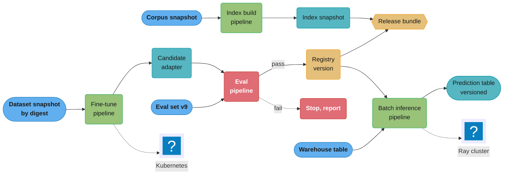
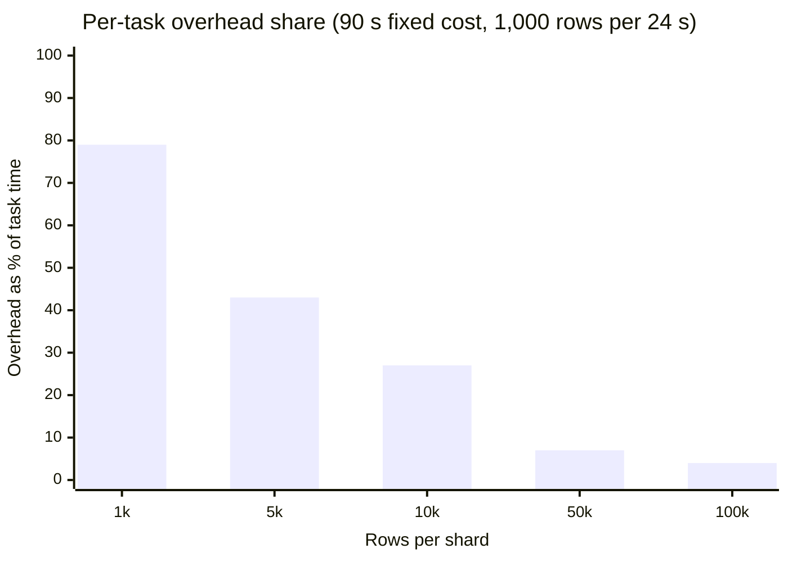
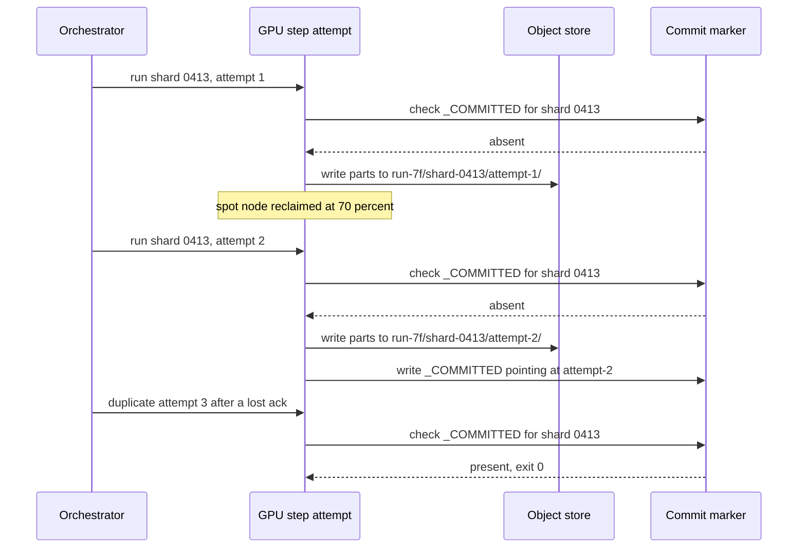
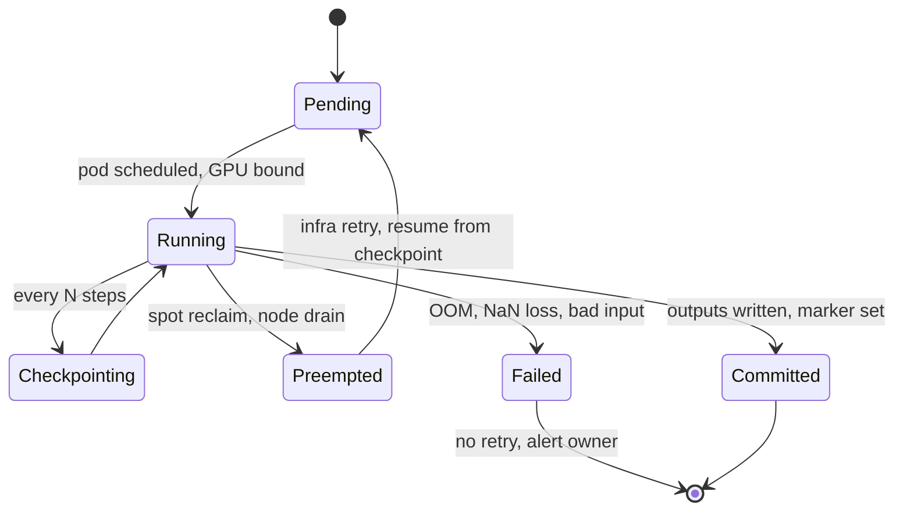
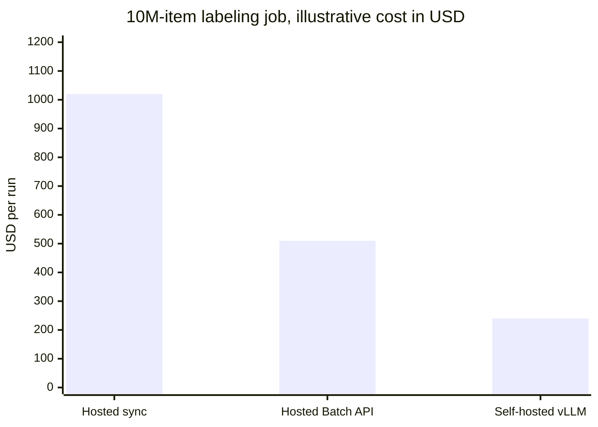
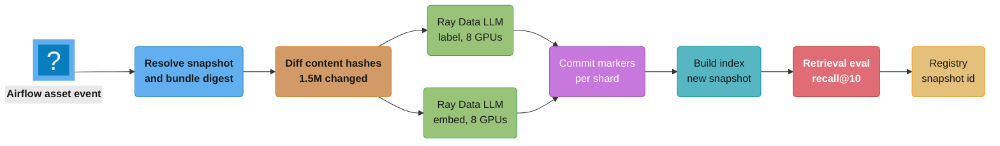

# ML Pipelines and Orchestration

> **Version anchor (2026-10-18).** Kubeflow Pipelines 2.17.2 (2026-09-04); Ray 2.59.0 (2026-10-02), which ships Ray Data LLM and Ray Serve LLM; vLLM v0.32.0 (2026-10-18). Airflow 3 details live in [Apache Airflow](../../technologies/apache_airflow/apache_airflow.md), which carries its own version pin.

An AI feature depends on four kinds of batch work that run on a schedule or a trigger, take minutes to days, and often hold GPUs: training and fine-tuning, evaluation, batch inference, and index builds. Each one consumes versioned inputs and produces versioned artifacts that a release bundle later pins. This module covers how those jobs are orchestrated: the orchestrator families, step caching keyed on input digests, GPU steps that survive retries and preemption, dynamic fan-out over thousands of shards, artifacts passed by reference, and the three ways to run LLM batch inference (offline engine, Ray Data LLM, provider Batch API).

---

## 1. Concept Overview

A **pipeline** is a directed acyclic graph of steps. Each step is a container or function with typed inputs and outputs. An **orchestrator** schedules the steps, passes outputs to inputs, retries failures, caches results and records what ran. The orchestrator does not do the heavy compute itself. It hands that to Kubernetes pods, a Ray cluster, Spark, a managed training service or a provider API.

The four pipeline kinds an AI platform runs:

| Pipeline | Typical trigger | Duration | GPU | Output artifact | Downstream consumer |
|---|---|---|---|---|---|
| Training / fine-tune | Schedule, data volume, drift alert, manual | 20 min to days | Yes, multi-node for large models | Weights or adapter digest, metrics | Registry, eval pipeline |
| Evaluation | New candidate, new eval-set version, new judge version | 5 min to 3 h | Often (local judge or candidate serving) | Score report, gate verdict | Release decision |
| Batch inference | Schedule, upstream table refresh | 10 min to 24 h | Yes (self-hosted) or none (provider Batch API) | Prediction table, labels, embeddings | Warehouse, features, index build |
| Index build | Corpus snapshot, embedding-model change | 30 min to days | Yes for embedding, no for ANN build on CPU | Index snapshot id | Retrieval service via alias |

What changes when the steps are ML steps instead of ETL steps:

- **Steps are expensive and slow.** A training step on 8 GPUs at $3 per GPU-hour costs $24 per hour. Rerunning it because a downstream step failed is a real cost, so caching and resume are budget items, not conveniences.
- **Steps are non-deterministic.** Sampling, dynamic batching and floating-point reduction order mean the same inputs can give different bytes. A cache hit is a policy choice, not a proof of equivalence.
- **Inputs are large.** A dataset snapshot is 400 GB, a checkpoint 140 GB. Inputs and outputs move as references (URIs plus digests), never as values in the orchestrator's database.
- **Fan-out is data-dependent.** The number of shards to embed or eval cases to score is known only at run time.
- **Infrastructure fails mid-step.** Spot GPUs are reclaimed, nodes drain for driver upgrades, NCCL hangs. A step must be safe to run twice.

**Orchestrator vs neighbors.** A data pipeline tool (Spark, dbt) transforms tables and lives inside one step. A durable-execution engine (Temporal) persists function state across failures and fits long-running, event-driven agent workflows better than a DAG. A distributed compute engine (Ray) runs the data-parallel work inside a step. The orchestrator is the layer above all three.

**Not here.** The KFP SDK v2 pipeline definition walkthrough is in [MLOps and CI/CD](../../ml/mlops_and_ci_cd/mlops_and_ci_cd.md) §6 "Kubeflow Pipeline Definition (KFP SDK v2)". Airflow internals (scheduler, executors, assets, DAG versioning) are in [Apache Airflow](../../technologies/apache_airflow/apache_airflow.md). Durable execution and workflow replay are in [Temporal Durable Execution](../../technologies/temporal_durable_execution/temporal_durable_execution.md). Training-pipeline stages (validation, HPO, the validation gate) are in [Training Pipeline Design](../../ml/ml_system_design/training_pipeline_design.md). Feature and ETL pipelines are in [Data Pipelines and Processing](../../ml/data_pipelines_and_processing/data_pipelines_and_processing.md). Dataset snapshots that pipelines read are in [Dataset and Label Versioning](../dataset_and_label_versioning/dataset_and_label_versioning.md). What an eval step checks and how a gate decides is in [Evaluation Gates and Eval Sets](../evaluation_gates_and_eval_sets/evaluation_gates_and_eval_sets.md). When to retrain is in [Continuous Training and Refresh Policy](../continuous_training_and_refresh_policy/continuous_training_and_refresh_policy.md). Index promotion and embedding migration are in [RAG and Vector Index Lifecycle](../rag_and_vector_index_lifecycle/rag_and_vector_index_lifecycle.md). Multi-node training job operations (checkpoints, NCCL, elastic restarts) are in [Training Infrastructure Operations](../training_infrastructure_operations/training_infrastructure_operations.md). API pricing and the Batch API discount are in [Token Economics and Cost Optimization](../../llm/token_economics_and_cost_optimization/token_economics_and_cost_optimization.md).

---

## 2. Intuition

> **One-line analogy**: an ML pipeline is a build system like Bazel for models: each step's output is keyed by the digests of everything that went in, so only the steps whose inputs changed run again.

**Mental model**: picture each step as a pure function `f(input digests, code digest, params) -> output digest`. The orchestrator keeps a table from the left side to the right side. A run walks the graph, looks up each step's key, and only executes the misses. Everything that breaks this model (a step that reads `s3://bucket/latest/`, a step that writes to a fixed path, a step that calls an API whose model moves) is a step that will either recompute for nothing or, worse, return a stale cached answer.

**Why it matters**: GPU steps dominate the bill and the wall clock. A nightly pipeline that embeds 12 million documents when 1.5 million changed spends 8 times the GPU hours it needs. A fine-tune that restarts from step zero after a spot reclaim at hour 7 of 8 runs for 15 hours instead of about 8. A batch-inference job that writes duplicate rows after a retry corrupts the feature table that the next model trains on.

**Key insight**: the orchestrator is the cheap part. The engineering is in the contract each step keeps: declared inputs by digest, outputs written to a fresh location and committed once, and a fixed amount of work per task. Pick any orchestrator that can express that contract.

---

## 3. Core Principles

- **Inputs by digest, never by mutable path.** A step takes `dataset_uri` plus `dataset_digest`, or a snapshot id. The cache key and the lineage edge both come from that digest.
- **Code is an input.** The container image digest and component version are part of the cache key. A bug fix to one step must invalidate that step and everything downstream of it, nothing else.
- **Outputs are written once.** A step writes to a run-scoped location and publishes with a single atomic commit (rename, manifest write, table commit). A retry either finds the commit and exits, or starts over in a new location.
- **Pass references, not payloads.** Parameters are small values (strings, numbers, ids). Datasets, models and indexes travel as artifact URIs in object storage.
- **Size tasks by work, not by item.** One task per shard of 10 to 40 minutes of GPU work. Per-task overhead (scheduling, image pull, model load) is 30 to 120 seconds and must stay under 10% of the task.
- **Separate infrastructure retries from logic failures.** Retry preemption, node loss and 5xx from a provider. Do not retry CUDA OOM, schema errors or a failed gate.
- **Checkpoint anything over 30 minutes.** A GPU step longer than the expected time between preemptions must resume from its last checkpoint.
- **Batch inference is not online inference in a loop.** Offline engines and Batch APIs exist because throughput-optimized batching costs less per token than an endpoint tuned for latency, and provider Batch APIs charge half the synchronous rate.
- **Every pipeline output lands in a registry or a versioned store.** A pipeline that writes the final artifact to an ad hoc path has produced something no release can pin.

---

## 4. Types / Architectures / Strategies

### 4.1 Orchestrator families

| Orchestrator | Execution model | Runs on | Strength for ML | Weak spot |
|---|---|---|---|---|
| Kubeflow Pipelines (KFP) 2.17 | Task DAG compiled to an IR YAML; each task is a pod (Argo Workflows backend on open source) | Kubernetes, Vertex AI Pipelines | Typed artifacts, default execution caching, `ParallelFor`, GPU requests per task | Kubernetes required; pod-per-task overhead; UI and metadata store to run |
| Airflow 3 | Task DAG with a scheduler loop and executors; assets for data-aware scheduling | VMs, Kubernetes, managed (MWAA, Cloud Composer, Astronomer) | Mature scheduling, backfills, huge operator library, DAG versioning | Not built for passing large artifacts; GPU work is delegated to other systems |
| Argo Workflows | Kubernetes CRD; each step a pod; DAG or steps template | Kubernetes | Native to Kubernetes, memoization, `withParam` fan-out | YAML-heavy; the Workflow object in etcd limits huge fan-outs |
| Metaflow | Python flow of steps; `foreach` fan-out; content-addressed artifact store | Local, AWS Batch, Kubernetes; schedules via Argo or Step Functions | Data scientist ergonomics, every step artifact persisted and addressable, `resume` | Scheduling delegated to another system |
| Flyte | Strongly typed tasks and workflows; per-task container and resources | Kubernetes | Typed interfaces, versioned task registration, cache by `cache_version` plus inputs, map tasks | Platform to operate; offloaded file inputs hash by URI unless told otherwise |
| Dagster | Asset-centric: software-defined assets with partitions | Anywhere; Dagster+ managed | Asset lineage and freshness, partition backfills | GPU execution is delegated (Kubernetes, Ray, Databricks) |
| Prefect | Python flows and tasks, dynamic at run time | Anywhere; Prefect Cloud | Low ceremony, dynamic mapping, cache policies on inputs and task source | Weaker artifact typing |
| ZenML | Pipeline framework over pluggable stacks (orchestrator, artifact store, registry) | Runs on KFP, Airflow, SageMaker, Vertex and others | Portability across orchestrators, default step caching | An abstraction layer over another orchestrator |
| SageMaker Pipelines | Managed DAG with typed steps (Processing, Training, Transform, Condition) | AWS | Managed, `CacheConfig` with `expire_after`, Model Registry integration | AWS-only, JSON definition |
| Vertex AI Pipelines | Managed runner for KFP IR | Google Cloud | Serverless KFP, execution caching on by default | Google Cloud only; cost per run plus compute |
| Temporal | Durable execution of code, not a DAG | Anywhere | Long-running, event-driven, human-in-the-loop flows, exact retry semantics | No artifact model, no step cache; you build them |

### 4.2 Execution models

| Model | Unit the scheduler thinks in | Example | Fits |
|---|---|---|---|
| Task DAG | A run of a graph of tasks | KFP, Airflow, Argo | Training and eval pipelines with clear stages |
| Asset graph | A table, model or index and its partitions | Dagster assets, Airflow 3 assets | Many derived artifacts with freshness goals |
| Durable execution | A function whose state survives crashes | Temporal | Agent workflows, long approvals, external callbacks |
| Data-parallel engine inside a step | Blocks of rows streamed through operators | Ray Data, Spark | Batch inference, embedding, preprocessing at scale |

Most production platforms combine two: a task DAG or asset graph at the top, and a data-parallel engine inside the heavy steps.

### 4.3 Batch inference modes

| Mode | How | Cost lever | Latency to result | Use when |
|---|---|---|---|---|
| vLLM offline (`LLM.generate`, `vllm run-batch`) | One process per GPU set loads the model and runs a large static batch | GPU-hours only, full batching | Minutes to hours | One model, data fits a few workers |
| Ray Data LLM | Streaming dataset through vLLM engine actors on a Ray cluster | GPU-hours, CPU preprocessing overlapped with GPU | Minutes to hours | Millions of rows, many GPUs, preprocessing in Python |
| Provider Batch API | Upload JSONL, poll, download results | Batch discount (50% at OpenAI and Anthropic per the token economics page) | Up to 24 h window | Hosted model, no GPUs, not time-critical |
| Online endpoint in a loop | Orchestrator workers call the serving endpoint | None, and it competes with live traffic | Bounded by endpoint rate limit | Small volumes only |

### 4.4 Caching strategies

| Strategy | Cache key | Hit means | Risk |
|---|---|---|---|
| Orchestrator default (KFP, Vertex, ZenML) | Component spec plus input values | Same code, same parameter values, same artifact references | A string path to mutable data hits on stale data |
| Explicit version (Flyte `cache_version`, Argo `memoize.key`) | Author-chosen version plus inputs | Author said nothing changed | Forgot to bump the version after a fix |
| Content digest in the key | Digests of every input plus image digest | The bytes in are the same | Cost of hashing large inputs (mitigated with stored digests) |
| Per-item output cache | Hash of item content plus model and prompt digests | This row was scored by this exact config | Store grows; needs TTL tied to bundle references |

---

## 5. Architecture Diagrams

### Four pipelines feeding one release bundle



Each pipeline reads snapshots by digest and writes one versioned artifact. The eval pipeline is the only path from a candidate to the registry, and the bundle pins what the registry and index pipeline produced. Heavy compute runs on Kubernetes pods or a Ray cluster, not inside the orchestrator.

### Cache key: mutable path vs digest

```
Step: embed_corpus

Key built from a mutable path (broken)
  image      sha256:3f10...                       same
  params     corpus_uri = s3://kb/corpus/latest/  same string
  key        a91c...                              same key  ->  cache HIT, stale embeddings   ✗

Key built from digests (fixed)
  image      sha256:3f10...                       same
  params     corpus_snapshot = lakefs:kb@c7e2     changed (new commit)
             model_digest    = sha256:51be...     same
  key        0d4e...                              new key   ->  cache MISS, re-embed         ✓
```

The orchestrator hashes what it is given. A path that points at different bytes tomorrow hashes the same as today, so the step must take the snapshot id or digest as its input.

### Shard size vs per-task overhead



With 90 seconds of fixed cost per GPU task (schedule, pull, load an 8B model) and about 1,000 rows per 24 seconds of work, shards under 10,000 rows spend more than a quarter of the GPU time on overhead. Shards of 50,000 rows bring it under 10%. Larger shards lose more work to a preemption, so the range is 10 to 40 minutes per task.

### Idempotent write and commit for a GPU step



Attempt 1's partial files are never read because no marker points at them. Attempt 3 exits at once. The reader of the output lists commit markers, not directories, so retries cannot produce duplicate rows.

### GPU step lifecycle



Only the preemption edge loops back. A logic failure goes straight to `Failed`, because a retry would burn the same GPU hours to hit the same error.

### Fan-out tree for an eval pipeline

```
eval_candidate(adapter sha256:a41f, eval set v9)
├─ load eval set v9                        1 task, CPU, 3,200 cases
├─ ParallelFor slices (parallelism=8)      8 slices x 400 cases
│  ├─ generate answers                     GPU, vLLM offline, 1 task per slice
│  └─ judge answers                        decision-model judge, pinned version
├─ aggregate                               per-slice pass rate, CI, cost per case
└─ gate                                    compare with champion on v9 only
   ├─ pass -> register version, emit report
   └─ fail -> stop, emit report, no registry write
```

The fan-out unit is a slice of 400 cases, not a case. The gate runs once on the aggregated report and compares against the champion's scores on the same eval-set version.

---

## 6. How It Works - Detailed Mechanics

### 6.1 Step caching keyed on input digests

KFP turns execution caching on by default for every task. The documented behavior is that a task reuses earlier outputs when it runs again with the same inputs and parameters and those outputs are still available. A task opts out with `task.set_caching_options(False)`; a pipeline compiled with `--disable-execution-caching-by-default`, or the environment variable `KFP_DISABLE_EXECUTION_CACHING_BY_DEFAULT` set before the KFP import, flips the default. A run-level `enable_caching` argument overrides per-task settings.

The trap: the cache sees the string, not the data behind it.

```python
# Broken: the parameter is a mutable location. The cache key never changes.
from kfp import dsl
from kfp.dsl import Output, Dataset

@dsl.component(base_image="python:3.12", packages_to_install=["pandas", "pyarrow"])
def load_tickets(source_uri: str, out: Output[Dataset]):
    import pandas as pd
    pd.read_parquet(source_uri).to_parquet(out.path)

@dsl.pipeline(name="nightly-labels")
def nightly(source_uri: str = "s3://support/tickets/latest/"):
    load_tickets(source_uri=source_uri)   # day 2 onward: cache hit, day-1 data
```

```python
# Fixed: the input is a snapshot id resolved before the run starts.
@dsl.component(base_image="python:3.12", packages_to_install=["pandas", "pyarrow"])
def load_tickets(snapshot_uri: str, snapshot_digest: str, out: Output[Dataset]):
    import pandas as pd
    df = pd.read_parquet(snapshot_uri)    # e.g. lakefs://support/c7e2.../tickets/
    out.metadata["source_digest"] = snapshot_digest
    df.to_parquet(out.path)

@dsl.pipeline(name="nightly-labels")
def nightly(snapshot_uri: str, snapshot_digest: str):
    load_tickets(snapshot_uri=snapshot_uri, snapshot_digest=snapshot_digest)
```

The trigger (a cron job, a sensor, an Airflow asset event) resolves "latest" into a commit or snapshot id once and passes it in. The same resolution rule applies to models: pass the registry version and its digest, never `@champion`.

**What the key must hold for an LLM step.** A step that calls a model is a function of more than its data:

| Key component | Why |
|---|---|
| Input data digest or snapshot id | Different rows, different outputs |
| Model digest (or dated provider snapshot id) | A moved alias changes behavior |
| Prompt version | A prompt edit changes every output |
| Decoding params (temperature, max tokens, stop) | Changes length and content |
| Engine version and key flags | vLLM upgrades can change numerics and defaults |
| Image digest | The step's own code |

The simplest way to get all of them into the key is to pass the release-bundle digest (or a sub-manifest digest) as a parameter. One string, every component covered.

**When not to cache.** Steps whose purpose is to observe the world: a canary eval against a hosted model alias, a data-freshness check, a drift probe. Disable caching on those explicitly. Also steps with sampling where the variance is the measurement (repeated judge runs to estimate judge noise).

### 6.2 Idempotent GPU steps

A step is idempotent when running it twice leaves the same committed state as running it once. Three rules get there:

1. **Write to an attempt-scoped prefix.** `run_id/shard_id/attempt_n/`. Never to the final location.
2. **Commit with one atomic operation.** A marker object written last, an object-store conditional put (`If-None-Match: *` on S3), a table-format commit (Iceberg, Delta), or a registry version create. Readers see only committed outputs.
3. **Check for the commit first.** If the marker exists, exit 0.

```python
# Broken: appends to the output table as rows are produced.
for batch in batches:
    preds = model.predict(batch)
    warehouse.insert("ticket_labels", preds)      # retry after 70% = 170% rows
```

```python
# Fixed: write the shard, then commit once. Readers join through the commit log.
import json, os, boto3, botocore

s3 = boto3.client("s3")
bucket, run, shard = "ml-out", "run-7f", "0413"
marker = f"labels/{run}/_commits/{shard}.json"

def committed() -> bool:
    try:
        s3.head_object(Bucket=bucket, Key=marker)
        return True
    except botocore.exceptions.ClientError:
        return False

if not committed():
    attempt = f"labels/{run}/{shard}/{os.environ['ATTEMPT_ID']}/part-0.parquet"
    write_parquet(predict(shard_rows), f"s3://{bucket}/{attempt}")
    try:
        s3.put_object(Bucket=bucket, Key=marker, IfNoneMatch="*",
                      Body=json.dumps({"path": attempt}).encode())
    except botocore.exceptions.ClientError:
        pass                                       # another attempt committed first
```

For training, idempotence means resume. A fine-tune that checkpoints every 500 steps to `run_id/ckpt/step-N/` and writes `latest` last restarts from the last full checkpoint. Expected loss per preemption is half the checkpoint interval. With 3 minutes per 100 steps and a 500-step interval, that is 7.5 minutes per reclaim instead of the full run. Checkpoint mechanics for multi-node jobs (sharded state, async save, NCCL timeouts) are in [Training Infrastructure Operations](../training_infrastructure_operations/training_infrastructure_operations.md).

**Retry policy split.** KFP has `task.set_retry(num_retries=3, backoff_duration="60s", backoff_factor=2)`. Its parameters set only the count and the backoff, with no filter on exit code or error type, so it retries an OOM exactly like a preemption. The step must classify: catch logic failures and end with a `failed` status output that a `dsl.If` routes to an alert, and leave non-zero exits to infrastructure faults. Raw Argo Workflows can filter instead with `retryStrategy.expression` on `lastRetry.exitCode`, and a Kubernetes Job with `podFailurePolicy`.

| Failure | Retry? | Why |
|---|---|---|
| Spot reclaim, node drain, pod eviction | Yes, resume from checkpoint | Infrastructure, not the step |
| Provider 429 or 5xx | Yes, with backoff and jitter | Transient |
| NCCL timeout on first collective | Yes once, then page | Often a bad node; repeated means a real fault |
| CUDA OOM | No | Same batch size, same OOM |
| NaN loss | No | Data or learning-rate problem |
| Schema mismatch on input | No | Upstream contract broke |
| Eval gate fail | No | That is the answer |

### 6.3 Dynamic fan-out

The number of shards comes from the data. KFP expresses it with `dsl.ParallelFor` over a list output of an earlier task, with `parallelism` capping concurrent pods, and `dsl.Collected` to gather outputs.

```python
from kfp import dsl

@dsl.component(base_image="python:3.12")
def plan_shards(manifest_uri: str, rows_per_shard: int) -> list:
    # Reads a manifest of row counts per file, returns shard specs.
    ...

@dsl.component(base_image="registry.internal/embedder@sha256:51be...")
def embed_shard(shard: dict, model_digest: str) -> str:
    ...
    return committed_uri

@dsl.component(base_image="python:3.12")
def build_index(shard_uris: list, out_snapshot: str): ...

@dsl.pipeline(name="index-build")
def index_build(manifest_uri: str, model_digest: str, out_snapshot: str):
    plan = plan_shards(manifest_uri=manifest_uri, rows_per_shard=50_000)
    with dsl.ParallelFor(items=plan.output, parallelism=16) as shard:
        e = embed_shard(shard=shard, model_digest=model_digest)
        e.set_accelerator_type("nvidia.com/gpu").set_accelerator_limit(1)
    build_index(shard_uris=dsl.Collected(e.output), out_snapshot=out_snapshot)
```

**Sizing the shard.** Take the per-task fixed cost `O` and per-row cost `w`. Overhead share is `O / (O + n * w)`. With `O = 90 s` and `w = 24 ms` per row (an 8B embedding or classification model, about 600 tokens per row, about 25,000 prefill tokens per second on one GPU), 50,000 rows take 1,200 seconds of work and overhead is 7%. At 1,000 rows it is 79%. Measure `w` on your own model and GPU before fixing the number.

**Sizing the parallelism.** `parallelism` is the GPU quota for the pipeline, not a speed knob. Sixteen concurrent embed tasks on a 16-GPU quota finish 240 shards in 15 waves of about 22 minutes each, or 5.5 hours. Asking for 64 queues 48 pods in Pending, which blocks other teams' jobs if the cluster has no quota system. Quotas and fair sharing are in [GPU Cluster Scheduling and Quotas](../gpu_cluster_scheduling_and_quotas/gpu_cluster_scheduling_and_quotas.md).

**Fan-out ceiling.** On the open-source KFP backend each iteration becomes nodes in an Argo `Workflow` object, which lives in etcd. etcd's default request limit is 1.5 MiB. Tens of thousands of nodes overflow it; Argo can offload node status to a database, but the better fix is fewer, larger shards, or moving the fan-out inside one step to Ray.

### 6.4 Artifacts by reference

```python
# Broken: a 2 GB DataFrame passed as a JSON parameter.
@dsl.component
def featurize(rows_json: str) -> str:      # rows_json is the whole dataset
    ...
    return df.to_json()                    # stored in the metadata DB, then in etcd
```

Parameters land in the orchestrator's metadata store and, on Argo, in the workflow object. Large values either fail outright or slow the UI and the API server for everyone.

```python
# Fixed: typed artifacts. The step receives a local path; the system stores the bytes
# in the artifact store and records the URI and metadata.
from kfp.dsl import Input, Output, Dataset

@dsl.component(base_image="python:3.12", packages_to_install=["pandas", "pyarrow"])
def featurize(raw: Input[Dataset], features: Output[Dataset]):
    import pandas as pd
    df = pd.read_parquet(raw.path)
    ...
    df.to_parquet(features.path)
    features.metadata["rows"] = len(df)
```

For artifacts already in a versioned store (a lakeFS commit, an Iceberg snapshot, a registry version), pass the identifier as a parameter and skip the copy. A 140 GB checkpoint should never be copied into a pipeline artifact store just so the next step can read it.

### 6.5 Batch inference with Ray Data LLM

Ray Data streams blocks of rows through a chain of operators. Ray Data LLM adds a processor that runs vLLM engine replicas as actors, with chat templating, tokenization and detokenization as separate stages, so CPU work overlaps GPU work.

```python
import ray
from ray.data.llm import vLLMEngineProcessorConfig, build_processor

config = vLLMEngineProcessorConfig(
    model_source="s3://models/ticket-classifier/sha256-a41f/",   # pinned by digest
    engine_kwargs={"max_model_len": 4096, "enable_prefix_caching": True},
    concurrency=(8, 8),     # fixed pool of 8 engine replicas, one GPU each
    batch_size=64,          # rows per batch sent to an engine
)

SYSTEM = open("prompts/ticket_label_v12.txt").read()              # prompt version pinned

def pre(row):
    return {
        "messages": [{"role": "system", "content": SYSTEM},
                     {"role": "user", "content": row["body"]}],
        "sampling_params": {"temperature": 0.0, "max_tokens": 8},
        "ticket_id": row["ticket_id"],
    }

def post(row):
    return {"ticket_id": row["ticket_id"], "label": row["generated_text"].strip()}

processor = build_processor(config, preprocess=pre, postprocess=post)

ds = ray.data.read_parquet("s3://support/snapshots/c7e2/tickets/")
processor(ds).write_parquet("s3://ml-out/labels/run-7f/attempt-1/")
```

Points that matter in production:

- `concurrency` as an integer lets the engine pool autoscale; a tuple `(n, n)` fixes it. Fix it when the GPUs are dedicated to the job, so every engine starts at once instead of scaling up from one, and keep `n` at or below the GPUs the job can get, or it waits for replicas that never schedule.
- A shared system prompt across all rows makes prefix caching pay: the prompt's KV blocks are computed once per replica.
- `max_tokens=8` for a label task keeps decode short. Prefill dominates, so throughput is close to the prefill rate.
- `should_continue_on_error` keeps one malformed row from failing a 12-million-row job. Count and report the errored rows; do not drop them silently.
- The output write still needs the commit step from 6.2. Ray retries failed tasks; the destination must tolerate it.

### 6.6 vLLM offline mode

For one model on one node, the offline `LLM` class runs without a server:

```python
from vllm import LLM, SamplingParams

llm = LLM(model="/models/ticket-classifier", tensor_parallel_size=1,
          enable_prefix_caching=True)
params = SamplingParams(temperature=0.0, max_tokens=8)
outputs = llm.chat([[{"role": "system", "content": SYSTEM},
                     {"role": "user", "content": body}] for body in bodies], params)
```

`llm.chat` and `llm.generate` take the whole list and let the scheduler pack batches, which is the throughput win over sending requests one by one. For OpenAI batch-format JSONL files, the CLI runs the same file format that a provider Batch API accepts:

```bash
vllm run-batch -i requests.jsonl -o results.jsonl --model /models/ticket-classifier
```

Same input file, two backends: the pipeline can switch between the provider Batch API and self-hosted vLLM with one parameter, which is useful when the cost comparison changes.

### 6.7 Provider Batch API arithmetic

A job: 10 million items, 600 input tokens and 20 output tokens each. That is 6 billion input tokens and 200 million output tokens. Illustrative rates for a small hosted model, $0.15 per 1M input and $0.60 per 1M output (current prices and discounts are in [Token Economics and Cost Optimization](../../llm/token_economics_and_cost_optimization/token_economics_and_cost_optimization.md)):

| Mode | Input cost | Output cost | Total | Wall clock |
|---|---|---|---|---|
| Hosted, synchronous | 6,000 x $0.15 = $900 | 200 x $0.60 = $120 | $1,020 | Bounded by rate limits |
| Hosted, Batch API at 50% | $450 | $60 | $510 | Up to 24 h |
| Self-hosted vLLM, 8B model | About 80 GPU-hours x $3.00 | included | About $240 | 5 h on 16 GPUs |

The self-hosted row assumes about 25,000 prefill tokens per second per GPU (6 billion / 25,000 = 240,000 GPU-seconds, about 67 GPU-hours) plus decode time, rounded to 80. It omits the engineering and the GPU quota. The Batch API row has zero GPU operations work. Below a few hundred dollars per run, the Batch API usually wins on total cost of ownership; at tens of thousands of dollars per month, self-hosting usually wins if the GPUs exist.



Batch API steps in a pipeline need three things: chunk the input to the provider's per-batch request and file-size limits, store the batch ids in the step's output so a retry polls the existing batch instead of submitting a new one, and pin a dated model snapshot so a 24-hour window does not straddle an alias move.

### 6.8 Index-build pipeline

An index build is a batch-inference pipeline (embed) followed by a CPU step (build ANN index) and a promotion step:

1. Resolve corpus snapshot and embedding-model digest.
2. Plan shards over changed documents only (diff against the previous snapshot's per-document content hashes).
3. Embed changed shards in parallel; reuse cached vectors for unchanged documents keyed by `(doc_hash, model_digest)`.
4. Build the index into a new snapshot location.
5. Run retrieval eval (recall@k on a labeled query set) against the new snapshot.
6. On pass, write the snapshot id to the registry; promotion through an alias is a release step, covered in [RAG and Vector Index Lifecycle](../rag_and_vector_index_lifecycle/rag_and_vector_index_lifecycle.md).

The cache in step 3 is what keeps daily cost proportional to churn. With 12 million documents and 1.5% daily churn, a daily build embeds 180,000 documents, not 12 million. An embedding-model change invalidates every key by design, which forces the full rebuild that a model change requires.

### 6.9 Eval as a pipeline step

The eval step takes the candidate reference, the eval-set version and the judge version as inputs, and outputs a report artifact plus a verdict. Downstream registration runs under a condition on the verdict:

```python
@dsl.pipeline(name="finetune-and-gate")
def finetune_and_gate(snapshot: str, eval_set: str, champion_version: str):
    ft = finetune(snapshot=snapshot)
    ft.set_accelerator_type("nvidia.com/gpu").set_accelerator_limit(8)
    ft.set_retry(num_retries=2, backoff_duration="120s")
    ev = evaluate(candidate=ft.outputs["adapter"], eval_set=eval_set,
                  champion_version=champion_version)
    with dsl.If(ev.outputs["verdict"] == "pass"):
        register(adapter=ft.outputs["adapter"], report=ev.outputs["report"])
```

The gate logic itself (thresholds, regression against the champion, per-slice gates) is in [Evaluation Gates and Eval Sets](../evaluation_gates_and_eval_sets/evaluation_gates_and_eval_sets.md). The pipeline's job is to make the gate unavoidable: no other path writes to the registry.

### 6.10 Triggers

| Trigger | Mechanism | Good for |
|---|---|---|
| Cron | Recurring run (KFP recurring runs, Airflow schedule) | Batch inference on a daily table |
| Data event | Airflow 3 assets, Dagster sensors, object-store notifications | Index build when a corpus snapshot lands |
| Model event | Registry webhook on new version | Eval pipeline on every candidate |
| Metric event | Drift or quality alert into a webhook | Retrain proposal; the policy is in continuous training |
| Manual | CLI or UI with parameters | Backfills, one-off migrations |

Every trigger resolves its inputs to snapshot ids before the run starts and writes them as run parameters, so the run record says exactly what it consumed.

---

## 7. Real-World Examples

**Netflix Metaflow.** Netflix built Metaflow for its data scientists and open-sourced it in December 2019. Every step's artifacts are persisted to a content-addressed datastore and deduplicated by hash, `foreach` expresses data-dependent fan-out, and `resume` restarts a failed run from the failed step while reusing the earlier steps' artifacts. Production scheduling is handed to Argo Workflows or AWS Step Functions. The design point is that the artifact store, not the scheduler, is the system of record.

**Lyft Flyte.** Lyft built Flyte to run its ML and data pipelines on Kubernetes and released it as open source; the first public release, v0.1.0, is dated November 2019. Tasks have typed interfaces and are registered as immutable versions, and caching is keyed on a declared `cache_version` plus the task's inputs. The typed interface is what lets the platform reject a pipeline at registration time when one step's output type does not match the next step's input.

**Airbnb Airflow.** Airflow started at Airbnb in 2014 and became an Apache top-level project in 2019. Many ML platforms run their schedules and backfills in Airflow and push GPU work into Kubernetes pods, Spark or a managed training service from Airflow operators. Airflow 3 replaced datasets with assets and added DAG versioning; see [Apache Airflow](../../technologies/apache_airflow/apache_airflow.md).

**Spotify and Kubeflow Pipelines.** Spotify's engineering blog described in December 2019 its move to TensorFlow Extended components orchestrated on Kubeflow Pipelines, to give ML teams a shared path from data to deployed model. The problem it named was engineers spending more time maintaining data and backend systems than improving models.

**Intuit and Argo.** Argo was created in 2017 at Applatix, which Intuit acquired in 2018. Argo joined the CNCF in 2020, graduated in 2022, and Argo Workflows is the execution backend under the open-source KFP. Kubeflow Pipelines on Argo is why a KFP fan-out has the etcd object-size ceiling described in 6.3.

**OpenAI and Ray.** At Ray Summit 2022, OpenAI's Greg Brockman described how OpenAI used Ray to train its largest model. Ray's role there is the distributed runtime inside a job, not the pipeline scheduler, which is the split this module recommends: an orchestrator outside, a compute engine inside.

**Provider Batch APIs.** OpenAI's Batch API and Anthropic's Message Batches API both price batch requests at 50% of the synchronous rate with results inside a 24-hour window. Teams use them for evaluation runs, synthetic data generation and offline labeling, where a day of latency costs nothing.

---

## 8. Tradeoffs

### Orchestrator choice

| Need | Pick | Avoid |
|---|---|---|
| Kubernetes-native, typed artifacts, GPU per step | KFP or Flyte | Airflow alone (no artifact model) |
| Hundreds of data and ML DAGs, backfills, mature ops | Airflow 3, delegating GPU steps | Rebuilding scheduling in KFP |
| Data scientists own pipelines end to end | Metaflow or ZenML | Raw Argo YAML |
| Asset freshness and partitions as the main concept | Dagster | Task DAGs with hand-coded freshness checks |
| Long-running, event-driven agent workflows | Temporal | A DAG with sensors that poll for days |
| Fully managed on one cloud | SageMaker Pipelines, Vertex AI Pipelines | Self-hosting KFP for a 3-person team |

### Batch inference mode

| Factor | vLLM offline | Ray Data LLM | Provider Batch API |
|---|---|---|---|
| Scale | One node | Many nodes | Provider quota |
| Ops work | Low | Medium (Ray cluster) | None |
| Model choice | Any open weights | Any open weights | Provider models |
| Cost driver | GPU-hours | GPU-hours | Tokens at a discount |
| Latency to result | Run time | Run time | Up to 24 h |
| Data leaves your network | No | No | Yes |

### Caching

| Choice | Saves | Costs |
|---|---|---|
| Orchestrator default cache | Free reruns of unchanged steps | Stale hits on mutable inputs |
| Digest-keyed cache | Correct hits only | Discipline in every component signature |
| Per-row output cache | Pay only for changed rows | A store to run and expire |
| No cache | No stale-hit risk | Full recompute every run |

### Shard size

| Shard | Overhead | Preemption loss | Straggler effect |
|---|---|---|---|
| Under 2 min of work | 40% or more | Small | Low |
| 10 to 40 min | Under 10% | Up to 40 min | Moderate |
| Over 2 h | Negligible | Hours | One slow shard sets the finish time |

---

## 9. When to Use / When NOT to Use

**Use an orchestrated pipeline when:**
- A job has more than one step that can fail independently, and rerunning everything costs GPU hours.
- The output is a versioned artifact that a release will pin (adapter, index snapshot, eval report, prediction table).
- The job recurs on a schedule or trigger and needs an audit trail of inputs.
- Fan-out size depends on the data.

**Use Ray Data LLM or vLLM offline inside a step when:**
- Batch inference volume is above a few hundred thousand rows per run on open-weight models.
- Preprocessing in Python would otherwise starve the GPUs.

**Use a provider Batch API when:**
- The model is hosted, the job tolerates 24 hours, and data may leave the network.

**Do not:**
- Run batch inference by calling the online serving endpoint from orchestrator workers. It competes with live traffic and pays latency-tuned prices.
- Adopt KFP or Flyte for three nightly scripts with no GPUs. A scheduled container job or the existing Airflow covers it.
- Put a 24-hour agent workflow with human approvals into a DAG with sensors. Use durable execution.
- Write a custom orchestrator. The scheduling is easy; the UI, metadata store, retries, caching and backfills are years of work.

---

## 10. Common Pitfalls

**Cache hit on `latest`.** A nightly KFP pipeline took `s3://support/tickets/latest/` as a string. From day 2 the load step hit the cache, and the classifier was retrained on day-1 data for 23 days. Offline metrics looked stable because the eval step was also cached. Found when a product manager asked why a new ticket category never appeared. Fix: the trigger resolves a lakeFS commit and passes it; a lint rejects pipeline parameters ending in `latest/`.

**Duplicate predictions after spot reclaims.** A batch-scoring step inserted rows into the warehouse per batch. Spot reclaims hit 6% of tasks, each retried from the start, and the prediction table ended up with 4.1% duplicate rows. A downstream model trained on the table with duplicated positives and shifted its threshold. Fix: shard writes to attempt-scoped paths with a commit marker, and a uniqueness check on `(run_id, ticket_id)` before publish.

**Retrying OOM.** A fine-tune step had `num_retries=5`. A data change raised the max sequence length, the step hit CUDA OOM at step 40, and the orchestrator retried five times with backoff. Six attempts on 8 H100s burned 9 GPU-hours to produce the same error. Fix: the step catches OOM, NaN loss and schema errors and reports them as a `failed` status output, so `set_retry` sees only infrastructure failures.

**Pod per row.** An eval pipeline fanned out one task per eval case, 3,200 pods. Each loaded a 16 GB judge model. The run took 4 hours, of which about 40 minutes was judging, and the Argo Workflow object hit the etcd size limit on the larger eval set. Fix: 8 slices of 400 cases, one model load per slice; the run took 35 minutes.

**Batch inference through the live endpoint.** A nightly Airflow DAG labeled 1.5 million listings by calling the production LLM endpoint with 64 concurrent workers. At p50 of 1.1 s per request it ran about 7 hours and crept into European morning traffic, where p99 latency for users doubled. Fix: Ray Data LLM on a separate GPU pool; 56 minutes, no shared capacity.

**Eval cached across a judge upgrade.** The eval step's key included the candidate and eval set but not the judge model. After the judge was upgraded, old candidates kept their cached scores and new candidates were scored by the new judge, and a regression of 3 points was hidden by the judge shift. Fix: the judge version is an input to the eval step; a judge change re-scores the champion.

**Mutable embedding-model reference.** An index-build pipeline passed `embedder:prod`. A different team re-tagged `prod` to a new model with the same dimension. Half the shards in one run used each model; recall@10 fell from 0.81 to 0.52 on the next eval. Fix: model digest as the pipeline parameter and as part of the per-document cache key.

**Batch API resubmitted on retry.** A step submitted a provider batch and then crashed while polling. The retry submitted the same 2 million requests again. Both batches completed and the bill doubled. Fix: write the batch id to the step's output location immediately after submit; a retry polls the existing id.

**Backfill recomputed everything.** A bug fix in the postprocessing step changed its image digest. The team re-ran the whole pipeline for 90 days of partitions, re-running GPU inference that had not changed. Fix: keep postprocessing a separate step after inference so its digest change invalidates only itself; with digest-keyed caching, the backfill cost 2 CPU-hours instead of 600 GPU-hours.

**Unbounded parallelism.** An index build set `parallelism` to the shard count, 400. With no queueing system, 384 GPU pods sat in Pending, blocking a training job from another team for 5 hours. Fix: parallelism equal to the team's GPU quota, and Kueue for admission.

---

## 11. Technologies & Tools

| Tool | Role | Notes |
|---|---|---|
| Kubeflow Pipelines | Task DAG on Kubernetes with typed artifacts and execution caching | 2.17.2; `ParallelFor`, `dsl.If`, `set_retry`, accelerator requests per task |
| Vertex AI Pipelines | Managed runner for KFP pipelines | Same IR YAML as open-source KFP |
| Apache Airflow | Scheduler, backfills, assets | Airflow 3; see [Apache Airflow](../../technologies/apache_airflow/apache_airflow.md) |
| Argo Workflows | Kubernetes-native workflow CRD, memoization | Execution backend under open-source KFP |
| Metaflow | Python flows, content-addressed artifact store, `resume` | Created at Netflix |
| Flyte | Typed tasks, versioned registration, map tasks | Created at Lyft |
| Dagster | Asset graph with partitions and freshness | Asset-centric model |
| Prefect | Dynamic Python flows, cache policies | Low ceremony |
| ZenML | Portable pipeline layer over stacks | Default step caching |
| SageMaker Pipelines | Managed DAG on AWS | `CacheConfig` with ISO 8601 `expire_after` |
| Temporal | Durable execution | See [Temporal Durable Execution](../../technologies/temporal_durable_execution/temporal_durable_execution.md) |
| Ray Data LLM | Streaming batch inference through vLLM engine actors | Ray 2.59.0; `vLLMEngineProcessorConfig`, `build_processor` |
| vLLM | Offline `LLM` class, `vllm run-batch` for batch JSONL | v0.32.0 |
| OpenAI Batch API, Anthropic Message Batches | Discounted asynchronous inference | 24 h window; pricing in the token economics page |
| Kueue | Queueing and quota admission for batch jobs | v0.20.2; see GPU Cluster Scheduling and Quotas |
| lakeFS | Commit ids as pipeline inputs | v1.88.0; see Dataset and Label Versioning |

Platform-level choice of orchestrator against the rest of the ML platform is in [ML Platform Architecture and Build vs Buy](../ml_platform_architecture_and_build_vs_buy/ml_platform_architecture_and_build_vs_buy.md).

---

## 12. Interview Questions with Answers

**Q: Why did a cached pipeline step keep returning last week's data?**
**Short:** The step took a mutable path like `s3://.../latest/` as a string, so the cache key never changed; pass a snapshot id or digest instead.

Orchestrator caches (KFP, Vertex, ZenML) key on the component spec and the input values. A string path is the same value every day even when the bytes behind it change, so the step hits the cache and returns stale outputs, and every downstream cached step follows. The fix is to resolve "latest" in the trigger into a commit id, snapshot id or content digest, pass that as the input, and lint pipeline definitions for mutable references. Disable caching only on steps whose job is to observe the live world.

**Q: A batch-scoring step was retried after a spot preemption and the output table has duplicate rows. What went wrong and how do you fix it?**
**Short:** The step appended rows as it went, so a retry re-appended them; write to an attempt-scoped location and publish with one atomic commit that readers follow.

Any step that writes incrementally to a shared destination is not idempotent. The fix has three parts: write each attempt to `run/shard/attempt/`, publish with one atomic operation (commit marker with a conditional put, Iceberg or Delta commit, registry create), and check for an existing commit before doing any work. Readers list commits, never directories. Add a uniqueness check on the natural key before the table is published so a regression is caught in the pipeline, not in the next model.

**Q: Why should batch inference not call the online serving endpoint in a loop?**
**Short:** It pays latency-tuned per-request costs, is capped by endpoint rate limits, and competes with live traffic; offline engines and Batch APIs batch for throughput.

An online endpoint is configured for low latency: small batches, headroom for spikes, autoscaling on request rate. A batch job sending a million requests through it raises user-facing p99, gets throttled, and pays the synchronous price. vLLM offline or Ray Data LLM packs large batches on dedicated GPUs, and provider Batch APIs charge about half the synchronous rate for a 24-hour window. Use the endpoint only for small volumes where setup time dominates.

**Q: An eval pipeline fans out one pod per eval case. What is the problem?**
**Short:** Per-task overhead (scheduling, image pull, model load) dwarfs per-case work, and thousands of nodes can overflow the workflow object; fan out by slices of hundreds of cases.

Each pod pays 30 to 120 seconds of fixed cost, and loading a judge model can add more. A case takes well under a second to generate or judge in a batch, so one pod per case spends nearly all its time on overhead. On Argo-backed KFP, thousands of nodes also grow the Workflow object toward etcd's 1.5 MiB request limit. Size each task for 10 to 40 minutes of work, keep the overhead share under 10%, and set `parallelism` to the GPU quota.

**Q: Which failures should a GPU step retry, and which should it not?**
**Short:** Retry infrastructure failures such as preemption, node loss and provider 5xx; do not retry OOM, NaN loss, schema errors or a failed gate, which repeat deterministically.

Orchestrator retries are blunt: KFP's `set_retry` retries any failure. A step that hits CUDA OOM with the same batch size will hit it again, and five retries on 8 GPUs burn hours to reproduce one error. Classify inside the step: report a logic failure as a status output instead of a non-zero exit, or, where the engine can filter (Argo `retryStrategy.expression`, a Job `podFailurePolicy`), give it a distinct exit code that skips retry. Infrastructure retries should resume from a checkpoint, not restart.

**Q: What must the cache key include for a step that calls an LLM?**
**Short:** The input data digest, model digest or dated snapshot, prompt version, decoding parameters, engine version and image digest; passing the bundle digest covers them in one value.

An LLM step's output depends on everything that shapes generation. If any of these is missing from the key, a change produces a stale cache hit: a prompt edit, an alias move at the provider, a temperature change or an engine upgrade with new defaults. The low-effort way is to pass the release-bundle digest, or a sub-manifest digest for the step's components, as a parameter. Judge model and judge prompt belong in the key of every eval step.

**Q: Why pass datasets and models as artifact references instead of parameters?**
**Short:** Parameters are stored in the orchestrator's metadata store and workflow object, which are sized for small values; large payloads fail or slow the control plane.

KFP stores parameter values in its metadata store and, on Argo, in the Workflow custom resource in etcd. A multi-gigabyte JSON string either exceeds a limit or makes every API call slower for every user. Typed artifacts (`Input[Dataset]`, `Output[Model]`) store bytes in object storage and record a URI and metadata. For artifacts already in a versioned store, pass the snapshot id or registry version and skip the copy entirely.

**Q: How do you choose between self-hosted vLLM, Ray Data LLM and a provider Batch API for a labeling job?**
**Short:** Batch API when the model is hosted, data may leave and 24 hours is fine; vLLM offline for one node; Ray Data LLM for multi-node jobs with heavy Python preprocessing.

Compute the job in tokens first. Ten million items at 600 input tokens is 6 billion tokens: about $450 input on a Batch API at an illustrative $0.075 per 1M after the discount, against roughly 80 GPU-hours self-hosted. The Batch API has no ops cost, so it wins for occasional jobs and small volumes. Self-hosting wins for recurring large jobs on open-weight models when GPUs are available, and is required when data cannot leave the network. Ray Data LLM is the choice once one node is not enough or CPU preprocessing would starve the GPUs.

**Q: How does Ray Data LLM keep GPUs busy during batch inference?**
**Short:** It streams blocks through separate CPU stages (templating, tokenization) and GPU vLLM engine actors, so preprocessing overlaps generation and each engine gets large batches.

Ray Data executes the dataset as a stream of blocks, not one stage after another. The processor built by `build_processor` runs chat templating and tokenization as CPU operators and vLLM engines as actor replicas sized by `concurrency`, with `batch_size` rows per batch. CPU work for the next blocks happens while the GPUs generate, and vLLM's continuous batching packs requests within each engine. Fix `concurrency` as a tuple when the GPUs are dedicated to the job, and use a shared system prompt so prefix caching reuses its KV blocks.

**Q: A provider Batch API step crashed while polling and the retry submitted the batch again. How do you prevent the double bill?**
**Short:** Persist the batch id right after submission and make the step poll an existing id on retry instead of submitting a new batch.

Submission is the side effect, so it must be recorded before anything else can fail. Write the batch id to the step's output location or a small state table keyed by `(run_id, chunk_id)`. On entry, the step checks for a recorded id and resumes polling. Also pin a dated model snapshot, since a 24-hour window can straddle an alias move, and chunk inputs to the provider's per-batch limits so one failed chunk does not void the rest.

**Q: How should an eval step sit inside a training pipeline?**
**Short:** As the only path from candidate to registry: it takes candidate, eval-set version and judge version as inputs, emits a report and verdict, and registration runs only on pass.

Express the dependency in the DAG with a condition on the verdict (`dsl.If` in KFP), so no other step can write the candidate to the registry. Compare the candidate with the champion's scores on the same eval-set version and the same judge version, re-scoring the champion when either changes. Store the report as an artifact linked to the candidate. Gate thresholds and per-slice rules belong to the eval-gate design, not the pipeline.

**Q: How do you backfill after a bug fix in one step without recomputing the GPU steps?**
**Short:** Keep the buggy logic in its own step so only its image digest changes; digest-keyed caching then reruns that step and its descendants and reuses everything upstream.

A cache can only skip work at step boundaries. If postprocessing lives in the same step as inference, a postprocessing fix invalidates the inference too. Split cheap CPU logic from expensive GPU work, key caches on input and image digests, and run the backfill over the partitions. Upstream steps hit the cache, the fixed step and its descendants rerun. Verify the plan with a dry run that lists expected cache hits before launching.

**Q: How do you make an index-build pipeline cheap to run daily?**
**Short:** Embed only documents whose content hash changed, reuse vectors keyed by document hash plus embedding-model digest, and build the new index into a fresh snapshot.

Daily cost should follow churn, not corpus size. A per-document cache keyed on `(doc_hash, model_digest)` means 1.5% daily churn on 12 million documents embeds 180,000 documents. The ANN build writes to a new snapshot location, retrieval eval runs against it, and promotion happens by moving an alias in a separate release step. An embedding-model change invalidates every key, which correctly forces a full rebuild.

**Q: When is Temporal a better fit than a DAG orchestrator for AI workloads?**
**Short:** For long-running, event-driven workflows such as agents waiting on tools or humans, where durable function state and exact retries matter more than artifact caching.

A DAG orchestrator models a run as a graph of steps that start and finish, with artifacts between them. An agent workflow that waits days for an approval, reacts to webhooks and calls tools with side effects needs persisted function state and replay, which is what durable execution provides. Temporal has no artifact model and no step cache, so training and batch inference stay in KFP, Airflow or Flyte. Many platforms run both, with Temporal workflows triggering pipeline runs.

**Q: Task-centric or asset-centric orchestration for ML?**
**Short:** Task-centric (KFP, Airflow DAGs) fits staged training and eval runs; asset-centric (Dagster, Airflow 3 assets) fits many derived tables, indexes and models with freshness goals.

Task-centric tools think in runs: this graph ran with these parameters. Asset-centric tools think in artifacts: this table partition is stale, rebuild it and what depends on it. Prediction tables, features and indexes behave like assets with partitions and freshness. A fine-tune with an eval gate behaves like a run. Platforms often use assets for data and batch outputs and a task DAG for training, linked by asset events triggering runs.

**Q: How long should cached step outputs and intermediate artifacts be kept?**
**Short:** Keep anything referenced by a live or auditable release; expire unreferenced intermediates on a TTL, since a cache hit on deleted outputs fails or forces recompute.

Intermediate artifacts grow fast: a daily pipeline producing 200 GB of shards fills 70 TB a year. Expire unreferenced intermediates after a TTL sized to the backfill window (30 to 90 days is common), and keep everything reachable from a bundle in production or in the audit window. Some managed systems expose this directly, such as SageMaker's `expire_after` on `CacheConfig`. KFP's documentation reuses outputs only when they are still available, so a lifecycle rule that deletes them turns hits into misses.

**Q: Why can a large dynamic fan-out break an Argo-backed pipeline even when the cluster has capacity?**
**Short:** Every iteration adds nodes to the Workflow custom resource stored in etcd, and tens of thousands of nodes approach etcd's default 1.5 MiB request limit.

The workflow's status records each node, and the whole object is written to etcd on updates. Large fan-outs make the object big and every update slow, and past the limit the controller cannot persist status. Argo can offload node status to a database, but the root fix is fewer, larger shards or moving the fan-out inside one step to Ray, where the orchestrator sees one task.

**Q: How do you size `parallelism` on a GPU fan-out?**
**Short:** Set it to the GPU quota the pipeline may hold, not the shard count; extra pods only sit in Pending and block other teams.

Parallelism controls how many tasks run at once. Above the available GPUs, pods queue, and without a queueing system such as Kueue they hold scheduler attention and can starve other jobs. Compute wall clock as waves: 240 shards of 22 minutes at parallelism 16 is 15 waves, about 5.5 hours. If that misses the deadline, buy quota or make shards cheaper (smaller model, shorter prompts), not bigger parallelism.

---

## 13. Best Practices

- Resolve every mutable reference (latest path, alias, tag) to a snapshot id or digest in the trigger, and pass those as run parameters.
- Put the image digest, model digest, prompt version, decoding parameters and judge version into the inputs of every LLM step.
- Write outputs to attempt-scoped locations and publish with one atomic commit; readers follow commits.
- Classify failures inside the step and retry only infrastructure failures.
- Checkpoint any GPU step over 30 minutes and resume on retry.
- Size tasks for 10 to 40 minutes of work, with overhead under 10%; set parallelism to the GPU quota.
- Pass datasets and models as artifacts or versioned-store ids, never as parameters.
- Split cheap CPU logic from GPU steps so a fix invalidates only what it changed.
- Run batch inference on vLLM offline, Ray Data LLM or a provider Batch API, never through the live endpoint.
- Persist provider batch ids immediately after submission.
- Make the eval step the only path to the registry.
- Disable caching explicitly on steps that observe live systems.
- Expire unreferenced intermediates on a TTL; keep anything a bundle references.

---

## 14. Case Study

**Scenario.** An online marketplace with 12 million active listings labels each listing with a category and a policy flag using a fine-tuned 8B model, embeds listings for search, and rebuilds a vector index nightly. About 1.5 million listings change per day. A monthly fine-tune refreshes the classifier adapter.

**Before.**
- An Airflow DAG read `s3://listings/latest/`, called the production LLM endpoint with 64 concurrent workers, and inserted labels row by row into the warehouse.
- Embedding ran over all 12 million listings every night on 16 GPUs, about 7 hours.
- The monthly fine-tune was a notebook run by hand, registered with no eval gate.

**Symptoms.**
- Labeling the 1.5 million daily changes took about 7 hours (64 workers at p50 1.1 s), ran into European morning traffic, and doubled user-facing p99 latency on the shared endpoint.
- Spot reclaims during embedding restarted shards from zero; warehouse label tables had 3 to 4% duplicates after retries.
- A fine-tune trained on a stale snapshot shipped with a 2.6-point drop on the "prohibited items" slice, found by the trust and safety team a week later.

**After.**



- Airflow stays the scheduler. A corpus-snapshot asset event triggers a KFP run with the lakeFS commit id and the bundle digest as parameters.
- A diff step compares per-listing content hashes with the previous snapshot and emits 30 shards of 50,000 changed listings.
- Labeling and embedding run on Ray Data LLM on a dedicated 16-GPU pool, 8 engines each, with the shared system prompt prefix-cached. Unchanged listings reuse cached labels and vectors keyed on `(listing_hash, bundle_digest)`.
- Each shard writes to an attempt-scoped prefix and commits with a conditional put. The warehouse load reads committed shards only and checks `(run_id, listing_id)` uniqueness.
- The monthly fine-tune is a KFP pipeline: snapshot by commit id, 8-GPU training with checkpoints every 500 steps, eval on eval set v9 with the pinned judge, and registration under `dsl.If(verdict == "pass")`.

**Numbers.**

| Metric | Before | After |
|---|---|---|
| Daily labeling wall clock | About 7 h on the shared endpoint | 56 min on 8 GPUs |
| Daily embedding | 12M listings, 7 h on 16 GPUs | 1.5M changed, 50 min on 8 GPUs |
| GPU-hours per night | About 112 plus endpoint load | About 14 |
| Duplicate label rows | 3 to 4% | 0, enforced by the uniqueness check |
| User p99 during batch window | 2x baseline | Baseline |
| Fine-tunes reaching the registry without eval | All | None |

The daily labeling arithmetic: 1.5 million listings at 450 input tokens is 675 million tokens; at about 25,000 prefill tokens per second per GPU on 8 GPUs, that is 3,375 seconds, or 56 minutes. Output is 8 tokens per listing, so decode adds little.

**What the team kept from the old setup.** Airflow for scheduling and backfills, because 140 other DAGs already ran there and the problem was never the scheduler. The change was the step contract: digests in, attempt-scoped writes, commit once, and GPU work on an engine built for batches.

**Follow-on.** A month later the team switched the policy-flag task to a hosted model through a provider Batch API for a two-week comparison. Because the labeling step already consumed OpenAI batch-format JSONL for `vllm run-batch`, the switch was one pipeline parameter. They kept self-hosting: at 45 million labeled listings a month and the illustrative Batch API rates from 6.7 ($0.075 input, $0.30 output per 1M tokens), the Batch API cost about $1,630 a month against about $675 of GPU time for labeling (225 GPU-hours at $3), about 2.4 times.
