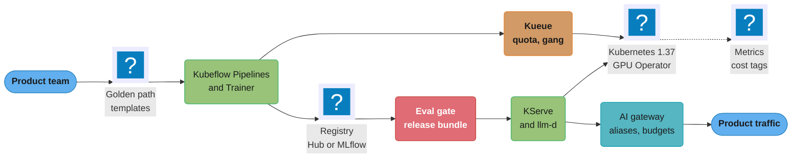
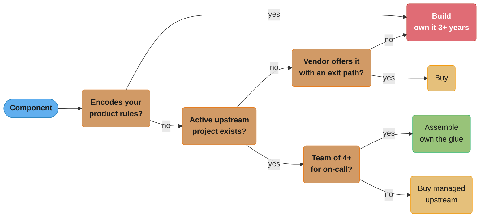
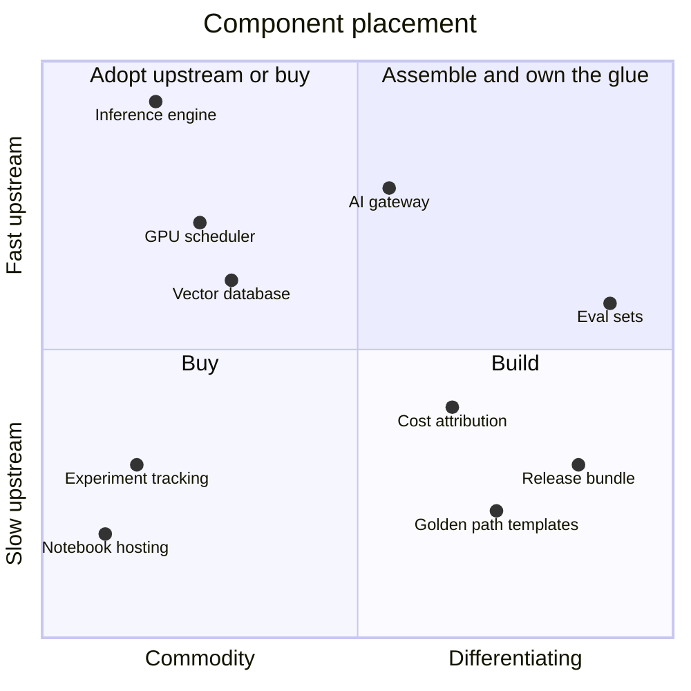
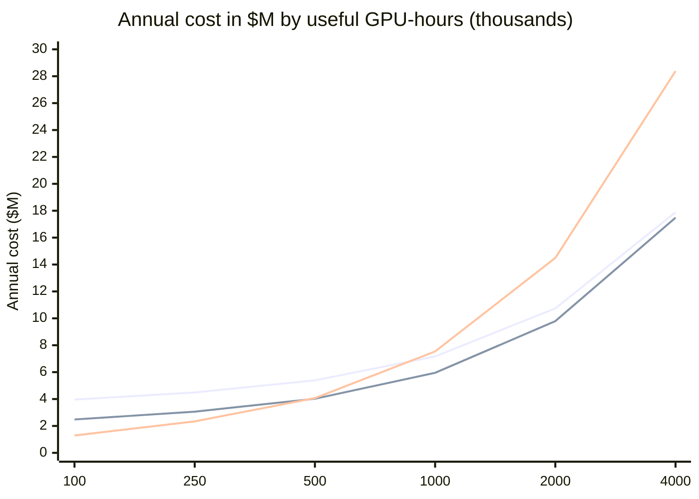
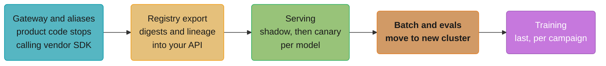

# ML Platform Architecture and Build vs Buy

> **Version anchor (2026-10-18).** Kubernetes 1.37 (1.37.0 2026-08-26, 1.37.1 2026-09-15).
> KServe v0.21.0 (2026-09-25), a CNCF incubating project since 2025-09-29. Kueue v0.20.2
> (2026-10-15); `kueue.x-k8s.io/v1beta1` is no longer served. Kueue is a Kubernetes SIG project,
> not a CNCF project. Kubeflow Hub v0.3.17 (2026-09-21; renamed from Model Registry at v0.3.9,
> MCP and Agents catalogs in v0.3.14 and v0.3.16). Kubeflow Pipelines 2.17.2 (2026-09-04).
> Kubeflow Trainer v2.3.0 (2026-08-07). Ray 2.59.0 (2026-10-02). llm-d v0.10.0 (2026-09-29),
> CNCF Sandbox since 2026-03-12. KAI Scheduler v0.18.6 (2026-10-15). MLflow 3.17.1 (2026-10-13).
> CNCF Kubernetes AI Conformance: per-version directories v1.33 to v1.37 (checked 2026-10-18).
> Every version claim below is checked against this anchor.

An ML platform is the set of shared services and contracts that let product teams train,
evaluate, release and serve models without each team running its own GPUs, registry and
serving stack. Most companies with more than a handful of models end up with one. The open
question is how much of it to build, how much to buy from a cloud or vendor, and how much to
assemble from open-source parts. That decision sets the platform team's headcount, the GPU
bill and the exit cost for the next three to five years.

---

## 1. Concept Overview

A platform has layers. Each layer has open-source options, managed options, and a page in
this section that owns its mechanics. This page owns the choice between them and the shape
of the whole.

| Layer | Question it answers | Open-source options | Managed options | Mechanics page |
|---|---|---|---|---|
| Compute substrate | Which GPUs, in which cloud, under which driver stack? | Kubernetes, GPU Operator, Slurm | Hyperscaler GPU node pools, neocloud clusters | [GPU Cluster Scheduling and Quotas](../gpu_cluster_scheduling_and_quotas/gpu_cluster_scheduling_and_quotas.md) |
| Admission and quota | Who may run now, against whose quota? | Kueue, Volcano, KAI Scheduler | NVIDIA Run:ai, managed training job queues | same |
| Pipelines and training | How does a run start, retry and record its inputs? | Kubeflow Pipelines, Kubeflow Trainer, Ray, Argo Workflows | SageMaker AI Pipelines, Agent Platform Pipelines, Databricks Jobs | [ML Pipelines and Orchestration](../ml_pipelines_and_orchestration/ml_pipelines_and_orchestration.md) |
| Artifacts and registry | Which weights, prompts and adapters exist, at which digest? | Kubeflow Hub, MLflow, OCI registries | SageMaker Model Registry, Unity Catalog models, Foundry Models catalog | [Model Registry and Packaging](../model_registry_and_packaging/model_registry_and_packaging.md) |
| Eval and release | Which bundle may ship, and how far? | MLflow, Langfuse, Phoenix, Argo Rollouts | vendor eval services | [Evaluation Gates and Eval Sets](../evaluation_gates_and_eval_sets/evaluation_gates_and_eval_sets.md) |
| Serving | Which engine, on which replicas, behind which router? | KServe, llm-d, Ray Serve, vLLM, SGLang | SageMaker AI endpoints, Foundry deployments, NIM | [Model Serving Platforms](../model_serving_platforms/model_serving_platforms.md) |
| Gateway | Which model answers this request, under whose budget? | LiteLLM, Agent Router | cloud API gateways with LLM policies | [AI Gateway Operations](../ai_gateway_operations/ai_gateway_operations.md) |
| Governance and cost | Who approved it, what did it cost, can we prove it? | OPA, Kyverno, OpenCost | cloud governance and billing exports | [AI Governance and Model Risk Operations](../ai_governance_and_model_risk_operations/ai_governance_and_model_risk_operations.md), [AI Cost Engineering and Unit Economics](../ai_cost_engineering_and_unit_economics/ai_cost_engineering_and_unit_economics.md) |

There are three sourcing modes for each layer:

- **Build.** Your engineers write and run the component. You own every bug and every
  upgrade. Uber built Michelangelo this way, described in a 2017 engineering post, because no
  product covered the lifecycle end to end.
- **Buy.** A cloud or vendor runs the component and you consume an API or console. You own
  the integration and the bill.
- **Assemble.** You run open-source components that others build, and you write the glue:
  templates, contracts, policy. You own upgrades and on-call, not the core code.

Most platforms mix modes: bought GPUs and object storage, assembled scheduling and
serving, built contracts. The mistake is to make the decision once for the whole platform
instead of once per layer.

**Not here.** Internal developer platform design in general (golden paths, Backstage, team
APIs, platform as a product) lives in
[Platform Engineering and IDP](../../devops/platform_engineering_and_idp/platform_engineering_and_idp.md).
The system-design interview version of an ML platform, with a feature store, training
pipeline and serving tier, is
[Design an ML Platform](../../ml/case_studies/design_ml_platform.md); the cluster and node
layer under it is
[Design ML Platform Infrastructure](../../devops/case_studies/design_ml_platform_infrastructure.md).
Experiment tracking and LLM observability products are compared in
[LLM Ops Platforms](../../llm/llm_ops_platforms/llm_ops_platforms.md). How to write the
decision down is in
[Design Docs, RFCs and ADRs](../../soft_skills/design_docs_rfcs_and_adrs/design_docs_rfcs_and_adrs.md).
The lifecycle the platform serves is
[MLOps Foundations and the AI Lifecycle](../mlops_foundations_and_the_ai_lifecycle/mlops_foundations_and_the_ai_lifecycle.md).

---

## 2. Intuition

**One-line analogy.** A platform team is a landlord: it should own the plumbing contracts
and the building rules, rent the boiler from a supplier, and never smelt its own pipes.

**Mental model.** The platform is a set of interfaces between product teams and
infrastructure: "submit this training job", "register this artifact", "release this bundle",
"call this model alias". Behind each interface sits a component that can be swapped. The
interfaces are slow to change because every team codes against them. The components change
every quarter because the upstream projects ship monthly. Own the slow part, rent or
assemble the fast part.

**Why it matters.** Two costs dominate. People: a platform engineer costs roughly $250,000 to
$350,000 a year fully loaded in US markets (this page uses $300,000 as an assumption), so a
12-person platform team is $3.6M a year before any GPU. GPUs: 256 H100s at an assumed
committed $2.50 per GPU-hour cost $5.6M a year whether or not they do work. A platform that
raises utilization on that fleet from 45% to 65% needs about 79 fewer GPUs for the same work,
about $1.7M a year, close to the $1.8M cost of a 6-person platform team. A platform that does not
raise utilization is overhead.

**Key insight.** Build vs buy is decided more by utilization than by headcount. Below about 100 GPUs, fixed people cost dominates and buying wins. Above several
hundred GPUs, cost per useful GPU-hour dominates and the mode that pools capacity best wins.
Building components that already exist upstream rarely wins at any scale.

---

## 3. Core Principles

1. **Decide per layer, not per platform.** The scheduler, the registry and the gateway have
   different churn rates, lock-in surfaces and differentiation. One verdict for all three is
   wrong for at least two of them.
2. **Own the contracts, rent the components.** The release bundle manifest, the registry API
   and aliases, the workload template, the cost tags and the eval-gate interface are yours.
   The engine behind them is replaceable.
3. **Price in useful GPU-hours, not paid GPU-hours.** A managed price that is 25% higher per
   GPU-hour but reaches 65% utilization beats a cheap self-run cluster stuck at 35%.
4. **Count the upgrade treadmill.** Every assembled component ships releases monthly. Count
   one engineer-week per component per quarter for upgrades and regressions before claiming
   assembled is free.
5. **Write the exit cost before you sign.** Know what moves cheaply (OCI images, weights in
   object storage, open formats) and what does not (proprietary pipeline DSLs, SDK calls in
   feature code, lineage metadata).
6. **Golden paths are products.** Adoption is earned with the shortest time to first deploy,
   and an escape hatch for the 20% of workloads the path does not fit.
7. **Do not build what has a community of hundreds.** Inference engines, GPU operators,
   schedulers and vector databases move faster than any internal team can follow.

---

## 4. Types / Architectures / Strategies

### 4.1 Reference stacks

Product names below were checked against vendor documentation on 2026-10-18. Amazon
SageMaker was renamed Amazon SageMaker AI on 2024-12-03; "Amazon SageMaker" now names the
wider data and AI suite. Azure AI Foundry is now Microsoft Foundry. Vertex AI is now Gemini
Enterprise Agent Platform (short form Agent Platform), with products such as Agent Platform
Pipelines, Managed Training and Model Registry on Gemini Enterprise Agent Platform.

| Stack | Mode | Control plane | Scheduling and training | Serving | Registry | Best fit |
|---|---|---|---|---|---|---|
| Kubeflow + KServe + Kueue | assemble | Kubernetes CRDs | Kueue quota and gang admission, Kubeflow Trainer, Kubeflow Pipelines | KServe, llm-d | Kubeflow Hub or MLflow | Orgs already running Kubernetes with a platform team of 4 or more |
| Ray on Kubernetes or Anyscale | assemble or buy | Ray clusters (KubeRay on Kubernetes, or Anyscale managed) | Ray Train, Ray Data, Ray Tune | Ray Serve, Ray Serve LLM | MLflow or external | Python-first teams that want one runtime for data, training and serving |
| Amazon SageMaker AI | buy | AWS APIs | Training jobs, HyperPod clusters, Pipelines | Real-time, serverless and async endpoints | SageMaker Model Registry | AWS-native orgs with a small platform team |
| Gemini Enterprise Agent Platform | buy | Google Cloud APIs | Managed Training, Agent Platform Pipelines | Endpoints, Model Garden deployments | Model Registry | Google Cloud orgs, Gemini-heavy GenAI |
| Databricks Mosaic AI | buy | Databricks workspace | Jobs, serverless GPU compute | Model Serving | Unity Catalog models | Data teams already on the lakehouse |
| Microsoft Foundry | buy | Azure resource provider | Azure Machine Learning for classic training | Foundry model deployments, hosted agents | Foundry Models catalog | Azure orgs, OpenAI-model GenAI, agent workloads |
| NVIDIA AI Enterprise with Run:ai and NIM | buy (software) on own or rented GPUs | Run:ai control plane on Kubernetes | Run:ai projects and quotas (KAI Scheduler is its open-source core) | NIM microservices | external | Large GPU estates on-prem or in neoclouds |
| Red Hat OpenShift AI | buy (supported open source) | OpenShift | Kubeflow components | vLLM, llm-d | Kubeflow components | Regulated or on-prem estates already on OpenShift |
| Neocloud (CoreWeave, Lambda, Nebius, Crusoe) | buy capacity, assemble the rest | Managed Kubernetes or Slurm | Customer-chosen | Customer-chosen | Customer-chosen | Large training and inference fleets that want H100/B200 capacity at a lower rate |

The neocloud row is a sourcing choice, not a platform. You still assemble everything above
the node.

### 4.2 Build, buy and assemble per layer

| Layer | Default in 2026 | Why |
|---|---|---|
| GPU driver stack and device plugins | buy or assemble (GPU Operator) | Vendor-maintained; any fork falls behind the next driver |
| Scheduler and quota | assemble (Kueue, KAI, Volcano) or buy (Run:ai) | Gang, cohorts, topology are solved; writing a scheduler is a multi-year project |
| Pipelines | assemble or buy | DSLs are commodity; the lock-in is in the DSL itself |
| Registry | assemble or buy, wrap with your API | Aliases and lineage must be yours even if storage is not |
| Inference engine | assemble (vLLM, SGLang, TensorRT-LLM) | Monthly releases with kernel work no internal team can match |
| Serving control plane | assemble (KServe, llm-d) or buy | Fit depends on Kubernetes depth |
| Gateway | assemble or buy, own the config | The routing policy and budgets are business logic |
| Eval sets and gates | build | Your eval sets are your product definition |
| Release bundle and lineage glue | build | No vendor knows your artifact set |
| Cost attribution joins | build on top of billing exports | Allocation keys follow your org chart |

### 4.3 Team topology

Team types and interaction modes are in
[Platform Engineering and IDP](../../devops/platform_engineering_and_idp/platform_engineering_and_idp.md).
For an ML platform, team size follows the sourcing mode:

| Shape | Size (planning assumption) | Works when |
|---|---|---|
| Embedded ML engineers, no platform team | 0 | Under 5 models, one cloud, bought platform |
| Thin platform team over a bought stack | 2 to 4 | 5 to 50 models, one primary cloud |
| Platform team over an assembled stack | 6 to 15 | 50+ models or 200+ GPUs, multi-tenant clusters |

Below 4 people, on-call for an assembled stack is one week in three or worse, and the team
ships nothing but upgrades.

### 4.4 GPU sourcing models

| Source | Price shape | Risk | Use for |
|---|---|---|---|
| Hyperscaler on-demand | Highest per hour | Capacity not guaranteed for H100/B200 class | Burst, experiments |
| Hyperscaler committed or reserved | 1 to 3 year commit | Stranded if the model mix changes | Steady inference floor next to your data |
| Neocloud reserved block | Monthly or yearly contract | Second vendor, egress from your data cloud | Training runs, large inference fleets |
| Spot or preemptible | Lowest per hour | Eviction with short notice | Checkpointed training, batch inference, evals |
| On-premises | Capex, 3 to 5 year depreciation | Power, cooling, hardware failures are yours | Very large steady fleets, data that cannot leave |

Purchase instruments, discounts and the FOCUS export live in
[GPU and AI FinOps](../../devops/cloud_cost_optimization_finops/gpu_and_ai_finops.md).

---

## 5. Architecture Diagrams

### Assembled reference stack on Kubernetes



The built parts are the templates, the release bundle and the gate. Everything else is
upstream code that the platform team upgrades and operates. Replacing KServe with a managed
endpoint changes one box, not the contract product teams call.

### Ownership grid by sourcing mode

```
Layer                     Build        Assemble          Buy
------------------------  -----------  ----------------  ----------------
GPU drivers and plugins   you          upstream + you    vendor
Scheduler and quota       you          upstream + you    vendor
Pipelines DSL             you          upstream          vendor (lock-in)
Inference engine          you          upstream + you    vendor
Serving control plane     you          upstream + you    vendor
Registry storage          you          upstream + you    vendor
Registry API and aliases  you          you               you (wrapper)
Release bundle manifest   you          you               you
Eval sets and gates       you          you               you
Cost attribution keys     you          you               you
On-call for the layer     you          you               vendor + you
Upgrade treadmill         you          you               vendor
```

The bottom block reads "you" in every column. Buying everything still leaves the contracts,
the eval sets and the cost keys with your team, which is why a bought platform still needs
2 to 4 platform engineers.

### Build, buy or assemble for one component



"Build" is reached only when the component encodes your rules or nothing else exists.
"Buy managed upstream" means a vendor running the same open-source project (managed Ray,
managed Kubeflow, supported OpenShift AI), which keeps the exit path open.

### Where each component sits



The gateway sits in quadrant 1 because the proxy is commodity and fast-moving while its
routing rules and budgets are yours.

### Annual cost against useful GPU-hours



Three lines from the model in §6.2: build (starts at 3.96), assemble (starts at 2.48) and buy
(starts at 1.29, ends at 28.38). Buy is cheapest below about 484,000 useful GPU-hours a
year, which is about 85 GPUs at 65% utilization. Build does not pass assemble until about
5.5M useful GPU-hours, about 960 GPUs at 65%.

---

## 6. How It Works - Detailed Mechanics

### 6.1 The contracts a platform owns

Whatever the sourcing mode, five interfaces belong to the platform team. Product teams code
against them; vendors and upstream projects sit behind them.

| Contract | Shape | Consumers | What it hides |
|---|---|---|---|
| Workload template | A small spec: image, entrypoint, GPU class, queue, budget tag | Training and batch teams | Kueue, Trainer, Ray or a managed training API |
| Registry API and aliases | `models:/fraud-scorer@champion` style URIs resolving to digests | Serving, CI, audits | Kubeflow Hub, MLflow or a cloud registry |
| Release bundle | One manifest pinning every artifact by digest | Release pipeline, rollback | Where each artifact is stored |
| Model alias at the gateway | An OpenAI-compatible endpoint and an alias name | Product code | Which engine, region or provider answers |
| Cost and owner tags | `team`, `feature`, `bundle` labels on every workload and request | FinOps, chargeback | Billing formats of each provider |

The release bundle is defined in
[Artifact Versioning and Lineage](../artifact_versioning_and_lineage/artifact_versioning_and_lineage.md),
and the worked manifest is in
[AI Release Bundle and Lineage](../case_studies/cross_cutting/ai_release_bundle_and_lineage.md).

A workload template is the smallest useful golden path. This is an internal API, not an
upstream CRD; the platform renders it into whatever runs underneath:

```yaml
# platform.example.com/v1: owned by the platform team, rendered by a controller or CI step
apiVersion: platform.example.com/v1
kind: TrainingRun
metadata:
  name: fraud-scorer-2026-10-18
  labels: {team: risk, feature: fraud-scoring}
spec:
  image: registry.internal/risk/fraud-train@sha256:<image-digest>
  command: ["python", "-m", "train", "--config", "configs/v14.yaml"]
  gpus: {class: h100, count: 16}
  queue: risk-train
  maxRuntime: 8h
  registerAs: fraud-scorer        # becomes a registry version with lineage
```

On the assembled stack the controller renders a Kubeflow `TrainJob` and points it at a Kueue
`LocalQueue`:

```yaml
apiVersion: kueue.x-k8s.io/v1beta2
kind: LocalQueue
metadata:
  name: risk-train
  namespace: risk
spec:
  clusterQueue: training-h100
```

On a managed stack the same spec becomes a training job API call. The product team's file
does not change, which is the whole point of owning the template.

### 6.2 TCO model in useful GPU-hours

Let `U` be the useful GPU-hours a year your workloads need, `P` the price per paid GPU-hour,
`m` the managed markup, `u` the utilization each mode reaches, and `F` the fixed cost (people
plus licenses).

```
paid GPU-hours = U / u
annual cost    = (U / u) * P * (1 + m) + F
cost per useful GPU-hour = P * (1 + m) / u + F / U
break-even U between modes A and B = (F_A - F_B) / (P_B (1 + m_B) / u_B - P_A (1 + m_A) / u_A)
```

Assumptions for the worked example. Every number is an input you replace with your own
quote; none is a list price.

| Input | Build | Assemble | Buy |
|---|---|---|---|
| `P` committed price per GPU-hour | $2.50 | $2.50 | $2.50 |
| `m` managed markup | 0 | 0 | 0.25 |
| `u` utilization reached | 0.70 | 0.65 | 0.45 |
| Platform engineers at $300,000 | 12 | 6 | 2 |
| Licenses and managed add-ons | 0 | $300,000 | 0 |
| `F` fixed cost | $3.6M | $2.1M | $0.6M |

Buy reaches lower utilization in this example because each model gets its own provisioned
endpoint with no cross-team pooling, borrowing or preemption. That is the most important
assumption on the page; §6.3 tests it.

```python
from dataclasses import dataclass

@dataclass(frozen=True)
class Mode:
    name: str
    utilization: float
    markup: float
    fixed: float                      # people plus licenses, $ per year

PRICE = 2.50                          # $ per paid GPU-hour, committed (assumption)

def annual_cost(mode: Mode, useful_hours: float) -> float:
    return useful_hours / mode.utilization * PRICE * (1 + mode.markup) + mode.fixed

def break_even(a: Mode, b: Mode) -> float:
    """Useful GPU-hours at which a and b cost the same; a has the higher fixed cost."""
    var_a = PRICE * (1 + a.markup) / a.utilization
    var_b = PRICE * (1 + b.markup) / b.utilization
    return (a.fixed - b.fixed) / (var_b - var_a)

BUILD = Mode("build", 0.70, 0.0, 3_600_000)
ASSEMBLE = Mode("assemble", 0.65, 0.0, 2_100_000)
BUY = Mode("buy", 0.45, 0.25, 600_000)

if __name__ == "__main__":
    u = 1_400_000
    for mode in (BUILD, ASSEMBLE, BUY):
        cost = annual_cost(mode, u)
        print(f"{mode.name:9} paid={u / mode.utilization:>10,.0f} "
              f"cost=${cost / 1e6:.2f}M per useful hour=${cost / u:.2f}")
    assert round(break_even(ASSEMBLE, BUY)) == 484_138
    assert round(break_even(BUILD, ASSEMBLE)) == 5_460_000
```

At `U = 1,400,000` useful GPU-hours (about 245 GPUs busy at 65%):

| Mode | Paid GPU-hours | Annual cost | Per useful GPU-hour |
|---|---|---|---|
| Build | 2,000,000 | $8.60M | $6.14 |
| Assemble | 2,153,846 | $7.48M | $5.35 |
| Buy | 3,111,111 | $10.32M | $7.37 |

Assemble beats buy by $2.8M a year here. Build loses to assemble by $1.1M: its 5 points of
extra utilization are worth $0.39M of GPU time, and it costs $1.5M more in people.

### 6.3 Sensitivity: the utilization assumption

The buy column's 45% is the number to attack in review. Managed platforms offer multi-model
endpoints, serverless inference and shared inference components, and a disciplined team can
push them well above 45%.

| Buy utilization | Variable cost per useful GPU-hour | Break-even with assemble | Equivalent fleet at 65% |
|---|---|---|---|
| 0.45 | $6.94 | 484,000 useful GPU-hours | about 85 GPUs |
| 0.55 | $5.68 | 817,000 | about 144 GPUs |
| 0.60 | $5.21 | 1,101,000 | about 193 GPUs |
| 0.70 | $4.46 | 2,427,000 | about 426 GPUs |

Moving buy utilization from 45% to 60% moves the break-even from 85 to 193 GPUs. Measure the
utilization you actually reach on a pilot, per workload class, before running the model.
Fleet utilization measurement is in
[GPU Observability and Fleet Health](../gpu_observability_and_fleet_health/gpu_observability_and_fleet_health.md).

### 6.4 Broken then fixed: vendor calls in feature code

The commonest lock-in is not the platform. It is product code calling the platform's SDK
directly, with endpoint names baked in.

```python
# Broken: the endpoint name, region and SDK are in 31 services
import boto3, json

runtime = boto3.client("sagemaker-runtime", region_name="us-east-1")

def score(txn: dict) -> float:
    resp = runtime.invoke_endpoint(
        EndpointName="fraud-scorer-v7-prod",
        ContentType="application/json",
        Body=json.dumps(txn),
    )
    return json.loads(resp["Body"].read())["score"]
```

Moving this model to KServe, or to a second region, means editing and redeploying 31
services. A version bump from v7 to v8 is a code change in each one.

```python
# Fixed: product code calls the platform contract; the alias resolves at the gateway
import httpx

GATEWAY = "https://ml-gateway.internal"

def score(txn: dict) -> float:
    resp = httpx.post(
        f"{GATEWAY}/v1/models/fraud-scorer:predict",
        headers={"x-team": "risk", "x-feature": "fraud-scoring"},
        json={"instances": [txn]},
        timeout=0.25,
    )
    resp.raise_for_status()
    return resp.json()["predictions"][0]["score"]
```

The gateway maps `fraud-scorer` to whichever bundle holds the `champion` alias and routes to
the managed endpoint or the KServe service behind it. Moving serving is a gateway config
change. The `x-team` and `x-feature` headers become cost tags.

### 6.5 Kubernetes AI Conformance as a procurement filter

The CNCF Kubernetes AI Conformance program certifies that a Kubernetes platform provides the
capabilities AI workloads need. The repository keeps one directory per Kubernetes minor
version, v1.33 to v1.37. A platform must already be Kubernetes Conformant, submits a
completed checklist with evidence as a pull request, and a certification is valid for one
year. The v1.37 checklist (checked 2026-10-18) has 15 requirements, 8 MUST and 7 SHOULD:

| Requirement id | Category | Level |
|---|---|---|
| `ai_inference` (Gateway API with weighted and header-based routing) | networking | MUST |
| `gang_scheduling` (at least one all-or-nothing solution, such as Kueue or Volcano) | scheduling | MUST |
| `cluster_autoscaling` (scale accelerator node groups on pending pods, if an autoscaler is offered) | scheduling | MUST |
| `pod_autoscaling` (HPA works for accelerator pods on custom metrics, if HPA is supported) | scheduling | MUST |
| `accelerator_metrics` (per-accelerator utilization and memory on a standard endpoint) | observability | MUST |
| `ai_service_metrics` (collect workload metrics in a standard format such as Prometheus) | observability | MUST |
| `secure_accelerator_access` (device plugin or DRA mediates access) | security | MUST |
| `robust_controller` (a complex CRD-based AI operator such as Ray or Kubeflow installs and reconciles) | operator | MUST |
| `driver_runtime_management`, `gpu_sharing`, `virtualized_accelerator` | accelerators | SHOULD |
| `advanced_inference_ingress`, `high_performance_networking`, `disaggregated_inference` | networking | SHOULD |
| `workload_sandboxing` | security | SHOULD |

Use it as a floor in an RFP, not as a ranking. It says nothing about price, GPU availability,
support response times or performance. Check that the certification covers the minor version
you will run, and ask for evidence on the SHOULD items you depend on, such as
`advanced_inference_ingress` if you plan to run llm-d's KV-cache-aware routing.

### 6.6 Multi-cloud GPU sourcing

Sourcing GPUs from two or three providers is common; running one platform evenly across all
of them is not.

- **Make workloads portable, not symmetric.** Images by digest, weights as OCI artifacts or
  in object storage by digest, and the workload template from §6.1. Each cluster runs the
  same contracts; it need not run the same managed add-ons.
- **Place by data gravity.** Training reads terabytes; put it next to the data or copy the
  data once per campaign. Inference reads only weights; it can sit anywhere the latency
  budget allows.
- **Count weight movement.** A 140 GB checkpoint copied to 3 regions daily is 420 GB a day,
  about 12.6 TB a month. At an assumed $0.08 per GB of egress that is about $1,000 a month
  per model, small for one model and large for a 60-model catalog with daily refresh.

Kueue's MultiKueue dispatches admitted workloads to worker clusters, which turns a second GPU
source into another quota flavor rather than a second platform. Mechanics are in
[GPU Cluster Scheduling and Quotas](../gpu_cluster_scheduling_and_quotas/gpu_cluster_scheduling_and_quotas.md);
weight distribution is in
[Model Storage, Loading and Cold Start](../model_storage_loading_and_cold_start/model_storage_loading_and_cold_start.md).

### 6.7 What not to build

| Do not build | Use instead | Why it fails in-house |
|---|---|---|
| An inference engine | vLLM, SGLang, TensorRT-LLM | Kernel, scheduling and quantization work ships monthly from hundreds of contributors |
| A GPU scheduler | Kueue, KAI Scheduler, Volcano, Run:ai | Gang, fair share, topology and preemption took these projects years |
| A GPU operator or device plugin | NVIDIA, AMD and Intel operators | Breaks on every driver release |
| A vector database | managed or open-source vector stores | Index maintenance and compaction are deep problems; see [RAG and Vector Index Lifecycle](../rag_and_vector_index_lifecycle/rag_and_vector_index_lifecycle.md) |
| An experiment tracking UI | MLflow, managed trackers | Commodity; no product differentiation |
| A notebook service | JupyterHub, managed notebooks | Commodity with a long security tail |
| A pipeline DSL | Kubeflow Pipelines, Argo Workflows, Ray, managed pipelines | An internal DSL needs its own SDK, UI, retry semantics and docs, and every team must learn it |

And what to build: the five contracts in §6.1, eval sets and gate policy, the lineage glue
that joins registry, bundle and traffic, cost attribution on top of billing exports, and the
policy rules that encode your risk tiers.

### 6.8 Exit plan and migration order

Migrate by layer, outside in, so each step is reversible:



The gateway step costs the most code changes and removes the most lock-in, so it goes first
even if no serving moves for a year. Training goes last because it is the most coupled to
data location and the least visible to users. Traffic-split mechanics for the serving step
are in
[Progressive Delivery for Model Servers](../progressive_delivery_for_model_servers/progressive_delivery_for_model_servers.md).

---

## 7. Real-World Examples

- **Uber Michelangelo.** Uber described Michelangelo in a 2017 engineering post as an
  internal platform covering data management, training, evaluation, deployment and
  monitoring. No product covered that lifecycle at the time, so "build" was the only mode
  available.
- **Netflix Metaflow.** Netflix built Metaflow for data scientists and open-sourced it in
  2019. Netflix kept compute on its existing infrastructure and built only the workflow
  layer that its users touched.
- **Spotify.** Spotify's 2019 engineering post described standardizing on TensorFlow
  Extended and Kubeflow Pipelines. Its later ML platform posts describe adding Ray for
  distributed workloads. The platform changed engines while keeping its own interfaces.
- **Shopify Merlin.** Shopify's 2022 post introduced Merlin, an ML platform built on Ray
  running on Kubernetes. Shopify assembled rather than built: Ray for compute, its own layer
  for workspaces and templates.
- **OpenAI on Kubernetes.** OpenAI's 2021 post "Scaling Kubernetes to 7,500 nodes" described
  running research workloads on very large Kubernetes clusters, with custom work on
  scheduling and networking at a scale few companies reach.
- **Red Hat OpenShift AI.** Red Hat sells a supported distribution that names Kubeflow, vLLM
  and llm-d among its open-source components. Buying it is "buy managed upstream": vendor
  support without a proprietary API.

---

## 8. Tradeoffs

### Build vs buy vs assemble

| Dimension | Build | Assemble | Buy |
|---|---|---|---|
| Time to first production model | 6 to 18 months | 2 to 6 months | Days to weeks |
| Fixed cost | Highest | Medium | Lowest |
| Cost per useful GPU-hour at scale | Low if utilization is high | Low | Higher (markup, weaker pooling) |
| Upgrade treadmill | All yours | Yours, upstream does the code | Vendor's |
| Exit cost | Low (you own it) | Low (open source) | Medium to high (DSLs, SDKs, metadata) |
| Access to new engines and models | As fast as you build | Weeks after upstream | When the vendor adds them |
| Compliance evidence | You produce it | You produce it | Vendor attestations plus yours |

### Managed hyperscaler platform vs NVIDIA-stack software vs neocloud plus assembled

| Dimension | Hyperscaler managed | NVIDIA AI Enterprise with Run:ai and NIM | Neocloud plus assembled |
|---|---|---|---|
| GPU source | That cloud only | Any (on-prem, neocloud, cloud) | Neocloud, sometimes plus cloud |
| Integration with data and IAM | Native | You integrate | You integrate |
| Engine choice | Vendor containers plus bring-your-own | NIM and supported engines | Any |
| License cost | In the instance price | Per-GPU software license | None for open source |
| Platform team needed | 2 to 4 | 4 to 8 | 6 to 15 |

---

## 9. When to Use / When NOT to Use

**Buy when:**
- You run fewer than about 100 GPUs or under 500,000 useful GPU-hours a year.
- The platform team would be under 4 people.
- Most models are GenAI calls to provider APIs, where serving is not yours anyway.
- Data and identity already live in one cloud and residency rules keep them there.

**Assemble when:**
- You run several hundred GPUs and measured utilization on the bought platform is under 50%.
- Many teams share the fleet and need quota, borrowing and preemption across them.
- You need engines, routing or disaggregated serving the vendor does not offer yet.
- You source GPUs from more than one provider.

**Build when:**
- The component encodes your product rules: eval sets, release policy, cost allocation.
- No active upstream project or vendor covers the need, and you will own it for 3+ years.

**Do NOT:**
- Build a scheduler, inference engine, GPU operator or vector database.
- Assemble with a team that cannot staff a sane on-call rotation.
- Go multi-cloud for portability alone; buy capacity from several sources, keep contracts
  portable, and run the platform where most of the work is.
- Make one verdict for the whole platform.

---

## 10. Common Pitfalls

**The platform nobody used.** A retailer's platform team spent 14 months building a unified
ML platform with its own pipeline DSL and model server. At launch, 3 of 22 model teams
adopted it; the rest stayed on notebooks and cron jobs because migrating took two sprints per
model and the DSL could not express their feature joins. Fix: ship one golden path for the
most common workload in 6 weeks, measure time to first deploy, and add paths by demand.

**Fourteen components, three engineers.** A startup assembled Kubeflow, KServe on Knative,
Istio, Kueue, MLflow, Argo Workflows, a vector database and an observability stack, run by
three people. A Knative and Istio upgrade broke KServe scale-from-zero for two days, during
which every serving change was frozen. Fix: count components against on-call capacity; with
three people, buy serving and keep only the scheduler and registry wrapper.

**One endpoint per model.** A bank moved 40 classic models to managed real-time endpoints,
one per model, each with 2 instances for availability. Measured GPU utilization was 8% on
average. Fix: multi-model endpoints or a shared serving cluster with per-model autoscaling,
which cut the instance count from 80 to 14.

**A served API version disappears.** A platform upgraded Kueue across several minor releases
in one change. The GitOps repo still held `kueue.x-k8s.io/v1beta1` manifests, which Kueue
v0.20 no longer serves, so every new queue sync failed and new teams could not onboard. Fix:
convert stored objects and Git manifests to `v1beta2` before the upgrade that drops the old
version, and run upgrades one minor at a time.

**Buy, then rebuild the registry.** A company bought a managed platform, then found its
registry could not hold prompts, adapters and tool-server versions together. Teams built
three shadow registries in spreadsheets and Git. Fix: wrap the vendor registry with your own
API and aliases from day one, so new artifact types are a schema change and not a new store.

**Multi-cloud by policy.** A board mandate required every model to run on two clouds. The
platform team maintained two of every managed integration and copied 2 TB of weights a week
between clouds. No failover was ever exercised. Fix: source capacity from two providers but
place each workload by data gravity, and test failover for the few services that need it.

**Mandated golden path, no escape hatch.** Leadership required all training to go through the
template. A research team needing custom NCCL settings could not set them, and ran jobs on
personal cloud accounts, outside quota and cost tags. Fix: the template exposes a raw
override block, flagged and reviewed, and the platform tracks how often it is used.

**Utilization never measured.** A team justified assembling with a projected 70% utilization.
A year later nobody had measured it; DCGM showed 38%, because quotas were nominal and
borrowing was off. Fix: put measured useful GPU-hours in the decision record and review it
quarterly.

---

## 11. Technologies & Tools

| Tool | Role | Notes |
|---|---|---|
| Kubernetes | substrate for assembled platforms | 1.37; AI Conformance checklist per minor version |
| Kubeflow | assembled ML platform components | Pipelines 2.17.2, Trainer v2.3.0, Hub v0.3.17 |
| KServe | serving control plane | v0.21.0; CNCF incubating |
| Kueue | quota and gang admission | v0.20.2; serves `v1beta2`; MultiKueue for multi-cluster |
| KAI Scheduler | GPU scheduler | v0.18.6; open-source core of NVIDIA Run:ai |
| llm-d | distributed LLM serving on Kubernetes | v0.10.0; CNCF Sandbox |
| Ray | Python-native distributed runtime | 2.59.0; Train, Data, Serve, Serve LLM |
| KubeRay | Ray on Kubernetes | runs Ray clusters as Kubernetes resources |
| Anyscale | managed Ray | buy-managed-upstream option for Ray stacks |
| AWS SageMaker | managed ML platform on AWS | product name is Amazon SageMaker AI since 2024-12-03 |
| Vertex AI | managed ML platform on Google Cloud | renamed Gemini Enterprise Agent Platform (short form Agent Platform) |
| Databricks | lakehouse with Mosaic AI training and serving | Unity Catalog holds models |
| Microsoft Foundry | managed AI platform on Azure | formerly Azure AI Foundry; models, agents, tools |
| Azure Machine Learning | classic ML training and endpoints on Azure | pairs with Microsoft Foundry for GenAI |
| NVIDIA Run:ai | commercial GPU control plane | projects, quotas, fractional GPUs |
| Red Hat OpenShift AI | supported open-source AI platform | names Kubeflow, vLLM and llm-d among components |
| MLflow | tracking and registry | 3.17.1 |
| Backstage | developer portal for golden paths | hosts templates and the service catalog |
| SkyPilot | multi-cloud job launcher | runs jobs across clouds and Kubernetes clusters |

Related pages: [LLM Ops Platforms](../../llm/llm_ops_platforms/llm_ops_platforms.md) for tracking and observability products, [Platform Engineering and IDP](../../devops/platform_engineering_and_idp/platform_engineering_and_idp.md) for golden paths in general, [AI Workloads and Agent Operations](../../devops/platform_engineering_and_idp/ai_workloads_and_agent_operations.md) for agent workloads on an IDP, and [Token Economics and Cost Optimization](../../llm/token_economics_and_cost_optimization/token_economics_and_cost_optimization.md) for the API-versus-self-host TCO model.

---

## 12. Interview Questions with Answers

**Q: A managed platform quotes a higher price per GPU-hour than your self-run cluster, yet finance says it is cheaper. When can that be true?**
**Short:** When it reaches higher utilization; cost per useful GPU-hour is price divided by utilization, so $3.13 at 65% beats $2.50 at 35%.

Price per paid GPU-hour is the wrong unit; cost per useful GPU-hour is `P * (1 + m) / u`. A
self-run cluster at $2.50 and 35% utilization costs $7.14 per useful hour. A managed option at
$3.13 (25% markup) reaching 65% costs $4.81. The reverse is just as common: managed
endpoints provisioned one per model with no pooling sit at 10% to 45%. Never compare quotes;
compare measured utilization on a pilot of your real workload mix, then add fixed people
cost.

**Q: A team wants to build its own GPU scheduler because Kueue lacks one feature they need. What do you ask first?**
**Short:** What the missing feature is worth per year against owning a scheduler forever; usually the answer is a Kueue contribution, KAI Scheduler, Volcano or a small admission webhook.

A scheduler is a multi-year commitment: gang admission, fair share, preemption, topology
and every Kubernetes upgrade. Ask what the gap costs in GPU-hours or engineer time each year,
then check the alternatives in order: a Kueue feature or configuration, an upstream issue or
contribution, another scheduler (KAI Scheduler for time-based fair share and fractional GPUs,
Volcano for in-scheduler gang), and a narrow admission webhook for a local policy. Building
only wins if none of those close a gap worth more than the 2 to 4 engineers who would own the
fork indefinitely.

**Q: Why is "multi-cloud for portability" usually a weak reason to assemble the whole platform on Kubernetes?**
**Short:** Portability is paid for every day in duplicated integrations while exit happens rarely; source GPUs from several providers but keep contracts portable and place work by data gravity.

Running symmetrically on two clouds doubles IAM, networking, managed add-ons and on-call,
and adds weight and dataset copies. Most companies never exercise the failover it buys. The
cheaper design keeps the contracts portable (images by digest, weights as OCI artifacts, a
workload template, a gateway alias), runs the platform where most data and traffic are, and
uses a second provider as a capacity flavor through MultiKueue or a launcher. Assemble when
pooling and engine choice justify it, not as insurance.

**Q: A vendor says its platform is CNCF Kubernetes AI Conformant. What does that tell you, and what does it not?**
**Short:** It shows the platform met the checklist MUSTs for one Kubernetes minor version, such as gang scheduling and accelerator metrics; it says nothing about price, capacity, support or performance.

The program certifies capabilities per Kubernetes minor version, and the repository keeps
directories for v1.33 to v1.37. The v1.37 checklist has 15 requirements: 8 MUST (including
`ai_inference`, `gang_scheduling`, `accelerator_metrics`, `secure_accelerator_access` and
`robust_controller`) and 7 SHOULD (including `gpu_sharing`, `advanced_inference_ingress` and
`disaggregated_inference`). A certification lasts one year. Check that it covers the version
you will run, ask for evidence on the SHOULDs your workloads need, and test performance and
GPU availability separately.

**Q: Six months after launch, only 20% of teams use the platform's golden path. What usually went wrong?**
**Short:** The path did not fit the common workload or took longer than the old way, and there was no escape hatch, so teams routed around it.

Adoption follows time to first deploy. A path that needs two sprints to migrate a model loses
to a notebook and a cron job. Typical causes are a DSL that cannot express the team's real
pipeline, missing GPU classes or frameworks, and no override for edge cases. Fix it like a
product: interview the non-adopters, ship a path for the single most common workload, measure
time to first deploy and weekly active teams, and add a reviewed raw override so edge cases
stay inside quota and cost tags.

**Q: Which parts of an ML platform should almost never be built in-house in 2026?**
**Short:** Inference engines, GPU schedulers, GPU operators and device plugins, vector databases, pipeline DSLs, notebook hosting and experiment tracking UIs.

Each has active upstream projects or vendors with far more contributors than an internal
team. vLLM and SGLang ship kernel and scheduling changes monthly; Kueue, KAI Scheduler and
Volcano have years of gang and fair-share work; vendor GPU operators track every driver.
A fork of any of them falls behind within a quarter. Spend the team on the contracts, eval
sets, lineage glue and cost attribution instead.

**Q: What should a platform team own even when it buys almost every component?**
**Short:** The contracts: workload template, registry API and aliases, release bundle manifest, gateway aliases, cost and owner tags, plus eval sets and gate policy.

These encode how your company ships models, and no vendor knows them. They are also the exit
path: if product code only calls a gateway alias and submits a workload template, moving
serving or training is a change behind the contract. A bought platform without them leaks
vendor SDK calls and endpoint names into product code, and the exit cost grows with every
service. This is why even a bought platform needs 2 to 4 platform engineers.

**Q: How do you compute the break-even between buying a managed platform and assembling one?**
**Short:** Divide the fixed-cost difference by the per-useful-hour cost difference: U = (F_assemble - F_buy) / (P(1+m)/u_buy - P/u_assemble).

With `P = $2.50`, `m = 0.25`, buy utilization 0.45, assemble utilization 0.65, and fixed
costs of $2.1M (assemble) and $0.6M (buy), the variable costs are $6.94 and $3.85 per useful
GPU-hour. Break-even is $1.5M / $3.10, about 484,000 useful GPU-hours a year, or about 85
GPUs busy at 65%. The result is sensitive to buy utilization: at 60% it moves to about 1.1M
hours, about 193 GPUs. State every input as an assumption and replace it with pilot data.

**Q: Rank the lock-in surfaces of a managed ML platform by exit cost.**
**Short:** Highest: SDK calls in product code and proprietary pipeline DSLs; then registry and lineage metadata; then IAM and network wiring; lowest: weights, images and data in open formats.

SDK calls with endpoint names are spread across every consuming service, so moving them is
a change in each one. Pipeline definitions in a vendor DSL must be rewritten, not migrated.
Registry metadata, approvals and lineage need an export path, or the audit trail stays with
the vendor. IAM roles and private networking are rebuilt once. Weights in safetensors, images
in OCI registries and data in Parquet move with a copy. Put a gateway and a registry API in
front early to shrink the top two.

**Q: Kubeflow plus KServe plus Kueue, or Ray on Anyscale: how do you choose?**
**Short:** Choose the Kubernetes CRD stack when the org already runs Kubernetes with a platform team; choose Ray when Python teams want one runtime for data, training and serving.

The Kubeflow stack treats each step as a Kubernetes resource: Kueue admits, Trainer runs,
KServe and llm-d serve, and GitOps manages it all. It fits mixed workloads and existing
Kubernetes skills. Ray gives one Python API across Ray Data, Train, Tune and Serve, with
less YAML and fewer components, and Anyscale removes cluster operations. They combine:
KubeRay runs Ray clusters on Kubernetes and Kueue can admit RayJobs, so the choice is often
which one product teams see first.

**Q: Where does NVIDIA AI Enterprise with Run:ai and NIM fit in a build-vs-buy decision?**
**Short:** It buys a GPU control plane and packaged inference services that run on any GPUs you own or rent, at a per-GPU license, in place of assembling the scheduler and serving layers.

Run:ai adds projects, quotas, fractional GPUs and a UI on Kubernetes; its open-source core is
the KAI Scheduler, a CNCF Sandbox project. NIM packages models with tuned engines as
microservices. The trade is license cost and NVIDIA's engine choices against fewer components
to integrate, and it works across on-prem, neocloud and cloud capacity. It fits large GPU
estates outside one hyperscaler that do not want to assemble the scheduling layer.

**Q: How should GPU capacity be sourced across hyperscalers and neoclouds?**
**Short:** Commit capacity for the steady inference floor near your data, reserve neocloud blocks for training, burst on on-demand or spot, and keep workloads portable across all of them.

Tie each source to a workload shape. Inference floors are steady and latency-bound, so
commit capacity in the cloud where users and data live. Training runs are large and bursty,
so reserve neocloud blocks per campaign. Evals, batch inference and checkpointed training
take spot. Every source becomes a Kueue flavor or a cluster behind MultiKueue, with the same
workload template and images by digest. Model egress per refresh before choosing where
training lands.

**Q: How do you migrate off a managed platform without a big-bang rewrite?**
**Short:** Move layer by layer from the outside in: gateway aliases first, then registry export, then serving per model with shadow and canary, then batch and evals, and training last.

The gateway step removes vendor SDK calls from product code and is the largest code change,
so it goes first, even if no model moves for months. Registry export copies digests,
approvals and lineage into your API. Serving moves one model at a time with shadow traffic
and a canary, each step reversible at the gateway. Training goes last because it is tied to
data location and invisible to users. Keep the managed platform running until the last
consumer is off it, and track the remaining spend as the progress metric.

**Q: When does building an in-house platform component make sense?**
**Short:** When it encodes your product rules or nothing usable exists, and the team will own it for three or more years; Uber Michelangelo, described in 2017, met that bar.

Michelangelo was built when no product covered the ML lifecycle at Uber's scale. The
same reasoning applies to narrower pieces: eval sets and gate policy, the release bundle and
lineage joins, cost allocation keys and risk-tier policy. Each encodes decisions only your
company makes. A component that duplicates an active upstream project fails the test, even if
the first version looks quick to write.

**Q: How do you size a platform team for 40 ML engineers and 300 GPUs?**
**Short:** Start from the sourcing mode and the on-call load: about 2 to 4 people over a bought stack, 6 to 10 over an assembled one, never fewer than 4 for anything you operate.

Count the layers you run, not the users. Each assembled component needs upgrades every
quarter and someone on call for it. An assembled stack with scheduling, serving, registry
and gateway, at 300 GPUs, usually needs 6 to 10 engineers to keep a rotation of one week in
six or better and still ship features. A bought stack needs 2 to 4 for contracts, templates,
cost and support escalation. Treat these as planning assumptions and check them against the
on-call rotation you can staff.

**Q: How do you write the build-vs-buy decision so that it survives review and later revisits?**
**Short:** As an ADR with options per layer, a TCO model with stated assumptions, measured utilization, exit cost, reversal triggers and a review date.

List each layer with the options considered. Show the TCO arithmetic with every input marked
as an assumption or a measurement. Record the exit cost and the contracts that keep it low.
Name the triggers that reopen the decision: fleet size crossing the break-even, measured
utilization below target, a vendor price change, or a needed engine the vendor lacks. Set a
review date six or twelve months out. Format guidance is in the design docs and ADR page.

---

## 13. Best Practices

- Decide build, buy or assemble per layer; record each verdict in an ADR with a review date.
- Model cost per useful GPU-hour from measured pilot utilization before comparing quotes.
- Put a gateway alias and a registry API in front of every bought service from day one.
- Own the release bundle, eval sets, cost tags and workload template, whatever else you buy.
- Upgrade Kubernetes and its operators one minor version at a time, and convert manifests
  before an API version is dropped.
- Require AI Conformance certification for the Kubernetes minor version you will run, plus
  evidence for the SHOULD items you need.
- Source GPUs from more than one provider for capacity and price, and place workloads by data
  gravity.
- Ship one golden path in weeks, measure time to first deploy, keep a reviewed escape hatch.
- Review measured utilization and platform cost per useful GPU-hour every quarter.

---

## 14. Case Study

### Scenario: a payments company decides between staying managed and assembling

**Starting point.** A payments company runs 60 classic models (fraud, credit, routing) and
14 GenAI features on a hyperscaler's managed ML platform. It uses 320 GPUs on average: 180
for inference endpoints, 100 for training and 40 for evals and batch. Every model has its own
endpoint. Measured GPU utilization over 90 days is 41%. The platform team is 3 engineers.
Annual GPU spend is about $8.8M at the managed rate.

**Options considered.**

| Option | Fixed cost | Expected utilization | Annual cost (§6.2 model, U = 1.15M useful GPU-hours) |
|---|---|---|---|
| Stay managed, add multi-model endpoints | $0.9M (3 engineers) | 55% | about $7.4M |
| Assemble on managed Kubernetes in the same cloud | $2.4M (7 engineers, add-ons) | 65% | about $6.8M |
| Assemble across the cloud and a neocloud | $3.0M (9 engineers, two clusters) | 68% | about $7.2M before egress |
| Build an internal serving system | $4.5M (15 engineers) | 70% | about $8.6M; duplicates KServe and llm-d |

**Decision.** Assemble in the same cloud first, with Kueue for quota across the three
workload classes, KServe and llm-d for serving, and the existing managed registry wrapped by
an internal registry API. The neocloud option was deferred, with a reversal trigger: revisit
when training demand passes 200 GPUs or the cloud cannot supply committed H100 capacity.

**Migration.**

1. Weeks 1 to 8: gateway aliases in front of all 74 endpoints. 31 services changed from SDK
   calls to the gateway; product teams did no further work after this step.
2. Weeks 6 to 12: registry API over the managed registry; release bundles reference digests.
3. Weeks 10 to 30: serving moves per model, shadow then canary, starting with the 12 models
   that had the lowest utilization.
4. Weeks 24 to 40: evals and batch move to spot capacity on the new cluster.
5. Training stays on the managed platform until the next review.

**Outcome after 12 months.** Inference GPUs fell from 180 to 100 because models share
replicas and scale per load, and evals and batch fell from 40 to 24. Training stayed at 100
GPUs on the managed platform. The fleet went from 320 to 224 GPUs for the same work, so
utilization rose from 41% to about 59%. The platform team grew to 7. Annual cost fell from
about $9.7M (GPUs plus team) to about $7.9M. One incident came
from the migration: a KServe upgrade that changed a default timeout, caught by the canary
after 5% of fraud traffic saw p99 latency rise from 40 ms to 300 ms, rolled back at the
gateway in 3 minutes.

**What they did not build.** No scheduler, no engine, no pipeline DSL. The built code was
the gateway config, the registry wrapper, two workload templates and the cost-tag joins,
about 9,000 lines in total.

**Lessons.**
- The gateway step paid off before any model moved, because it removed every vendor call
  from product code.
- The 55% "stay managed" option was close. Without the measured 41% baseline the review
  would have argued about quotes instead of utilization.
- The reversal trigger made the neocloud question a scheduled review, not an annual debate.
