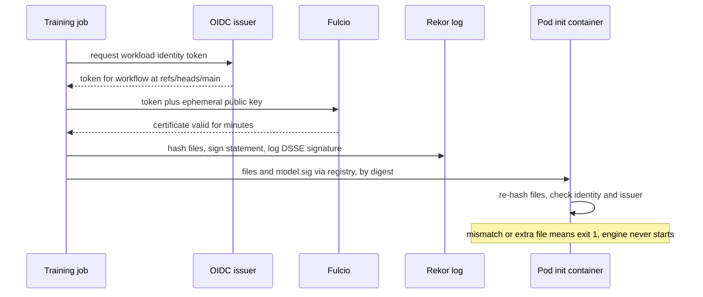

# ML Supply Chain Security

> **Version anchor (2026-10-18).** model-transparency (OpenSSF Model Signing) v1.1.1
> (2025-10-10), the `model_signing` CLI and library. CycloneDX specification 1.7 (repo tag 1.7.2,
> 2026-09-17). LiteLLM v1.106.0 (2026-10-18), which disables stdio MCP servers by default
> (#44066). Kubernetes 1.37 (1.37.1 on 2026-09-15); the OCI image volume source has been GA
> since 1.36. Scanner, PyTorch, cosign and Kyverno versions in §11 were read from their GitHub
> release pages on 2026-10-18. Every version claim below is checked against this anchor.

An AI feature runs on bytes that nobody on the team wrote: base weights from a hub, adapters from
a fine-tuning job, a dataset scraped two years ago, a Python dependency tree with 300 packages,
and MCP servers that a different team ships. This page covers how those bytes get attacked and
the controls that answer four questions for each one: does loading it run code, is it the exact
artifact we approved, who produced it and from what, and does it behave the way its owner claims.

---

## 1. Concept Overview

The ML supply chain is every input that reaches a served model: base weights, adapters,
tokenizer and config files, datasets and labels, training code and containers, the Python
dependency tree, eval sets, and the tool and MCP servers an agent calls. Classic software supply
chain security (SBOMs, signed images, SLSA, admission control) applies to all of it, but ML
artifacts break three of its assumptions.

| Assumption in software supply chain | Where ML breaks it |
|---|---|
| Artifacts are reviewable source plus a build | Weights are 16 to 800 GB of floats; nobody can diff a backdoor out of them |
| Loading an artifact is passive | `torch.load` on a pickle checkpoint, a Keras `Lambda` layer and `trust_remote_code=True` all run code at load |
| Inputs are code and packages | Training data is an input, and poisoning it changes behavior with no code change |

Four properties, each answered by a different control:

| Property | Question | Control |
|---|---|---|
| Safe to load | Does opening the file execute anything? | Data-only formats (safetensors, GGUF, ONNX), conversion in a sandbox, scanners as a backstop |
| Integrity | Are these the exact bytes that were approved? | Per-file digests, signatures (OpenSSF Model Signing, cosign), digest-pinned references |
| Provenance | Who produced it, with which code, data and base? | SLSA provenance as in-toto attestations, ML-BOM (CycloneDX, SPDX 3 AI and Dataset profiles) |
| Behavior | Does it do only what it claims? | Behavioral evals, trigger probes, red-teaming; no static check proves this |

The first three are mechanical and can be enforced by a pipeline. The fourth cannot. A signed,
provenance-attested safetensors file can still carry a backdoor that its legitimate producer
trained in, or that a poisoned dataset put there. Signing moves trust from one party to another;
it does not create trust.

**Not here.** Prompt injection, jailbreaks, data leakage and the OWASP LLM Top 10 live in
[LLM Security](../../llm/llm_security/llm_security.md). Generic DevSecOps (SAST, DAST, SCA,
container scanning, cosign and Rekor basics, SLSA levels for application builds, admission
controllers) lives in
[DevSecOps and Supply Chain Security](../../devops/devsecops_and_supply_chain_security/devsecops_and_supply_chain_security.md),
with the worked pipeline in
[Supply Chain Security Pipeline](../../devops/case_studies/cross_cutting/supply_chain_security_pipeline.md)
and regulated-industry evidence in
[Regulated Supply Chain](../../devops/devsecops_and_supply_chain_security/regulated_supply_chain.md).
Python packaging attacks and defenses (hash pinning, trusted publishing, PEP 740) live in
[Supply Chain and Publishing](../../python/packaging_and_project_tooling/supply_chain_and_publishing.md).
MCP protocol-level threats (tool poisoning, confused deputy, token passthrough) live in
[MCP Security](../../llm/mcp_model_context_protocol/mcp_security.md). Evasion and adversarial
examples live in
[Adversarial ML and Robustness](../../ml/adversarial_ml_and_robustness/adversarial_ml_and_robustness.md).
Registry semantics and on-disk formats live in
[Model Registry and Packaging](../model_registry_and_packaging/model_registry_and_packaging.md),
and listing digests for tool servers live in
[Agent Tool and MCP Server Lifecycle](../agent_tool_and_mcp_server_lifecycle/agent_tool_and_mcp_server_lifecycle.md).

---

## 2. Intuition

**One-line analogy.** A tamper band proves nobody opened the jar after the factory sealed it,
not that the ingredients were clean. Signatures are the tamper band, provenance is the factory
record, safe formats stop a jar built to explode when opened, and evals taste the contents.

**Mental model.** The path from producer to GPU is a chain of hand-offs: hub, ingest job,
training job, registry, object store, node cache, serving pod. At each hand-off, compare digests
against a signed manifest. At each load, refuse formats that execute code. At each name lookup,
resolve to an immutable id once and record it.

**Why it matters.** A model loader runs in one of the most privileged processes on the platform:
GPU nodes, credentials for the model bucket, often a service account that reads training data.
A pickle payload in a checkpoint gets all of that, and JFrog found about 100 such models on
Hugging Face in February 2024.

**Key insight.** Verify at the boundary you control, against an identity you chose. A green
"signed" badge, a "safe" scanner result or a famous org name on a hub are claims made by
someone else. Your pipeline should turn them into one record you own: this digest, signed by
this identity, built from these inputs, approved by this person.

---

## 3. Core Principles

1. **Loading must not execute code.** Accept safetensors, GGUF and ONNX for weights. Treat
   pickle (`.bin`, `.pt`, `.pth`, `.ckpt`, `.pkl`, joblib) as code: convert it once in a
   sandbox with no network and no credentials, then never load the original again.
2. **Pin by content, not by name.** Hub names, `main` branches and OCI tags move. Resolve them
   once to a commit SHA or `sha256:` digest, mirror the bytes, and reference only the digest.
3. **Sign where the artifact is made, verify where it is used.** The training job signs with a
   workload identity; the registry and the node cache verify before the server reads a byte.
4. **Verification names the expected signer.** Anyone can get a Sigstore certificate, so the
   verifier checks a specific identity and issuer, such as one CI workflow on one branch.
5. **Record provenance as data.** Base model, dataset, code, container and builder go into a
   signed in-toto statement by digest, so a policy can evaluate them.
6. **Scanners are a backstop.** A scanner result decides "quarantine for review", never "safe
   to load"; denylists miss new gadgets and malformed files.
7. **Behavior is tested, not proven.** Run behavioral evals and trigger probes on every
   third-party model and every fine-tune on data you did not fully control.

---

## 4. Types / Architectures / Strategies

### 4.1 Attack classes

| Class | Mechanism | Real case | Primary control |
|---|---|---|---|
| Load-time code execution | Pickle `__reduce__` calls `os.system` during `torch.load` | JFrog, about 100 Hugging Face models (Feb 2024) | Data-only formats, sandboxed conversion |
| Scanner evasion | Broken pickle stream or unusual compression hides the payload from scanners | ReversingLabs "nullifAI" (Feb 2025) | Allowlist parsing, sandbox, no pickle in prod |
| Remote code in repo | `trust_remote_code=True` imports `modeling_*.py` from the repo | Any repo with custom architecture code | Review code, vendor it, pin revision |
| Namespace reuse and typosquat | Deleted org re-registered, or a near-identical org name | Unit 42 namespace reuse (Sep 2025), PoisonGPT "EleuterAI" (Jul 2023) | Pin commit SHA, mirror internally |
| Tampering after approval | Write access to a bucket or registry swaps weights | Insider or leaked storage credentials | Signature verify at load, immutable storage |
| Backdoored weights | Trigger phrase produces attacker-chosen output | PoisonGPT edited GPT-J with ROME; Anthropic sleeper agents (Jan 2024) | Behavioral evals, provenance, trusted base |
| Data poisoning | Poisoned samples in training data | 250 documents backdoored models from 600M to 13B (Anthropic and UK AISI, Oct 2025) | Snapshot data by hash, source allowlist |
| Dependency compromise | Malicious release of a package the stack imports | LiteLLM 1.82.7 and 1.82.8 (Mar 2026), Ultralytics (Dec 2024), torchtriton (Dec 2022) | Hash-locked installs, cooldown, pinned images |
| Tool server rug pull | A later version of an MCP server adds hidden behavior | postmark-mcp 1.0.16 BCC backdoor (Sep 2025) | Pin version and digest, build from source |

### 4.2 Weight formats by load-time risk

| Format | Executes code at load? | Notes |
|---|---|---|
| Pickle (`pytorch_model.bin`, `.pt`, `.ckpt`, joblib) | Yes, by design | `torch.load` defaults to `weights_only=True` since PyTorch 2.6 (2025-01-29); CVE-2025-32434 bypassed it in versions below 2.6.0 |
| safetensors | No | JSON header plus raw tensor bytes; header size capped; no checksum of its own, so integrity needs an external digest |
| GGUF | No | Data-only, but parsed by C and C++ loaders; keep the runtime patched |
| ONNX | No code; custom ops can load native libraries the runtime is told to load | Register only reviewed custom-op libraries |
| Keras `.keras` | `Lambda` layers can; `safe_mode=True` blocks them | CVE-2024-3660 (fixed 2.13.1), CVE-2025-1550 safe_mode bypass (fixed 3.9.0) |
| TensorFlow SavedModel | Graph ops can read and write files | Treat third-party SavedModels like code |
| Repo Python files | Yes, with `trust_remote_code=True` | Not a weight format, but loaded by the same call |

### 4.3 Model scanners

| Scanner | Approach | Gap |
|---|---|---|
| Hugging Face Hub | ClamAV on files under 2 GB, plus a pickle import scan that lists imports per file and highlights suspicious ones; partner scanners shown on model pages | Hub docs say the import lists are best-effort and "not 100% foolproof" |
| picklescan | Walks pickle opcodes, flags `GLOBAL` imports on a denylist | Denylist; CVE-2025-10155 (extension mismatch, fixed 0.0.31); missed nullifAI's broken streams until patched |
| ModelScan (Protect AI) | Scans pickle, H5, SavedModel, Keras for unsafe operators | Same denylist limit; does not judge weights' behavior |
| fickling (Trail of Bits) | Decompiles pickle to Python AST and analyzes it | Analysis, not a sandbox |

A denylist knows only reported gadgets. `weights_only=True` is an allowlist (every `GLOBAL` must
be in a short list such as `torch._utils._rebuild_tensor_v2`), stronger but still in-process.

### 4.4 Signing methods in OpenSSF Model Signing

The `model_signing` tool hashes every file in a model directory, writes the `(path, digest)`
pairs as subjects of an in-toto statement with predicate type
`https://model_signing/signature/v1.0`, wraps it in a DSSE envelope, and stores the result as a
Sigstore bundle (`model.sig` by default).

| Method | CLI | Identity proven | Fits |
|---|---|---|---|
| Sigstore keyless | `model_signing sign sigstore` (default) | OIDC identity in a short-lived Fulcio certificate; entry in the Rekor log | CI and training jobs with workload identity (GitHub Actions, GitLab CI, GCP service accounts, Buildkite) |
| Private key | `model_signing sign key --private_key` | Holder of an EC key | Air-gapped sites, simple internal setups |
| Certificate | `model_signing sign certificate` | Key plus an X.509 chain from your CA | Enterprises with an existing PKI |
| PKCS #11 | `model_signing sign pkcs11-key` or `pkcs11-certificate` | Key held in an HSM or token (NIST P-256/384/521) | Regulated environments that require HSM-held keys |

Private Sigstore instances (own Fulcio and Rekor) are configured with `--trust_config`.

### 4.5 Provenance and bills of materials

| Artifact | What it records | Format |
|---|---|---|
| Signature | These files, these digests, signed by this identity | OMS bundle, cosign signature |
| Build provenance | Builder id, inputs (code commit, base model digest, dataset digest, container digest), parameters, timestamps | SLSA provenance v1 predicate in an in-toto statement |
| ML-BOM | Model components, datasets, licenses, model card fields, dependencies | CycloneDX 1.7 (`machine-learning-model`, `data`, `modelCard`), SPDX 3 AI and Dataset profiles |
| Model card | Intended use, limits, eval results | Markdown, or CycloneDX `modelCard` |

SLSA's specification is at v1.2 (status Approved on slsa.dev) with a Build track and a Source
track. Build L1 means provenance exists, L2 means a hosted build platform generates and signs it,
L3 means the platform isolates runs and keeps signing material out of reach of user-defined steps,
so a tenant cannot forge the provenance. For training, that means the trainer controller, not the
training script, produces and signs the statement.

---

## 5. Architecture Diagrams

### Intake and release path with verification points

```mermaid
flowchart LR
    classDef io      fill:#61afef,stroke:#2e86c1,color:#1a1a1a,font-weight:bold
    classDef frozen  fill:#c678dd,stroke:#9b59b6,color:#fff
    classDef train   fill:#98c379,stroke:#27ae60,color:#1a1a1a
    classDef mathOp  fill:#d19a66,stroke:#e67e22,color:#1a1a1a,font-weight:bold
    classDef lossN   fill:#e06c75,stroke:#c0392b,color:#fff,font-weight:bold
    classDef req     fill:#56b6c2,stroke:#0097a7,color:#1a1a1a
    classDef base    fill:#e5c07b,stroke:#f39c12,color:#1a1a1a

    hub@{ icon: "logos:hugging-face-icon", form: "square", label: "Hub repo<br/>pinned commit", pos: "b", h: 44 }
    hub --> ingest("Ingest job<br/>safetensors only")
    ingest --> sandbox("Convert sandbox<br/>no network")
    ingest --> scan("Scanners<br/>quarantine only")
    sandbox --> evals("Behavior evals<br/>trigger probes")
    scan --> evals
    evals --> train("Training job<br/>workload identity")
    train --> sign@{ icon: "logos:sigstore-icon", form: "square", label: "Sign files<br/>plus provenance", pos: "b", h: 44 }
    sign --> reg("Registry<br/>verify on promote")
    reg --> k8s@{ icon: "logos:kubernetes", form: "square", label: "Admission<br/>digest refs only", pos: "b", h: 44 }
    k8s --> verify("Init container<br/>verify identity")
    verify --> serve("Serving engine<br/>loads bytes")
    verify -.->|"mismatch"| bad("Pod fails<br/>to start")

    class ingest,sandbox mathOp
    class scan,evals req
    class train train
    class reg base
    class verify frozen
    class serve io
    class bad lossN
```



The ingest job is the only place a hub name is resolved. Everything to the right of it moves by
digest, and the last check before the engine reads a byte is a signature verification against a
named CI identity, not a scanner result.

### Why a broken pickle beats a scanner that validates first

```
pickle stream    | PROTO | GLOBAL os.system | args | REDUCE | ...junk, invalid opcode... |
                 +-------+------------------+------+--------+----------------------------+
unpickler        reads opcode by opcode ------------> REDUCE runs os.system(args)
                                                       payload has executed
                                                                  then the bad opcode raises
                                                                  an error, too late

scanner (2025)   parse whole stream first ----------------------> parse error on bad opcode
                 reports "scan error", lists no dangerous import, file not flagged
```

ReversingLabs' nullifAI models put the payload at the start of the stream and broke the stream
after it, and used 7z instead of PyTorch's ZIP container. The unpickler executes sequentially, so
the payload ran; picklescan validated first, failed on the corruption, and flagged nothing until
Hugging Face patched it.

### Which control catches which threat

```
                                 data-only  pinned    scanner  signature  SLSA     behavior
                                 format     commit             verify     prov.    evals
pickle payload in checkpoint        ✓         .          ~         .         .        .
nullifAI style broken pickle        ✓         .          ✗         .         .        .
trust_remote_code module            .         ~          .         .         .        .
namespace reuse / typosquat         .         ✓          .         ~         .        .
weights swapped in bucket           .         .          .         ✓         .        .
backdoor trained by producer        .         .          .         .         ~        ~
poisoned training data              .         .          .         .         ~        ~
compromised pip dependency          .         .          .         .         ~        .
MCP server rug pull (code)          .         ✓          .         ✓         ~        ~

✓ blocks it    ~ helps or narrows it    ✗ known bypass    . does not apply
```

Read the grid by row. Remote code is caught only by human review of the pinned `.py` files, and
backdoors and poisoning have no column with a check mark, which is why the behavior column and a
trusted producer stay in the design even after signing is complete.

### Keyless signing in CI and verification at load



The ephemeral key exists only for the signing call, so there is no long-lived key to leak. The
security of the scheme moves to the identity check in the last step: if the verifier accepts any
identity, an attacker with their own GitHub account produces a valid signature.

---

## 6. How It Works - Detailed Mechanics

### 6.1 Importing a hub model: broken, then fixed

The common first version:

```python
from transformers import AutoModelForCausalLM

model = AutoModelForCausalLM.from_pretrained(
    "acme-labs/fin-7b",
    trust_remote_code=True,
)
```

Four problems. The name resolves to whatever `main` points at today, and to a stranger's upload
if the org is deleted and re-registered. `trust_remote_code=True` imports Python from the repo.
If the repo has only `pytorch_model.bin`, the loader unpickles it. And nothing records which bytes
were loaded.

The ingest job that replaces it runs once per approved revision, in an isolated namespace, and is
the only code allowed to talk to the hub:

```python
import hashlib
import json
import pathlib
import struct

from huggingface_hub import HfApi, snapshot_download

REPO = "acme-labs/fin-7b"
REV = "3f1c2a9e5b7d4c0e8a6f1b2c3d4e5f6a7b8c9d0e"
ALLOW = ["*.safetensors", "*.json", "tokenizer.model", "LICENSE*", "README.md"]
PICKLE = (".bin", ".pt", ".pth", ".ckpt", ".pkl")
MAX_HEADER = 100_000_000

info = HfApi().model_info(REPO, revision=REV, files_metadata=True)
names = {s.rfilename for s in info.siblings}
if not any(n.endswith(".safetensors") for n in names):
    raise SystemExit("no safetensors: route to the conversion sandbox")
if any(n.endswith(".py") for n in names):
    raise SystemExit("repo ships Python: needs code review before import")

out = pathlib.Path(f"/ingest/{REPO.replace('/', '__')}/{REV}")
snapshot_download(REPO, revision=REV, allow_patterns=ALLOW, local_dir=out)

expected = {s.rfilename: s.lfs.sha256 for s in info.siblings if s.lfs}
manifest = {}
for f in sorted(out.rglob("*")):
    if not f.is_file() or ".cache" in f.parts:
        continue
    rel = str(f.relative_to(out))
    h = hashlib.sha256()
    with f.open("rb") as fh:
        for chunk in iter(lambda: fh.read(1 << 24), b""):
            h.update(chunk)
    digest = h.hexdigest()
    if rel in expected and expected[rel] != digest:
        raise SystemExit(f"{rel}: hub LFS digest mismatch")
    if rel.endswith(".safetensors"):
        with f.open("rb") as fh:
            (n,) = struct.unpack("<Q", fh.read(8))
            if n > MAX_HEADER:
                raise SystemExit(f"{rel}: header {n} bytes")
            json.loads(fh.read(n))
    manifest[rel] = digest

(out.parent / f"{REV}.manifest.json").write_text(json.dumps(manifest, indent=1))
```

The 40-character `REV` closes namespace reuse and silent `main` updates. `allow_patterns` never
downloads pickle or `.py` files. The LFS digest check catches a mirror that serves different
bytes than the hub's index, and the header check rejects a malformed safetensors file. `local_dir`
writes real files; the default cache uses symlinks, which `model_signing` refuses unless
`--allow_symlinks` is passed. The files are then copied to the internal store, signed by the
ingest workflow's identity and registered. Production never resolves `acme-labs/fin-7b` again.

### 6.2 Converting a pickle checkpoint

Some models exist only as pickle, and older internal checkpoints are often `.pt` files. Convert
each once:

```python
import torch
from safetensors.torch import save_file

assert tuple(int(x) for x in torch.__version__.split(".")[:2]) >= (2, 6)

state = torch.load("/in/pytorch_model.bin", map_location="cpu", weights_only=True)
tensors = {k: v.contiguous().clone() for k, v in state.items() if isinstance(v, torch.Tensor)}
save_file(tensors, "/out/model.safetensors", metadata={"source_sha256": "9b1e..."})
```

Run it in a pod with a deny-all egress NetworkPolicy, no service account token, a read-only
input volume and no cloud credentials. The version assertion matters because CVE-2025-32434
achieved code execution through `torch.load(weights_only=True)` below PyTorch 2.6.0. `.clone()`
breaks shared storage between tied weights, which `save_file` rejects. If the
load fails with "Weights only load failed", the file references a global outside the allowlist;
that is the case to inspect with fickling, not a reason to set `weights_only=False`.

### 6.3 Signing in the training pipeline

Sign in the same job that produced the files, with the job's workload identity:

```yaml
jobs:
  publish-model:
    runs-on: [self-hosted, gpu-export]
    permissions:
      id-token: write
      contents: read
    steps:
      - run: pip install --require-hashes -r requirements-sign.txt
      - run: |
          model_signing sign sigstore ./out/fin-7b-sft \
            --use_ambient_credentials \
            --signature ./out/fin-7b-sft.sig
      - run: |
          model_signing verify sigstore ./out/fin-7b-sft \
            --signature ./out/fin-7b-sft.sig \
            --identity "https://github.com/acme/ml-train/.github/workflows/publish.yml@refs/heads/main" \
            --identity_provider "https://token.actions.githubusercontent.com"
```

`requirements-sign.txt` pins `model-signing==1.1.1` with hashes. The verify step in the same job
catches a misconfigured identity before the artifact leaves. The CLI flags in v1.1.1 use
underscores (`--identity_provider`, `--trust_config`); the README on `main` shows hyphenated
forms from later work, so match the docs to the version you pinned.

Hashing cost is real for large models. `model_signing` hashes files in parallel with SHA-256 by
default; the library's hashing config can also shard files into 1 GB pieces or switch to BLAKE3,
which the v1.1.1 CLI does not expose. Assuming about 1.5 GB/s per core for SHA-256, a 140 GB 70B BF16 checkpoint takes about 93 seconds on one core and about 12 seconds
across 8 cores if storage can deliver 12 GB/s. The verify side pays the same cost, which is why
§6.5 verifies once per node cache fill and not on every pod start.

### 6.4 What a verification checks

The verifier checks the Sigstore bundle (certificate chain to Fulcio's root, Rekor inclusion
proof, subject and issuer against `--identity` and `--identity_provider`), then the DSSE
signature over the in-toto statement, then re-hashes the directory against the subjects. Two
defaults matter in v1.1.1. Git paths are ignored on both sides (`--ignore-git-paths` is on).
Files present on disk but absent from the signed manifest fail verification unless
`--ignore_unsigned_files` is passed. Leave that flag off for model directories: an extra
`tokenizer_config.json` with a different chat template, or a dropped `.py` file, is exactly the
change you want to fail. The signature file itself is ignored automatically.

### 6.5 Verifying at the cluster

Kubernetes admission sees container images and, since image volumes went GA in 1.36, OCI
references for model volumes. Two policies and one init container cover the path.

First, every model volume must reference the internal registry by digest:

```yaml
apiVersion: admissionregistration.k8s.io/v1
kind: ValidatingAdmissionPolicy
metadata:
  name: model-volumes-by-digest
spec:
  failurePolicy: Fail
  matchConstraints:
    resourceRules:
      - apiGroups: [""]
        apiVersions: ["v1"]
        operations: ["CREATE", "UPDATE"]
        resources: ["pods"]
  validations:
    - expression: >-
        !has(object.spec.volumes) || object.spec.volumes.all(v,
          !has(v.image) ||
          (v.image.reference.startsWith('registry.internal/models/') &&
           v.image.reference.contains('@sha256:')))
      message: "model image volumes must come from registry.internal/models and use a digest"
```

A `ValidatingAdmissionPolicyBinding` with `validationActions: ["Deny"]` scopes it to the
inference namespaces. Second, the serving engine image and every MCP server image must be
signed by the platform's release workflow. Kyverno's `ImageValidatingPolicy` does this for
containers (the legacy `ClusterPolicy` with `verifyImages` is deprecated in Kyverno 1.19):

```yaml
apiVersion: policies.kyverno.io/v1
kind: ImageValidatingPolicy
metadata:
  name: signed-serving-and-tool-images
spec:
  validationActions: [Deny]
  failurePolicy: Fail
  matchConstraints:
    resourceRules:
      - apiGroups: [""]
        apiVersions: ["v1"]
        operations: ["CREATE", "UPDATE"]
        resources: ["pods"]
    namespaceSelector:
      matchExpressions:
        - key: kubernetes.io/metadata.name
          operator: In
          values: ["inference", "mcp-servers"]
  matchImageReferences:
    - glob: "registry.internal/serving/*"
    - glob: "registry.internal/mcp/*"
  validationConfigurations:
    mutateDigest: true
  attestors:
    - name: release
      cosign:
        keyless:
          identities:
            - subject: "https://github.com/acme/platform-release/.github/workflows/release.yml@refs/heads/main"
              issuer: "https://token.actions.githubusercontent.com"
        ctlog:
          url: https://rekor.sigstore.dev
  validations:
    - expression: >-
        images.containers.map(image, verifyImageSignatures(image, [attestors.release])).all(e, e > 0)
      message: "serving and MCP images must be signed by the release workflow"
```

Third, the model signature. Admission policies verify container signatures in the cosign
format; an OMS bundle over a directory is verified by `model_signing`. Run it as an init
container over the mounted model volume, so the engine container never starts on bad bytes:

```yaml
initContainers:
  - name: verify-model
    image: registry.internal/tools/model-signing@sha256:4c1d...
    args:
      - verify
      - sigstore
      - /models/fin-7b-sft
      - --signature=/models/fin-7b-sft.sig
      - --identity=https://github.com/acme/ml-train/.github/workflows/publish.yml@refs/heads/main
      - --identity_provider=https://token.actions.githubusercontent.com
    volumeMounts:
      - name: model
        mountPath: /models
        readOnly: true
```

A per-pod verify adds the §6.3 hashing time to every cold start. The usual compromise: verify
once when a node's cache is filled, write a marker keyed by the OCI manifest digest, and have
the init container check the marker and re-hash only config, tokenizer and chat template. The
runtime checks layer digests on pull, so the residual risk is a process with write access to
the node's image store. Cold-start tradeoffs are covered in
[Model Storage, Loading and Cold Start](../model_storage_loading_and_cold_start/model_storage_loading_and_cold_start.md).

### 6.6 SLSA provenance for a training run

A signature says who published the files. Provenance says how they were made. Emit one in-toto
statement per training run, signed by the training platform's identity, not by the user's code:

```json
{
  "_type": "https://in-toto.io/Statement/v1",
  "subject": [
    {"name": "model-00001-of-00004.safetensors", "digest": {"sha256": "9b1e4f..."}},
    {"name": "tokenizer.json", "digest": {"sha256": "51c0aa..."}}
  ],
  "predicateType": "https://slsa.dev/provenance/v1",
  "predicate": {
    "buildDefinition": {
      "buildType": "https://train.acme.internal/sft-job/v2",
      "externalParameters": {"recipe": "git+https://git.acme.internal/ml/fin-7b@refs/tags/r42"},
      "internalParameters": {"nodes": 8, "gpusPerNode": 8, "seed": 1234},
      "resolvedDependencies": [
        {"uri": "git+https://git.acme.internal/ml/fin-7b", "digest": {"gitCommit": "a1b2c3..."}},
        {"uri": "oci://registry.internal/train/torch-2.14", "digest": {"sha256": "77de01..."}},
        {"uri": "oci://registry.internal/models/acme-labs-fin-7b", "digest": {"sha256": "3e9f12..."}},
        {"uri": "lakefs://datasets/fin-sft/7c9e1d", "digest": {"sha256": "c4a8b0..."}}
      ]
    },
    "runDetails": {
      "builder": {"id": "https://train.acme.internal/controller/v3"},
      "metadata": {"invocationId": "job-58213", "finishedOn": "2026-10-12T19:44:00Z"}
    }
  }
}
```

A promotion rule reads the `resolvedDependencies` digests: base model in the approved-bases
list, dataset with a data-review record, builder id equal to the production trainer. The
trainer controller writes and signs the statement from what it launched, so a training script
cannot claim a different base or dataset. Dataset snapshot ids come from
[Dataset and Label Versioning](../dataset_and_label_versioning/dataset_and_label_versioning.md);
the release bundle that pins this model next to its prompts and tools is defined in
[Artifact Versioning and Lineage](../artifact_versioning_and_lineage/artifact_versioning_and_lineage.md)
and worked through in
[AI Release Bundle and Lineage](../case_studies/cross_cutting/ai_release_bundle_and_lineage.md).

### 6.7 ML-BOM with CycloneDX 1.7

CycloneDX has carried ML component types since 1.5. In 1.7 a component's `type` can be
`machine-learning-model` or `data`, and a model component carries a `modelCard` with
`modelParameters` (`approach`, `task`, `architectureFamily`, `modelArchitecture`, `datasets`,
`inputs`, `outputs`), `quantitativeAnalysis` and `considerations`.

```json
{
  "bomFormat": "CycloneDX", "specVersion": "1.7",
  "components": [
    {"type": "machine-learning-model", "bom-ref": "model-fin-7b-sft",
     "name": "fin-7b-sft", "version": "r42",
     "hashes": [{"alg": "SHA-256", "content": "3e9f12..."}],
     "modelCard": {
       "modelParameters": {"approach": {"type": "supervised"}, "task": "text-generation",
                           "architectureFamily": "llama", "datasets": [{"ref": "data-fin-sft"}]},
       "considerations": {"technicalLimitations": ["English only", "not for credit decisions"]}}},
    {"type": "data", "bom-ref": "data-fin-sft", "name": "fin-sft", "version": "7c9e1d",
     "data": [{"type": "dataset", "name": "fin-sft", "classification": "internal"}]}
  ],
  "dependencies": [{"ref": "model-fin-7b-sft", "dependsOn": ["data-fin-sft"]}]
}
```

SPDX 3 covers the same ground with an AI profile (`AIPackage`: `typeOfModel`,
`informationAboutTraining`, `safetyRiskAssessment`, energy consumption) and a Dataset profile
(`DatasetPackage`: `dataCollectionProcess`, `knownBias`, `hasSensitivePersonalInformation`).
Pick the format your SBOM tooling already consumes; governance use is covered in
[AI Governance and Model Risk Operations](../ai_governance_and_model_risk_operations/ai_governance_and_model_risk_operations.md).

### 6.8 The Python dependency tree around the model

Training images hold data credentials and gateways hold every provider API key, so their Python
dependencies are high-value targets. Malicious `litellm==1.82.7` and `1.82.8` were uploaded
straight to PyPI on 2026-03-24 from 10:39 UTC, bypassing the project's CI; LiteLLM's post says
the credentials likely came from the compromised Trivy dependency in its CI scanning. 1.82.8
added `litellm_init.pth` to site-packages. Python executes `import` lines in `.pth` files at interpreter startup, so
the payload ran in every Python process in that environment, not only on `import litellm`, and
posted environment variables, SSH keys, cloud credentials and Kubernetes tokens to
`models.litellm.cloud`. The official proxy image `ghcr.io/berriai/litellm` pins its
dependencies and was not affected.

The controls are in
[Supply Chain and Publishing](../../python/packaging_and_project_tooling/supply_chain_and_publishing.md):
hash-locked installs, a release cooldown, images built once and promoted by digest, and secret
rotation on any host that installed an affected version. Gateway operations are covered in
[AI Gateway Operations](../ai_gateway_operations/ai_gateway_operations.md).

### 6.9 Tool and MCP servers

An MCP server is code an agent runs with the agent's credentials. The listing digest catches
description changes and is covered in
[Agent Tool and MCP Server Lifecycle](../agent_tool_and_mcp_server_lifecycle/agent_tool_and_mcp_server_lifecycle.md).
postmark-mcp 1.0.16 kept its listing and added a hidden BCC to `phan@giftshop.club` inside the
`sendEmail` handler, so only a version pin plus a reviewed diff on each bump stops that.

Build each server from a pinned source commit in your CI, sign the image, and run it from
`registry.internal/mcp/` under the Kyverno policy in §6.5. Do not let agent configs launch
stdio servers, which run a binary on the host: LiteLLM v1.106.0 disables stdio MCP servers by
default (#44066). Earlier, GHSA-v4p8-mg3p-g94g (April 2026, fixed in 1.83.7) reported
authenticated command execution through its MCP stdio test endpoints. Scope each server's credentials to its tools.

### 6.10 Screening for backdoors

No scanner proves a model is clean. What a pipeline can do:

| Check | Catches | Misses |
|---|---|---|
| Behavioral eval on held-out tasks | Gross degradation, swapped model | Triggered backdoors that stay dormant |
| Trigger probes (known trigger families, rare tokens, dates, code markers) | Published trigger styles | Novel triggers |
| Weight delta against the declared base | A "fine-tune" whose delta concentrates in a few layers, as a ROME edit does | Backdoors spread across a full fine-tune |
| Provenance check on the producer | Models from unknown or re-registered orgs | Backdoors trained in by a legitimate producer |
| Red-team on the deployed task | Task-specific harmful behavior | Anything outside the tested distribution |

Anthropic's sleeper agents (January 2024) wrote secure code when the prompt said 2023 and
inserted vulnerabilities when it said 2024, through supervised fine-tuning, RL and adversarial
training. Test third-party weights on your tasks with the gates in
[Evaluation Gates and Eval Sets](../evaluation_gates_and_eval_sets/evaluation_gates_and_eval_sets.md).

---

## 7. Real-World Examples

**JFrog, malicious Hugging Face models (February 27, 2024).** About 100 models carried pickle
payloads; the incident and the pickle mechanism are covered in
[LLM Security](../../llm/llm_security/llm_security.md).

**ReversingLabs, nullifAI (February 6, 2025).** Two reverse-shell models, mechanics in §5.
Hugging Face removed them within 24 hours of the January 20 report and changed picklescan to
detect threats in broken files.

**PoisonGPT, Mithril Security (July 2023).** Researchers edited GPT-J-6B with ROME so it gave one
false fact while scoring normally on benchmarks, and uploaded it under `EleuterAI`, one letter
from EleutherAI. The point was that benchmark scores and an org name are not provenance.

**Unit 42, model namespace reuse (September 3, 2025).** A deleted Hugging Face author's
namespace can be re-registered and the old model path recreated. Unit 42 did this for models
listed in Vertex AI Model Garden and Azure AI Foundry and got a reverse shell from the deployment
endpoint on both. Google began daily scans that mark orphaned models "verification
unsuccessful". The fix is the `revision` pin plus an internal mirror.

**LiteLLM PyPI compromise (March 24, 2026).** Mechanics in §6.8. PyPI quarantined the
releases after about 40 minutes. A clean v1.83.0 shipped on March 30 through a rebuilt CI
pipeline, and Docker images have been cosign-signed since v1.83.0-nightly.

**postmark-mcp on npm (September 2025).** Releases up to 1.0.15 were clean; 1.0.16 (September 17)
added a BCC of every outgoing email to an outside address. Postmark said it did not develop or
publish the package. Clients that floated on the latest version installed it on their next
restart.

**Ultralytics and torchtriton.** Ultralytics 8.3.41, 8.3.42, 8.3.45 and 8.3.46 (December 2024)
carried an XMRig miner; the CI attack path is in
[Supply Chain and Publishing](../../python/packaging_and_project_tooling/supply_chain_and_publishing.md).
In December 2022 a `torchtriton` package on PyPI shadowed the one on PyTorch's nightly index and sent SSH keys
out over DNS; PyTorch renamed the dependency to `pytorch-triton`. Both sit inside many training
images.

**Poisoning at scale.** Carlini and co-authors (2023) showed split-view poisoning: LAION-400M
and COYO-700M are URL lists, and buying expired domains for about $60 would have controlled
0.01% of either. Anthropic, the UK AI Security Institute and the Alan Turing Institute (October
2025) found about 250 poisoned documents backdoored models from 600M to 13B parameters.

---

## 8. Tradeoffs

### Signing methods

| Dimension | Sigstore keyless | Private key | Certificate or PKCS #11 |
|---|---|---|---|
| Key management | None; ephemeral keys | You store and rotate a key | Your PKI or HSM |
| Identity in the signature | OIDC subject (workflow path, email, service account) | Key id only | Certificate subject |
| Public transparency log | Yes, public Rekor by default; private Rekor with `--trust_config` | No | No |
| Offline or air-gapped | Needs Fulcio and Rekor reachable, or a private instance | Yes | Yes |
| Revocation story | Short-lived certs; monitor the log for your identity | Rotate key, re-sign | CRL or OCSP from your CA |
| Typical fit | CI and training platforms | Small internal setups | Banks, defense, regulated sites |

Keyless signing writes the signing identity and the artifact digest to a public log. For a model
whose name or existence is confidential, run a private Sigstore or use certificates.

### Where to verify

| Point | Cost | What it catches | What it misses |
|---|---|---|---|
| Registry on promote | Once per version | Wrong signer, tampering before promote | Tampering in storage after promote |
| Node cache fill | Once per node per version | Storage or transit tampering | A process on the node that edits the cache |
| Pod init container, full re-hash | Every cold start, 10 to 90 s at 140 GB | Everything above | Nothing extra beyond node cache plus small-file check, at much higher cost |
| Engine load, small files only | Under 1 s | Config, tokenizer or template swaps | Large-file tampering, if not verified upstream |

---

## 9. When to Use / When NOT to Use

**Use the full chain (mirror, convert, sign, provenance, admission, init verify)** when hub
models reach production or a cluster with customer data, when customers upload adapters or
fine-tuning data (see
[LoRA Adapter Serving and Lifecycle](../lora_adapter_serving_and_lifecycle/lora_adapter_serving_and_lifecycle.md)),
when a regulator asks which model and data produced a decision, and when agents call MCP
servers that other teams or vendors ship.

**Use a lighter version** on a research cluster with no production credentials: pin revisions
and refuse pickle, skip signing and admission. For a model consumed only through a provider
API you cannot sign the weights; pin the model version string and track changes as vendor risk.

**Do not** treat a clean scan as approval, sign in a step any pull request can trigger, verify
a keyless signature without pinning `--identity` and `--identity_provider`, or add
`--ignore_unsigned_files` to make a verify pass.

---

## 10. Common Pitfalls

**The re-registered org.** A notebook template loaded `some-org/sentiment-base` by name. The
author deleted the account; months later the name came back with a pickle checkpoint, and the
first notebook run on a GPU node sent the training service account's token out. Fix: pin
`revision=`, load only from the internal mirror, and proxy GPU-node egress through an allowlist.

**`weights_only=False` to "fix" a load error.** A legacy checkpoint failed under PyTorch 2.6, and
an engineer set the flag to `False` in the shared loader. Every model through it was unpickled
without restriction for two months. Fix: the loader accepts only safetensors, and a lint rule
fails CI on `weights_only=False`.

**Signing in a job any PR can trigger.** The publish workflow ran on `pull_request` with
`id-token: write`, and verifiers matched the workflow path with a wildcard ref. Any
contributor's branch produced an accepted signature. Fix: sign only on protected branches, pin
the subject to `@refs/heads/main`, and grant `id-token: write` only to that job.

**Chat template swapped after signing.** The weights were signed, but the serving container
fetched `tokenizer_config.json` from the hub at start, and a hub-side template change altered
outputs with no signature failure. Fix: sign the whole directory and block hub egress from
serving pods.

**Adapter signed, base not bound.** Each customer adapter was signed, but the platform rebuilt
the base with a new quantization under the same name. Signatures verified; quality dropped.
Fix: adapter provenance records `base_model_digest`, and the loader refuses a mismatch.

---

## 11. Technologies & Tools

| Tool | Role | Notes |
|---|---|---|
| model-transparency | OpenSSF Model Signing library and CLI | v1.1.1; `model_signing sign` and `verify`; Sigstore, key, certificate, PKCS #11 |
| Sigstore | Keyless signing infrastructure | Fulcio issues short-lived certs, Rekor logs signatures |
| cosign | Container and blob signing | v3.1.3 (2026-08-06); v2.6.5 maintained in parallel |
| Kyverno | Kubernetes policy engine | v1.19.1 (2026-09-10); `ImageValidatingPolicy` with keyless attestors; `ClusterPolicy` deprecated in 1.19 |
| safetensors | Data-only tensor format | v0.8.0 (2026-06-09); v0.9.0 at rc |
| PyTorch | Training and loading | `weights_only=True` default since 2.6.0; v2.14.1 (2026-09-30) |
| picklescan | Pickle opcode scanner | v1.0.5 (2026-07-01) |
| ModelScan | Model file scanner by Protect AI | v0.8.8 (2026-02-18) |
| fickling | Pickle decompiler and analyzer by Trail of Bits | Static analysis of pickle files |
| HuggingFace Hub | Model hosting | ClamAV and pickle import scans; `revision` pins a commit |
| huggingface_hub | Hub client library | `snapshot_download` with `revision`, `allow_patterns`, `local_dir` |
| in-toto | Attestation framework | Statement v1 wraps SLSA provenance and OMS manifests |
| SLSA | Provenance specification | v1.2 approved; Build and Source tracks |
| CycloneDX | SBOM and ML-BOM standard | Specification 1.7; `machine-learning-model` and `data` components |
| SPDX | SBOM standard | 3.0.1 (2024-12-17); AI and Dataset profiles |
| Kubernetes | Admission and image volumes | ValidatingAdmissionPolicy with CEL; image volumes GA since 1.36 |
| LiteLLM | AI gateway | v1.106.0; stdio MCP servers off by default |

---

## 12. Interview Questions with Answers

**Q: The model is in safetensors format, so is it safe to deploy?**
**Short:** It is safe to load, not safe to run: safetensors removes load-time code execution but says nothing about backdoors, swapped tokenizers or remote code.

Safetensors is a JSON header plus raw tensors, so opening it executes nothing. It does not prove
who produced the weights, whether they match what was approved, or how the model behaves; the
same repo can ship a hostile chat template or `.py` files that `trust_remote_code=True` imports.
PoisonGPT was a normal-looking checkpoint with one edited fact. Deploy also needs a pinned
digest, a signature from a known identity and a passing behavioral eval.

**Q: Picklescan reports no findings on a third-party checkpoint. Why not load it directly?**
**Short:** Pickle scanners work from denylists and have known bypasses, so a clean scan lowers risk but never proves a pickle file will not run code.

A pickle file is a program for a stack machine; a scanner reads its `GLOBAL` imports and
compares them to a list of known-dangerous callables. New gadgets are not on the list, and
malformed files can stop the scan before it reaches the payload. nullifAI did that with a stream
broken after the payload, and CVE-2025-10155 bypassed picklescan through an extension mismatch.
Convert the file to safetensors once in a sandbox with no network and no credentials, then load
only the converted file.

**Q: A Sigstore signature on the model verifies. What exactly has been proven?**
**Short:** That these exact files were signed by the identity in the certificate and logged in Rekor; nothing about the producer's honesty or the model's behavior.

Verification proves integrity (the re-hashed files match the signed manifest) and identity (the
Fulcio certificate binds the signature to an OIDC subject, and Rekor shows the event). It does
not prove that identity is one you trust, unless the verifier pinned it, and it does not prove
the training data or code were clean. A legitimate producer can sign a backdoored model. Combine
the signature with provenance about inputs and an eval record about behavior.

**Q: Why must a keyless verification pin `--identity` and `--identity_provider`?**
**Short:** Anyone can obtain a valid Sigstore certificate for their own identity, so a check without a pinned signer accepts an attacker's signature.

Fulcio issues certificates to any authenticated OIDC user or workload. An attacker can sign a
tampered model with their own GitHub account and the cryptography will verify. The trust decision
is the identity match: for example
`https://github.com/acme/ml-train/.github/workflows/publish.yml@refs/heads/main` with issuer
`https://token.actions.githubusercontent.com`. Pin the branch too, or a workflow run from a
feature branch produces an accepted signature.

**Q: What is wrong with loading `org/model` by name from a hub in production?**
**Short:** A name can move or be reclaimed, so production can load different bytes with no deploy; pin a commit SHA and serve from an internal mirror.

`main` changes when the owner pushes, and a deleted org's namespace can be re-registered by
anyone, as Unit 42 showed on Vertex AI and Azure AI Foundry in September 2025. Resolve the name
once to a 40-character `revision`, check LFS digests, mirror, sign, and reference only digests.

**Q: How do you handle a model that needs `trust_remote_code=True`?**
**Short:** Treat the repo's Python files as a code dependency: review them, vendor them into your repo at a pinned commit, and never let the loader fetch them at runtime.

The flag makes `transformers` import `modeling_*.py` and `configuration_*.py` from the model repo
with the process's full permissions. Review them, copy them into an internal package, and load
with `trust_remote_code=False`; check first whether `transformers` supports the architecture
natively. Block the flag in shared loaders with a lint rule.

**Q: Where should model signatures be verified: registry, node, or pod?**
**Short:** At the registry on promotion and again where bytes land on a node; a full re-hash on every pod start costs too much for large models.

Registry verification catches a wrong signer before a version becomes eligible; node-level
verification on cache fill catches tampering in storage or transit. A 140 GB checkpoint at
about 12 GB/s costs about 12 seconds per verify, so re-hashing on every cold start hurts
autoscaling. Mark the verified OCI manifest digest and re-hash only small files at pod start.

**Q: What goes into SLSA provenance for a training run, and who should sign it?**
**Short:** Digests of code, container, base model and dataset snapshot plus builder id and parameters, signed by the training platform rather than by the user's script.

The in-toto statement lists the output files as subjects and uses the SLSA provenance v1
predicate. `resolvedDependencies` carries the code commit, training image digest, base model
digest and dataset snapshot digest; `runDetails.builder.id` names the trainer. If the training
script writes its own provenance, it can lie, which is Build L1. L2 needs the platform to
generate and sign it; L3 adds isolation so tenant code cannot reach the signing material.

**Q: How do an ML-BOM, a model card and SLSA provenance differ?**
**Short:** The ML-BOM inventories components and datasets, the model card states intended use and limits, and provenance records how and from what the artifact was built.

A CycloneDX ML-BOM lists model, datasets, licenses and dependencies with hashes, answering
"which models used dataset X". A model card states use, limits and evaluation for people, and
CycloneDX can embed it as `modelCard`. Provenance is a signed build record with inputs by digest.

**Q: What did the March 2026 LiteLLM compromise teach ML platform teams?**
**Short:** An unpinned `pip install` of a gateway package handed every provider key and cloud credential to a `.pth` payload; hash-locked, digest-promoted images were unaffected.

Malicious 1.82.7 and 1.82.8 went straight to PyPI, outside the project's CI, and 1.82.8 added
`litellm_init.pth`, whose `import` line Python runs at interpreter startup. Hosts that installed it lost
environment variables, SSH keys, cloud and Kubernetes credentials; the official proxy image
pinned its dependencies and was not affected. Lock with hashes, adopt releases after a cooldown,
promote images by digest, and rotate every secret on an affected host.

**Q: How do you defend against an MCP server rug pull at the supply chain level?**
**Short:** Pin the server's package version or image digest, build it from reviewed source, sign it, and admit only signed images; a listing digest alone misses handler changes.

postmark-mcp 1.0.16 kept its tool listing and changed the `sendEmail` handler to BCC every
message outside, so the listing digest did not move. Control the code: version pin, reviewed
diff per bump, internal signed build, a Kyverno `ImageValidatingPolicy`, per-server credentials.

**Q: Can any scanner tell you a model has a backdoor?**
**Short:** No; backdoors live in weight values that behave normally until a trigger appears, so detection relies on provenance, behavioral tests and red-teaming.

A backdoor is a learned behavior, not a code path, so it passes every format and signature
check; sleeper agent models kept theirs through safety training. Trust the producer through
provenance, run held-out evals and trigger probes, check a fine-tune's weight delta against its
declared base for edits concentrated in a few layers, and red-team on the deployed task.

**Q: How many poisoned samples does it take to backdoor an LLM, and what does that imply?**
**Short:** About 250 documents sufficed for models from 600M to 13B parameters in a 2025 study, so dataset sources need pinning and provenance like code.

The Anthropic, UK AISI and Alan Turing Institute study found the needed count stayed roughly
constant as models and datasets grew, so a larger corpus does not dilute the attack. Split-view
poisoning makes it cheap: URL-list datasets can be poisoned by buying expired domains, about $60
for 0.01% of LAION-400M. Snapshot training data by content hash at collection time, keep a
source allowlist, and record the snapshot digest in the training provenance.

**Q: What does `model_signing verify` do when someone adds a file to a signed model directory?**
**Short:** It fails, because files not in the signed manifest are rejected unless `--ignore_unsigned_files` is passed, and that flag should stay off for model directories.

The verifier re-hashes the directory against the signed `(path, digest)` subjects; in v1.1.1
an extra file fails by default, while git paths and the signature file are ignored. An added
`.py` file or a new `tokenizer_config.json` is the change to catch. Re-sign through the pipeline.

**Q: Keyless Sigstore, keys or HSM-backed certificates for a bank's model signing?**
**Short:** Usually HSM-backed certificates or a private Sigstore, because public keyless signing writes identities and digests to a public log and needs internet access.

Keyless removes key management, but the default Rekor is public and Fulcio and Rekor must be
reachable. `model_signing` supports PKCS #11 keys and CA certificate chains, and `--trust_config`
points keyless signing at a private Fulcio and Rekor. Pick by existing PKI and audit rules.

**Q: How do you enforce signed model weights through Kubernetes admission?**
**Short:** Require image-volume model references by digest from your registry with a CEL policy, verify engine and tool images with Kyverno, and verify the model bundle in an init container.

Admission policies verify container image signatures; a model signed with OpenSSF Model Signing
is a directory bundle, verified by `model_signing`. Since image volumes are GA in Kubernetes
1.36, a ValidatingAdmissionPolicy can require `v.image.reference` to start with your model
registry and contain `@sha256:`. The init container runs `model_signing verify` against the
mounted volume with a pinned identity, so the engine container never starts on unverified bytes.

---

## 13. Best Practices

- Resolve hub names to a commit SHA in one ingest job and mirror the bytes; production never
  talks to a public hub.
- Accept only safetensors, GGUF or ONNX in production. Convert pickle once, sandboxed, on
  PyTorch 2.6 or later. Lint shared loaders for `trust_remote_code=True` and
  `weights_only=False`.
- Sign the whole model directory, tokenizer and chat template included, in the job that made
  it, with a workload identity bound to a protected branch. Pin signer and issuer in every
  verifier.
- Verify on registry promotion and node cache fill; re-check small files at pod start.
  Require digest references at admission.
- Emit SLSA provenance from the training platform and gate promotion on its digests; keep an
  ML-BOM per release with the release bundle.
- Treat scanners as quarantine triggers. Run behavioral evals on every third-party model.
- Build gateways, training images and MCP servers from hash-locked dependencies with a
  cooldown. Bind adapters to their base digest. Monitor Rekor for your signing identities.

---

## 14. Case Study

### Scenario: open-weight model intake at a payments company

**Context.** A payments company runs 12 LLM features on three open-weight bases (8B, 32B and a
120B MoE), 300 customer LoRA adapters, and 25 MCP servers that read disputes, refunds and
merchant data. Pods pulled models from Hugging Face by name, adapters arrived as
`adapter_model.bin` pickles, and MCP servers ran from `npx` and `uvx` commands. A review after
the LiteLLM incident found four GPU nodes with outbound internet, a shared loader with
`weights_only=False`, and an MCP server pinned to `latest`.

**Requirements.** No production process resolves a public hub or package name at runtime. No
pickle file is opened outside a sandbox. Every model, adapter and MCP server image in production
traces to a signature from a known pipeline identity, a provenance record and an eval record.
Cold start for the 120B model (about 240 GB in BF16) grows by at most 15 seconds.

**Design.**

1. **Ingest.** One workflow takes `repo` and `revision`, downloads safetensors, JSON and
   tokenizer files with `local_dir`, checks LFS digests, holds repos with `.py` files for code
   review, and writes a manifest. Pickle-only repos go to a deny-all-egress conversion job.
2. **Evaluation.** Held-out evals and a trigger-probe suite run; results attach to the registry
   version, and anomalies stop promotion.
3. **Signing.** Ingest and training workflows sign with GitHub Actions workload identity against
   a private Fulcio and Rekor (`--trust_config`), because model names are confidential. The
   training controller writes SLSA provenance with base, dataset, code and image digests.
4. **Adapters.** Accepted only as safetensors; the upload service checks tensor names and shapes
   against the base, records `base_model_digest` and signs. The loader refuses a base mismatch.
5. **Distribution and admission.** Models are OCI artifacts in `registry.internal/models/`; the
   CEL policy from §6.5 denies non-digest image volumes, and Kyverno verifies engine and MCP
   images against the release workflow's subject.
6. **Verification.** A node DaemonSet verifies each newly cached model once and writes a marker
   keyed by manifest digest; the init container checks the marker and re-hashes small files.
7. **MCP servers.** All 25 are rebuilt from pinned commits, signed and run in their own
   namespace. The gateway rejects stdio launch commands.

**Numbers.** Hashing the 120B model's 240 GB at about 12 GB/s takes about 20 seconds, which
would break the 15-second budget if done per pod. Done once per node on cache fill, it adds
nothing to pod cold start after the first; the small-file re-hash takes under a second. The
intake queue added a median of one working day from request to production eligibility, almost
all of it in eval and code review. The first scan of existing assets found 41 adapters stored as
pickle, which were converted and re-signed, and 3 internal notebooks that loaded hub models by
name, which now load from the mirror.

**Replay against §7.** A reclaimed namespace fails at ingest, because the pinned commit does not
exist in the new repo. A nullifAI-style checkpoint is never loaded. A swapped file in object
storage fails node verification. A postmark-style MCP update needs a reviewed version bump. A
model backdoored by its own producer passes every mechanical check; only the eval and
trigger-probe stage can catch it, so that stage stays mandatory for third-party weights.

**Lessons.** The ingest job is the control point: once names are gone from production, hub-side
attacks have nowhere to land. Verification cost decides where verification lives. The signing
identity is the policy, and most design review time went into which workflow, on which branch,
may sign.
