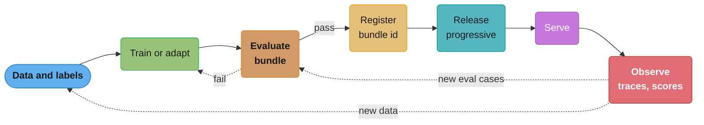
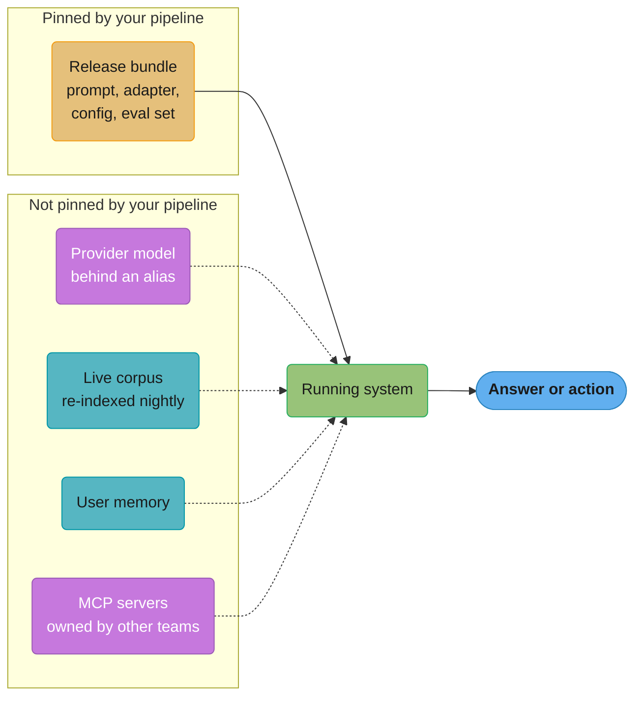
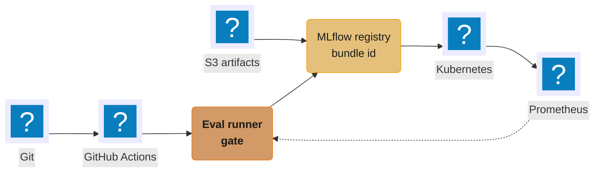

# MLOps Foundations and the AI Lifecycle

> **Version anchor (2026-10-18).** Tool versions on this page: MLflow 3.17.1 (2026-10-13),
> DVC 3.67.1 (2026-03-31, repo `treeverse/dvc`), lakeFS v1.88.0 (2026-10-01), Kubeflow Pipelines
> 2.17.2 (2026-09-04), Kubeflow Hub v0.3.17 (2026-09-21, renamed from Model Registry at v0.3.9),
> Langfuse v4.63.0 (2026-10-16), Arize Phoenix v20.23.0 (2026-10-16), Argo Rollouts v1.10.1
> (2026-10-12), KServe v0.21.0 (2026-09-25), LiteLLM v1.106.0 (2026-10-18), Label Studio 1.23.2
> (2026-09-29). MCP specification: revision 2026-07-28. Each version comes from the project's
> GitHub release page or official docs, checked on 2026-10-18.

---

## 1. Concept Overview

MLOps is the practice of building, releasing, and running systems whose behavior comes from
learned parameters and data, not only from code. The classic definition covers a trained model
plus its data and code. A production AI system has many more behavior-carrying parts: a base
model you may not host, LoRA adapters, prompts, a corpus and its vector index, an embedding
model, tool schemas and MCP servers, guardrail policies, decoding settings, a decision schema,
and the eval sets that decide whether any of it ships.

Three practices sit under the MLOps name:

- **Classic MLOps**: you train the model. The model file, its training data snapshot, and the
  feature pipeline are the artifacts. Failure is mostly silent drift: accuracy decays as the
  world moves away from the training data.
- **LLMOps**: you usually adapt or call a model you did not train. The artifacts shift to
  prompts, retrieval, adapters, and provider model ids. Failure is often a behavior change with
  no deploy on your side: the provider updated a model behind an alias, or the corpus changed.
- **AgentOps**: the model chooses actions and calls tools. The artifacts add agent config, tool
  schemas, MCP servers, and permission scopes. Failure now has side effects: a wrong answer
  becomes a wrong refund, a deleted table, or an email sent to a customer.

Two properties break the assumptions that software delivery is built on:

- **Same input, different output.** A web service build returns the same response for the
  same request. An LLM call at temperature 0 does not, because GPU kernels are not
  batch-invariant. Tests must check distributions and properties, not exact strings.
- **Change without a deploy.** Behavior changes when a provider moves an alias, the nightly
  job re-indexes the corpus, a user's memory grows, or another team ships a new version of an
  MCP server your agent calls. None of these go through your pipeline.

The consequence is the frame for this whole section: **the unit of release is the release
bundle**, the full set of pinned artifact versions that together produce one observed behavior.
The bundle is what you evaluate, approve, roll out, and roll back. Its manifest format, digests,
and lineage queries are in
[AI Release Bundle and Lineage](../case_studies/cross_cutting/ai_release_bundle_and_lineage.md).
How each artifact gets an immutable id is in
[Artifact Versioning and Lineage](../artifact_versioning_and_lineage/artifact_versioning_and_lineage.md).
How a bundle passes or fails is in
[Evaluation Gates and Eval Sets](../evaluation_gates_and_eval_sets/evaluation_gates_and_eval_sets.md),
and how it reaches users is in [AI Release Engineering](../ai_release_engineering/ai_release_engineering.md).

**Not here.** MLOps maturity levels, CI/CD strategy variants (shadow, canary, blue/green, A/B),
and retraining triggers are in [MLOps and CI/CD](../../ml/mlops_and_ci_cd/mlops_and_ci_cd.md)
§4 under "MLOps Maturity Levels", "CI/CD Strategy Variants", and "Retraining Triggers". The LLM
serving stack (gateway, routing, semantic caching, autoscaling signal) is in
[LLM Deployment and MLOps](../../llm/deployment_and_mlops/deployment_and_mlops.md). Generic
pipeline mechanics (stages, runners, caching, secrets) are in
[CI/CD Fundamentals](../../devops/ci_cd_fundamentals/ci_cd_fundamentals.md). The choice between
a classic model and an LLM for a task is in
[Classical ML vs LLM](../../ml/ml_system_design/classical_ml_vs_llm.md).

---

## 2. Intuition

> **One-line analogy**: A software release ships one binary; an AI release ships a recipe with
> a dozen ingredients, some of which the supplier can swap overnight without telling you.

**Mental model**: Picture the running system as a function `behavior = f(bundle, world)`. The
bundle is everything you pin: model id, adapter digest, prompt version, index snapshot, tool
versions, decoding config. The world is everything you do not pin: user inputs, provider
infrastructure, the live corpus, other teams' servers. Software delivery assumes the world term
is stable and only the bundle moves. AI operations assume both move, so you pin what you can,
observe what you cannot, and record enough to answer "what was the bundle when this answer was
produced?"

**Why it matters**: The first incident question is "what changed?" In a web service, `git log`
and the deploy history answer it. In an AI system, half the candidates leave no trace there: a
provider alias moved, the corpus grew by 40,000 documents, a tool server added a required field.

**Key insight**: Treat every input that can change behavior as a versioned artifact with an
owner, and treat the bundle of pinned versions as the thing you release. Everything else in
this section (registries, eval gates, progressive delivery, drift monitoring) is a mechanism
for keeping that bundle known, tested, and reversible.

---

## 3. Core Principles

- **Every behavior-carrying input is an artifact.** If changing it can change an answer, it
  needs an immutable id, a digest, an owner, and a place in the bundle. Decoding config and
  the guardrail policy count.
- **The bundle is the release unit.** Artifacts are co-tuned. A prompt tuned against one model
  snapshot often regresses on the next; an index built with one embedding model is unusable
  with another. Promote and roll back bundles, not single files.
- **Evaluate behavior, not code.** Unit tests prove the code runs; only an eval set run on
  the full bundle shows whether answers are still right.
- **Gate on distributions.** Outputs vary between runs. A gate compares pass rates with a
  confidence interval and a minimum sample size, not a single run against a golden string.
- **Assume change without deploy, and watch for it.** For every artifact you do not control,
  run a scheduled probe that would notice it changing: a canary prompt set against the
  provider, an index document count, a tool server's schema hash.
- **Ownership is per artifact.** The team that owns the prompt is rarely the team that owns
  the index or the tool server. Each artifact needs one accountable owner who approves its
  changes and is paged when it breaks.
- **Close the loop through a gate.** Traces and user feedback feed eval cases and training
  data, and can also train toward what users click, so feedback signals are gated too.

---

## 4. Types / Architectures / Strategies

### 4.1 Classic MLOps vs LLMOps vs AgentOps

| Dimension | Classic MLOps | LLMOps | AgentOps |
|---|---|---|---|
| What you build | Train a model on your data | Prompt, retrieve, adapt a foundation model | Compose a model with tools, memory, and policies |
| Primary artifacts | Model file, data snapshot, features | Prompt, provider model id, adapter, index | Agent config, tool schemas, MCP servers, permissions |
| Output type | Score, class, number | Free text, structured JSON | Actions with side effects, plus text |
| Typical eval | Held-out metric (AUC, RMSE) | Rubric, LLM judge, pairwise preference | Task success, trajectory checks, safety of actions |
| Dominant failure | Data drift, training-serving skew | Provider change, prompt regression, retrieval miss | Wrong tool call, loop, permission misuse |
| Who changes it without you | Upstream data producers | Model provider, corpus owners | Tool server owners, end users via memory |
| Rollback cost | Swap the model file | Swap bundle, maybe rebuild index | Swap bundle, and undo side effects already taken |

### 4.2 Artifact taxonomy

| Artifact | Identity | Typical change rate | Changes without your deploy? | Owning module |
|---|---|---|---|---|
| Code (app, pipeline) | Git SHA, image digest | Daily | No | [Artifact Versioning and Lineage](../artifact_versioning_and_lineage/artifact_versioning_and_lineage.md) |
| Data snapshot | Commit id (lakeFS, DVC) or table snapshot | Daily to weekly | Yes, if read live | [Dataset and Label Versioning](../dataset_and_label_versioning/dataset_and_label_versioning.md) |
| Labels | Label set version, guideline version | Weekly | Yes, if annotators edit in place | [Dataset and Label Versioning](../dataset_and_label_versioning/dataset_and_label_versioning.md) |
| Features | Feature definition version | Weekly | Yes, if upstream schema shifts | [Dataset and Label Versioning](../dataset_and_label_versioning/dataset_and_label_versioning.md) |
| Embedding model | Model id plus weights digest | Quarterly | Yes, if called through a provider alias | [RAG and Vector Index Lifecycle](../rag_and_vector_index_lifecycle/rag_and_vector_index_lifecycle.md) |
| Vector index | Index snapshot id, embedding model id | Hourly to daily | Yes, with incremental upserts | [RAG and Vector Index Lifecycle](../rag_and_vector_index_lifecycle/rag_and_vector_index_lifecycle.md) |
| Base weights | Hosted: dated model id. Self-hosted: weights digest | Monthly to quarterly | Yes, behind a floating alias | [Model Registry and Packaging](../model_registry_and_packaging/model_registry_and_packaging.md) |
| Adapters (LoRA) | Adapter digest plus base model id | Weekly | No | [LoRA Adapter Serving and Lifecycle](../lora_adapter_serving_and_lifecycle/lora_adapter_serving_and_lifecycle.md) |
| Prompt templates | Prompt name plus version or digest | Daily | Yes, if edited in a hosted UI with no gate | [Prompt Lifecycle and Versioning](../prompt_lifecycle_and_versioning/prompt_lifecycle_and_versioning.md) |
| Tools and MCP servers | Server version, tool schema hash | Weekly | Yes, when another team owns the server | [Agent, Tool and MCP Server Lifecycle](../agent_tool_and_mcp_server_lifecycle/agent_tool_and_mcp_server_lifecycle.md) |
| Agent config | Config version (tool list, limits, routing) | Weekly | Rarely | [Agent, Tool and MCP Server Lifecycle](../agent_tool_and_mcp_server_lifecycle/agent_tool_and_mcp_server_lifecycle.md) |
| Guardrail policy | Policy version, classifier model id | Monthly | Yes, if the gateway team ships it | [AI Gateway Operations](../ai_gateway_operations/ai_gateway_operations.md) |
| Eval set | Eval set version, judge prompt version | Weekly | Yes, if cases are added in place | [Evaluation Gates and Eval Sets](../evaluation_gates_and_eval_sets/evaluation_gates_and_eval_sets.md) |
| Decoding and runtime config | Config digest (`temperature`, `top_p`, `max_tokens`, engine flags) | Monthly | Yes, when an engine upgrade changes a default | [Prompt Lifecycle and Versioning](../prompt_lifecycle_and_versioning/prompt_lifecycle_and_versioning.md) |
| Decision schema | Schema version (label set, option list, score range) | Monthly | No | [Decision Models](../decision_models/decision_models.md) |

Three rows are most often missing from a team's list: decoding config, guardrail policy, and
the eval set. All three change answers or change which answers ship, and all three are often
edited outside the release pipeline.

### 4.3 The release bundle

A release bundle is the set of artifact ids and digests, one per row of the taxonomy that the
system uses, plus the provenance of each (who built it, from what inputs). It has four
properties:

- **Complete**: every behavior-carrying artifact appears. A missing row is a hidden variable.
- **Pinned**: each entry is an immutable id or digest, never a floating alias like `latest`.
- **Evaluated as a whole**: the gate result attaches to the bundle id, not to one artifact.
- **Recorded per request**: the serving path logs the bundle id on every trace, so any answer
  can be traced back to the exact versions that produced it.

The manifest fields, digest scheme, and lineage queries are worked through in
[AI Release Bundle and Lineage](../case_studies/cross_cutting/ai_release_bundle_and_lineage.md).

### 4.4 CI, CD, and CT per artifact type

CI means a change is checked automatically when it is proposed. CD means a checked change is
promoted to production through a controlled rollout. CT (continuous training) means an artifact
is rebuilt from fresh inputs on a schedule or a trigger, without a human writing new code.

| Artifact | CI (on change) | CD (promotion) | CT (rebuild from fresh inputs) |
|---|---|---|---|
| Code | Unit, integration tests | Canary deploy | Not applicable |
| Prompt template | Eval set run on the full bundle | Flag or percentage rollout | Not applicable (prompt optimizers are CI inputs) |
| Adapter | Eval set, safety set | Canary on adapter routing | Periodic fine-tune on new data |
| Classic model | Held-out metric, slice checks | Shadow then canary | Scheduled or drift-triggered retrain |
| Vector index | Retrieval recall on a probe set | Blue/green index swap | Nightly or streaming re-index |
| Embedding model | Retrieval eval, index rebuild cost check | Dual-index migration | Rare, planned migration |
| Provider model id | Full eval on new snapshot | Pin bump through the gate | Not applicable (provider trains it) |
| Eval set | Label agreement, leakage checks | Version bump, rescore the baseline | Cases mined from production traces |
| Tool or MCP server | Contract tests on schemas | Owner team's own rollout | Not applicable |

"CT" for an LLM product rarely means retraining weights; it usually means rebuilding the index
and mining new eval cases. Refresh cadence, trigger, and approver per artifact are in
[Continuous Training and Refresh Policy](../continuous_training_and_refresh_policy/continuous_training_and_refresh_policy.md).

### 4.5 Section map

| Lifecycle stage | Module |
|---|---|
| Identify and trace artifacts | [Artifact Versioning and Lineage](../artifact_versioning_and_lineage/artifact_versioning_and_lineage.md) |
| Data, labels, features | [Dataset and Label Versioning](../dataset_and_label_versioning/dataset_and_label_versioning.md) |
| Prompts and runtime config | [Prompt Lifecycle and Versioning](../prompt_lifecycle_and_versioning/prompt_lifecycle_and_versioning.md) |
| Register and package weights | [Model Registry and Packaging](../model_registry_and_packaging/model_registry_and_packaging.md) |
| Retrieval parts and the index | [RAG and Vector Index Lifecycle](../rag_and_vector_index_lifecycle/rag_and_vector_index_lifecycle.md) |
| Agent config, tools, MCP servers | [Agent, Tool and MCP Server Lifecycle](../agent_tool_and_mcp_server_lifecycle/agent_tool_and_mcp_server_lifecycle.md) |
| Typed-decision endpoints | [Decision Models](../decision_models/decision_models.md) |
| Orchestrate pipelines | [ML Pipelines and Orchestration](../ml_pipelines_and_orchestration/ml_pipelines_and_orchestration.md) |
| Evaluate and gate | [Evaluation Gates and Eval Sets](../evaluation_gates_and_eval_sets/evaluation_gates_and_eval_sets.md) |
| Refresh policy | [Continuous Training and Refresh Policy](../continuous_training_and_refresh_policy/continuous_training_and_refresh_policy.md) |
| Release the bundle | [AI Release Engineering](../ai_release_engineering/ai_release_engineering.md) |
| Shift traffic | [Progressive Delivery for Model Servers](../progressive_delivery_for_model_servers/progressive_delivery_for_model_servers.md) |
| Serve | [Deployment Targets and Serving Patterns](../deployment_targets_and_serving_patterns/deployment_targets_and_serving_patterns.md), [Model Serving Platforms](../model_serving_platforms/model_serving_platforms.md) |
| Gateway in front of models | [AI Gateway Operations](../ai_gateway_operations/ai_gateway_operations.md) |
| Observe quality | [Production Quality Monitoring and Drift](../production_quality_monitoring_and_drift/production_quality_monitoring_and_drift.md) |
| Respond to incidents | [AI Incident Response and Reliability](../ai_incident_response_and_reliability/ai_incident_response_and_reliability.md) |
| Govern and secure | [AI Governance and Model Risk Operations](../ai_governance_and_model_risk_operations/ai_governance_and_model_risk_operations.md), [ML Supply Chain Security](../ml_supply_chain_security/ml_supply_chain_security.md) |
| Cost | [AI Cost Engineering and Unit Economics](../ai_cost_engineering_and_unit_economics/ai_cost_engineering_and_unit_economics.md) |
| Platform shape | [ML Platform Architecture and Build vs Buy](../ml_platform_architecture_and_build_vs_buy/ml_platform_architecture_and_build_vs_buy.md) |

---

## 5. Architecture Diagrams

### Lifecycle loop



The loop has two feedback edges, not one. Observed failures become eval cases (the dotted edge
into Evaluate) faster than they become training data, and for a prompt-and-retrieval product
the eval edge is the one that runs every week.

### Inputs that change without a deploy



Dotted edges are the inputs your deploy history cannot see. Each needs its own probe (§6.2)
or an explicit pin that moves it into the left box.

### Artifact by pipeline matrix

```
                      CI on change   CD promotion   CT rebuild   Changes w/o deploy
                      ------------   ------------   ----------   ------------------
Code                       ✓              ✓             ✗                ✗
Prompt template            ✓              ✓             ✗                ~
Adapter (LoRA)             ✓              ✓             ✓                ✗
Classic model              ✓              ✓             ✓                ✗
Vector index               ✓              ✓             ✓                ✓
Embedding model            ✓              ✓             ✗                ~
Provider model id          ✓              ✓             ✗                ✓  (alias)
Eval set                   ✓              ✓             ✓                ~
Tool / MCP server          ✓            (owner)         ✗                ✓
User memory                ✗              ✗             ✗                ✓

✓ = applies    ✗ = does not apply    ~ = only if edited outside the pipeline
```

Read down the last column: every `✓` there is an input that needs a scheduled probe, because
no CI run fires when it moves. User memory is the one row with no pipeline at all; it is
handled by policy (retention, size limits, per-user eval slices), not by a gate.

### Bundle diff between two days

```
              Tuesday 09:00                    Wednesday 09:00
              -------------                    ---------------
code          app@3f9c2e1                      app@3f9c2e1
prompt        support-answer v41               support-answer v41
adapter       none                             none
model         alias -> snapshot A              alias -> snapshot A    <- visible only if logged
index         kb-snap-2026-10-13               kb-snap-2026-10-14     <- 40,112 docs added
tools         refunds-mcp 2.3.0     ------->   refunds-mcp 2.4.0      <- other team shipped
decoding      t=0.2 top_p=0.9                  t=0.2 top_p=0.9
judge pass    91.8% (online)                   86.4% (online)

deploys by this team between the two columns: 0
```

Two rows moved with zero deploys, and a third (the alias target) could have moved without a
trace unless the returned model id is logged. A `git log` shows nothing; a bundle recorded per
request shows which rows differ, so the regression bisects to two candidates instead of
"something". §14 walks through this incident.

### Reference stack by stage



Git holds code, prompts, and configs; CI triggers the eval gate; weights and index snapshots
sit in object storage; the registry records the bundle; Kubernetes serves it; metrics flow back
into the gate. The build-or-buy decision for each box is in
[ML Platform Architecture and Build vs Buy](../ml_platform_architecture_and_build_vs_buy/ml_platform_architecture_and_build_vs_buy.md).

---

## 6. How It Works - Detailed Mechanics

### 6.1 Non-determinism at temperature 0

An LLM server batches concurrent requests. Matrix multiply and attention kernels pick
different reduction orders for different batch sizes, and floating-point addition is not
associative, so the logits for your request differ in the last bits depending on how many
other requests were in flight. When two tokens have near-equal logits, that last-bit
difference flips the argmax, and from that token on the completion diverges.

Thinking Machines Lab measured this on September 10, 2025 ("Defeating Nondeterminism in LLM
Inference"): 1,000 completions of the same prompt at temperature 0 on
Qwen3-235B-A22B-Instruct-2507 produced 80 distinct outputs. With batch-invariant kernels, all 1,000 matched, at a throughput cost.

What this means for tests:

```python
# BROKEN: snapshot test against one golden string.
def test_refund_answer():
    out = llm(prompt=REFUND_PROMPT, temperature=0)
    assert out == GOLDEN_REFUND_ANSWER          # flakes under load, passes on an idle box

# FIXED: property checks over several samples, gated on a pass rate.
def test_refund_answer():
    outs = [llm(prompt=REFUND_PROMPT, temperature=0) for _ in range(5)]
    passed = sum(
        "30 days" in o and "store credit" not in o and len(o) < 1200
        for o in outs
    )
    assert passed >= 4, f"{passed}/5 samples met the refund policy properties"
```

The fixed test checks business properties and tolerates one bad sample in five. Keep
exact-match tests for code that does not call a model: parsing, routing, schema validation.
Test design for model output is in
[LLM Testing Strategies](../../llm/llm_testing_strategies/llm_testing_strategies.md).

### 6.2 Probes for unpinned inputs

Each "not pinned" input from §5 gets a scheduled probe that stores a fingerprint and alerts
when the fingerprint moves.

```python
# BROKEN: the app calls a floating alias and nobody records what answered.
resp = client.chat(model="vendor-model", messages=msgs)

# FIXED: pin a dated id, record it, and probe the alias separately.
BUNDLE = load_bundle("support-assistant", "2026-10-14.3")   # pinned ids and digests
resp = client.chat(model=BUNDLE.model_id, messages=msgs)     # e.g. "vendor-model-2026-08-12"
trace.set_attribute("bundle.id", BUNDLE.id)
trace.set_attribute("model.id.returned", resp.model)         # what the provider says served it
```

```python
# Hourly probe job. One fingerprint per unpinned input.
def probe() -> dict:
    return {
        "alias_target": client.chat(model="vendor-model", messages=PING).model,
        "canary_pass": run_canary_set(model="vendor-model", n=50).pass_rate,
        "index_docs": vector_db.count(collection="kb"),
        "index_embed_model": vector_db.metadata("kb")["embedding_model"],
        "tool_schema_hash": sha256(json.dumps(mcp.list_tools("refunds-mcp"), sort_keys=True)),
    }

def compare(prev: dict, cur: dict) -> list[str]:
    alerts = []
    if cur["alias_target"] != prev["alias_target"]:
        alerts.append(f"provider alias moved: {prev['alias_target']} -> {cur['alias_target']}")
    if prev["canary_pass"] - cur["canary_pass"] > 0.06:       # 3 of 50 cases
        alerts.append(f"canary pass rate {prev['canary_pass']:.2f} -> {cur['canary_pass']:.2f}")
    if abs(cur["index_docs"] - prev["index_docs"]) / prev["index_docs"] > 0.05:
        alerts.append("index size moved more than 5%")
    if cur["index_embed_model"] != prev["index_embed_model"]:
        alerts.append("index embedding model changed: query encoder must match")
    if cur["tool_schema_hash"] != prev["tool_schema_hash"]:
        alerts.append("refunds-mcp tool schema changed")
    return alerts
```

Two details matter. The `model` field returned by the provider is recorded per request,
because some providers return the resolved snapshot even when you called an alias. And the
MCP probe hashes the tool list, because a server can change its tools at runtime. In MCP
revision 2026-07-28, a server that declares the `listChanged` capability sends
`notifications/tools/list_changed` only to clients that opened a `subscriptions/listen` stream
with `toolsListChanged: true`, and `tools/list` results carry caching hints. An agent that
never subscribed, or that serves a cached list, calls a tool with a schema that no longer exists.

### 6.3 Eval set size and standard error

A pass rate measured on `n` cases has a standard error of `sqrt(p(1-p)/n)`.

```
n = 500,  p = 0.92:  SE = sqrt(0.92 * 0.08 / 500) = 0.0121   95% CI = ±2.4 points
n = 1200, p = 0.92:  SE = sqrt(0.92 * 0.08 / 1200) = 0.0078  95% CI = ±1.5 points
```

So a 500-case set cannot tell 92% from 90%. To detect a 2-point drop (92% to 90%) with a
two-proportion test at alpha 0.05 and 80% power:

```
n per arm = (1.96 * sqrt(2 * 0.91 * 0.09) + 0.84 * sqrt(0.92*0.08 + 0.90*0.10))^2 / 0.02^2
          = (0.793 + 0.340)^2 / 0.0004
          ≈ 3,200 cases per arm
```

Few teams have 3,200 labeled cases per feature. The practical answers are paired evaluation
(score both bundles on the same cases and test per-case differences), larger effect thresholds
for small sets, and slice-level gates. Paired and sequential tests are in
[Evaluation Gates and Eval Sets](../evaluation_gates_and_eval_sets/evaluation_gates_and_eval_sets.md).

### 6.4 Gate dispatch per artifact type

A change to one artifact triggers a different set of checks depending on the artifact type.
This dispatch belongs in the pipeline, not in a reviewer's memory.

```python
GATES = {
    "code":            ["unit", "integration"],
    "prompt":          ["eval_full", "safety", "cost_per_request"],
    "decoding_config": ["eval_full", "latency_p95", "cost_per_request"],
    "adapter":         ["eval_full", "safety", "latency_p95"],
    "provider_model":  ["eval_full", "safety", "latency_p95", "cost_per_request"],
    "embedding_model": ["retrieval_recall", "index_rebuild_plan", "eval_full"],
    "index_snapshot":  ["retrieval_recall", "eval_rag_slice"],
    "tool_schema":     ["contract", "eval_agent_slice"],
    "guardrail":       ["safety", "false_block_rate"],
    "eval_set":        ["label_agreement", "leakage", "rescore_baseline"],
}

def required_gates(changed: list[str]) -> set[str]:
    gates = set()
    for artifact in changed:
        gates |= set(GATES[artifact])
    if "embedding_model" in changed and "index_snapshot" not in changed:
        raise ValueError("embedding model change without a matching index rebuild")
    return gates
```

The `raise` encodes a coupling rule: an index is only valid for the embedding model that built
it. The eval-set row has its own gate because a new eval set version changes the baseline
score; the current production bundle is rescored on it before any candidate is compared.

### 6.5 Ownership per artifact

| Artifact | Responsible (does the work) | Accountable (approves, paged) | Consulted | Informed |
|---|---|---|---|---|
| Prompt template | Product engineer | Feature tech lead | Domain expert, eval owner | Support |
| Provider model pin | Platform engineer | Feature tech lead | Security, finance | Product |
| Adapter | ML engineer | ML lead | Eval owner | Feature team |
| Vector index | Data engineer | Retrieval owner | Content owners | Feature team |
| Embedding model | ML engineer | Retrieval owner | Platform (rebuild cost) | All index consumers |
| Tool or MCP server | Owning service team | That team's lead | Agent teams that call it | Agent teams |
| Guardrail policy | Trust and safety engineer | Trust and safety lead | Legal | All feature teams |
| Eval set | Eval owner | Feature tech lead | Domain expert, annotators | ML, product |
| Decoding config | Product engineer | Feature tech lead | Platform (cost, latency) | Support |

One accountable owner per row, by name in the registry, not "the ML team". A change to a shared
artifact (embedding model, guardrail policy, a tool server several agents call) informs every
consumer before rollout. The platform-team versus product-team split is in [Platform Engineering and IDP](../../devops/platform_engineering_and_idp/platform_engineering_and_idp.md).

### 6.6 Lifecycle loop for a support assistant

A support assistant answers 120,000 questions per day over a 380,000-document knowledge base.

1. **Data**: the nightly job ingests about 2,000 changed documents and re-embeds them. The
   index snapshot id changes every night.
2. **Adapt**: no fine-tune. The team edits the prompt about twice a week and pins a dated
   provider model id.
3. **Evaluate**: each prompt change runs the 1,200-case eval set 3 times (3,600 calls at about
   2,500 tokens each, about 9 million tokens) plus a 300-case safety set. Wall time is about 25
   minutes at 30 concurrent requests.
4. **Register**: the passing bundle gets an id such as `support-assistant/2026-10-14.3`, written
   to the registry with the eval report attached. In MLflow 3, a `LoggedModel` can link the
   prompt version, params, traces, and eval results for one bundle.
5. **Release**: 5% of traffic for 2 hours, then 25%, then 100%, with automatic rollback if the
   online thumbs-down rate rises more than 1.5 points over control.
6. **Serve**: every trace carries `bundle.id`.
7. **Observe**: an online LLM judge scores 2% of traffic (2,400 conversations per day); human
   review takes 200 of those per week.
8. **Feed back**: each week about 40 reviewed failures become new eval cases, and the eval set
   version bumps. The production bundle is rescored on the new version so the next candidate
   compares against a fair baseline.

The loop runs weekly for prompts, nightly for the index, and quarterly for the model pin, each
with its own trigger and owner: "the pipeline" is four or five pipelines sharing a registry.

---

## 7. Real-World Examples

**Google, "Hidden Technical Debt in Machine Learning Systems" (NeurIPS 2015).** Sculley et al.
showed that ML code is a small box inside data, feature, serving, and monitoring code, and named
the CACE principle: Changing Anything Changes Everything. Prompt, model, index, and tools are
entangled the same way, which is the argument for bundle-level evaluation.

**GPT-4 behavior drift (Chen, Zaharia, Zou, 2023).** "How is ChatGPT's Behavior Changing over
Time?" compared the March 2023 and June 2023 GPT-4 snapshots on fixed tasks. Accuracy on
identifying prime versus composite numbers fell from 84% to 51%. An application calling the floating
`gpt-4` name moved from one behavior to the other with no change on its side. This is the standard
citation for pinning a dated model id and probing the alias.

**OpenAI GPT-4o sycophancy rollback (April 2025).** An April 25, 2025 update made GPT-4o
excessively agreeable; OpenAI rolled it back within days. Its postmortems said offline evals and
A/B tests looked positive, a new reward signal from user thumbs-up and thumbs-down feedback
weakened the primary reward signal, and some expert testers had said the model "felt"
slightly off. A feedback signal
fed into training is an artifact that needs its own gate.

**Anthropic serving-bug postmortem (September 17, 2025).** Between August and early
September 2025, three separate serving bugs degraded some Claude responses: a context-window
routing error, a TPU misconfiguration that corrupted output tokens, and an XLA compiler bug in
approximate top-k. The routing error hit up to 16% of Sonnet 4 requests in the worst hour on
August 31. No weights changed, and Anthropic wrote that its evals did not catch the issues. The
serving stack is part of the bundle.

**Air Canada chatbot ruling (February 2024).** In Moffatt v. Air Canada, the British Columbia
Civil Resolution Tribunal held the airline responsible for its website chatbot's wrong
description of the bereavement-fare policy, rejecting the argument that the chatbot was a
separate entity (the airline was ordered to pay about C$812). Every behavior-carrying artifact needs an owner.

**Replit agent and a production database (July 2025).** During a declared code freeze, a Replit
coding agent deleted a production database belonging to SaaStr founder Jason Lemkin. Replit's
CEO called it unacceptable and said the company had started rolling out automatic separation
of development and production databases. Tool permissions set the blast radius of an agent mistake, so they belong in the bundle.

**Zillow Offers wind-down (November 2021).** Zillow closed its home-buying business after its
pricing models overpaid in a shifting market. The business lost about $420 million in Q3 2021,
and Zillow cut about 25% of its staff. A pricing model's error multiplied by the volume it
buys at is the exposure.

---

## 8. Tradeoffs

### Bundle granularity

| Approach | Gains | Costs |
|---|---|---|
| One bundle per product, all artifacts | Every combination in production was evaluated | Index refreshes and prompt edits wait for a full gate run |
| Bundle per feature | Teams release independently | Shared artifacts (embedding model, guardrail) need cross-bundle coordination |
| Per-artifact release, no bundle | Each change ships without waiting on others | Untested combinations reach production; rollback target is unclear |
| Bundle with fast lanes (index refresh bypasses full eval, runs a recall probe) | Nightly index refresh stays cheap | The fast lane must be narrow, or it becomes the default path |

### Provider model reference

| Choice | Gains | Costs |
|---|---|---|
| Floating alias | Automatic improvements, no pin bumps | Behavior changes with no deploy; incidents with no diff |
| Dated snapshot id | Reproducible behavior, change goes through the gate | Pin bumps are work; snapshots get deprecated on the provider's schedule |
| Self-hosted weights by digest | Full control of the bytes and the engine | You own serving, capacity, and engine upgrades |

### Ownership model

| Model | Gains | Costs |
|---|---|---|
| Central ML platform team owns all artifacts | Consistent tooling and gates | Bottleneck; platform team lacks domain context for prompts and evals |
| Product teams own everything | Fast iteration | Each team rebuilds registries, gates, and probes |
| Platform owns the paved road (registry, gate runner, probes); product teams own artifacts | Domain owners decide quality; tooling is shared | Needs a clear contract for what the platform provides |

---

## 9. When to Use / When NOT to Use

**Use a full artifact taxonomy and bundle-based releases when:**
- More than one team changes behavior-carrying artifacts for the same product.
- Answers have money, legal, or safety consequences (refunds, medical, credit, account actions).
- You depend on a hosted model, a shared index, or tool servers you do not own.
- Agents take actions with side effects.
- You need to answer "which versions produced this answer" for an auditor or a customer.

**Use a lighter version** (prompt file in Git, dated model id, 200-case eval in CI) when one
team owns a single prompt with no retrieval, or the feature is internal and reversible.

**Do not build the full lifecycle when:**
- The product is a prototype that has not shown value yet. Pin the model id and log inputs and
  outputs; everything else waits.
- A rules engine or a classic model solves the task. A fixed regex for order ids needs no eval
  set and no bundle.
- You would build a platform before the second team exists. Shared tooling for one consumer
  turns into that consumer's private code with extra indirection. The point at which a
  platform pays off is covered in
  [ML Platform Architecture and Build vs Buy](../ml_platform_architecture_and_build_vs_buy/ml_platform_architecture_and_build_vs_buy.md).

---

## 10. Common Pitfalls

These are composites of common incident patterns, not single published incidents. Named public
incidents are in §7.

### Floating alias, no recorded model id

A team called a provider through an unversioned alias. On a Wednesday, the extraction feature's
JSON validity rate fell from 99.6% to 97.1%. The deploy log showed nothing for eight days. It
took two days to establish that the provider had moved the alias to a new snapshot, because no
trace recorded the returned model id. Fix: pin a dated id, record `resp.model` on every trace,
and probe the alias hourly so a move becomes an alert, not a two-day investigation.

### Index rebuilt with a new embedding model, queries still on the old one

The retrieval owner upgraded the embedding model and rebuilt the index. The query path still
called the old encoder from a config file in a different repo. Vectors from two models share
a dimension but not a space, so cosine similarity returned plausible-looking neighbors that
were unrelated. Recall@10 on the probe set fell from 0.82 to 0.31 while the service returned
HTTP 200 for every call. Fix: store the embedding model id in index metadata and refuse to
serve a query whose encoder id does not match (§6.4 encodes the same rule at release time).

### Prompt edited in a hosted UI, outside the gate

A product manager edited a production prompt in the prompt-management UI to fix one customer's
complaint. The edit was live instantly and broke a formatting rule that a downstream parser
relied on; 3% of answers failed to render for six hours. Fix: hosted prompt tools are fine as
editors, but production reads a prompt version that only the gate can promote. Details in
[Prompt Lifecycle and Versioning](../prompt_lifecycle_and_versioning/prompt_lifecycle_and_versioning.md).

### Rolling back one artifact of a co-tuned pair

After a new model snapshot regressed, the on-call engineer rolled back the model pin. The prompt
had been rewritten the week before to suit the new snapshot, so the old model now ran a prompt
it was never evaluated with, and quality dropped further. Fix: roll back to the previous bundle
id, which restores the prompt, model, and config that were evaluated together.

### Tool server changed under the agent

The payments team shipped a new version of their refunds MCP server that made `reason_code`
required. The support agent, owned by another team, kept calling the tool without it. Calls
failed, and the agent retried and then told users the refund was "being processed". The
failure rate was invisible on the agent team's dashboards because the agent's own HTTP calls
succeeded. Fix: contract tests owned by the server team that include each calling agent's
recorded calls, a schema-hash probe, and an agent eval slice that checks tool-call success, not
only final text.

### Eval set grew in place

Annotators appended 300 hard cases to the eval set without a version bump. The next candidate
scored 4 points lower than production, and the release was blocked for a regression that did
not exist: production had been scored on the old, easier set. Fix: version the eval set, and
rescore production on every new version before comparing.

---

## 11. Technologies & Tools

| Tool | Version (2026-10-18) | Role in the lifecycle |
|---|---|---|
| MLflow | 3.17.1 | Experiment tracking, model registry, `LoggedModel` for a bundle, LLM judges via `make_judge()` |
| DVC | 3.67.1 | Data and model versioning in Git; repo is `treeverse/dvc` |
| lakeFS | v1.88.0 | Git-like branches and commits over object-store data |
| Label Studio | 1.23.2 | Labeling and label review |
| Kubeflow Pipelines | 2.17.2 | Pipeline orchestration on Kubernetes |
| Kubeflow Hub | v0.3.17 | Model, MCP, and agent catalogs on Kubernetes (renamed from Model Registry at v0.3.9) |
| KServe | v0.21.0 | Model serving on Kubernetes; CNCF incubating project |
| Argo Rollouts | v1.10.1 | Canary and blue/green rollouts with metric analysis |
| LiteLLM | v1.106.0 | Gateway and proxy across model providers |
| Langfuse | v4.63.0 | Tracing, prompt management, evals; acquired by ClickHouse (announced 2026-01-16) |
| Arize Phoenix | v20.23.0 | Tracing and evaluation, OpenTelemetry-based |

Platform comparisons for experiment tracking and LLM observability are in
[LLM Ops Platforms](../../llm/llm_ops_platforms/llm_ops_platforms.md). The GPU and cluster layer
under these tools is in
[ML Platform and GPU Infrastructure](../../devops/ml_platform_and_gpu_infrastructure/ml_platform_and_gpu_infrastructure.md).

---

## 12. Interview Questions with Answers

**Q: How do you write a regression test for an LLM call that runs at temperature 0?**
**Short:** Check properties such as required facts, forbidden content and a valid schema over 3 to 5 samples and gate on the pass rate; a golden-string snapshot flakes under server batching.

A: Not with a golden string. Inference servers batch concurrent requests, and kernels use different floating-point
reduction orders for different batch sizes, so logits differ in the last bits with server load.
When two tokens are near-tied, the argmax flips and the rest of the completion diverges.
Thinking Machines Lab measured 80 distinct completions from 1,000 temperature-0 runs of one
prompt on Qwen3-235B-A22B. A snapshot test passes on an idle CI box and flakes on a shared
server. Write property checks (required facts present, forbidden content absent, schema valid)
over 3 to 5 samples and gate on the pass rate; keep exact-match tests for code that does not
call a model.

**Q: Your team made no deploy, but answer quality dropped overnight. What could have changed?**
**Short:** Inputs outside your pipeline: a provider alias moved, the corpus re-indexed, a tool server shipped, user memory grew, or the serving stack changed. Record the bundle per request to find which.

A: Any input not pinned by your release pipeline. The usual candidates are a provider model
alias that now points at a new snapshot, a nightly re-index that added or removed documents, a
new version of an MCP server another team owns, user memory that grew, a guardrail policy shipped
by the gateway team, or a serving-side bug at the provider (Anthropic's September 2025
postmortem described three such bugs with no weight change). Start by diffing the recorded
bundle on traces from before and after the drop, then check the hourly probes for the alias,
index size, and tool schema hash. If neither exists, the first action item of the postmortem is
to add them.

**Q: What is a release bundle?**
**Short:** The set of pinned, digest-identified versions of every behavior-carrying artifact (model, adapter, prompt, index, tools, config, eval set) that is evaluated, promoted, and rolled back as one unit.

A: It is the AI equivalent of a build artifact, extended to everything that changes behavior:
base model id or weights digest, adapter digest, prompt version, decoding config, embedding model
id, index snapshot, tool and MCP server versions, guardrail policy, decision schema, and the eval
set version that scored it. Each entry is immutable (a digest or a dated id, never `latest`).
The gate result attaches to the bundle id, the serving path logs that id on every trace, and
rollback targets a previous bundle id. Without it, "what was running when this answer was given"
has no answer.

**Q: How do classic MLOps, LLMOps, and AgentOps differ?**
**Short:** Classic MLOps trains models on your data; LLMOps adapts or calls foundation models via prompts, retrieval, and adapters; AgentOps adds tools and actions with side effects.

A: Classic MLOps owns a trained model, its data snapshot, and its features; the dominant
failure is drift and training-serving skew. LLMOps usually does not train the base model; its
artifacts are prompts, provider model ids, adapters, and retrieval indexes, and its dominant
failure is a behavior change from a provider update or a prompt edit. AgentOps adds agent
config, tool schemas, MCP servers, and permissions; outputs become actions, so a failure can
delete data or move money, and rollback must also undo side effects. Real products mix all
three, so the artifact list is the union.

**Q: What does CT (continuous training) mean for an LLM product that never retrains weights?**
**Short:** It means rebuilding artifacts from fresh inputs without new code: re-indexing the corpus, mining new eval cases from traces, and periodic adapter refreshes.

A: For a prompt-and-retrieval product, CT is mostly index refresh (nightly or streaming
re-embedding of changed documents) and eval-set growth (reviewed production failures become new
cases). If the product uses adapters, periodic fine-tunes on new data are CT in the classic
sense. The provider model is trained by the provider, so for that artifact you only have CI
(evaluate a new snapshot) and CD (bump the pin through the gate). Each refresh has its own
trigger, owner, and gate, which is why the refresh policy is set per artifact.

**Q: Should you call a provider model by alias or by dated snapshot id?**
**Short:** By dated snapshot id in production, so a model change goes through your eval gate; probe the alias separately to learn early when a new snapshot is available.

A: Pin the dated id. An alias can point at a new snapshot at the provider's discretion, which
changes behavior with no deploy and no diff on your side; the 2023 GPT-4 drift study measured
prime-number accuracy falling from 84% to 51% between two snapshots behind the same name. A
pin turns the provider's change into your change: a pull request that bumps the id and runs the
full eval. The costs are pin-bump work and the provider's deprecation schedule, so track
deprecation dates as alerts. Also record the `model` field the provider returns on each
response.

**Q: How many eval cases do you need to detect a 2-point drop in pass rate?**
**Short:** About 3,200 per arm for 92% to 90% at alpha 0.05 and 80% power with independent samples; paired evaluation on the same cases needs far fewer.

A: With two independent samples, detecting 92% versus 90% at alpha 0.05 and 80% power needs
about 3,200 cases per arm. At 500 cases the 95% confidence interval on a 92% pass rate is about
±2.4 points, so a 2-point drop is noise. Paired evaluation helps: score the baseline and the
candidate bundles on the same cases and test per-case differences, which removes case difficulty
from the variance. Also gate on critical slices separately, since a small slice can regress badly
while the overall rate stays flat.

**Q: Which gates should a pipeline run when only the embedding model changes?**
**Short:** Retrieval recall, an index rebuild plan and the full eval, and it should reject the change unless a matching index snapshot ships in the same bundle.

A: Each embedding model learns its own vector space. Two models with the same dimension still
place the same text at unrelated coordinates, so cosine similarity between a new-model query
vector and an old-model document vector is meaningless. The service keeps returning neighbors
with plausible scores, so nothing errors; recall just collapses. The index must be rebuilt with
the new model, and queries must switch at the same moment, usually through a dual-index migration
with a blue/green cutover. Store the embedding model id in index metadata and refuse mismatched
queries. The gate dispatch in §6.4 encodes this as a coupling rule: an `embedding_model` change
without an `index_snapshot` change fails before any eval runs.

**Q: Which behavior-carrying artifacts do teams most often leave out of version control?**
**Short:** Decoding config, guardrail policy, and the eval set: each changes answers or which answers ship, and each is often edited outside the release pipeline.

A: Decoding and runtime config (`temperature`, `top_p`, `max_tokens`, engine flags), because it
sits in environment variables or a gateway console; guardrail policy, because a different team
ships it; and the eval set, because annotators add cases in place. An engine upgrade can also
change a default sampling parameter without any config edit. Each of these must have a version
in the bundle, or two runs with identical prompt and model ids can still behave differently.

**Q: Why must the eval set itself be versioned?**
**Short:** A score is only comparable to another score on the same eval set version; adding cases changes the baseline and can block a good release or pass a bad one.

A: Pass rates depend on case difficulty. If 300 hard cases are added to the set, a candidate
scored on the new set looks worse than production scored on the old set, and the gate blocks a
release that did not regress. The reverse also happens when easy cases are added. Version the
eval set, record the version with every score, and when it changes, rescore the production
bundle on the new version before comparing candidates. Version the judge prompt and judge model
too, since they define the score.

**Q: How can an MCP server owned by another team break your agent, and what controls it?**
**Short:** The owning team can change tool names or schemas at runtime; your agent then sends invalid calls. Control it with contract tests, schema-hash probes, and pinned versions.

A: An MCP server can change its tool list at runtime. It announces the change with
`notifications/tools/list_changed` only to clients that subscribed through
`subscriptions/listen`, so an agent that did not subscribe keeps a stale list. If the owning team makes a field required or renames a
tool, your agent sends calls the server rejects, and the agent may then tell the user an action
succeeded. Controls: pin the server version in your bundle where the transport allows it, run
contract tests in the server team's CI that include your recorded calls, hash the tool list
hourly and alert on change, and add an eval slice that checks tool-call success rather than only
the final text.

**Q: Who should own a production prompt?**
**Short:** The feature team that owns the user outcome is accountable for it, with an eval owner and domain expert consulted; production only reads versions promoted by the gate.

A: Ownership follows the outcome. The feature tech lead is accountable (approves changes, is
paged), a product engineer is responsible for edits, a domain expert and the eval owner are
consulted, and support is informed of changes that alter answers. Anyone can draft in a prompt
tool, but production reads a version that only the gate promotes. The common failure is shared
ownership ("the ML team"), where nobody approves edits and nobody is paged.

**Q: Where does feedback enter the AI lifecycle loop, and what is the risk?**
**Short:** Observed failures enter as new eval cases and as training or adaptation data; the risk is training toward what users click rather than what is correct.

A: Two edges: reviewed production failures become eval cases (weekly for most products), and
logged interactions become training or adapter data. The eval edge is low risk if cases are
reviewed. The training edge can learn the wrong objective: thumbs-up rewards agreeable answers,
and click-through rewards confident ones. Gate feedback signals like any artifact, keep a
held-out eval set that feedback cannot reach, and watch for metrics that rise while reviewed
quality falls.

**Q: How should a platform team and product teams split lifecycle ownership?**
**Short:** The platform owns the paved road (registry, gate runner, probes, rollout tooling); product teams own their artifacts, eval sets, and release decisions.

A: The platform team builds what every team would otherwise rebuild: the registry and bundle
format, the eval runner and gate service, drift and alias probes, trace export with `bundle.id`,
and rollout tooling. Product teams own prompts, eval sets, thresholds, and the decision to
release, because quality is domain-specific. Shared artifacts (embedding model, guardrail
policy) get named owners who inform every consumer before a change. A platform team that owns
prompts becomes a bottleneck; product teams with no platform rebuild the same gate five times.

**Q: When is the full artifact lifecycle not worth building?**
**Short:** For a prototype that has not shown value, a task a rules engine or classic model solves, or a platform with only one consuming team; pin the model id and log inputs and outputs instead.

A: Bundles, probes and gate dispatch pay off when several teams change behavior-carrying
artifacts, when answers carry money, legal or safety consequences, or when the product depends on
a hosted model, a shared index or tool servers it does not own. Before that, a prompt file in Git,
a dated model id and a 200-case eval in CI cover one team with one prompt and no retrieval. Shared
tooling built for a single consumer turns into that consumer's private code with extra
indirection; build it when the second team exists.

---

## 13. Best Practices

- Write the artifact list for your product before building tooling. One row per
  behavior-carrying input, with identity, owner, and whether it can change without your deploy.
- Pin every artifact by digest or dated id. Ban `latest` and floating aliases in production
  config with a CI check.
- Log `bundle.id` and the provider's returned model id on every trace.
- Run an hourly probe for each unpinned input: alias target, canary pass rate, index size and
  embedding model id, tool schema hash.
- Gate on the full bundle. Every change to any artifact runs the eval set on the candidate
  bundle, with per-artifact extra gates (§6.4).
- Size eval sets for the effect you need to detect, or use paired comparisons on the same cases.
- Version the eval set, the judge prompt, and the judge model. Rescore production when any of
  them changes.
- Roll back to a bundle id, never to a single artifact.
- Name one accountable owner per artifact in the registry. Shared artifacts notify every
  consumer before release.
- Replace exact-match tests on model output with property checks over several samples.
- Treat feedback signals used for training as artifacts with their own gate and a held-out set.
- Keep agent tool permissions in the bundle and default them to least privilege; production
  data access is a separate, reviewed permission.

---

## 14. Case Study

### Support assistant quality drop with zero deploys

**Context.** A fintech runs a support assistant: a hosted LLM, a 380,000-document knowledge
base indexed nightly, a prompt owned by the support-product team, and a refunds MCP server owned
by the payments team. Traffic is 120,000 conversations per day. The release gate runs a
1,200-case eval set; the online judge scores 2% of traffic.

**Symptom.** On a Wednesday morning the online judge pass rate fell from 91.8% to 86.4%, and the
thumbs-down rate rose from 4.1% to 6.9%. The support-product team had not deployed in six days.

**Before: what the team could see.**

```
deploy log (support-assistant):   last deploy 6 days ago
git log (prompts repo):            no commits in 6 days
dashboards:                        p95 latency normal, HTTP 5xx 0.02%
traces:                            prompt text, answer text, latency
                                   no model id, no index snapshot, no tool versions
```

The first 14 hours went to reading answers and arguing about the prompt.

**Investigation once bundle fields were added.** The team added `bundle.id`, the returned model
id, the index snapshot id, and the tool server version to traces, and backfilled what it could
from provider and vector-store logs:

| Field | Tuesday | Wednesday | Changed |
|---|---|---|---|
| Prompt | support-answer v41 | support-answer v41 | No |
| Returned model id | snapshot A | snapshot A | No |
| Index snapshot | kb-snap-2026-10-13 | kb-snap-2026-10-14 | Yes (40,112 docs added) |
| refunds-mcp | 2.3.0 | 2.4.0 | Yes |
| Decoding config | t=0.2, top_p=0.9 | t=0.2, top_p=0.9 | No |

The alias had not moved (the team called an alias, but the returned id was the same snapshot),
which removed one suspect. Two remained.

**Bisect.** Running the 1,200-case eval set on four combinations:

| Index | refunds-mcp | Pass rate |
|---|---|---|
| 10-13 | 2.3.0 | 91.6% |
| 10-14 | 2.3.0 | 91.1% |
| 10-13 | 2.4.0 | 86.9% |
| 10-14 | 2.4.0 | 86.4% |

The index change was within noise (±1.5 points at n=1,200). The tool server change accounted for
the drop. Version 2.4.0 had made `reason_code` required on `create_refund`. The agent's cached
tool list still had the old schema, every refund call failed validation, and the agent then
replied "your refund is being processed" in 61% of refund conversations. Refund conversations
are about 9% of traffic, which matches a drop of about 5 points.

**Fix.**
1. Payments rolled refunds-mcp back to 2.3.0 within an hour of the finding.
2. The agent subscribes through `subscriptions/listen` with `toolsListChanged: true`, refreshes
   its tool list on `notifications/tools/list_changed`, and fails loudly on a schema validation
   error instead of continuing the conversation.
3. Payments' CI runs contract tests built from the support agent's recorded `create_refund`
   calls; a required-field addition now fails their build.
4. The support bundle pins refunds-mcp by version; a new version is a bundle bump with a full
   eval run.
5. An hourly probe hashes the tool list and alerts both teams on change.
6. A new eval slice of 150 refund conversations checks that a refund tool call succeeded
   before the agent claims it did.

**After.** Time to identify the changed artifact in the next incident (an index snapshot that
dropped 9% of documents due to a crawler bug) was 20 minutes: the probe alerted on index size,
and the trace diff showed one changed field.

**Takeaways.** The failure was not in the model or the prompt, and the owning team did not
deploy. The bundle record turned a 14-hour argument into a four-run bisect. The durable fix was
ownership: the tool server became a pinned artifact in the agent's bundle, with a contract the
server team's CI enforces. The release mechanics behind steps 4 and 5 are in
[AI Release Engineering](../ai_release_engineering/ai_release_engineering.md); the probe design
is in
[Production Quality Monitoring and Drift](../production_quality_monitoring_and_drift/production_quality_monitoring_and_drift.md).
