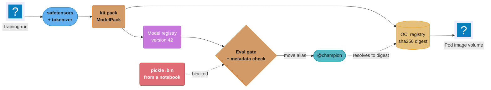
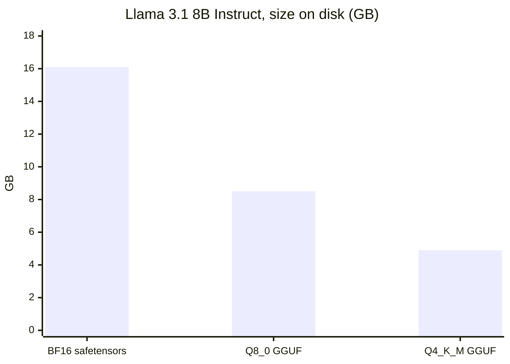
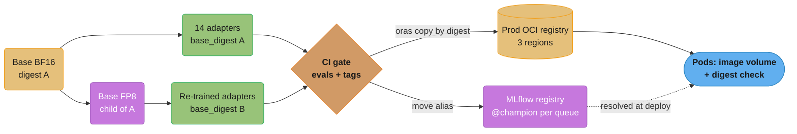

# Model Registry and Packaging

> **Version anchor (2026-10-18).** MLflow 3.17.1 (2026-10-13). Kubeflow Hub v0.3.17
> (2026-09-21); the project was renamed from Kubeflow Model Registry at v0.3.9 and added an MCP
> catalog in v0.3.14 and an Agents catalog in v0.3.16. Kubernetes 1.37 (1.37.1 on 2026-09-15);
> the OCI image volume source has been GA since 1.36. ModelPack model-spec v0.0.7 (git tag of
> 2025-07-21, no GitHub release objects); ModelPack is a CNCF Sandbox project, accepted
> 2025-05-13. KitOps v1.16.0 (2026-09-29), repo `kitops-ml/kitops`, CNCF Sandbox since
> 2025-03-04; its README calls it an implementation of the ModelPack specification, and
> `kit pack --use-model-pack` writes that format. Every version claim below is checked against
> this anchor.

A model registry answers one question for every model a company runs: which exact bytes are
approved for which use, and who said so. Packaging answers the next one: how those bytes,
plus the tokenizer, config and license that make them usable, travel from the training cluster
to a serving node without changing on the way. This page covers both: registry semantics that
hold across products, the on-disk formats (safetensors, GGUF, ONNX, MLflow `MLmodel`,
`torch.export`), and OCI distribution with ModelPack, KitOps, ORAS and Kubernetes image volumes.

---

## 1. Concept Overview

Three layers sit between a training job and a serving process, and most incidents in this area
come from mixing them up.

| Layer | Question it answers | Examples |
|---|---|---|
| Format | How are the tensors laid out in a file? | safetensors, GGUF, ONNX, `.pt2`, pickle `.bin` |
| Package | Which files make one usable model, and what are their digests? | MLflow `MLmodel` dir, ModelKit, ModelPack artifact, HF repo at a commit |
| Registry | Which package version is approved for which environment, and why? | MLflow, Unity Catalog, SageMaker, Vertex, W&B Registry, Kubeflow Hub |

The **registry** is a metadata store. It maps a name (`payments.fraud_scorer`) to numbered,
immutable versions, maps mutable aliases (`champion`, `staging`) to versions, and stores the
evidence attached to each version: input and output signature, eval results, a lineage pointer
to the run and data that produced it, license, intended use, and approver. It does not hold
the bytes. The bytes live in an object store or an OCI registry, and the registry version
points at them by URI or digest.

The **package** is the unit that moves. For a gradient-boosted fraud model it is a few
megabytes: a serialized booster, a `requirements.txt` and a signature. For an 8B-parameter LLM
it is 16 GB of BF16 weights plus `config.json`, `tokenizer.json`, `tokenizer_config.json`
(which holds the chat template), `generation_config.json` and a license file. Ship the weights
without the tokenizer files and the server starts cleanly and produces wrong output.

The **format** decides what loading costs and what loading can do. A pickle-based checkpoint
(`pytorch_model.bin`, most `.pt` files) runs arbitrary Python during `torch.load`. A
safetensors file is a JSON header plus raw tensor bytes and runs nothing. That difference is a
security boundary, not a style choice.

Two shifts shape this area. Aliases replaced fixed stages (MLflow deprecated stages in 2.9; Unity
Catalog never had them). And models are moving onto the OCI registries that already hold
container images, through the ModelPack spec, so one registry, signing chain and pull path serve
code and weights.

**Not here.** Stage and approval basics and the CI flow around them live in
[MLOps and CI/CD](../../ml/mlops_and_ci_cd/mlops_and_ci_cd.md) §4 "Model Registry Governance".
MLflow internals (schema, alias resolution at load, URI forms) live in
[MLflow Deep Dive](../../ml/mlflow_deep_dive/mlflow_deep_dive.md). How fast weights load,
lazy pulling and cold start belong to
[Model Storage, Loading and Cold Start](../model_storage_loading_and_cold_start/model_storage_loading_and_cold_start.md).
Signing, provenance attestations and model scanning belong to
[ML Supply Chain Security](../ml_supply_chain_security/ml_supply_chain_security.md). Digests,
bundle manifests and lineage graphs across all artifact types belong to
[Artifact Versioning and Lineage](../artifact_versioning_and_lineage/artifact_versioning_and_lineage.md).

---

## 2. Intuition

**One-line analogy.** The registry is the pharmacy's approved-drug list; the package is the
sealed, labeled box with the lot number; the format is the pill's chemistry. A label that
says "aspirin" on a box nobody sealed is how wrong drugs reach patients.

**Mental model.** Think of every model reference as one of two kinds:

- A **pointer you can move**: an alias (`@champion`), a container tag (`:latest`), a Git
  branch (`main` on Hugging Face). Good for humans and for promotion.
- A **pointer you cannot move**: a registry version number, a `sha256:` digest, a 40-character
  commit SHA. Good for deploy records, audits and rollback.

Promotion moves the first kind. Deployment records the second kind. A team that records only
the first kind cannot answer "what was serving at 14:03 last Tuesday".

**Why it matters.** Serving systems resolve a model reference at load time. If that reference
is mutable and nobody recorded what it resolved to, two replicas that started an hour apart can
run different weights with no deploy, no diff and no alert, and the auditor or incident
commander who opens the registry next finds nothing to go on.

**Key insight.** Promote the bytes; never rebuild them. A version that passed evals in staging
must be the same digest in production. Re-exporting, re-quantizing or re-packaging between
environments produces a different artifact that skipped the gate.

---

## 3. Core Principles

1. **Versions are immutable, aliases are not.** A registry version, once written, never
   changes its bytes or its source URI. All change happens by creating a new version and moving
   an alias. Overwriting a version's files in place is a process bug.
2. **Identity is a digest.** Version numbers are local to one registry; `sha256:` digests are
   global. Copying a model from a dev registry to a prod registry changes the version number
   and keeps the digest, so the digest is what gates and deploy records compare.
3. **The registry stores evidence, not just files.** A version without a signature, eval
   results, a lineage pointer, a license and an intended-use note is a file upload. Make these
   required fields and block alias moves when they are missing.
4. **The package is the full inference contract.** Weights, architecture config, tokenizer,
   chat template, generation defaults, preprocessing code or its version, and the runtime
   requirement (framework, CUDA, engine). Anything left out is supplied by guesswork at serve
   time.
5. **Loading must not execute code.** Prefer formats that are pure data (safetensors, GGUF,
   ONNX). Pickle checkpoints are code. Scanning reduces the risk; it does not remove it.
6. **Derived artifacts point at their parent by digest.** A LoRA adapter, a quantized variant
   or an ONNX export is valid only for one exact base. Record the base digest on the entry and
   check it at load.
7. **One registry of record per environment boundary.** Dev, staging and prod can be separate
   registries for access control, but promotion between them is a copy by digest with the
   evidence attached, not a re-upload from a laptop.

---

## 4. Types / Architectures / Strategies

### 4.1 Promotion models: fixed stages vs aliases

| Model | How it works | Where it lives | Weakness |
|---|---|---|---|
| Fixed stages | Each version is in one of `None`, `Staging`, `Production`, `Archived` | MLflow (deprecated since 2.9) | One version per stage per name; no room for `canary`, `shadow`, per-region pins |
| Aliases | Named pointers per registered model; one alias points at one version, a version can hold many | MLflow (since 2.3), Unity Catalog, W&B Registry, Vertex AI | Any user with write access can move one; needs a gate |
| Approval status | Each version carries `PendingManualApproval`, `Approved` or `Rejected` | SageMaker Model Registry | Status is a flag, not a pointer; the deploy pipeline must pick which approved version |
| Git revisions | Branches and tags over commits | Hugging Face Hub | `main` moves; only the commit SHA is fixed |
| OCI tags and digests | Tags are mutable names over immutable manifest digests | ModelPack, KitOps, ORAS, any OCI registry | Tag mutation unless the registry enforces tag immutability |

Aliases replaced stages because rollouts need more than two slots: a fraud team may run `champion`
on 95% of traffic, `challenger` on 5%, `shadow` on a mirror and `eu_champion` one version behind
for a regulator's sign-off. Fixed stages cannot express that.

### 4.2 Registry products

| Registry | Naming | Promotion primitive | Notes |
|---|---|---|---|
| MLflow 3.17 (open source) | `name`, integer versions | Aliases plus version tags | `LoggedModel` links a model to its traces and evals; `models:/name@alias` URIs |
| Databricks Unity Catalog | `catalog.schema.model` | Aliases; no stages | Access control and lineage come from the catalog; MLflow client with `databricks-uc` registry URI |
| SageMaker Model Registry | Model package group, numbered packages | `ModelApprovalStatus` | Approval changes can trigger EventBridge rules that start deployment |
| Vertex AI Model Registry | Model resource, version ids | Version aliases; a `default` alias | Endpoints deploy a specific model version |
| W&B Registry | Registry, collection, linked artifact versions | Aliases on linked versions | Artifact versions carry content checksums |
| Kubeflow Hub v0.3.17 | Registered model, model version, model artifact | Custom properties and states | Self-hosted on Kubernetes; model, MCP and Agents catalogs |
| Hugging Face Hub | `org/repo` | Commit SHA, branches, tags | Gated repos require accepting terms before download |

Kubeflow Hub's catalogs list approved base models, MCP servers and agents behind one API; versioning
of tools and agents is in
[Agent, Tool and MCP Server Lifecycle](../agent_tool_and_mcp_server_lifecycle/agent_tool_and_mcp_server_lifecycle.md).

### 4.3 Model formats

| Format | What it stores | Executes code on load? | Typical runtime |
|---|---|---|---|
| safetensors | JSON header plus raw tensors; tensors only | No | PyTorch, Transformers, vLLM, SGLang, TensorRT-LLM checkpoint conversion |
| Pickle (`.bin`, `.pt`, `.pkl`, `joblib`) | Arbitrary Python object graph | Yes | Legacy PyTorch checkpoints, scikit-learn, XGBoost via pickle |
| GGUF | Single file: metadata KV (architecture, tokenizer, chat template) plus tensors, often quantized | No | llama.cpp, Ollama, LM Studio |
| ONNX | Computation graph plus weights in protobuf; external data file above 2 GB | No | ONNX Runtime, TensorRT, OpenVINO |
| `torch.export` `.pt2` | `ExportedProgram`: traced graph, signature, weights; AOTInductor packages add compiled kernels | Yes: tensors load through `torch.load`; AOTInductor packages are native `.so` code | PyTorch runtime, AOTInductor C++ loader |
| MLflow `MLmodel` dir | Wrapper: flavors, signature, input example, environment files, plus one of the above | Depends on the flavour | `mlflow.pyfunc`, MLServer, KServe |

`MLmodel` is a package format, not a tensor format. An MLflow sklearn model is a pickle inside an
`MLmodel` directory; a Transformers model can be safetensors inside one. Check what is inside
before calling it safe.

### 4.4 Adapters and derived variants as registry entries

A LoRA adapter is tens to hundreds of megabytes; its base model is tens of gigabytes. Register the
adapter as its own model with its own versions, and give every adapter version a required
`base_model_digest` property. The same holds for a GPTQ or AWQ quantized variant, a GGUF
conversion and an ONNX export: each is a child of one exact parent. The serving side of
adapters, hot loading and multi-tenant routing, is in
[LoRA Adapter Serving and Lifecycle](../lora_adapter_serving_and_lifecycle/lora_adapter_serving_and_lifecycle.md).

---

## 5. Architecture Diagrams

### Registry and package flow from training to a serving pod



The registry version and the OCI digest are written together at pack time, so the alias always
resolves to one digest. The pod mounts the digest, never the alias, which keeps two replicas
from drifting apart.

### Alias moves over time

```
time       v40          v41          v42          v43
------------------------------------------------------------
day 1      champion     challenger
day 3      previous     champion
day 9      previous     champion     challenger
day 10                  previous     champion*
day 10+                 champion     previous     rejected
```

The cell marked `*` is the bad promotion: v42 lost a slice on day 10, and rollback is one alias
move back to v41, which works only because v41 kept its bytes and its `@previous` label. Versions
never change; only the labels slide across columns. A deploy record
that stored "champion" instead of "v42" cannot show which column served traffic on day 10.

### safetensors byte layout

```
offset 0         8                        8+N                                  end
       +---------+------------------------+------------------------------------+
       | N (u64) | JSON header, N bytes   | tensor bytes, contiguous           |
       | LE      | {"w1": {"dtype":"BF16",| w1: [0, 33554432)                  |
       |         |  "shape":[4096,4096],  | w2: [33554432, 67108864)           |
       |         |  "data_offsets":[...]} | ...                                |
       +---------+------------------------+------------------------------------+
                  ^ parsed as data only    ^ mmap; read only the ranges you need
```

The header is the whole index. A loader reads 8 bytes, reads N bytes of JSON, and then knows the
exact byte range of every tensor, so it can memory-map the file and copy one tensor per GPU
shard without reading the rest. A 4096 by 4096 BF16 matrix is 33,554,432 bytes, which is why
`w2` starts there.

### ModelPack artifact as an OCI manifest

```
registry.example.com/models/fraud-llm@sha256:5f2a...   (manifest)
├─ artifactType: application/vnd.cncf.model.manifest.v1+json
├─ config:       application/vnd.cncf.model.config.v1+json
│                (descriptor, config, modelfs)
└─ layers
   ├─ application/vnd.cncf.model.weight.v1.raw          model-00001-of-00004.safetensors
   ├─ application/vnd.cncf.model.weight.v1.raw          model-00002-of-00004.safetensors
   ├─ application/vnd.cncf.model.weight.v1.raw          ... 4 shards, about 4 GB each
   ├─ application/vnd.cncf.model.weight.config.v1.raw   config.json, tokenizer.json
   ├─ application/vnd.cncf.model.doc.v1.raw             README.md, LICENSE
   └─ application/vnd.cncf.model.dataset.v1.tar+zstd    eval set, optional
```

Each shard is its own layer, so a registry deduplicates shards shared between two versions,
and a client pulls shards in parallel. The `raw` media types skip tar and compression, which is
the right call for weights: BF16 tensors compress poorly and decompression adds CPU time on
every pull.

### Bytes on disk for one 8B model by format



Three registry entries, one base. The GGUF variants are children of the BF16 version and carry
its digest as their parent; a quantized file uploaded without that link cannot be traced back
to the weights that passed evals.

---

## 6. How It Works - Detailed Mechanics

### 6.1 Registering a version with its evidence (MLflow 3.17)

```python
import mlflow
from mlflow import MlflowClient
from mlflow.models import infer_signature

NAME = "fraud_scorer"
client = MlflowClient()

with mlflow.start_run() as run:
    signature = infer_signature(X_val, model.predict_proba(X_val))
    info = mlflow.xgboost.log_model(
        model,
        name="model",
        signature=signature,
        input_example=X_val[:5],
    )
    mlflow.log_metrics({"auc_pr": 0.412, "recall_at_1pct_fpr": 0.63})

mv = mlflow.register_model(info.model_uri, NAME)
for key, value in {
    "eval_set": "fraud-eval@2026-10-01",
    "eval_report": f"runs:/{run.info.run_id}/eval/report.json",
    "training_data": "lakefs://fraud/main@c41f9e2",
    "license": "internal",
    "intended_use": "card-not-present scoring, EU and US",
}.items():
    client.set_model_version_tag(NAME, mv.version, key, value)
```

The signature is stored in `MLmodel` and checked by `pyfunc` at predict time; the tags are the
evidence a gate reads. Nothing here moves an alias. Registration and promotion are separate
steps with separate permissions.

### 6.2 The promotion gate: broken, then fixed

Broken: anyone with registry write access promotes from a notebook.

```python
# BROKEN: no check, no record of who or why, works on any version
client.set_registered_model_alias("fraud_scorer", "champion", 43)
```

A data scientist ran this on a Friday to "test the alias". The serving fleet re-resolved
`@champion` on its next scale-out and served v43, which had never run the eval set. Recall at 1%
FPR dropped from 0.63 to 0.51 for the six hours until someone compared versions.

Fixed: aliases move only from a CI job that holds the write permission, and the job refuses
versions without evidence.

```python
REQUIRED = {"eval_set", "eval_report", "training_data", "license", "intended_use"}

def promote(name: str, version: str, alias: str, approver: str) -> None:
    mv = client.get_model_version(name, version)
    missing = REQUIRED - mv.tags.keys()
    if missing:
        raise SystemExit(f"{name} v{version} missing tags: {sorted(missing)}")
    if mv.tags.get("gate_result") != "pass":
        raise SystemExit(f"{name} v{version} has no passing eval gate")
    try:
        current = client.get_model_version_by_alias(name, alias)
        client.set_registered_model_alias(name, "previous", current.version)
    except mlflow.exceptions.MlflowException:
        pass  # first promotion for this alias
    client.set_registered_model_alias(name, alias, version)
    client.set_model_version_tag(name, version, f"promoted_{alias}_by", approver)
```

Humans hold no alias-write permission, so the notebook path fails on permissions rather than
discipline, and the old champion gets `@previous` before each move, so rollback needs no lookup.
The gate's checks are in
[Evaluation Gates and Eval Sets](../evaluation_gates_and_eval_sets/evaluation_gates_and_eval_sets.md).

### 6.3 Reading a safetensors header without a framework

```python
import json, struct

def safetensors_index(path: str) -> dict:
    with open(path, "rb") as f:
        (n,) = struct.unpack("<Q", f.read(8))
        if n > 100_000_000:
            raise ValueError("header too large")
        header = json.loads(f.read(n))
    meta = header.pop("__metadata__", {})
    total = sum(e["data_offsets"][1] - e["data_offsets"][0] for e in header.values())
    return {"tensors": len(header), "bytes": total, "metadata": meta}
```

This is the whole parser that matters for safety: an integer, a JSON object and byte ranges.
The safetensors library rejects headers above 100 MB and checks that the offsets are in bounds
and do not overlap, so a crafted file can fail to load but cannot run code. `__metadata__` is a
string-to-string map; a packaging step can write the base digest or the eval-set version there
so the evidence travels inside the file.

### 6.4 Pickle checkpoints: broken, then fixed

```python
# BROKEN: runs whatever __reduce__ the file contains
state = torch.load("pytorch_model.bin")
```

A pickle stream can call any importable function during unpickling; the classic payload calls
`os.system` from `__reduce__` before your code sees a tensor. `weights_only=True` restricts the
unpickler to an allowlist and is the default since PyTorch 2.6, but CVE-2025-32434 bypassed it
for remote code execution in PyTorch 2.5.1 and earlier. A flag inside a code-executing format is
a mitigation with a version history, not a boundary.

```python
# FIXED: data-only format; conversion runs once, in a sandbox, by the platform
from safetensors.torch import load_file, save_file

state = load_file("model.safetensors", device="cpu")

# one-time conversion job, network-isolated container, never on a serving node
legacy = torch.load("pytorch_model.bin", weights_only=True)
save_file({k: v.contiguous() for k, v in legacy.items()}, "model.safetensors",
          metadata={"converted_from_sha256": "9a1f..."})
```

Refuse pickle uploads for neural weights and convert legacy checkpoints in an isolated job.
scikit-learn models are pickles (joblib) by default: use ONNX where the runtime supports it,
use XGBoost's native `.ubj` or `.json` from `save_model`, and scan the rest. Scanning and signing
are in [ML Supply Chain Security](../ml_supply_chain_security/ml_supply_chain_security.md); the
attack side of pickle payloads is in [LLM Security](../../llm/llm_security/llm_security.md).

### 6.5 GGUF: the single-file package

GGUF is a format and a package at once. Its layout:

```
magic "GGUF" (4 bytes) | version u32 = 3 | tensor_count u64 | kv_count u64
metadata KV pairs: general.architecture = "llama"
                   general.alignment    = 32
                   tokenizer.ggml.model = "gpt2"
                   tokenizer.chat_template = "..."
tensor infos:      name, n_dims, dims[], type (F16, Q8_0, Q4_K, ...), offset
padding to general.alignment
tensor data
```

The tokenizer and chat template ride inside the file, so a GGUF cannot lose them the way an HF
directory can, but the template is frozen at conversion time: an upstream template fix reaches no
GGUF until someone re-converts it. Register each GGUF as a child of its source revision with the
`llama.cpp` build as a tag, so a fix can find every affected child.

### 6.6 ONNX export and the 2 GB limit

ONNX models are protobuf, and a single protobuf message is capped at 2 GB. Larger models store
weights in an external data file next to the graph:

```python
import onnx

model = onnx.load("model.onnx")    # reads any existing external data into memory
onnx.save_model(
    model, "packaged/model.onnx",
    save_as_external_data=True,
    all_tensors_to_one_file=True,
    location="model.onnx.data",
)
```

The `.onnx` file holds a relative path to `model.onnx.data`, so register both as one version;
`model.onnx` alone parses and then fails at session creation. Tag the opset
(`model.opset_import`) too: a runtime built for opset 17 cannot run a graph exported at opset 21.

### 6.7 `torch.export` and AOTInductor packages

```python
import torch

ep = torch.export.export(model.eval(), (example_input,))
torch.export.save(ep, "ranker.pt2")                     # graph + weights, no model class

pkg = torch._inductor.aoti_compile_and_package(ep, package_path="ranker_aoti.pt2")
runner = torch._inductor.aoti_load_package(pkg)          # compiled for this GPU arch
```

`torch.export` captures a typed graph, so loading needs no Python model class. It is not a
data-only format: the tensors inside load through `torch.load`, so treat a `.pt2` from outside
the trust boundary like a pickle. An AOTInductor package adds compiled kernels tied to the GPU architecture, CUDA and
PyTorch versions that built it: register the plain `.pt2` as the parent and each build as a
child tagged `sm_arch`, `cuda` and `torch`, so an H100 pod never resolves the L4 build.

### 6.8 Packaging to OCI with KitOps and ModelPack

```yaml
# Kitfile
manifestVersion: "1.0"
package:
  name: support-llm
  version: 3.2.0
  authors: ["ml-platform@example.com"]
model:
  name: support-llm-8b
  path: ./model
  license: llama3.1
  description: Support assistant, SFT on 2026-09 tickets
datasets:
  - name: eval
    path: ./eval/support-eval-2026-10.parquet
docs:
  - path: ./README.md
```

```bash
kit pack . -t registry.example.com/models/support-llm:3.2.0 --use-model-pack
kit push registry.example.com/models/support-llm:3.2.0
kit inspect registry.example.com/models/support-llm:3.2.0   # prints manifest and digest
kit unpack registry.example.com/models/support-llm@sha256:7c1e... --filter=model -d /models
```

`--use-model-pack` writes ModelPack media types; without it KitOps writes its own ModelKit
types, which `kit` reads but other ModelPack consumers may not. Pick one per platform. In
ModelPack mode KitOps maps the Kitfile's model `path` to one `weight` layer and each model part
to a `weight.config` layer, as `tar` by default; `--layer-format raw` accepts only single files,
not directories. After
the push, write the manifest digest onto the registry version as `oci_digest`, so the alias,
the registry version and the OCI digest are linked in one record.

ORAS covers the case where you want plain OCI with your own media types:

```bash
oras push registry.example.com/models/ranker:v42 \
  --artifact-type application/vnd.example.ranker.v1 \
  ranker.pt2:application/vnd.example.ranker.weights.v1
oras copy registry.example.com/models/ranker@sha256:3b9d... \
  prod-registry.example.com/models/ranker:v42
```

`oras copy` by digest is how promotion between a dev and a prod registry keeps identity: the
digest at the destination equals the digest at the source, which a gate can verify.

### 6.9 Mounting a model with a Kubernetes image volume

```yaml
apiVersion: v1
kind: Pod
metadata:
  name: support-llm
spec:
  containers:
    - name: server
      image: registry.example.com/serving/llm-server@sha256:41d0...
      args: ["--model", "/models/support-llm"]
      volumeMounts:
        - name: weights
          mountPath: /models/support-llm
          readOnly: true
  volumes:
    - name: weights
      image:
        reference: registry.example.com/models/support-llm@sha256:7c1e...
        pullPolicy: IfNotPresent
```

The image volume source (GA since Kubernetes 1.36) pulls an OCI object through the node's
container runtime and mounts it read-only. Unlike an init container running `kit unpack` or
`aws s3 cp`, it shares the node cache across pods, reuses image credentials and mirrors, and
leaves no writable `emptyDir` copy to fill the disk. Two cautions: runtime support for non-image
OCI artifacts (ModelPack layers rather than an image filesystem) varies by runtime and version,
so test your exact artifact type on your node image; and reference by digest, since a tag makes
the pod spec a mutable pointer again. Load speed is in
[Model Storage, Loading and Cold Start](../model_storage_loading_and_cold_start/model_storage_loading_and_cold_start.md).

### 6.10 Adapters pinned to a base digest

PEFT writes `adapter_config.json` with `base_model_name_or_path`, a name such as
`meta-llama/Llama-3.1-8B-Instruct`. A name is a mutable pointer. The registry entry must carry
the digest of the exact base the adapter was trained on, and the server must check it:

```python
def check_adapter(adapter_mv, base_mv) -> None:
    want = adapter_mv.tags["base_model_digest"]
    have = base_mv.tags["oci_digest"]
    if want != have:
        raise RuntimeError(
            f"adapter {adapter_mv.name} v{adapter_mv.version} trained on {want[:19]}, "
            f"refusing to load on base {have[:19]}"
        )
```

A LoRA adapter loaded on the wrong base does not fail. The tensor shapes match, the server
starts, and quality degrades by an amount that depends on how far the two bases differ. Only a
digest check catches it.

### 6.11 Hugging Face revisions

```python
from transformers import AutoModelForCausalLM, AutoTokenizer

REV = "0e9e39f249a16976918f6564b8830bc894c89659"   # 40-char commit SHA
tok = AutoTokenizer.from_pretrained("org/model", revision=REV)
model = AutoModelForCausalLM.from_pretrained("org/model", revision=REV,
                                             use_safetensors=True)
```

Without `revision`, both calls read `main`, which the repo owner can push to at any time,
including a tokenizer or chat-template fix that changes outputs. `use_safetensors=True` makes
the load fail rather than fall back to a pickle file when the repo has no safetensors weights.
Avoid `trust_remote_code=True` on serving nodes: it imports Python files from the repo. For
production, mirror the repo at a pinned SHA into your own registry and serve from the mirror.

### 6.12 Size arithmetic for distribution

| Model | Precision | Bytes per param | Size | Pull at 10 Gbit/s, ideal |
|---|---|---|---|---|
| 8B | BF16 | 2 | 16 GB | 13 s |
| 70B | BF16 | 2 | 140 GB | 112 s |
| 70B | GGUF Q4_K_M | about 0.6 | about 42 GB | 34 s |

Ideal means 1.25 GB/s with no protocol overhead; one stream rarely sustains that, which is why
sharded layers pulled in parallel matter. Storage scales too: 30 retained versions of a 70B model
are 4.2 TB before replication to three regions, so retention is part of registry design.

---

## 7. Real-World Examples

**Hugging Face and safetensors.** Hugging Face built safetensors to replace pickle checkpoints
and commissioned a security audit from Trail of Bits in 2023, jointly with EleutherAI and
Stability AI. Transformers saves safetensors by default and loads them first when a repo has
both formats.

**Malicious models on public hubs.** JFrog's security research team reported in February 2024
that it had found around 100 models on Hugging Face with pickle payloads that ran code on load,
one of them opening a reverse shell. In February 2025 ReversingLabs described "nullifAI": two
models, compressed with 7z instead of PyTorch's ZIP, whose pickle stream put the payload first
and broke right after it, so loading ran the payload before failing and Picklescan did not flag
them. Both
reports point to the same rule: do not load pickle from outside your trust boundary, and do not
treat a scanner pass as proof.

**Ollama and Docker Model Runner.** Ollama distributes models through an OCI-shaped registry: a
manifest per tag with layers for GGUF weights, chat template, parameters and license, so a
second model that shares a layer downloads only the difference. Docker ships models as OCI
artifacts on Docker Hub (the `ai/` namespace), pulled with `docker model pull` through the same
auth, mirrors and replication teams already run for images.

**Meta Llama gating.** Llama repos on Hugging Face are gated: a user accepts the license before
download. A company that mirrors the weights internally bypasses that gate, so the license and
acceptable-use policy must travel in the package and `license` must be a required tag.

---

## 8. Tradeoffs

### Formats

| Dimension | safetensors | GGUF | ONNX | `.pt2` (export) | Pickle |
|---|---|---|---|---|---|
| Safe to load untrusted | Yes | Yes | Yes | No (tensors via `torch.load`; AOTInductor is native code) | No |
| Lazy, mmap-friendly | Yes | Yes | Partly (external data) | Varies | Partly (`torch.load(mmap=True)`) |
| Carries tokenizer and template | No | Yes | No | No | No |
| Quantized variants | Via separate tensors | Native (Q8_0, Q4_K, ...) | Via QDQ graphs | Via torchao | Any |
| Engine reach | Broad GPU serving | llama.cpp family | ONNX Runtime, TensorRT, OpenVINO | PyTorch | PyTorch, sklearn |
| Best for | GPU LLM serving | CPU, laptop, edge | Cross-runtime, small models | Python-free PyTorch | Nothing new |

### Distribution

| Channel | Promotion cost | Rollback | Supply chain | Main risk |
|---|---|---|---|---|
| Object store path | Copy files | Point at old path | Separate signing story | Path reuse, lifecycle deletion |
| OCI artifact | Copy by digest | Old digest | Same as images (signatures, referrers) | Registry limits on huge layers |
| Weights in image | Image push | Old image | Same as images | 20 GB images, slow rebuilds |
| HF Hub direct | None | Old SHA | Depends on the repo | `main` drift, outages, rate limits |

---

## 9. When to Use / When NOT to Use

**Use a registry with required metadata when:**
- More than one model version can be live at once (canary, shadow, per-region).
- A regulator, auditor or customer can ask what model made a decision on a given date.
- Serving resolves models at load time rather than baking them into images.

**Use OCI distribution when:**
- You already run an OCI registry with replication, auth and signing for images.
- Models are larger than a few hundred MB and shared across clusters or regions.
- You want image volumes or a node-level cache instead of per-pod downloads.

**Do NOT:**
- Add a registry for one batch model retrained monthly by one person; a versioned object-store
  path and a run id in the job log are enough until a second consumer appears.
- Bake multi-gigabyte weights into the serving image when weights change more often than the
  server code; every weight change becomes a full image rebuild and push.
- Accept pickle uploads into a registry that serves neural networks.

---

## 10. Common Pitfalls

**The alias moved and nobody deployed.** A recommendations team ran pods that resolved
`models:/ranker@champion` at start. A data scientist moved the alias to test a candidate in a
notebook. Over the next four hours the autoscaler added 30 pods, all on the candidate, while
the original 40 stayed on the old version. Click-through dropped 3% on the new pods, and the
dashboards averaged it into noise for a day. Fix: alias writes only from CI, and serving logs
the resolved version and digest at load so a mixed fleet shows up in one query.

**Weights without the tokenizer.** A platform team copied only `*.safetensors` into the prod
bucket for an SFT model, because their sync job filtered on extension. The server fell back to
the base model's tokenizer from a cache. The fine-tune had added 12 special tokens; outputs
included raw token fragments in about 4% of replies. Fix: package the full inference contract
and have the server refuse to start when `tokenizer_config.json` is missing from the package.

**Chat template fixed upstream, stale in GGUF.** An internal assistant served a GGUF converted
in week one. The upstream repo fixed a chat-template bug that dropped the system prompt on
multi-turn requests. The GGUF kept the old template inside the file. Fix: record source SHA and
converter build on each GGUF entry and re-convert children when the parent revision changes.

**Lifecycle rule deleted a live version.** A bucket had a 90-day expiry on `models/` to cut
storage cost. The champion was 120 days old. A node replacement tried to pull it and got 404s,
and the registry still listed the version as champion. Fix: retention lives in the registry
(never expire a version that holds an alias or `@previous`), and the bucket rule exempts
referenced prefixes, or the bytes live in an OCI registry with tag-based retention.

**Adapter on the wrong base.** A team re-quantized its base model to FP8 and registered it under
the same name. Adapters trained on the BF16 base loaded onto the FP8 base by name. Shapes
matched, nothing errored, and a support-intent adapter lost 6 points of accuracy on its eval
set. Fix: `base_model_digest` on every adapter version and a load-time check.

**ONNX graph without its data file.** A model above 2 GB was exported with external data, and
the upload step registered only `model.onnx`. Staging passed because the build agent still had
`model.onnx.data` in the working directory. Production failed at session creation. Fix:
register the directory as one version and test-load from a clean pull, not from the build
workspace.

**Tag overwritten in the OCI registry.** CI pushed `support-llm:3.2.0` twice after a rerun, with
a different packaging timestamp, so the digest changed. Two regions had pulled different
digests under the same tag. Fix: enable tag immutability on the model repositories and record
the digest, not the tag, on the registry version.

---

## 11. Technologies & Tools

| Tool | Role | Notes |
|---|---|---|
| MLflow Model Registry | Open-source registry | 3.17.1; aliases, version tags, `LoggedModel` lineage |
| MLflow Models | Package format | `MLmodel` file with flavors, signature, environment |
| Unity Catalog | Governed registry on Databricks | Three-level names, aliases, catalog permissions |
| SageMaker Model Registry | AWS registry | Model package groups, `ModelApprovalStatus`, EventBridge events |
| Vertex AI Model Registry | GCP registry | Model versions and aliases |
| W&B Artifacts | Versioned artifacts under W&B Registry | Collections, linked versions, aliases |
| Kubeflow Hub | Self-hosted registry and catalogs | v0.3.17; models, MCP servers and agents |
| HuggingFace Hub | Public model hosting | Git revisions, gated repos, model cards |
| safetensors | Tensor format | Data-only, mmap, header limit 100 MB |
| GGUF | Single-file quantized format | llama.cpp, Ollama |
| ONNX | Graph format | Opsets, external data above 2 GB |
| torch.export | PyTorch graph export | `.pt2` `ExportedProgram` |
| AOTInductor | Ahead-of-time compiled PyTorch packages | Tied to GPU arch, CUDA and PyTorch version |
| ModelPack | OCI model artifact spec | model-spec v0.0.7; `application/vnd.cncf.model.*` media types |
| KitOps | Packaging CLI | v1.16.0; Kitfile, `kit pack --use-model-pack`, init-container integration |
| ORAS | Generic OCI artifact CLI | `oras push`, `oras copy`, referrers |
| Harbor | Self-hosted OCI registry | Replication, tag immutability, tag retention |
| Kubernetes | Image volume source | Mounts OCI objects read-only; GA since 1.36, pinned 1.37 |

---

## 12. Interview Questions with Answers

**Q: Why is pointing a deployment at a registry alias not enough to make it reproducible?**
**Short:** An alias is mutable, so a deploy record must store the resolved version and digest, or nobody can say which bytes served traffic.

An alias such as `@champion` is a pointer that anyone with write access can move, and serving
code usually resolves it at load time. Two pods that start an hour apart can therefore run
different versions with no deploy event. Log the resolved version number and the content digest
at load, store them in the deploy record, and alert when the fleet reports more than one digest
for one alias. Promotion moves aliases; audit and rollback read digests.

**Q: What breaks when you load a pickle-based checkpoint with `torch.load`?**
**Short:** Unpickling can call any Python function, so loading an untrusted `.bin` or `.pt` file runs the uploader's code on your node.

Pickle stores an object graph plus instructions to rebuild it, and `__reduce__` can name any
importable callable, `os.system` included. `weights_only=True` limits the unpickler and is the
default since PyTorch 2.6, yet CVE-2025-32434 showed a bypass in 2.5.1 and earlier, so the flag
has a version history. Use safetensors for neural weights, convert legacy checkpoints once in an
isolated job, and refuse pickle uploads into the registry.

**Q: A new model version loads cleanly but chat replies have broken formatting. What did the package miss?**
**Short:** The tokenizer files and chat template; weights alone do not define how text maps to tokens or how turns are formatted.

An LLM package needs `tokenizer.json`, `tokenizer_config.json` (which holds the chat template),
`generation_config.json` and `config.json` next to the weights. If a sync job copies only
`*.safetensors`, the server may pick up a cached base tokenizer and still start. Fine-tunes that
add special tokens then emit raw fragments. Package the full inference contract and make the
server refuse to start when those files are absent.

**Q: Why must a LoRA adapter's registry entry pin the base model by digest instead of by name?**
**Short:** An adapter is only valid for the exact base it was trained on, and a name can point at re-quantized or updated weights.

PEFT records `base_model_name_or_path`, a name. If the platform re-quantizes the base or pulls a
new upstream commit under the same name, the adapter still loads because shapes match, and
quality drops with no error. Store `base_model_digest` on each adapter version and compare it
with the base's digest at load time; refuse to serve on mismatch.

**Q: Why pin a Hugging Face model to a commit SHA rather than `main`?**
**Short:** `main` is a branch the repo owner can push to at any time, while a 40-character commit SHA always resolves to the same files.

`from_pretrained` without `revision` reads `main`, so a tokenizer fix, a new chat template or
replaced weights reach production on the next pod start. Pass `revision=<sha>` for both the
model and tokenizer, set `use_safetensors=True` so the load fails instead of falling back to
pickle, and for production mirror the repo at that SHA into your own registry.

**Q: What metadata should a registry version carry before it can be promoted?**
**Short:** An input and output signature, eval results with the eval-set version, a lineage pointer to run and data, license, intended use, and the content digest.

Without these, a version is a file upload. The signature catches schema drift at request time,
eval results with the eval-set version make the gate repeatable, lineage supports erasure and
blast-radius queries, and license plus intended use answer legal and governance reviews. Enforce
them as required tags that a CI promotion job checks before it moves an alias.

**Q: Should model weights be baked into the serving container image?**
**Short:** Usually not for large models: weights change on a different cadence than server code, and baking them in turns each weight change into a huge image push.

A 16 GB image rebuilds and repushes for every fine-tune, and layers are not shared across models
that use the same server. Ship the server image and the model as separate OCI artifacts, both by
digest, and mount the model with an image volume or a node cache. Baking in still fits small
models that change with the code, such as a 50 MB classifier owned by the same team.

**Q: How do you promote a model from a dev registry to a prod registry without breaking its identity?**
**Short:** Copy the artifact by digest, carry its evidence with it, and have the prod gate verify the digest matches the one that passed evals.

Version numbers differ between registries; digests do not. `oras copy` or a registry
replication rule moves the OCI artifact unchanged, and Unity Catalog can copy a model version
into another catalog. Re-exporting or re-uploading from a workstation creates a new artifact that
skipped the gate. Record source registry, source version and digest as tags on the prod version.

**Q: How does safetensors make loading both safe and fast?**
**Short:** It is an 8-byte length, a JSON header with dtype, shape and byte offsets, then raw tensor bytes, so loaders parse data only and mmap the ranges they need.

No code runs during parsing, and the library checks header size (100 MB maximum) and that offsets
stay in bounds without overlapping. Because every tensor's byte range is in the header, a
tensor-parallel loader reads only the slices for its shard and can memory-map the file instead of
copying it. Pickle has neither property: it must execute the stream to find the tensors.

**Q: What does the ModelPack specification define, and what does it leave to other tools?**
**Short:** It defines OCI media types for model artifacts, a manifest artifactType, a config with model metadata, and layer types for weights, configs, docs, code and datasets.

The config JSON has `descriptor` (name, version, licenses, authors), `config` (architecture,
format, parameter size, precision, quantization, capabilities) and `modelfs` (layer diff ids).
Layers come in `raw`, `tar`, `tar+gzip` and `tar+zstd` forms. It does not define promotion,
approval or eval evidence; that stays in the model registry, which should store the artifact
digest.

**Q: How does KitOps relate to ModelPack?**
**Short:** KitOps is a CLI that packs a project into an OCI artifact, either its own ModelKit format or ModelPack with `kit pack --use-model-pack`.

A Kitfile lists the model, datasets, code and docs; `kit pack`, `kit push`, `kit pull` and
`kit unpack` move it through any OCI registry, and `kit unpack` can extract only the model layers.
Both KitOps and ModelPack are CNCF Sandbox projects. Choose one format per platform, because
other ModelPack consumers may not read ModelKit media types.

**Q: What does a Kubernetes image volume give a model server compared with an init container that downloads weights?**
**Short:** The runtime pulls and caches the OCI object on the node and mounts it read-only, reusing image auth, mirrors and the node cache instead of a per-pod copy.

An init container copies weights into an `emptyDir` for every pod, which fills node disk and
repeats the download. The image volume source, GA since Kubernetes 1.36, shares one cached copy
across pods on the node. Reference by digest, and test your runtime first, since support for
non-image OCI artifacts varies by runtime and version.

**Q: Why is ONNX awkward for models larger than 2 GB?**
**Short:** ONNX is protobuf with a 2 GB message limit, so large weights go into an external data file that must be packaged and registered with the graph.

`onnx.save_model(..., save_as_external_data=True, location="model.onnx.data")` writes the
weights beside the graph, and the `.onnx` file refers to them by relative path. Registering only
the `.onnx` gives a file that parses and fails at session creation. Also tag the opset, because a
runtime cannot run a graph exported at a newer opset.

**Q: When is GGUF the right package instead of safetensors?**
**Short:** For llama.cpp-family runtimes on CPU, laptops and edge devices, where one quantized file carrying tokenizer and chat template is easiest to ship.

GGUF holds metadata KV pairs (architecture, tokenizer, chat template, alignment) plus tensors in
quantized types such as Q8_0 and Q4_K. An 8B model drops from 16.1 GB in BF16 to about 4.9 GB at
Q4_K_M. GPU serving engines are built around safetensors checkpoints, so GGUF is usually a child
variant. The template is frozen at conversion, so re-convert when the source revision changes.

**Q: Where does `torch.export` fit next to safetensors?**
**Short:** safetensors stores tensors only, while `torch.export` stores a traced graph with weights, so a `.pt2` can run without the Python model class.

`torch.export.export` produces an `ExportedProgram` saved as `.pt2`; AOTInductor compiles it into
a package with kernels for one GPU architecture, CUDA and PyTorch version. Register the portable
`.pt2` as the parent and each compiled build as a child tagged with `sm_arch`, `cuda` and `torch`,
so a node resolves only the build that matches its hardware. A `.pt2` is not data-only: its
tensors load through `torch.load` and an AOTInductor package is native code, so accept one only
from inside the trust boundary.

**Q: Why should the registry, not the object store, own retention of model versions?**
**Short:** Only the registry knows which versions hold aliases or rollback slots, so a bucket expiry rule can delete bytes the registry still calls live.

A 90-day bucket lifecycle rule deleted a 120-day-old champion in one incident; the next node
replacement got 404s while the registry still listed it. Keep retention in registry policy:
never expire a version with an alias or `@previous`, and exempt referenced prefixes in the bucket,
or store bytes in an OCI registry with retention keyed to tags.

---

## 13. Best Practices

- Record the resolved version and digest at model load; alert when one alias resolves to more
  than one digest across the fleet.
- Grant alias-write only to the CI promotion job; humans request promotions through it.
- Make signature, eval-set version, eval report, lineage pointer, license and intended use
  required tags, checked before any alias move.
- Set `@previous` on every promotion so rollback is one alias move with no lookup.
- Use safetensors for neural weights, native or ONNX formats for classical models, and refuse
  pickle uploads; convert legacy checkpoints in an isolated job.
- Package the full inference contract: weights, config, tokenizer, chat template, generation
  config, license, runtime requirement.
- Register every derived artifact (adapter, quantized variant, GGUF, ONNX, AOTInductor build) as
  a child with the parent digest and the converter version.
- Pin Hugging Face models by commit SHA and mirror them internally for production.
- Promote across registries by digest copy, never by re-export; reference digests in pod specs.
- Keep retention in the registry; never let a bucket lifecycle rule delete a referenced version.

---

## 14. Case Study

### Support LLM with per-team adapters across three regions

**Context.** A payments company runs a support assistant on an 8B open-weights base model in
BF16 (16.1 GB), with 14 LoRA adapters, one per support queue, each about 160 MB. Serving runs in
three regions on Kubernetes. Before the redesign, weights lived under
`s3://ml-models/support/<name>/` with paths reused on retrain, adapters were loaded by name, and
the MLflow registry held stages copied by hand from a spreadsheet.

**Incident that started the redesign.** The platform team produced an FP8 version of the base to
halve memory and uploaded it to the same S3 prefix. Adapters loaded onto it by name. Nothing
errored. Over nine days the refunds-queue adapter's resolution rate fell from 71% to 64%, and
two regions served FP8 while the third still had BF16 cached on its nodes. Nobody could answer
which base each region had served on which day.

**Target design.**



**Decisions.**

1. Packaging: the base and each adapter are ModelPack artifacts. The base has 4 safetensors
   shards as `weight.v1.raw` layers and the tokenizer and chat template as
   `weight.config.v1.raw` layers.
2. Registry: MLflow remains the registry of record. Each version carries `oci_digest`; each
   adapter version carries `base_model_digest`. The FP8 base is a separate registered model with
   `parent_digest` set to the BF16 digest.
3. Promotion: a CI job runs the queue's eval set, checks required tags, copies the artifact into
   the prod registry with `oras copy` by digest, then moves `@champion` and sets `@previous`.
   Humans have no alias-write permission.
4. Deployment: the Argo CD manifests render digests, not aliases. A deploy job resolves
   `@champion` once and commits the digest, so Git history is the record of what ran where.
5. Serving: pods mount the base with an image volume. Adapters load through the server's adapter
   API after `check_adapter()` compares digests. The server logs both digests at load.
6. Retention: the registry keeps every version holding an alias or `@previous`, plus 10 more per
   model. The prod OCI registry has tag immutability on and a retention rule keyed to registry
   tags. The S3 prefix was retired.

**Numbers after rollout.**

| Metric | Before | After |
|---|---|---|
| Time to answer "which weights served queue X on date D" | 2 days, partial | One Git log query |
| Rollback of one adapter | 40 min, manual S3 copy | 90 s, alias move plus sync |
| Base pull per new node | 16.1 GB per pod via init container | 16.1 GB per node, shared by pods |
| Adapters loaded on a mismatched base | Not detectable | Refused at load, 2 caught in first month |
| Storage for retained versions | Unbounded S3 growth | About 1.1 TB across 3 regions |

**What the team chose not to do.** They kept MLflow rather than adopt a second registry, because
ModelPack carries packaging and the registry carries evidence, and two registries of record would
split that evidence. They did not move the FP8 base into production until all 14 adapters were
re-trained on it and passed their eval sets; the eval design is in
[Evaluation Gates and Eval Sets](../evaluation_gates_and_eval_sets/evaluation_gates_and_eval_sets.md),
and the staged rollout of the new base across regions is in
[AI Release Engineering](../ai_release_engineering/ai_release_engineering.md).

**Follow-on work.** Signing and admission checks:
[ML Supply Chain Security](../ml_supply_chain_security/ml_supply_chain_security.md). KServe
versus a plain Deployment: [Model Serving Platforms](../model_serving_platforms/model_serving_platforms.md).
Serving basics: [Model Serving and Inference](../../ml/model_serving_and_inference/model_serving_and_inference.md).
Quantization: [Optimization and Quantization](../../llm/optimization_and_quantization/optimization_and_quantization.md).
Registry operations for images: [Artifact and Registry Management](../../devops/artifact_and_registry_management/artifact_and_registry_management.md).
Layer formats: [OCI Image Formats and Lazy Pulling](../../devops/container_runtimes_and_oci/oci_image_formats_and_lazy_pulling.md).
Image volume security context: [Kubernetes Security](../../devops/kubernetes_security/kubernetes_security.md).
