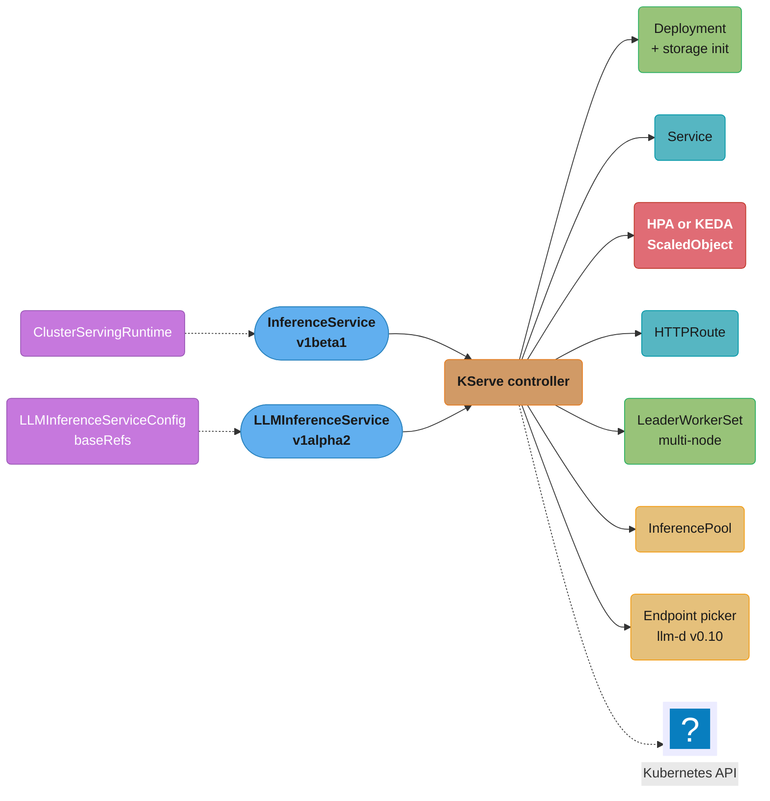
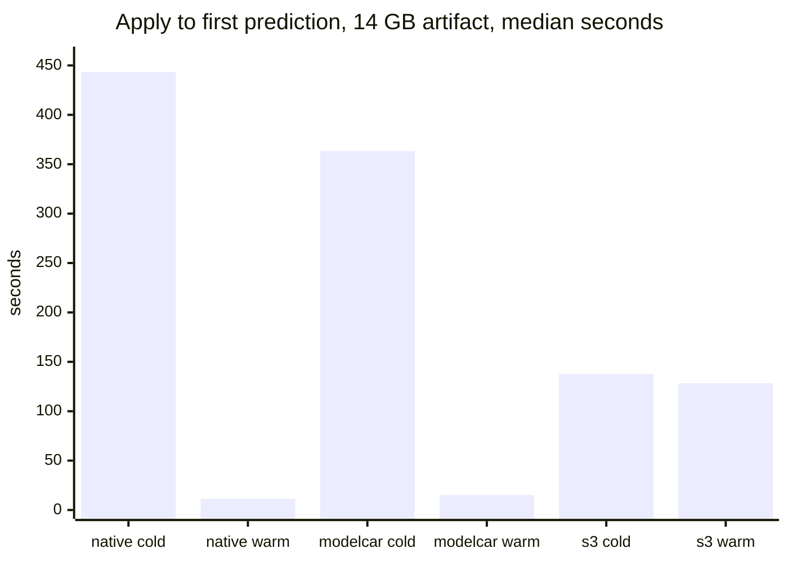
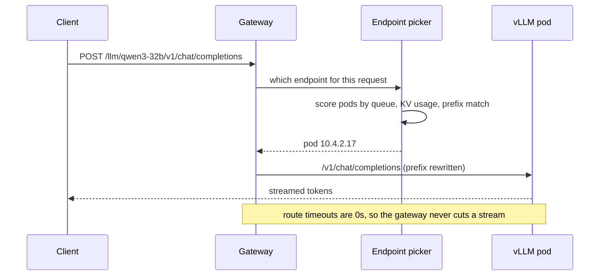
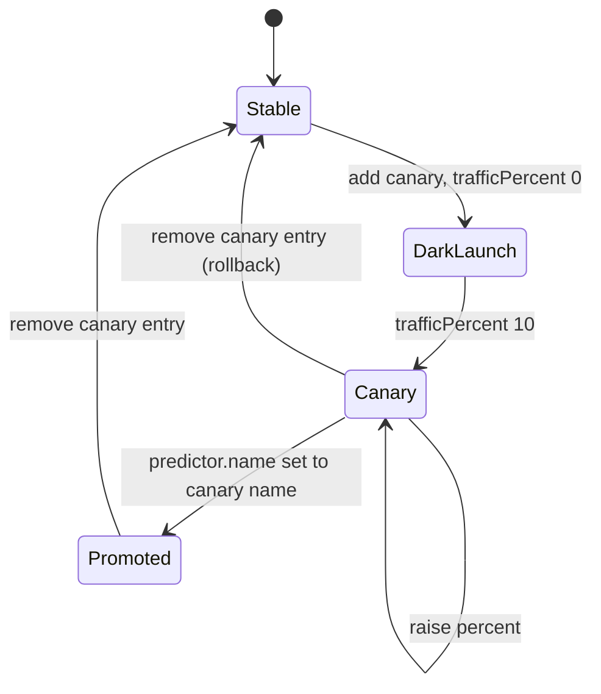

# KServe Deep Dive

> **Version anchor (2026-10-18).** KServe v0.21.0 (2026-09-25), CNCF incubating since 2025-09-29.
> llm-d v0.10.0 (2026-09-29), CNCF Sandbox since 2026-03. KEDA v2.21.0 (2026-09-23). Gateway API
> Inference Extension v1.6.2 (2026-09-17); EPP, BBR, InferenceObjective and InferenceModelRewrite
> moved to llm-d in v1.6.0. Kubernetes 1.37 (1.37.1 on 2026-09-15), with ImageVolume GA since 1.36.
> Field names on this page were read from the KServe API types at the `v0.21.0` tag.

## 1. Concept Overview

KServe is a set of Kubernetes custom resources and a controller that turns "serve this model" into
Deployments, Services, routes and autoscalers. The parent page, [Model Serving
Platforms](model_serving_platforms.md), places it among the other platforms. This page is the
operator's view: what each resource does, what the controller generates from it, and how it fails.

The resources at v0.21.0:

| Resource | API version | Purpose |
|---|---|---|
| `InferenceService` | `serving.kserve.io/v1beta1` | Predictor, optional transformer and explainer, optional `canary` list |
| `ServingRuntime`, `ClusterServingRuntime` | `v1alpha1` | Container template for a model format: image, args, ports, `supportedModelFormats` |
| `LLMInferenceService` | `v1alpha2` | LLM serving with llm-d scheduling, prefill/decode, multi-node, LoRA, KV offload |
| `LLMInferenceServiceConfig` | `v1alpha2` | Reusable base spec merged through `baseRefs` |
| `InferenceGraph` | `v1alpha1` | Router pod that chains, splits, ensembles or switches between services |
| `LocalModelNodeGroup`, `LocalModelCache`, `LocalModelNamespaceCache` | `v1alpha1` | Pre-stage weights on node-local volumes |
| `ClusterStorageContainer` | `v1alpha1` | Custom storage initializer image for a URI scheme |

The v0.21.0 changelog adds DRA `resourceClaims` to `ServingRuntime`, `spec.tracing` to
`InferenceService`, KEDA scaling and `rolloutStrategy` to `LLMInferenceService`, canary splitting on
`HTTPRoute`s in Standard mode, and the `oci+fetch://` scheme.

Where the weights come from in general (object store, OCI, P2P, streaming loaders) is in [Model
Storage, Loading and Cold
Start](../model_storage_loading_and_cold_start/model_storage_loading_and_cold_start.md). Which
metrics to scale on is in [Inference Autoscaling and Capacity
Planning](../inference_autoscaling_and_capacity_planning/inference_autoscaling_and_capacity_planning.md).
The strategy matrix for rollouts is in [Progressive Delivery for Model
Servers](../progressive_delivery_for_model_servers/progressive_delivery_for_model_servers.md). The
llm-d scheduler and prefill/decode design are in [Distributed Inference and
Disaggregation](../distributed_inference_and_disaggregation/distributed_inference_and_disaggregation.md).

**Not here.** How Kubernetes operators, CRDs and reconcile loops work, and what Knative Serving is,
are in [Kubernetes Operators and
CRDs](../../devops/kubernetes_operators_and_crds/kubernetes_operators_and_crds.md). Engine flags for
the vLLM images that KServe runs are in [vLLM Deep
Dive](../../llm/vllm_deep_dive/vllm_deep_dive.md).

---

## 2. Intuition

**One-line analogy:** KServe is a compiler. You write a short `InferenceService`; it emits five to
ten Kubernetes objects you would otherwise write by hand. Debugging KServe means reading the
compiler's output.

**Mental model:** two front ends, one back end.

- The `InferenceService` front end compiles a model format plus a storage URI into a runtime pod, a
  Service, an autoscaler and a route.
- The `LLMInferenceService` front end compiles a model URI plus router settings into engine pods
  (Deployment or LeaderWorkerSet), an `InferencePool`, an endpoint-picker Deployment and an
  `HTTPRoute`.
- The back end is the same: storage initializer, Gateway API, HPA or KEDA, and the controller's
  status conditions.

**Why it matters:** most KServe incidents are not engine bugs. They are a missing generated object,
a default that differs between modes, or a dependency the controller assumes (Prometheus Adapter,
Knative, a Gateway).

**Key insight:** the spec says what you asked for; the generated objects say what you got.

---

## 3. Core Principles

1. **Standard mode is the default.** At v0.21.0 `DefaultDeployment` is `Standard`. The older names
   are parsed and normalized: `RawDeployment` becomes `Standard`, `Serverless` becomes `Knative`.
   Pick Knative only when scale-to-zero through the Knative activator or revision-based traffic is
   required.
2. **Runtime selection is implicit unless you pin it.** A predictor names a `modelFormat`; the
   controller picks the highest-`priority` runtime with `autoSelect: true` for that format. Name
   `runtime:` explicitly in production.
3. **Storage is a separate step from serving.** The storage initializer, modelcar sidecar, image
   volume or local cache puts files at `/mnt/models` before the server starts. A slow start is
   usually this step.
4. **LLM routing goes through an `InferencePool`.** `LLMInferenceService` with `router.scheduler`
   puts the llm-d endpoint picker between the gateway and the pods, scoring by queue, KV usage and
   prefix. Paths that the managed route does not list bypass it.
5. **Scaling and replicas are exclusive.** `LLMInferenceService` rejects `replicas` together with
   `scaling`; `scaling` takes either WVA or direct KEDA, never both.
6. **`v1alpha2` means change.** `LLMInferenceService` samples moved from `v1alpha1` to `v1alpha2` in
   this cycle; read every minor changelog.

---

## 4. Types / Architectures / Strategies

### 4.1 Deployment modes

| Mode | Annotation value | Generated workload | Autoscaler | Scale to zero | Canary mechanism |
|---|---|---|---|---|---|
| Standard (default) | `Standard` (legacy `RawDeployment`) | Deployment, Service, HTTPRoute or Ingress | HPA by default; KEDA with `autoscalerClass: keda` | Through KEDA | `spec.canary[]` with `trafficPercent`, HTTPRoute weights |
| Knative | `Knative` (legacy `Serverless`) | Knative Service and revisions | KPA (concurrency or RPS) | Yes, through the activator | `canaryTrafficPercent` between revisions |
| ModelMesh | `ModelMesh` | ModelMesh pods | Its own | No | Not covered; `kserve/modelmesh-serving` is archived |

The mode is set per service with the `serving.kserve.io/deploymentMode` annotation, or cluster-wide
in the `inferenceservice-config` ConfigMap.

### 4.2 Storage paths

| `storageUri` scheme | Mechanism | Node cache | Notes |
|---|---|---|---|
| `s3://`, `gs://`, `hf://`, `pvc://`, `modelscope://` | Storage initializer init container downloads to `/mnt/models` | None (every pod start downloads) | Credentials through a service account or secret |
| `oci://` (default `modelcar`) | Sidecar container from the model image shares `/mnt/models` | containerd image store | About 4 s of sidecar lifecycle per pod in KServe's benchmark |
| `oci+native://` (or `oci://` with `ociModelMode: native`) | Kubernetes ImageVolume, no sidecar | containerd image store | Needs Kubernetes 1.33+ for `subPath` |
| `oci+fetch://` | Storage initializer pulls image layers | None | Added in the v0.21.0 changelog (#5739); for clusters without ImageVolume, with no long-lived sidecar; `LLMInferenceService` falls back to modelcar |
| Any URI matching a `LocalModelCache` | PVC on node-local disk, filled by the local model agent | Node-local volume | Exact URI or a subdirectory of `sourceModelUri` |

### 4.3 Autoscaling options

- **`InferenceService`, Standard mode:** HPA on CPU or memory by default;
  `serving.kserve.io/autoscalerClass: keda` plus `autoScaling.metrics` with an `External` Prometheus
  query creates a KEDA ScaledObject. `autoscalerClass` values: `hpa`, `kpa`, `keda`, `external`,
  `none`.
- **`InferenceService`, Knative mode:** KPA on `concurrency` or `rps` with `scaleTarget`.
- **`LLMInferenceService`:** `scaling.minReplicas`, `scaling.maxReplicas` and exactly one of
  `scaling.wva` (Workload Variant Autoscaler, with an HPA or KEDA actuator) or `scaling.keda`
  (direct KEDA with your own triggers). Prefill and decode workloads scale independently.

### 4.4 Rollout fields

| Field | Applies to | Effect |
|---|---|---|
| `predictor.canaryTrafficPercent` | `InferenceService`, Knative mode | Splits traffic between the latest and the last ready revision |
| `spec.canary[].trafficPercent` | `InferenceService`, Standard mode | Separate Deployment `{isvc}-{name}-predictor`; 0 means dark launch; canary uses fixed replicas |
| `predictor.deploymentStrategy` | `InferenceService`, Standard mode | Standard Kubernetes `RollingUpdate` or `Recreate` |
| `rolloutStrategy.maxUnavailable`, `maxSurge` | `LLMInferenceService` workloads | Defaults 25%/25% for Deployments, 1/0 for LeaderWorkerSets |
| `router.route.group` and `weight` | `LLMInferenceService` | Proportional weights between members of a group; members gated on readiness |

### 4.5 `InferenceGraph` routers

`Sequence` calls steps in order, `Splitter` picks one target by weight, `Ensemble` calls all targets
and merges the responses, and `Switch` picks a target by a condition on the request. The graph runs
as its own router Deployment with its own `minReplicas`, `maxReplicas` and `routerTimeouts`.

---

## 5. Architecture Diagrams

### What the controller generates



The left side is what you write; the right side is what you debug.

### Generated objects by front end and mode

```
                          Deployment  LWS   Service  HTTPRoute  InferencePool  EPP   HPA/KEDA
 InferenceService
   Standard mode              X              X        X                             X
   Knative mode          (Knative Service + revisions; KPA; activator for zero)
 LLMInferenceService
   replicas, no scheduler     X              X        X
   + router.scheduler         X              X        X          X           X
   + worker (multi-node)            X        X        X          X           X
   + prefill block            X x2           X        X          X           X
   + scaling                  X              X        X          X           X     X per workload
```

Each `X` is one object to check with `kubectl get` when a service is not Ready.

### Cold start by storage path, 14 GB model



KServe's own single-node benchmark (kind, Kubernetes 1.36.1, containerd 2.3.1, gp3 EBS at 125 MiB/s,
sample README for `oci+native://`). The first OCI pull is slower than an S3 download because
containerd writes the blob and then unpacks it; every later start on that node takes about 11
seconds whatever the size. At 140 GB the warm OCI start was 11.7 s against 2,441.6 s for `s3://`.

### LLM request path through the endpoint picker



A path missing from the managed route (for example `/v1/systemone`) skips the picker and goes from
the gateway to the workload `Service`.

### `InferenceService` canary lifecycle in Standard mode



Promotion without a restart works by renaming the predictor to the canary's name, so the existing
canary Deployment becomes the primary, then deleting the canary entry.

---

## 6. How It Works - Detailed Mechanics

### 6.1 A custom runtime, pinned

```yaml
apiVersion: serving.kserve.io/v1alpha1
kind: ClusterServingRuntime
metadata:
  name: sglang-0-5-21
spec:
  supportedModelFormats:
    - name: sglang
      version: "1"
      autoSelect: false
  containers:
    - name: kserve-container
      image: lmsysorg/sglang@sha256:<qualified-digest>
      command: [python3, -m, sglang.launch_server]
      args: [--model-path=/mnt/models, --port=8080, --host=0.0.0.0]
      ports: [{containerPort: 8080, protocol: TCP}]
---
apiVersion: serving.kserve.io/v1beta1
kind: InferenceService
metadata:
  name: classifier-14b
spec:
  predictor:
    model:
      modelFormat: {name: sglang}
      runtime: sglang-0-5-21
      storageUri: oci://registry.internal/models/classifier-14b@sha256:<model-digest>
      resources:
        limits: {nvidia.com/gpu: "1"}
```

`autoSelect: false` keeps this runtime from being picked for any service that did not ask for it,
and the predictor names it explicitly. Both the engine image and the model image are digests. The
runtime name carries the engine version, so `kubectl get isvc -o wide` shows which engine each
service runs.

### 6.2 Pre-staging weights with `LocalModelCache`

```yaml
apiVersion: serving.kserve.io/v1alpha1
kind: LocalModelNodeGroup
metadata:
  name: h100-nvme
spec:
  storageLimit: 3Ti
  persistentVolumeSpec:
    accessModes: [ReadWriteOnce]
    capacity: {storage: 3Ti}
    local: {path: /mnt/nvme/models}
    nodeAffinity:
      required:
        nodeSelectorTerms:
          - matchExpressions:
              - {key: gpu.pool, operator: In, values: [h100]}
  persistentVolumeClaimSpec:
    accessModes: [ReadWriteOnce]
    resources: {requests: {storage: 3Ti}}
---
apiVersion: serving.kserve.io/v1alpha1
kind: LocalModelCache
metadata:
  name: llama-70b-instruct
spec:
  sourceModelUri: s3://models/llama-3.3-70b-instruct/2026-09-30/
  modelSize: 142Gi
  nodeGroups: [h100-nvme]
```

The local model agent on each node in `h100-nvme` downloads the prefix once. A service whose
`storageUri` equals `sourceModelUri` or is a subdirectory of it mounts the node-local volume
instead. `sourceModelUri` is immutable (a CEL rule rejects edits), so each model version gets its
own cache object. v0.21.0 extends the cache to LoRA adapters of an `LLMInferenceService` (#5690).

### 6.3 KEDA scaling for an `InferenceService` in Standard mode

```yaml
apiVersion: serving.kserve.io/v1beta1
kind: InferenceService
metadata:
  name: embed-bge
  annotations:
    serving.kserve.io/autoscalerClass: keda
spec:
  predictor:
    minReplicas: 2
    maxReplicas: 12
    autoScaling:
      metrics:
        - type: External
          external:
            metric:
              backend: prometheus
              serverAddress: http://prometheus.monitoring:9090
              query: sum(rate(embed_requests_total{isvc="embed-bge"}[1m]))  # your request counter
            target:
              type: Value
              value: "400"
    model: {modelFormat: {name: huggingface}, storageUri: "hf://BAAI/bge-large-en-v1.5"}
```

The controller creates a KEDA `ScaledObject` instead of an HPA.

### 6.4 `LLMInferenceService` scaling (broken, then fixed)

A platform team enabled WVA with the HPA actuator:

```yaml
spec:
  scaling:
    minReplicas: 2
    maxReplicas: 8
    wva:
      hpa: {}
```

The cluster had no Prometheus Adapter. The HPA reads `wva_desired_replicas` through
`external.metrics.k8s.io`; with no adapter, the HPA condition went to `Unknown` and the deployment
stayed at 2 replicas through a traffic peak. The API type's own comment warns that scaling "will
silently stop" in this case. The HPA logged metric-fetch failures as events, but nothing alerted,
because no alert watched the HPA's conditions.

The fix uses direct KEDA, which queries Prometheus itself, adds a hold value for metric outages, and
waits for model load before evaluating triggers:

```yaml
spec:
  scaling:
    minReplicas: 2
    maxReplicas: 8
    keda:
      pollingInterval: 15
      cooldownPeriod: 600
      initialCooldownPeriod: 300
      fallback:
        failureThreshold: 3
        replicas: 4
      triggers:
        - type: prometheus
          metadata:
            serverAddress: http://prometheus.monitoring:9090
            query: sum(vllm:num_requests_waiting{namespace="llm",pod=~"qwen3-32b-kserve.*"})
            threshold: "8"
```

Alert on `kube_horizontalpodautoscaler_status_condition{condition="ScalingActive",status="false"}`
for every generated autoscaler.

For scale to zero, set `idleReplicaCount: 0`. It must be lower than `minReplicas` (which has a
minimum of 1), and KEDA jumps straight from 0 to `minReplicas` when a trigger becomes active. Pair
it with a pre-staged cache (§6.2): a 140 GB model that comes back from zero through `s3://` waited
2,318.8 s in KServe's cold benchmark.

### 6.5 Rolling a multi-node `LLMInferenceService`

A multi-node service (`worker` set) runs as a LeaderWorkerSet whose default rollout is
`maxUnavailable: 1`, `maxSurge: 0`: one group at a time goes down and comes back, with no extra
GPUs. For 4 groups of 2 nodes each:

```
 group restart time = weight load + engine init + warmup
   from s3, 350 GB per node at 1.5 GB/s  = 233 s
   engine init and CUDA graph capture    = 150 s
   warmup requests                       =  30 s
                                          -----
                                          413 s per group, 4 groups = 27.5 min at 75% capacity

   from LocalModelCache on NVMe, 6 GB/s  =  58 s  ->  238 s per group = 15.9 min
```

`rolloutStrategy` changes the trade-off:

```yaml
# on an LLMInferenceService that sets spec.worker (multi-node)
spec:
  rolloutStrategy:
    maxUnavailable: 0
    maxSurge: 1         # needs one spare 2-node group of GPUs during the rollout
```

`maxSurge: 1, maxUnavailable: 0` keeps full capacity but needs 16 spare GPUs for the duration. If
the cluster cannot hold a fifth group, keep the default and shed or queue load at the gateway for 16
to 28 minutes. The full strategy matrix, including recreate, is in [Progressive Delivery for Model
Servers](../progressive_delivery_for_model_servers/progressive_delivery_for_model_servers.md).

### 6.6 Canary for an `InferenceService` in Standard mode

```yaml
apiVersion: serving.kserve.io/v1beta1
kind: InferenceService
metadata:
  name: fraud-xgb
spec:
  predictor:
    name: v41
    minReplicas: 3
    model:
      modelFormat: {name: xgboost}
      storageUri: s3://models/fraud-xgb/v41/
  canary:
    - trafficPercent: 10
      predictor:
        name: v42
        model:
          modelFormat: {name: xgboost}
          storageUri: s3://models/fraud-xgb/v42/
```

The canary runs as Deployment `fraud-xgb-v42-predictor` with fixed replicas. Traffic is split on the
`HTTPRoute`, gated on canary readiness since #5984 so the route does not send traffic to a canary
that is still starting (that window produced transient 503s before the fix). To promote, set
`predictor.name: v42` with v42's model and delete the `canary` entry; #5899 cleans up the orphaned
autoscaler and tracing resources on promotion.

### 6.7 Weighted groups for `LLMInferenceService`

Two `LLMInferenceService`s that set the same `router.route.group` (for example `support-chat`) share
traffic by `router.route.weight`, such as 95 on the current member and 5 on the candidate. Weights
are proportional (Gateway API `backendRef` semantics), from 0 to 1,000,000, not percentages. The
group name must be set explicitly on each member and is not derived from the model name. Members
join the split only when Ready.

### 6.8 `InferenceGraph` switch and payload logging

A `Switch` node lists `steps`, each with a `serviceName` and a `condition`. The condition is a gjson
path evaluated against the request body, for example `[@this].#(doc_type=="invoice")`, and the
router takes the first step whose path returns a result. Put a catch-all step last, or unmatched
requests have nowhere to go.

Payload logging is a `logger` block on a component: `mode` is `all`, `request` or `response`, and
`url` is the sink. Logged payloads are full request bodies; route them to a sink inside the data
boundary and apply the same retention and redaction as the source system.

### 6.9 Debugging an `InferenceService` that is not Ready

```bash
kubectl get isvc fraud-xgb -o jsonpath='{range .status.conditions[*]}{.type}={.status} {.reason}{"\n"}{end}'
kubectl get deploy,svc,hpa,scaledobject,httproute -l serving.kserve.io/inferenceservice=fraud-xgb
kubectl logs deploy/fraud-xgb-predictor -c storage-initializer
kubectl get llmisvc qwen3-32b -o jsonpath='{.status.conditions}'
kubectl get inferencepool,httproute -n llm
```

Read conditions, then generated objects, then storage-initializer logs.

---

## 7. Real-World Examples

- **KServe v0.21.0 changelog** shows where the project's work goes: 11 of its 32 `feat` entries, the
  largest group, are for `LLMInferenceService` (direct KEDA scaling, `idleReplicaCount: 0`,
  `rolloutStrategy`, LoRA cache, tokenizer as a vLLM render Deployment), while `InferenceService`
  received canary routing, tracing and DRA.
- **Red Hat and Bloomberg** are named among KServe's major adopters in CNCF's incubation
  announcement (2025-11-11), and Red Hat launched llm-d, whose scheduler and images
  `LLMInferenceService` deploys.
- **llm-d images in KServe:** the v0.21.0 default templates run the llm-d endpoint picker and
  disaggregation sidecar at `v0.10.0` and the engine image `ghcr.io/llm-d/llm-d-cuda:v0.9.0`. The
  scheduler and the engine move on separate version lines.
- **Prefill/decode KV transfer:** the v0.21.0 changelog includes "give P/D engines a NixlConnector
  so KV actually transfers" (#6027). Disaggregated deployments built from earlier default templates
  should be checked for KV transfer, since without it the decode pod recomputes the prefill.

---

## 8. Tradeoffs

### Standard vs Knative mode

| Factor | Standard | Knative |
|---|---|---|
| Dependencies | Gateway API or Ingress | Knative Serving plus a networking layer |
| Scale to zero | Through KEDA `idleReplicaCount: 0` | Native, through the activator |
| Request buffering at zero | None; the first request waits on the gateway | Activator holds requests while a pod starts |
| Canary | `spec.canary[]` with fixed-replica canary | Revision split with `canaryTrafficPercent` |
| GPU fit | Better: no queue-proxy sidecar, plain Deployments | Activator and revision churn add moving parts for 10-minute cold starts |

### Storage path for a 140 GB model

| Path | First start on a node | Later starts | Extra infrastructure |
|---|---|---|---|
| `s3://` storage initializer | 2,318.8 s | 2,441.6 s | None |
| `oci+native://` | 4,585.5 s | 11.7 s | OCI registry, Kubernetes 1.33+ |
| `LocalModelCache` | Agent download ahead of time | Volume mount | Node groups with local disks |

Figures are KServe's single-node benchmark medians on a 125 MiB/s disk.

---

## 9. When to Use / When NOT to Use

**Use `InferenceService` in Standard mode** for classic models, embedding models and single-node
LLMs that need ordinary autoscaling and routing.

**Use `LLMInferenceService`** for LLMs that need prefix-aware scheduling, prefill/decode,
multi-node, LoRA routing or KV offload, and accept a `v1alpha2` API.

**Use Knative mode** only for services that must scale to zero with request buffering and start
quickly (small CPU models). Do not use it for large GPU models, where a cold start of minutes
defeats the activator's purpose.

**Use `LocalModelCache`** for any model above about 20 GB that scales out more than once a day.

---

## 10. Common Pitfalls

**1. Runtime picked by priority, then changed under you.** A cluster admin added a
`ClusterServingRuntime` for a new Triton version with `autoSelect: true` and a higher `priority` for
`onnx`. On the next pod restart, 23 ONNX services that did not name a runtime moved to it; 4 failed
to load because of an opset change. Fix: `runtime:` in every production predictor.

**2. Rolling a LeaderWorkerSet at peak.** The default `maxUnavailable: 1, maxSurge: 0` removes one
group at a time. A team rolled four 2-node groups at noon and ran at 75% capacity for 28 minutes;
p95 TTFT tripled. Fix: roll off-peak, pre-stage weights so each group returns faster, or budget a
surge group.

**3. Editing `sourceModelUri` to roll a cached model.** The CEL rule rejects the edit, and a team
that deleted and recreated the `LocalModelCache` with the new URI forced 40 nodes to re-download 142
GB each during business hours, saturating the object store's egress. Fix: create the new cache
object ahead of the rollout and delete the old one after.

**4. Scale from zero without a cache.** A team set `idleReplicaCount: 0` on a 70B service used by an
internal tool. The first request each morning waited over 30 minutes for an `s3://` download. Fix:
`LocalModelCache` or `oci+native://`, or a floor of one replica during working hours.

**5. Payload logging as a data leak.** `logger.mode: all` on a support model sent full
conversations, including pasted card numbers, to a shared sink with 400-day retention. Fix: a sink
inside the data boundary, with redaction.

---

## 11. Technologies & Tools

| Tool | Role | Notes |
|---|---|---|
| KServe | Model serving CRDs and controller | v0.21.0; Standard mode default |
| llm-d | Scheduler, sidecars and images used by `LLMInferenceService` | v0.10.0 endpoint picker; engine image `llm-d-cuda:v0.9.0` in default templates |
| Gateway API Inference Extension | `InferencePool` API and conformance | v1.6.2; EPP and BBR moved to llm-d in v1.6.0 |
| LeaderWorkerSet | Multi-node pod groups | Used when `worker` is set; default rollout 1 unavailable, 0 surge |
| KEDA | Event-driven autoscaling | v2.21.0; `autoscalerClass: keda` and `scaling.keda` |
| Prometheus Adapter | Exposes Prometheus metrics to the HPA | Required by the WVA HPA actuator |
| Knative | Serverless serving layer | Needed only for Knative mode |
| NVIDIA Triton | Runtime for many model formats | `kserve-tritonserver` runtime |
| MLServer | Python runtime with Open Inference Protocol | `kserve-mlserver` runtime |
| vLLM | LLM engine | `kserve-vllmserver` runtime and llm-d images |

Operator patterns and CRD lifecycles in general are in [Kubernetes Operators and
CRDs](../../devops/kubernetes_operators_and_crds/kubernetes_operators_and_crds.md).

---

## 12. Interview Questions with Answers

**Q: Which deployment mode does KServe v0.21.0 use when you set none?**
**Short:** Standard, which creates plain Deployments, Services, routes and HPAs; the legacy names `RawDeployment` and `Serverless` are normalized to `Standard` and `Knative`.

`DefaultDeployment` is `Standard` in the constants at the v0.21.0 tag, and `ParseDeploymentMode`
maps the old annotation values to the new names, so manifests written for older releases keep
working. Knative mode needs Knative Serving installed and is chosen per service with
`serving.kserve.io/deploymentMode: Knative`. Many older tutorials assume Serverless was the default;
that is not true for this version.

**Q: You set `canaryTrafficPercent: 10` on a Standard-mode `InferenceService`. Does it split traffic?**
**Short:** No; `canaryTrafficPercent` drives Knative revision splits only, and in Standard mode the canary is a `spec.canary[]` entry with its own predictor and `trafficPercent`.

`canaryTrafficPercent` splits between the latest and last ready Knative revision. Standard mode has
no revisions, so v0.20 and v0.21 added `spec.canary`, a list of named predictors, each a separate
Deployment with fixed replicas, with the split applied on the `HTTPRoute`. `trafficPercent: 0` is a
dark launch. Promotion renames the main predictor to the canary's name and removes the entry.

**Q: Why does an `LLMInferenceService` with both `replicas` and `scaling` fail to apply?**
**Short:** A CEL rule makes them mutually exclusive: `replicas` is for static deployments, `scaling` for autoscaled ones, and the API server rejects the object.

The `WorkloadSpec` validation reads "replicas and scaling are mutually exclusive". Inside `scaling`,
exactly one of `wva` or `keda` is allowed, and direct KEDA needs at least one trigger. Validation at
admission is a feature: the alternative is a controller that silently picks one. Prefill and decode
workloads each take their own `scaling`.

**Q: Autoscaling on an `LLMInferenceService` with WVA stopped working without errors. Where do you look?**
**Short:** At the actuator: the WVA HPA actuator needs a Prometheus Adapter to read `wva_desired_replicas`, and without one the HPA goes to `Unknown` and stops scaling silently.

The KServe API comment says so directly. Check `kubectl describe hpa` for a `ScalingActive`
condition of `False` or `Unknown`, and whether `external.metrics.k8s.io` is served. The KEDA
actuator queries Prometheus itself and needs no adapter. Whichever you choose, alert on autoscalers
whose `ScalingActive` condition is not true.

**Q: How does `idleReplicaCount: 0` differ from `minReplicas: 0`?**
**Short:** In `LLMInferenceService` scaling, `minReplicas` is at least 1 and is the floor while triggers are active; `idleReplicaCount: 0` is the KEDA floor when no trigger is active, giving scale to zero.

When a trigger fires, KEDA moves straight from `idleReplicaCount` to `minReplicas`. A CEL rule
requires `idleReplicaCount` to be less than `minReplicas` and requires `minReplicas` to be set when
it is used. Scale to zero only makes sense with a fast weight path; a 140 GB model through `s3://`
took about 39 minutes to its first prediction in KServe's benchmark.

**Q: Why does a multi-node `LLMInferenceService` roll out one group at a time by default?**
**Short:** It runs as a LeaderWorkerSet, whose defaults are `maxUnavailable: 1` and `maxSurge: 0`, so no extra GPUs are needed but capacity drops by one group during each restart.

For large models a surge group can be 16 GPUs, which many clusters cannot spare. The cost is time at
reduced capacity: four groups with 7-minute restarts mean about 28 minutes at 75%. `rolloutStrategy`
can set `maxSurge: 1, maxUnavailable: 0` when spare capacity exists. Faster weight loading (local
cache, image volumes) shortens every step of the default rollout.

**Q: Which requests to an `LLMInferenceService` go through the endpoint picker?**
**Short:** Those on the managed route's listed paths: `/v1/completions`, `/v1/chat/completions`, `/v1/responses` and `/v1/messages`; other paths hit a catch-all rule to the workload Service.

The managed `HTTPRoute` has a PathPrefix rule per listed endpoint with the `InferencePool` as
backend and a URL rewrite, plus header-based rules for model-based routing. Everything else
(`/v1/models`, `/health`, custom or newer engine paths) goes straight to the Service, which is
correct for health checks and wrong for inference calls that benefit from prefix affinity. Add your
own route for such paths.

**Q: How does `LocalModelCache` decide that a service can use the cached copy?**
**Short:** The service's `storageUri` must equal the cache's `sourceModelUri` or be a subdirectory of it, and the pod must land on a node in one of the cache's node groups.

The cache is cluster-scoped; `LocalModelNamespaceCache` limits use to one namespace. `modelSize` declares
the size that must fit within the node group's `storageLimit`. `sourceModelUri` cannot be edited, so each model
version needs its own cache object. Schedule GPU pods onto the cached node group with affinity, or
the pod falls back to downloading.

**Q: When is `oci+native://` faster than `s3://`, and when is it slower?**
**Short:** It is far faster on any node that already has the image (about 11 s at any size) and slower on the first pull, because containerd writes and then unpacks the layers.

In KServe's benchmark at 14 GB, the first native start took 443.4 s against 137.8 s for S3, and warm
starts took 11.4 s against 128.4 s. S3 has no node cache, so every start pays the full download. Use
OCI for models that start repeatedly on the same nodes (autoscaling, rollouts), and pre-pull the
image to new nodes so users never see the cold number.

**Q: How do you stop a new `ClusterServingRuntime` from changing existing services?**
**Short:** Name `runtime:` on every production predictor, and give new runtimes `autoSelect: false` unless they are meant to become the default for a format.

Auto-selection picks the highest-`priority` runtime with `autoSelect: true` for the format,
re-evaluated when the controller reconciles. A new runtime with a higher priority silently becomes
the target at the next pod restart. Naming the runtime ties the service to a reviewed choice, and a
runtime name that carries the engine version makes the choice visible in `kubectl get`.

**Q: How do `LLMInferenceServiceConfig` base references merge?**
**Short:** The controller merges the configs in `baseRefs` in order, later ones overriding earlier ones, and the service's own spec overrides all of them.

KServe ships configs such as `kserve-config-llm-template` and `kserve-config-llm-router-route`, and
platform teams add their own (GPU type, TLS, tracing). A finalizer prevents deleting a config that
services still reference. Keep base configs small and single-purpose; a deep stack of overrides
makes "which image am I running" hard to answer, so check the rendered pod spec.

**Q: What changed for prefill/decode `LLMInferenceService`s in the v0.21.0 cycle that you should verify?**
**Short:** The changelog adds a NixlConnector to P/D engines "so KV actually transfers" (#6027); deployments from older templates may have been recomputing prefill on the decode side.

A disaggregated service without working KV transfer still answers, so the defect shows only as lower
throughput and higher decode load than the design predicted. Check engine logs for the connector,
compare decode-side prefill token counters against expectations, and look at transfer metrics. The
design trade-offs of disaggregation are in the distributed inference module.

**Q: What are the risks of KServe payload logging?**
**Short:** It ships full request and response bodies to a sink, so it copies sensitive user data out of the serving boundary unless the sink, retention and redaction are controlled.

`logger.mode` selects `all`, `request` or `response`, and the logger sends each payload to
`logger.url`. That is valuable for evaluation datasets and drift checks, and it is also a second
copy of every prompt. Keep the sink in the same data boundary, apply redaction before storage, set
retention to match the source system, and enable it per service rather than cluster-wide.

**Q: How do you debug an `InferenceService` stuck in not Ready?**
**Short:** Read `status.conditions`, then list the generated objects, then read the storage-initializer and server logs; most failures are runtime selection, storage credentials, image pulls or a missing Gateway.

Conditions name the failing component (predictor, ingress, canary). Generated objects show whether
the controller produced the Deployment, Service, autoscaler and route. Storage-initializer logs show
credential and path errors before the server starts. For `LLMInferenceService`, also check the
`InferencePool`, the endpoint-picker Deployment and the router conditions, since a missing Gateway
leaves the service running but unreachable.

**Q: When would you still choose Knative mode for a KServe service?**
**Short:** For small CPU models that must scale to zero and need the activator to hold requests during start-up; GPU LLMs with multi-minute cold starts belong in Standard mode.

Knative's activator buffers requests while a pod starts and its KPA scales on concurrency, which
works when a pod is ready in seconds. With a 10-minute GPU cold start, buffered requests time out
anyway, and the queue-proxy sidecar and revision churn add operational surface. Standard mode with
KEDA, a weight cache and an off-hours floor of one replica covers most GPU cases.

---

## 13. Best Practices

- Pin `runtime:` on every production predictor and reference engine and model images by digest.
- Give new `ClusterServingRuntime`s `autoSelect: false` until they are qualified as a format
  default.
- Pre-stage large weights with `LocalModelCache` or `oci+native://`, and create the next version's
  cache before the rollout.
- Prefer direct KEDA or the KEDA actuator over the WVA HPA actuator unless a Prometheus Adapter is
  installed and monitored.
- Alert on every generated autoscaler whose `ScalingActive` condition is not true.
- Add user-managed routes for inference paths that the managed route does not list.

---

## 14. Case Study

### Moving a GPU fleet from Knative mode to Standard mode and `LLMInferenceService`

**Context.** A media company ran 36 `InferenceService`s in Knative mode: 30 small CPU models
(tagging, language detection) and 6 GPU services (two embedding models, a 14B classifier, and three
LLMs between 8B and 70B on the Hugging Face runtime). The GPU services had three recurring problems:
cold starts of 6 to 25 minutes after scale to zero, revision churn that left old revisions holding
GPUs for minutes after rollouts, and no prefix-aware routing for the 70B model, a multi-turn
assistant whose requests resend a conversation history of about 4,000 tokens.

**Decision 1: split by mode.** The 30 CPU models stayed on Knative, where scale to zero and request
buffering worked (cold starts under 8 seconds). The 6 GPU services moved to Standard mode with the
`serving.kserve.io/deploymentMode: Standard` annotation.

**Decision 2: weight delivery.** The two largest models (70B at 142 GB, 32B at 66 GB) got a
`LocalModelNodeGroup` on the H100 pool's NVMe and one `LocalModelCache` per model version. The
embedding models and the classifier moved to `oci+native://` images in the internal registry.
Measured time from pod creation to Ready for the 70B model went from 1,520 s (storage initializer
from S3 at about 100 MB/s effective) to 205 s (local volume plus engine start).

**Decision 3: the 70B model on `LLMInferenceService`.** It became an `LLMInferenceService` with
`router.scheduler: {}`, `parallelism.tensor: 4`, 4 replicas, and direct KEDA scaling on
`vllm:num_requests_waiting` with `fallback.replicas: 4` and `initialCooldownPeriod: 300`. The team
first tried WVA with the HPA actuator; staging showed the HPA at `Unknown` because the cluster had
no Prometheus Adapter, which is how the §6.4 failure was caught before production. A staging test
also showed that the team's batch summarization path called a custom endpoint that the managed route
sent to the catch-all Service; they moved it onto `/v1/chat/completions`.

**Decision 4: rollouts.** Classic GPU services use `spec.canary[]` at 0% (dark launch for a smoke
test), then 10%, then promotion by renaming the predictor. The 70B model uses a route group: a
second `LLMInferenceService` with weight 5 against 95, raised to 50 and then 100 over two days, with
TTFT and an online quality score as the gates.

**Results after six weeks.**

| Metric | Before | After |
|---|---|---|
| 70B pod to Ready | 1,520 s | 205 s |
| 70B prefix-cache hit rate | 31% (Service load balancing, 4 replicas) | 88% (endpoint picker) |
| 70B p95 TTFT at peak | 2.9 s | 1.1 s |
| GPUs held by old revisions after a rollout | up to 8 for 10 minutes | 0 |
| Autoscaler incidents | 2 silent stalls in the quarter | 0, with `ScalingActive` alerting |

**What they would do differently.** Create the `LocalModelCache` for each new model version as part
of the release pipeline, not by hand: the first version bump re-downloaded 142 GB to 12 nodes during
a rollout because the new cache object was created at the same time as the new service.

A full design for distributing weights to many nodes at once is in [Design a Model Weight
Distribution System](../case_studies/design_a_model_weight_distribution_system.md).
