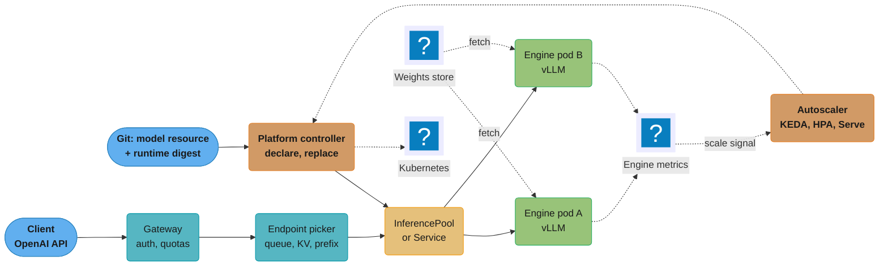
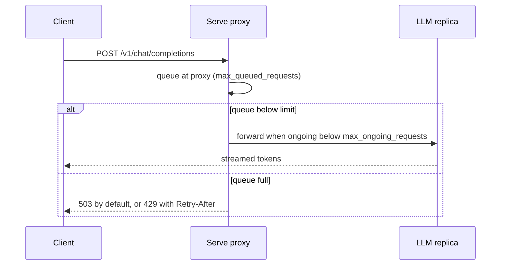

# Model Serving Platforms

> **Version anchor (2026-10-18).** KServe v0.21.0 (2026-09-25). Ray 2.59.0 (2026-10-02), the release
> that ships Serve LLM and Ray Data LLM. AIBrix v0.8.0 (2026-10-13). Triton Inference Server 2.73.0,
> NGC container 26.09 (2026-09-30). BentoML v1.4.39 (2026-05-07), with no later release as of
> 2026-10-18. Seldon Core 2 v2.10.2 (2025-12-19), whose `LICENSE` is a Business Source License
> naming "Seldon Core v2" as the Licensed Work. Engines behind these platforms: vLLM v0.32.0
> (2026-10-18), SGLang v0.5.21 (2026-10-02), TensorRT-LLM stable v1.2.1 (2026-04-20). NVIDIA NIM has
> no pin in this section and is described without a version.

## 1. Concept Overview

A model serving platform is the control plane above an inference engine. The engine (vLLM, SGLang,
TensorRT-LLM, ONNX Runtime, an XGBoost booster) turns a request into tokens or scores on one GPU or
CPU process. The platform decides everything around that process: which container image runs it,
where the weights come from, how many replicas exist, how a request reaches the right replica, how
version N+1 replaces version N, and what gets logged on the way.

Every platform in this module answers the same six questions, in different places:

1. **Declare.** What object names a served model? A Kubernetes custom resource (KServe
   `InferenceService`, Seldon `Model`), a Python decorator (Ray Serve `@serve.deployment`, BentoML
   `@bentoml.service`), or a console form (SageMaker, Vertex AI).
2. **Run.** Which process serves it? A runtime picked by model format (KServe `ServingRuntime`), a
   server type (Seldon `Server`), or user code wrapping an engine.
3. **Fetch.** How do weights reach the pod? An init container, a sidecar, an image volume, a node
   cache, or the engine's own downloader.
4. **Route.** How does a request find a replica? Kubernetes Service round robin, a Gateway API
   `HTTPRoute`, an LLM-aware endpoint picker over an `InferencePool`, or the platform's own router.
5. **Scale.** What changes the replica count? HPA, KEDA, Knative's KPA, Ray Serve's autoscaler, or a
   managed service's target-tracking policy.
6. **Replace.** How does a new version take traffic? Rolling update, canary percentage, weighted
   route group, or an `Experiment` resource.

The platforms covered here are KServe (CNCF incubating since 2025-09-29), Ray Serve, BentoML, Seldon
Core 2 with MLServer, NVIDIA Triton Inference Server and NIM, AIBrix, the vLLM production-stack, and
the managed endpoints of SageMaker and Vertex AI. KServe has its own sub-page, [KServe Deep
Dive](kserve_deep_dive.md), because most Kubernetes platform teams end up operating it directly.

This page is about choosing a platform and composing it with an engine. Where a request should be
served (online, batch, streaming, edge) is decided first, in [Deployment Targets and Serving
Patterns](../deployment_targets_and_serving_patterns/deployment_targets_and_serving_patterns.md).
Engine flags, benchmarking and upgrade qualification are in [Inference Engine Operations and
Benchmarking](../inference_engine_operations_and_benchmarking/inference_engine_operations_and_benchmarking.md).
Multi-node and prefill/decode serving with llm-d and LeaderWorkerSet are in [Distributed Inference
and
Disaggregation](../distributed_inference_and_disaggregation/distributed_inference_and_disaggregation.md).
Adapter density is in [LoRA Adapter Serving and
Lifecycle](../lora_adapter_serving_and_lifecycle/lora_adapter_serving_and_lifecycle.md), autoscaling
signals in [Inference Autoscaling and Capacity
Planning](../inference_autoscaling_and_capacity_planning/inference_autoscaling_and_capacity_planning.md),
and traffic shifting between two model versions in [Progressive Delivery for Model
Servers](../progressive_delivery_for_model_servers/progressive_delivery_for_model_servers.md).

**Not here.** Engine internals (PagedAttention, continuous batching, scheduler policy, kernel
choice) are in [Inference Engines](../../llm/inference_engines/inference_engines.md) and [vLLM Deep
Dive](../../llm/vllm_deep_dive/vllm_deep_dive.md). Triton internals (model repository layout,
backends, dynamic batcher, ensembles) are in [NVIDIA Triton Inference
Server](../../technologies/nvidia_triton_inference_server/nvidia_triton_inference_server.md), and
NVIDIA's Dynamo stack is in [Dynamo and the NVIDIA Serving
Stack](../../technologies/nvidia_triton_inference_server/dynamo_and_the_nvidia_serving_stack.md).
OpenVINO Model Server is in [Intel OpenVINO](../../technologies/intel_openvino/intel_openvino.md).
Operator and CRD basics are in [Kubernetes Operators and
CRDs](../../devops/kubernetes_operators_and_crds/kubernetes_operators_and_crds.md), and the
infrastructure view of a whole ML platform is in [Design ML Platform
Infrastructure](../../devops/case_studies/design_ml_platform_infrastructure.md).

---

## 2. Intuition

**One-line analogy:** the engine is the database engine, and the serving platform is the managed
database service around it. Postgres does not decide how many replicas you run or how failover
works; RDS does.

**Mental model:** a platform is a stack of six adapters (declare, run, fetch, route, scale, replace)
wrapped around an engine binary that you do not control. Two platforms with the same engine can give
very different latency, cost and upgrade speed, because they differ in the five adapters that are
not the engine.

```
   request
      |
      v
 +-----------+   route   picks a replica: round robin, prefix-aware, adapter-aware
 | platform  |   scale   changes replica count from a signal
 |  control  |   replace moves traffic from version N to N+1
 |   plane   |   fetch   puts weights on local disk or in GPU memory
 |           |   run     starts the engine container with flags
 +-----------+   declare one object per served model
      |
      v
 +-----------+
 |  engine   |   vLLM / SGLang / TensorRT-LLM / XGBoost: batching, kernels, KV cache
 +-----------+
```

The platform box is where the operational decisions live. The engine box is where tokens per second
are made.

**Why it matters:** a team that picks a platform for its demo (one model, one GPU, OpenAI-compatible
endpoint in five minutes) usually discovers its real requirements in production: a prefix-aware
router, a second engine, scale-to-zero for 200 small models, a license review, or an engine release
the platform has not adopted yet.

**Key insight:** the platform sets your engine upgrade speed. Ray 2.59.0 ships Ray Serve LLM pinned
to vLLM 0.27.0 (Ray release notes, #65351), while upstream vLLM reached v0.32.0 on 2026-10-18. Any
feature that landed in vLLM between those versions, including `POST /v1/systemone`, is not available
through the bundled path until the platform catches up.

---

## 3. Core Principles

1. **The engine is a pinned dependency, not part of the platform.** Pin the engine image by digest
   in the runtime definition. The KServe repo's runtime kustomization at v0.21.0 maps `vllmserver`
   to `vllm/vllm-openai:latest`; shipping that as is means a node replacement can change engine
   versions with no deploy.
2. **One declared object per model version.** A served model is a resource with a name, an artifact
   URI, a runtime and resource requests, stored in git. Anything configured by hand in a console or
   a notebook cannot be diffed, reviewed or rolled back.
3. **Routing must see engine state.** An LLM replica's cost to serve a request depends on its queue
   depth, KV-cache occupancy, and whether it already holds the request's prefix or adapter. Round
   robin ignores all three. LLM-aware routing (an endpoint picker over an `InferencePool`, AIBrix's
   gateway, Ray Serve's request routers) is a platform feature, not an engine feature.
4. **Scale on engine signals.** GPU utilization reads near 100% on a replica that is busy and on one
   that is overloaded. Queue depth (`vllm:num_requests_waiting`), KV-cache usage
   (`vllm:kv_cache_usage_perc`) and TTFT tell them apart. The signal choice is covered in [Inference
   Autoscaling and Capacity
   Planning](../inference_autoscaling_and_capacity_planning/inference_autoscaling_and_capacity_planning.md).
5. **Weight delivery is a platform responsibility.** A 140 GB model fetched from S3 on every pod
   start is a 39-minute cold start in KServe's own single-node benchmark; the same model from a
   node-cached OCI image starts in 11.7 seconds. Where weights live decides scale-up speed more than
   any engine flag. Depth is in [Model Storage, Loading and Cold
   Start](../model_storage_loading_and_cold_start/model_storage_loading_and_cold_start.md).
6. **Density and isolation trade against each other.** One pod per model gives clean isolation and
   terrible utilization for 300 small models. Multi-model servers (Triton, MLServer, Ray Serve
   multiplexing) pack them, at the cost of noisy neighbors and shared failure.
7. **License and release cadence are platform properties.** A Business Source License, an archived
   dependency or a five-month release gap is an operational risk with a date attached.

---

## 4. Types / Architectures / Strategies

### 4.1 Platform families

| Family | Examples | Declared as | Strength | Weak spot |
|---|---|---|---|---|
| Kubernetes CRD platform | KServe, Seldon Core 2 | Custom resources reconciled by a controller | GitOps, RBAC, quotas and Gateway API come with Kubernetes | Every feature is a controller release; debugging spans controller, pods and gateway |
| LLM-specific Kubernetes stack | llm-d, AIBrix, vLLM production-stack | Helm chart plus CRDs built around vLLM; AIBrix also fronts SGLang and TensorRT-LLM | KV-aware and prefix-aware routing, disaggregation, adapter handling | Components move between repos release to release; narrow engine support |
| Python serving framework | Ray Serve, BentoML | Decorated Python classes | Arbitrary pre and post processing, model composition in code, fast iteration | Python process is the control plane; Kubernetes integration is a second layer (KubeRay, BentoCloud) |
| Inference server | NVIDIA Triton Inference Server | Model repository directory plus `config.pbtxt` | Many backends in one process, dynamic batching, multi-model per GPU | Not a fleet manager; needs KServe, Seldon or plain Deployments around it |
| Packaged microservice | NVIDIA NIM | One container per model family | Pre-tuned engine and profile per GPU type | Vendor license (NVIDIA AI Enterprise); limited control of engine flags |
| Managed endpoint | Amazon SageMaker endpoints, Vertex AI endpoints | API call or console | No cluster to run; integrated IAM and billing | Instance catalog and quotas set by the provider; engine versions lag |

### 4.2 KServe

KServe started in 2019 as KFServing, a collaboration of Google, IBM, Bloomberg, NVIDIA and Seldon
under the Kubeflow project, and later left Kubeflow as the standalone KServe. It was accepted as a CNCF incubating project on 2025-09-29. At
v0.21.0 it has two serving APIs:

- **`InferenceService` (`serving.kserve.io/v1beta1`).** Predictor, optional transformer and
  explainer. The predictor names a `modelFormat` (sklearn, xgboost, lightgbm, onnx, tensorflow,
  pytorch, huggingface, vLLM and others), and the controller selects a `ClusterServingRuntime` that
  supports it. Built-in runtimes at v0.21.0 include `kserve-sklearnserver`, `kserve-xgbserver`,
  `kserve-lgbserver`, `kserve-tritonserver`, `kserve-mlserver`, `kserve-huggingfaceserver`,
  `kserve-vllmserver`, `kserve-openvino` and `kserve-autogluonserver`.
- **`LLMInferenceService` (`serving.kserve.io/v1alpha2`).** Built for LLMs and integrated with
  llm-d: Gateway API routing through an `InferencePool`, the llm-d endpoint picker as scheduler,
  prefill/decode disaggregation through a `prefill` block, multi-node serving through a `worker` pod
  spec, LoRA adapters, KV-cache offloading, and autoscaling through WVA or KEDA.

Supporting resources: `InferenceGraph` (Sequence, Splitter, Ensemble and Switch routers),
`LocalModelCache` (weights pre-staged on node groups), and `ServingRuntime` for custom engines.
Default deployment mode at v0.21.0 is `Standard` (plain Deployments, formerly named
`RawDeployment`); `Knative` (formerly `Serverless`) remains for scale-to-zero through the Knative
activator. ModelMesh, the high-density multi-model mode that acts as a distributed LRU cache of models
across pods, lives in `kserve/modelmesh-serving`, which is archived on GitHub; its last release is v0.12.0 (2024-07-09).
Every field-level detail is in [KServe Deep Dive](kserve_deep_dive.md).

### 4.3 Ray Serve

Ray Serve runs deployments as Ray actors. A deployment is a Python class; replicas are actors placed
by the Ray scheduler; an HTTP proxy on each node routes to them. Three properties matter in
production:

- **Composition in code.** A pipeline (retrieve, rerank, generate) is a set of deployments calling
  each other through `DeploymentHandle`s, with each step scaled separately. No YAML graph language.
- **Backpressure.** `max_ongoing_requests` (default 5) caps concurrent requests per replica.
  `max_queued_requests` caps the queue at each caller (each proxy or handle) and defaults to -1, no
  limit. When the cap is hit, HTTP callers get 503 by default; `BackpressureConfig(status_code=429,
  retry_after_s=...)` switches it to 429 with a `Retry-After` header. gRPC rejections map to
  `RESOURCE_EXHAUSTED`.
- **Model multiplexing.** `@serve.multiplexed(max_num_models_per_replica=3)` (3 is the default)
  loads models on demand inside a replica with LRU eviction. Requests carry the
  `serve_multiplexed_model_id` header, and the router prefers replicas that already hold that model.

Ray Serve LLM (`ray.serve.llm`) became generally available in Ray 2.59.0. `LLMConfig` plus
`build_openai_app` produces an OpenAI-compatible app over vLLM; `build_pd_openai_app` builds a
prefill/decode app. Ray 2.59.0 bundles vLLM 0.27.0. On Kubernetes, Ray clusters run through
KubeRay's `RayService`.

### 4.4 BentoML

BentoML packages a Python service class (`@bentoml.service`, `@bentoml.api`) and its dependencies
into a "Bento", which builds into an OCI image. It suits teams that want one artifact holding
pre-processing, model and post-processing, deployed to BentoCloud or their own Kubernetes.
`@bentoml.api(batchable=True, max_batch_size=64, max_latency_ms=20)` turns a method into an
adaptively batched endpoint, and `bentoml containerize` builds the image. Its newest GitHub release
is v1.4.39 of 2026-05-07; no release followed in the five months to 2026-10-18, although the
default branch still received commits (the newest dated 2026-09-07). Treat that as a dated fact to re-check
before adoption, not as a statement about the project's future.

### 4.5 Seldon Core 2 and MLServer

Seldon Core 2 schedules many models onto shared `Server` replicas. A `Model` resource declares
`storageUri`, `requirements` (capabilities a server must offer, such as `sklearn` or `mlflow`) and
`memory`; the scheduler places it on a matching `Server` (MLServer or Triton). `Pipeline` chains
models over Kafka topics, and `Experiment` splits traffic between `candidates` by `weight` (for
example 90/10 between `churn-v13` and `churn-v14`) or copies a percentage to a shadow model through
`mirror`. The `LICENSE` at v2.10.2 is Business Source License 1.1: non-production use is free,
production use needs a commercial license (non-profit educational institutions excepted), and each
version converts to Apache 2.0 four years after its release. The v1 line (v1.19.0, 2026-01-23) is a
separate product. MLServer, Seldon's Python inference server that implements the Open Inference
Protocol (V2), has its newest release at 1.7.1 (2025-06-06).

### 4.6 NVIDIA Triton and NIM

Triton (2.73.0, NGC 26.09) hosts many models of many frameworks in one process: TensorRT, ONNX
Runtime, PyTorch, Python, FIL for tree models, a vLLM backend and a TensorRT-LLM backend. It batches
per model and can load and unload models through its model-control API. Triton is a server, not a
fleet manager: on Kubernetes it runs under KServe (`kserve-tritonserver`), Seldon Core 2, or a plain
Deployment. The KServe-plus-Triton split is also covered in [ML Platform and GPU
Infrastructure](../../devops/ml_platform_and_gpu_infrastructure/ml_platform_and_gpu_infrastructure.md). NIM packages one model family with a tuned engine and per-GPU profiles into one
container exposing an OpenAI-compatible API; it is licensed through NVIDIA AI Enterprise for
production.

### 4.7 AIBrix and the vLLM production-stack

**AIBrix** (open-sourced by ByteDance, now under the `vllm-project` GitHub org) is a Kubernetes
control plane built around vLLM that also serves SGLang and TensorRT-LLM behind one gateway: a
gateway that picks a pod from live engine state (prefix cache, load, prefill/decode placement),
`ModelAdapter` for LoRA placement, `StormService` for multi-node and
prefill/decode roles, an autoscaler, a distributed KV cache, and batch inference. v0.8.0 added
scheduled replica bounds and predictive autoscaling APIs, Redis-backed session affinity, and
experimental `ModelClaim` (many models sharing GPU runtimes) and `ModelWarmup`.

**vLLM production-stack** is the vLLM project's Helm-based reference deployment: a request router
that routes by routing key or session ID to reuse KV cache in front of vLLM pods, LMCache for KV offload, and Grafana
dashboards. Its newest chart release is `vllm-stack-0.1.13` (2026-09-29). It serves vLLM only.

**llm-d** (CNCF Sandbox since 2026-03-12) is covered in [Distributed Inference and
Disaggregation](../distributed_inference_and_disaggregation/distributed_inference_and_disaggregation.md);
KServe's `LLMInferenceService` is one way to deploy it.

### 4.8 Managed endpoints

SageMaker real-time endpoints run a container per production variant on chosen instance types, with
inference components to pack several models onto one endpoint and scale each separately;
asynchronous inference queues large payloads. Vertex AI endpoints host one or more deployed models
with a traffic split and dedicated or shared machine types. Both bring IAM, VPC networking and
billing for free and take away engine control: the available engine is whatever image the provider
or you build into a container, and GPU capacity is subject to regional quotas.

### 4.9 Engine composition matrix

| Platform | vLLM | SGLang | TensorRT-LLM | Classic models |
|---|---|---|---|---|
| KServe `InferenceService` | `kserve-vllmserver` and `kserve-huggingfaceserver` runtimes | Custom `ServingRuntime` | Through `kserve-tritonserver` | sklearn, XGBoost, LightGBM, PMML, ONNX, TensorFlow, MLServer, OpenVINO |
| KServe `LLMInferenceService` | Default template image `ghcr.io/llm-d/llm-d-cuda:v0.9.0` | Override `template` image and args | Not supported as a first-class path | Not applicable |
| Ray Serve | Ray Serve LLM (vLLM 0.27.0 in Ray 2.59.0), or a hand-written deployment | Hand-written deployment | Hand-written deployment | Any Python model |
| BentoML | Service class calling the engine | Service class calling the engine | Service class calling the engine | Any Python model |
| Seldon Core 2 | Custom server | Custom server | Through Triton server | MLServer and Triton |
| Triton | vLLM backend | No backend | TensorRT-LLM backend | TensorRT, ONNX Runtime, PyTorch, FIL |
| AIBrix | Primary engine | Supported behind the gateway and in batch | Supported behind the gateway | No |
| vLLM production-stack | Only engine | No | No | No |

A platform that wraps the engine in its own Python layer (Ray Serve LLM, Triton backends) adopts
engine releases on its schedule. A platform that runs the engine's own image (KServe
`LLMInferenceService`, AIBrix, production-stack) lets you move the engine on yours, by overriding
the image.

### 4.10 Decision-model routes behind a platform

Decision models return typed labels, probabilities and scores instead of generated text, and engines
expose them on new paths: vLLM v0.32.0 added `POST /v1/systemone`, and SGLang v0.5.21 serves
`/v1/decisions` and `/v1/systemone`. A platform in front of the engine has to route those paths:

- KServe `LLMInferenceService` at v0.21.0 sends `/v1/completions`, `/v1/chat/completions`,
  `/v1/responses` and `/v1/messages` through the `InferencePool` and the endpoint picker. Every
  other path falls to a catch-all rule that goes straight to the workload `Service`, bypassing the
  scheduler. A decision route works, but loses prefix-aware placement.
- Ray Serve LLM in Ray 2.59.0 runs vLLM 0.27.0, which predates `/v1/systemone`.
- A plain Deployment plus `HTTPRoute` passes any path the engine serves.

The model side (schemas, calibration, evaluation) is in [Decision
Models](../decision_models/decision_models.md).

---

## 5. Architecture Diagrams

### Platform control plane around engine pods



The control plane (git, controller, autoscaler) never touches a request. The data plane (gateway,
picker, pool, engine pods) never reads git. Most outages trace to a signal crossing between them: a
metric that stops arriving, or a route the controller did not generate.

### Engine version lag by integration path

```
 engine release   vLLM upstream        KServe LLMISVC         Ray Serve LLM        production-stack
                  (github releases)    default template       (bundled dep)        (runs vLLM image)
 ---------------  -------------------  ---------------------  -------------------  ----------------
 2026-09-22       v0.30.0
 2026-10-05       v0.31.0
 2026-10-18       v0.32.0              llm-d-cuda:v0.9.0      vLLM 0.27.0          image you pin
                  /v1/systemone        override `template`    upgrade means a      override chart
                  added                image to move          new Ray release      values to move
```

The left column moves every two weeks. The other columns move when the platform ships or when you
override the image. "Which vLLM am I running?" has a different answer per path, and only the
image-override paths let you answer "the one I qualified".

### GPU memory layout: dedicated vs multiplexed vs multi-model server

```
 one 80 GB GPU, models of 6 GB each (weights + runtime overhead)

 dedicated pod per model        Ray Serve multiplexing        Triton / MLServer multi-model
 (1 model per GPU)              (max 3 per replica)           (repository of 11 models)
 +--------------------------+   +--------------------------+   +--------------------------+
 | model A        6 GB      |   | model A        6 GB      |   | A  B  C  D  E  F    36 GB|
 |                          |   | model B        6 GB      |   | G  H  I  J  K       30 GB|
 |                          |   | model C        6 GB      |   |                          |
 |  idle         74 GB      |   |  KV / scratch 62 GB      |   |  scratch           14 GB |
 +--------------------------+   +--------------------------+   +--------------------------+
 11 models -> 11 GPUs           11 models -> 4 replicas        11 models -> 1 GPU
 isolation: full                isolation: per replica         isolation: none (shared)
 cold load: never               cold load: on LRU miss         cold load: on explicit load
```

Density buys GPUs back at the cost of a shared failure domain: one model's out-of-memory error in
the right-hand box takes all eleven down.

### Ray Serve backpressure path



With `max_queued_requests` left at -1, the `else` branch never fires: requests wait in each proxy's
queue until the client times out, and the client's retry adds another request to the same queue.

---

## 6. How It Works - Detailed Mechanics

### 6.1 A classic model on KServe in Standard mode

```yaml
apiVersion: serving.kserve.io/v1beta1
kind: InferenceService
metadata:
  name: fraud-xgb
  namespace: risk
spec:
  predictor:
    minReplicas: 2
    maxReplicas: 8
    model:
      modelFormat:
        name: xgboost
      storageUri: s3://models/fraud-xgb/2026-10-12/
      resources:
        requests: {cpu: "1", memory: 2Gi}
        limits: {cpu: "2", memory: 2Gi}
```

The controller picks `kserve-xgbserver` because its `supportedModelFormats` lists `xgboost` with
`autoSelect: true`. The storage initializer (an init container) downloads the S3 prefix into
`/mnt/models` before the server starts. In Standard mode the result is a `Deployment`, a `Service`,
an HPA, and an `HTTPRoute` or `Ingress`.

### 6.2 An LLM on KServe `LLMInferenceService`

```yaml
apiVersion: serving.kserve.io/v1alpha2
kind: LLMInferenceService
metadata:
  name: qwen3-32b
  namespace: llm
spec:
  model:
    uri: hf://Qwen/Qwen3-32B
    name: Qwen/Qwen3-32B
  parallelism:
    tensor: 2
  scaling:
    minReplicas: 2
    maxReplicas: 6
    keda:
      triggers:
        - type: prometheus
          metadata:
            serverAddress: http://prometheus.monitoring:9090
            query: sum(vllm:num_requests_waiting{namespace="llm",pod=~"qwen3-32b.*"})
            threshold: "8"
  router:
    gateway: {}
    route: {}
    scheduler: {}
  template:
    containers:
      - name: main
        image: ghcr.io/llm-d/llm-d-cuda@sha256:<qualified-digest>
        resources:
          limits: {nvidia.com/gpu: "2"}
```

`router.scheduler: {}` deploys the llm-d endpoint picker and an `InferencePool`; `route: {}` and
`gateway: {}` generate the managed `HTTPRoute` on the cluster gateway. Setting `replicas` together
with `scaling` is rejected by a CEL rule ("replicas and scaling are mutually exclusive"). The image
is pinned by digest; the default template would otherwise run `llm-d-cuda:v0.9.0`.

### 6.3 Ray Serve LLM with bounded queues (broken, then fixed)

The first version shipped with defaults:

```python
from ray import serve
from ray.serve.llm import LLMConfig, LLMServingArgs, build_openai_app

llm = LLMConfig(
    model_loading_config=dict(model_id="support-8b", model_source="/mnt/models/support-8b"),
    deployment_config=dict(autoscaling_config=dict(min_replicas=2, max_replicas=8)),
    accelerator_type="L40S",
)
app = build_openai_app(LLMServingArgs(llm_configs=[llm]))
serve.run(app)
```

During a launch spike, traffic rose from 40 to 220 requests per second in two minutes. New replicas
needed about 3 minutes (node, image, weights, CUDA graphs). `max_queued_requests` was -1, so all
four proxies queued without limit. p95 TTFT reached 38 seconds, the mobile client timed out at 30
seconds and retried twice, and the queue tripled. No request was rejected; almost none succeeded.

The fix bounds the queue and tells clients when to come back:

```python
from ray.serve.config import BackpressureConfig

llm = LLMConfig(
    model_loading_config=dict(model_id="support-8b", model_source="/mnt/models/support-8b"),
    deployment_config=dict(
        autoscaling_config=dict(min_replicas=2, max_replicas=8),
        max_queued_requests=64,
        backpressure_config=BackpressureConfig(status_code=429, retry_after_s=5),
    ),
    accelerator_type="L40S",
)
```

64 requests per proxy times 4 proxies is a 256-request ceiling, about 1.2 seconds of the spike rate.
Excess requests get a 429 with `Retry-After: 5`, which the client SDK honors with jitter, and the
gateway falls back to a hosted model for interactive users. In the next spike, p95 TTFT for admitted
requests stayed under 2.1 seconds and 11% of requests in the first three minutes were shed or sent
to the fallback.

### 6.4 Ray Serve multiplexing for many small models

```python
from ray import serve
import xgboost as xgb

@serve.deployment(num_replicas=4, ray_actor_options={"num_cpus": 2})
class TenantScorer:
    @serve.multiplexed(max_num_models_per_replica=40)
    async def get_model(self, model_id: str) -> xgb.Booster:
        booster = xgb.Booster()
        booster.load_model(f"/mnt/models/{model_id}/model.json")
        return booster

    async def __call__(self, request):
        model = await self.get_model(serve.get_multiplexed_model_id())
        features = xgb.DMatrix(await request.json())
        return {"score": float(model.predict(features)[0])}

app = TenantScorer.bind()
```

Callers set the `serve_multiplexed_model_id` header to the tenant's model id. The router prefers
replicas that already hold the model, so 1,200 tenant models with a long-tail traffic shape run on 4
replicas with about 160 models resident (40 per replica) and the rest loaded on demand. Raise
`max_num_models_per_replica` from its default of 3 only after measuring per-model memory; 40 models
of 50 MB each is 2 GB of booster memory per replica.

### 6.5 Pinning the engine under a platform

The rule: the platform's runtime definition names the engine image by digest, and the digest changes
only through a reviewed commit that carries an engine qualification report.

```yaml
# Broken: tag resolves at pull time on each node
containers:
  - name: kserve-container
    image: vllm/vllm-openai:latest

# Fixed: digest recorded with the qualification run
containers:
  - name: kserve-container
    image: vllm/vllm-openai@sha256:<digest-qualified-2026-10-16>
```

The qualification itself (throughput, TTFT, numerics, flag diffs) is in [Inference Engine Operations
and
Benchmarking](../inference_engine_operations_and_benchmarking/inference_engine_operations_and_benchmarking.md).
The digest becomes a field of the release bundle defined in [Model Registry and
Packaging](../model_registry_and_packaging/model_registry_and_packaging.md).

### 6.6 Exposing a decision route through KServe with the scheduler

Because the managed route sends `/v1/systemone` to the catch-all `Service` rule, a team that wants
prefix-aware placement for it adds its own route and references it with `router.route.http.refs`:

```yaml
apiVersion: gateway.networking.k8s.io/v1
kind: HTTPRoute
metadata:
  name: qwen3-32b-decisions
  namespace: llm
spec:
  parentRefs:
    - name: kserve-ingress-gateway
      namespace: kserve
  rules:
    - matches:
        - path: {type: PathPrefix, value: /llm/qwen3-32b/v1/systemone}
      filters:
        - type: URLRewrite
          urlRewrite:
            path: {type: ReplacePrefixMatch, replacePrefixMatch: /v1/systemone}
      backendRefs:
        - group: inference.networking.k8s.io
          kind: InferencePool
          name: qwen3-32b-inference-pool
          port: 8000
```

Check the gateway and pool names against the generated objects (`kubectl get httproute,inferencepool
-n llm`) before copying this; the names above follow the managed template's `<name>-inference-pool`
pattern.

---

## 7. Real-World Examples

- **Bloomberg** was one of the five 2019 KFServing collaborators and is named among KServe's major
  adopters in CNCF's incubation announcement (2025-11-11). KServe's dual-API shape (classic
  `InferenceService`, LLM `LLMInferenceService`) reflects users who run both kinds of models on one
  platform.
- **KServe ModelMesh** (`kserve/modelmesh` and `kserve/modelmesh-serving`) is archived on GitHub, so
  a team still running ModelMesh is operating code with no upstream releases since v0.12.0
  (2024-07-09).
- **Red Hat** is also named among KServe's major adopters, and launched llm-d on 2025-05-20 with
  CoreWeave, Google Cloud, IBM Research and NVIDIA as founding contributors. KServe's
  `LLMInferenceService` deploys llm-d's scheduler and images.
- **ByteDance** open-sourced AIBrix, which now lives under the `vllm-project` GitHub org. Its v0.8.0
  release lists 443 commits from more than 100 contributors.
- **Seldon** licenses Seldon Core v2 under the Business Source License 1.1 (the `LICENSE` copyright
  line reads January 2024), so production use outside its grant needs a commercial license.

---

## 8. Tradeoffs

### Platform choice for a Kubernetes shop

| Need | KServe | Ray Serve on KubeRay | Seldon Core 2 | AIBrix |
|---|---|---|---|---|
| GitOps, one CRD per model | Native | `RayService` CRD wraps a Python app | Native | Native |
| LLM-aware routing | `LLMInferenceService` with llm-d scheduler | Request routers, KV-aware routing guide in 2.59 docs | Not a focus | Gateway routing on prefix cache, load and prefill/decode placement |
| Many small classic models | Triton or MLServer runtime; ModelMesh archived | Multiplexing | Core design (multi-model scheduling) | Experimental `ModelClaim` |
| Python pipelines between models | `InferenceGraph` or transformer | Native, code-level | `Pipeline` over Kafka | No |
| License | Apache 2.0 | Apache 2.0 | BSL 1.1 for production | Apache 2.0 |
| Engine upgrade control | Override runtime or template image | Bundled vLLM in Serve LLM | Custom server | Override image |

### Self-run platform vs managed endpoint

| Factor | Self-run (KServe, Ray Serve) | Managed (SageMaker, Vertex AI) |
|---|---|---|
| Time to first endpoint | Days to weeks for platform setup | Hours |
| Engine version | Any image you qualify | Provider images or your container, within provider limits |
| GPU supply | Your reservations, any cloud or on-prem | Regional quotas and instance catalog |
| Unit cost at steady load | Lower once utilization is above about 50% | Higher markup, no platform team |
| Routing intelligence | Your choice of picker | Provider load balancer |

---

## 9. When to Use / When NOT to Use

**Use KServe when** the organization already runs Kubernetes with GitOps, needs both classic and LLM
serving under one API, and wants llm-d scheduling without building it. Do not use it for a single
model on one GPU, where a Deployment and a Service are less to learn.

**Use Ray Serve when** inference is a multi-step Python program (retrieve, rerank, generate,
post-process) with steps that scale differently, or when the team already runs Ray for data and
training. Do not use Ray Serve LLM when you need an engine feature newer than its bundled vLLM; wrap
the engine yourself or use an image-based platform.

**Use Seldon Core 2 when** hundreds of classic models must share servers and you have, or will buy,
the commercial license. Do not adopt it on the assumption that it is open source for production.

**Use Triton when** many models of different frameworks need to share a GPU with per-model dynamic
batching. Do not use it as the fleet manager; put KServe or a Deployment around it.

**Use AIBrix or the vLLM production-stack when** the workload is vLLM-centered LLM serving and you want
routing, KV offload and autoscaling in one install. Do not use them for classic models.

**Do not build a platform** for fewer than about five models. A Deployment, an `HTTPRoute`, an HPA
on queue depth and a digest-pinned engine image are the platform at that size.

---

## 10. Common Pitfalls

**1. Engine tag that moved under a stable platform.** A team ran 14 `InferenceService`s on a custom
vLLM `ServingRuntime` that referenced `vllm/vllm-openai:latest`. A node pool upgrade drained every
node over one night; each new pod pulled the tag fresh. The new engine had a different default for a
scheduler setting, and p95 TTFT rose 40% on the two longest-prompt services. No deploy was recorded,
so the on-call engineer spent four hours ruling out the model. Fix: digest in the runtime, and an
admission policy that rejects tags on runtime images.

**2. A hand-written Ray Serve deployment capped at five requests.** `max_ongoing_requests` defaults
to 5. A team wrapped vLLM in its own `@serve.deployment` and saw 18 tokens/s per GPU where `vllm
serve` on the same card gave 140, because the engine never had more than five sequences to batch.
Fix: set `max_ongoing_requests` from the engine's measured concurrency at the latency SLO (often 32
to 128 for an 8B model), and size `target_ongoing_requests` for autoscaling from the same number.

**3. Decision route that silently skipped the scheduler.** A team added a classification step on
`/v1/systemone` to a KServe `LLMInferenceService`. Each call repeated a 3,000-token conversation
that a chat call had just placed on one replica, but the managed route sent the decision calls to
the catch-all `Service`, whose load balancing ignores prefixes. With four replicas, a call landed on
the replica holding its conversation about one time in four, so the prefix-cache hit rate was 25%
instead of above 90%, and p95 latency was 3 times the chat path's. Fix: a user-managed `HTTPRoute` for the path with
the `InferencePool` as backend (§6.6).

**4. Archived dependency discovered during an upgrade.** A platform team planned a Kubernetes minor
upgrade and found ModelMesh in the critical path with no release since 2024-07-09 and an archived
repo. The migration (to Triton multi-model under KServe for 600 small models) took a quarter that
had been planned for something else. Fix: an inventory of platform components with their
last-release date, reviewed each quarter.

**5. License read after the architecture review.** A team prototyped on Seldon Core 2 for six weeks,
then legal flagged BSL 1.1: production use needed a commercial license that had not been budgeted.
Fix: license check is step one of platform selection, next to the security review.

**6. One pod per model for a long tail.** 300 tenant XGBoost models, each as its own
`InferenceService` with `minReplicas: 1`, held 300 pods with 1 vCPU and 2 Gi each while 260 of them
served under one request per minute. Moving those 260 to Ray Serve multiplexing (or a multi-model
MLServer) on 4 replicas cut the footprint from 300 pods to 44, with the top 40 models kept
dedicated, where isolation and latency matter.

---

## 11. Technologies & Tools

| Tool | Role | Notes |
|---|---|---|
| KServe | Kubernetes model serving platform | v0.21.0. `InferenceService` (v1beta1) and `LLMInferenceService` (v1alpha2); CNCF incubating |
| Ray Serve | Python serving framework on Ray actors | Ray 2.59.0. Serve LLM GA, multiplexing, `BackpressureConfig` for 429 or 503 |
| KubeRay | Ray clusters on Kubernetes | `RayService` deploys a Serve application |
| BentoML | Python service packaging and serving | v1.4.39 (2026-05-07); Bento artifacts build to OCI images |
| Seldon Core | Multi-model scheduling on Kubernetes | v2.10.2; Business Source License 1.1; `Model`, `Server`, `Pipeline`, `Experiment` |
| MLServer | Python inference server, Open Inference Protocol | 1.7.1 (2025-06-06); server for Seldon Core 2 and a KServe runtime |
| NVIDIA Triton | Multi-framework inference server | 2.73.0 (NGC 26.09); vLLM and TensorRT-LLM backends |
| NVIDIA NIM | Packaged model microservices | No pinned version in this section; NVIDIA AI Enterprise license for production |
| AIBrix | vLLM control plane on Kubernetes | v0.8.0; gateway routing, `ModelAdapter`, `StormService`, predictive autoscaling APIs |
| vLLM production-stack | Helm reference stack for vLLM | Chart `vllm-stack-0.1.13` (2026-09-29); router plus LMCache |
| llm-d | Distributed LLM serving on Kubernetes | v0.10.0; scheduler and images used by KServe `LLMInferenceService` |
| vLLM | LLM inference engine | v0.32.0; `POST /v1/systemone` added in this release |
| SGLang | LLM inference engine | v0.5.21; `/v1/decisions` and `/v1/systemone` |
| TensorRT-LLM | NVIDIA LLM inference engine | Stable v1.2.1; v1.4.0rc0 pre-release |
| AWS SageMaker | Managed real-time and async endpoints | Inference components pack several models per endpoint |
| Vertex AI | Managed prediction endpoints | Traffic split across deployed models on one endpoint |

How a whole ML platform composes these on shared GPU infrastructure is in [Design ML Platform
Infrastructure](../../devops/case_studies/design_ml_platform_infrastructure.md), and the
LLM-specific build is in [Design a GPU Inference
Platform](../../llm/case_studies/design_gpu_inference_platform.md).

---

## 12. Interview Questions with Answers

**Q: Is KServe an inference engine like vLLM?**
**Short:** No. KServe is a control plane that declares, fetches, routes, scales and rolls out models; the engine inside the pod (vLLM, Triton, XGBoost server) runs the model.

KServe reconciles `InferenceService` and `LLMInferenceService` resources into Deployments, Services,
routes and autoscalers, and runs a storage initializer to fetch weights. The tokens per second come
from whatever image the runtime names. Two KServe installs with different vLLM images behave
differently, and a KServe upgrade does not change engine performance unless the runtime image
changes with it. Interviewers ask this to check that the candidate can place a latency problem in
the right layer.

**Q: A Ray Serve LLM deployment times out under load but never returns an error. Why?**
**Short:** `max_queued_requests` defaults to -1, so each proxy queues without limit; requests wait until the client gives up instead of being rejected fast.

Ray Serve caps concurrency per replica with `max_ongoing_requests` (default 5) but does not cap the
caller-side queue unless you set `max_queued_requests`. Overload therefore shows up as rising TTFT
and client timeouts, and client retries add to the same queues. Set a bound per proxy, and use
`BackpressureConfig(status_code=429, retry_after_s=...)` so clients get a retryable signal; the
default rejection status is 503. Remember the bound is per caller, so the cluster ceiling is the
bound times the number of proxies.

**Q: Why might a feature from the newest vLLM release be unavailable on your serving platform?**
**Short:** Platforms that bundle the engine adopt engine releases on their own schedule; Ray 2.59.0 ships Serve LLM on vLLM 0.27.0 while upstream vLLM is at v0.32.0.

An engine reached through the platform's Python layer is a dependency of the platform release. vLLM
shipped v0.30.0, v0.31.0 and v0.32.0 between 2026-09-22 and 2026-10-18, roughly every two weeks; a
platform that releases monthly or quarterly is always behind. Platforms that run the engine's own
container image (KServe `LLMInferenceService`, AIBrix, production-stack) let you override the image,
at the cost of qualifying the combination yourself. Ask "how do I move the engine without moving the
platform?" before choosing.

**Q: `/v1/systemone` calls to a KServe `LLMInferenceService` succeed but ignore queue depth and prefixes. How do you fix the routing?**
**Short:** Add a user-managed `HTTPRoute` for that path with the `InferencePool` as backend and reference it from `router.route.http.refs`, since the managed route sends unlisted paths to the plain Service.

The managed `HTTPRoute` template has explicit rules for `/v1/completions`, `/v1/chat/completions`,
`/v1/responses` and `/v1/messages` with the `InferencePool` as backend, so the llm-d endpoint picker
scores replicas by queue and prefix. Any other path matches the catch-all rule whose backend is the
workload `Service`, so placement is ordinary Service load balancing that ignores queue depth and
prefixes. The call succeeds, which is why the
problem is easy to miss. Add a user-managed `HTTPRoute` for the path with the pool as backend and
reference it from `router.route.http.refs`.

**Q: Is Seldon Core 2 open source?**
**Short:** Its license at v2.10.2 is Business Source License 1.1: free for non-production use, production needs a commercial license, and each version becomes Apache 2.0 four years after release.

The `LICENSE` names "Seldon Core v2" as the Licensed Work, grants copy, modify and non-production
use, adds a production grant only for non-profit educational institutions, and sets the change
license to Apache 2.0 after four years per version. The BSL text itself states it is not an Open
Source license. Seldon Core v1 (v1.19.0, 2026-01-23) is a separate line. Check this before a
prototype becomes a dependency.

**Q: Should a new platform adopt ModelMesh for high-density classic model serving?**
**Short:** No; `kserve/modelmesh-serving` is archived on GitHub and its last release is v0.12.0 from 2024-07-09, so it receives no fixes.

ModelMesh solved a real problem: thousands of small models sharing a few pods with LRU loading,
which IBM needed for Watson. The density need remains; the component does not. Current options are
Triton or MLServer multi-model runtimes under KServe, Ray Serve multiplexing, Seldon Core 2 if the
license fits, or AIBrix's experimental `ModelClaim` for LLMs. Existing ModelMesh users should plan a
migration before the next Kubernetes upgrade forces it.

**Q: BentoML's newest release is from May 2026. What do you do with that fact?**
**Short:** Record it with a date, check repository activity and your support path, and decide based on your exposure; do not infer ownership or end of life from it.

v1.4.39 shipped on 2026-05-07 and no release followed by 2026-10-18, though commits continued on the
default branch (the newest dated 2026-09-07). A five-month gap matters for a platform that wraps fast-moving engines and Python
dependencies with CVEs. Mitigations: pin and scan the dependency tree yourself, keep the service
code portable (it is plain Python around the model), and re-check the cadence at each quarterly
review. Do not repeat unconfirmed claims about the company.

**Q: When would you choose Ray Serve over KServe?**
**Short:** When serving is a multi-step Python program whose steps scale differently, or the team already runs Ray; choose KServe when each model is a standalone resource managed by GitOps.

Ray Serve composes deployments in code: a retriever on CPU, a reranker on one GPU, a generator on
four, each with its own autoscaling, calling each other through handles. KServe expresses
composition through `InferenceGraph` or a transformer, which is coarser. KServe fits a platform team
that manages hundreds of models as Kubernetes objects with quotas and RBAC; Ray Serve fits a product
team that owns one complex pipeline. Many organizations run both: KubeRay `RayService` for pipelines
and KServe for standalone models.

**Q: How does Ray Serve multiplexing route a request to the right model?**
**Short:** The request carries `serve_multiplexed_model_id`; the router prefers a replica already holding that model, and a miss loads it into a replica with LRU eviction.

A method decorated with `@serve.multiplexed(max_num_models_per_replica=N)` loads a model by id and
caches up to N per replica, default 3. Replicas report which ids they hold, and the router sends
requests to a holder when one has capacity. A miss costs a load from disk or object storage, so the
pattern fits many small models with skewed traffic. Size N from measured per-model memory, and keep
hot models resident by giving them enough replicas.

**Q: For an LLM on KServe, when do you use `InferenceService` and when `LLMInferenceService`?**
**Short:** Use `LLMInferenceService` when you need llm-d scheduling, disaggregation, multi-node or LoRA routing; `InferenceService` with the vLLM runtime fits a single-node model behind simple routing.

`InferenceService` with `kserve-vllmserver` or `kserve-huggingfaceserver` gives a Deployment plus
Service with standard autoscaling. `LLMInferenceService` adds an `InferencePool` with the endpoint
picker (prefix and load aware), a `prefill` block for disaggregation, a `worker` spec for
multi-node, `parallelism` settings, KV offload tiers and route groups with weights. It is still
`v1alpha2`, so expect field changes between minor releases and read each changelog.

**Q: What does a KServe `ServingRuntime` decide, and how is one picked?**
**Short:** It defines the container, ports and supported model formats; the controller picks the runtime whose formats match the predictor and has `autoSelect` set, with the highest `priority` winning.

A `ClusterServingRuntime` is cluster-wide, a `ServingRuntime` is per namespace. Each lists
`supportedModelFormats` with name, version, `autoSelect` and `priority`. A predictor that names
`modelFormat: xgboost` without a runtime gets the highest-priority auto-selectable match. Pin the
runtime explicitly with `runtime:` for production models so that a new cluster-wide runtime with a
higher priority cannot change the serving image under you.

**Q: Why return 429 instead of 503 when Ray Serve sheds load?**
**Short:** A 503 reads as "the deployment is broken" to load balancers and SLO tooling; Ray 2.59's `BackpressureConfig` returns 429, optionally with `Retry-After`, for deliberate shedding.

When a caller's queue passes `max_queued_requests`, Ray Serve rejects the request with 503 by
default. `BackpressureConfig(status_code=429, retry_after_s=5)` on the deployment changes only those
backpressure rejections; requests rejected because the deployment is unavailable still get 503, and
the gRPC path always maps backpressure to `RESOURCE_EXHAUSTED`. Separating the two lets a load
balancer keep the backend in rotation, lets a retry policy honor `Retry-After` with jitter, and
keeps planned shedding out of the availability SLO. It does nothing unless `max_queued_requests` is
set, since the default of -1 never rejects.

**Q: What do you get from NVIDIA NIM and what do you give up?**
**Short:** You get a tuned engine and per-GPU profile for a model in one container; you give up control of engine flags and versions, and production use needs an NVIDIA AI Enterprise license.

NIM picks an engine and settings for the detected GPU and exposes an OpenAI-compatible API, which
removes most of the qualification work for supported models. The platform question remains:
something still has to run, scale and route NIM containers, so it sits under KServe, a Helm chart or
a managed service. Compare its throughput with your own tuned vLLM or TensorRT-LLM deployment on
your traffic before paying for the convenience.

**Q: How do AIBrix, llm-d and the vLLM production-stack differ?**
**Short:** All three run LLM engines on Kubernetes: production-stack is a Helm reference stack for vLLM, AIBrix a full control plane with gateway and autoscaler, llm-d scheduling parts that plug into KServe.

Production-stack gives a router, LMCache and dashboards with little else. AIBrix (v0.8.0) adds
`ModelAdapter`, `StormService`, a distributed KV cache, batch inference, predictive autoscaling APIs
and engine-aware routing, and serves SGLang and TensorRT-LLM as well as vLLM behind its gateway. llm-d (v0.10.0, CNCF Sandbox) provides the
endpoint picker and well-lit paths for prefill/decode and wide expert parallelism, and KServe's
`LLMInferenceService` deploys it. Pick by what you will operate: a chart, a full stack, or scheduler
components under an existing platform.

**Q: When is a managed SageMaker or Vertex AI endpoint the right platform?**
**Short:** When there is no platform team, the needed GPUs are in the provider's quota, and steady-state utilization is too low or uncertain to pay back a self-run platform.

Managed endpoints remove cluster operations, bring IAM and VPC integration, and bill per
instance-hour. The costs: provider markup, regional GPU quotas, and engine versions limited to the
provider's images or the container you build. Self-hosting starts to pay when GPUs run above roughly
50% utilization and someone can own the platform; the arithmetic is in [AI Cost Engineering and Unit
Economics](../ai_cost_engineering_and_unit_economics/ai_cost_engineering_and_unit_economics.md).

**Q: How do you pin an engine version under a platform so that rollbacks are real?**
**Short:** Reference the engine image by digest in the runtime or template, change it only through a reviewed commit with a qualification report, and record the digest in the release bundle.

Tags such as `latest` or `v0.32.0` resolve at pull time and can move. A digest cannot. Put the
digest in the `ServingRuntime`, the `LLMInferenceService` template or the Helm values, add an
admission policy that rejects tagged images for serving namespaces, and store the digest with the
model version so that a rollback restores both together. The same applies to platform-bundled
engines: pin the platform version that pins the engine.

**Q: How do you serve 1,000 small classic models without 1,000 pods?**
**Short:** Pack them: Ray Serve multiplexing, Triton or MLServer multi-model servers, or Seldon Core 2 scheduling; keep only the busiest models on dedicated replicas.

Per-model pods waste memory and CPU on idle sidecars and runtime overhead. Multiplexing loads models
on demand with LRU eviction; multi-model servers load an explicit set; Seldon Core 2 places models
on shared servers by declared memory. The costs are cold loads on misses and a shared failure
domain. Split by traffic: dedicated replicas for the top few percent, packed servers for the tail,
and an alert on load-miss rate.

**Q: Why is Ray Serve's default `max_ongoing_requests` wrong for a hand-written vLLM deployment?**
**Short:** The default of 5 caps each replica at five concurrent requests, which starves continuous batching; an LLM replica needs tens of concurrent sequences to reach its throughput.

vLLM's throughput comes from batching many sequences per decode step. With five in flight, the GPU
runs mostly empty batches and tokens per second per GPU can drop by an order of magnitude against
`vllm serve` on the same card. Set `max_ongoing_requests` from the measured concurrency at your
latency SLO, and set autoscaling's `target_ongoing_requests` from the same measurement. Ray Serve
LLM sets its own values; check them rather than assume.

**Q: What do you check before adopting a serving platform?**
**Short:** License, release cadence and archived dependencies, engine upgrade path, LLM-aware routing, autoscaling signals, weight-delivery options, and who will operate it.

Read the `LICENSE` file at the version you will deploy. List the last release date of each component
and any archived repos. Ask how to move the engine without moving the platform. Check whether
routing sees queue depth, KV usage and prefixes, and whether autoscaling can use engine metrics.
Measure cold start for your largest model with the platform's storage options. Finally, name the
team that will be paged; a platform nobody owns degrades into a set of hand-patched YAML files
within a year.

---

## 13. Best Practices

- Pin every engine image by digest and record the digest in the release bundle.
- Choose the platform by the six questions (declare, run, fetch, route, scale, replace) for your
  hardest model, not your first one.
- Read the license file at the exact version you deploy, and keep an inventory of component
  last-release dates and archived repos.
- Bound every queue: `max_queued_requests` in Ray Serve, queue-depth limits in the gateway, and a
  429 with `Retry-After` for clients.
- Route LLM traffic through an engine-aware picker, and check that every path you serve (including
  decision routes) actually goes through it.
- Autoscale on queue depth, KV-cache usage or TTFT, never on GPU utilization alone.
- Keep the busiest models on dedicated replicas and pack the long tail.
- Put tenancy, auth and quotas in the gateway ([AI Gateway
  Operations](../ai_gateway_operations/ai_gateway_operations.md)), not in platform annotations.
- Test a platform upgrade and an engine upgrade separately; never ship both in one change.

---

## 14. Case Study

### Consolidating three serving stacks at a payments company

**Context.** A payments company served models three ways: 220 classic models (fraud, risk and
routing scores, mostly XGBoost and LightGBM) as one-pod-per-model `InferenceService`s on KServe in
Knative mode; a support assistant on an 8B model in a hand-written Ray Serve deployment; and a 32B
model for dispute summaries behind a vendor API. GPU spend was rising, the platform team was four
engineers, and a new requirement arrived: a decision model on `/v1/systemone` to classify each
summarized dispute into 14 reason codes.

**Measurements before the change.**

| Item | Value |
|---|---|
| Classic model pods | 220, of which 171 served under 1 request per minute |
| Classic CPU reserved | 440 vCPU (2 per pod including the queue proxy) |
| Ray Serve 8B throughput | 22 tokens/s per GPU at p95 TTFT 1.9 s |
| `vllm serve` on the same GPU, same traffic | 151 tokens/s per GPU at p95 TTFT 1.4 s |
| Vendor 32B cost | About $41,000 per month at 6M requests |

**Decision 1: classic models.** ModelMesh was ruled out (archived repo). Seldon Core 2 fitted the
density need but needed a commercial license that was not in budget. The team kept KServe, moved to
Standard mode, and split the fleet: the 49 busiest models stayed as dedicated `InferenceService`s
with explicit `runtime:` names at 2 vCPU each, and the 171-model tail moved onto 6 Triton replicas
of 4 vCPU (FIL backend for tree models) behind one `InferenceService` per risk tier. Reserved CPU
fell from 440 to 122 vCPU (98 dedicated plus 24 Triton). p99 latency for tail models rose from 18 ms to 24 ms, inside their 50 ms SLO.

**Decision 2: the 8B assistant.** The low throughput was `max_ongoing_requests` at its default of 5.
Raising it to 64 alone moved throughput to 139 tokens/s per GPU. The team still moved the assistant
off Ray Serve, because its only Ray use was this one deployment and it wanted the same engine image
across all LLMs. It became an `LLMInferenceService` with the llm-d scheduler, 3 replicas on one L40S
each, and KEDA scaling on `vllm:num_requests_waiting`.

**Decision 3: the 32B model and the decision route.** Self-hosting the 32B model on 2 H100s per
replica (tensor parallel 2) at 4 replicas cost about $23,000 per month in reserved capacity at the
company's rates, against $41,000 from the vendor, and kept dispute data inside the VPC. The decision
model needed vLLM v0.32.0 for `/v1/systemone`; the team built an image on that release, qualified
it, and pinned it by digest in the template. Each dispute is summarized and then classified over
the same document prefix. A first load test showed the decision calls at 3.1 times the p95 latency
of the summary calls; the cause was the catch-all route in §6.6, which spread decision calls without
regard to which replica held the dispute's prefix.
Adding a user-managed `HTTPRoute` to the `InferencePool` brought the prefix-cache hit rate for
decision calls from 27% to 93% and p95 to 1.2 times the chat path.

**Rollout.** Classic models moved in 11 batches of 20 over three weeks, each batch shadowed for 24
hours with score diffs below 1e-6. The 32B model went through shadow and a 5% canary for a week
using route-group weights; the mechanics are in [Progressive Delivery for Model
Servers](../progressive_delivery_for_model_servers/progressive_delivery_for_model_servers.md).

**Outcome.**

- One platform (KServe) and one engine image line for LLMs, both pinned by digest.
- Classic CPU reservation down 72% (440 to 122 vCPU).
- LLM throughput per GPU up from 22 to 146 tokens/s on the assistant.
- Dispute summarization cost down about 44% per month, with data kept in the VPC.
- A quarterly platform review that lists license, last release and archived dependencies for every
  component.

The KServe fields used here (`runtime`, Standard mode, `LLMInferenceService` scaling, route groups,
`router.route.http.refs`) are covered field by field in [KServe Deep Dive](kserve_deep_dive.md).
Capacity planning for the GPU replicas is in [Inference Autoscaling and Capacity
Planning](../inference_autoscaling_and_capacity_planning/inference_autoscaling_and_capacity_planning.md).
